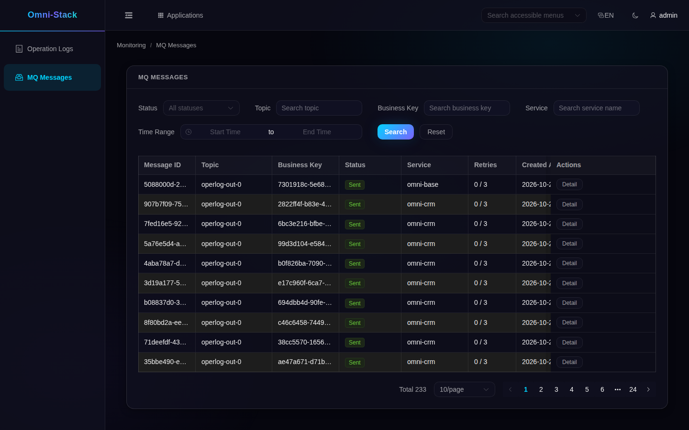

# 5. Management: understand the state before resending

Enter Monitoring from My Workspace's application catalog or Applications drawer, then select MQ Messages in the new tab. If the menu is missing, check permissions. List, detail, resend, and skip operations obey the current tenant and functional permissions. A relay scanning all tenants does not let users read across tenants.

## Which services does this page manage?



This real page reads existing sending records in the same local environment using a registered test identity. It does not prove a resend or new consumption during capture. The Base aggregation scope is explicit in source:

<!-- omni:source path="omni-backend/omni-base/src/main/java/com/omni/base/service/impl/MqMessageAggregationServiceImpl.java" -->
```java
    private static final String BASE_SERVICE = "omni-base";
    private static final String CRM_SERVICE = "omni-crm";
```

The page aggregates Base and CRM only. Other services having Outbox tables does not automatically include their records here. Absence from this page is not proof that their messages were lost.

## Read the six states

| State | Meaning | Next check |
|---|---|---|
| PENDING | Waiting to be claimed | Delivery switches and scheduling |
| PROCESSING | Claimed by a relay | Actual outcome; lease and logs if necessary |
| SENT | Sending side succeeded | Consumer business result when required |
| FAILED | Send failed, possibly awaiting automatic retry | Sanitized error and backoff time |
| DEAD_LETTER | Automatic retries stopped | Fix the cause, then decide whether to resend or skip |
| SKIPPED | Administrator explicitly stopped delivery | Terminal; cannot resend or skip again |

## Check whether delivery is enabled

The page's runtime endpoint uses this actual logic:

<!-- omni:source path="omni-backend/omni-base/src/main/java/com/omni/base/controller/MqMessageController.java" -->
```java
    @GetMapping("/runtime")
    @PreAuthorize("hasAuthority('base:mqmessage:list')")
    public R<MqRelayRuntimeStatus> runtime() {
        boolean relayEnabled = environment.getProperty(
                "omni.mqlog.relay.enabled", Boolean.class, true);
        boolean executorEnabled = environment.getProperty(
                "xxl.job.executor.enabled", Boolean.class, true);
        boolean deliveryEnabled = relayEnabled && executorEnabled;
        return R.ok(new MqRelayRuntimeStatus(
                true,
                deliveryEnabled,
                deliveryEnabled ? "FULL" : "OUTBOX_ONLY"));
    }
```

deliveryEnabled depends on both relay and executor switches. OUTBOX_ONLY still permits enqueuing. Do not report undelivered records as lost records.

## Resend and skip are business operations

Only FAILED/DEAD_LETTER can be resent, with resend permission and asynchronous delivery enabled. Resend resets the record to PENDING and clears counters/backoff; it is not immediate delivery. Only DEAD_LETTER can be skipped, with skip permission. Skipping accepts non-delivery, so assess the business impact first.

Check msgId, source, error, and current state before one justified action. If another executor changed the state, CAS rejects overwriting it and the page needs refreshing. Do not keep clicking for a green state or edit the database to manufacture SENT. These tutorial captures performed no writes.

Next, learn [integration and verification](mq-extension.en.md).
