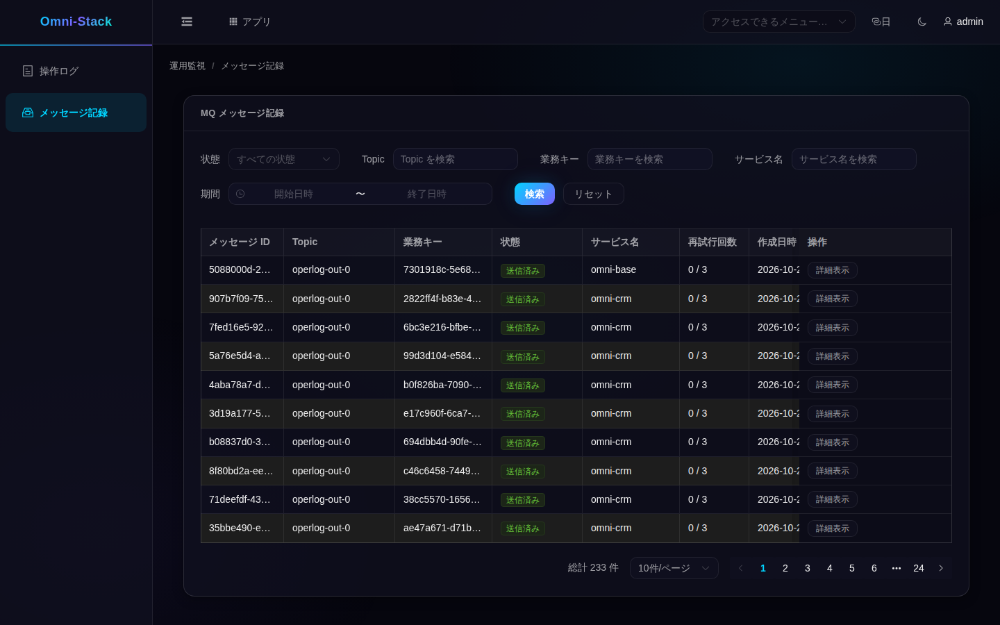

# 5. 管理画面：状態を理解してから再送する

マイワークスペースのアプリ一覧または「アプリ」から「運用監視」を新しいタブで開き、「メッセージ記録」を選びます。メニューがなければ権限を確認します。一覧、詳細、再送、無視は現在のテナントと機能権限に従います。中継が全テナントを検索しても、利用者が他テナントを読めるわけではありません。

## 現在の管理範囲



同じローカル環境で登録済みテスト用アカウントにより既存の送信記録を読んだ画面です。撮影時の再送や新規消費の証拠ではありません。Baseの集約対象はソースで次のように定義しています。

<!-- omni:source path="omni-backend/omni-base/src/main/java/com/omni/base/service/impl/MqMessageAggregationServiceImpl.java" -->
```java
    private static final String BASE_SERVICE = "omni-base";
    private static final String CRM_SERVICE = "omni-crm";
```

対象はBaseとCRMだけです。他サービスがOutboxを持っていても自動的には表示されず、ここにないだけでメッセージ喪失とは判断できません。

## 六つの状態

| 状態 | 意味 | 次の確認 |
|---|---|---|
| PENDING | 取得待ち | 配送スイッチとスケジュール |
| PROCESSING | 中継が取得済み | 実際の結果。必要ならリースとログ |
| SENT | 送信側が成功 | 必要に応じ消費側の業務結果 |
| FAILED | 送信失敗、自動再試行待ちの場合もある | サニタイズ済みエラーと待機時刻 |
| DEAD_LETTER | 自動再試行が停止 | 原因修正後に再送か無視を判断 |
| SKIPPED | 管理者が配送中止を確定 | 終端。再送や再度の無視は不可 |

## 配送が有効か先に確認する

画面の稼働状態APIの実際のロジックです。

<!-- omni:source path="omni-backend/omni-base/src/main/java/com/omni/base/controller/MqMessageController.java" -->
```java
    @GetMapping("/runtime")
    @PreAuthorize("hasAuthority('base:mqmessage:list')")
    public R<MqRelayRuntimeStatus> runtime() {
        boolean relayEnabled = environment.getProperty(
                "omni.mqlog.relay.enabled", Boolean.class, true);
        boolean executorEnabled = environment.getProperty(
                "xxl.job.executor.enabled", Boolean.class, true);
        boolean deliveryEnabled = relayEnabled && executorEnabled;
        return R.ok(new MqRelayRuntimeStatus(
                true,
                deliveryEnabled,
                deliveryEnabled ? "FULL" : "OUTBOX_ONLY"));
    }
```

deliveryEnabledは中継と実行器の両方のスイッチで決まります。OUTBOX_ONLYでも記録は保存できるため、未配送を記録喪失と誤認しないでください。

## 再送と無視は業務操作

再送できるのはFAILED/DEAD_LETTERだけで、resend権限と非同期配送の有効化も必要です。PENDINGへ戻し回数と待機を消しますが、即時到着ではありません。無視はDEAD_LETTERだけでskip権限が必要です。届かないことを受け入れる操作なので業務への影響を先に確認します。

msgId、出所、エラー、現在の状態を調べて、一度だけ根拠ある操作をします。他の実行が状態を変えていればCASが上書きを拒否するため更新します。緑になるまで連打したり、DBをSENTに書き換えたりしません。このチュートリアルの撮影は読み取りのみです。

次は[業務への接続と検証](mq-extension.jp.md)です。
