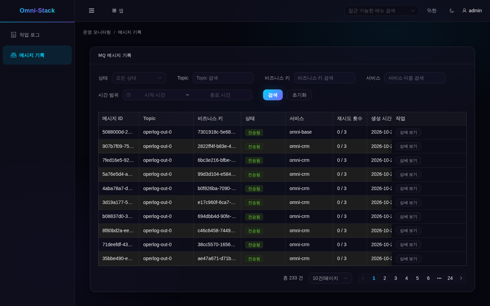

# 5. 관리 화면: 상태를 이해한 뒤 재전송하기

내 작업대의 앱 목록이나 “앱” 팝업에서 “운영 모니터링”을 새 탭으로 열고 “메시지 기록”을 선택합니다. 메뉴가 없으면 권한을 확인합니다. 목록, 상세, 재전송, 무시는 현재 테넌트와 기능 권한을 따릅니다. 중계가 모든 테넌트를 조회해도 사용자가 다른 테넌트를 읽을 수 있다는 뜻은 아닙니다.

## 현재 관리 범위



같은 로컬 환경에서 등록된 테스트 계정으로 기존 전송 기록을 읽은 실제 화면입니다. 촬영 당시 재전송이나 새 소비를 증명하지 않습니다. Base의 집계 범위는 소스에 명시되어 있습니다.

<!-- omni:source path="omni-backend/omni-base/src/main/java/com/omni/base/service/impl/MqMessageAggregationServiceImpl.java" -->
```java
    private static final String BASE_SERVICE = "omni-base";
    private static final String CRM_SERVICE = "omni-crm";
```

이 화면은 Base와 CRM만 집계합니다. 다른 서비스에 Outbox가 있어도 자동으로 목록에 포함되지 않으며, 여기 없다는 이유만으로 메시지 유실을 단정할 수 없습니다.

## 여섯 상태 읽기

| 상태 | 의미 | 다음 확인 |
|---|---|---|
| PENDING | 선점 대기 | 전달 스위치와 스케줄 |
| PROCESSING | 중계가 선점함 | 실제 결과, 필요하면 임대와 로그 |
| SENT | 전송 측 성공 | 필요시 소비자 업무 결과 |
| FAILED | 전송 실패, 자동 재시도 대기일 수 있음 | 정제된 오류와 백오프 시각 |
| DEAD_LETTER | 자동 재시도 중단 | 원인 수정 후 재전송 또는 무시 판단 |
| SKIPPED | 관리자가 전달 중단 확정 | 최종 상태, 재전송·재무시 불가 |

## 전달이 켜져 있는지 먼저 확인하기

화면의 런타임 상태 API가 사용하는 실제 로직입니다.

<!-- omni:source path="omni-backend/omni-base/src/main/java/com/omni/base/controller/MqMessageController.java" -->
```java
    @GetMapping("/runtime")
    @PreAuthorize("hasAuthority('base:mqmessage:list')")
    public R<MqRelayRuntimeStatus> runtime() {
        boolean relayEnabled = environment.getProperty(
                "omni.mqlog.relay.enabled", Boolean.class, true);
        boolean executorEnabled = environment.getProperty(
                "xxl.job.executor.enabled", Boolean.class, true);
        boolean deliveryEnabled = relayEnabled && executorEnabled;
        return R.ok(new MqRelayRuntimeStatus(
                true,
                deliveryEnabled,
                deliveryEnabled ? "FULL" : "OUTBOX_ONLY"));
    }
```

deliveryEnabled는 중계와 실행기 두 스위치에 따라 결정됩니다. OUTBOX_ONLY에서도 대기 기록을 쓸 수 있으므로 미전달을 기록 유실로 오해하지 마세요.

## 재전송과 무시는 업무 작업이다

FAILED/DEAD_LETTER만 재전송할 수 있고 resend 권한과 비동기 전달 활성화가 필요합니다. PENDING으로 되돌리고 횟수·백오프를 지우지만 즉시 도착은 아닙니다. 무시는 DEAD_LETTER만 가능하며 skip 권한이 필요합니다. 전달하지 않기로 받아들이는 작업이므로 업무 영향을 먼저 확인합니다.

msgId, 출처, 오류, 현재 상태를 확인하고 근거 있는 작업을 한 번 수행합니다. 다른 실행기가 상태를 바꿨다면 CAS가 덮어쓰기를 거부하므로 새로 고칩니다. 녹색이 될 때까지 연속 클릭하거나 DB를 SENT로 바꾸지 마세요. 이번 튜토리얼 촬영에서는 쓰기를 하지 않았습니다.

다음은 [새 업무 연결과 검증](mq-extension.kr.md)입니다.
