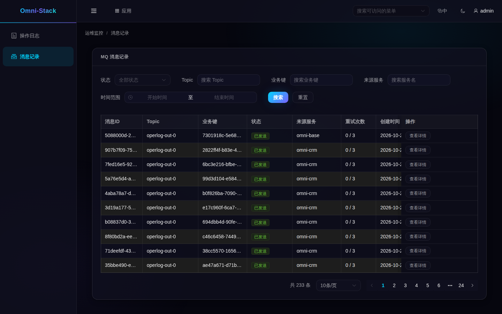

# 5. 管理页面：看懂状态，再决定是否重发

从“我的工作台”的应用目录或“应用”弹窗进入“运维监控”，在新标签中选择“消息记录”。看不到菜单先核对权限。列表、详情、重发、忽略都受当前租户与功能权限约束，后台中继跨租户扫描不等于用户能跨租户读取消息。

## 当前页面管理哪些服务



本图是同一套本地应用使用登记测试身份读取的真实页面，展示已有发送记录，不证明拍摄时执行了重发或新的消费。当前Base聚合的服务范围在源码中明确为：

<!-- omni:source path="omni-backend/omni-base/src/main/java/com/omni/base/service/impl/MqMessageAggregationServiceImpl.java" -->
```java
    private static final String BASE_SERVICE = "omni-base";
    private static final String CRM_SERVICE = "omni-crm";
```

因此此页面只聚合Base和CRM。其他服务存在Outbox，不代表已自动进入这个统一列表；查不到它们不能直接判定消息丢失。

## 六种状态怎样读

| 状态 | 含义 | 下一步 |
|---|---|---|
| PENDING | 等待领取 | 看投递开关和调度 |
| PROCESSING | 中继已领取 | 等实际结果，必要时查租约与日志 |
| SENT | 发送侧成功 | 需要时另查消费业务结果 |
| FAILED | 发送失败、可能等待自动重试 | 查脱敏错误和退避时间 |
| DEAD_LETTER | 自动重试停止 | 修复原因后决定重发或忽略 |
| SKIPPED | 管理员明确不再投递 | 终态，不能再次重发或忽略 |

## 先确认投递是否开启

页面使用的运行状态接口来自以下实际逻辑：

<!-- omni:source path="omni-backend/omni-base/src/main/java/com/omni/base/controller/MqMessageController.java" -->
```java
    @GetMapping("/runtime")
    @PreAuthorize("hasAuthority('base:mqmessage:list')")
    public R<MqRelayRuntimeStatus> runtime() {
        boolean relayEnabled = environment.getProperty(
                "omni.mqlog.relay.enabled", Boolean.class, true);
        boolean executorEnabled = environment.getProperty(
                "xxl.job.executor.enabled", Boolean.class, true);
        boolean deliveryEnabled = relayEnabled && executorEnabled;
        return R.ok(new MqRelayRuntimeStatus(
                true,
                deliveryEnabled,
                deliveryEnabled ? "FULL" : "OUTBOX_ONLY"));
    }
```

deliveryEnabled取决于中继和执行器两个开关。OUTBOX_ONLY时仍能写待发记录，不能把没有发送误报成记录丢失。

## 重发和忽略是业务操作

只有FAILED/DEAD_LETTER允许重发，并且要有resend权限、异步投递已启用。重发把状态重置为PENDING、清除计数和退避，不代表立即送达。只有DEAD_LETTER允许忽略，并要有skip权限；这表示接受不再投递，应先确认业务影响。

先查msgId、来源、错误和当前状态，再做一次有依据的动作；状态已被其他执行器改变时，CAS拒绝覆盖，需刷新。不要连续点击直到“变绿”，也不要直接改数据库制造SENT。本次教程实拍只读，没有执行这些写操作。

下一篇说明[新业务接入与验证](mq-extension.md)。
