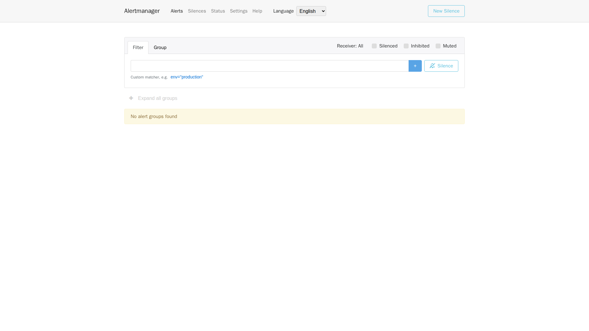

# 5. Alerts and objectives: a red indicator does not prove notification delivery

Detecting a problem is the first stage. Alert rules determine when it warrants attention. Alertmanager groups, repeats and routes alerts. Someone must still handle the business impact; a visible alert does not establish that an on-call recipient received it.

## Read one actual rule before learning query syntax

The service-unavailable rule in the repository is:

<!-- omni:source path="observability/prometheus/alerts.yml" -->
```yaml
      - alert: OmniServiceDown
        expr: up{job="omni-platform"} == 0
        for: 2m
        labels: {severity: critical}
        annotations:
          summary: "Omni 服务不可用（示例阈值，发布前校准）"
```

up comes from Prometheus scrape results. After the zero condition persists for two minutes, the rule fires. severity is the configured level. The duration and label are local examples, not promises for every business service. This checks a collection target and cannot independently establish end-to-end business availability.

Rules also cover HTTP 5xx ratios, P95/P99, connection pools, Outbox backlog/dead letters, Workflow and scheduling failures, disk, container restarts, memory and deadlocks. Understand their windows and denominators rather than only changing chart colors.

## The default receiver sends no real notifications

The standard template is:

<!-- omni:source path="observability/alertmanager/alertmanager.yml" -->
```yaml
route:
  receiver: local-null
  group_by: [alertname, service_name]
  group_wait: 30s
  group_interval: 5m
  repeat_interval: 4h

receivers:
  - name: local-null
```

local-null has no external notification channel. A visible alert therefore does not prove email, SMS or webhook delivery. group_wait delays initial grouping, group_interval controls later group-update intervals, and repeat_interval controls repeated reminders. None is a receipt from the external recipient.

The project's four-language Alertmanager UI proxies one backend. Its standard host entry is 127.0.0.1:9093, with zh-CN, en-US, ja-JP and ko-KR language paths. Changing language does not start another backend, and protocol labels and receiver names retain their original values.

## Read the actual alert page



Alerts opens the current list, Silences shows existing temporary notification suppression, Status describes the backend, and Settings controls interface options. Filters narrow labels, grouping collects related alerts, and the receiver filter selects a notification destination.

No alert groups were present when this image was captured; no artificial alert was injected. An empty list means no matches under the current filters. It does not establish correct rules or delivered email. Also check filters, whether silenced or inhibited items are included, and rule states in Prometheus.

New Silence changes notification behavior for a period; it does not repair the fault. Understand matching labels and expiry before using it to avoid suppressing unrelated problems. This capture created no silence, changed no receiver and sent no external message. The default local-null boundary still applies.

## Distinguish SLI, SLO and error budget

An SLI defines measurement, such as the proportion of valid requests without 5xx responses. An SLO sets the target for a user journey over a period. An error budget is the unsuccessful portion the target permits.

For a hypothetical time-based availability measure, 99.9% over thirty days permits forty-three minutes and twelve seconds of unavailability. A request-based measure instead budgets failed requests; its budget cannot automatically be converted to those minutes. Define the measurement first.

The repository's 99.9%, latency targets and alert multipliers are template values, not established service commitments. A passing local check under low traffic is not evidence of production SLO achievement.

## Make thresholds useful

Define the user journey and valid request population first. Observe representative traffic, daily/weekly patterns and downstream limits. Calibrate error, latency and backlog thresholds per service, and record owners and review dates.

Test unavailability, 5xx, dead letters and failed notification receivers. Configuration syntax, rule firing, notification receipt and business recovery require separate evidence. The default receiver has no real notification channel; fabricated screenshots cannot fill that gap.

Finish with [integration and troubleshooting](observability-practice.en.md).
