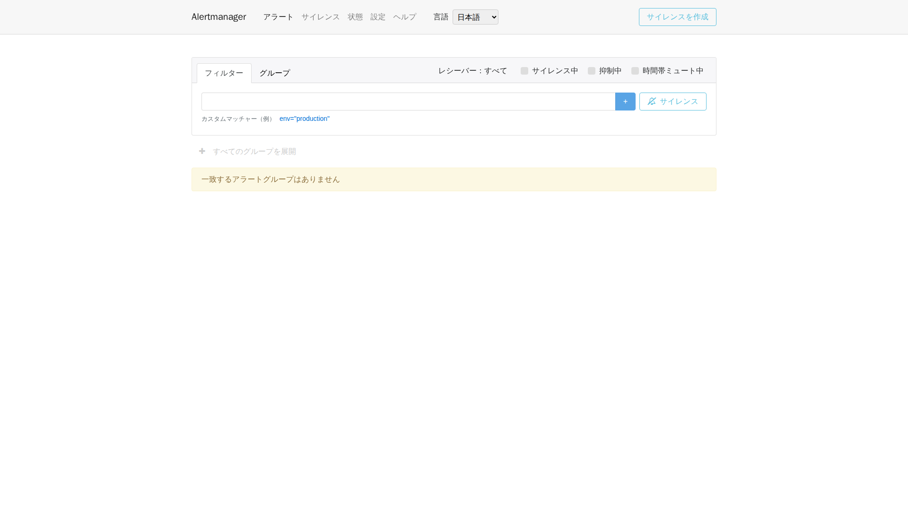

# 5. アラートと目標：赤い表示と通知到達を分ける

異常検出は最初の段階です。規則が注意を促す時点を決め、Alertmanager がまとめ方、繰り返し、宛先を決めます。業務影響を判断して対応する人も必要です。画面にアラートがあるだけでは、当番への到達は証明できません。

## 問い合わせ言語より先に、一つの実際の規則を読む

サービスにアクセスできない状態を検出する、リポジトリの規則です。

<!-- omni:source path="observability/prometheus/alerts.yml" -->
```yaml
      - alert: OmniServiceDown
        expr: up{job="omni-platform"} == 0
        for: 2m
        labels: {severity: critical}
        annotations:
          summary: "Omni 服务不可用（示例阈值，发布前校准）"
```

up は Prometheus の取得結果です。ゼロの条件が二分間続くと発火し、severity は設定した重大度です。時間とラベルはローカル例で、全業務への約束ではありません。収集対象の検査であり、業務全体の可用性は単独では判断できません。

HTTP 5xx 比率、P95/P99、接続プール、Outbox 滞留・デッドレター、Workflow・ジョブ失敗、ディスク、再起動、メモリ、デッドロックの規則もあります。色だけを変えず、時間窓と分母を理解してください。

## 既定の受信先は実通知を送らない

標準テンプレートです。

<!-- omni:source path="observability/alertmanager/alertmanager.yml" -->
```yaml
route:
  receiver: local-null
  group_by: [alertname, service_name]
  group_wait: 30s
  group_interval: 5m
  repeat_interval: 4h

receivers:
  - name: local-null
```

local-null に外部通知経路はありません。アラートが見えてもメール、SMS、webhook を送った証明にはなりません。group_wait は初回のまとめ待ち、group_interval は後続グループ更新の間隔、repeat_interval は再通知の間隔です。外部受信先からの受領確認とは違います。

四言語の Alertmanager UI は一つのバックエンドへ接続します。標準ホスト入口は 127.0.0.1:9093、言語経路は zh-CN、en-US、ja-JP、ko-KR です。言語変更で別バックエンドは起動せず、プロトコルラベルや受信先名も翻訳しません。

## 実画面でアラートを読む



上部のアラートは現在一覧、サイレンスは既存の一時的な通知抑制、状態はバックエンド、設定は画面の選択肢です。条件でラベルを絞り、グループ化で関連項目をまとめ、受信先の条件で見る通知先を選びます。

図の撮影時に該当グループはなく、架空のアラートは追加していません。空一覧は現在の条件に一致する項目がないという意味で、規則の正しさやメール到達を証明しません。検索条件、抑制中の項目を表示する選択肢、Prometheus の規則状態も確認します。

新しいサイレンスを作ると一定期間の通知が変わりますが、障害自体は直りません。対象ラベルと期限を理解してから使い、ほかの問題まで抑制しないようにします。今回の撮影ではサイレンスや受信先を変更せず、外部メッセージも送っていません。既定 local-null の外部送信なしという境界はそのままです。

## SLI、SLO、エラーバジェットを例で分ける

SLI は測定方法で、たとえば有効要求のうち 5xx でない割合です。SLO は特定の利用者体験について期間内に達成したい目標です。エラーバジェットは、その目標で許容される不成功部分です。

時間で可用性を測る仮の例なら、三十日で 99.9% は四十三分十二秒の利用不能時間に相当します。要求数で測るなら失敗要求数で予算を計算し、この分数をそのまま使えません。先に指標の定義を決めます。

リポジトリの 99.9%、遅延目標、警告倍率はテンプレート値であり、確定したサービス保証ではありません。低負荷のローカル確認が一度成功しても、本番 SLO 達成の証拠にはなりません。

## 役に立つ閾値へ調整する

具体的な利用経路と有効要求を定義し、代表的な負荷、日・週の変動、呼び出し先の制約を観察します。そのデータに基づき、サービス別の失敗率、遅延、滞留を調整し、担当者と見直し日を定めます。

サービス停止、5xx、デッドレター、通知先失敗も試験します。構文の検証、規則発火、通知到達、業務復旧はそれぞれ証拠を残します。既定で実通知先がない境界を、架空の画像で埋めてはいけません。

最後に[導入と障害調査](observability-practice.jp.md)を読みます。
