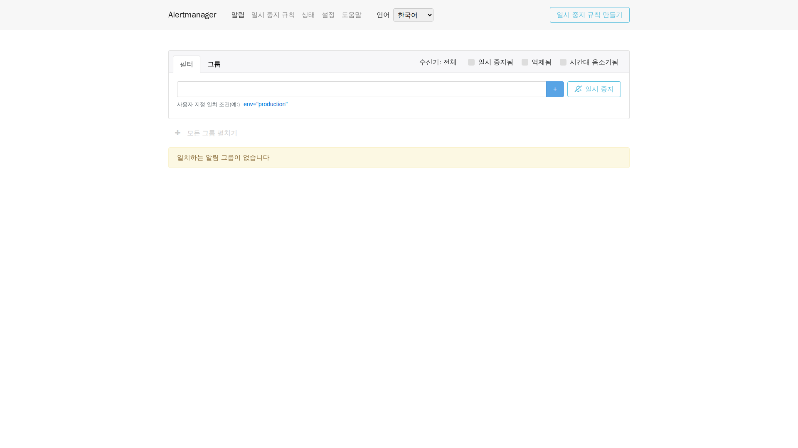

# 5. 경보와 서비스 목표: 빨간 표시와 통지 전달은 다르다

이상 감지는 첫 단계입니다. 경보 규칙이 주의를 줄 때를 정하고 Alertmanager가 그룹·반복·수신처를 정합니다. 업무 영향에 대응할 사람도 필요합니다. 화면에 경보가 있다고 당직자가 통지를 받았다는 뜻은 아닙니다.

## 조회 언어보다 먼저 실제 규칙 하나를 읽는다

저장소의 서비스 불가 규칙입니다.

<!-- omni:source path="observability/prometheus/alerts.yml" -->
```yaml
      - alert: OmniServiceDown
        expr: up{job="omni-platform"} == 0
        for: 2m
        labels: {severity: critical}
        annotations:
          summary: "Omni 服务不可用（示例阈值，发布前校准）"
```

up은 Prometheus 수집 결과입니다. 0인 조건이 2분 동안 지속되면 경보가 발생하고 severity는 설정한 심각도입니다. 시간·라벨은 로컬 예시이지 모든 업무의 약속은 아닙니다. 수집 대상을 검사하므로 업무 전체의 가용성을 단독으로 판단할 수는 없습니다.

HTTP 5xx 비율·P95/P99·연결 풀·Outbox 적체와 데드레터·Workflow와 작업 실패·디스크·컨테이너 재시작·메모리·교착 규칙도 있습니다. 색만 바꾸지 말고 시간 창과 분모를 이해해야 합니다.

## 기본 수신자는 실제 통지를 보내지 않는다

표준 템플릿입니다.

<!-- omni:source path="observability/alertmanager/alertmanager.yml" -->
```yaml
route:
  receiver: local-null
  group_by: [alertname, service_name]
  group_wait: 30s
  group_interval: 5m
  repeat_interval: 4h

receivers:
  - name: local-null
```

local-null에는 외부 통지 채널이 없습니다. 경보가 보여도 이메일·SMS·webhook 전달을 증명하지 않습니다. group_wait는 처음 그룹을 모으는 대기, group_interval은 후속 그룹 갱신 간격, repeat_interval은 반복 통지 간격입니다. 외부 수신자의 수신 확인과는 다릅니다.

4개 언어 Alertmanager UI는 같은 백엔드를 프록시합니다. 표준 호스트 입구는 127.0.0.1:9093이며 언어 경로는 zh-CN·en-US·ja-JP·ko-KR입니다. 언어 변경이 다른 백엔드를 만들지 않고 프로토콜 라벨·수신자 이름도 번역하지 않습니다.

## 실제 화면에서 경보 읽기



위의 ‘알림’은 현재 목록, ‘일시 중지 규칙’은 기존의 일시적 통지 억제, ‘상태’는 백엔드, ‘설정’은 화면 옵션을 보여 줍니다. 필터는 라벨 범위를 줄이고 그룹은 관련 경보를 모으며 수신자 필터는 볼 통지 대상을 고릅니다.

촬영 당시 일치하는 경보 그룹이 없었으며 가짜 경보를 넣지 않았습니다. 빈 목록은 현재 조건에 맞는 항목이 없다는 뜻으로 규칙의 정확성이나 이메일 전달을 증명하지 않습니다. 필터·무음 또는 억제 중인 항목의 표시 선택·Prometheus 규칙 상태도 확인하세요.

새 무음을 만들면 일정 기간 통지 동작이 바뀌지만 장애가 해결되지는 않습니다. 먼저 대상 라벨과 만료 시각을 이해해 다른 문제까지 가리지 않도록 합니다. 이번 촬영은 무음·수신처를 바꾸거나 외부 메시지를 보내지 않았고 기본 local-null의 외부 통지 없음이라는 범위도 그대로입니다.

## SLI·SLO·오류 예산을 구분한다

SLI는 측정 방식으로, 예를 들면 유효 요청 중 5xx가 아닌 비율입니다. SLO는 특정 사용자 여정이 일정 기간 달성할 목표입니다. 오류 예산은 그 목표가 허용하는 실패 부분입니다.

시간 기준 가용성의 가상 예시에서 30일 99.9%는 43분 12초의 불가 시간을 허용합니다. 요청 수 기준이면 실패 요청 수로 예산을 계산해야 하며 이 분 단위를 그대로 적용하지 않습니다. 측정 기준부터 정해야 합니다.

저장소의 99.9%·지연 목표·경보 배수는 템플릿 값이지 확정된 서비스 약속이 아닙니다. 저부하 로컬 점검 한 번이 운영 SLO 달성의 증거는 아닙니다.

## 유용한 임계값으로 조정하기

구체적인 사용자 여정과 유효 요청 집합을 정하고 대표 트래픽·일간과 주간 변화·하위 서비스 한계를 관찰합니다. 서비스별 오류율·지연·적체를 조정하고 담당자·재검토 날짜를 정합니다.

서비스 중단·5xx·데드레터·통지 수신 실패도 시험해야 합니다. 설정 문법·경보 발생·통지 전달·업무 복구는 각각 증거를 남깁니다. 기본 수신처가 없는 범위를 가짜 화면으로 메우면 안 됩니다.

마지막은 [적용과 문제 해결](observability-practice.kr.md)입니다.
