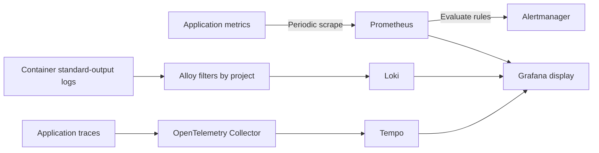

# 2. Architecture and tool choices: who collects, stores and displays data?

Applications produce clues, collectors move them, storage backends retain and query them, and dashboards present results. One product can bundle these roles, or separate components can cooperate. Omni-Stack currently uses cooperating components.

These tradeoffs are inferred from existing configuration, not an invented historical evaluation. This describes the current combination, not a universal recommendation or a requirement to start every component before reading.

## Separate the three paths



| Tool | Current responsibility | Boundary |
|---|---|---|
| Micrometer and Actuator | Application metrics, tracing integration and management endpoints | Not a long-term query database |
| Prometheus | Scrape metrics, retain time series and evaluate rules | Not storage for every request's full logs |
| OpenTelemetry Collector | Receive, batch and forward traces | Not this project's trace query storage |
| Tempo | Store and query traces | Not a business database replacement |
| Alloy and Loki | Collect container logs, then store and query them | No automatic guarantee of safe log contents |
| Grafana | Display charts and queries using configured data sources | Installation does not prove data collection |
| Alertmanager | Group, route and handle notifications | The default template does not configure real recipients |

Node Exporter and cAdvisor provide host and container clues respectively. A one-shot migrator cannot remain available for scraping after it exits, so Pushgateway retains its result metrics. This does not mean every business service should switch to pushing metrics.

## What disabled by default means

The observability profile controls optional services. Trace export and sampling also need application-side settings. This is a continuous excerpt from the application Compose configuration:

<!-- omni:source path="compose.apps.yaml" -->
```yaml
      OTLP_EXPORT_ENABLED: ${OTLP_EXPORT_ENABLED:-false}
      MANAGEMENT_OTLP_METRICS_EXPORT_ENABLED: "false"
      OTLP_TRACES_ENDPOINT: ${OTLP_TRACES_ENDPOINT:-http://otel-collector:4318/v1/traces}
      TRACING_SAMPLING_PROBABILITY: ${TRACING_SAMPLING_PROBABILITY:-0.0}
      LOGGING_STRUCTURED_FORMAT_CONSOLE: ${STRUCTURED_LOGGING_FORMAT:-ecs}
```

Export defaults to false and sampling to 0.0. Starting Collector alone therefore does not establish application traces. OTLP metrics export is explicitly off because application metrics primarily use Prometheus scraping. It does not mean every application metric is disabled.

ECS configures structured standard-output logging. Applications can still log without Loki; management endpoints do not vanish merely because Prometheus is stopped. **Producing data and collecting it into optional backends are separate stages.**

## Why management and business ports differ

In standard Compose, applications use container business port 8080 and separate management ports 19900–19907 by service. The internal network uses management ports for collection; they are not published to the host or routed through Gateway. Host access still uses the prescribed business ports.

A 404 from /actuator/prometheus on a business port does not establish missing metrics. Check the service's management port, network and exposed endpoints instead of adding arbitrary host ports.

## More tools also have costs

Separate signals can be queried and correlated, at the cost of additional processes, disk use, sampling and retention decisions, and collection configuration.

Compose pins the tool image versions. Local defaults retain Prometheus and Loki data for seven days and Tempo data for twenty-four hours. These are template settings, not production capacity guarantees. Shared and production environments additionally need authentication, network isolation, capacity planning, backups and secret management.

Continue with [metrics](observability-metrics.en.md).
