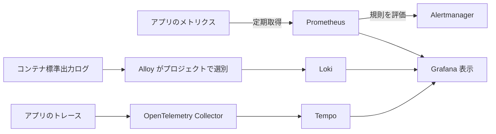

# 2. 構成と道具の選択：収集・保存・表示を分担する

アプリケーションが情報を作り、収集器が運び、保存先が保持して検索し、画面が表示します。一製品でまとめる構成も、複数の道具で分担する構成もあります。Omni-Stack は現在、後者です。

以下は現在の設定から読み取る取捨選択で、過去の製品比較を創作した説明ではありません。どの規模にも最適という主張でも、読む前に全構成を起動する要求でもありません。

## 三つの経路を分ける



| 道具 | 現在の担当 | 境界 |
|---|---|---|
| Micrometer と Actuator | アプリ内計測、追跡との連携、管理エンドポイント | 長期検索用データベースではない |
| Prometheus | メトリクス取得、時系列保存、規則評価 | 全要求の完全なログを保存するものではない |
| OpenTelemetry Collector | トレース受信、まとめ処理、転送 | この構成のトレース検索用保存先ではない |
| Tempo | トレース保存と検索 | 業務データベースを置き換えない |
| Alloy と Loki | ログ収集と、その保存・検索 | ログ内容の自動的な安全性は保証しない |
| Grafana | データソースを使うグラフと検索入口 | インストール成功だけでは収集済みと分からない |
| Alertmanager | アラートのグループ化、経路、通知処理 | 既定設定は実際の通知先を用意しない |

Node Exporter はホスト、cAdvisor はコンテナの情報を提供します。一回で終了するマイグレーターは終了後に定期取得できないため、Pushgateway に結果指標を残します。通常の業務サービスも全部プッシュ方式にすべき、という意味ではありません。

## 「既定で無効」の範囲

任意の観測サービスは observability profile で選びます。トレースの転送とサンプリングにはアプリ側の設定も必要です。Compose の連続した原文です。

<!-- omni:source path="compose.apps.yaml" -->
```yaml
      OTLP_EXPORT_ENABLED: ${OTLP_EXPORT_ENABLED:-false}
      MANAGEMENT_OTLP_METRICS_EXPORT_ENABLED: "false"
      OTLP_TRACES_ENDPOINT: ${OTLP_TRACES_ENDPOINT:-http://otel-collector:4318/v1/traces}
      TRACING_SAMPLING_PROBABILITY: ${TRACING_SAMPLING_PROBABILITY:-0.0}
      LOGGING_STRUCTURED_FORMAT_CONSOLE: ${STRUCTURED_LOGGING_FORMAT:-ecs}
```

転送の既定値は false、サンプリングは 0.0 なので、Collector だけを起動してもアプリのトレースが得られるとは限りません。メトリクスは主に Prometheus が取得するため、OTLP metrics 転送は明示的に無効です。すべてのアプリ指標が禁止されているわけではありません。

ECS は標準出力ログの構造化形式です。Loki がなくてもログは出せますし、Prometheus が止まっても管理エンドポイントが消えるわけではありません。**情報を作る段階と、任意の保存先へ収集して表示する段階は別です。**

## 業務ポートと管理ポートが違う理由

標準 Compose のアプリはコンテナ内の業務ポート 8080 と、サービス別の管理ポート 19900–19907 を使います。管理ポートは内部ネットワークの収集用で、ホストに公開せず Gateway も通りません。ホストからの業務アクセスは所定の標準ポートです。

業務ポートの /actuator/prometheus が 404 でも、指標がないとは言えません。管理ポート、ネットワーク、公開エンドポイントを確認し、任意のホストポートを追加しないでください。

## 道具が増えると費用も増える

信号ごとに検索し、関連 ID で行き来できますが、プロセス、ディスク、サンプリングと保存期間、収集設定の保守が増えます。

Compose は道具のイメージ版を固定しています。ローカルの既定保存期間は Prometheus と Loki が七日、Tempo が二十四時間です。テンプレートの値であり、本番容量の保証ではありません。共有・本番環境は認証、ネットワーク隔離、容量、バックアップ、秘密情報管理も必要です。

次は[メトリクス](observability-metrics.jp.md)です。
