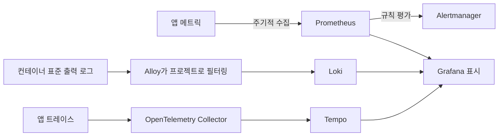

# 2. 구조와 도구 선택: 수집·저장·표시를 나누는 이유

애플리케이션은 단서를 만들고, 수집기는 옮기고, 저장소는 보관·조회하며, 대시보드는 보여 줍니다. 한 제품이 모두 담당하거나 여러 도구가 협력할 수 있습니다. Omni-Stack은 현재 여러 구성 요소가 협력하는 방식입니다.

아래는 현재 설정에서 추론한 선택이며 과거 제품 평가를 지어낸 설명이 아닙니다. 모든 규모에 최적이라는 주장도, 문서를 읽기 전에 전부 시작하라는 요구도 아닙니다.

## 세 경로를 구분한다



| 도구 | 현재 책임 | 경계 |
|---|---|---|
| Micrometer와 Actuator | 앱 내부 계측·추적 연동·관리 엔드포인트 | 장기 조회 데이터베이스가 아님 |
| Prometheus | 메트릭 수집·시계열 저장·규칙 평가 | 모든 요청의 전체 로그 저장소가 아님 |
| OpenTelemetry Collector | 트레이스 수신·배치 처리·전달 | 이 구성의 과거 트레이스 조회 저장소가 아님 |
| Tempo | 트레이스 저장·조회 | 업무 데이터베이스를 대신하지 않음 |
| Alloy와 Loki | 컨테이너 로그 수집 후 저장·조회 | 로그 내용의 자동 안전성을 보장하지 않음 |
| Grafana | 데이터 소스를 통한 그래프와 조회 | 설치 성공이 수집 성공을 뜻하지 않음 |
| Alertmanager | 경보 그룹·경로·통지 처리 | 기본 템플릿이 실제 수신자를 구성하지는 않음 |

Node Exporter와 cAdvisor는 각각 호스트와 컨테이너 단서를 제공합니다. 한 번 실행 후 끝나는 마이그레이터는 종료 뒤 계속 수집할 수 없으므로 Pushgateway에 결과 메트릭을 남깁니다. 모든 업무 서비스도 푸시 방식으로 바꾸라는 뜻은 아닙니다.

## 기본 비활성화의 의미

선택형 관측 서비스는 observability profile로 제어합니다. 트레이스 내보내기와 샘플링에는 앱 설정도 필요합니다. Compose의 연속된 원문입니다.

<!-- omni:source path="compose.apps.yaml" -->
```yaml
      OTLP_EXPORT_ENABLED: ${OTLP_EXPORT_ENABLED:-false}
      MANAGEMENT_OTLP_METRICS_EXPORT_ENABLED: "false"
      OTLP_TRACES_ENDPOINT: ${OTLP_TRACES_ENDPOINT:-http://otel-collector:4318/v1/traces}
      TRACING_SAMPLING_PROBABILITY: ${TRACING_SAMPLING_PROBABILITY:-0.0}
      LOGGING_STRUCTURED_FORMAT_CONSOLE: ${STRUCTURED_LOGGING_FORMAT:-ecs}
```

내보내기는 기본 false, 샘플링은 0.0입니다. Collector만 시작해서 앱 트레이스가 생긴다고 기대하면 안 됩니다. 앱 메트릭은 주로 Prometheus가 가져오므로 OTLP metrics 내보내기는 명시적으로 꺼져 있습니다. 모든 앱 메트릭이 금지되었다는 뜻은 아닙니다.

ECS는 구조화된 표준 출력 로그 형식입니다. Loki 없이도 앱은 로그를 남기며 Prometheus가 없다고 관리 엔드포인트가 사라지지는 않습니다. **정보 생성과 선택형 백엔드의 수집·표시는 별개입니다.**

## 관리 포트와 업무 포트가 다른 이유

표준 Compose에서 컨테이너 내부 업무 포트는 8080이고 관리 포트는 서비스별 19900–19907입니다. 관리 포트는 내부 네트워크 수집용이며 호스트에 공개하거나 Gateway를 거치지 않습니다. 호스트 업무 접근은 정해진 표준 포트를 사용합니다.

업무 포트의 /actuator/prometheus가 404여도 메트릭이 없다고 단정하지 마세요. 관리 포트·네트워크·노출 엔드포인트를 확인하고 임의 호스트 포트를 늘리지 않습니다.

## 도구가 늘면 비용도 늘어난다

신호를 따로 조회하고 연관 ID로 연결할 수 있지만 추가 프로세스·디스크·샘플링·보존 정책과 수집 설정 관리가 필요합니다.

Compose는 도구 이미지 버전을 고정합니다. 로컬 기본 보존 기간은 Prometheus·Loki가 7일, Tempo가 24시간입니다. 템플릿 설정이지 운영 용량 보장이 아닙니다. 공유·운영 환경에는 인증·네트워크 격리·용량·백업·비밀 정보 관리도 필요합니다.

다음은 [메트릭](observability-metrics.kr.md)입니다.
