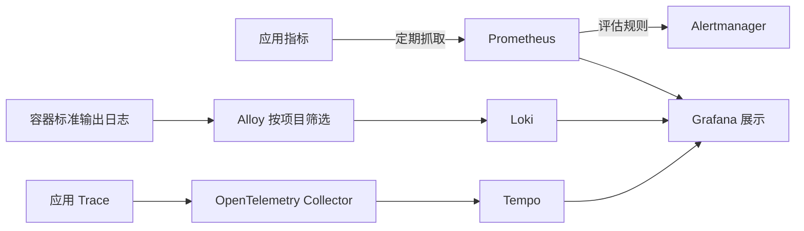

# 2. 架构和工具选择：为什么不是装一个看板就够了

应用负责产生线索，采集器负责搬运，存储负责保存和查询，看板负责把结果展示出来。这几种工作可以由一个产品包办，也可以由不同组件协作。Omni-Stack 当前采用后者。

下面的取舍是从现有配置推导的说明，不是虚构一段历史选型评测。这里介绍当前组合，不意味着它适合所有规模，也不要求读者为了读文档先启动整套组件。

## 先把三条路分开



| 工具 | 当前负责什么 | 不负责什么 |
|---|---|---|
| Micrometer 与 Actuator | 应用内记录指标、追踪适配以及管理端点 | 不是长期查询数据库 |
| Prometheus | 定期抓取指标、保存时序和评估规则 | 不保存所有请求的完整日志 |
| OpenTelemetry Collector | 接收、批处理和转发 Trace | 不是本项目的链路查询存储 |
| Tempo | 保存并查询 Trace | 不替代业务数据库 |
| Alloy 与 Loki | 前者采集容器日志，后者保存和查询 | 不保证日志内容天然没有敏感信息 |
| Grafana | 使用数据源展示图和查询入口 | 安装成功不代表数据已采到 |
| Alertmanager | 告警分组、路由与通知处理 | 默认模板不等于已配置真实通知接收人 |

Node Exporter 和 cAdvisor 分别提供主机、容器层面的线索。一次性迁移器结束后不能像常驻服务那样持续被抓取，所以通过 Pushgateway 留下迁移结果指标。它不是业务服务都应该改用推送的理由。

## “默认关闭”具体关了什么

可选的观测服务由 observability profile 控制，Trace 导出和采样还需要应用侧配置。Compose 的应用配置中有下面一段连续原文：

<!-- omni:source path="compose.apps.yaml" -->
```yaml
      OTLP_EXPORT_ENABLED: ${OTLP_EXPORT_ENABLED:-false}
      MANAGEMENT_OTLP_METRICS_EXPORT_ENABLED: "false"
      OTLP_TRACES_ENDPOINT: ${OTLP_TRACES_ENDPOINT:-http://otel-collector:4318/v1/traces}
      TRACING_SAMPLING_PROBABILITY: ${TRACING_SAMPLING_PROBABILITY:-0.0}
      LOGGING_STRUCTURED_FORMAT_CONSOLE: ${STRUCTURED_LOGGING_FORMAT:-ecs}
```

导出默认 false、采样默认 0.0，因此不能仅凭 Collector 启动就期待应用链路出现。OTLP metrics 导出明确关闭，因为当前应用指标主要由 Prometheus 抓取；不要把它误读成所有应用指标都被禁止。

ECS 结构化标准输出则是日志格式设置。即使没有启用 Loki，应用仍可输出日志；即使没有启动 Prometheus，应用管理端点也不因此等同于消失。**应用产生数据和可选后端采集展示，是两件事。**

## 为什么指标端口和业务端口不同

标准 Compose 中，应用的容器内业务端口是 8080，管理端口按服务分配为 19900–19907。管理端口供内部网络采集，不映射宿主机，也不经过 Gateway。宿主机访问应用仍使用项目规定的业务标准端口。

因此在业务端口访问 /actuator/prometheus 得到 404，不能直接认定指标不存在。应核对对应服务的管理端口、网络和暴露端点，而不是随意增加宿主端口。

## 工具越多，成本也越明确

这套组合可以分别查看不同信号，也能通过关联编号交叉定位；代价是更多进程、磁盘、采样和保留策略，以及采集链的配置维护。

当前 Compose 固定了工具镜像版本；本地默认保留期为 Prometheus 七天、Loki 七天、Tempo 二十四小时。它们是现有本地模板的配置，不是生产容量保证。共享或生产环境还需要访问认证、网络隔离、容量、备份与凭据管理。

下一页从最容易观察的[指标](observability-metrics.md)开始。
