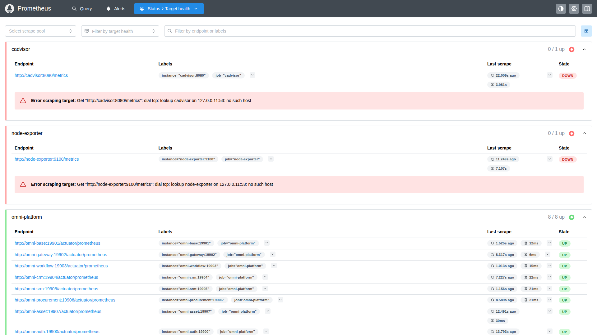
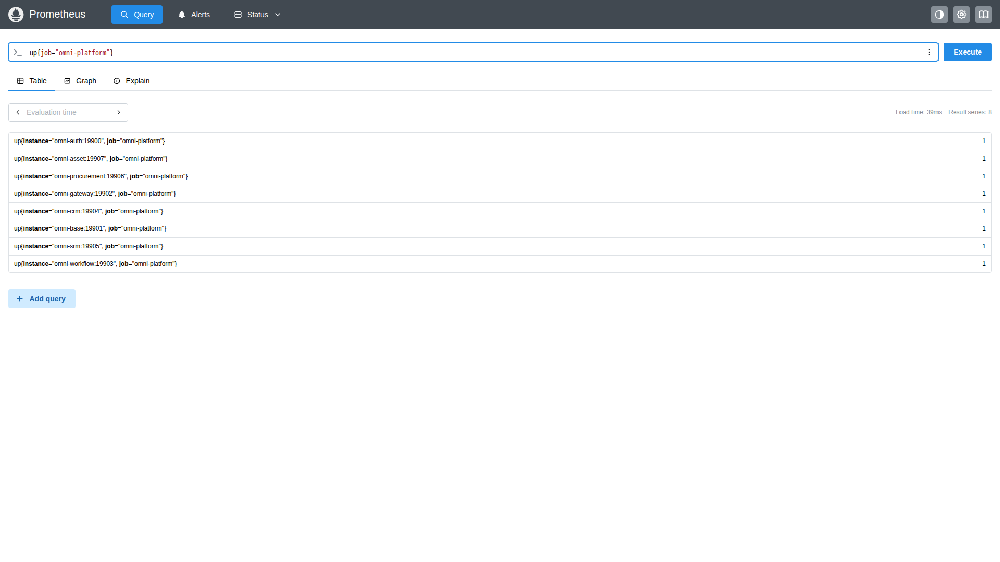
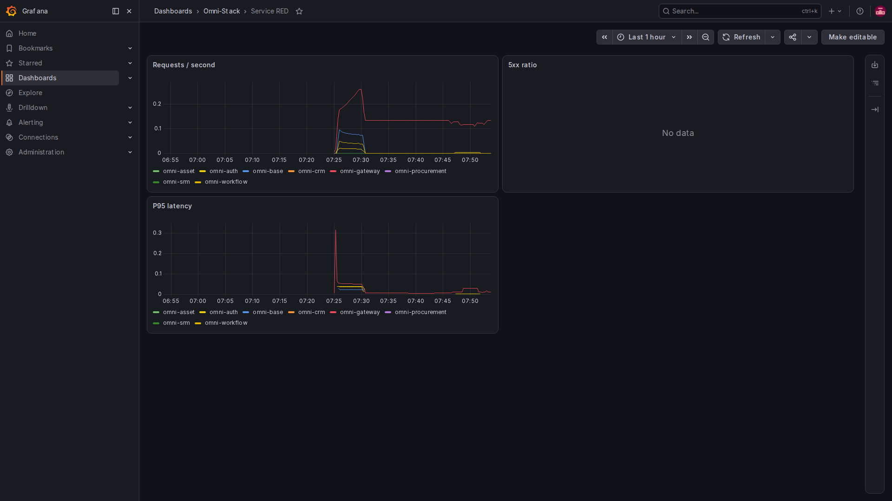
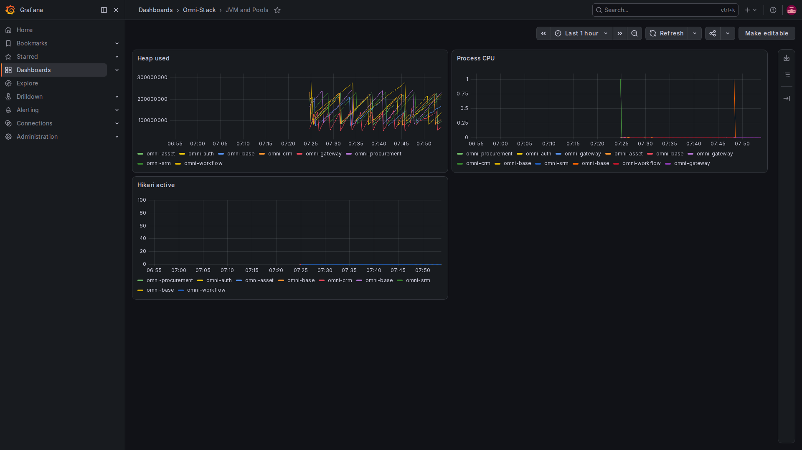
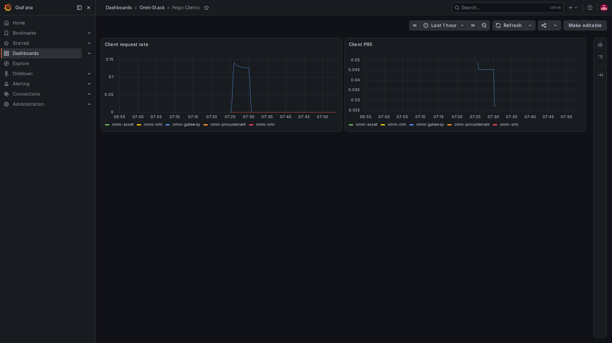
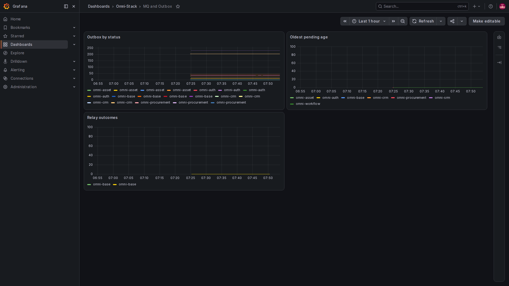

# 3. Metrics and project source: turn recent behavior into queryable numbers

Metrics do not retain every user's complete operation. They record statistical values, such as requests per minute, queued messages or operation duration.

## Three recording patterns

A Counter normally increases, for example with each delivery attempt. A Gauge represents a current value such as pending messages, and can rise or fall. Timers or histograms record duration distributions for averages and slower percentiles.

The project registers these through Micrometer and exports Prometheus metrics. Dot-separated Java names can become underscore-separated names. Counters commonly gain a total suffix; units also affect exported names.

## First excerpt: current backlog from stored state

MqLogMetrics registers fixed message states and oldest-message age in its constructor:

<!-- omni:source path="omni-backend/omni-common-mqlog/src/main/java/com/omni/common/mqlog/metrics/MqLogMetrics.java" -->
```java
        registerStatusGauge("pending", SysMqMessage.STATUS_PENDING);
        registerStatusGauge("sent", SysMqMessage.STATUS_SENT);
        registerStatusGauge("failed", SysMqMessage.STATUS_FAILED);
        registerStatusGauge("dead_letter", SysMqMessage.STATUS_DEAD_LETTER);
        Gauge.builder("omni.mq.outbox.oldest.age", this, MqLogMetrics::oldestPendingAgeSeconds)
                .baseUnit("seconds")
                .description("最旧 PENDING/FAILED Outbox 消息年龄")
                .register(registry);
    }
```

pending, sent, failed and dead_letter are fixed label values. Counts show records in each state. oldest.age measures how long the oldest pending or failed message has waited, in seconds. A small backlog with a very old message can still require investigation.

Exports include omni_mq_outbox_messages and omni_mq_outbox_oldest_age_seconds. They observe message infrastructure overall; they are not APIs determining which messages a user may read.

## Second excerpt: increment a counter when an operation happens

The same class records enqueue or delivery outcomes:

<!-- omni:source path="omni-backend/omni-common-mqlog/src/main/java/com/omni/common/mqlog/metrics/MqLogMetrics.java" -->
```java
        operationCounters.computeIfAbsent(key, ignored -> Counter.builder("omni.mq.outbox.operations")
                        .description("Outbox 入库与投递结果")
                        .tag("destination", safeDestination)
                        .tag("result", safeResult)
                        .register(registry))
                .increment();
    }
```

destination distinguishes controlled message destinations and result distinguishes outcomes. Each label combination is a separate time series. This code registers and increments values; it does not automatically convert arbitrary caller strings into a bounded enumeration. Callers must follow the fixed-value contract.

Putting userId, tenantId, usernames, document numbers or complete URLs in labels creates growing value sets, resource costs and potential identity exposure. Engineering rules prohibit these labels. Investigate individual events using controlled logs and correlation IDs rather than creating a metric series per person.

## Third excerpt: unavailable is not zero

When a state query cannot access the database, this class catches the exception and returns NaN:

<!-- omni:source path="omni-backend/omni-common-mqlog/src/main/java/com/omni/common/mqlog/metrics/MqLogMetrics.java" -->
```java
        } catch (RuntimeException exception) {
            log.debug("Outbox 状态指标暂不可用: {}", exception.getMessage());
            return Double.NaN;
        }
    }
```

NaN means a valid number is unavailable, not that the backlog is zero. This failure does not directly abort scraping at this code path, but it does not establish database health. Treat empty charts, zero and invalid numbers separately.

## How Prometheus retrieves the values

This excerpt shows the three foundational services. It stops at Gateway; other targets later in the source depend on the selected preset:

<!-- omni:source path="observability/prometheus/prometheus.yml" -->
```yaml
  - job_name: omni-platform
    metrics_path: /actuator/prometheus
    static_configs:
      - targets:
          - omni-auth:19900
          - omni-base:19901
          - omni-gateway:19902
```

Prometheus periodically visits container management endpoints. The source template sets scraping and rule evaluation to fifteen seconds. These are not instantaneous, per-click event records.

For subset deliveries, compare generated configuration with deployed modules. An undeployed service is not automatically a fault, and all DOWN targets cannot be ignored either. First determine which services should exist in this deployment.

## Check targets first: is the thermometer connected?



Open local Prometheus on port 9090 and choose Status, then Target health. Endpoint is the collection address, Last scrape is the latest collection, State is its outcome, and the expanded error explains a failure. Scroll to inspect the complete list.

The omni-platform group shows 8 / 8 up. The two red targets above it are cAdvisor and Node Exporter. Neither optional component was started for this capture, so their names cannot resolve. They were retained in the configuration. If your deployment requires them, investigate the failure; when validating application metrics alone, explicitly record that host and container metrics are outside that validation.



Enter the simple expression shown in Query, choose Execute and inspect Table. Here 1 means a successful scrape and 0 means a failed scrape; it is not a 100% request success rate. Graph plots the values over time. The result-series count is not a request count either.

## Read dashboard charts with their units and time range



Requests / second tells you how busy the service is, 5xx ratio shows the server-error proportion, and P95 latency describes the slower portion of requests. The queries use changes over five minutes. Panels mostly show raw values: a ratio of 0.05 means 5%, and the duration metrics are in seconds. Insufficient samples can leave no curve; that does not mean zero latency.



Heap used is measured in bytes, Process CPU is a utilization ratio, and Hikari active counts connections currently in use. Together they help identify resource pressure. One memory increase does not establish a leak: compare sustained trends, load and connection limits. These three units cannot be compared directly.



This dashboard observes the service as a caller, whereas Service RED observes incoming requests. Missing client metrics, no recent calls or mismatched filters can produce No data. The image preserves the actual state and does not establish coverage of every kind of downstream call.



Look for pending or failed work, then check whether Oldest pending age keeps rising. Relay outcomes shows changes per second rather than cumulative business documents. A sent result concerns the relay delivery stage; confirm consumption logs and business state before declaring completion.

The current chart legend mainly displays service names, so one service can appear on multiple state curves. Inspect the query's status, destination and result labels when distinguishing them; a color alone does not establish which state it represents.

## Other project signals

| Category | Current metric directions |
|---|---|
| HTTP and client calls | Request counts, outcomes and duration distributions |
| JVM and connection pools | Memory, threads and database connection use |
| Outbox | State counts, oldest wait, enqueue and delivery results |
| Scheduling | Registration and user-job execution outcomes |
| When Workflow applies | Starts, approvals, backlog, operation and whole-process duration |
| When business modules apply | Purchasing start retries; SRM, purchasing and asset Inbox handling/retries |
| Database migration | One-shot outcome, duration and controlled schema version |

Approval operation duration and time from process creation to completion measure different intervals. The former can be short while the latter includes human waiting. Pending messages are also not automatically a count of failed business transactions.

Continue from aggregate symptoms to [individual requests and logs](observability-tracing.en.md).
