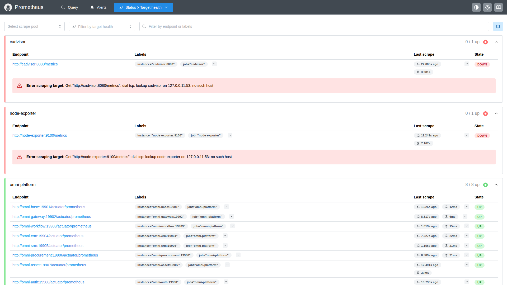
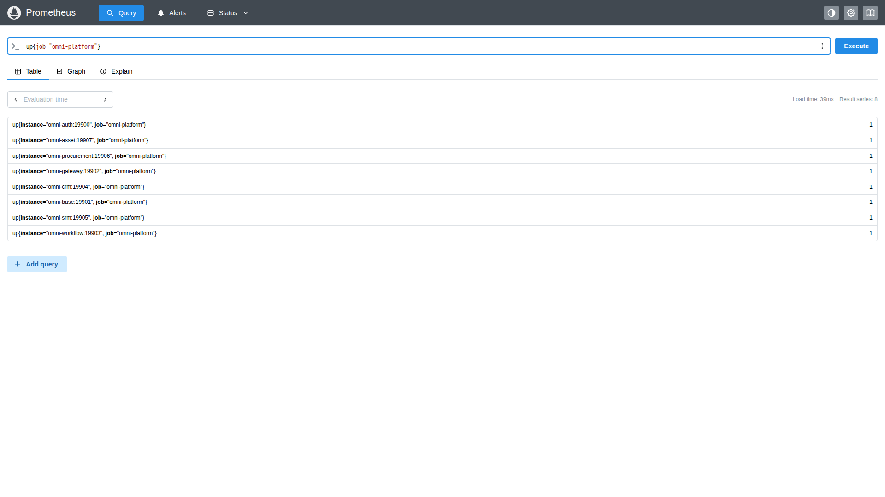
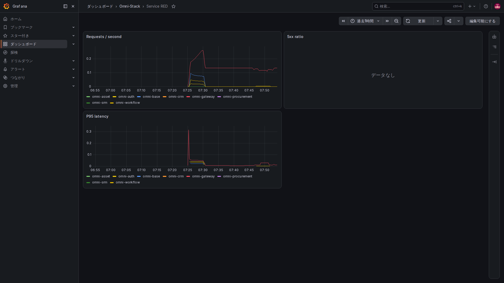
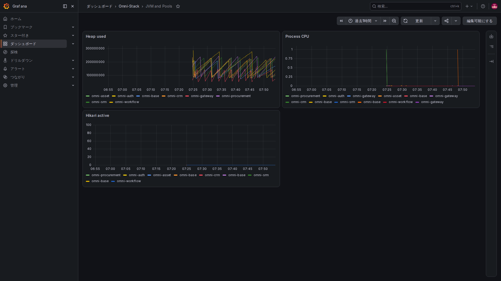
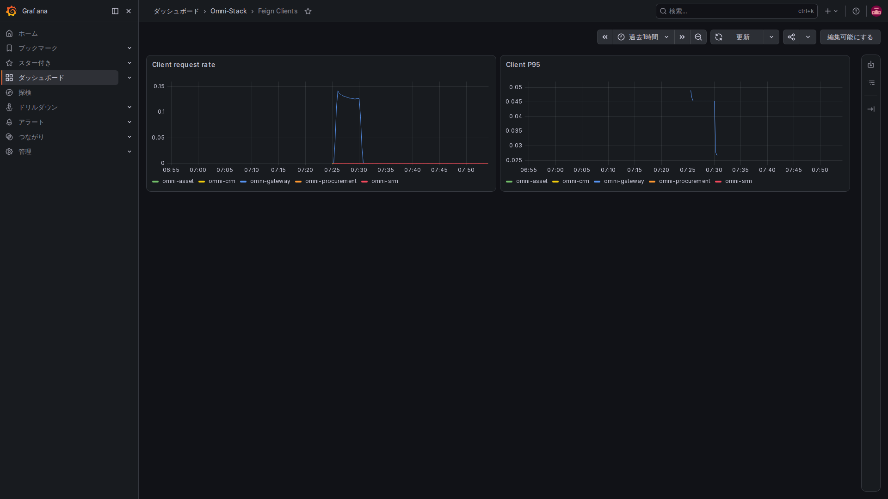
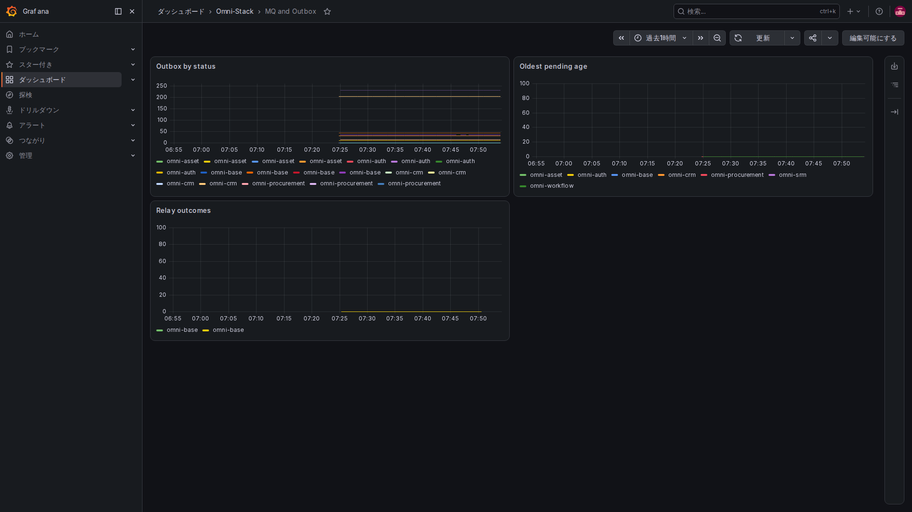

# 3. メトリクスと実装：「最近どうか」を数値にする

メトリクスは各ユーザーの操作全文を保存するものではありません。一分間の要求数、未送信メッセージ数、処理時間などを統計できる数値にします。

## 三つの記録方式

Counter は配送回数など、通常増えていく累積値です。Gauge は現在の滞留数など、その時点の値で増減します。Timer やヒストグラムは処理時間の分布を記録し、平均や遅い側の分位を調べます。

Micrometer に登録し、Prometheus 形式で出力します。Java の点区切り名が下線区切りになったり、Counter に total が付いたりします。単位も出力名に影響します。

## 一つ目：保存状態から現在の滞留を見る

MqLogMetrics のコンストラクターで固定状態と最古メッセージの待ち時間を登録します。

<!-- omni:source path="omni-backend/omni-common-mqlog/src/main/java/com/omni/common/mqlog/metrics/MqLogMetrics.java" -->
```java
        registerStatusGauge("pending", SysMqMessage.STATUS_PENDING);
        registerStatusGauge("sent", SysMqMessage.STATUS_SENT);
        registerStatusGauge("failed", SysMqMessage.STATUS_FAILED);
        registerStatusGauge("dead_letter", SysMqMessage.STATUS_DEAD_LETTER);
        Gauge.builder("omni.mq.outbox.oldest.age", this, MqLogMetrics::oldestPendingAgeSeconds)
                .baseUnit("seconds")
                .description("最旧 PENDING/FAILED Outbox 消息年龄")
                .register(registry);
    }
```

pending、sent、failed、dead_letter は固定ラベル値です。件数は状態ごとのレコード数、oldest.age は最も古い未処理・失敗メッセージの経過秒数です。件数が少なくても、長時間待つ一件が問題になる場合があります。

出力名には omni_mq_outbox_messages と omni_mq_outbox_oldest_age_seconds があります。メッセージ基盤全体の観測であり、ユーザーが読めるメッセージを決める API ではありません。

## 二つ目：操作が起きたら回数を増やす

同じクラスが保存・送信の結果を記録します。

<!-- omni:source path="omni-backend/omni-common-mqlog/src/main/java/com/omni/common/mqlog/metrics/MqLogMetrics.java" -->
```java
        operationCounters.computeIfAbsent(key, ignored -> Counter.builder("omni.mq.outbox.operations")
                        .description("Outbox 入库与投递结果")
                        .tag("destination", safeDestination)
                        .tag("result", safeResult)
                        .register(registry))
                .increment();
    }
```

destination は管理された宛先、result は結果を区別します。ラベルの組み合わせごとに別の時系列ができます。このコードは登録と加算を行いますが、任意の文字列を有限な列挙値へ自動変換しません。呼び出し側が固定値の契約を守ります。

userId、tenantId、ユーザー名、伝票番号、完全な URL を入れると、値が増え続けて保存・メモリ負荷や身元情報の露出につながります。プロジェクトの規則は禁止しています。個別の調査は制御したログと関連 ID を使い、人ごとの時系列を作りません。

## 三つ目：取得不能をゼロと見せない

データベースにアクセスできない場合など、状態検索の例外を捕捉して NaN を返します。

<!-- omni:source path="omni-backend/omni-common-mqlog/src/main/java/com/omni/common/mqlog/metrics/MqLogMetrics.java" -->
```java
        } catch (RuntimeException exception) {
            log.debug("Outbox 状态指标暂不可用: {}", exception.getMessage());
            return Double.NaN;
        }
    }
```

NaN は有効な数字を得られない状態で、「滞留ゼロ」ではありません。この箇所の例外で取得全体を直接中断しなくても、データベースが正常な証明にはなりません。空表示、ゼロ、不正な数値を分けます。

## Prometheus はどう取得するか

基本三サービスの設定です。Gateway までを抜粋し、その後にはプリセットに依存する他の対象があります。

<!-- omni:source path="observability/prometheus/prometheus.yml" -->
```yaml
  - job_name: omni-platform
    metrics_path: /actuator/prometheus
    static_configs:
      - targets:
          - omni-auth:19900
          - omni-base:19901
          - omni-gateway:19902
```

コンテナの管理エンドポイントへ定期的にアクセスします。元のテンプレートは取得と規則評価を十五秒間隔にしており、クリックごとに即時表示する記録とは違います。

部分配布では生成後の設定と実際のモジュールを照合します。未配備サービスを直ちに障害扱いせず、すべての DOWN を無視することもしません。まず今回、何が動くべきかを確認します。

## 収集対象の画面で「体温計がつながっているか」を確認する



ローカルの 9090 ポートを開き、Status から Target health を選びます。Endpoint は収集先、Last scrape は直近の収集、State は結果です。展開されたエラーで失敗理由を読み、下へスクロールして対象を最後まで確認します。

図の omni-platform は 8 / 8 up です。上の赤い二つは cAdvisor と Node Exporter で、今回は起動していないため名前解決に失敗しています。全項目を緑に見せるために設定から消したわけではありません。配備に必要な構成なら対処し、アプリケーション指標だけを検証する場合は、ホスト・コンテナ指標を確認していないことを明記します。



Query に図の短い式を入力し、Execute を押して Table を見ます。1 は今回の収集成功、0 は収集失敗で、要求成功率が 100% という意味ではありません。Graph は時間軸での推移です。結果の系列数も要求件数とは違います。

## ダッシュボードは単位と時間範囲を確かめて読む



Requests / second は忙しさ、5xx ratio はサーバーエラーの割合、P95 latency は遅い側の要求時間を示します。最近五分間の変化を使った検索で、パネルは主に元の数値を表示します。割合の 0.05 は 5%、時間指標の単位は秒です。標本が足りないと曲線が出ない場合があり、遅延ゼロとは読めません。



Heap used はバイト数、Process CPU は使用割合、Hikari active は使用中の接続数です。資源不足の調査に役立ちますが、一度メモリが増えただけで漏れとは判断しません。継続的な傾向、負荷、接続上限と合わせて読み、異なる単位の数字を直接比べないようにします。



サービスが呼び出す側になったときの画面で、受け付けた要求を見る RED とは向きが違います。該当指標がない、最近呼び出していない、条件が合わない場合は No data になることがあります。実際の表示を残しており、すべての種類の呼び出しを収集できた証明ではありません。



pending や failed の滞留を確認し、Oldest pending age が増え続けていないかを見ます。Relay outcomes は一秒あたりの結果変化で、業務伝票の累積件数ではありません。sent は中継の配送段階を示すので、消費ログと業務結果も確認します。

現在の凡例は主にサービス名を表示するため、同じ名前でも状態の異なる曲線があります。区別するときは検索結果の status、destination、result ラベルも確認します。色だけで状態を決めつけないでください。

## ほかに提供している手掛かり

| 分類 | 現在の指標 |
|---|---|
| HTTP とクライアント呼び出し | 要求数、結果、時間分布 |
| JVM と接続プール | メモリ、スレッド、データベース接続 |
| Outbox | 状態件数、最古待ち時間、保存・配信結果 |
| スケジュール | 登録とユーザージョブ実行結果 |
| Workflow が対象の場合 | 開始、承認、滞留、操作と全プロセスの時間 |
| 業務モジュールが対象の場合 | 購買開始再試行、SRM・購買・資産 Inbox の処理と再試行 |
| データ移行 | 一回の移行結果、時間、管理された構造版 |

承認操作の時間と、作成から全プロセス終了までの時間は別です。前者が短くても後者には人の対応待ちが含まれます。未送信メッセージ数も業務失敗件数と同じではありません。

次は[具体的な要求とログ](observability-tracing.jp.md)につなげます。
