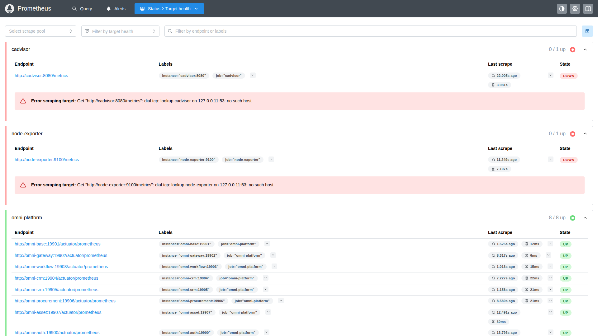
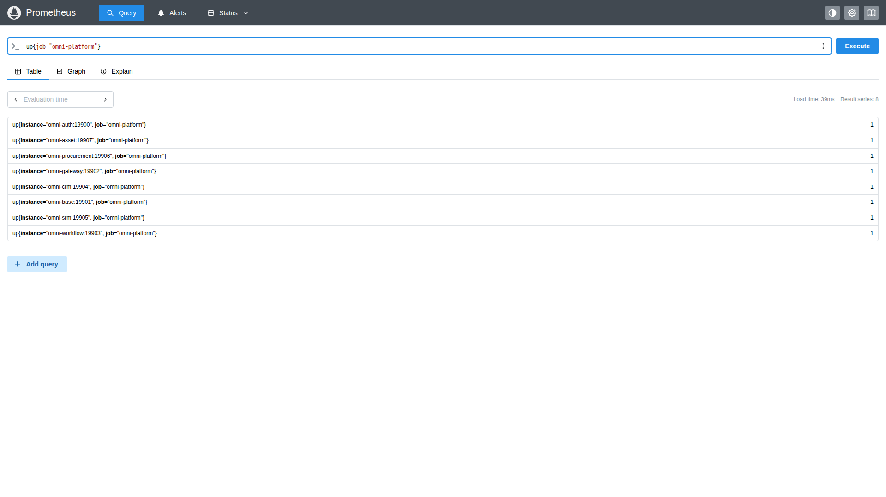
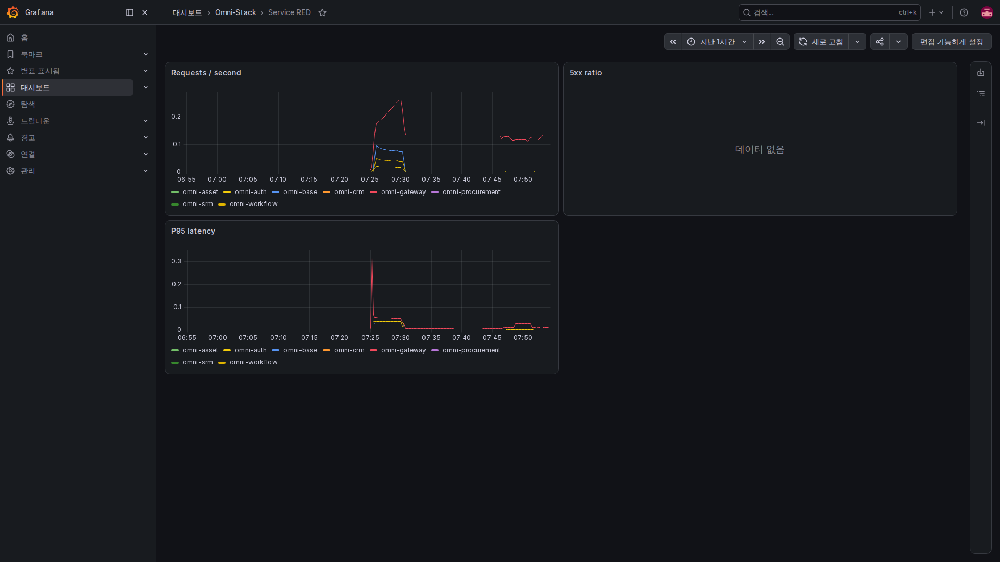
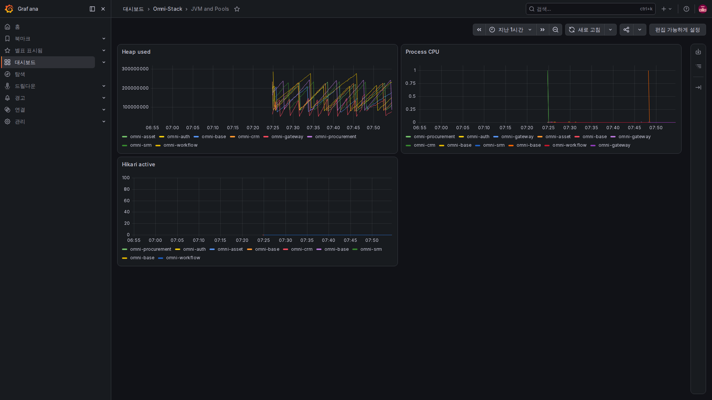
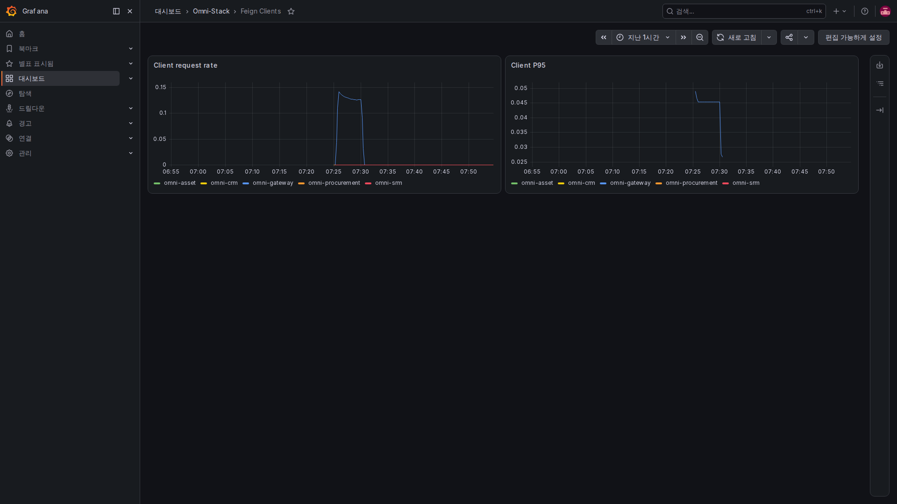
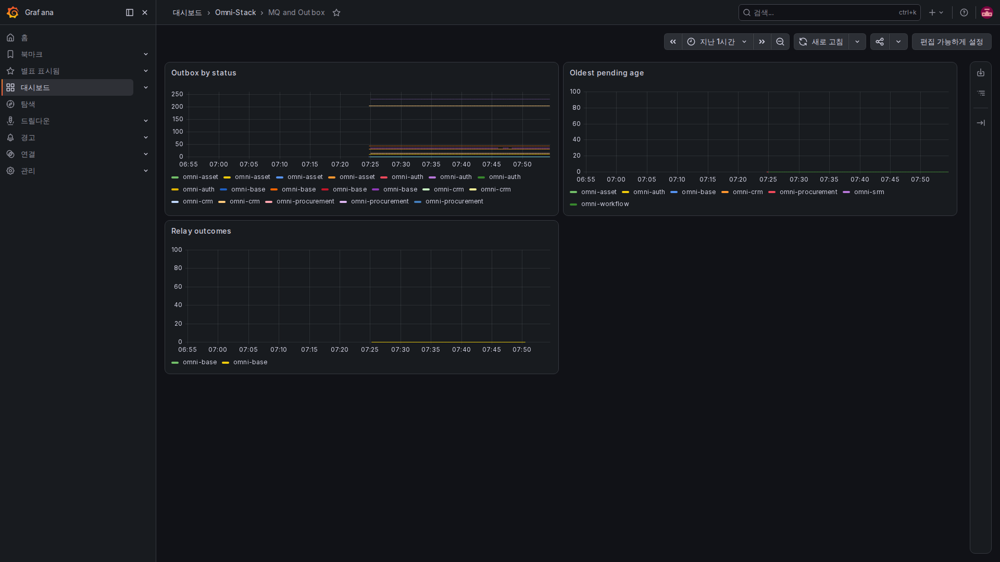

# 3. 메트릭과 구현: 최근 상태를 조회 가능한 수치로 만들기

메트릭은 각 사용자의 동작 전체를 저장하지 않습니다. 분당 요청 수·대기 메시지 수·동작 소요 시간처럼 통계할 수 있는 값을 기록합니다.

## 세 가지 기록 방식

Counter는 전달 횟수처럼 보통 증가하는 누적값입니다. Gauge는 현재 대기 수처럼 오르내리는 현재값입니다. Timer나 히스토그램은 시간 분포를 기록해 평균과 느린 쪽 백분위수를 봅니다.

프로젝트는 Micrometer에 등록해 Prometheus 형식으로 내보냅니다. Java의 점 구분 이름이 밑줄 이름으로 바뀌거나 Counter에 total 접미사가 붙을 수 있습니다. 단위도 이름에 영향을 줍니다.

## 첫 코드: 저장된 상태로 현재 적체 확인

MqLogMetrics 생성자가 고정 메시지 상태와 가장 오래된 메시지의 대기 시간을 등록합니다.

<!-- omni:source path="omni-backend/omni-common-mqlog/src/main/java/com/omni/common/mqlog/metrics/MqLogMetrics.java" -->
```java
        registerStatusGauge("pending", SysMqMessage.STATUS_PENDING);
        registerStatusGauge("sent", SysMqMessage.STATUS_SENT);
        registerStatusGauge("failed", SysMqMessage.STATUS_FAILED);
        registerStatusGauge("dead_letter", SysMqMessage.STATUS_DEAD_LETTER);
        Gauge.builder("omni.mq.outbox.oldest.age", this, MqLogMetrics::oldestPendingAgeSeconds)
                .baseUnit("seconds")
                .description("最旧 PENDING/FAILED Outbox 消息年龄")
                .register(registry);
    }
```

pending·sent·failed·dead_letter는 고정 라벨 값입니다. 수량은 각 상태의 기록 수이며 oldest.age는 가장 오래된 대기·실패 메시지의 경과 초입니다. 수량이 적어도 한 건이 오래 기다리면 조사할 이유가 있습니다.

출력 이름에는 omni_mq_outbox_messages와 omni_mq_outbox_oldest_age_seconds가 있습니다. 메시지 기반 시설 전체의 관측이며 사용자가 어느 메시지를 볼 수 있는지 정하는 API가 아닙니다.

## 두 번째: 동작이 발생할 때 수량 증가

같은 클래스가 저장·전달 결과를 기록합니다.

<!-- omni:source path="omni-backend/omni-common-mqlog/src/main/java/com/omni/common/mqlog/metrics/MqLogMetrics.java" -->
```java
        operationCounters.computeIfAbsent(key, ignored -> Counter.builder("omni.mq.outbox.operations")
                        .description("Outbox 入库与投递结果")
                        .tag("destination", safeDestination)
                        .tag("result", safeResult)
                        .register(registry))
                .increment();
    }
```

destination은 관리된 메시지 목적지, result는 결과를 구분합니다. 각 라벨 조합은 별도 시계열입니다. 이 코드는 등록·증가를 수행하지만 임의 호출 문자열을 유한한 열거형으로 바꾸지는 않습니다. 호출자가 고정값 계약을 지켜야 합니다.

userId·tenantId·사용자명·문서 번호·전체 URL을 넣으면 값이 계속 늘어 자원 사용과 신원 노출이 증가할 수 있습니다. 프로젝트 규칙은 이런 라벨을 금지합니다. 개별 사건은 제어된 로그와 연관 ID로 조사하고 사람마다 시계열을 만들지 않습니다.

## 세 번째: 조회 불가를 0으로 만들지 않는다

데이터베이스가 잠시 불가한 경우 등 상태 조회 예외를 잡아 NaN을 반환합니다.

<!-- omni:source path="omni-backend/omni-common-mqlog/src/main/java/com/omni/common/mqlog/metrics/MqLogMetrics.java" -->
```java
        } catch (RuntimeException exception) {
            log.debug("Outbox 状态指标暂不可用: {}", exception.getMessage());
            return Double.NaN;
        }
    }
```

NaN은 유효한 숫자를 얻지 못했다는 뜻이지 적체가 0이라는 뜻이 아닙니다. 이 지점의 예외가 수집 전체를 바로 중단시키지 않더라도 데이터베이스가 정상이라는 증거는 아닙니다. 빈 그래프·0·잘못된 수치를 구분해야 합니다.

## Prometheus가 가져오는 방법

기본 세 서비스의 설정입니다. Gateway까지 발췌했으며 뒤에는 프리셋에 따라 적용되는 다른 대상이 있습니다.

<!-- omni:source path="observability/prometheus/prometheus.yml" -->
```yaml
  - job_name: omni-platform
    metrics_path: /actuator/prometheus
    static_configs:
      - targets:
          - omni-auth:19900
          - omni-base:19901
          - omni-gateway:19902
```

Prometheus가 컨테이너 관리 엔드포인트에 주기적으로 접근합니다. 원본 템플릿의 수집·규칙 평가 간격은 15초입니다. 클릭마다 즉시 갱신하는 개별 요청 기록과는 다릅니다.

일부 모듈만 배포했다면 생성 설정과 실제 배포 모듈을 비교합니다. 미배포 서비스를 무조건 장애로 보거나 모든 DOWN을 무시하면 안 됩니다. 이번에 어떤 서비스가 실행되어야 하는지부터 확인합니다.

## 수집 대상 화면: 체온계가 연결되었는지 먼저 확인하기



로컬 9090 포트의 Prometheus에서 Status, Target health를 차례로 선택합니다. Endpoint는 수집 주소, Last scrape는 마지막 수집, State는 결과이며 펼쳐진 오류가 실패 이유를 알려 줍니다. 아래로 스크롤해 전체 서비스를 확인하세요.

omni-platform은 8 / 8 up입니다. 위의 빨간 대상은 cAdvisor와 Node Exporter로 이번 촬영에서는 시작하지 않아 이름을 찾지 못합니다. 모두 정상처럼 보이게 하려고 설정에서 지우지 않았습니다. 배포에 필요한 구성이라면 처리해야 하고, 앱 메트릭만 검증했다면 호스트·컨테이너 메트릭은 검증 범위에 없다고 명시해야 합니다.



Query에 그림의 간단한 식을 넣고 Execute를 누른 뒤 Table을 봅니다. 1은 이번 수집 성공, 0은 수집 실패이며 요청 성공률 100%라는 뜻이 아닙니다. Graph는 시간에 따른 변화를 보여 줍니다. 결과 시계열 수도 요청 건수가 아닙니다.

## 대시보드는 단위와 시간 범위를 확인하며 읽기



Requests / second는 얼마나 바쁜지, 5xx ratio는 서버 오류가 차지하는 비율, P95 latency는 느린 쪽 요청의 시간을 보여 줍니다. 최근 5분의 변화를 조회하며 패널은 주로 원래 숫자를 표시합니다. 비율 0.05는 5%이고 시간 메트릭의 단위는 초입니다. 표본이 부족해 곡선이 없다고 지연이 0인 것은 아닙니다.



Heap used는 바이트 수, Process CPU는 사용 비율, Hikari active는 사용 중인 연결 수입니다. 자원 부족을 판단하는 단서지만 메모리가 한 번 늘었다고 누수라고 단정하지 않습니다. 지속 추세·부하·연결 한도와 함께 읽고 서로 다른 단위의 숫자를 직접 비교하지 마세요.



서비스가 호출하는 쪽일 때를 보는 화면으로, 들어오는 요청을 보는 RED와 방향이 다릅니다. 관련 메트릭이 없거나 최근 호출이 없거나 필터가 맞지 않으면 No data가 될 수 있습니다. 실제 상태를 보존한 이미지이며 모든 종류의 하위 호출이 수집되었다는 증거는 아닙니다.



pending·failed 적체를 보고 Oldest pending age가 계속 증가하는지 확인합니다. Relay outcomes는 초당 결과 변화이며 누적 업무 문서 수가 아닙니다. sent는 중계 전달 단계의 결과이므로 소비 로그와 업무 결과도 확인해야 합니다.

현재 범례는 주로 서비스 이름을 표시해 한 서비스의 여러 상태 곡선이 같은 이름으로 보일 수 있습니다. 구분할 때 조회 결과의 status·destination·result 라벨도 확인하세요. 색만 보고 상태를 판단할 수는 없습니다.

## 다른 프로젝트 신호

| 분류 | 현재 제공 방향 |
|---|---|
| HTTP·클라이언트 호출 | 요청 수·결과·시간 분포 |
| JVM·연결 풀 | 메모리·스레드·데이터베이스 연결 사용 |
| Outbox | 상태별 수량·최장 대기·저장과 전달 결과 |
| 스케줄링 | 등록·사용자 작업 실행 결과 |
| Workflow 적용 시 | 시작·승인·대기 적체·동작 및 전체 프로세스 시간 |
| 업무 모듈 적용 시 | 구매 시작 재시도, SRM·구매·자산 Inbox 처리·재시도 |
| 데이터 마이그레이션 | 일회성 결과·시간·관리된 구조 버전 |

승인 동작 시간과 생성부터 프로세스 전체 종료까지의 시간은 다릅니다. 앞의 값은 짧아도 뒤에는 사람의 대기가 포함됩니다. 전달 대기 메시지 수도 업무 실패 건수와 같지 않습니다.

다음은 [특정 요청과 로그](observability-tracing.kr.md)입니다.
