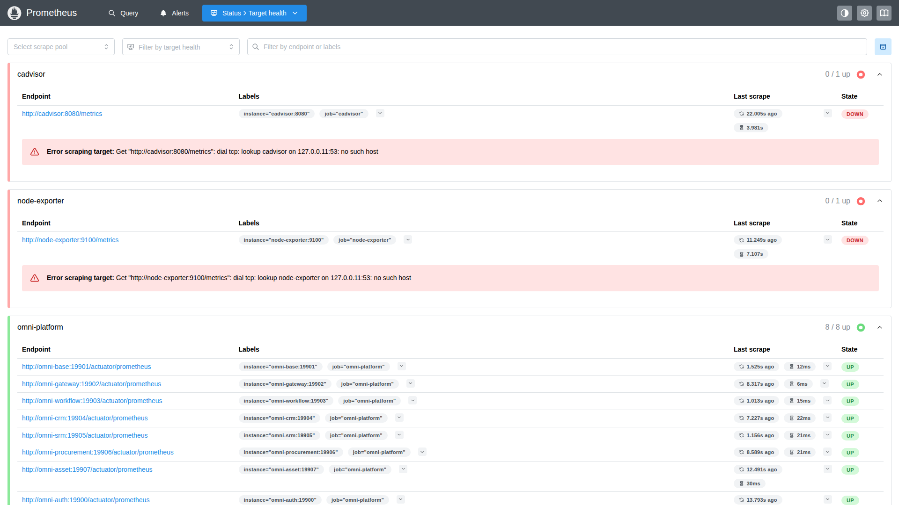
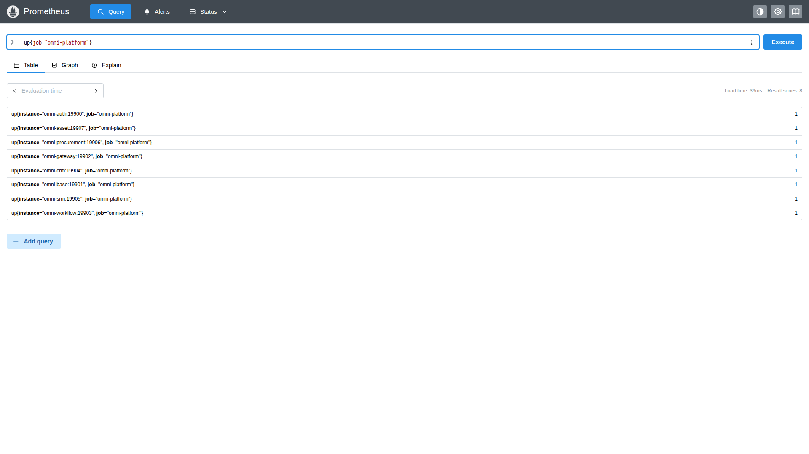
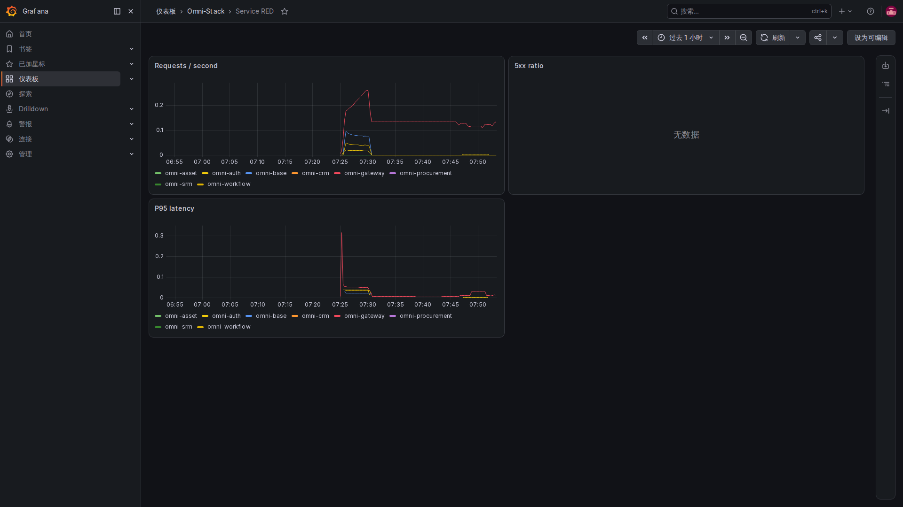
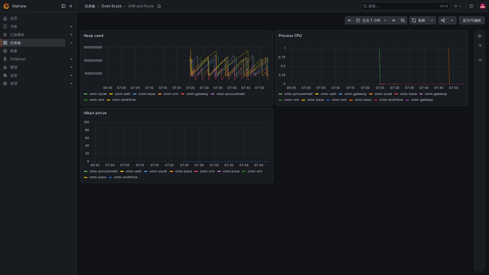
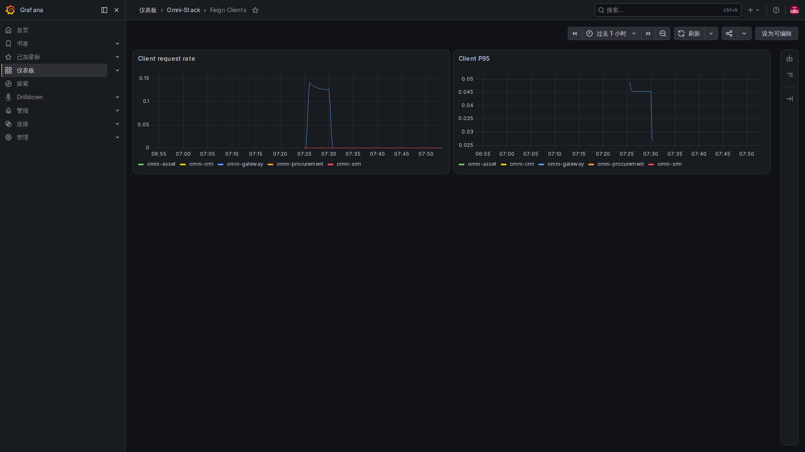
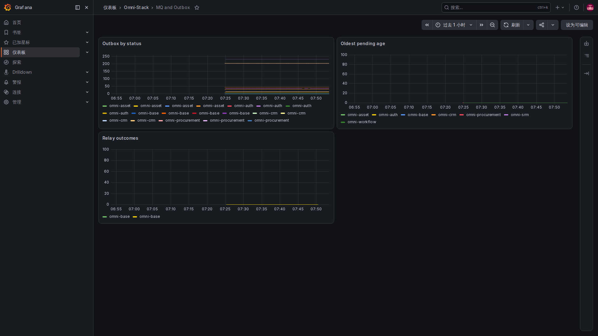

# 3. 指标与工程源码：把“最近怎么样”变成可查询的数据

指标不是把每个用户的操作全文存一遍。它记录可以统计的数值，例如每分钟多少次请求、现在多少条消息积压、一次操作花了多久。

## 先分清三种记录方式

累计计数器 Counter 通常只增加，例如发生了多少次投递。当前值 Gauge 表示此刻的状态，例如还剩多少条待处理消息，可以升也可以降。计时器或直方图记录耗时分布，用于看平均值和较慢分位。

项目用 Micrometer 注册这些数据，再通过 Prometheus 格式导出。Java 中的点分隔名称与导出的下划线名称可能不同；Counter 在 Prometheus 中常带 total 后缀，单位也会影响名称。

## 第一段：从数据库状态得到当前积压

MqLogMetrics 构造时注册固定的消息状态和最旧消息年龄：

<!-- omni:source path="omni-backend/omni-common-mqlog/src/main/java/com/omni/common/mqlog/metrics/MqLogMetrics.java" -->
```java
        registerStatusGauge("pending", SysMqMessage.STATUS_PENDING);
        registerStatusGauge("sent", SysMqMessage.STATUS_SENT);
        registerStatusGauge("failed", SysMqMessage.STATUS_FAILED);
        registerStatusGauge("dead_letter", SysMqMessage.STATUS_DEAD_LETTER);
        Gauge.builder("omni.mq.outbox.oldest.age", this, MqLogMetrics::oldestPendingAgeSeconds)
                .baseUnit("seconds")
                .description("最旧 PENDING/FAILED Outbox 消息年龄")
                .register(registry);
    }
```

pending、sent、failed、dead_letter 是固定标签值。状态数量表示相应记录有多少；oldest.age 观察最旧待处理或失败消息已经等了多久，单位为秒。数量不高但等待很久，也可能值得调查。

对应的导出指标包括 omni_mq_outbox_messages 和 omni_mq_outbox_oldest_age_seconds。它们面向消息基础设施的整体观测，不是某个用户有权查看哪些消息的接口。

## 第二段：发生一次操作就增加计数

同一个类记录入库或投递结果：

<!-- omni:source path="omni-backend/omni-common-mqlog/src/main/java/com/omni/common/mqlog/metrics/MqLogMetrics.java" -->
```java
        operationCounters.computeIfAbsent(key, ignored -> Counter.builder("omni.mq.outbox.operations")
                        .description("Outbox 入库与投递结果")
                        .tag("destination", safeDestination)
                        .tag("result", safeResult)
                        .register(registry))
                .increment();
    }
```

destination 区分受控的消息目的地，result 区分结果。每组标签对应一条单独的时间序列。这里的代码负责注册和累加，不会自动把任意来访字符串变成有限枚举；调用者必须遵守固定取值约定。

如果把 userId、tenantId、用户名、业务单号或完整 URL 放进标签，值会越积越多，存储和内存也会跟着增长，还可能泄露身份。工程约束禁止这些标签。需要定位一件事时，用受控日志和关联编号，不要为每个人建一条指标。

## 第三段：查询失败不能伪装成零

数据库暂时不可用时，这个类的状态查询捕获异常并返回 NaN：

<!-- omni:source path="omni-backend/omni-common-mqlog/src/main/java/com/omni/common/mqlog/metrics/MqLogMetrics.java" -->
```java
        } catch (RuntimeException exception) {
            log.debug("Outbox 状态指标暂不可用: {}", exception.getMessage());
            return Double.NaN;
        }
    }
```

NaN 表示当前得不到有效数字，不是“积压为零”。指标没有造成抓取直接被这处异常打断，也不代表数据库健康。这就是为什么空图、零值和异常值要分开看。

## Prometheus 怎样取到它

仓库抓取配置中，基础三服务的这一段如下；片段止于 Gateway，后面还有依赖具体预设的其他目标：

<!-- omni:source path="observability/prometheus/prometheus.yml" -->
```yaml
  - job_name: omni-platform
    metrics_path: /actuator/prometheus
    static_configs:
      - targets:
          - omni-auth:19900
          - omni-base:19901
          - omni-gateway:19902
```

Prometheus 定期访问这些容器的管理端点。源码模板的抓取与规则评估间隔均为十五秒，所以它也不是每次点击立刻刷新的逐请求记录。

子集交付应按生成后实际配置和已部署模块核对目标。未部署服务的状态不能冒充故障，也不能把所有 DOWN 一律忽略；先确认“这一次本来应该运行哪些服务”。

## 打开采集目标页：先确认温度计有没有接上



进入本地 9090 的 Prometheus，在 Status 中选择 Target health。Endpoint 是采集地址，Last scrape 是上次采集，State 是结果，展开的错误说明为什么失败。向下滚动可以看完所有服务。

图中 omni-platform 显示 8 / 8 up。上方两个红色目标分别是 cAdvisor 与 Node Exporter，本次没有启动这两个可选组件，所以出现名称解析失败。它们没有被删掉来制造“全绿”。如果你的部署要求包含它们，这个状态就需要处理；如果只验证应用指标，也应明确说明未覆盖主机和容器指标。



Query 页可以输入图中的简单表达式，点击 Execute，在 Table 中看到每个目标。这里的 1 表示这次抓取成功，0 表示抓取失败，不表示请求成功率是百分之百。切到 Graph 才是在时间轴上看变化；右侧结果条数也不是请求条数。

## 到看板读曲线：先看单位，再看范围



Requests / second 回答“最近忙不忙”，5xx ratio 回答“服务端错误占多少”，P95 latency 回答“较慢的一批请求有多慢”。这些查询按最近五分钟的变化计算。当前面板主要使用原始数值：比例 0.05 对应 5%，延迟指标的单位为秒。没有足够样本时可能没有曲线，不能读成零延迟。



Heap used 是堆内存的字节数，Process CPU 是进程使用比例，Hikari active 是正在使用的数据库连接数。它们帮助判断资源是否紧张，但内存一次上升不一定是泄漏。要结合持续趋势、负载和连接上限，不要把三个不同单位的数字直接比较。



这页看的是服务作为调用方的情况，和用户请求进入服务的 RED 看板方向不同。没有相应客户端指标、没有近期调用或筛选不匹配，都可能显示 No data。截图保留实际状态，不代表每一种下游调用都已被采集。



先看是否有 pending 或 failed 积压，再看 Oldest pending age 是否持续增长。Relay outcomes 是每秒结果变化，不是累计业务单据数。sent 表示中继投递阶段的结果，仍需结合消费日志和业务结果；不要仅凭这张图宣布端到端处理完成。

当前图例主要显示服务名，一个服务可能出现多条状态曲线。区分时还要核对查询结果的 status、destination 和 result 标签，单靠颜色不能判断是哪种状态。

## 项目还提供哪些线索

| 类别 | 当前可用的指标方向 |
|---|---|
| HTTP 与客户端调用 | 请求数量、结果和耗时分布 |
| JVM 与连接池 | 内存、线程、数据库连接使用 |
| Outbox | 各状态数量、最旧等待时间、入库和投递结果 |
| 调度 | 注册与用户任务执行结果 |
| 工作流模块适用时 | 启动、审批、待办积压、处理及全流程耗时 |
| 业务模块适用时 | 采购启动重试、SRM/采购/资产 Inbox 处理与重试 |
| 数据迁移 | 一次性迁移结果、耗时及受控的结构版本 |

看板上的“审批操作耗时”和“从创建到整个流程结束的耗时”不是一个时间范围；前者可能很短，后者包含等待人处理的时间。也不要拿消息待投递数量直接当作业务失败数量。

下一页把指标中发现的异常，连到[具体请求和日志](observability-tracing.md)。
