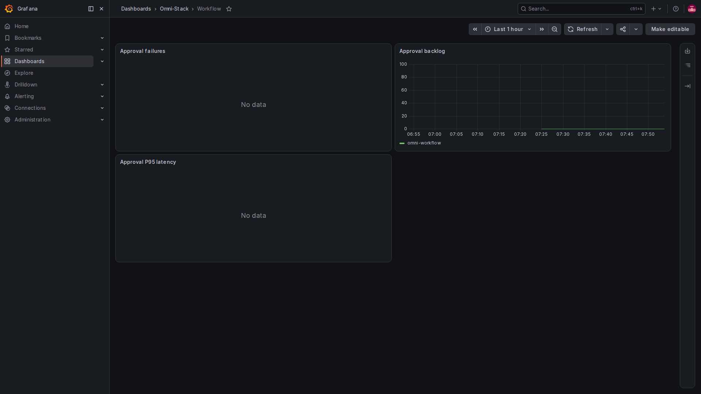
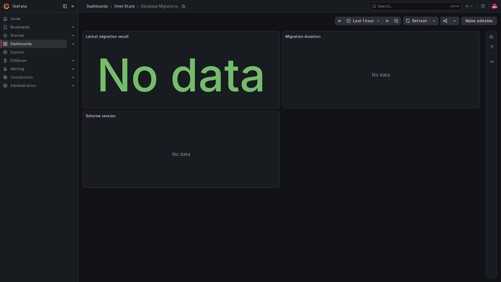

# 6. Integration and troubleshooting: check where the data reaches

Start with a question, then choose the relevant signal. Do not enable every tool and every detailed log immediately. This page uses actual monitoring screens to explain the checking sequence. Images come from the same local environment and are not production acceptance evidence.

## Step one: establish the preset and actual deployment

Identify deployed business modules and the Compose project. Keep business ports, internal network and data volumes in the original environment; do not start another application stack or invent ports merely to obtain charts.

The optional profile, application export setting and sampling probability are separate conditions. Default-disabled collection/display does not prevent reading source and ordinary application logs. Actual enablement requires resource planning and the same project's formal configuration and replacement process. Collector alone does not establish a complete path.

## Step two: check metrics targets before charts

Check the service's internal management port and /actuator/prometheus. Then inspect the relevant Prometheus target, last scrape and error. Once data arrives, select the correct service, time range and metric.

Distinguish an undeployed target, scrape failure, an event that has not happened, a mismatched filter and NaN. A business-port 404, an empty chart and a genuine zero are different.

## Step three: dashboards come from controlled files

The Dashboard provider configuration is:

<!-- omni:source path="observability/grafana/provisioning/dashboards/dashboards.yml" -->
```yaml
providers:
  - name: Omni-Stack
    folder: Omni-Stack
    type: file
    disableDeletion: true
    allowUiUpdates: false
    options:
      path: /var/lib/grafana/dashboards
```

allowUiUpdates=false prevents saving UI edits to these provisioned dashboards. Maintain controlled JSON and update it through formal delivery. Adjusting a browser view does not change repository files.

The seven dashboards cover platform overview; service request rate, errors and duration; JVM and pools; Feign clients; MQ/Outbox; Workflow; and database migrations. Interpret only deployed modules with data. A Workflow dashboard existing does not mean the core preset runs Workflow.

### Workflow: failed operations, waiting work and processing duration



Open Workflow in the Omni-Stack dashboard folder. Approval failures is the recent failed-operation rate, Approval backlog counts waiting tasks, and Approval P95 latency describes the slower portion of approval operations. Waiting work may simply need a person's action; it does not independently establish an engine fault.

This is not the duration from application to whole-process completion. Metrics without samples can show No data. Check the module, metric and period first; creating meaningless approvals or changing business state merely to populate a chart supplies no useful evidence.

### Migrations: read the result of a one-shot operation



A finished migrator no longer serves an endpoint, so it leaves results through Pushgateway. Latest migration result groups by outcome, Migration duration shows elapsed time, and Schema version uses controlled version labels. These describe migration execution, not row-by-row validation of business data.

If the local migrator finished before this Pushgateway started, its historical result does not appear automatically and panels can be empty. Inspect the original exit code and logs to determine whether a push succeeded. Do not rerun migrations merely to fill a chart or report No data as migration success. Even green No data text is panel styling, not a successful result.

## Step four: correlate one real operation

Record its actual time, service and request or message correlation IDs, then perform a legitimate operation. Find the event in service logs. If tracing is enabled and the operation was sampled, query Tempo. For asynchronous messages, use the same msgId to connect producer, relay and consumer records, checking each trace separately.

Do not treat a response header ID as proof of stored traces, or a historical screenshot as evidence of the current operation. The tracing and logs page provides real examples; your operation still needs its own actual time, identity, correlation ID and stored result checked.

## Step five: validate alerts by stage

Validate rule syntax, actual trigger conditions and receipt by Alertmanager, then the real receiver and delivery result. Standard local-null cannot send externally. Without a channel, report external notification delivery as unverified.

Set budgets and thresholds for a particular journey. Do not delete alerts or extend waiting indefinitely to obtain a pass. After recovery, confirm business results rather than only a green panel.

## Instrument a new feature in this order

| Question | Useful evidence | Avoid |
|---|---|---|
| What does user success or failure mean? | Fixed operation/outcome counts and durations | Treating every expected business rejection as a system fault |
| Is work accumulating? | Counts and oldest wait | Reporting query failures as zero |
| Which operation failed? | Necessary, bounded log fields and correlation IDs | Passwords, tokens and entire request/message bodies |
| How do we investigate across services or threads? | Standard context propagation and explicit message correlation | Assuming ThreadLocal crosses threads or messages |
| Who acts on an alert? | Calibrated thresholds, ownership and real receivers | A red indicator without anyone to receive it |

Before using shared metric helpers, read their activation conditions and behavior without a registry. Fixed labels are a calling contract, not automatic redaction of business inputs. Assess the possible value count of every new label.

## Do not skip stages during investigation

Check production of signals, collection/network, storage and query filters in sequence. For metrics inspect management endpoints and targets; for traces inspect sampling, export, Collector and Tempo; for logs inspect format, project filtering, Alloy and Loki; for notifications inspect rules, routing and receivers.

Record current source, images, preset, time, exit codes and actual failures. Keep source, build, runtime, delivery and performance results separate. This chapter adds no new observability business capability, upgrades no dependency and promises no production performance. Preserve the same boundaries in future extensions.
