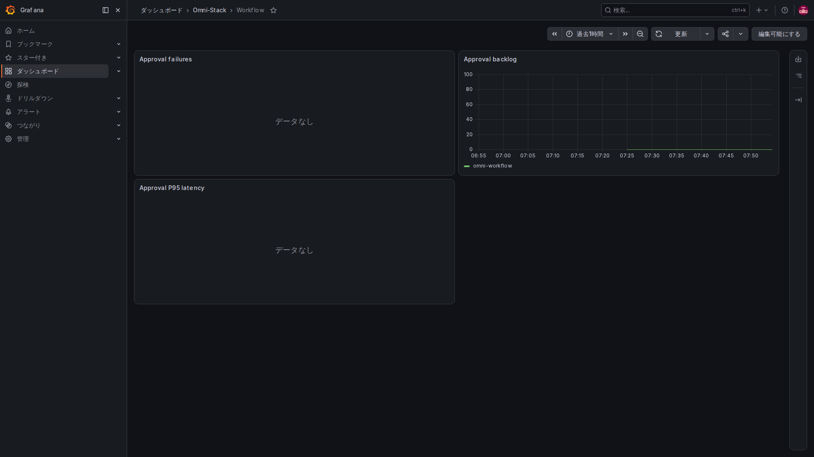
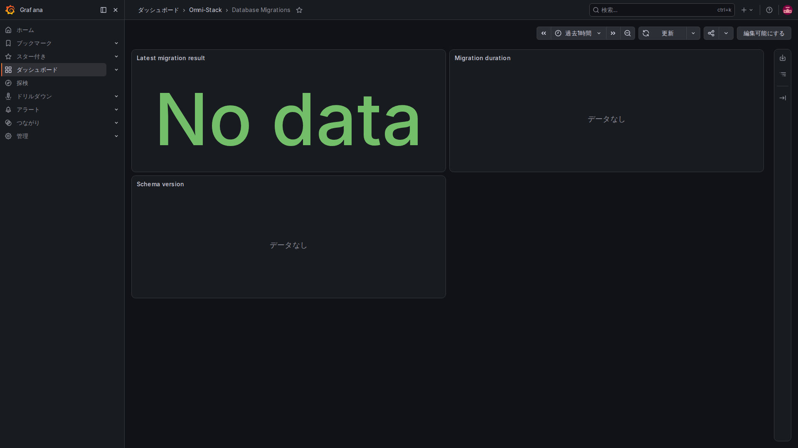

# 6. 導入と障害調査：情報がどこまで届いたかを順に確認する

先に解決したい問題を決め、見る信号を選びます。最初から全ツールや全詳細ログを有効にしません。実際の監視画面を使って確認順序を説明します。画像は同じローカル環境のもので、本番の受け入れ報告ではありません。

## 一段階目：プリセットと配備範囲を確認する

実際の業務モジュールと Compose プロジェクトを確認します。業務ポート、内部ネットワーク、データボリュームを元の環境に保ち、グラフを見るために別アプリ環境や任意ポートを作りません。

任意 profile、アプリ転送設定、サンプリング率は別条件です。収集・表示が既定で無効でも、ソースや通常ログは読めます。有効化には資源評価と同じプロジェクトの正式な設定・置換が必要で、Collector だけで全経路が完成するわけではありません。

## 二段階目：グラフの前に収集対象を確認する

サービスの内部管理ポートと /actuator/prometheus を調べ、Prometheus の対象状態、最終取得時刻、エラーを確認します。データが入ってから適切なサービス、期間、指標を選びます。

対象未配備、取得失敗、まだ操作が発生していない、条件不一致、NaN を区別します。業務ポートの 404、空表示、本当のゼロは別です。

## 三段階目：ダッシュボードは管理されたファイルから提供される

Dashboard provider の原文です。

<!-- omni:source path="observability/grafana/provisioning/dashboards/dashboards.yml" -->
```yaml
providers:
  - name: Omni-Stack
    folder: Omni-Stack
    type: file
    disableDeletion: true
    allowUiUpdates: false
    options:
      path: /var/lib/grafana/dashboards
```

allowUiUpdates=false は、このファイル提供のダッシュボードで UI 更新を保存できない意味です。管理下の JSON を変更して正式に更新します。ブラウザー表示の調整だけでリポジトリ変更済みとは言えません。

七つのダッシュボードは、プラットフォーム全体、要求率・失敗・時間、JVM と接続プール、Feign、MQ/Outbox、Workflow、データ移行です。実際に配備されデータのあるモジュールだけを解釈します。Workflow ダッシュボードがあっても、core プリセットで Workflow が稼働している証明にはなりません。

### Workflow：失敗操作、処理待ち、承認の時間



Dashboards の Omni-Stack フォルダーから Workflow を開きます。Approval failures は最近の失敗操作の速さ、Approval backlog は待ち件数、Approval P95 latency は承認処理の遅い側の分位です。件数が多くても人の対応待ちかもしれず、それだけでエンジン故障とは判断できません。

申請からフロー全体が終わるまでの時間とは別です。標本のない統計は No data になります。先にモジュール、指標、期間を確認し、グラフを埋めるためだけに不要な承認を作ったり、業務状態を書き換えたりしません。

### データ移行：一回で終わる作業の最後の結果を読む



移行ツールは終了すると継続的なエンドポイントを提供できないため、Pushgateway に結果を残します。Latest migration result は結果別集計、Migration duration は時間、Schema version は管理されたバージョンラベルです。移行処理の情報であり、業務データを一行ずつ検査済みという意味ではありません。

今回の Pushgateway より先に移行ツールが終了していた場合、過去の結果が自動で補充されるわけではなく、データなしになることがあります。元の終了コードとログで送信の成否を確認します。グラフのためだけに移行を再実行せず、No data を成功扱いしません。緑色の No data もパネルの表示形式であり、成功結果ではありません。

## 四段階目：一件の実操作でログとトレースを関連付ける

実時刻、サービス、要求やメッセージの関連 ID を記録して、正規の操作を行います。サービスログの該当イベントを確認し、追跡が有効かつ対象がサンプリングされた場合に Tempo を検索します。非同期メッセージは同じ msgId で生成元・中継・受信をたどり、各 Trace は別々に確認します。

応答ヘッダーの番号を保存済みの証拠とせず、過去画像を今回の結果にしません。トレースとログのページには実画面の例がありますが、自分の操作でも実時刻、利用者、関連 ID、保存結果を別に確認してください。

## 五段階目：アラートを段階ごとに試す

構文、実条件による発火、Alertmanager 受領、実通知先、到達結果の順に確認します。標準 local-null は外部へ送りません。通路がなければ外部通知未確認と記録します。

目標と閾値は具体的な利用経路に合わせます。合格のために規則を削除したり待ち時間を無限に増やしたりしません。緑色に戻った後も業務結果を確認します。

## 新機能ではこの順序で手掛かりを設計する

| 質問 | 残す情報 | 避けること |
|---|---|---|
| 利用者にとって成功・失敗とは何か | 固定操作・結果の回数と時間 | 想定内の業務拒否を全部システム障害にする |
| 処理が滞留していないか | 件数と最古待ち時間 | 検索失敗をゼロにする |
| どの一件が失敗したか | 必要最小限のログと関連 ID | パスワード、トークン、本文全体 |
| サービス・スレッドを越えて調べるには | 標準文脈伝播とメッセージの明示的関連 | ThreadLocal が自動で引き継ぐと想定する |
| 誰がアラートへ対応するか | 調整済み閾値、担当、実通知先 | 受信者のいない赤表示 |

共通指標ツールの使用前に有効化条件とレジストリーがない場合の動作を確認します。固定ラベルは呼び出し契約で、業務入力の自動匿名化ではありません。新ラベルで取り得る値の数を評価し、管理可能に保ちます。

## 中間段階を飛ばさない

情報生成、収集ネットワーク、保存、検索条件を順に確かめます。メトリクスは管理エンドポイントと target、トレースはサンプリング・転送・Collector・Tempo、ログは形式・プロジェクト選別・Alloy・Loki、通知は規則・経路・受信先を調べます。

現在のソース、イメージ、プリセット、時刻、終了コード、実失敗を記録します。ソース、ビルド、実行、通知、性能の結果は分けます。この章は新たな業務機能や依存更新、本番性能保証を追加していません。今後も同じ境界を保って拡張します。
