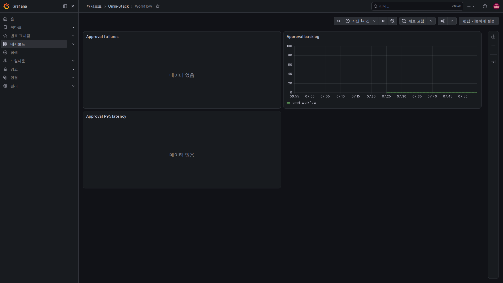
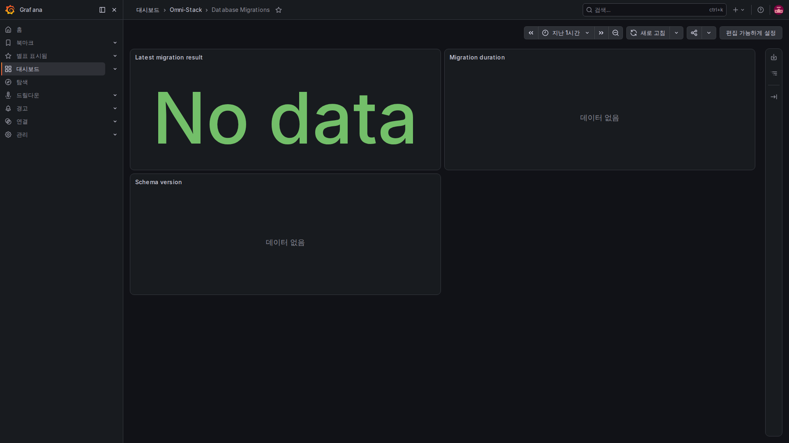

# 6. 적용과 문제 해결: 데이터가 어디까지 왔는지 차례로 확인하기

먼저 해결할 질문을 정하고 신호를 선택합니다. 모든 도구·상세 로그를 처음부터 켜지 않습니다. 실제 모니터링 화면으로 현재 프로젝트의 확인 순서를 설명합니다. 이미지는 같은 로컬 환경에서 촬영했으며 운영 환경 검수 보고가 아닙니다.

## 첫 단계: 프리셋과 배포 범위 확인

실제로 배포한 업무 모듈과 Compose 프로젝트를 확인합니다. 업무 포트·내부 네트워크·데이터 볼륨을 기존 환경에 유지하며 그래프를 위해 두 번째 앱 환경이나 임의 포트를 만들지 않습니다.

선택형 profile·앱 내보내기·샘플링 비율은 다른 조건입니다. 기본 수집·표시가 꺼져 있어도 소스와 일반 앱 로그를 읽을 수 있습니다. 실제 활성화는 자원 검토와 같은 프로젝트의 정식 설정·교체가 필요합니다. Collector만 시작해 전체 경로가 완성되었다고 보면 안 됩니다.

## 두 번째: 그래프 전에 수집 대상 확인

서비스의 내부 관리 포트와 /actuator/prometheus, Prometheus 대상 상태·최근 수집 시각·오류를 확인합니다. 데이터가 들어오면 맞는 서비스·시간 범위·메트릭을 선택합니다.

미배포 대상·수집 실패·아직 발생하지 않은 메트릭·필터 불일치·NaN을 구분합니다. 업무 포트 404·빈 그래프·실제 0은 서로 다릅니다.

## 세 번째: 대시보드는 관리 파일에서 제공된다

Dashboard provider 원문입니다.

<!-- omni:source path="observability/grafana/provisioning/dashboards/dashboards.yml" -->
```yaml
providers:
  - name: Omni-Stack
    folder: Omni-Stack
    type: file
    disableDeletion: true
    allowUiUpdates: false
    options:
      path: /var/lib/grafana/dashboards
```

allowUiUpdates=false는 파일로 제공하는 이 대시보드의 UI 갱신 저장을 막습니다. 관리 JSON을 수정해 정식 배포로 반영해야 하며 브라우저 보기만 조정해 저장소를 바꿨다고 주장하면 안 됩니다.

7개 대시보드는 플랫폼 개요·서비스 요청률/오류/시간·JVM과 연결 풀·Feign·MQ/Outbox·Workflow·데이터 마이그레이션입니다. 실제 배포하고 데이터가 있는 모듈만 해석합니다. Workflow 대시보드가 있다고 core 프리셋에서 Workflow가 실행되는 것은 아닙니다.

### Workflow: 실패 동작·승인 대기·처리 시간



Dashboards의 Omni-Stack 폴더에서 Workflow를 엽니다. Approval failures는 최근 실패 동작의 속도, Approval backlog는 대기 수, Approval P95 latency는 승인 처리의 느린 쪽 백분위수입니다. 대기가 많아도 사람의 처리를 기다리는 중일 수 있어 엔진 고장으로 단정하면 안 됩니다.

신청부터 프로세스 전체 종료까지 걸린 시간과는 다릅니다. 표본이 없는 통계는 No data를 표시할 수 있습니다. 먼저 모듈·메트릭·기간을 확인하고 그래프를 채우려고 의미 없는 승인을 만들거나 업무 상태를 바꾸지 마세요.

### 마이그레이션: 한 번 끝나는 작업의 마지막 결과 읽기



일회성 마이그레이터는 종료 후 엔드포인트를 계속 제공할 수 없어 Pushgateway에 결과를 남깁니다. Latest migration result는 결과별 통계, Migration duration은 소요 시간, Schema version은 관리된 버전 라벨을 보여 줍니다. 업무 데이터를 행마다 모두 검증했다는 뜻은 아닙니다.

로컬 마이그레이터가 이번 Pushgateway보다 먼저 종료했다면 과거 결과가 저절로 들어오지 않아 데이터가 없을 수 있습니다. 원래 종료 코드와 로그로 실제 푸시 성공 여부를 확인하세요. 그래프를 채우려고 마이그레이션을 다시 실행하거나 No data를 성공으로 적으면 안 됩니다. 초록색 No data도 패널 스타일일 뿐 성공 결과가 아닙니다.

## 네 번째: 실제 동작 한 건으로 로그와 트레이스 연결

실제 시각·서비스·요청이나 메시지 연관 ID를 적고 정상 동작을 수행합니다. 서비스 로그에서 사건을 찾고, 추적이 켜져 있고 이번 요청이 샘플링되었다면 Tempo를 조회합니다. 비동기 메시지는 같은 msgId로 생산·중계·소비를 연결하되 각 Trace는 따로 확인합니다.

응답 헤더 ID를 트레이스 저장 증거로 보거나 과거 화면을 이번 결과로 사용하면 안 됩니다. 앞의 트레이스·로그 페이지에 실제 예시가 있지만 자기 동작도 실제 시각·신원·연관 ID·저장 결과를 별도로 확인해야 합니다.

## 다섯 번째: 경보를 단계별 검증

규칙 문법, 실제 조건 발생, Alertmanager 수신, 실제 수신처와 전달 결과를 차례로 확인합니다. 표준 local-null은 외부로 보낼 수 없습니다. 채널이 없다면 외부 통지 전달 미검증으로 기록합니다.

오류 예산과 임계값은 특정 사용자 여정에 맞춥니다. 통과하려고 경보를 지우거나 대기 시간을 끝없이 늘리지 않습니다. 초록색 복귀뿐 아니라 업무 결과도 확인합니다.

## 새 기능에는 이 순서로 단서를 설계한다

| 질문 | 남길 단서 | 피할 것 |
|---|---|---|
| 사용자 기준 성공·실패는 무엇인가 | 고정 동작·결과의 수량과 시간 | 예상한 업무 거부를 모두 시스템 장애로 취급 |
| 적체가 있는가 | 수량·가장 오래된 대기 | 조회 실패를 0으로 표시 |
| 어느 동작이 실패했는가 | 필요한 제한된 로그 필드·연관 ID | 비밀번호·토큰·전체 요청/메시지 본문 |
| 서비스나 스레드가 바뀌면 어떻게 조사하는가 | 표준 문맥 전파·메시지의 명시적 연관 | ThreadLocal 자동 전파 가정 |
| 누가 경보에 대응하는가 | 조정된 임계값·담당자·실제 채널 | 수신자 없는 빨간 표시 |

공통 메트릭 도구를 쓰기 전에 활성화 조건과 레지스트리가 없을 때의 동작을 읽으세요. 고정 라벨은 호출 계약이며 임의 업무 입력의 자동 비식별화가 아닙니다. 새 라벨의 가능한 값 개수를 평가해 제한해야 합니다.

## 중간 단계를 건너뛰지 않는다

앱 생성·수집 네트워크·저장·조회 조건을 순서대로 확인합니다. 메트릭은 관리 엔드포인트와 target, 트레이스는 샘플링·내보내기·Collector·Tempo, 로그는 형식·프로젝트 필터·Alloy·Loki, 통지는 규칙·경로·수신처를 봅니다.

현재 소스·이미지·프리셋·시각·종료 코드·실제 실패를 기록하고 소스·빌드·실행·전달·성능 결과를 구분합니다. 새 관측 업무 기능이나 의존성 업그레이드·운영 성능 보장을 추가한 장이 아닙니다. 이후 확장에도 같은 경계를 유지하세요.
