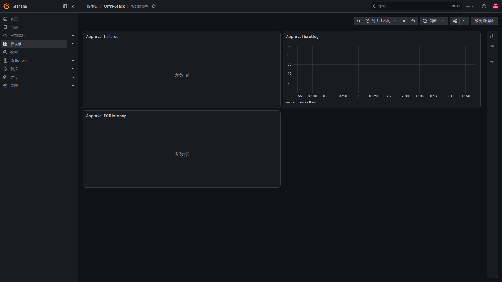
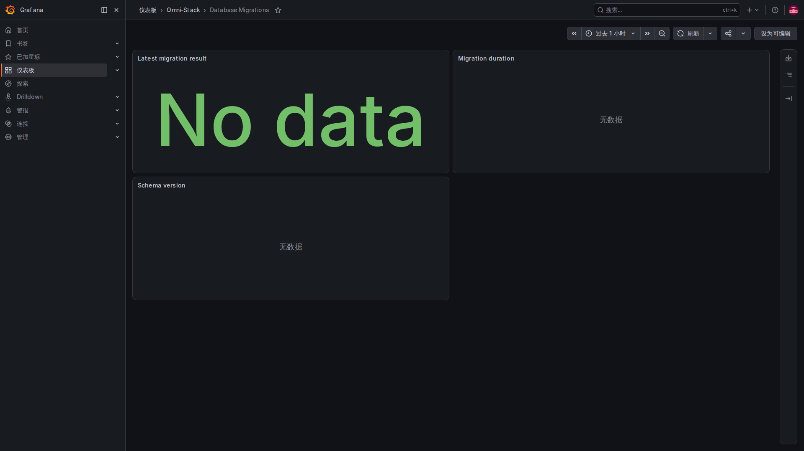

# 6. 工程接入与排障：一步一步确认数据走到哪里

初学时，先明确要解决哪个问题，再决定看哪个信号。不要一开始就把所有工具和所有详细日志都打开。下面结合实际监控网页说明当前工程的确认顺序；图片来自同一套本地环境，不是生产验收报告。

## 第一步：确认这一次的预设与运行范围

先看实际部署了哪些业务模块，使用的是不是同一个 Compose 项目。业务端口、内部网络和数据卷保持原环境；不能为了看图另开第二套应用或随意换端口。

可选观测 profile、应用导出开关、采样比例是不同条件。当前默认未启用完整采集展示，不妨碍先读源码和普通应用日志。实际启用时需要评估本地资源，并按同一项目的正式部署方式配置与替换，不能只启动 Collector 就当作全链完成。

## 第二步：指标先查采集目标，再看图

先核对该服务的内部管理端口和 /actuator/prometheus，再看 Prometheus 对应目标的状态、最近抓取时间和错误。确认数据进来后，再选择正确服务、时间窗口和指标。

图表空白时区分：目标没部署、抓取失败、指标尚未发生、筛选条件不匹配、查询返回 NaN。业务端口 404、空图和真正零值不能混用。

## 第三步：看板是读取配置，不是随意保存的页面

仓库的 Dashboard provider 原文：

<!-- omni:source path="observability/grafana/provisioning/dashboards/dashboards.yml" -->
```yaml
providers:
  - name: Omni-Stack
    folder: Omni-Stack
    type: file
    disableDeletion: true
    allowUiUpdates: false
    options:
      path: /var/lib/grafana/dashboards
```

allowUiUpdates=false 表示当前通过文件提供的看板不允许在 UI 中保存更新。改看板需要维护受控 JSON，再通过正式交付更新，不能只在浏览器里调整后就声称仓库已修改。

现有七个看板分别观察平台总览、服务请求率/错误/耗时、JVM 与连接池、Feign 客户端、MQ/Outbox、工作流、数据库迁移。只对实际部署且有数据的模块解释结果；“有一个工作流看板”不等于 core 预设正在运行工作流服务。

### 工作流看板：操作失败、待办积压和处理耗时



在 Dashboards 的 Omni-Stack 文件夹打开 Workflow。Approval failures 是近期失败操作的速率，Approval backlog 是待办数量，Approval P95 latency 是审批操作的较慢分位。待办多可能只是还在等人处理，不能直接判为引擎坏了。

这张图不等于“从申请到整个流程结束”的耗时。如果对应统计尚无样本，会显示 No data；应先确认模块、指标和时间范围，不要为了画出曲线创建无意义审批或改业务状态。

### 迁移看板：一次性工作要读最后一次结果



一次性迁移器结束后不再持续提供端点，因此通过 Pushgateway 留下结果。Latest migration result 按结果统计，Migration duration 看耗时，Schema version 看受控版本标签。它们说明迁移过程，不表示业务表的内容已逐行校验。

本地迁移器早于本次 Pushgateway 启动时，历史结果不会凭空补进来，页面可能没有数据。这时先查本次迁移器原始退出码和日志，确认是否曾成功推送；不要为了填图重新执行迁移，也不要把 No data 写成迁移成功。即使 No data 是绿色，也只是面板样式，不是成功结果。

## 第四步：用一次真实操作关联日志和链路

先记下实际时间、服务、请求或消息的关联编号，再执行一次合法操作。查看该服务日志是否存在对应事件；追踪启用且这次有采样时，再查询 Tempo。异步消息按同一 msgId 连到生产、中继和消费，各段追踪分别确认。

不要把普通响应头编号当成链路已落库证据，也不要把打开一张历史截图当成这次操作的结果。前面的链路与日志页给出了真实网页例子；你自己的操作仍要另外核对实际时间、身份、关联编号和存储结果。

## 第五步：告警按阶段验证

先验证规则语法，再确认实际条件是否触发、Alertmanager 是否收到，最后检查真实接收器和送达结果。标准 local-null 无外发能力；没有接收通道时，只能如实说明“未验证外部通知送达”。

错误预算和阈值要针对具体旅程，不能为取得绿灯删掉告警或把等待时间无限调长。恢复后还要查业务结果是否正确，而不是只看面板恢复绿色。

## 给一个新功能接入观测时，按这个顺序想

| 问题 | 建议留下的线索 | 避免什么 |
|---|---|---|
| 用户的哪件事算成功或失败 | 固定操作/结果的计数和耗时 | 把可预期的业务拒绝都当成系统故障 |
| 当前有没有积压 | 数量与最旧等待时间 | 把查询失败写成零 |
| 哪一次操作出了问题 | 有限、必要的日志字段与关联编号 | 密码、令牌、完整请求/消息体 |
| 服务或线程改变后怎样查 | 标准上下文传播，消息显式关联编号 | 假设 ThreadLocal 自动跨线程、跨消息 |
| 谁会根据告警行动 | 校准阈值、负责人和真实接收通道 | 只配置一个无接收人的红灯 |

调用现有公共指标工具前，先看其装配条件与无注册表时的行为。固定标签是调用约定，不是工具替你把任意业务字段脱敏。新增标签要评估所有可能值的数量，保持受控。

## 看到异常后，不要跳过中间环节

从应用产生、采集网络、存储、查询条件逐段确认：指标查管理端口和 target，链路查采样/导出/Collector/Tempo，日志查输出格式/项目过滤/Alloy/Loki，通知查规则/路由/接收器。

记录当前源码、镜像、预设、时间、退出码和实际失败。源码、构建、运行、通知和性能结果分别记账。这里没有新增观测业务、升级依赖或对生产性能作保证；后续扩展应保留同样的边界。
