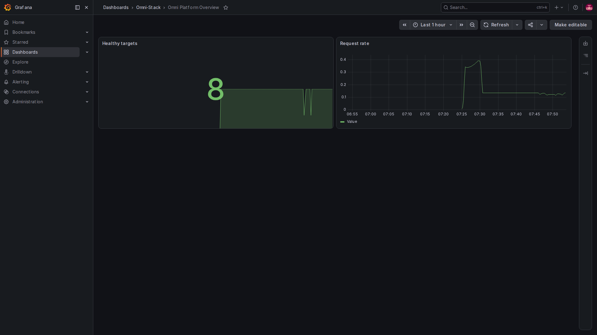
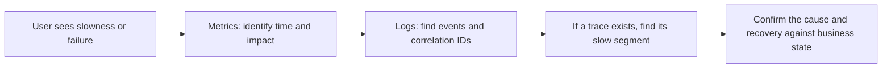

# 1. Observability from scratch: where to look when the system is slow

Suppose you submit a request and the page keeps spinning. Knowing that an endpoint timed out is not enough. Did traffic increase, did the database connection pool run out, or did a downstream service slow down? Observability leaves enough clues to trace a user's symptom to the part that needs attention.

The timeout story and numbers here are teaching examples, not a report of a current fault. The repository provides observability configuration, but the optional stack is disabled by default. Configuration files do not mean the pages already contain live data.

## Start with a real monitoring page

This image comes from the same local full environment. The left menu belongs to the monitoring tool. Healthy targets counts the business services Prometheus can currently scrape; Request rate shows how quickly requests are arriving. The eight targets reflect this full deployment. A core deployment has a different expected count.

Choose the last hour at the top right, then compare when the curves change. The large 8 is neither an online-user count nor proof that eight business journeys passed. A restart can cause a brief dip; inspect the targets page to understand it.

The images were captured with the container browser, without changing page content or drawing curves. Grafana navigation uses the selected language. Repository dashboard and panel titles remain English and are explained here. Prometheus and Alloy use shared images of their native English pages. Values describe the local environment at capture time.

## Three clues answer different questions

| Signal | Everyday comparison | Question it helps answer |
|---|---|---|
| Metrics | Regular temperature and pulse readings | Is traffic high, are failures increasing, is work accumulating? |
| Logs | Records of events as they happen | What happened in a particular operation, and where should we investigate? |
| Traces | A time sheet for one journey through several service desks | Which services handled this request, and where was its time spent? |

Metrics describe trends over a period. Logs describe specific events. Traces describe one request's path. Together they help explain slowness; they are not three identical datasets, and installing an attractive dashboard does not establish all three.

## Follow one slow request

Start with request volume, error rate and duration charts to determine whether the problem was brief or persistent. Search logs by the relevant time, service and correlation ID to find a specific request. If it was sampled and successfully exported to trace storage, open its trace and compare time spent in the gateway, business service and downstream calls.

Finding a log correlation ID without a trace does not establish that the application never received the request. Tracing may be disabled, the request may not have been sampled, or export may have failed. The tracing page explains the project's compatibility IDs.

## HTTP success and business success differ

A response without a 5xx status establishes only the absence of that class of server error. A business rule may have rejected the operation, or an approval may still be pending. A passing health check covers its configured checks, not a complete purchase, approval or message delivery.

Likewise, an Outbox record does not prove receipt, and an ended process does not prove a document was updated. Observability supplies evidence for separating these stages; it does not replace business rules.

## Numbers beginners often misread

A request count is cumulative: its increase over a period is often more useful than its absolute size. A backlog is a current value and can rise or fall. Duration distributions require distinguishing an average from the slower portion of requests.

Roughly, P95 means that about 95% of requests in the selected period and population took no longer than this value. It is neither the maximum nor the average. The window, sample count and statistical method matter.

Missing data, zero and a failed query are different states. A blank chart is not automatically evidence of no fault.

## Read this chapter in order

| Page | What it explains |
|---|---|
| [2. Architecture and tool choices](observability-design.en.md) | Producing, moving, storing and displaying signals |
| [3. Metrics and project source](observability-metrics.en.md) | Recording and scraping metrics; why labels need limits |
| [4. Traces and logs](observability-tracing.en.md) | Correlating a request and collecting only this project's logs |
| [5. Alerts and objectives](observability-alerts.en.md) | Trigger conditions, notification delivery and service targets |
| [6. Integration and troubleshooting](observability-practice.en.md) | Checking each stage and instrumenting a new feature |

The [official OpenTelemetry signals guide](https://opentelemetry.io/docs/concepts/signals/) is optional further reading. You can continue without leaving this Wiki.
