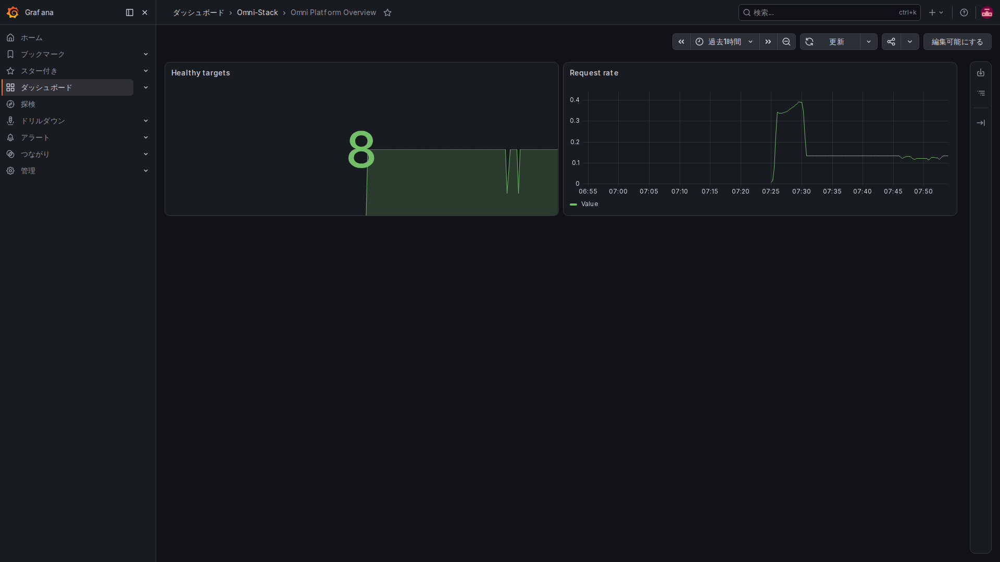

# 1. 可観測性の基礎：システムが遅いとき、何を見るか

申請を送信したのに画面が処理中のままだとします。「ある API が時間切れになった」だけでは原因が分かりません。アクセスが急増したのか、データベース接続を使い切ったのか、呼び出し先が遅いのか。可観測性は、利用者に見えた症状から問題箇所を調べるための手掛かりを残すことです。

この時間切れの話と数字は説明用で、現在の障害報告ではありません。リポジトリに設定はありますが、任意の観測スタックは既定で無効です。設定ファイルの存在は、画面に実データがある証明にはなりません。

## まず実際の監視画面を見てみる

同じローカル full 環境で撮影した画面です。左側は監視ツールのメニュー、Healthy targets は Prometheus が現在収集できる業務サービス数、Request rate は要求が増える速さを示します。八つという数は今回の全構成のもので、core プリセットでも八つ必要という意味ではありません。

右上で過去一時間を選び、曲線が変わる時刻を比べます。大きな 8 は接続中の利用者数でも、八種類の業務がすべて検証済みという印でもありません。再起動で一時的に下がる場合は、収集対象のページで原因を確認します。

画像はコンテナ内のブラウザーで撮影し、ページの文字や曲線は加工していません。Grafana のメニューは選択した言語ですが、リポジトリのダッシュボード名とパネル名は英語のままなので本文で説明します。Prometheus と Alloy は英語の標準画面を共用します。数字は撮影時のローカル環境の状態です。

## 三つの手掛かりは違う質問に答える

| 種類 | 身近な例 | 分かること |
|---|---|---|
| メトリクス Metrics | 定期的な体温・脈拍 | 要求が多いか、失敗率が高いか、処理が滞留しているか |
| ログ Logs | 出来事の記録 | 特定の操作で何が起き、どこを詳しく調べるか |
| トレース Trace | 複数の窓口を回った一件の所要時間表 | どのサービスを通り、どこで時間がかかったか |

メトリクスは一定期間の傾向、ログは具体的な出来事、トレースは一件の経路を示します。組み合わせて遅延の理由を調べます。同じ情報の三つのコピーではなく、見栄えのよい画面だけで三つが揃うわけでもありません。

## 遅い一件を調べる順序

まず要求数、エラー率、処理時間の推移で、一時的か継続的かを確かめます。次に時刻、サービス、関連 ID でログを探し、具体的な要求を特定します。その要求がサンプリングされ、正常に保存された場合は、トレースでゲートウェイ、業務サービス、呼び出し先の時間を比べます。

ログの関連 ID はあるのにトレースがない場合も、アプリケーションに要求が届かなかったとは限りません。追跡が無効、対象外のサンプリング、転送失敗などがあります。後のページで互換 ID の仕組みを説明します。

## HTTP の成功と業務の成功を分ける

5xx でない応答は、その種類のサーバーエラーではなかったという意味です。業務検査で拒否されたり、まだ承認待ちだったりするかもしれません。ヘルスチェックも検査対象の状態を示すだけで、購買、承認、メッセージ送信の全経路成功を証明しません。

Outbox に保存済みでも相手の受領済みとは限らず、フロー終了も伝票更新を意味しません。観測は段階を区別する証拠であり、業務規則の代わりではありません。

## 初めに誤解しやすい数字

要求総数は累積値なので、総数だけでなく一定時間での増え方を見ます。滞留件数は現在値で増減します。処理時間では平均と遅い側の分布を区別します。

P95 は大まかに、選んだ時間・要求集合の約 95% がその値以内だったことを示します。最遅値や平均ではなく、時間窓、標本数、計算方式にも左右されます。

データなし、ゼロ、検索失敗は別です。空のグラフを「異常なし」と決めつけません。

## 六つのページで読む

| ページ | 内容 |
|---|---|
| [2. 構成と道具の選択](observability-design.jp.md) | 情報の生成・運搬・保存・表示の分担 |
| [3. メトリクスと実装](observability-metrics.jp.md) | 計測と収集、ラベルを制限する理由 |
| [4. トレースとログ](observability-tracing.jp.md) | 一件の関連付けと対象プロジェクトのログ収集 |
| [5. アラートと目標](observability-alerts.jp.md) | 条件成立、通知到達、サービス目標の区別 |
| [6. 導入と障害調査](observability-practice.jp.md) | 経路の段階確認、新機能で残す手掛かり |

[OpenTelemetry の公式説明](https://opentelemetry.io/docs/concepts/signals/)は任意の参考です。先に外部資料を読む必要はありません。
