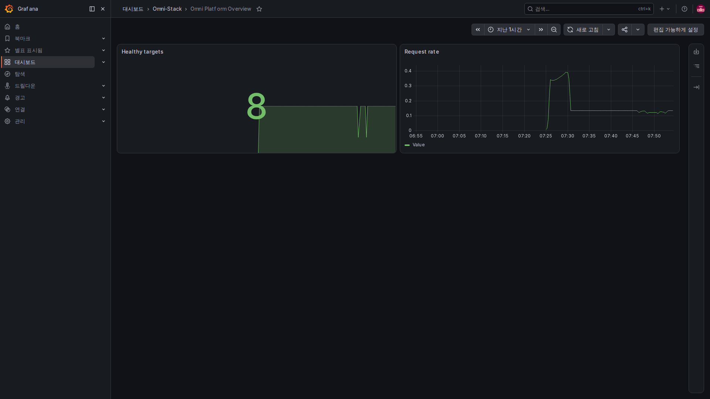

# 1. 관측 가능성의 기초: 시스템이 느릴 때 무엇부터 볼까

신청을 제출했는데 화면이 계속 처리 중이라고 가정해 보겠습니다. API 하나가 시간 초과되었다는 사실만으로는 원인을 알기 어렵습니다. 요청이 갑자기 늘었는지, 데이터베이스 연결을 다 썼는지, 호출한 서비스가 느린지 찾아야 합니다. 관측 가능성은 사용자가 겪은 증상에서 문제 위치까지 추적할 단서를 남기는 것입니다.

이 시간 초과 이야기와 수치는 설명용 예시이며 현재 장애 보고가 아닙니다. 저장소에 관측 설정은 있지만 선택형 관측 스택은 기본적으로 꺼져 있습니다. 설정 파일이 있다고 화면에 실제 데이터가 있다는 뜻은 아닙니다.

## 먼저 실제 모니터링 화면을 살펴보자

같은 로컬 full 환경에서 촬영한 화면입니다. 왼쪽은 모니터링 도구의 메뉴입니다. Healthy targets는 Prometheus가 현재 수집할 수 있는 업무 서비스 수, Request rate는 요청이 들어오는 속도를 나타냅니다. 여덟 대상은 이번 전체 배포의 수이며 core 프리셋에서도 같은 수를 기대하면 안 됩니다.

오른쪽 위에서 최근 한 시간을 선택하고 곡선이 바뀐 시각을 비교하세요. 큰 숫자 8은 접속 중인 사용자 수나 여덟 업무 여정의 검증 완료 표시가 아닙니다. 재시작 때문에 잠깐 내려갈 수 있으므로 수집 대상 페이지에서 원인을 확인합니다.

이미지는 컨테이너 브라우저로 촬영했으며 웹 내용이나 곡선을 고치지 않았습니다. Grafana 탐색 메뉴는 선택한 언어를 쓰지만 저장소가 제공하는 대시보드와 패널 제목은 영어로 유지되어 본문에서 뜻을 설명합니다. Prometheus와 Alloy는 기본 영어 화면을 공용 이미지로 씁니다. 숫자는 촬영 당시 로컬 환경을 보여 줍니다.

## 세 가지 단서는 다른 질문에 답한다

| 신호 | 비유 | 알 수 있는 것 |
|---|---|---|
| 메트릭 Metrics | 주기적으로 잰 체온과 맥박 | 요청이 많은지, 실패 비율이 높은지, 적체가 늘어나는지 |
| 로그 Logs | 사건이 생길 때 남긴 기록 | 특정 동작에서 무슨 일이 생겼고 어디를 더 살펴볼지 |
| 트레이스 Trace | 여러 창구를 거친 한 건의 시간표 | 이 요청이 어느 서비스를 지났고 어디서 시간을 썼는지 |

메트릭은 일정 기간의 추세, 로그는 구체적인 사건, 트레이스는 요청 한 건의 경로를 봅니다. 함께 써야 왜 느렸는지 찾기 쉽습니다. 같은 데이터 세 벌이 아니며 보기 좋은 대시보드 하나로 모두 갖춰지는 것도 아닙니다.

## 느린 요청 한 건을 조사하는 순서

먼저 요청량·오류율·소요 시간 그래프로 순간적인지 지속적인지 확인합니다. 그다음 발생 시각·서비스·연관 ID로 로그를 찾아 특정 요청을 확인합니다. 그 요청이 샘플링되고 정상 저장되었다면 트레이스를 열어 게이트웨이·업무 서비스·하위 호출의 시간을 비교합니다.

로그의 연관 ID만 있고 트레이스가 없어도 애플리케이션이 요청을 받지 않았다고 단정하면 안 됩니다. 추적이 꺼져 있거나 샘플링되지 않았거나 내보내기가 실패했을 수 있습니다. 뒤에서 호환 연관 ID의 동작을 설명합니다.

## HTTP 성공과 업무 성공도 구분한다

5xx가 없다는 것은 그 종류의 서버 오류가 없었다는 뜻일 뿐입니다. 업무 검증에서 거부되었거나 승인 대기 중일 수도 있습니다. 상태 점검 통과도 설정된 검사의 범위를 증명하며 구매·승인·메시지 전달 전체의 성공을 보장하지 않습니다.

Outbox에 저장되었다고 상대가 받았다는 뜻은 아니며 프로세스 종료가 업무 전표 갱신을 뜻하지도 않습니다. 관측은 이 단계를 구분하는 증거이며 업무 규칙을 대신하지 않습니다.

## 처음에 오해하기 쉬운 수치

요청 총수는 누적값이므로 크기 자체보다 일정 시간 동안 증가하는 속도를 보는 경우가 많습니다. 현재 적체는 오르내릴 수 있는 현재값입니다. 소요 시간은 평균과 느린 쪽 분포를 구분해야 합니다.

P95는 대략 선택한 기간과 요청 집합의 약 95%가 그 값 이하의 시간에 끝났다는 뜻입니다. 최댓값이나 평균이 아니며 시간 창·표본 수·통계 방식의 영향을 받습니다.

데이터 없음·0·조회 실패는 서로 다른 상태입니다. 빈 그래프를 이상 없음으로 읽으면 안 됩니다.

## 여섯 페이지 읽기

| 페이지 | 내용 |
|---|---|
| [2. 구조와 도구 선택](observability-design.kr.md) | 정보 생성·이동·저장·표시의 분담 |
| [3. 메트릭과 구현](observability-metrics.kr.md) | 수치 기록·수집과 라벨을 제한하는 이유 |
| [4. 트레이스와 로그](observability-tracing.kr.md) | 요청 연관과 이 프로젝트 로그만 수집하기 |
| [5. 경보와 목표](observability-alerts.kr.md) | 조건 발생·통지 전달·서비스 목표 구분 |
| [6. 적용과 문제 해결](observability-practice.kr.md) | 각 단계 확인과 새 기능에 남길 단서 |

[OpenTelemetry 공식 신호 안내](https://opentelemetry.io/docs/concepts/signals/)는 선택적으로 볼 자료입니다. 먼저 외부로 이동할 필요는 없습니다.
