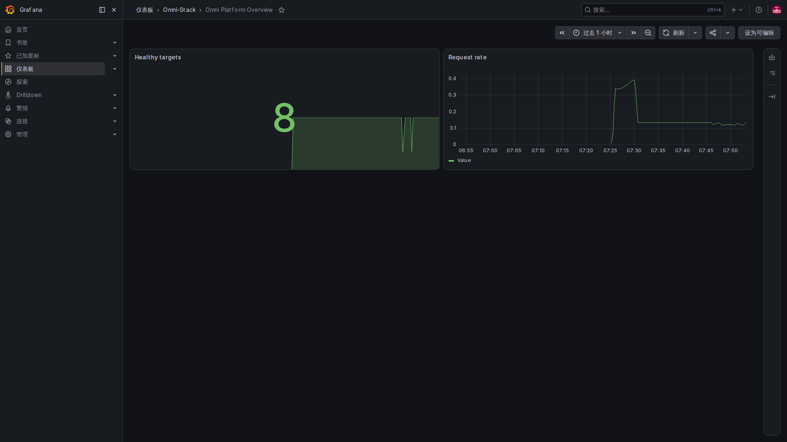

# 1. 从零认识可观测：系统慢了，先看什么

假设你点了“提交申请”，页面一直转圈。只知道“有一个接口超时”还不够：是请求突然变多、数据库连接用完，还是某个下游服务变慢？可观测要做的，就是留下足够的线索，让你从用户看到的现象追到发生问题的位置。

本页中的超时故事和数字是教学例子，不是当前环境的故障报告。仓库已经提供观测配置，但可选观测栈默认关闭；有配置不等于这些页面现在已有数据。

## 先看一张真正的监控网页

这张图来自同一套本地 full 环境。左边的菜单是监控工具自己的入口；中间的 Healthy targets 表示 Prometheus 当前能抓取到多少个业务服务，右边 Request rate 表示最近请求增长的速度。截图中的八个目标来自这次完整部署，core 预设不能照抄这个数量。

先在右上角选“最近一小时”，再看曲线的变化时间。左侧的 8 不是在线用户数，也不是八条业务都验收成功。一次重启可能让曲线短暂下落；要到采集目标页查原因，不能只看绿色大数字。

本章原图由容器浏览器采集，没有改网页内容或补画曲线。Grafana 导航使用对应语言，仓库提供的看板和面板标题保留英文，正文会解释含义。Prometheus 与 Alloy 原生页共用英文原图；图上的数字只代表拍摄时的本地环境。

## 三种线索，各回答一个问题

| 线索 | 像什么 | 能回答什么 |
|---|---|---|
| 指标 Metrics | 定期记录的体温和心率 | 最近请求多不多、失败比例高不高、积压是否增加 |
| 日志 Logs | 发生事情时留下的记录 | 哪次操作发生了什么错误，哪个环节需要继续查 |
| 链路 Trace | 一次办事经过各窗口的时间单 | 这次请求经过哪些服务，时间花在哪一段 |

指标看一段时间的整体趋势，日志看具体事件，链路看一次请求的路径。三者放在一起，才更容易解释“刚才为什么慢”。它们不是三份一模一样的数据，也不是有一张漂亮看板就都具备了。

## 用一次慢请求练习思路

先看最近的请求量、错误率和耗时曲线，判断是一瞬间还是持续异常。再用出问题的时间、服务和关联编号查日志，找出具体请求。如果这次请求被采样并成功送入链路存储，就继续打开它的链路，比较网关、业务服务和下游调用的耗时。

如果只有日志关联编号，却查不到链路，不能立即认定应用没收到请求。链路可能未启用、没有被采样，或导出失败。日志篇会说明项目怎样保留兼容关联编号。

## 请求成功率和业务成功率也要分开

HTTP 没有返回 5xx，只说明没有这类服务端错误；业务可能返回了校验拒绝，也可能仍在审批中。健康检查通过，说明检查覆盖的能力可用，不证明采购、审批、发消息等完整业务都成功。

同理，某条消息已经放进 Outbox，不等于接收方收到；流程结束，不等于业务单据更新。可观测是帮助分辨这些阶段的证据，不能代替业务规则。

## 初学时最容易误读的几个数字

请求总数是累计量，通常看一段时间内增长得多快，而不是只看总数大不大。当前积压数是这一刻的量，可以升也可以降。耗时分布则需要区别平均值和较慢的一批请求。

P95 可以粗略理解为：在选定时间和请求集合里，约 95% 的请求耗时不超过这个值。它不是最慢的一次，也不是平均耗时；查询窗口、样本数量和统计方式都会影响结果。

没有数据、值为零、查询失败也不是同一种状态。不要把空白图自动读成“没有故障”。

## 本章的阅读顺序

| 页 | 内容 |
|---|---|
| [2. 架构和工具选择](observability-design.md) | 谁产生、搬运、保存和展示数据，为什么有多个组件 |
| [3. 指标和工程源码](observability-metrics.md) | 指标怎样产生、怎样被抓取，标签为什么不能乱加 |
| [4. 链路和日志](observability-tracing.md) | 一次请求如何关联，日志如何只采集本项目 |
| [5. 告警与目标](observability-alerts.md) | 条件触发、通知送达、服务目标怎样区分 |
| [6. 接入与排障](observability-practice.md) | 怎样逐步确认整条链，新增功能要留下哪些线索 |

如果希望进一步了解信号分类，可自行阅读 [OpenTelemetry 官方说明](https://opentelemetry.io/docs/concepts/signals/)。继续读本章不需要先离开本站。
