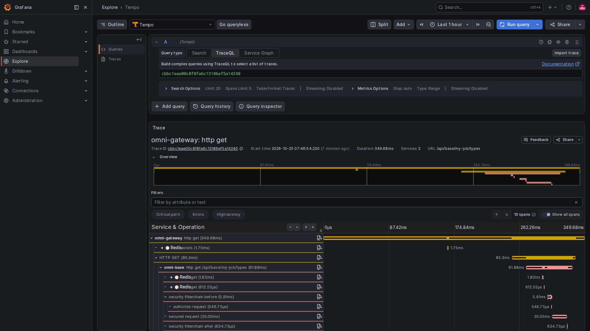
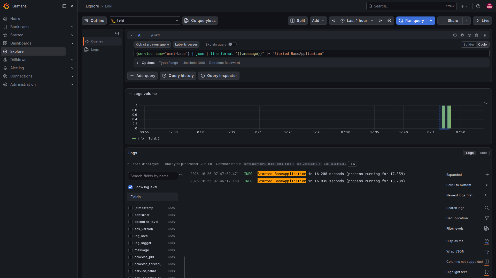
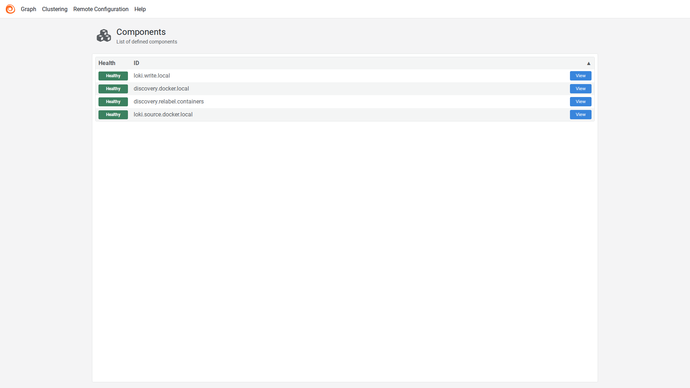

# 4. Traces and logs: find the stage behind a particular failure

One request may travel from the browser through a gateway to a business service, database or other services. A trace connects its segments, usually called spans. Logs record specific events during processing.

A correlation ID helps find the same event. It is not an access credential and does not guarantee that a trace was stored.

## First excerpt: prefer the real trace ID

The Servlet shared module's TraceIdFilter chooses an ID like this:

<!-- omni:source path="omni-backend/omni-common/src/main/java/com/omni/common/web/TraceIdFilter.java" -->
```java
    private String resolveTraceId(String incoming) {
        Tracer tracer = tracerSupplier.get();
        Span currentSpan = tracer == null ? null : tracer.currentSpan();
        if (currentSpan != null && currentSpan.context() != null) {
            return currentSpan.context().traceId();
        }
        return incoming != null && SAFE_TRACE_ID.matcher(incoming).matches()
                ? incoming : UUID.randomUUID().toString().replace("-", "");
    }
```

If a Micrometer span exists, its traceId wins. Otherwise, the filter accepts an old X-Trace-Id matching its format rule, or generates a compatibility ID. An ID in a log or response header therefore does not establish a corresponding Tempo trace.

Cross-service propagation uses W3C traceparent. The compatibility header does not replace it, and manually reusing a string cannot create spans for service calls.

## Second excerpt: clear log context after use

The same filter adds the ID to logging context:

<!-- omni:source path="omni-backend/omni-common/src/main/java/com/omni/common/web/TraceIdFilter.java" -->
```java
        MDC.put(MDC_KEY, traceId);
        try {
            filterChain.doFilter(request, response);
        } finally {
            MDC.remove(MDC_KEY);
        }
    }
```

Think of MDC as a small set of details attached to logs on the current thread. finally removes the ID so a reused thread does not carry the previous request into the next one. Asynchronous threads and message consumers cannot inherit an entire trace merely from this thread-local information.

## Third excerpt: move traces through a collector into storage

The actual Collector traces pipeline is:

<!-- omni:source path="observability/otel-collector/config.yaml" -->
```yaml
  pipelines:
    traces:
      receivers: [otlp]
      processors: [memory_limiter, batch]
      exporters: [otlp/tempo]
```

It accepts OTLP, applies memory limiting and batching, then forwards to Tempo. memory_limiter and batch are relay policies; Collector is not the historical trace database. Sampling chooses requests to record, while export, network and storage determine whether those records can be queried.

## Fourth excerpt: filter containers before collecting logs

After Docker discovery, Alloy filters by the Compose project label. This is the beginning of its relabel configuration, stopping after the first rule:

<!-- omni:source path="observability/alloy/config.alloy" -->
```hcl
discovery.relabel "containers" {
  targets = discovery.docker.local.targets

  rule {
    source_labels = ["__meta_docker_container_label_com_docker_compose_project"]
    regex         = sys.env("OMNI_COMPOSE_PROJECT")
    action        = "keep"
  }
```

Only targets matching OMNI_COMPOSE_PROJECT remain. The log source consumes that filtered set:

<!-- omni:source path="observability/alloy/config.alloy" -->
```hcl
loki.source.docker "local" {
  host       = "unix:///var/run/docker.sock"
  targets    = discovery.relabel.containers.output
  forward_to = [loki.write.local.receiver]
}
```

It forwards to the local Loki writer rather than collecting logs from every discovered container. A read-only Docker socket mount still exposes a high-privilege control plane. The local template is not automatically a production least-privilege design.

ECS JSON is a structured log format, useful for field-based queries. Structure does not establish redaction: passwords, tokens, cookies, Authorization, request bodies and message bodies must not be logged merely for convenience.

## Follow a message across a time boundary

Outbox retains producer_trace_id. The sender passes correlation fields through omniProducerTraceId and omniMessageId headers. Each relay delivery creates its own relay span; consumers also have their own trace IDs.

Start with msgId to find the same message, then query logs and traces using producerTraceId, relayTraceId and consumerTraceId separately. They need not belong to one trace. Three IDs do not prove an uninterrupted parent-child trace. Older messages lacking a producer ID can still be delivered.

Grafana data sources configure trace/log correlation, but successful navigation also depends on field format, time range, sampling and stored data.

## Inspect one real request in the browser



Open Grafana Explore, select Tempo, choose TraceQL, enter a recorded trace ID and run the query. The native interface recognizes the ID and displays the request details below. This image shows a real GET for personal job types using the local test identity. It created no job or approval document.

Services 2 means two services participated. The 10 spans are ten processing segments, not ten business submissions. Indentation shows relationships and horizontal bars show start positions and durations. Gateway calls Base, which includes authorization and Redis processing. Scroll for additional rows and select a span to inspect its attributes.

A parent span normally already includes its children's time, so adding all bars does not give the user's total wait. This image establishes actual storage of this request in Tempo, not sampling of every request or completion of asynchronous messages. Tracing was temporarily enabled only for Gateway and Base, then restored to the original disabled export and zero sampling after persistence was confirmed. Project defaults remain unchanged.

## Inspect logs: narrow the search before reading events



In Explore, switch the data source to Loki. Select the period and service, filter the message content, then choose Run query. Logs volume shows the distribution of matching entries over time; the actual lines appear below it.

This query selects Base startup-success messages and formats the display to show only the message field. Stored log content is unchanged. These are startup records rather than errors from the business request: the two entries came from the actual restarts used to enable tracing and restore its settings. Investigate a request using its time and correlation ID rather than substituting startup evidence.

## Alloy: inspect the stages that move logs



On local port 12345, discovery.docker.local discovers containers, discovery.relabel.containers filters the project, loki.source.docker.local reads logs, and loki.write.local sends them to Loki. View opens a component's details; Graph shows their connections.

Healthy is that component's current health assessment, not a guarantee that every entry arrived. Querying real content in Loki, as above, establishes that at least those entries passed collection, storage and retrieval. The native Alloy page is English; it is not presented as a four-language interface.

Continue to [alerts](observability-alerts.en.md).
