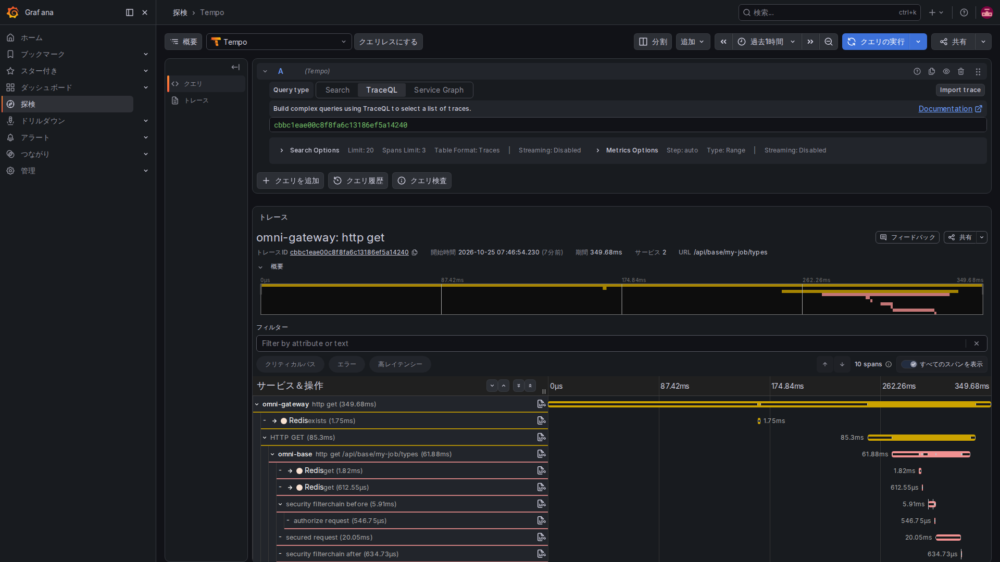
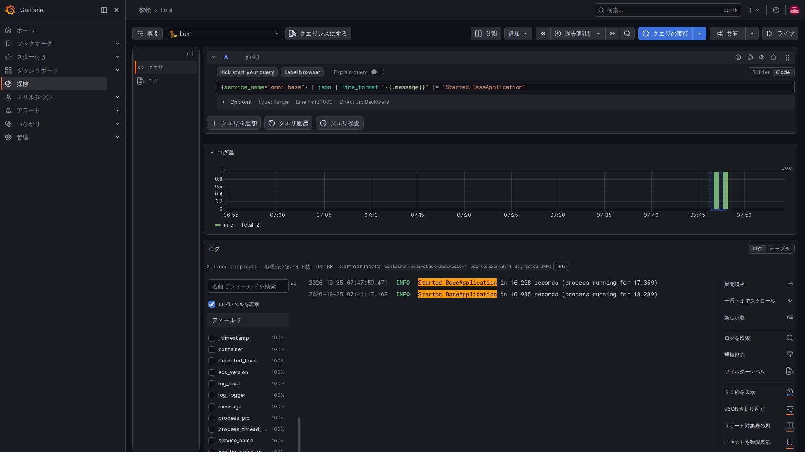
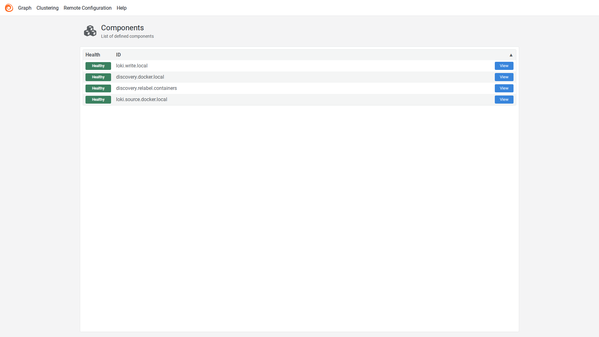

# 4. トレースとログ：一件の異常から問題箇所を探す

ブラウザーからの要求は、ゲートウェイ、業務サービス、データベースや他サービスを通ることがあります。Trace は一件の処理区間を関連付けます。各区間を通常 Span と呼び、ログはその処理で起きた具体的な出来事を残します。

関連 ID は同じ出来事を探す手掛かりであり、アクセス権でも、トレース保存済みの保証でもありません。

## 一つ目：実際のトレース ID を優先する

Servlet 共通モジュールの TraceIdFilter は次のように選びます。

<!-- omni:source path="omni-backend/omni-common/src/main/java/com/omni/common/web/TraceIdFilter.java" -->
```java
    private String resolveTraceId(String incoming) {
        Tracer tracer = tracerSupplier.get();
        Span currentSpan = tracer == null ? null : tracer.currentSpan();
        if (currentSpan != null && currentSpan.context() != null) {
            return currentSpan.context().traceId();
        }
        return incoming != null && SAFE_TRACE_ID.matcher(incoming).matches()
                ? incoming : UUID.randomUUID().toString().replace("-", "");
    }
```

現在の Micrometer Span があれば、その traceId を使います。なければ形式条件に合う旧 X-Trace-Id を受け入れるか、互換 ID を新しく作ります。ログや応答ヘッダーに番号があっても、Tempo に該当トレースがあるとは限りません。

サービス間の標準的な伝播は W3C traceparent を使います。互換ヘッダーで代用できず、同じ文字列を手で渡すだけで呼び出しの Span が作られることもありません。

## 二つ目：ログ文脈を使い終わったら消す

同じフィルターがログのコンテキストへ ID を入れます。

<!-- omni:source path="omni-backend/omni-common/src/main/java/com/omni/common/web/TraceIdFilter.java" -->
```java
        MDC.put(MDC_KEY, traceId);
        try {
            filterChain.doFilter(request, response);
        } finally {
            MDC.remove(MDC_KEY);
        }
    }
```

MDC は現在のスレッドのログに添える小さな情報袋と考えてください。finally で消し、再利用されたスレッドが前の要求の番号を残さないようにします。非同期スレッドやメッセージ受信が、このスレッド局所情報だけで全トレースを継承するわけではありません。

## 三つ目：中継を通して保存先へ送る

Collector の実際の traces 経路です。

<!-- omni:source path="observability/otel-collector/config.yaml" -->
```yaml
  pipelines:
    traces:
      receivers: [otlp]
      processors: [memory_limiter, batch]
      exporters: [otlp/tempo]
```

OTLP を受け、メモリ制限とまとめ処理を通し、Tempo へ送ります。memory_limiter と batch は中継方針であり、Collector は履歴検索データベースではありません。記録対象を決めるサンプリングに加え、転送、ネットワーク、保存も検索可否に影響します。

## 四つ目：プロジェクトを絞ってからログを集める

Alloy は Docker で見つけたコンテナを Compose プロジェクトラベルで絞ります。以下は relabel 設定の冒頭で、最初の規則までの抜粋です。

<!-- omni:source path="observability/alloy/config.alloy" -->
```hcl
discovery.relabel "containers" {
  targets = discovery.docker.local.targets

  rule {
    source_labels = ["__meta_docker_container_label_com_docker_compose_project"]
    regex         = sys.env("OMNI_COMPOSE_PROJECT")
    action        = "keep"
  }
```

OMNI_COMPOSE_PROJECT に合う対象だけを残し、ログ収集元は絞り込み後の集合を使います。

<!-- omni:source path="observability/alloy/config.alloy" -->
```hcl
loki.source.docker "local" {
  host       = "unix:///var/run/docker.sock"
  targets    = discovery.relabel.containers.output
  forward_to = [loki.write.local.receiver]
}
```

後でローカル Loki の送信先へ渡します。発見したすべてのコンテナを収集するわけではありません。Docker socket は読み取り専用マウントでも高権限の制御面です。ローカル設定をそのまま本番の最小権限構成とは見なせません。

ECS JSON はフィールドで検索しやすい構造化ログです。構造化は自動マスキングではありません。調査の都合だけで、パスワード、トークン、Cookie、Authorization、要求本文、メッセージ本文を書いてはいけません。

## 時間をまたぐメッセージを調べる

Outbox は生成時の producer_trace_id を保存し、送信時に omniProducerTraceId と omniMessageId ヘッダーで関連情報を渡します。中継は配送ごとに自分の relay span を作り、受信側にも独自の追跡番号があります。

まず msgId で同じメッセージを探し、producerTraceId、relayTraceId、consumerTraceId のログと Trace をそれぞれ確認します。同一 Trace とは限らず、三番号の存在だけで切れ目のない親子関係を証明できません。生成元番号のない過去メッセージも配送できます。

Grafana のデータソースには Trace・ログ間の関連検索がありますが、成功にはフィールド形式、時間範囲、サンプリング、保存データも必要です。

## 実際の一件をブラウザーで調べる



Grafana の Explore（探索）を開き、Tempo、TraceQL の順に選んで、記録しておいたトレース ID を入力して実行します。標準画面が番号を認識し、下に同じ要求の詳細を表示します。図はローカルのテスト用利用者が個人ジョブの種類を読み取った実際の GET です。ジョブや承認伝票は作成していません。

Services 2 は二つのサービス、10 spans は十個の処理区間という意味で、業務を十回送信したという意味ではありません。字下げが呼び出し関係、横棒が開始位置と時間を示します。ゲートウェイが Base を呼び、Base 内では権限検査や Redis 処理も行います。下へスクロールして続きを見たり、行を選んで属性を確認したりできます。

親の時間には通常、子の時間も含まれるので、横棒をすべて足して利用者の待ち時間にしないでください。この図は一件のトレースが Tempo に保存された証拠で、全要求の記録や非同期メッセージ完了の証明ではありません。撮影時はゲートウェイと Base だけ一時的に追跡を有効にし、保存を確認して元の転送無効・サンプリングゼロへ戻しました。既定値を全件記録に変えてはいません。

## ログは範囲を絞ってから本文を読む



Explore（探索）のデータソースを Loki に切り替えます。期間とサービスを選び、本文の条件を追加して Run query（クエリの実行）を実行します。Logs volume は一致したログの時間分布で、実際の行は下に表示されます。

図は Base の起動成功メッセージだけを検索し、表示用の書式で message フィールドだけを見せています。保存されたログは変更していません。この二行は要求のエラー記録ではなく、追跡の有効化と設定復元に伴う二回の実再起動の記録です。要求を調べるときは、その時刻と関連 ID を使い、起動ログで代用しないでください。

## Alloy でログを運ぶ各段階を確認する



ローカルの 12345 ポートで、discovery.docker.local はコンテナの発見、discovery.relabel.containers はプロジェクトの絞り込み、loki.source.docker.local は読み取り、loki.write.local は Loki への送信を担当します。View で詳細、Graph で接続関係を確認できます。

Healthy はその構成要素自身の現在の健康判断で、全行の到達保証ではありません。上の Loki 検索で実データが見つかれば、少なくともその行が収集・保存・検索を通ったことを確認できます。Alloy の標準画面は英語であり、四言語対応と見せかけていません。

次は[アラート](observability-alerts.jp.md)です。
