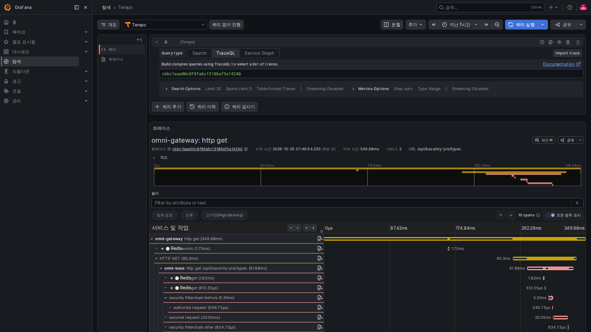
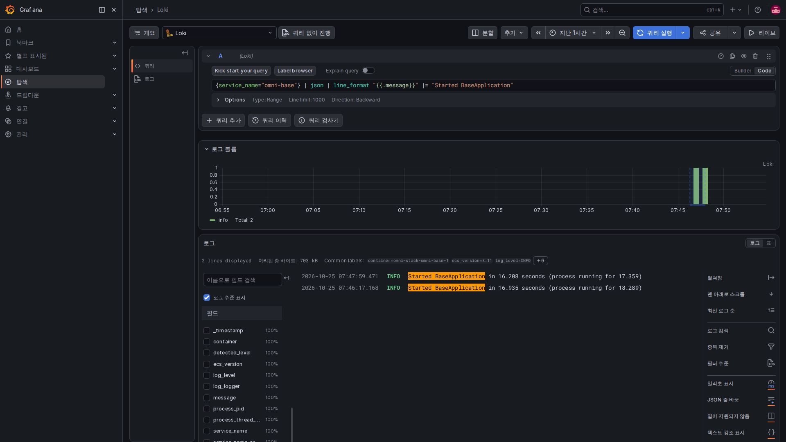
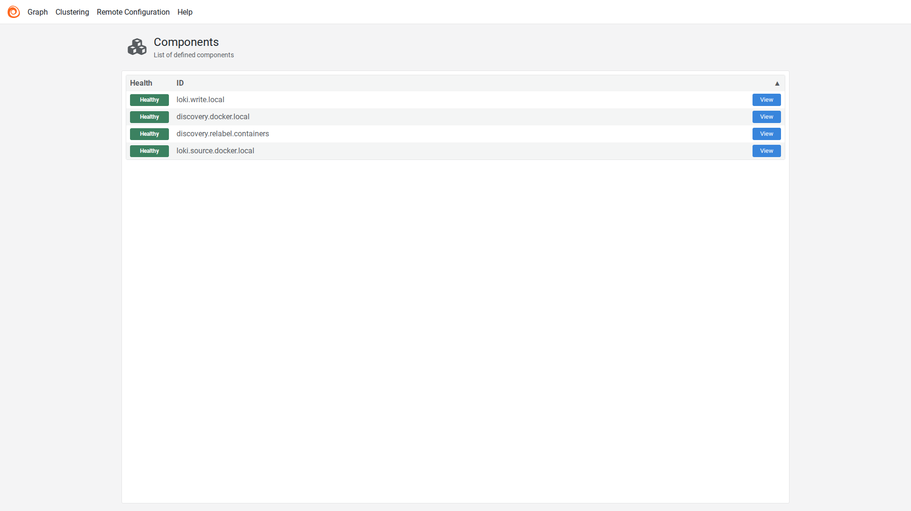

# 4. 트레이스와 로그: 특정 오류가 생긴 지점을 찾기

요청 한 건은 브라우저에서 게이트웨이·업무 서비스·데이터베이스·다른 서비스를 거칠 수 있습니다. Trace는 처리 구간을 연결하며 각 구간을 보통 Span이라고 합니다. 로그는 그 과정에서 생긴 사건을 기록합니다.

연관 ID는 같은 사건을 찾는 단서이지 접근 권한이나 트레이스 저장 보장이 아닙니다.

## 첫 코드: 실제 트레이스 ID 우선

Servlet 공통 모듈의 TraceIdFilter는 다음처럼 번호를 선택합니다.

<!-- omni:source path="omni-backend/omni-common/src/main/java/com/omni/common/web/TraceIdFilter.java" -->
```java
    private String resolveTraceId(String incoming) {
        Tracer tracer = tracerSupplier.get();
        Span currentSpan = tracer == null ? null : tracer.currentSpan();
        if (currentSpan != null && currentSpan.context() != null) {
            return currentSpan.context().traceId();
        }
        return incoming != null && SAFE_TRACE_ID.matcher(incoming).matches()
                ? incoming : UUID.randomUUID().toString().replace("-", "");
    }
```

현재 Micrometer Span이 있으면 그 traceId를 씁니다. 없으면 형식 조건에 맞는 기존 X-Trace-Id를 받거나 호환 ID를 생성합니다. 로그·응답 헤더에 번호가 있어도 Tempo에 같은 트레이스가 있다는 뜻은 아닙니다.

서비스 간 표준 전파에는 W3C traceparent를 씁니다. 호환 헤더가 이를 대신하지 않으며 같은 문자열을 직접 넣어도 서비스 호출 Span이 생기지는 않습니다.

## 두 번째: 로그 문맥을 쓰고 나면 지운다

같은 필터가 로그 문맥에 번호를 넣습니다.

<!-- omni:source path="omni-backend/omni-common/src/main/java/com/omni/common/web/TraceIdFilter.java" -->
```java
        MDC.put(MDC_KEY, traceId);
        try {
            filterChain.doFilter(request, response);
        } finally {
            MDC.remove(MDC_KEY);
        }
    }
```

MDC는 현재 스레드의 로그에 덧붙이는 작은 정보라고 생각하세요. finally에서 지워 재사용된 스레드가 이전 요청 번호를 다음 요청에 남기지 않게 합니다. 비동기 스레드·메시지 소비자는 이 스레드 로컬 정보만으로 전체 트레이스를 자동 상속하지 않습니다.

## 세 번째: 중계를 통해 저장소로 전달

Collector의 실제 traces 파이프라인입니다.

<!-- omni:source path="observability/otel-collector/config.yaml" -->
```yaml
  pipelines:
    traces:
      receivers: [otlp]
      processors: [memory_limiter, batch]
      exporters: [otlp/tempo]
```

OTLP를 받아 메모리 제한·배치 처리를 거쳐 Tempo로 보냅니다. memory_limiter와 batch는 중계 정책이며 Collector가 과거 트레이스 조회 데이터베이스는 아닙니다. 샘플링이 기록할 요청을 정하고 내보내기·네트워크·저장도 조회 가능 여부에 영향을 줍니다.

## 네 번째: 프로젝트로 거른 후 로그 수집

Alloy는 Docker에서 발견한 컨테이너를 Compose 프로젝트 라벨로 필터링합니다. 아래는 relabel 설정의 시작이며 첫 규칙까지만 발췌했습니다.

<!-- omni:source path="observability/alloy/config.alloy" -->
```hcl
discovery.relabel "containers" {
  targets = discovery.docker.local.targets

  rule {
    source_labels = ["__meta_docker_container_label_com_docker_compose_project"]
    regex         = sys.env("OMNI_COMPOSE_PROJECT")
    action        = "keep"
  }
```

OMNI_COMPOSE_PROJECT에 맞는 대상만 남깁니다. 로그 소스는 필터링된 집합을 사용합니다.

<!-- omni:source path="observability/alloy/config.alloy" -->
```hcl
loki.source.docker "local" {
  host       = "unix:///var/run/docker.sock"
  targets    = discovery.relabel.containers.output
  forward_to = [loki.write.local.receiver]
}
```

이후 로컬 Loki 기록기로 넘기며 발견한 모든 컨테이너 로그를 모으는 것은 아닙니다. 읽기 전용 Docker socket 마운트도 높은 권한의 제어면을 노출합니다. 현재 로컬 템플릿을 운영 최소 권한 설계로 간주하면 안 됩니다.

ECS JSON은 필드 검색을 돕는 구조화 로그 형식입니다. 구조화가 자동 비식별화는 아닙니다. 조사 편의를 위해 비밀번호·토큰·Cookie·Authorization·요청 본문·메시지 본문을 기록하면 안 됩니다.

## 시간 경계를 넘는 메시지를 조사하기

Outbox는 생성 시 producer_trace_id를 저장하고 송신 시 omniProducerTraceId·omniMessageId 헤더로 연관 필드를 전달합니다. 중계는 전달 시도마다 자체 relay span을 만들며 소비자도 자체 추적 번호를 가집니다.

먼저 msgId로 같은 메시지를 찾고 producerTraceId·relayTraceId·consumerTraceId의 로그와 Trace를 따로 확인합니다. 같은 Trace일 필요는 없으며 세 번호만으로 끊김 없는 부모·자식 관계를 증명할 수 없습니다. 생성 추적 번호가 없는 과거 메시지도 정상 전달할 수 있습니다.

Grafana 데이터 소스에 Trace·로그 연관 조회가 있지만 필드 형식·시간 범위·샘플링·실제 저장 데이터가 맞아야 이동할 수 있습니다.

## 실제 요청 한 건을 웹에서 조사하기



Grafana의 Explore(탐색)에서 Tempo와 TraceQL을 선택하고 기록한 트레이스 ID를 입력해 실행합니다. 기본 인터페이스가 번호를 인식하고 아래에 같은 요청의 상세 내용을 보여 줍니다. 그림은 로컬 테스트 신원으로 개인 작업 유형을 읽은 실제 GET 요청이며 작업이나 승인 문서를 만들지 않았습니다.

Services 2는 서비스 두 개, 10 spans는 처리 구간 열 개라는 뜻으로 업무 제출 열 번을 의미하지 않습니다. 들여쓰기는 호출 관계, 가로 막대는 시작 위치와 시간을 나타냅니다. 게이트웨이가 Base를 호출하고 Base 안에서는 권한 검사와 Redis 처리도 거칩니다. 아래로 스크롤해 나머지를 보거나 행을 눌러 속성을 확인하세요.

부모 구간 시간에는 보통 자식 시간이 포함되므로 막대를 모두 더하면 사용자 대기 시간이 되지 않습니다. 이 이미지는 해당 요청이 실제로 Tempo에 저장되었음을 보여 주며 모든 요청의 샘플링이나 비동기 메시지 완료를 증명하지 않습니다. 촬영을 위해 게이트웨이와 Base만 잠시 추적을 켰다가 저장을 확인한 뒤 원래의 내보내기 꺼짐·샘플링 0으로 복구했습니다. 기본값을 전량 수집으로 바꾸지 않았습니다.

## 로그는 범위를 줄인 다음 원문을 읽기



Explore(탐색)에서 데이터 소스를 Loki로 바꿉니다. 기간과 서비스를 정하고 메시지 조건을 추가한 다음 Run query(쿼리 실행)를 누릅니다. Logs volume은 일치한 로그의 시간 분포이며 실제 행은 아래에 표시됩니다.

그림은 Base 시작 성공 메시지만 조회하고 표시 형식으로 message 필드만 보여 줍니다. 저장된 로그는 바꾸지 않았습니다. 이 두 행은 업무 요청의 오류가 아니라 추적 활성화와 설정 복구에 따른 실제 두 번의 재시작 기록입니다. 요청을 조사할 때는 그 요청의 시각과 연관 ID를 써야 하며 시작 로그로 대신하면 안 됩니다.

## Alloy 화면에서 로그를 옮기는 단계를 확인하기



로컬 12345 포트에서 discovery.docker.local은 컨테이너 발견, discovery.relabel.containers는 프로젝트 필터, loki.source.docker.local은 읽기, loki.write.local은 Loki 전달을 맡습니다. View로 상세 상태, Graph로 연결 관계를 확인합니다.

Healthy는 각 구성 요소 자신의 현재 건강 판단으로 모든 로그의 전달 보장은 아닙니다. 위 Loki 화면처럼 실제 내용을 찾아야 적어도 그 행이 수집·저장·조회 경로를 통과했음을 확인할 수 있습니다. Alloy 기본 화면은 영어이며 4개 언어 제품처럼 꾸미지 않았습니다.

다음은 [경보와 목표](observability-alerts.kr.md)입니다.
