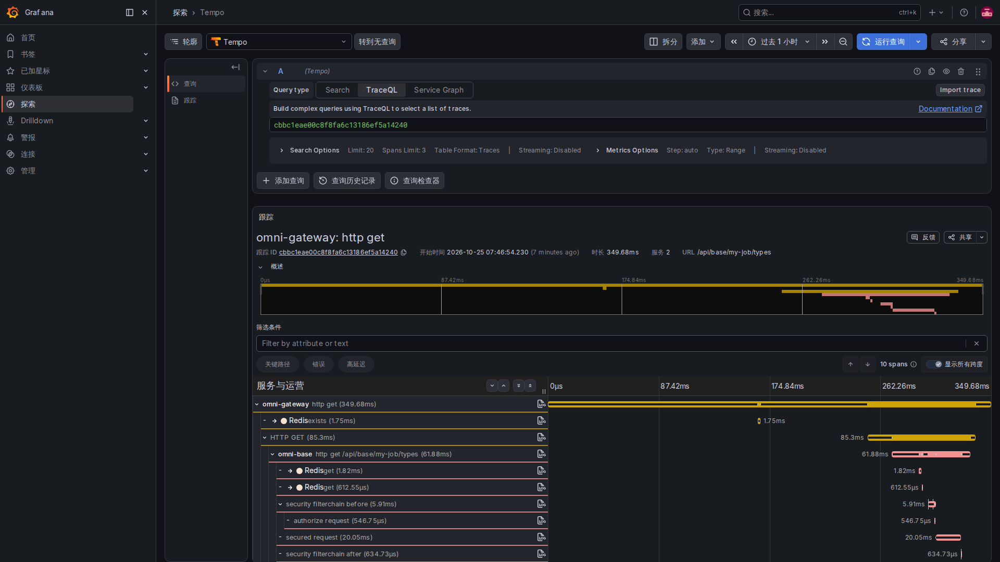
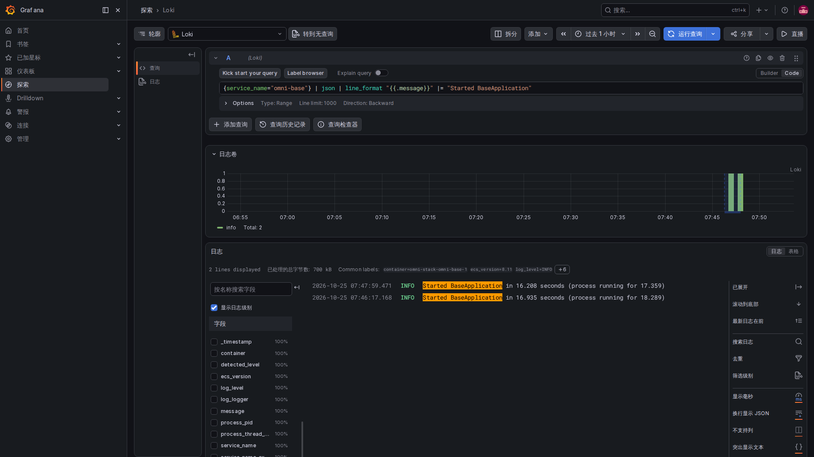
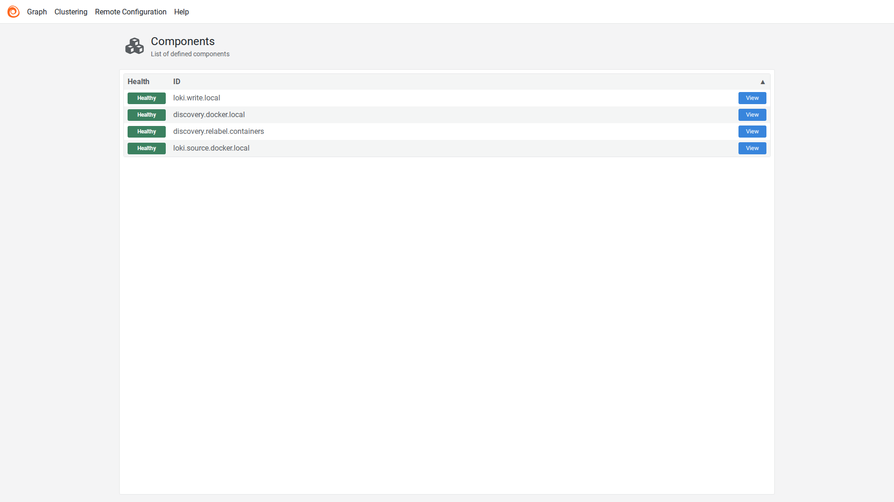

# 4. 链路与日志：从一次异常找到发生问题的环节

一次请求可能从浏览器经过网关，再到业务服务、数据库或其他服务。Trace 把这次请求的各段处理联系起来，每一段通常叫 Span。日志则记录在这些处理中发生的具体事件。

关联编号帮助找到同一件事，但编号本身不是访问权限，也不保证链路一定已经保存。

## 第一段：优先使用真实链路的编号

Servlet 公共模块的 TraceIdFilter 这样选择编号：

<!-- omni:source path="omni-backend/omni-common/src/main/java/com/omni/common/web/TraceIdFilter.java" -->
```java
    private String resolveTraceId(String incoming) {
        Tracer tracer = tracerSupplier.get();
        Span currentSpan = tracer == null ? null : tracer.currentSpan();
        if (currentSpan != null && currentSpan.context() != null) {
            return currentSpan.context().traceId();
        }
        return incoming != null && SAFE_TRACE_ID.matcher(incoming).matches()
                ? incoming : UUID.randomUUID().toString().replace("-", "");
    }
```

有当前 Micrometer Span 时，使用它的 traceId。没有时，只接收符合格式的旧 X-Trace-Id，或者生成新的兼容编号。因此日志中出现关联编号，甚至响应头里有 X-Trace-Id，都不意味着 Tempo 中必有对应链路。

跨服务的标准传播使用 W3C traceparent。兼容头不是它的替代品；手工拼一个相同字符串，也不会凭空产生服务调用的 Span。

## 第二段：日志文脉用完要清理

同一个过滤器把编号放进日志上下文：

<!-- omni:source path="omni-backend/omni-common/src/main/java/com/omni/common/web/TraceIdFilter.java" -->
```java
        MDC.put(MDC_KEY, traceId);
        try {
            filterChain.doFilter(request, response);
        } finally {
            MDC.remove(MDC_KEY);
        }
    }
```

MDC 可以理解为当前线程记录日志时随带的一小份信息。finally 清理，避免线程复用时把上一次请求编号带给下一次。异步线程和消息消费不能仅靠这份线程局部信息自动继承整条链路。

## 第三段：链路经中转站进入存储

Collector 的实际 traces 管道是：

<!-- omni:source path="observability/otel-collector/config.yaml" -->
```yaml
  pipelines:
    traces:
      receivers: [otlp]
      processors: [memory_limiter, batch]
      exporters: [otlp/tempo]
```

接收端使用 OTLP，先经过内存限制和批处理，再发给 Tempo。这里的 memory_limiter 和 batch 是中转策略，Collector 自身不是查询历史链路的数据库。采样决定哪些请求被记录，导出、网络和存储还决定这些记录能否被查到。

## 第四段：日志先筛项目，再采集

Alloy 发现 Docker 容器后，用 Compose 项目标签筛选。下方是重标记配置的开头，片段止于第一条规则：

<!-- omni:source path="observability/alloy/config.alloy" -->
```hcl
discovery.relabel "containers" {
  targets = discovery.docker.local.targets

  rule {
    source_labels = ["__meta_docker_container_label_com_docker_compose_project"]
    regex         = sys.env("OMNI_COMPOSE_PROJECT")
    action        = "keep"
  }
```

只有匹配 OMNI_COMPOSE_PROJECT 的目标被保留。后续日志源使用的是筛选后的集合：

<!-- omni:source path="observability/alloy/config.alloy" -->
```hcl
loki.source.docker "local" {
  host       = "unix:///var/run/docker.sock"
  targets    = discovery.relabel.containers.output
  forward_to = [loki.write.local.receiver]
}
```

它再转给本地 Loki 写入端，不是把发现的所有容器日志都采集进去。Docker socket 即使只读挂载也属于高权限控制面；当前本地模板不能直接视为生产最小权限方案。

ECS JSON 是结构化日志格式，便于按字段查找。结构化不等于已经脱敏：密码、令牌、Cookie、Authorization、请求体和消息体都不应该因为“排障方便”而写进日志。

## 消息跨过时间边界，要怎样继续查

Outbox 保存生产时的 producer_trace_id，发送时用 omniProducerTraceId 和 omniMessageId 消息头传递关联字段。中继每次投递创建自己的 relay span，消费侧也有自己的追踪编号。

排查时先按 msgId 找到同一条消息，再分别查看 producerTraceId、relayTraceId 和 consumerTraceId 对应的日志与 Trace。它们不一定是同一个 Trace，不能把“存在三个编号”写成已经有一条无断点的父子链。历史消息缺生产编号仍能正常投递。

当前 Grafana 数据源配置提供 Trace 与日志的关联查询；能否跳转还取决于字段格式、时间范围、采样和实际存储数据。

## 在网页里查一次真实请求



打开 Grafana 的 Explore（探索），选择 Tempo，进入 TraceQL，输入已经记录下来的链路编号并运行。原生界面能识别这个编号，下面会出现同一次请求的详情。图中是本地测试身份读取“个人任务类型”的真实 GET 请求，没有创建任务或审批单据。

顶部的 Services 2 表示涉及两个服务，10 spans 表示十个处理片段，并不是十次业务提交。下面按缩进展示调用关系，横条表示开始位置和持续时间；网关调用 Base，Base 内部还经过权限校验和 Redis 等处理。细节较多时继续向下滚动，点击某一条查看其属性。

父片段通常已经包含子片段的时间，不能把所有横条的耗时相加当作用户等待时间。这张图证明该请求的链路实际存入 Tempo，不证明所有请求都被采样，也不证明异步消息已经完成。采集时仅临时开启网关与 Base 的追踪，确认落库后恢复原来的关闭和零采样设置；项目默认值没有改成全量采样。

## 在网页里查日志：先缩小范围，再读原文



同样在 Explore（探索）中，把数据源切到 Loki。先选时间范围和服务，再按消息内容筛选，点击 Run query（运行查询）。上面的 Logs volume（日志量）是匹配日志随时间的分布，下面才是实际日志行。

图中只查询 Base 的启动成功消息，并用查询的显示格式只展示 message 字段，便于阅读。它没有修改存储的日志，也不是这次业务请求的错误记录；这两条启动消息分别来自临时启用追踪和恢复配置后的真实重启。需要排查请求时应改用实际时间与关联编号，不要用启动日志代替请求证据。

## Alloy 网页：确认搬运日志的几个环节



本地 12345 的组件页中，discovery.docker.local 负责发现，discovery.relabel.containers 按项目筛选，loki.source.docker.local 读取日志，loki.write.local 发送到 Loki。点击对应 View 可以继续查看状态，Graph 可以查看它们的连接关系。

Healthy 表示该组件当前的自身健康判断，不保证每一条日志都送达。要像上面的 Loki 页面一样查询到真实内容，才能确认至少这条数据已经经过采集、存储和查询。原生 Alloy 页面为英文，本章没有把它伪装成四语产品。

下一页解释异常什么时候成为[告警](observability-alerts.md)。
