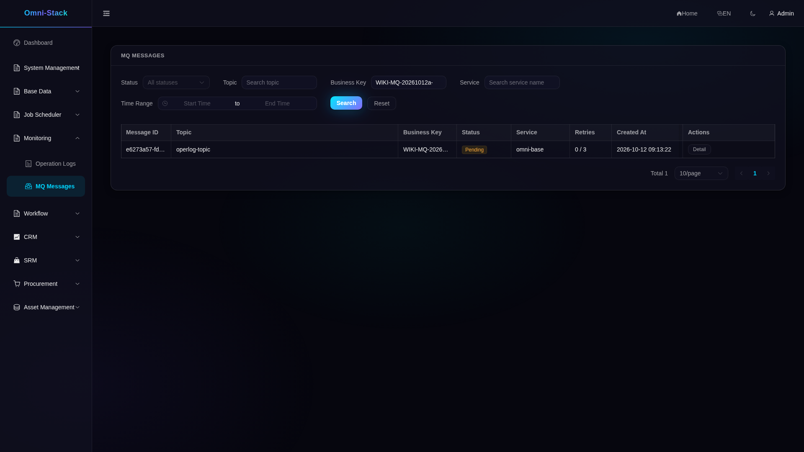
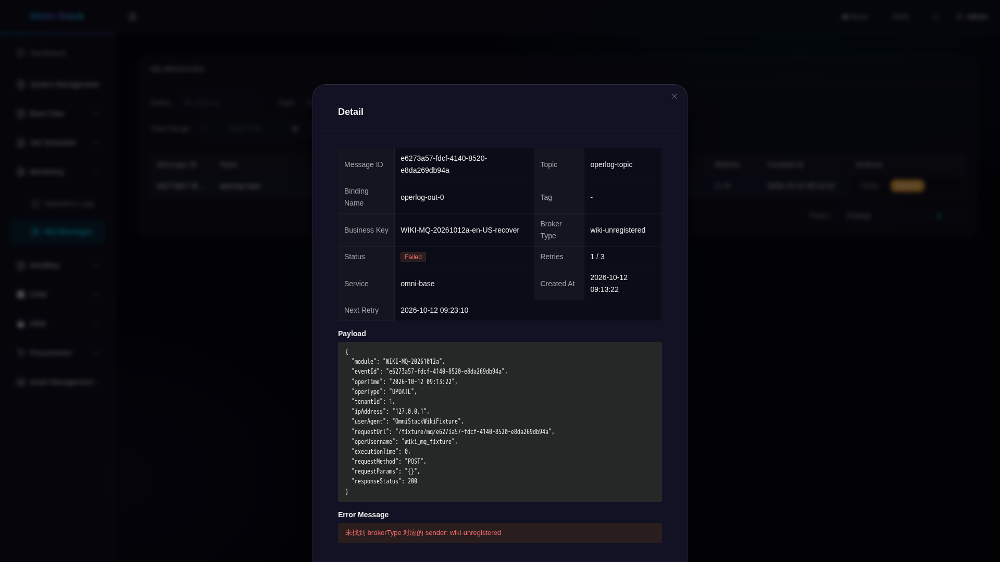
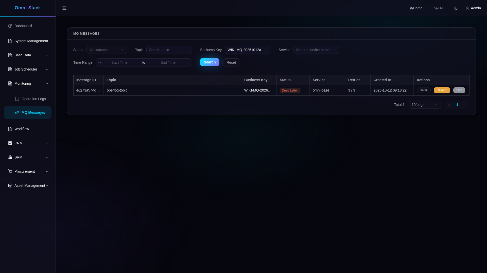
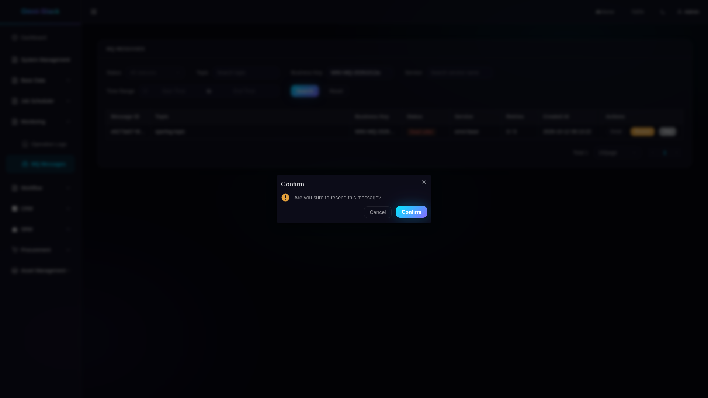
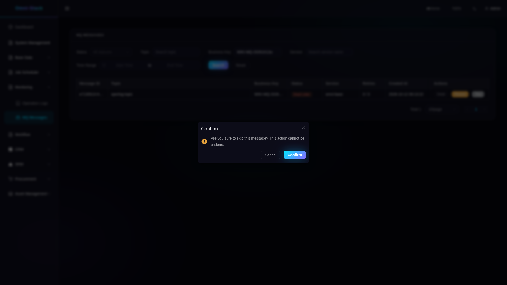
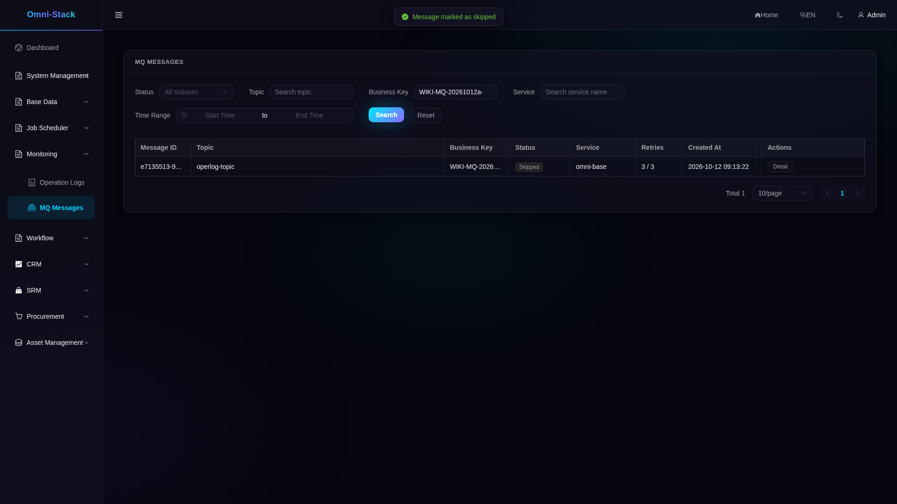
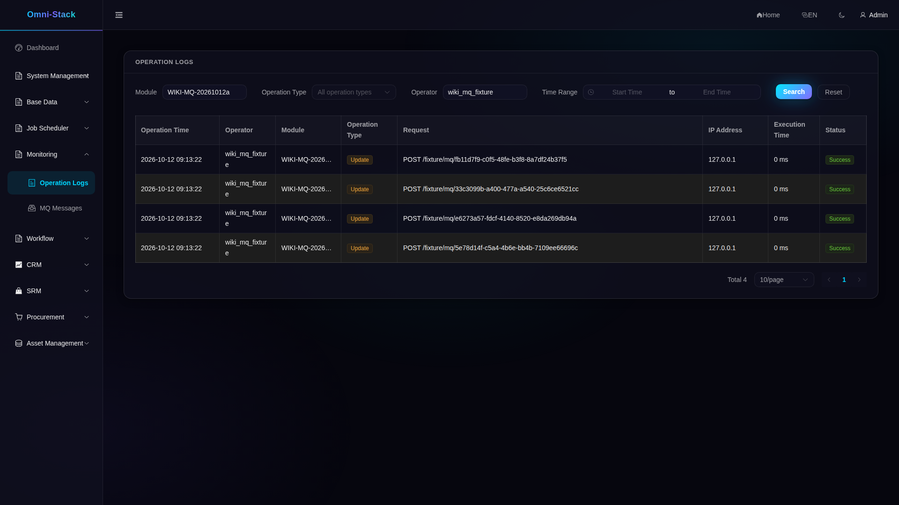
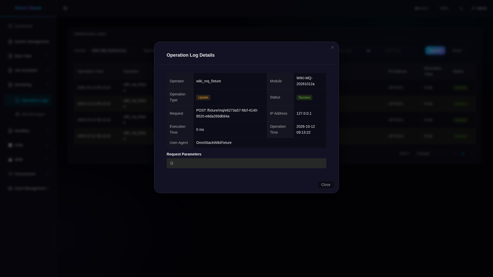
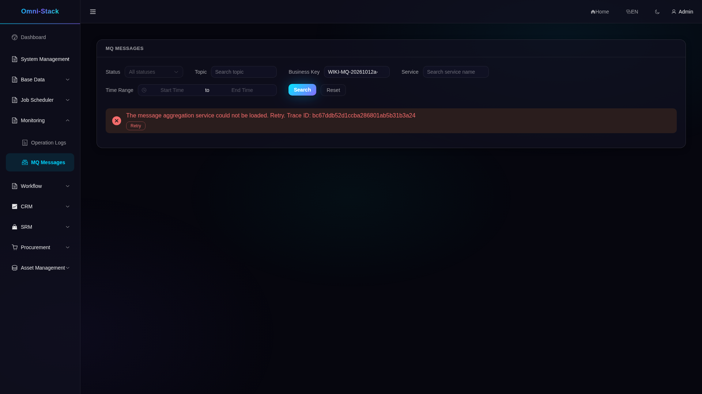
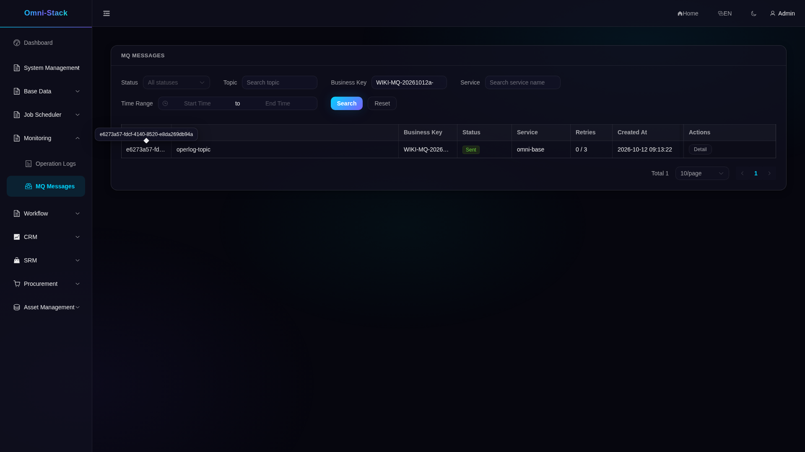

# Reliable messages: failure, retries and consumer deduplication

Baseline: 0.6.1, `fc165e3` and this remediation branch. These commands use full; core lacks the RocketMQ, XXL-JOB and CRM required by this exercise and cannot reproduce its delivery chain directly. The original evidence is dated 2026-10-12: [provenance and limits](../reference/evidence/mq-2026-10-12.json). That batch used SUPER_ADMIN; actual query, resend and skip checks require `base:mqmessage:list`, `base:mqmessage:resend` and `base:mqmessage:skip` respectively. An ordinary identity without the relevant authority is rejected. Every operation needs an explicit tenant.

## 1. Prepare an isolated environment

Complete private configuration and image preparation in [Quick start](../guides/quick-start.en.md). Use a unique project, external env file, separate volumes and no host ports; do not reuse standard omni-stack. Container browsers/API tools reach `http://omni-frontend:3000` on that project network. The overlay declares port resets for 16 full services; verify the root Compose includes/profiles and actual merged model for a new environment. Image builds, migrator exit 0 and service health still require actual checks; configuration declarations are not runtime proof.


```powershell
$project = 'omni-e2e-mq-yourrun'
$private = Join-Path $env:TEMP 'omni-mq-yourrun'
New-Item -ItemType Directory -Path $private -ErrorAction Stop
Copy-Item -LiteralPath .env.example -Destination "$private/.env.example" -ErrorAction Stop
docker run --rm --mount "type=bind,source=$PWD,target=/workspace,readonly" --mount "type=bind,source=$private,target=/evidence" omni-stack-tools:local node /workspace/tools/omni-cli/scripts/init-env.mjs --root /evidence
Move-Item -LiteralPath "$private/.env" -Destination "$private/teaching.env" -ErrorAction Stop
docker compose --env-file "$private/teaching.env" -p $project -f compose.yaml -f scripts/fixtures/compose.teaching.yaml --profile full up -d --build
docker compose --env-file "$private/teaching.env" -p $project -f compose.yaml -f scripts/fixtures/compose.teaching.yaml --profile full ps -a
```

## 2. Prepare traceable teaching records

Create an external output directory. The fixture creates 8 synthetic messages: one recover and one skip for each of 4 locales. It sets broker_type to the unregistered `wiki-unregistered` and holds initial delivery for 30 minutes; it does not alter the real bindingName/destination. These synthetic logs use operator `wiki_mq_fixture` and remain separate from business records and formal seeds. Filter by the receipt prefix; PENDING should offer details only. Never overwrite a receipt. If a write outcome is uncertain, Inspect before considering another Prepare.


```powershell
$env:E2E_MUTATIONS = 'true'
$fixture = Join-Path $private 'fixture'
./scripts/fixtures/run-mq-teaching-fixture.ps1 -ProjectName $project -RunId yourrun -OutputDirectory $fixture -Action Prepare
./scripts/fixtures/run-mq-teaching-fixture.ps1 -ProjectName $project -RunId yourrun -OutputDirectory $fixture -Action Inspect
```




## 3. Observe real retries and dead letters

Release removes the initial hold. The real relay runs every 10 seconds: failure 1 gives FAILED/retryCount=1 with a 20-second difference between nextRetryTime and updateTime; failure 2 gives 40 seconds; failure 3 gives DEAD_LETTER/retryCount=3 and null nextRetryTime. Scheduling wait is additional; there is no third 80-second wait. Details show the unknown-route error. Backend error text remains Chinese in all 4 UI locales.


```powershell
./scripts/fixtures/run-mq-teaching-fixture.ps1 -ProjectName $project -RunId yourrun -OutputDirectory $fixture -Action Release
```








## 4. Repair routing, resend or skip

Repair changes only the 4 recover broker_type values to rocketmq; it does not reset status. As administrator, resend and confirm each recover dead letter, then refresh until SENT. Skip and confirm each remaining dead letter, then check SKIPPED. A confirmation or submission toast does not prove delivery. An ordinary identity without functional permission receives HTTP/business 403. Repeating an action on a terminal message returns HTTP 200/business 400 without changing state.


```powershell
./scripts/fixtures/run-mq-teaching-fixture.ps1 -ProjectName $project -RunId yourrun -OutputDirectory $fixture -Action Repair
```










## 5. Verify consumption and duplicate delivery

Open Operation Log and filter by the receipt module prefix and operator `wiki_mq_fixture`. Expect exactly 4 consumed records, with the original recover msgId in requestUrl. `/fixture/mq/<uuid>` is synthetic log content, not a business API. Replay creates 4 new Outbox msgIds with the original payload/eventId. Wait until every consumer queue offset catches up and inflight is 0; the log count must remain 4. SENT alone does not prove consumption. Default USER can read operation logs: the ordinary request on 2026-10-12 returned 200, not 403.


```powershell
./scripts/fixtures/run-mq-teaching-fixture.ps1 -ProjectName $project -RunId yourrun -OutputDirectory $fixture -Action Replay
./scripts/fixtures/run-mq-teaching-fixture.ps1 -ProjectName $project -RunId yourrun -OutputDirectory $fixture -Action Inspect
```







## 6. Diagnose traces, metrics and service failure

Find relay logs by msgId, then inspect the real relay Trace. producer_trace_id can be null; it is null for this SQL fixture. Base metrics use the management endpoint `19901/actuator/prometheus`, rather than business port 8080. Counters belong to the process, not just these 8 messages, and reset on restart. This batch correlated real retry/dead/sent logs with Trace IDs and checked low-cardinality labels; it did not prove the full Grafana/Loki/Tempo delivery chain.

For failure practice, stop only Base in your own project, record its container ID, and start that same container in finally. Do not recreate containers or delete volumes. In the 2026-10-12 run, the gateway initially returned 500 and then 503; the real 503 page displayed a Trace ID and hid stale table data. After recovery of the original container, Retry loaded current data. A 90-second observation timeout is not proof of recovery or permission to repeat a stop.







## 7. Integrate a new service

Read the [current contract](../mq-reliability.en.md) and [Outbox breakpoints](source-debugging.en.md#outbox). Add omni-common-mqlog and include the common MQ changeSet in the service database migration. Call send with explicit tenantId inside the same effective local transaction and data source. Do not copy a nonexistent mapper return type or assume Controller operation logging is atomic with an already committed transaction. Check the real destination behind bindingName, mqRelayHandler registration and `deliveryEnabled`; this field projects configuration flags and does not prove Broker, executor or consumer health. Base currently aggregates Base/CRM only; another service needs a protected internal client. Consumers deduplicate using eventId/Inbox unique keys; StreamBridge does not supply business deduplication.

Follow ReliableMessageTemplate.send → relayPendingMessages/relayOne → MessageSender → OperLogConsumer/OperLogServiceImpl. Inspect claim CAS, the 120-second PROCESSING lease, failure count and consumer DuplicateKeyException. The fact page links concurrency/unknown-broker tests. A new Sender also needs an enqueue-selection contract; it does not change the rocketmq default by itself.

## 8. Capture evidence and clean up

Use [mq-teaching.flows.spec.ts](../../omni-frontend/e2e-docs/flows/mq-teaching.flows.spec.ts) in pending, retry, actions, terminal, fault, operlog order. Release only after READY_FOR_RELEASE. Stop/start the original Base only after READY_FOR_BASE_STOP/RESTART. Never run competing write phases. The [container entry](../../scripts/fixtures/run-mq-teaching-browser.mjs) reads adminToken/outsiderToken from an external JSON issued by the [test-classpath fixture](../../scripts/fixtures/README.md); those tokens do not prove password/CAPTCHA login. Check the short expiry before a phase.

browser.env contains only the nonsecret paths and parameters in the configuration block below. Keep token JSON out of Git. Generate runtime JSON from current Docker inspect using a whitelist: project and containers with service/image_id/state/host_ports, including frontend/gateway/base/auth/crm. Require running containers owned by this project with empty host bindings; an old snapshot cannot prove current health.

The original 2026-10-12 batch passed 6 phase tests, retained 2 failed attempts (500 at 90 seconds and an incorrect expectation of 403 for USER log reading), and individually inspected 48 original PNGs. This review did not rerun that batch. Lists truncate long IDs/modules, the English menu may clip, Japanese/Korean buttons wrap, and backend errors remain Chinese. Use details/API for complete values. The recovery image retains the hovered ID tooltip; images were not repainted. Visual inspection and document semantics are recorded separately. Actual AI_REVIEW suffices for the four-language documents; human translation review is optional.

Cleanup requires verified terminal states and consumption deduplication. The 2026-10-12 receipt records removal of exactly 12 fixture Outbox rows and 4 synthetic logs, with both residual counts at 0. This review does not repeat those completed operations. Real management audit records and prior data remain. Never clear a database/volume or repeat a committed action after a disconnected response.


```powershell
$ids = @(docker ps -q --filter "label=com.docker.compose.project=$project")
if ($LASTEXITCODE -ne 0 -or $ids.Count -eq 0) { throw 'No owned running containers' }
$items = @(docker inspect $ids | ConvertFrom-Json)
if ($LASTEXITCODE -ne 0) { throw 'Inspect failed' }
$rows = @(foreach ($item in $items) {
  $ports = @($item.NetworkSettings.Ports.PSObject.Properties | Where-Object { $null -ne $_.Value })
  if ($item.Config.Labels.'com.docker.compose.project' -ne $project -or $ports.Count -ne 0 -or $item.State.Status -ne 'running') { throw 'Wrong ownership/state/ports' }
  if ($item.State.Health -and $item.State.Health.Status -ne 'healthy') { throw 'Service not healthy' }
  [ordered]@{ service=$item.Config.Labels.'com.docker.compose.service'; image_id=$item.Image; state=$item.State.Status; host_ports=@() }
})
[ordered]@{ project=$project; at=[DateTime]::UtcNow.ToString('o'); containers=$rows } | ConvertTo-Json -Depth 8 | Set-Content -LiteralPath "$private/runtime.json" -Encoding utf8
```

```powershell
docker run --rm --mount "type=bind,source=$PWD,target=/workspace,readonly" --mount "type=volume,source=omni-stack-docs_browser-modules,target=/workspace/omni-frontend/node_modules" --workdir /workspace/omni-frontend mcr.microsoft.com/playwright:v1.61.1-noble npm ci
```

```dotenv
E2E_RUNTIME_MODE=external
E2E_BASE_URL=http://omni-frontend:3000
E2E_TENANT_ID=1
E2E_MUTATIONS=true
E2E_EXECUTION=mq-pending-yourrun-001
E2E_MQ_PHASE=pending
E2E_MQ_TOKEN_FILE=/evidence/tokens.json
E2E_MQ_FIXTURE_FILE=/evidence/fixture/mq-teaching.json
E2E_MQ_RUNTIME_FILE=/evidence/runtime.json
E2E_DOCS_IMAGE_DIR=/evidence/images
E2E_REGISTRY_PATH=/evidence/mq-pending-001.json
E2E_ARTIFACT_DIR=/evidence/mq-pending-001-results
```


```powershell
docker run --rm --network "${project}_default" --mount "type=bind,source=$PWD,target=/workspace,readonly" --mount "type=bind,source=$private,target=/evidence" --mount "type=volume,source=omni-stack-docs_browser-modules,target=/workspace/omni-frontend/node_modules" --workdir /workspace/omni-frontend --env-file "$private/browser.env" mcr.microsoft.com/playwright:v1.61.1-noble node /workspace/scripts/fixtures/run-mq-teaching-browser.mjs
```


```powershell
./scripts/fixtures/run-mq-teaching-fixture.ps1 -ProjectName $project -RunId yourrun -OutputDirectory $fixture -Action Inspect
./scripts/fixtures/run-mq-teaching-fixture.ps1 -ProjectName $project -RunId yourrun -OutputDirectory $fixture -Action Cleanup
./scripts/fixtures/run-mq-teaching-fixture.ps1 -ProjectName $project -RunId yourrun -OutputDirectory $fixture -Action Inspect
```

The [current review record](../reference/evidence/outbox-development-wiki-review-2026-10-18.json) separates current source inspection, hash binding of 48 dated images and actual viewing of 12 originals in this review. Existing business and cleanup receipts remain historical evidence.
