# 信頼性のあるメッセージ：失敗、再試行、消費側の重複排除

対象：0.6.1、`fc165e3` と本整備ブランチ。以下のコマンドは full を使用します。core には演習に必要な RocketMQ・XXL-JOB・CRM がなく、この配信経路をそのまま再現できません。元の証拠は 2026-10-12 の実行で得られたもので、[出典と制限](../reference/evidence/mq-2026-10-12.json)を参照します。当時の管理者は SUPER_ADMIN でしたが、実際の照会・再送・スキップはそれぞれ `base:mqmessage:list`、`base:mqmessage:resend`、`base:mqmessage:skip` を検査します。必要な権限のない一般ユーザーは拒否され、各操作でテナントを明示します。

## 1. 独立した環境を準備する

[クイックスタート](../guides/quick-start.jp.md)で非公開設定とイメージを準備します。固有のプロジェクト名、リポジトリ外 env、独立ボリューム、ホストポートなしの環境を使い、標準 omni-stack は再利用しません。ブラウザー/API はプロジェクトの Docker ネットワーク内の `http://omni-frontend:3000` に接続します。上書きファイルは full の16サービスにポートのリセットを宣言しますが、新環境ではルート Compose の include/profiles と実際のマージ結果も確認します。ビルド、migrator 終了0、稼働状態の確認は別途必要で、設定宣言だけでは実行を証明できません。


```powershell
$project = 'omni-e2e-mq-yourrun'
$private = Join-Path $env:TEMP 'omni-mq-yourrun'
New-Item -ItemType Directory -Path $private -ErrorAction Stop
Copy-Item -LiteralPath .env.example -Destination "$private/.env.example" -ErrorAction Stop
docker run --rm --mount "type=bind,source=$PWD,target=/workspace,readonly" --mount "type=bind,source=$private,target=/evidence" omni-stack-tools:local node /workspace/tools/omni-cli/scripts/init-env.mjs --root /evidence
Move-Item -LiteralPath "$private/.env" -Destination "$private/teaching.env" -ErrorAction Stop
docker compose --env-file "$private/teaching.env" -p $project -f compose.yaml -f scripts/fixtures/compose.teaching.yaml --profile full up -d --build
docker compose --env-file "$private/teaching.env" -p $project -f compose.yaml -f scripts/fixtures/compose.teaching.yaml --profile full ps -a
```

## 2. 追跡可能な演習データを作る

出力先をリポジトリ外に作ります。4言語それぞれに recover と skip を1件ずつ、合計8件の合成メッセージを作成します。broker_type に未登録の `wiki-unregistered` を設定し、初回配信を30分保留します。実際の bindingName/destination を変更するものではありません。操作ユーザー `wiki_mq_fixture` の合成ログであり、業務データや正式シードと分離します。実行記録の prefix で検索し、PENDING では詳細だけが表示されることを確認します。記録は上書きせず、結果が不明なら Inspect から確認し、Prepare を繰り返しません。


```powershell
$env:E2E_MUTATIONS = 'true'
$fixture = Join-Path $private 'fixture'
./scripts/fixtures/run-mq-teaching-fixture.ps1 -ProjectName $project -RunId yourrun -OutputDirectory $fixture -Action Prepare
./scripts/fixtures/run-mq-teaching-fixture.ps1 -ProjectName $project -RunId yourrun -OutputDirectory $fixture -Action Inspect
```


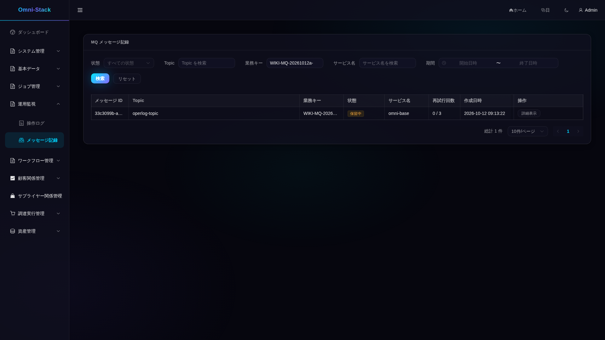

## 3. 実際の再試行とデッドレターを確認する

Release で初回保留を解除します。実際の中継は10秒ごとに実行されます。1回目は FAILED/retryCount=1、nextRetryTime と updateTime の差は20秒、2回目は40秒です。3回目で DEAD_LETTER/retryCount=3、nextRetryTime は null になります。スケジュール待ちは別で、3回目の80秒待ちはありません。詳細の未知ルートエラーはバックエンド由来で、4言語とも中国語のままです。


```powershell
./scripts/fixtures/run-mq-teaching-fixture.ps1 -ProjectName $project -RunId yourrun -OutputDirectory $fixture -Action Release
```


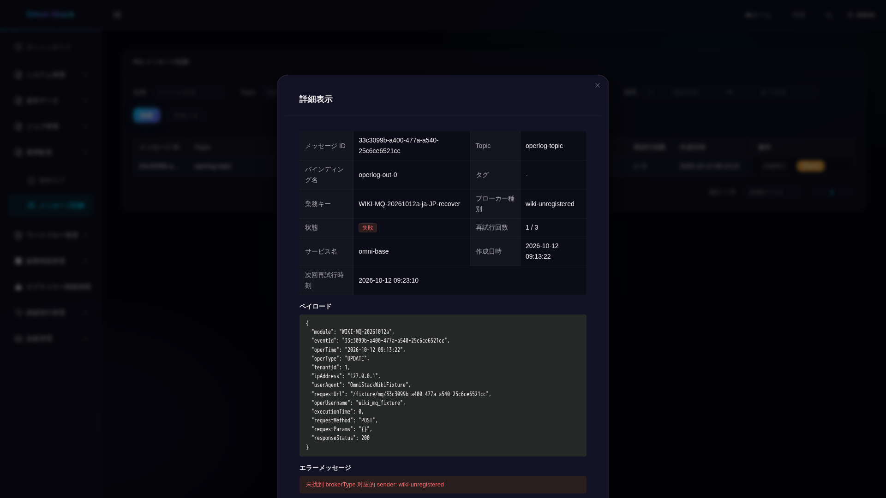


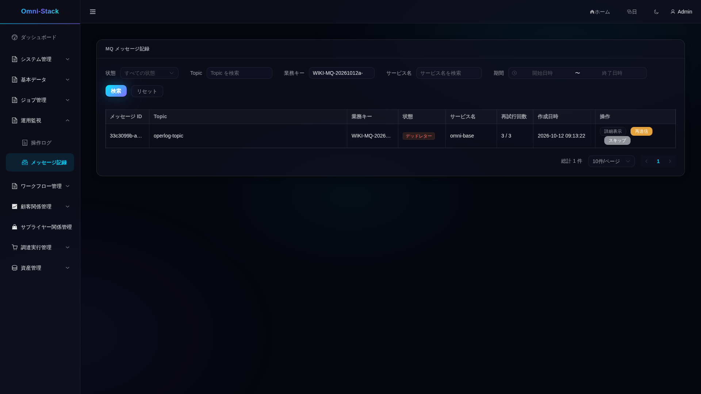


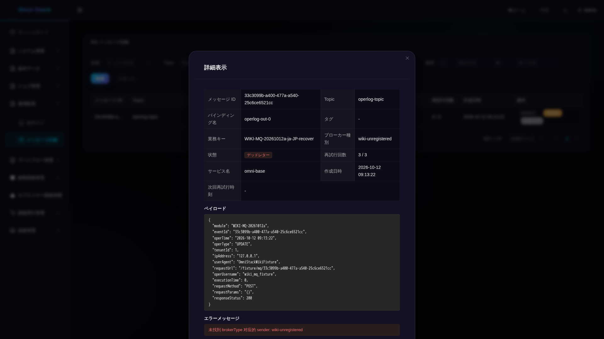

## 4. ルーティングを修復して再送・スキップする

Repair は recover4件の broker_type だけを rocketmq に修復し、状態をリセットしません。管理者は各デッドレターで再送を確認し、一覧を更新して SENT を確認します。残り4件はスキップを確認して SKIPPED になったことを確認します。確認画面や送信指示の通知は配信完了の証明ではありません。機能権限のない一般ユーザーは HTTP/業務403、終状態への重複操作は HTTP200/業務400 となり、状態は変わりません。


```powershell
./scripts/fixtures/run-mq-teaching-fixture.ps1 -ProjectName $project -RunId yourrun -OutputDirectory $fixture -Action Repair
```


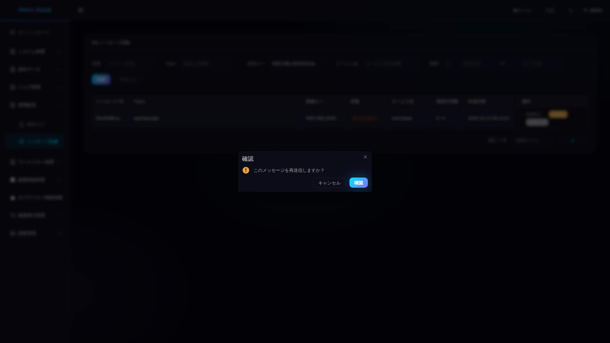


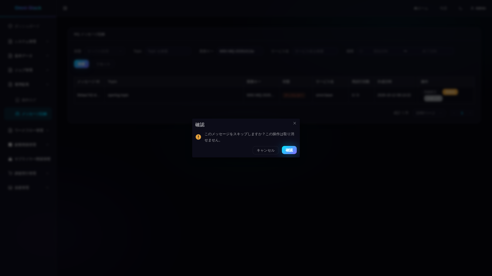


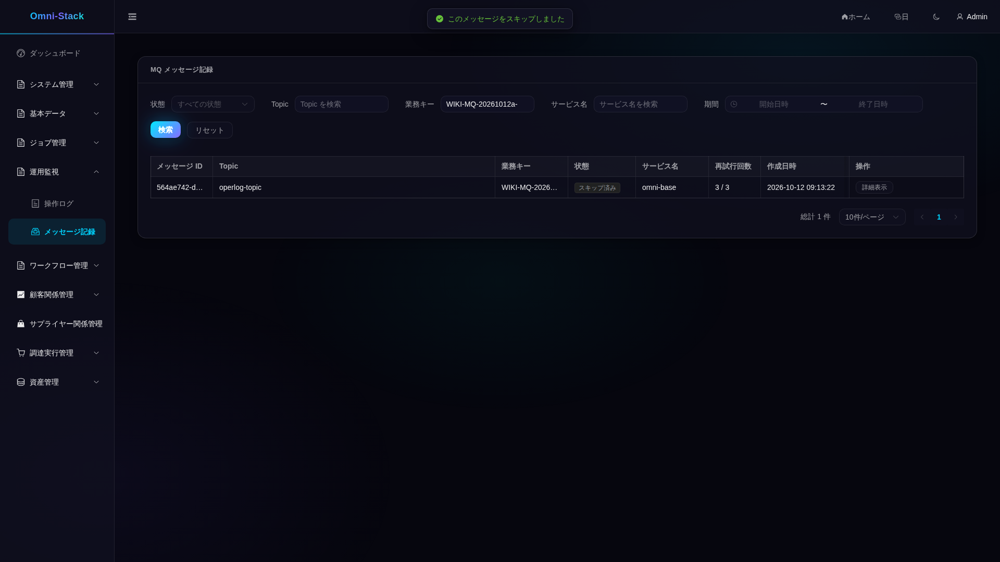

## 5. 消費と重複配信を確認する

操作ログを実行記録のモジュール prefix と操作ユーザー `wiki_mq_fixture` で検索すると、消費済み4件だけが表示され、requestUrl に元の recover msgId が含まれます。図の `/fixture/mq/<uuid>` は合成ログの値であり、業務 API ではありません。Replay は元の payload/eventId を保持して4個の新しい Outbox msgId を作ります。全消費キューの offset が追いつき、inflight=0 となった後もログは4件のままです。SENT だけでは消費完了を証明できません。標準 USER は操作ログを閲覧でき、2026-10-12 の一般ユーザーによる照会は200であり、403ではありません。


```powershell
./scripts/fixtures/run-mq-teaching-fixture.ps1 -ProjectName $project -RunId yourrun -OutputDirectory $fixture -Action Replay
./scripts/fixtures/run-mq-teaching-fixture.ps1 -ProjectName $project -RunId yourrun -OutputDirectory $fixture -Action Inspect
```


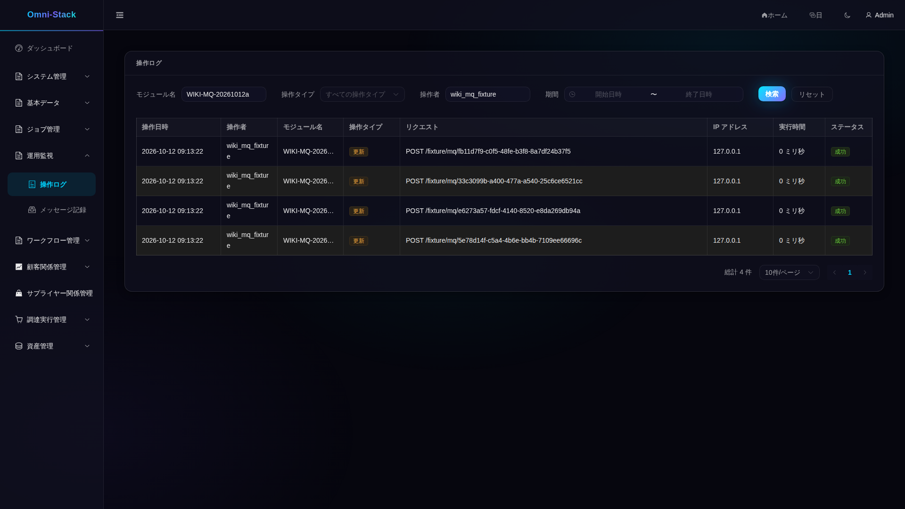


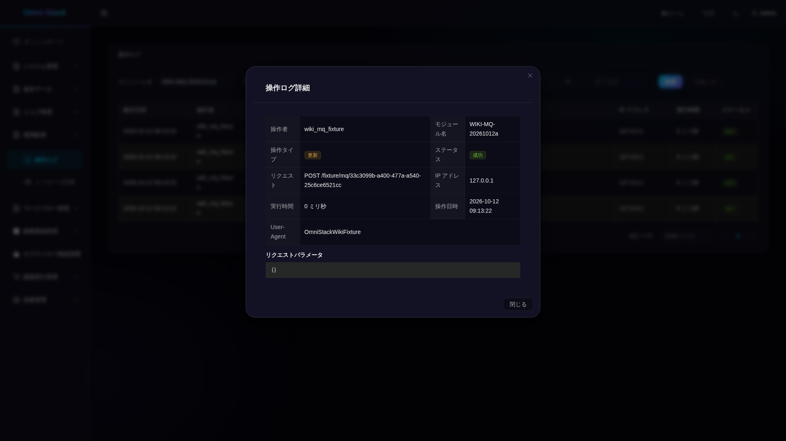

## 6. Trace・メトリクス・障害を調べる

msgId で中継ログを探し、実際の relay Trace を調べます。producer_trace_id は空でもよく、この SQL の合成メッセージでは null です。Base のメトリクスは管理エンドポイント `19901/actuator/prometheus` で取得し、業務ポート8080ではありません。計数はプロセス全体の累積で、この8件だけの値ではなく、再起動でリセットされます。本実証は retry/dead/sent ログと Trace の対応、低カーディナリティのラベルを確認しましたが、Grafana/Loki/Tempo 全体の到達は証明していません。

障害演習では自分のプロジェクトの Base だけを停止し、ID を記録して finally で同じコンテナを起動します。再作成・ボリューム削除は禁止です。2026-10-12 の実行では最初500、後で503となり、実際の503画面に Trace ID が表示され、古い表は隠れました。元のコンテナの復旧後に再試行し、新しい一覧を取得しました。90秒の観測タイムアウトを復旧や再停止の根拠にしません。


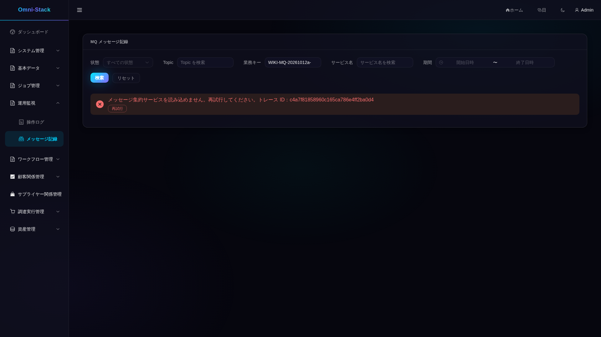


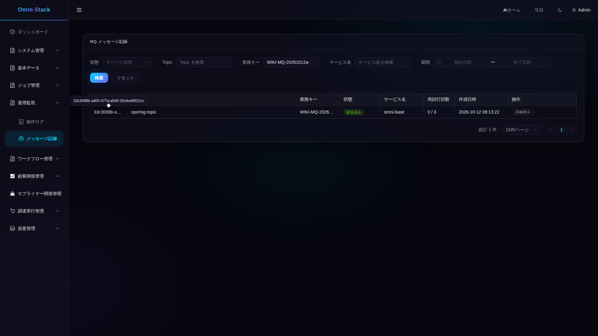

## 7. 新しいサービスに組み込む

[現在の契約](../mq-reliability.jp.md)と[Outbox のブレークポイント](source-debugging.jp.md#outbox)を読みます。omni-common-mqlog を追加し、対象 DB の正式マイグレーションに common MQ changeSet を含めます。同じ有効なローカルトランザクション・データソース内で tenantId を明示して send を呼びます。存在しない mapper 戻り値を写したり、Controller の操作ログが既に終了した業務トランザクションと原子的だと考えたりしません。bindingName の実際の destination、mqRelayHandler 登録、`deliveryEnabled` を確認します。この値は設定スイッチの投影であり、Broker・実行器・消費側の正常稼働の証明ではありません。Base の集約は現在 Base/CRM のみで、新サービスには保護された内部クライアントが必要です。eventId/Inbox 一意キーで重複を排除し、StreamBridge の業務重複排除に依存しません。

ReliableMessageTemplate.send → relayPendingMessages/relayOne → MessageSender → OperLogConsumer/OperLogServiceImpl を追います。claim CAS、120秒 PROCESSING リース、失敗回数、消費側 DuplicateKeyException を確認します。競合・未知 Broker のテストは事実文書にあります。新 Sender にはキュー投入時の選択契約も必要で、追加しただけで rocketmq の既定値は変わりません。

## 8. 自動採取とクリーンアップ

[mq-teaching.flows.spec.ts](../../omni-frontend/e2e-docs/flows/mq-teaching.flows.spec.ts)を pending、retry、actions、terminal、fault、operlog の順に実行します。READY_FOR_RELEASE の後だけ Release、READY_FOR_BASE_STOP/RESTART の後だけ元の Base を操作します。書込み段階を並列実行しません。[コンテナー入口](../../scripts/fixtures/run-mq-teaching-browser.mjs)は、[テスト classpath](../../scripts/fixtures/README.md)が発行したリポジトリ外 JSON の adminToken/outsiderToken を読みます。短期トークンはパスワード/CAPTCHA 検証の証明ではなく、実行前に有効期限を確認します。

browser.env には下の設定ブロックにある秘密でないパスと引数だけを保存し、token JSON は Git に入れません。最新 Docker inspect の許可フィールドから runtime JSON を作り、project と containers の service/image_id/state/host_ports を含めます。少なくとも frontend/gateway/base/auth/crm が同一プロジェクトで稼働し、ホストポートが空であることを確認します。古いスナップショットで現在の稼働状態を証明しません。

元の 2026-10-12 の実行では6段階のテストが成功し、90秒時点の500と USER のログ閲覧に403を期待した誤りの2失敗を保存し、48枚の原図を個別確認しました。今回の文書レビューで再実行したものではありません。長い ID/モジュールは省略され、英語メニューの一部が切れ、日韓ボタンは折り返し、バックエンドエラーは中国語です。完全な値は詳細/API で確認します。復旧図の ID ホバーツールチップも原図のままです。視覚確認と文書の意味の確認を別に記録し、四言語文書は実際の AI_REVIEW で受け入れます。人による翻訳レビューは必須ではありません。

終状態と消費側の重複排除を確認してから Cleanup します。2026-10-12 の実行記録には対象 Outbox12件と合成ログ4件の削除、残件が両方0であることが記されています。今回これらの完了済み操作を繰り返しません。実際の管理監査と既存データは保持し、DB/ボリューム全消去や応答切断後の確定済み操作の再送は行いません。


```powershell
$ids = @(docker ps -q --filter "label=com.docker.compose.project=$project")
if ($LASTEXITCODE -ne 0 -or $ids.Count -eq 0) { throw 'No owned running containers' }
$items = @(docker inspect $ids | ConvertFrom-Json)
if ($LASTEXITCODE -ne 0) { throw 'Inspect failed' }
$rows = @(foreach ($item in $items) {
  $ports = @($item.NetworkSettings.Ports.PSObject.Properties | Where-Object { $null -ne $_.Value })
  if ($item.Config.Labels.'com.docker.compose.project' -ne $project -or $ports.Count -ne 0 -or $item.State.Status -ne 'running') { throw 'Wrong ownership/state/ports' }
  if ($item.State.Health -and $item.State.Health.Status -ne 'healthy') { throw 'Service not healthy' }
  [ordered]@{ service=$item.Config.Labels.'com.docker.compose.service'; image_id=$item.Image; state=$item.State.Status; host_ports=@() }
})
[ordered]@{ project=$project; at=[DateTime]::UtcNow.ToString('o'); containers=$rows } | ConvertTo-Json -Depth 8 | Set-Content -LiteralPath "$private/runtime.json" -Encoding utf8
```

```powershell
docker run --rm --mount "type=bind,source=$PWD,target=/workspace,readonly" --mount "type=volume,source=omni-stack-docs_browser-modules,target=/workspace/omni-frontend/node_modules" --workdir /workspace/omni-frontend mcr.microsoft.com/playwright:v1.61.1-noble npm ci
```

```dotenv
E2E_RUNTIME_MODE=external
E2E_BASE_URL=http://omni-frontend:3000
E2E_TENANT_ID=1
E2E_MUTATIONS=true
E2E_EXECUTION=mq-pending-yourrun-001
E2E_MQ_PHASE=pending
E2E_MQ_TOKEN_FILE=/evidence/tokens.json
E2E_MQ_FIXTURE_FILE=/evidence/fixture/mq-teaching.json
E2E_MQ_RUNTIME_FILE=/evidence/runtime.json
E2E_DOCS_IMAGE_DIR=/evidence/images
E2E_REGISTRY_PATH=/evidence/mq-pending-001.json
E2E_ARTIFACT_DIR=/evidence/mq-pending-001-results
```


```powershell
docker run --rm --network "${project}_default" --mount "type=bind,source=$PWD,target=/workspace,readonly" --mount "type=bind,source=$private,target=/evidence" --mount "type=volume,source=omni-stack-docs_browser-modules,target=/workspace/omni-frontend/node_modules" --workdir /workspace/omni-frontend --env-file "$private/browser.env" mcr.microsoft.com/playwright:v1.61.1-noble node /workspace/scripts/fixtures/run-mq-teaching-browser.mjs
```


```powershell
./scripts/fixtures/run-mq-teaching-fixture.ps1 -ProjectName $project -RunId yourrun -OutputDirectory $fixture -Action Inspect
./scripts/fixtures/run-mq-teaching-fixture.ps1 -ProjectName $project -RunId yourrun -OutputDirectory $fixture -Action Cleanup
./scripts/fixtures/run-mq-teaching-fixture.ps1 -ProjectName $project -RunId yourrun -OutputDirectory $fixture -Action Inspect
```

[今回のレビュー記録](../reference/evidence/outbox-development-wiki-review-2026-10-18.json)は、現在ソースの確認、過去の48枚のハッシュ照合、今回実際に原寸で確認した12枚を分けて記録します。既存の業務・清掃記録は過去の証拠として保持します。
