# 신뢰할 수 있는 메시지: 실패, 재시도와 소비자 중복 제거

기준은 0.6.1, `fc165e3` 및 이번 정비 브랜치입니다. 아래 명령은 full을 사용합니다. core에는 실습에 필요한 RocketMQ, XXL-JOB, CRM이 없어 이 전달 흐름을 그대로 재현할 수 없습니다. 원래 증거는 2026-10-12에 수집했으며 [출처와 한계](../reference/evidence/mq-2026-10-12.json)를 참조하세요. 당시 관리자는 SUPER_ADMIN이었지만 실제 조회·재전송·건너뛰기는 각각 `base:mqmessage:list`, `base:mqmessage:resend`, `base:mqmessage:skip` 권한을 검사합니다. 해당 권한이 없는 일반 사용자는 거부되며 모든 작업에서 테넌트를 명시해야 합니다.

## 1. 독립 환경 준비

[빠른 시작](../guides/quick-start.kr.md)에서 비공개 설정과 이미지를 준비합니다. 고유 프로젝트, 저장소 밖 env, 독립 볼륨과 호스트 포트가 없는 환경을 사용하고 표준 omni-stack을 재사용하지 않습니다. 컨테이너 브라우저/API는 프로젝트 Docker 네트워크의 `http://omni-frontend:3000`에 연결합니다. 오버레이는 full의 16개 서비스에 포트 초기화를 선언하지만 새 환경에서는 루트 Compose의 include/profiles와 실제 병합 결과도 확인해야 합니다. 이미지 빌드, migrator 종료 0, 서비스 상태는 별도로 확인하며 설정 선언만으로 실제 실행을 증명하지 않습니다.


```powershell
$project = 'omni-e2e-mq-yourrun'
$private = Join-Path $env:TEMP 'omni-mq-yourrun'
New-Item -ItemType Directory -Path $private -ErrorAction Stop
Copy-Item -LiteralPath .env.example -Destination "$private/.env.example" -ErrorAction Stop
docker run --rm --mount "type=bind,source=$PWD,target=/workspace,readonly" --mount "type=bind,source=$private,target=/evidence" omni-stack-tools:local node /workspace/tools/omni-cli/scripts/init-env.mjs --root /evidence
Move-Item -LiteralPath "$private/.env" -Destination "$private/teaching.env" -ErrorAction Stop
docker compose --env-file "$private/teaching.env" -p $project -f compose.yaml -f scripts/fixtures/compose.teaching.yaml --profile full up -d --build
docker compose --env-file "$private/teaching.env" -p $project -f compose.yaml -f scripts/fixtures/compose.teaching.yaml --profile full ps -a
```

## 2. 추적 가능한 실습 데이터 준비

저장소 밖에 출력 디렉터리를 만듭니다. 4개 언어마다 recover와 skip을 각 1건씩, 총 8건의 합성 메시지를 생성합니다. broker_type을 등록되지 않은 `wiki-unregistered`로 설정하고 최초 전달을 30분 보류합니다. 실제 bindingName/destination을 바꾸는 작업은 아닙니다. 조작자 `wiki_mq_fixture`의 합성 로그이며 업무 데이터와 정식 시드와 분리됩니다. 실행 기록의 prefix로 검색하고 PENDING에는 상세만 표시되는지 확인하세요. 기록을 덮어쓰지 말고 쓰기 결과가 불명확하면 Inspect부터 확인하며 Prepare를 반복하지 않습니다.


```powershell
$env:E2E_MUTATIONS = 'true'
$fixture = Join-Path $private 'fixture'
./scripts/fixtures/run-mq-teaching-fixture.ps1 -ProjectName $project -RunId yourrun -OutputDirectory $fixture -Action Prepare
./scripts/fixtures/run-mq-teaching-fixture.ps1 -ProjectName $project -RunId yourrun -OutputDirectory $fixture -Action Inspect
```


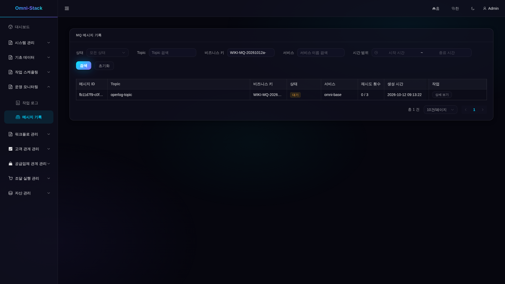

## 3. 실제 재시도와 데드레터 확인

Release로 최초 보류를 해제합니다. 원래 실습의 릴레이는 10초마다 실행됩니다. 1차 실패는 FAILED/retryCount=1이며 nextRetryTime과 updateTime의 차이는 20초, 2차는 40초입니다. 3차에는 DEAD_LETTER/retryCount=3, nextRetryTime=null이 됩니다. 스케줄 대기는 별도 시간이며 3차의 80초 대기는 없습니다. 상세 오류는 등록되지 않은 Broker 유형에 대한 백엔드 메시지로, 4개 UI 언어에서도 중국어입니다.


```powershell
./scripts/fixtures/run-mq-teaching-fixture.ps1 -ProjectName $project -RunId yourrun -OutputDirectory $fixture -Action Release
```


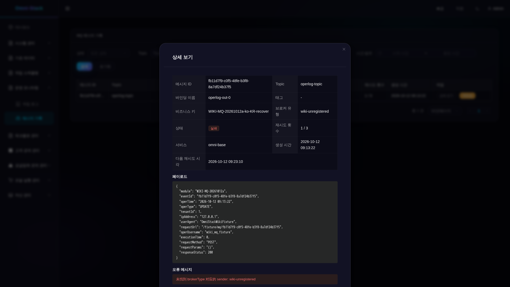


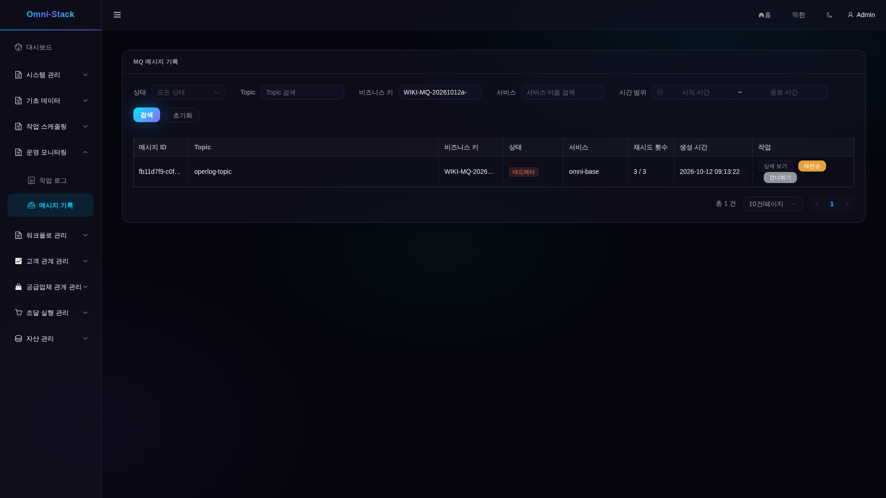


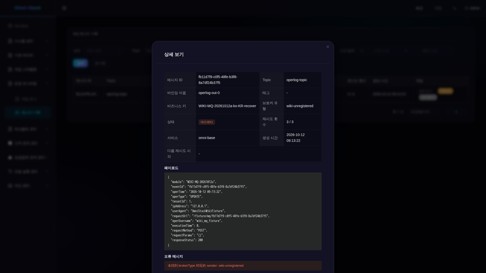

## 4. 경로 복구 후 재전송 또는 건너뛰기

Repair는 recover 4건의 broker_type만 rocketmq로 바꾸며 상태는 초기화하지 않습니다. 관리자는 각 복구 대상 데드레터의 재전송을 확인하고 새로 고침하여 SENT를 확인합니다. 나머지 4건은 건너뛰기를 확인하여 SKIPPED가 되었는지 확인합니다. 확인 창이나 제출 알림은 전달 완료 증거가 아닙니다. 기능 권한이 없는 일반 사용자는 HTTP/업무 403을 받습니다. 종료 상태에 작업을 반복하면 HTTP 200/업무 400이며 상태는 유지됩니다.


```powershell
./scripts/fixtures/run-mq-teaching-fixture.ps1 -ProjectName $project -RunId yourrun -OutputDirectory $fixture -Action Repair
```


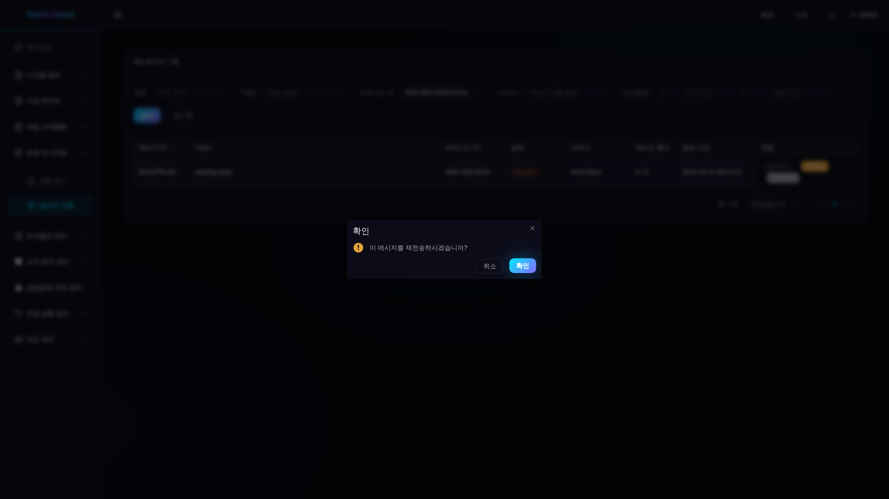


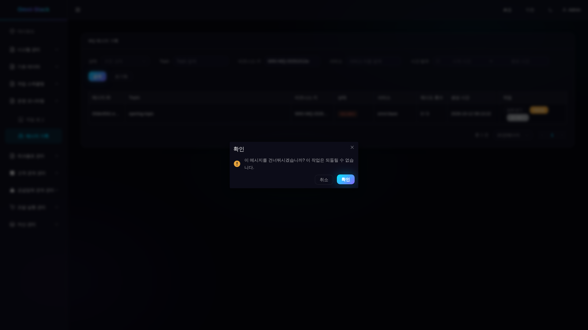


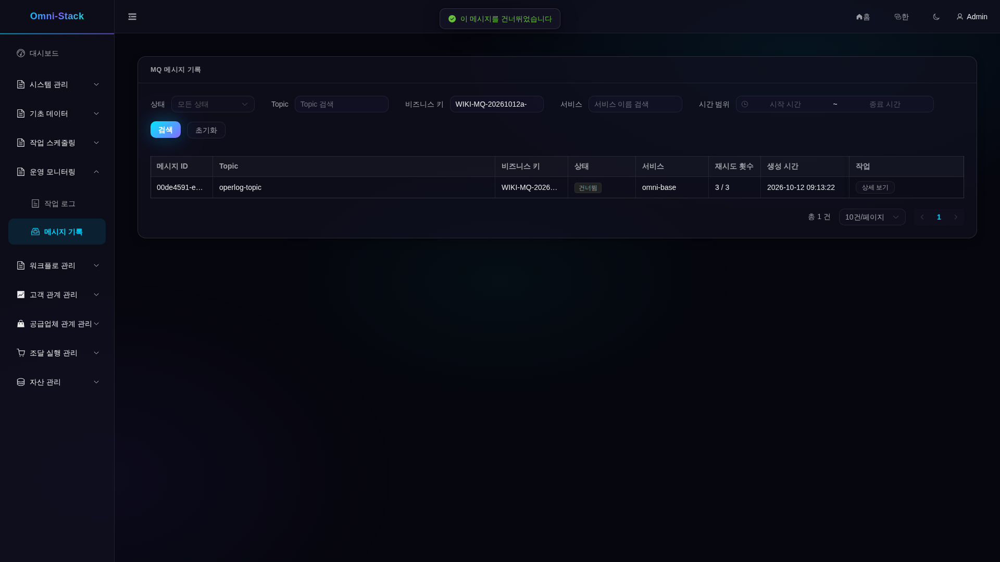

## 5. 소비와 중복 전송 확인

작업 로그에서 실행 기록의 모듈 prefix와 조작자 `wiki_mq_fixture`로 검색하면 소비된 4건만 나오고 requestUrl에는 원래 recover msgId가 있습니다. 그림의 `/fixture/mq/<uuid>`는 합성 로그 필드이며 업무 API가 아닙니다. Replay는 원래 payload/eventId를 유지하면서 새로운 Outbox msgId 4개를 만듭니다. 모든 소비 큐 offset이 따라잡고 inflight=0이 된 후에도 로그는 4건이어야 합니다. SENT만으로 소비 완료를 증명할 수 없습니다. 기본 USER는 작업 로그를 읽을 수 있으며 2026-10-12의 일반 사용자 조회는 200이지 403이 아닙니다.


```powershell
./scripts/fixtures/run-mq-teaching-fixture.ps1 -ProjectName $project -RunId yourrun -OutputDirectory $fixture -Action Replay
./scripts/fixtures/run-mq-teaching-fixture.ps1 -ProjectName $project -RunId yourrun -OutputDirectory $fixture -Action Inspect
```


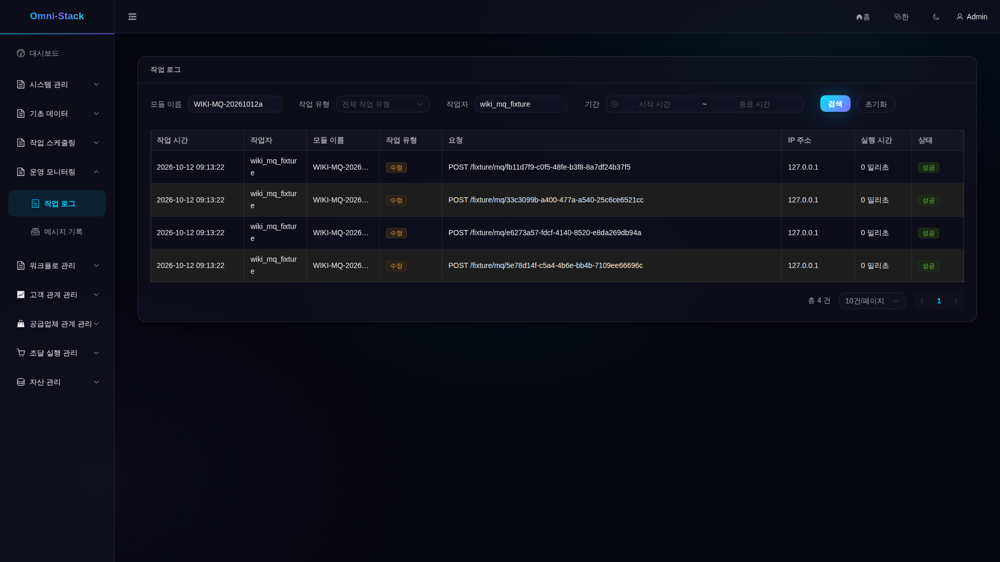


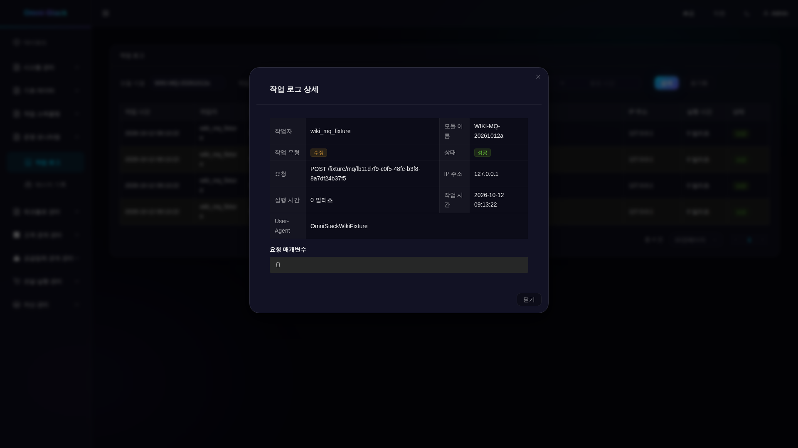

## 6. Trace, 지표와 서비스 장애 진단

msgId로 릴레이 로그를 찾고 실제 relay Trace를 조회합니다. producer_trace_id는 비어 있을 수 있으며 원래 SQL 합성 메시지에서는 null입니다. Base 지표는 관리 엔드포인트 `19901/actuator/prometheus`에서 확인하며 업무 포트 8080은 해당 지표의 진입점이 아닙니다. 카운터는 프로세스 전체 누적값이고 이 8건만의 값이 아니며 재시작하면 초기화됩니다. 원래 증거는 retry/dead/sent 로그와 Trace의 연관 및 낮은 카디널리티 라벨을 확인했지만 Grafana/Loki/Tempo 전체 전달을 증명하지 않았습니다.

장애 실습에서는 자신이 소유한 프로젝트의 Base만 중지합니다. 컨테이너 ID를 기록하고 finally에서 같은 컨테이너를 시작하며 재생성하거나 볼륨을 삭제하지 않습니다. 원래 실습에서는 처음 500, 이후 503이었고 실제 503 화면이 Trace ID를 표시하며 이전 표를 숨겼습니다. 복구 후 재시도로 최신 데이터를 가져왔습니다. 90초 관찰 시간 초과를 복구 완료나 재중지의 근거로 사용하지 않습니다.


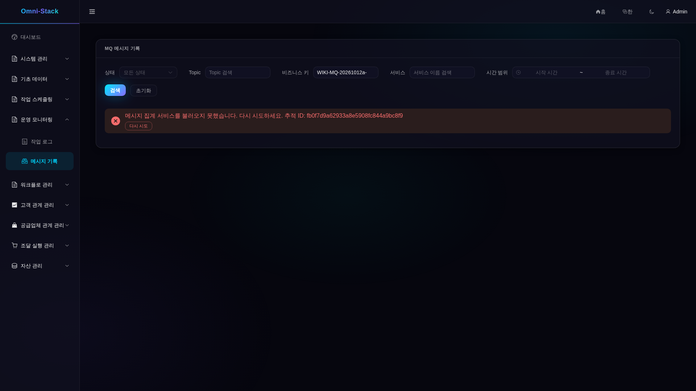


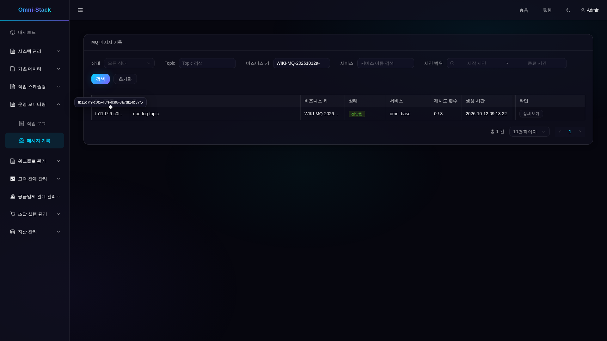

## 7. 새 서비스에 통합

[현재 계약](../mq-reliability.kr.md)과 [Outbox 중단점](source-debugging.kr.md#outbox)을 읽습니다. omni-common-mqlog를 추가하고 해당 DB의 정식 마이그레이션에 common MQ changeSet을 포함합니다. 같은 유효한 로컬 트랜잭션과 데이터 소스에서 tenantId를 명시하여 send를 호출합니다. 존재하지 않는 mapper 반환값을 복사하거나 Controller의 작업 로그가 이미 끝난 업무 트랜잭션과 원자적으로 커밋된다고 가정하지 않습니다. bindingName의 실제 destination, mqRelayHandler 등록과 `deliveryEnabled`를 확인하세요. 이 필드는 설정 스위치의 투영이며 Broker·실행기·소비자의 정상 상태를 증명하지 않습니다. Base는 현재 Base/CRM만 집계하므로 새 서비스에는 보호된 내부 클라이언트가 필요합니다. eventId/Inbox 고유 키로 중복을 제거하며 StreamBridge에 업무 중복 제거를 맡기지 않습니다.

ReliableMessageTemplate.send → relayPendingMessages/relayOne → MessageSender → OperLogConsumer/OperLogServiceImpl을 추적합니다. claim CAS, 120초 PROCESSING 임대, 실패 횟수와 소비자의 DuplicateKeyException을 확인합니다. 경합/미등록 Broker 테스트는 사실 문서에 연결되어 있습니다. 새 Sender에는 메시지를 큐에 넣을 때의 선택 계약도 필요하며 추가만으로 rocketmq 기본값이 바뀌지 않습니다.

## 8. 자동 증거 수집과 정리

[mq-teaching.flows.spec.ts](../../omni-frontend/e2e-docs/flows/mq-teaching.flows.spec.ts)를 pending, retry, actions, terminal, fault, operlog 순서로 실행합니다. READY_FOR_RELEASE 이후에만 Release하고 READY_FOR_BASE_STOP/RESTART 이후에만 원래 Base를 조작합니다. 쓰기 단계를 동시에 실행하지 마세요. [컨테이너 진입점](../../scripts/fixtures/run-mq-teaching-browser.mjs)은 [테스트 classpath](../../scripts/fixtures/README.md)가 발급한 저장소 밖 JSON의 adminToken/outsiderToken을 읽습니다. 단기 토큰은 비밀번호/CAPTCHA 로그인 증거가 아니며 단계 시작 전에 만료 여부를 확인합니다.

browser.env에는 아래 설정 블록의 비밀이 아닌 경로와 매개변수만 둡니다. token JSON은 Git에 넣지 않습니다. 현재 Docker inspect의 허용 필드로 runtime JSON을 작성하며 project와 containers의 service/image_id/state/host_ports를 포함합니다. 최소 frontend/gateway/base/auth/crm이 같은 프로젝트에서 실행 중이고 호스트 포트가 비어 있는지 확인하세요. 과거 스냅샷으로 현재 정상 상태를 주장하지 않습니다.

원래 2026-10-12 실행에서는 6개 단계 테스트가 통과했고, 90초 시점의 500과 USER 로그 조회에 403을 기대한 오류라는 2건의 실패를 보존했으며, 48개 원본 이미지를 개별 검토했습니다. 이번 문서 검토에서 해당 실행을 반복한 것은 아닙니다. 긴 ID/모듈은 생략되고 영어 메뉴 일부는 잘리며 일본어/한국어 버튼은 줄바꿈되고 백엔드 오류는 중국어입니다. 전체 값은 상세/API에서 확인하세요. 복구 이미지의 ID 호버 툴팁도 원본 그대로이며 이미지를 다시 그리지 않았습니다. 시각 확인과 문서 의미 검토를 따로 기록합니다. 네 언어 문서는 실제 AI_REVIEW로 인수하며 사람의 번역 검토는 필수가 아닙니다.

종료 상태와 소비 중복 제거를 확인한 뒤 Cleanup합니다. 2026-10-12 기록에는 대상 Outbox 12건과 합성 로그 4건을 정확히 삭제하고 잔여가 모두 0임을 확인한 결과가 남아 있습니다. 이번에는 완료된 작업을 반복하지 않습니다. 실제 관리 감사와 기존 데이터는 보존하며 DB/볼륨 전체 삭제나 응답 연결이 끊긴 뒤 확정 작업의 반복 제출은 하지 않습니다.


```powershell
$ids = @(docker ps -q --filter "label=com.docker.compose.project=$project")
if ($LASTEXITCODE -ne 0 -or $ids.Count -eq 0) { throw 'No owned running containers' }
$items = @(docker inspect $ids | ConvertFrom-Json)
if ($LASTEXITCODE -ne 0) { throw 'Inspect failed' }
$rows = @(foreach ($item in $items) {
  $ports = @($item.NetworkSettings.Ports.PSObject.Properties | Where-Object { $null -ne $_.Value })
  if ($item.Config.Labels.'com.docker.compose.project' -ne $project -or $ports.Count -ne 0 -or $item.State.Status -ne 'running') { throw 'Wrong ownership/state/ports' }
  if ($item.State.Health -and $item.State.Health.Status -ne 'healthy') { throw 'Service not healthy' }
  [ordered]@{ service=$item.Config.Labels.'com.docker.compose.service'; image_id=$item.Image; state=$item.State.Status; host_ports=@() }
})
[ordered]@{ project=$project; at=[DateTime]::UtcNow.ToString('o'); containers=$rows } | ConvertTo-Json -Depth 8 | Set-Content -LiteralPath "$private/runtime.json" -Encoding utf8
```

```powershell
docker run --rm --mount "type=bind,source=$PWD,target=/workspace,readonly" --mount "type=volume,source=omni-stack-docs_browser-modules,target=/workspace/omni-frontend/node_modules" --workdir /workspace/omni-frontend mcr.microsoft.com/playwright:v1.61.1-noble npm ci
```

```dotenv
E2E_RUNTIME_MODE=external
E2E_BASE_URL=http://omni-frontend:3000
E2E_TENANT_ID=1
E2E_MUTATIONS=true
E2E_EXECUTION=mq-pending-yourrun-001
E2E_MQ_PHASE=pending
E2E_MQ_TOKEN_FILE=/evidence/tokens.json
E2E_MQ_FIXTURE_FILE=/evidence/fixture/mq-teaching.json
E2E_MQ_RUNTIME_FILE=/evidence/runtime.json
E2E_DOCS_IMAGE_DIR=/evidence/images
E2E_REGISTRY_PATH=/evidence/mq-pending-001.json
E2E_ARTIFACT_DIR=/evidence/mq-pending-001-results
```


```powershell
docker run --rm --network "${project}_default" --mount "type=bind,source=$PWD,target=/workspace,readonly" --mount "type=bind,source=$private,target=/evidence" --mount "type=volume,source=omni-stack-docs_browser-modules,target=/workspace/omni-frontend/node_modules" --workdir /workspace/omni-frontend --env-file "$private/browser.env" mcr.microsoft.com/playwright:v1.61.1-noble node /workspace/scripts/fixtures/run-mq-teaching-browser.mjs
```


```powershell
./scripts/fixtures/run-mq-teaching-fixture.ps1 -ProjectName $project -RunId yourrun -OutputDirectory $fixture -Action Inspect
./scripts/fixtures/run-mq-teaching-fixture.ps1 -ProjectName $project -RunId yourrun -OutputDirectory $fixture -Action Cleanup
./scripts/fixtures/run-mq-teaching-fixture.ps1 -ProjectName $project -RunId yourrun -OutputDirectory $fixture -Action Inspect
```

[이번 검토 기록](../reference/evidence/outbox-development-wiki-review-2026-10-18.json)은 현재 소스 확인, 과거 이미지 48개의 해시 연결, 이번 원본 이미지 12개의 실제 확인을 구분합니다. 기존 업무와 정리 기록은 과거 증거로 보존합니다.
