# 可靠消息：从失败、重试到消费去重

适用基线：0.6.1，`fc165e3` 及本整改分支。本文命令使用 full；core 默认缺少本练习所需的 RocketMQ、XXL-JOB 和 CRM，不能直接复现投递链路。原始取证日期为 2026-10-12，见[来源与限制](../reference/evidence/mq-2026-10-12.json)。该批管理员为 SUPER_ADMIN；实际查询、重发和忽略分别校验 `base:mqmessage:list`、`base:mqmessage:resend`、`base:mqmessage:skip`，无相应权限的普通身份被拒绝。每个操作都须明确租户。

## 1. 准备独立环境

先完成[快速开始](../guides/quick-start.md)的私密配置与镜像构建。下面使用唯一项目名、仓库外 env、独立数据卷和零宿主端口；不要复用标准 omni-stack。浏览器和 API 工具连接该项目 Docker 网络中的 `http://omni-frontend:3000`。覆盖层对16个 full 服务声明 ports 重置；根 Compose 的 include/profiles 和实际合并结果须在新环境中核对。启动还须确认镜像构建、migrator 退出0及服务健康，配置声明不能代替运行。


```powershell
$project = 'omni-e2e-mq-yourrun'
$private = Join-Path $env:TEMP 'omni-mq-yourrun'
New-Item -ItemType Directory -Path $private -ErrorAction Stop
Copy-Item -LiteralPath .env.example -Destination "$private/.env.example" -ErrorAction Stop
docker run --rm --mount "type=bind,source=$PWD,target=/workspace,readonly" --mount "type=bind,source=$private,target=/evidence" omni-stack-tools:local node /workspace/tools/omni-cli/scripts/init-env.mjs --root /evidence
Move-Item -LiteralPath "$private/.env" -Destination "$private/teaching.env" -ErrorAction Stop
docker compose --env-file "$private/teaching.env" -p $project -f compose.yaml -f scripts/fixtures/compose.teaching.yaml --profile full up -d --build
docker compose --env-file "$private/teaching.env" -p $project -f compose.yaml -f scripts/fixtures/compose.teaching.yaml --profile full ps -a
```

## 2. 准备可追踪的教学数据

先在仓库外建立输出目录。夹具生成四语言各一条 recover 和 skip 消息，共8条，将 broker_type 设为未注册的 `wiki-unregistered`，暂缓首次投递30分钟；这不是修改真实 bindingName/destination。它们是操作人 `wiki_mq_fixture` 的合成日志，与真实业务和正式种子隔离。列表用回执 prefix 筛选，PENDING 应只有详情入口。回执不可覆盖；提交结果不明先 Inspect，不能重跑 Prepare。


```powershell
$env:E2E_MUTATIONS = 'true'
$fixture = Join-Path $private 'fixture'
./scripts/fixtures/run-mq-teaching-fixture.ps1 -ProjectName $project -RunId yourrun -OutputDirectory $fixture -Action Prepare
./scripts/fixtures/run-mq-teaching-fixture.ps1 -ProjectName $project -RunId yourrun -OutputDirectory $fixture -Action Inspect
```


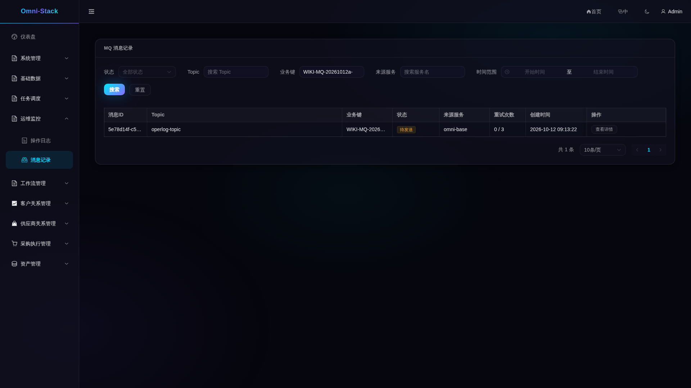

## 3. 观察真实重试与死信

Release 取消首次暂缓。真实中继每10秒调度；第一次失败为 FAILED/retryCount=1，nextRetryTime 与 updateTime 相差20秒；第二次为40秒；第三次为 DEAD_LETTER/retryCount=3，nextRetryTime 为空。不要把调度等待算作固定退避，也不要期待第三次等待80秒。失败详情展示未知路由错误；错误来自后端，四语言页面中仍为中文。


```powershell
./scripts/fixtures/run-mq-teaching-fixture.ps1 -ProjectName $project -RunId yourrun -OutputDirectory $fixture -Action Release
```


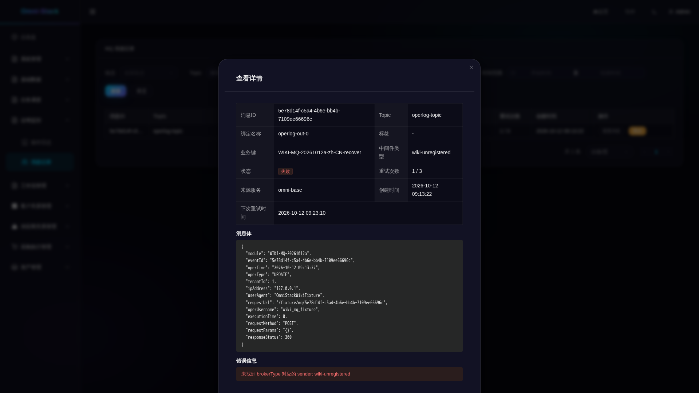


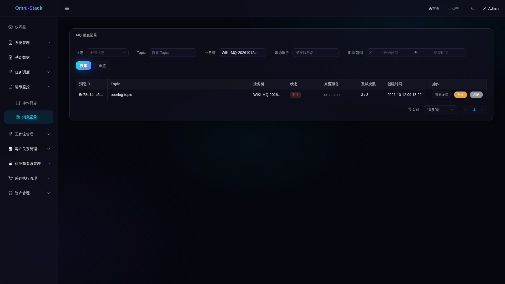


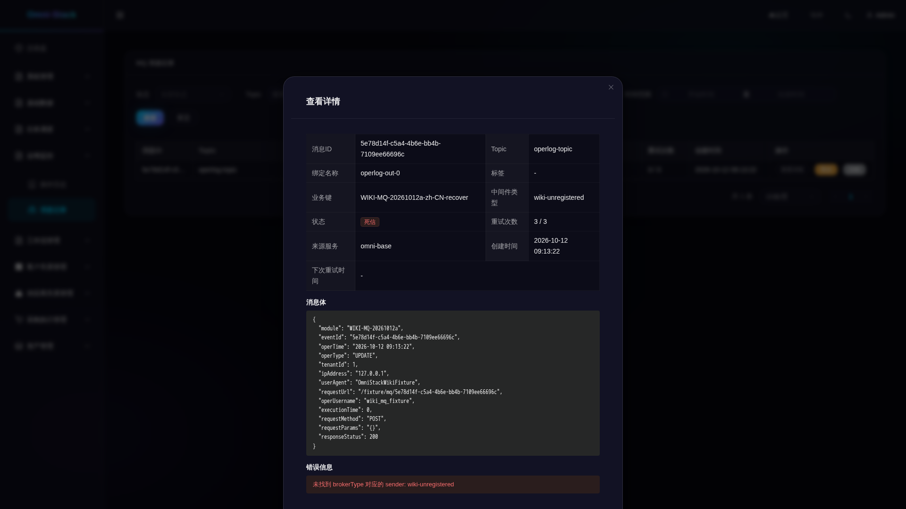

## 4. 修复路由、重发或忽略

先执行 Repair，只把4条 recover 的 broker_type 修复为 rocketmq，不重置状态。管理员在这4条死信上依次点“重发”并确认，刷新直到 SENT；对另外4条点“忽略”并确认，结果为 SKIPPED。确认框和提交提示不代表发送完成。无功能权限的普通身份重发/忽略返回 HTTP/业务403；对终态重复操作返回 HTTP200/业务400，状态保持不变。


```powershell
./scripts/fixtures/run-mq-teaching-fixture.ps1 -ProjectName $project -RunId yourrun -OutputDirectory $fixture -Action Repair
```


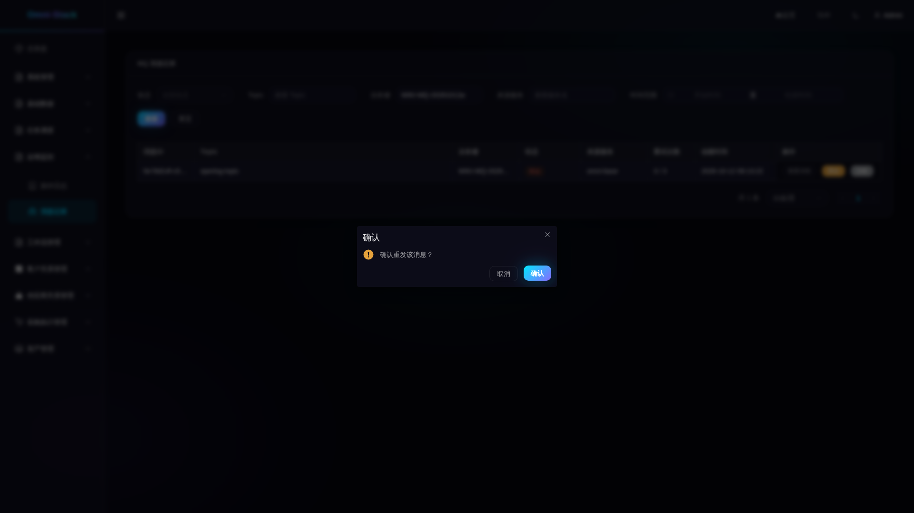


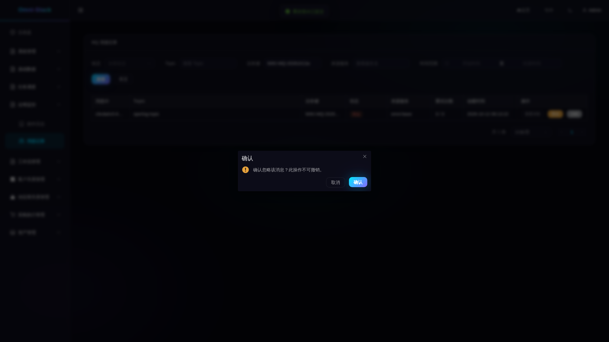


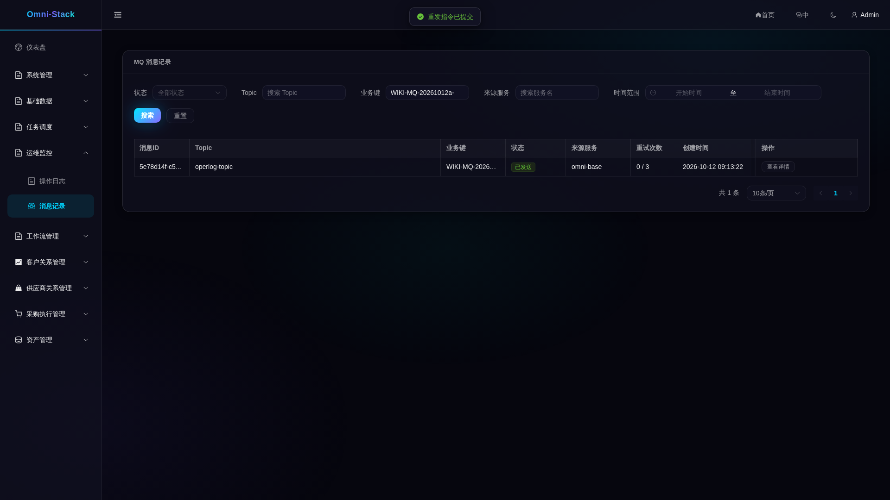


## 5. 核对消费与重复投递

进入操作日志，按回执 prefix 对应模块和操作人 `wiki_mq_fixture` 筛选，应只有4条消费日志，详情 requestUrl 含原 recover 消息 ID。图里的 `/fixture/mq/<uuid>` 是合成日志字段，不是业务接口。Replay 使用4个新 Outbox msgId，保留原 payload/eventId；等所有消费队列 offset 追平且无在途消息后，日志仍应恰好4条。SENT 本身不足以证明消费完成。默认 USER 有操作日志读取权限，2026-10-12 的普通身份查询为200，不能据此声称该读取接口返回403。


```powershell
./scripts/fixtures/run-mq-teaching-fixture.ps1 -ProjectName $project -RunId yourrun -OutputDirectory $fixture -Action Replay
./scripts/fixtures/run-mq-teaching-fixture.ps1 -ProjectName $project -RunId yourrun -OutputDirectory $fixture -Action Inspect
```


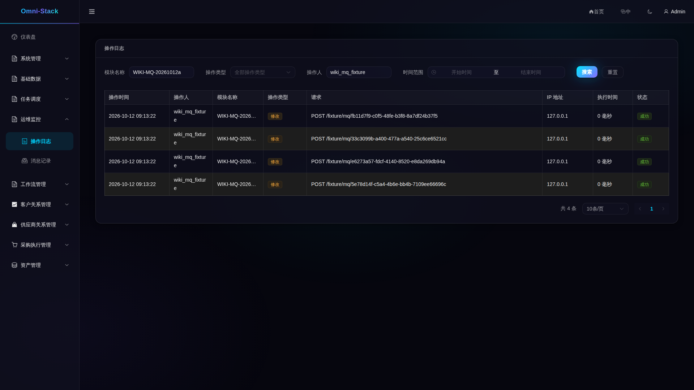


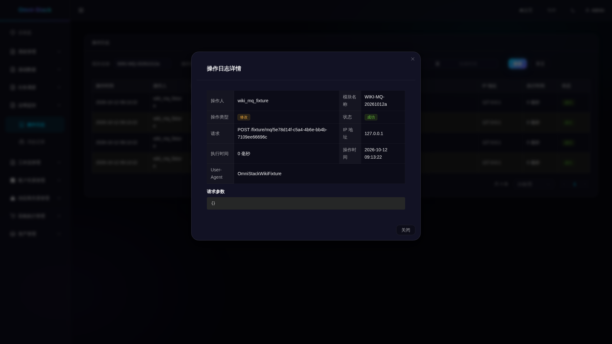

## 6. 定位 Trace、指标与服务故障

先用 msgId 找中继日志，再用真实 relay Trace 查询；producer_trace_id 可为空，本次 SQL 合成入队就是空值。管理端口 `19901/actuator/prometheus` 可查 Base 指标；业务端口8080不是该指标入口。指标是进程累计值，不是这8条消息的独立计数；实例重启会重置计数。已有证据关联了真实 retry/dead/sent 日志与 Trace，并核对低基数标签；完整 Grafana/Loki/Tempo 送达链未由本批证明。

故障练习只停止自己项目的 Base，记录容器 ID 后在 finally 中启动同一容器，禁止重建或删卷。2026-10-12 的取证中，网关先返回500、稍后503；真实503页面带 Trace ID 并隐藏旧表格，原容器恢复后点重试重新获取数据。不能把固定90秒的观察超时当作恢复完成或重复停服的依据。


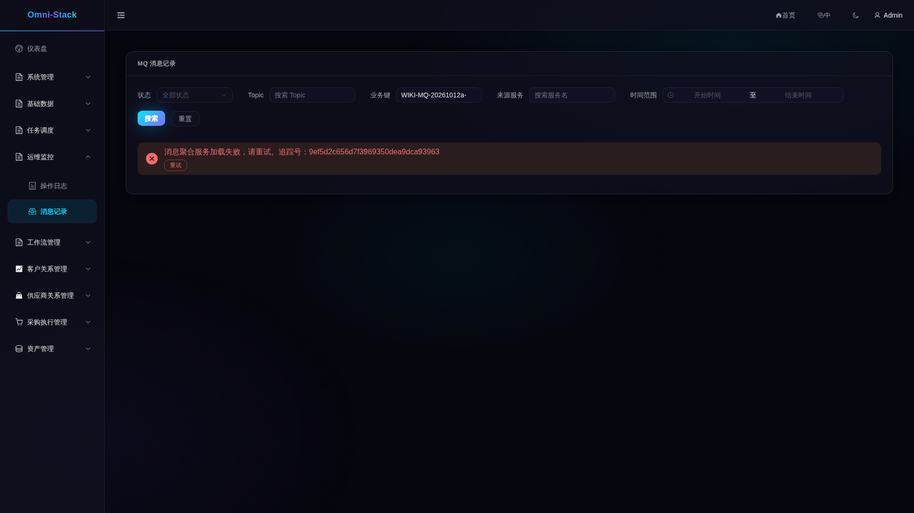


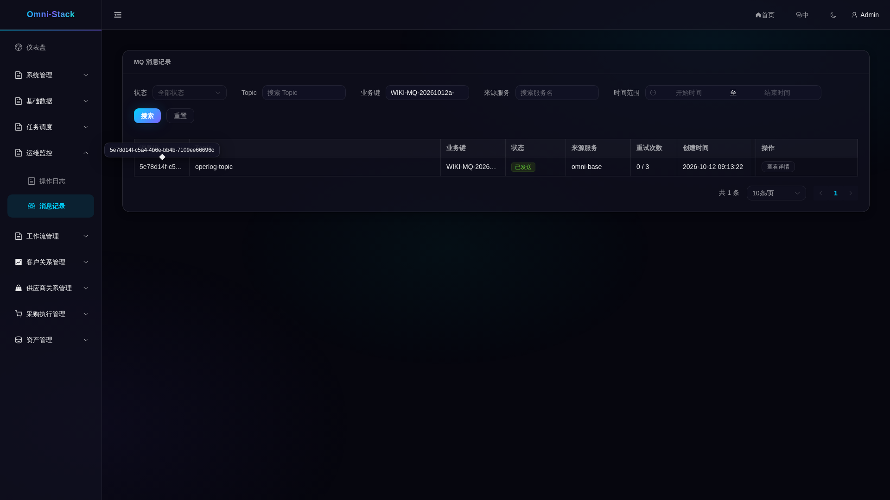

## 7. 在新服务中接入

先读[事实契约](../mq-reliability.md)和[Outbox 断点](source-debugging.md#outbox)。新增服务依赖 omni-common-mqlog，将 common MQ changeSet 纳入该库的正式迁移；在同一有效本地事务、同一数据源中显式传 tenantId 调用 send。不要复制不存在的 mapper 返回值或假设 Controller 操作日志与已提交业务事务原子提交。核对 bindingName 的真实 destination、XXL-JOB 的 mqRelayHandler 注册及 `deliveryEnabled`；该字段只是配置开关的投影，不代表 Broker、执行器或消费健康。Base 当前仅聚合 Base/CRM，新服务需增加受保护内部客户端。消费者按 eventId/Inbox 唯一键幂等，StreamBridge 不提供业务去重。

从源码进入 ReliableMessageTemplate.send → relayPendingMessages/relayOne → MessageSender → OperLogConsumer/OperLogServiceImpl。关注 claim CAS、120秒 PROCESSING 租约、失败次数及消费者 DuplicateKeyException；竞争和未知路由测试入口见事实页。新增 Broker 还需扩展入队选择契约，单独加 Sender 不会改变默认 rocketmq。

## 8. 自动取证与清理

自动化入口为 [mq-teaching.flows.spec.ts](../../omni-frontend/e2e-docs/flows/mq-teaching.flows.spec.ts)，阶段依次 pending、retry、actions、terminal、fault、operlog；retry 登记 READY_FOR_RELEASE 后再 Release，fault 登记 READY_FOR_BASE_STOP/RESTART 后才操作原容器。不要并行两个写入阶段。使用[容器入口](../../scripts/fixtures/run-mq-teaching-browser.mjs)从仓库外 token JSON 读取 adminToken/outsiderToken；令牌由[受控测试 classpath](../../scripts/fixtures/README.md)签发，不能证明密码或验证码登录。令牌短期有效，提交前核对是否过期。

browser.env 只放下方配置块的非秘密路径和参数，token JSON 不入库。运行时 JSON 由当次 Docker inspect 的白名单投影产生，包含 project 和 containers 的 service/image_id/state/host_ports，至少有 frontend/gateway/base/auth/crm。它们须为同项目运行中的容器且无宿主端口，不能用旧健康快照冒充当前状态。

2026-10-12 的原始批次有6个阶段测试通过，保留2次失败尝试（90秒时仍500、错误预期 USER 读日志403），并逐张查看了48张原图；这不是本轮重跑。列表长 ID/模块会省略，英文菜单可能截断，日韩按钮会换行，错误详情仍为中文，完整值以详情/API 为准。恢复图保留悬停 ID 提示，原图未改绘。视觉检查和文档语义复核分别记录；四语文档以真实 AI_REVIEW 验收，人工翻译复核不是必需条件。

所有终态和消费去重核对后才能 Cleanup。2026-10-12 的回执记录精确删除12条夹具 Outbox 和4条合成日志，回查均0；本轮不重复这些已完成的操作。真实管理审计和既有记录保留。不要删卷、清空全库或因断流重复提交管理操作。


```powershell
$ids = @(docker ps -q --filter "label=com.docker.compose.project=$project")
if ($LASTEXITCODE -ne 0 -or $ids.Count -eq 0) { throw 'No owned running containers' }
$items = @(docker inspect $ids | ConvertFrom-Json)
if ($LASTEXITCODE -ne 0) { throw 'Inspect failed' }
$rows = @(foreach ($item in $items) {
  $ports = @($item.NetworkSettings.Ports.PSObject.Properties | Where-Object { $null -ne $_.Value })
  if ($item.Config.Labels.'com.docker.compose.project' -ne $project -or $ports.Count -ne 0 -or $item.State.Status -ne 'running') { throw 'Wrong ownership/state/ports' }
  if ($item.State.Health -and $item.State.Health.Status -ne 'healthy') { throw 'Service not healthy' }
  [ordered]@{ service=$item.Config.Labels.'com.docker.compose.service'; image_id=$item.Image; state=$item.State.Status; host_ports=@() }
})
[ordered]@{ project=$project; at=[DateTime]::UtcNow.ToString('o'); containers=$rows } | ConvertTo-Json -Depth 8 | Set-Content -LiteralPath "$private/runtime.json" -Encoding utf8
```

```powershell
docker run --rm --mount "type=bind,source=$PWD,target=/workspace,readonly" --mount "type=volume,source=omni-stack-docs_browser-modules,target=/workspace/omni-frontend/node_modules" --workdir /workspace/omni-frontend mcr.microsoft.com/playwright:v1.61.1-noble npm ci
```

```dotenv
E2E_RUNTIME_MODE=external
E2E_BASE_URL=http://omni-frontend:3000
E2E_TENANT_ID=1
E2E_MUTATIONS=true
E2E_EXECUTION=mq-pending-yourrun-001
E2E_MQ_PHASE=pending
E2E_MQ_TOKEN_FILE=/evidence/tokens.json
E2E_MQ_FIXTURE_FILE=/evidence/fixture/mq-teaching.json
E2E_MQ_RUNTIME_FILE=/evidence/runtime.json
E2E_DOCS_IMAGE_DIR=/evidence/images
E2E_REGISTRY_PATH=/evidence/mq-pending-001.json
E2E_ARTIFACT_DIR=/evidence/mq-pending-001-results
```


```powershell
docker run --rm --network "${project}_default" --mount "type=bind,source=$PWD,target=/workspace,readonly" --mount "type=bind,source=$private,target=/evidence" --mount "type=volume,source=omni-stack-docs_browser-modules,target=/workspace/omni-frontend/node_modules" --workdir /workspace/omni-frontend --env-file "$private/browser.env" mcr.microsoft.com/playwright:v1.61.1-noble node /workspace/scripts/fixtures/run-mq-teaching-browser.mjs
```


```powershell
./scripts/fixtures/run-mq-teaching-fixture.ps1 -ProjectName $project -RunId yourrun -OutputDirectory $fixture -Action Inspect
./scripts/fixtures/run-mq-teaching-fixture.ps1 -ProjectName $project -RunId yourrun -OutputDirectory $fixture -Action Cleanup
./scripts/fixtures/run-mq-teaching-fixture.ps1 -ProjectName $project -RunId yourrun -OutputDirectory $fixture -Action Inspect
```

[本轮复核记录](../reference/evidence/outbox-development-wiki-review-2026-10-18.json)分别保留当前源码核对、48张旧图的摘要绑定和本轮12张原图的实际查看；原有业务与清理回执保持为历史证据。
