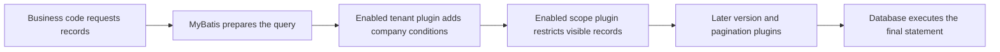

# 3. Framework: add a company condition before a query runs

Shared tables identify the company that owns a record. How does each query use that ownership?

Think of a query as a request to retrieve files. The original request says “find customers”; the tenant plugin adds “belonging to this company”; scope adds “owned by me or my department”. Applicable conditions must hold together.

These excerpts use the project's MyBatis-Plus 3.5.16 JSQLParser-4.9 module source. They are continuous originals; there is no need to memorize variables first.

## Locate the mechanism



This shows common-service responsibilities when those capabilities are enabled. It does not place Auth, Workflow, and raw JDBC on one identical chain. The next page separates them.

## Excerpt one: rewrite before querying

The following is beforeQuery in TenantLineInnerInterceptor, actual-version lines 63–70.

<!-- omni:source path="docs/reference/upstream/mybatis-plus-3.5.16/query-rewrite.java.txt" -->
```java
    @Override
    public void beforeQuery(Executor executor, MappedStatement ms, Object parameter, RowBounds rowBounds, ResultHandler resultHandler, BoundSql boundSql) throws SQLException {
        if (InterceptorIgnoreHelper.willIgnoreTenantLine(ms.getId())) {
            return;
        }
        PluginUtils.MPBoundSql mpBs = PluginUtils.mpBoundSql(boundSql);
        mpBs.sql(parserSingle(mpBs.sql(), null));
    }
```

The first check lets explicitly marked queries skip the tenant plugin. Otherwise it reads the pending statement, processes it through parserSingle, and replaces it with the result.

This runs while the application prepares database access. The database does not recognize the browser user automatically. Access outside the plugin needs its own ownership condition; do not casually add ignore markers to business methods.

## Excerpt two: build the company condition

Lines 264–270 in the same class construct a tenant expression for a table.

<!-- omni:source path="docs/reference/upstream/mybatis-plus-3.5.16/tenant-condition.java.txt" -->
```java
    @Override
    public Expression buildTableExpression(final Table table, final Expression where, final String whereSegment) {
        if (tenantLineHandler.ignoreTable(table.getName())) {
            return null;
        }
        return new EqualsTo(getAliasColumn(table), tenantLineHandler.getTenantId());
    }
```

If project policy ignores that table, null means this step adds no company condition. Otherwise it builds equality between the tenant column and current tenant value.

A table can have a short name in a query, called an alias. getAliasColumn includes it to distinguish columns in multi-table queries. The project supplies getTenantId; the framework does not know which company the visitor belongs to.

TenantLineHandler lines 46–48 define the default column directly:

<!-- omni:source path="docs/reference/upstream/mybatis-plus-3.5.16/tenant-column.java.txt" -->
```java
    default String getTenantIdColumn() {
        return "tenant_id";
    }
```

This establishes the default name tenant_id, not that every table has such a column. Infrastructure, engine tables, and global catalogs require their own rules.

## Excerpt three: domain scope belongs to another responsibility

DataPermissionInterceptor delegates table, existing conditions, and mapped statement ID to the project's multi-table scope handler. Original lines 166–174:

<!-- omni:source path="docs/reference/upstream/mybatis-plus-3.5.16/permission-delegation.java.txt" -->
```java
    @Override
    public Expression buildTableExpression(final Table table, final Expression where, final String whereSegment) {
        if (dataPermissionHandler == null) {
            return null;
        }
        // 只有新版数据权限处理器才会执行到这里
        final MultiDataPermissionHandler handler = (MultiDataPermissionHandler) dataPermissionHandler;
        return handler.getSqlSegment(table, where, whereSegment);
    }
```

The framework does not say “Li works in East sales”. It calls a handler. People, roles, organizations, and field mappings come from the project.

Here too, null means no extra condition from this plugin. It neither denies access nor removes conditions elsewhere. Tenant restrictions, original business conditions, and API authorization remain applicable.

## Divide responsibilities

| Framework | Project |
|---|---|
| Hook into applicable database access | Enable the capability in the right services and register the chain |
| Parse supported statements and construct expressions | Supply the trusted tenant and applicable tables |
| Delegate data-scope handling | Resolve operation permissions, self/organization scope, fields, and parent relationships |
| Continue execution | Enforce write ownership, state, versions, and transactions |

The common-service order is TenantLine, DataPermission, OptimisticLock, Pagination. Tenant and record restrictions precede pagination so results and counts use the restrictions. Services with independent configuration require their own reading.

The last two roughly mean preventing stale updates from overwriting someone else's change through record versions, and returning lists in batches. Entities, version fields, and queries must still integrate the mechanism.

## What to ask after reading these excerpts

“The project uses a tenant plugin” does not establish isolation for every record. Ask whether the table is covered, the query passes through it, the identity is trusted, and business authorization and asynchronous paths have rules.

Continue with [one project request](tenancy-request.en.md).

## Original material and license

Source: the [official MyBatis-Plus 3.5.16 Maven source archive](https://repo.maven.apache.org/maven2/com/baomidou/mybatis-plus-jsqlparser-4.9/3.5.16/mybatis-plus-jsqlparser-4.9-3.5.16-sources.jar). Its published SHA-256 matches the retrieved archive. Excerpts retain original text; original files carry Copyright (c) 2011-2025, baomidou (jobob@qq.com), under the [Apache License 2.0](https://www.apache.org/licenses/LICENSE-2.0).

Provenance records bind archive, files, ranges, excerpts, and complete license digests. Teaching excerpts add no runtime dependency and do not replace business isolation tests.

The complete [license](../reference/upstream/mybatis-plus-3.5.16/LICENSE.txt) and [provenance record](../reference/upstream/mybatis-plus-3.5.16/provenance.json) are included with this site.
