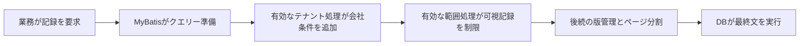

# 3. フレームワーク：クエリー前に会社の条件を加える

共有表には所属会社があります。次は、その帰属をクエリーでどう使うかを見ます。

クエリーを資料の取寄せ申請と考えてください。「顧客を探す」にテナントプラグインが「現在の会社のもの」、データ範囲が「本人や部門の担当」を加えます。対象の条件は同時に満たす必要があります。

以下はプロジェクトの MyBatis-Plus 3.5.16、JSQLParser-4.9 モジュールの連続原文です。変数を先に暗記する必要はありません。

## 処理位置を見る



common-service で対象能力を有効にした場合の責任図です。Auth、Workflow、直接の JDBC を同じチェーンへ入れた図ではありません。違いは次で説明します。

## 原文一：クエリー前に書き換える

TenantLineInnerInterceptor の beforeQuery、実際の版の 63–70 行です。

<!-- omni:source path="docs/reference/upstream/mybatis-plus-3.5.16/query-rewrite.java.txt" -->
```java
    @Override
    public void beforeQuery(Executor executor, MappedStatement ms, Object parameter, RowBounds rowBounds, ResultHandler resultHandler, BoundSql boundSql) throws SQLException {
        if (InterceptorIgnoreHelper.willIgnoreTenantLine(ms.getId())) {
            return;
        }
        PluginUtils.MPBoundSql mpBs = PluginUtils.mpBoundSql(boundSql);
        mpBs.sql(parserSingle(mpBs.sql(), null));
    }
```

最初に、明示的な対象外指定があるか確認します。なければ待機中の文を取り出し、parserSingle で処理し、結果を戻します。

アプリが DB アクセスを準備する時点の処理で、DB がブラウザー利用者を自動認識するわけではありません。プラグイン外のアクセスは独自の帰属条件が必要です。業務メソッドへ安易に無視指定を追加しないでください。

## 原文二：会社条件を組み立てる

同じクラスの 264–270 行で、表に対するテナント条件を作ります。

<!-- omni:source path="docs/reference/upstream/mybatis-plus-3.5.16/tenant-condition.java.txt" -->
```java
    @Override
    public Expression buildTableExpression(final Table table, final Expression where, final String whereSegment) {
        if (tenantLineHandler.ignoreTable(table.getName())) {
            return null;
        }
        return new EqualsTo(getAliasColumn(table), tenantLineHandler.getTenantId());
    }
```

プロジェクト側の表ポリシーが対象外とすれば null を返し、この段階で会社条件を加えません。対象ならテナント列と現在値の等値条件を組み立てます。

表にはクエリー内の短い呼び名、別名を付けられます。getAliasColumn はそれを列名へ含め、複数表で指し先を区別します。getTenantId はプロジェクトが提供し、フレームワーク自身は来訪者の会社を知りません。

既定の列名は TenantLineHandler の 46–48 行です。

<!-- omni:source path="docs/reference/upstream/mybatis-plus-3.5.16/tenant-column.java.txt" -->
```java
    default String getTenantIdColumn() {
        return "tenant_id";
    }
```

既定が tenant_id であることを示すだけで、全表に存在する証明ではありません。基盤表、エンジン表、全体一覧はそれぞれの規則で扱います。

## 原文三：データ範囲の判断を委譲する

DataPermissionInterceptor は別の責任です。現在の複数表用分岐では、表、元条件、マッピング文の識別子をプロジェクトの処理器へ渡します。166–174 行の原文です。

<!-- omni:source path="docs/reference/upstream/mybatis-plus-3.5.16/permission-delegation.java.txt" -->
```java
    @Override
    public Expression buildTableExpression(final Table table, final Expression where, final String whereSegment) {
        if (dataPermissionHandler == null) {
            return null;
        }
        // 只有新版数据权限处理器才会执行到这里
        final MultiDataPermissionHandler handler = (MultiDataPermissionHandler) dataPermissionHandler;
        return handler.getSqlSegment(table, where, whereSegment);
    }
```

ここに「李さんは東部営業部」という判断はありません。処理器を呼び、人、ロール、組織、列の対応はプロジェクトが提供します。

この null も追加条件なしの意味で、拒否でも他の条件の解除でもありません。テナント制限、元からある業務条件、API 認可も満たす必要があります。

## フレームワークとプロジェクトの分担

| フレームワーク | プロジェクト |
|---|---|
| 対応する DB アクセスへ処理を差し込む | 有効にするサービスと登録順 |
| 対応する文を解析し条件を組み立てる | 信頼できるテナントと対象表 |
| 範囲処理をコールバックへ渡す | 操作権限、本人・組織範囲、列、親子関係 |
| 後続実行へ進める | 更新時の帰属、状態、版、トランザクション |

common-service は TenantLine、DataPermission、OptimisticLock、Pagination の順です。先に会社と行範囲を処理してからページ分割することで、記録と総数に制限を反映します。独自設定のサービスは別に読みます。

最後の二つは、記録の版で他人の直前の変更を古い更新が上書きしないようにすることと、一覧を分割して返すこと、と理解できます。実際の有効性にはエンティティー、版の列、クエリーの接続が必要です。

## この原文から考えること

「テナントプラグインを採用」だけでは全データの隔離は証明できません。対象表か、処理経路を通るか、身元が信頼できるか、業務認可と非同期経路にも規則があるかを確認します。

次は[プロジェクトの一度のリクエスト](tenancy-request.jp.md)です。

## 原資料とライセンス

引用元は [MyBatis-Plus 3.5.16 公式 Maven ソース](https://repo.maven.apache.org/maven2/com/baomidou/mybatis-plus-jsqlparser-4.9/3.5.16/mybatis-plus-jsqlparser-4.9-3.5.16-sources.jar)で、公開された SHA-256 と取得物が一致しています。原文と Copyright (c) 2011-2025, baomidou (jobob@qq.com) を保ち、[Apache License 2.0](https://www.apache.org/licenses/LICENSE-2.0) に従います。

由来の記録はアーカイブ、原ファイル、行範囲、断片、完全なライセンスのダイジェストを保持します。説明用であり、実行依存の追加や業務隔離テストの代替ではありません。

完全な[ライセンス](../reference/upstream/mybatis-plus-3.5.16/LICENSE.txt)と[出典記録](../reference/upstream/mybatis-plus-3.5.16/provenance.json)は、このサイトに同梱しています。
