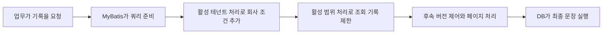

# 3. 프레임워크 원리: 쿼리 실행 전에 회사 조건 넣기

공유 테이블에는 소속 회사 표시가 있습니다. 각 쿼리가 이를 어떻게 사용할까요?

쿼리를 서류 조회 신청이라고 생각하세요. “고객 찾기”에 테넌트 플러그인이 “현재 회사 소속”, 범위 처리가 “본인 또는 부서 담당”을 더합니다. 해당 조건이 함께 충족되어야 합니다.

프로젝트의 MyBatis-Plus 3.5.16 JSQLParser-4.9 모듈 소스이며 연속된 원문입니다. 변수 이름부터 외울 필요는 없습니다.

## 전체 위치 보기



해당 능력을 켠 common-service의 책임도입니다. Auth·Workflow·직접 JDBC를 같은 체인에 넣은 그림은 아닙니다. 다음 글에서 구분합니다.

## 첫 원문: 조회 전에 쿼리 변경

TenantLineInnerInterceptor의 beforeQuery, 실제 버전 63–70행입니다.

<!-- omni:source path="docs/reference/upstream/mybatis-plus-3.5.16/query-rewrite.java.txt" -->
```java
    @Override
    public void beforeQuery(Executor executor, MappedStatement ms, Object parameter, RowBounds rowBounds, ResultHandler resultHandler, BoundSql boundSql) throws SQLException {
        if (InterceptorIgnoreHelper.willIgnoreTenantLine(ms.getId())) {
            return;
        }
        PluginUtils.MPBoundSql mpBs = PluginUtils.mpBoundSql(boundSql);
        mpBs.sql(parserSingle(mpBs.sql(), null));
    }
```

처음에 명시적으로 제외된 쿼리인지 확인합니다. 아니라면 실행할 문장을 읽어 parserSingle로 처리한 뒤 결과로 교체합니다.

앱이 DB 접근을 준비할 때 동작하며 DB가 브라우저 사용자를 자동으로 알아보는 것은 아닙니다. 플러그인 밖의 접근은 별도 소유 조건이 필요하며 업무 메서드에 제외 표시를 함부로 추가해서는 안 됩니다.

## 두 번째 원문: 회사 조건 구성

같은 클래스 264–270행에서 테이블의 테넌트 조건을 만듭니다.

<!-- omni:source path="docs/reference/upstream/mybatis-plus-3.5.16/tenant-condition.java.txt" -->
```java
    @Override
    public Expression buildTableExpression(final Table table, final Expression where, final String whereSegment) {
        if (tenantLineHandler.ignoreTable(table.getName())) {
            return null;
        }
        return new EqualsTo(getAliasColumn(table), tenantLineHandler.getTenantId());
    }
```

프로젝트 정책이 제외한 테이블이면 null, 즉 이 단계에서 회사 조건을 더하지 않습니다. 대상이면 테넌트 열과 현재 값의 동등 조건을 구성합니다.

테이블은 쿼리에서 별칭이라는 짧은 이름을 쓸 수 있습니다. getAliasColumn이 이를 열 이름에 포함하여 여러 테이블에서 대상을 구분합니다. getTenantId는 프로젝트가 제공하며 프레임워크 자체는 방문자의 회사를 모릅니다.

기본 열 이름은 TenantLineHandler 46–48행에 있습니다.

<!-- omni:source path="docs/reference/upstream/mybatis-plus-3.5.16/tenant-column.java.txt" -->
```java
    default String getTenantIdColumn() {
        return "tenant_id";
    }
```

기본 이름이 tenant_id라는 뜻이며 모든 테이블에 이 열이 있다는 증거는 아닙니다. 기반 시스템·엔진 테이블·전역 목록은 각각의 규칙이 필요합니다.

## 세 번째 원문: 데이터 범위는 별도 책임

DataPermissionInterceptor는 테이블·기존 조건·매핑 문장 식별자를 프로젝트의 다중 테이블 범위 처리기로 넘깁니다. 166–174행 원문입니다.

<!-- omni:source path="docs/reference/upstream/mybatis-plus-3.5.16/permission-delegation.java.txt" -->
```java
    @Override
    public Expression buildTableExpression(final Table table, final Expression where, final String whereSegment) {
        if (dataPermissionHandler == null) {
            return null;
        }
        // 只有新版数据权限处理器才会执行到这里
        final MultiDataPermissionHandler handler = (MultiDataPermissionHandler) dataPermissionHandler;
        return handler.getSqlSegment(table, where, whereSegment);
    }
```

여기에는 “리 씨가 동부 영업부다”라는 판단이 없습니다. 처리기를 호출하며 사람·역할·조직·필드 매핑은 프로젝트가 제공합니다.

null은 이 플러그인의 추가 조건이 없다는 뜻이지 거부나 다른 조건 해제가 아닙니다. 테넌트 제한·원래 업무 조건·API 인가도 계속 충족해야 합니다.

## 프레임워크와 프로젝트의 책임

| 프레임워크 | 프로젝트 |
|---|---|
| 해당 DB 접근에 처리 삽입 | 서비스 활성화와 등록 순서 |
| 지원 문장 해석과 조건 구성 | 신뢰할 테넌트와 대상 테이블 |
| 범위 처리를 콜백에 위임 | 작업 권한·본인/조직 범위·열·부모 관계 |
| 후속 실행으로 연결 | 쓰기 소유 관계·상태·버전·트랜잭션 |

common-service 순서는 TenantLine, DataPermission, OptimisticLock, Pagination입니다. 테넌트·행 범위를 먼저 처리하고 페이지를 나눠야 결과와 개수에 제한을 반영할 수 있습니다. 독립 설정이 있는 서비스는 별도로 봅니다.

마지막 두 개는 기록 버전으로 이전 업데이트가 다른 사람의 최신 변경을 덮지 않게 하는 것과 목록을 나눠 반환하는 것으로 이해하면 됩니다. 실제 동작에는 엔티티·버전 필드·쿼리의 연동이 필요합니다.

## 원문에서 기억할 판단

테넌트 플러그인을 쓴다는 사실만으로 모든 데이터 격리를 증명할 수 없습니다. 대상 테이블인지, 플러그인을 거치는지, 신원이 신뢰되는지, 업무 인가와 비동기 경로에도 규칙이 있는지 확인하세요.

다음은 [프로젝트 요청의 흐름](tenancy-request.kr.md)입니다.

## 원문과 라이선스

[MyBatis-Plus 3.5.16 공식 Maven 소스](https://repo.maven.apache.org/maven2/com/baomidou/mybatis-plus-jsqlparser-4.9/3.5.16/mybatis-plus-jsqlparser-4.9-3.5.16-sources.jar)에서 왔으며 공개 SHA-256과 받은 파일이 일치합니다. 원문 및 Copyright (c) 2011-2025, baomidou (jobob@qq.com)를 유지하고 [Apache License 2.0](https://www.apache.org/licenses/LICENSE-2.0)을 따릅니다.

출처 기록은 아카이브·원본 파일·행 범위·발췌·전체 라이선스 다이제스트를 보관합니다. 설명용 인용이며 런타임 의존성 추가나 업무 격리 테스트의 대체가 아닙니다.

전체 [라이선스](../reference/upstream/mybatis-plus-3.5.16/LICENSE.txt)와 [출처 기록](../reference/upstream/mybatis-plus-3.5.16/provenance.json)은 이 사이트에 함께 제공됩니다.
