# 資産の図解ガイド：入庫から使用終了まで

新しいパソコンが届いたら、誰が登録し、誰に渡し、誰が受領を確認するのでしょうか。別の人に渡すとき、修理に出すとき、最後に廃棄するときは、それぞれどの操作を使うのでしょうか。本章では、こうした日常の場面に沿って説明します。まず現在の利用者を確認し、承認と実物の引き渡しを分けて考えると、手順を取り違えにくくなります。

画像はローカル環境の専用デモアカウントで実際に操作したものです。撮影時点は場面ごとに異なります。廃棄と除却には別々のサンプル資産を使用しており、同じ資産が同時に二つの最終状態になったわけではありません。英語の名称、アカウント名、部門番号はデモ用です。実際の利用では、自分が扱う権限を持つ対象を選んでください。

## 1. モジュールを開き、自分の役割を確認する

ホームページから自分のワークスペースを開くと、新しいブラウザータブが開きます。ワークスペースのアプリ一覧、またはアプリのダイアログから資産管理を選ぶと、資産用のタブが別に開きます。資産モジュール内では、左メニューと右上の検索はこのモジュールに絞られます。別のアプリに移るときは、元のワークスペースのタブに戻ります。

役割によって、見える範囲と担当する操作が異なります。

| 役割 | 主に見るもの・行うこと |
| --- | --- |
| 資産管理者 | テナント内の台帳管理、資産登録、割り当て、修理依頼、移管・廃棄の申請と完了処理 |
| 資産マネージャー | 権限のある部門範囲での資産管理。承認できるかどうかは、自分に実際のタスクが届いているかで判断 |
| 資産利用者 | 自分の資産の確認、受領確認、返却。全員分の資産管理は担当しない |

資産マネージャーだからといって、すべての申請を承認できるわけではありません。逆に、承認タスクを受け取っても、資産モジュール全体の管理権限が得られるわけではありません。メニューやボタンがない場合は、アカウントと資産の状態を確認します。

## 2. 概要で気になる点を見つけ、台帳で確認する

資産概要では、まず状態別の件数を確認します。分布は状態、カテゴリ、部門、場所で切り替えられます。「受領待ちが多い」「修理中の機器がまだ戻っていない」といった状況を探すときに役立ちます。

画像の数字は撮影時点の実際の値です。処理後は再読み込みできますが、概要の数字だけで特定の資産の引き渡し完了を判断しないでください。その資産を台帳で確認します。

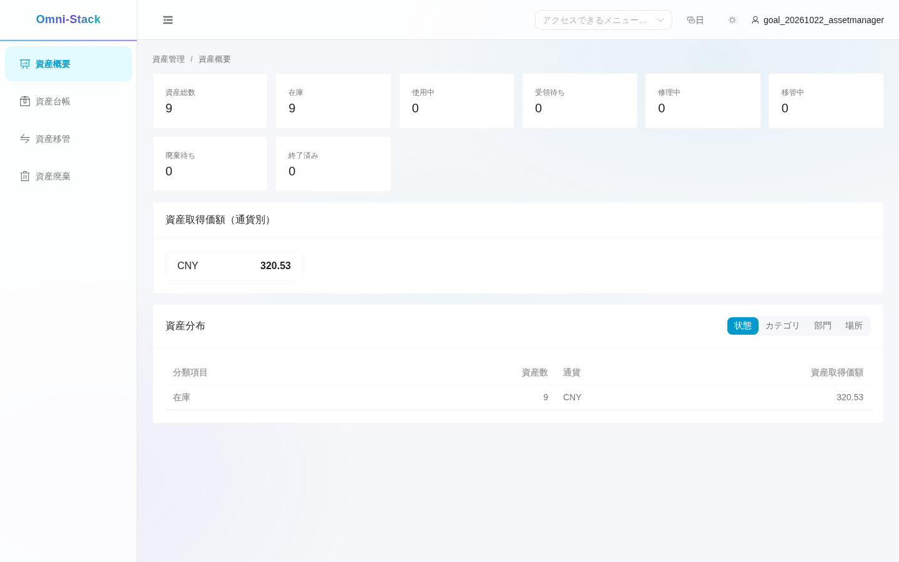

## 3. 台帳で探し、入手元と履歴を読む

資産台帳を開き、名称または資産番号で検索します。必要に応じて状態、管理部門、場所などの条件を追加します。「検索」で条件を適用し、「リセット」で解除します。ほかの行はページを切り替えるか、1ページの表示件数を変えて確認します。

表が横に長い場合は、横スクロールして右側の状態や操作を確認します。画像によっては左端の列が画面外に出ていますが、検索欄の番号と詳細画面で対象を確認できます。

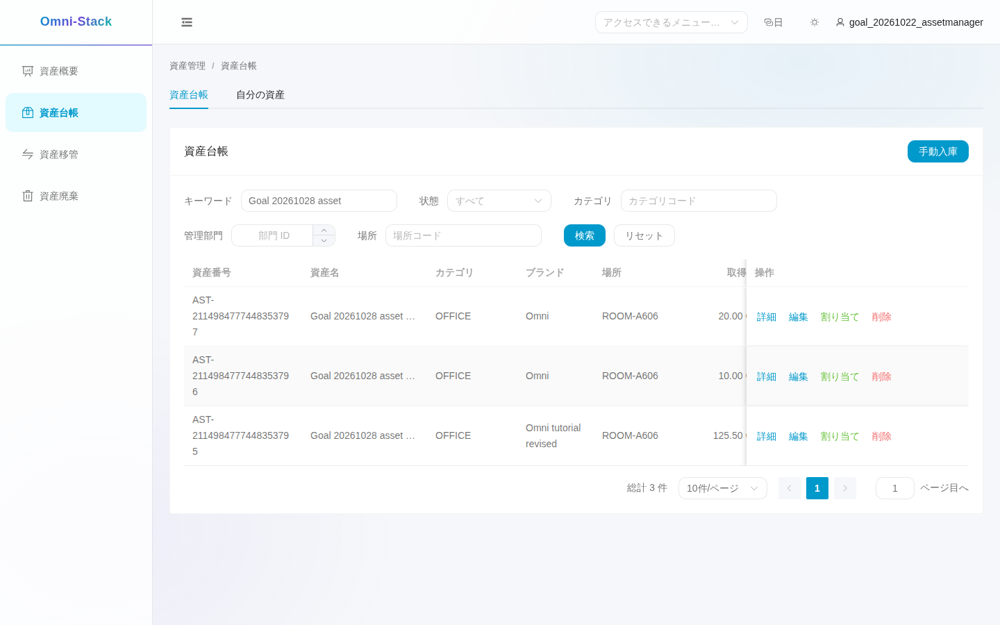

「詳細」を開くと、右側のパネルで名称、取得価額、場所、現在の利用者と部門を確認でき、その下に変更履歴があります。手動登録のサンプルは、当初の利用者が未設定で、価額は125.50 CNYです。管理を担当する人と、実物を使う人を混同しないでください。

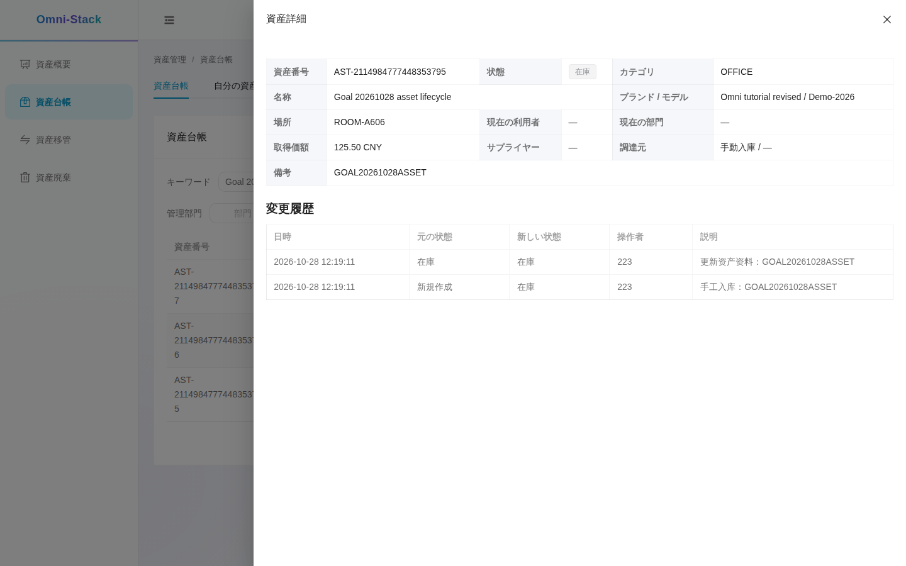

履歴には、申請の開始と、その後の復元の両方が残ります。今できる操作は現在の状態で判断し、経緯は日時順に読みます。長い履歴は下にスクロールしてください。画像は見えている範囲だけを示し、言語を切り替えても保存済みの業務説明は書き換わりません。

## 4. 購買の受け入れから資産カードができるまで

購買の受入記録で検品が合格し、受け入れを確定すると、条件を満たす実物の資産カードが自動作成されます。条件は、検品合格、資産管理の対象品目、資産数量が正の整数であることです。同じ型番の機器が2台なら、2枚のカードに分けて、それぞれ割り当てや修理を管理できます。

台帳から詳細を開き、発注書、受入記録、入手元の情報を実物と照合します。この画像は、購買ガイドで実際に確認した資産カードを再利用しています。後半の手動登録サンプルとは別のものです。

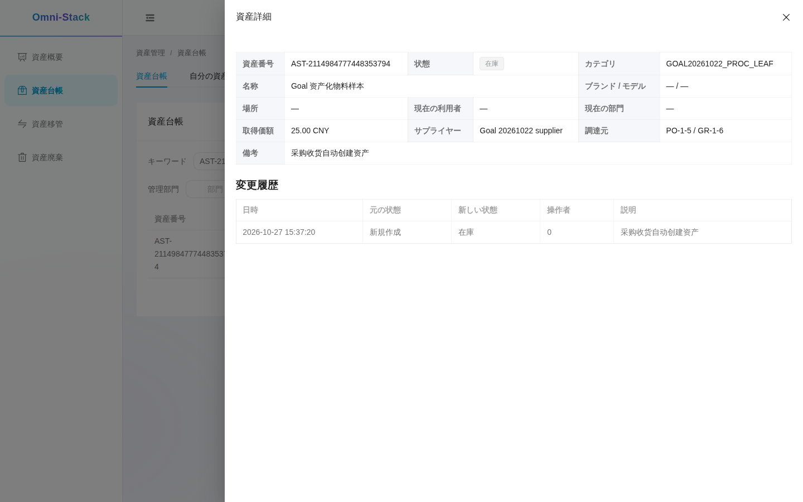

受け入れを確定してもカードが見つからない場合は、最初に検索条件を確認します。続いて受入記録の検品結果、資産管理の指定、数量を確認してください。同じ実物を手動で何度も登録しないでください。判断できない場合は、受入番号を残して管理者に確認します。

## 5. 購買元のない資産を手動で入庫する

既存機器の追加入力などには「手動入庫」を使います。名称、カテゴリ、仕様、ブランド・型番、購入日、価額、通貨、場所を入力します。担当する管理者を選び、そのアカウントから設定される管理部門を確認します。情報があれば保証期限と想定使用年数も入力できます。

仕入先を関連付ける場合は、仕入先欄で名称を検索し、権限のある検索結果から選びます。隣の仕入先名は自動入力され、選択時の名称を残します。勝手な名称を入力する欄ではありません。適切な候補がないときは、仕入先情報と権限を確認します。

金額は画面の案内に従い、例えば125.50のように入力します。金額欄に通貨や説明を付け足さないでください。管理者は正しい候補から選び、部門がその人と一致することを確認します。デモの番号をそのまま転記しないでください。

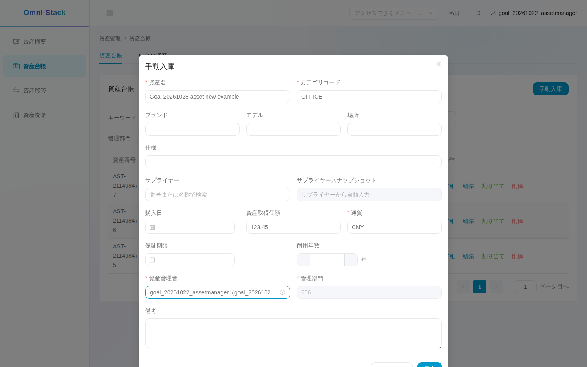

長いフォームでは下へスクロールし、備考、管理担当、下部のボタンまで確認します。保存すると資産番号が発行され、初期状態は「在庫」です。キャンセルすると入力を破棄し、資産は新規登録されません。

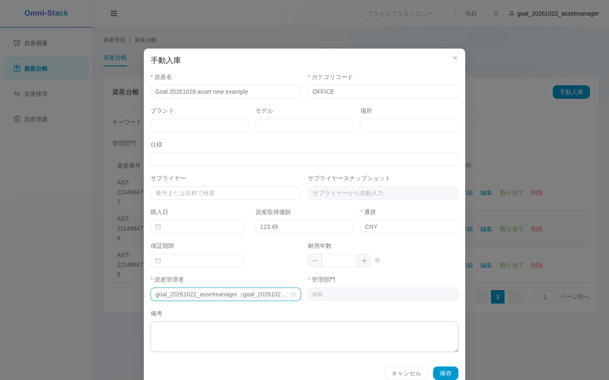

手動入庫で発注書や受入元が作られることはありません。手動カードと購買から作られたカードは入手元が異なります。備考を書き加えても、手動カードを購買由来のカードにはできません。

## 6. 編集、削除、変更の競合を扱う

編集可能な在庫資産で「編集」を開き、名称、ブランド・型番、備考などを変更します。編集フォームには場所を直接変える欄がないため、情報の編集を実物の移動と混同しないでください。送信前に対象を確認します。他の人が先に変更していた場合は、繰り返し送信せず、再読み込みして現在の内容を確認します。

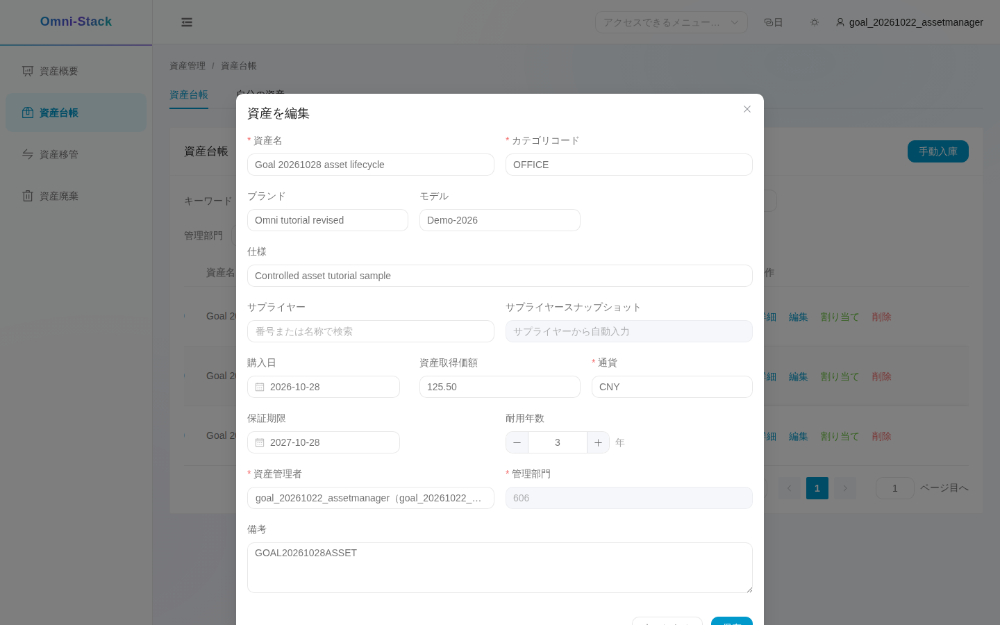

管理担当と下部の操作もスクロールして確認します。管理者を変更することと、実物を別の利用者へ渡すことは異なります。利用者を変える場合は、割り当てまたは移管の手順を使います。

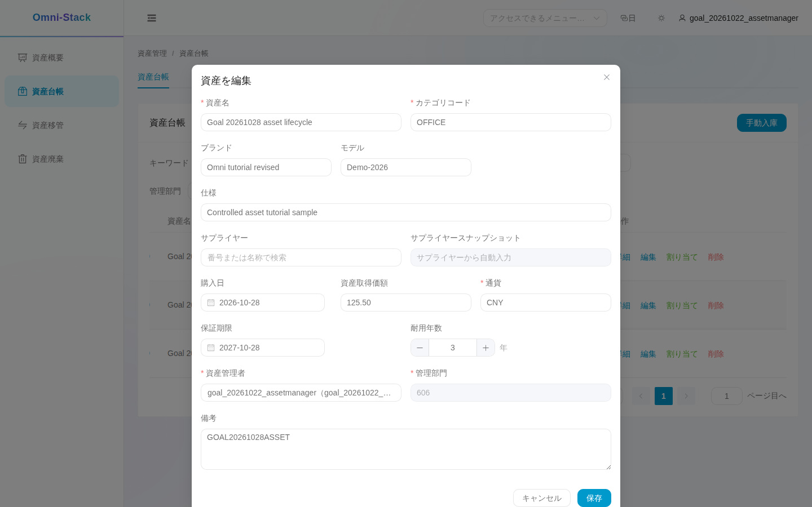

削除は、まだ使用されておらず、利用関係や進行中の処理がない手動の在庫記録を整理するための操作です。確認画面で名称や番号を確かめ、削除後は一覧を再読み込みします。購買由来のカードや業務履歴のある資産を、使用終了の代わりに削除することはできません。実物を使用対象から外す場合は、適切な廃棄の手順を使います。

## 7. 割り当てと受領確認は別の段階

台帳で割り当て可能な在庫資産を探し、「割り当て」を選びます。利用者を選択し、部門を確認して、必要なら備考を入力します。利用者は有効なアカウントで、対象部門に所属している必要があります。選べる候補は自分の権限範囲に限られます。

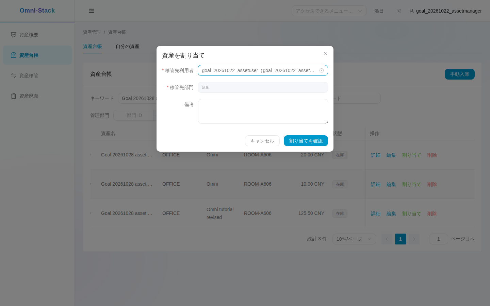

成功すると状態は「受領待ち」になり、利用者と部門が記録されます。管理者は受取人を決めましたが、その人が実物の受け取りを確認したわけではありません。下図は、同じデモ資産を後で再び割り当てたときの実際の状態です。

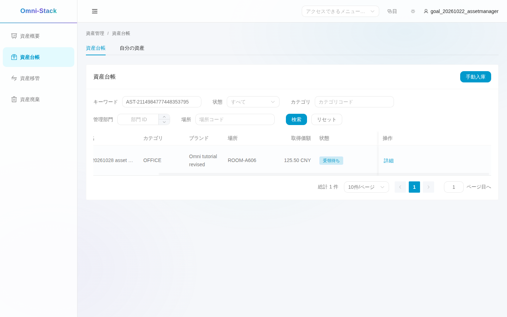

すでに使っている資産を別の人へ渡す場合は、再度割り当てないでください。いったん返却してから割り当て直すか、後述の移管を使います。

## 8. 本人が受領を確認する、または受領前に返却する

受取人は資産台帳の「自分の資産」を開き、受領待ちの記録で「受領確認」を選びます。確認画面で番号を確かめ、実物、自分のアカウント、記録が一致してから確定します。管理者が他人の代わりに受領確認することはできません。

成功後に「自分の資産」を再読み込みすると「使用中」になります。画像のアカウントは、このサンプルの実際の利用者です。同じ部門の別アカウントが、部門が同じという理由だけで同じ資産の利用者になることはありません。

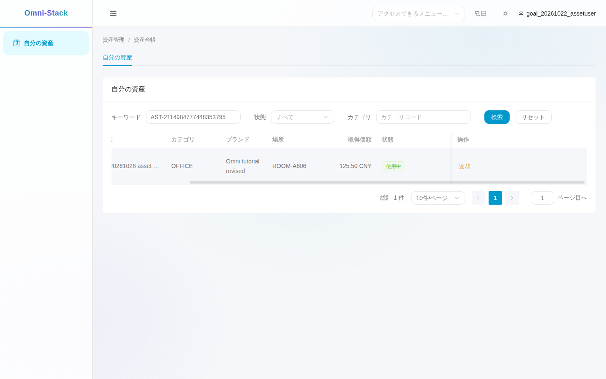

まだ受け取っていない段階で戻す場合は、受領待ちの記録から「返却」を選べます。返却のためにいったん受領確認する必要はありません。実物が自分の手元に残らないことを確認してください。

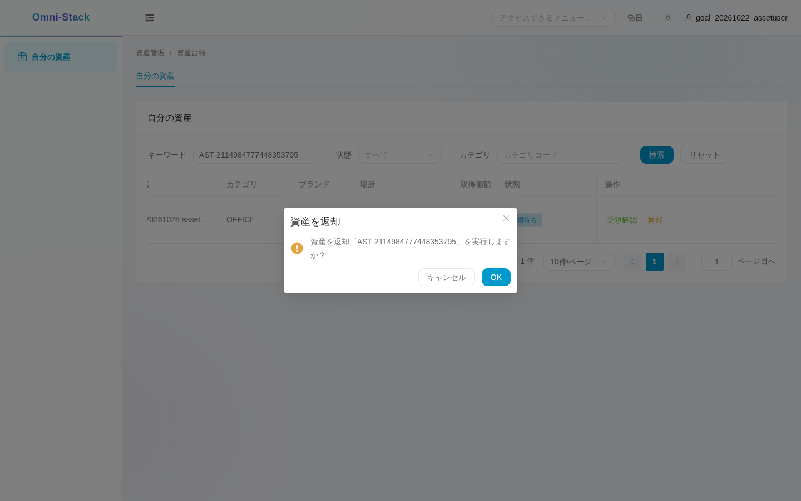

## 9. 使用中の資産を返却する

実物を返した後、現在の利用者が「自分の資産」の使用中の記録から「返却」を選び、番号を確認して確定します。この操作は、ログイン中の本人に記録された、返却可能な資産が対象です。

成功すると資産は「在庫」に戻り、本人の利用対象から外れます。そのため「自分の資産」には表示されなくなります。空の一覧は、必ずしもデータが失われたことを意味しません。権限のある管理者に同じ番号を台帳で検索してもらえます。

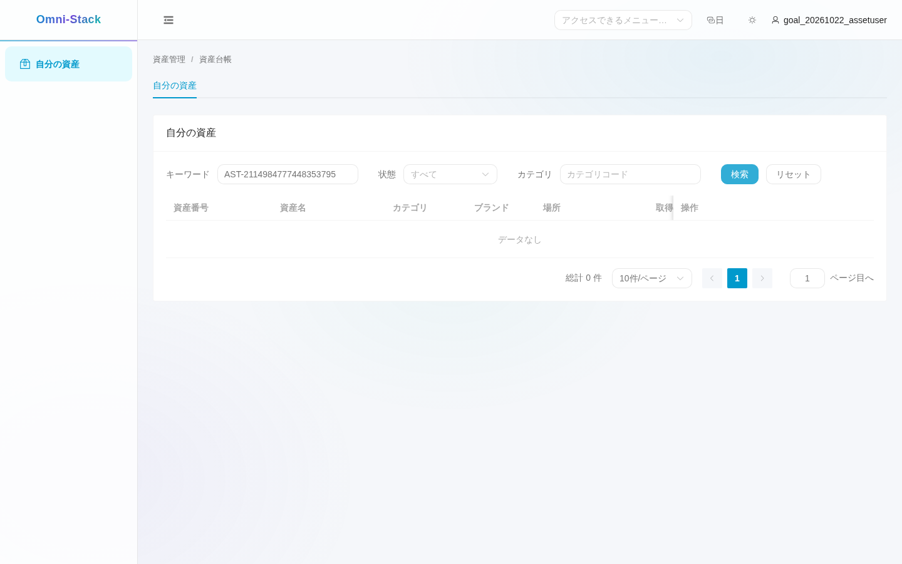

管理者が詳細を開くと、現在の利用関係が解除され、割り当て、受領確認、返却の履歴は残っていることを確認できます。購買由来の資産では、入手元の情報も保持されます。

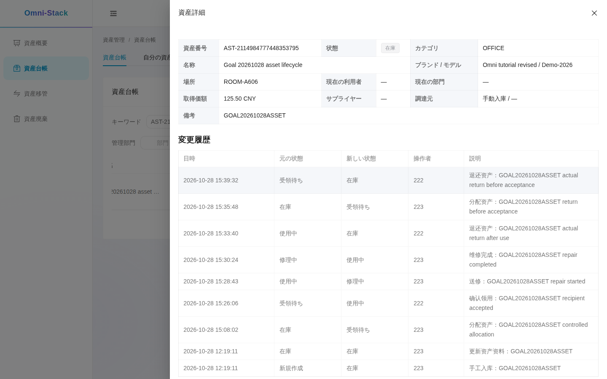

## 10. 修理に出しても元の利用者は変わらない

管理者は使用中の資産で「修理に出す」を選び、確認画面で対象を確かめます。状態は「修理中」になります。修理中の資産を在庫として再割り当てしたり、同時に移管や廃棄を始めたりしないでください。

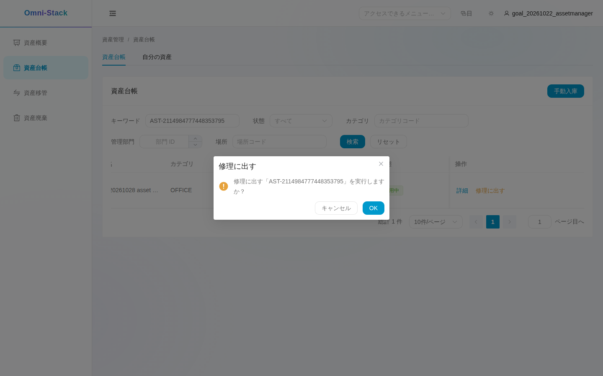

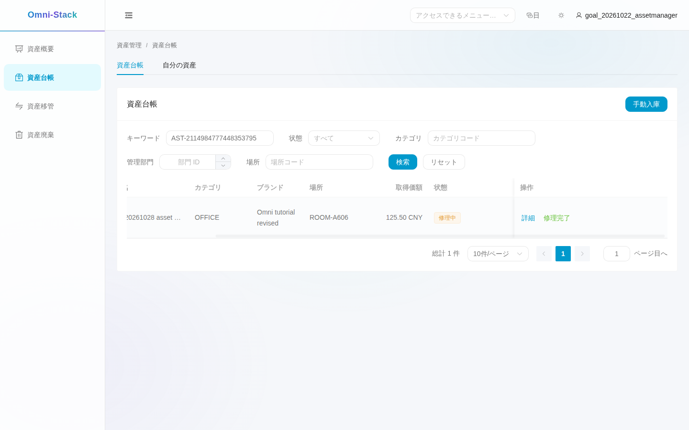

修理が終わり実物が戻ったら、管理者は「修理完了」を選んで確定します。「使用中」に戻り、元の利用者と部門は維持されます。これは修理を終えて元の使用状態に戻す操作であり、利用者から在庫へ返却する操作ではありません。

## 11. 移管を申請し、実際の担当者が承認する

「資産移管」を開き、「移管を開始」を選びます。権限範囲内で、ほかの申請に使用されていない資産を選び、移管先の利用者、部門、場所、理由を確認します。選択可能な対象には、在庫、受領待ち、使用中の資産が含まれる場合があります。フォームに実際に表示される候補から選んでください。

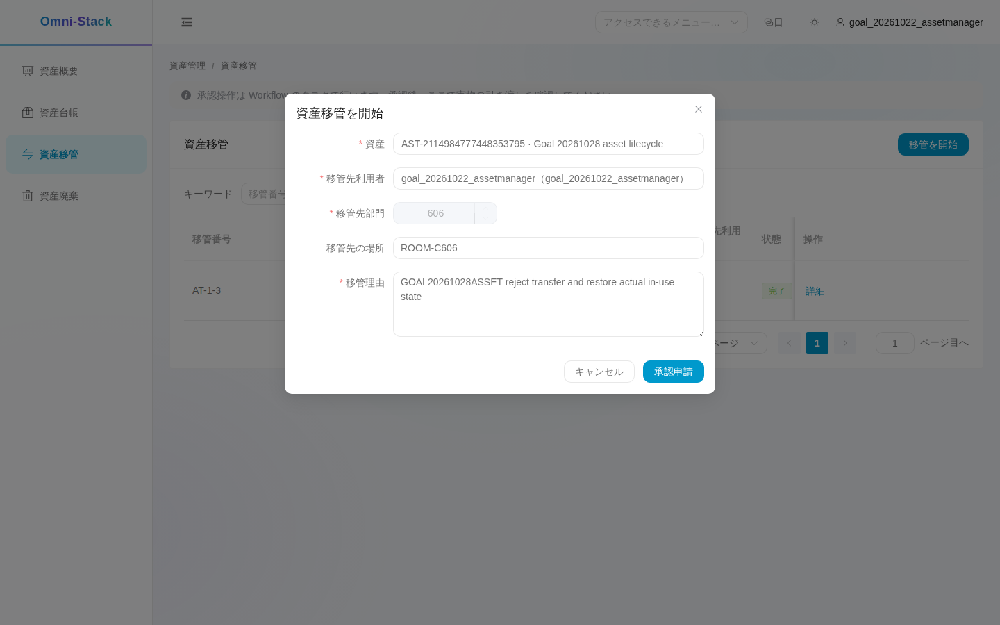

入力済みフォームの画像は送信前のプレビューです。実際に送信して初めて申請番号ができます。申請後は詳細を開き、元の利用者と移管先、元の場所と移動先を比べ、対象に間違いがないか確認します。

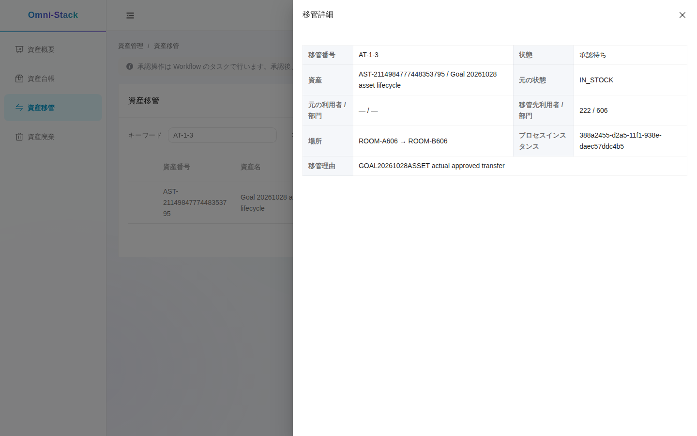

承認者は元のワークスペースのタブに戻り、自分の承認待ちに実際に届いたタスクを開きます。元の利用関係と理由を読み、「承認」または「却下」を選び、コメントを入力して確定します。下図は、担当承認者が却下を選択した場面です。ダイアログを開いただけでは判断は送信されません。

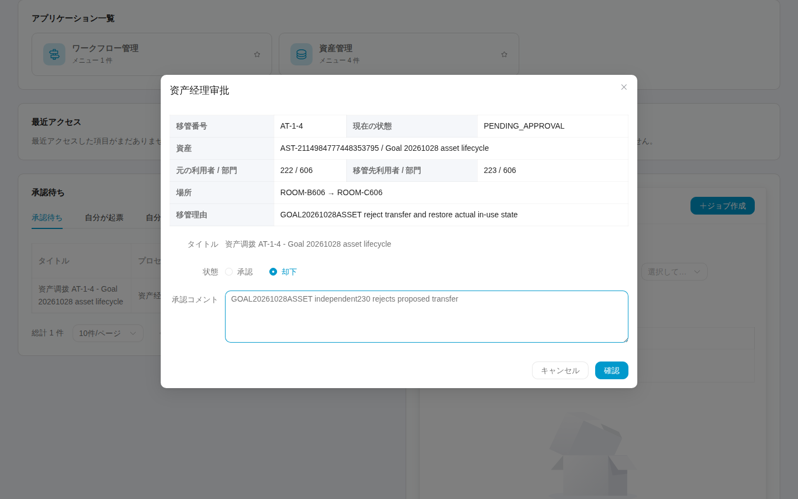

申請処理中の資産は「移管中」です。提案した利用者への切り替えはまだ完了していません。同じ資産を二つの処理で同時に扱わないための状態なので、待ち時間を避けようと別の申請を作らないでください。

## 12. 承認の後に実物を引き渡す

承認後、管理者は資産タブの「資産移管」に戻り、元の申請と結果を確認して実物を引き渡します。受取人と場所が正しいことを確認してから「引き渡し完了」を選び、確定します。

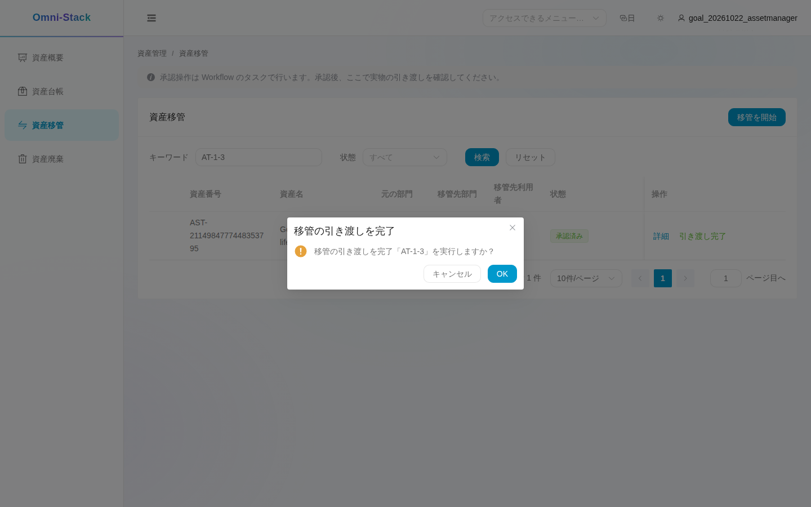

完了すると申請は完了状態になり、資産は使用状態に戻ります。現在の利用者、部門、場所は、その移管で指定した内容に更新されます。資産の管理担当と、実物を受け取る利用者は別の立場です。

却下された場合、変更案は反映されず、資産は申請前の状態に戻ります。この例では、使用中だった資産の利用者、部門、場所が維持されています。ほかの状態から申請した場合は、その元の状態に戻ったことを確認します。

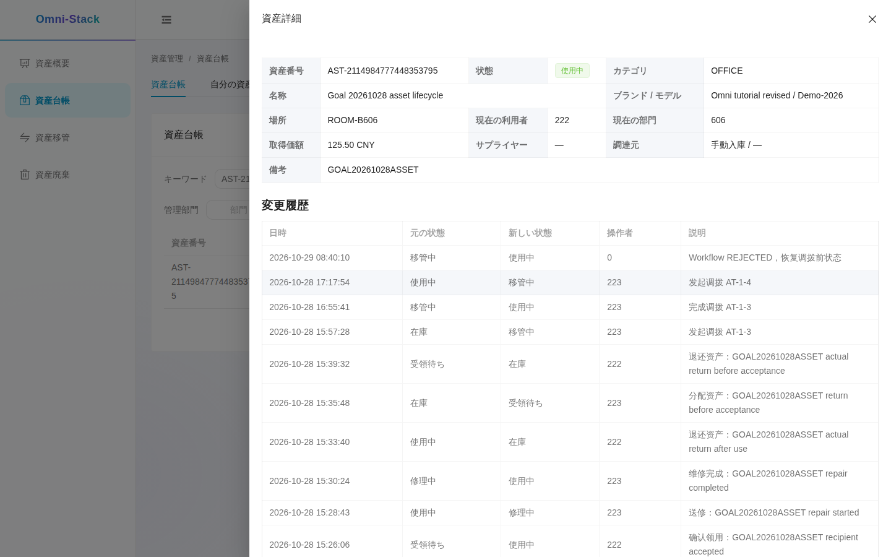

## 13. 廃棄・除却と最終確認を分けて考える

「資産廃棄」を開き、「廃棄を開始」を選びます。処理可能な資産を選択し、「廃棄」または「除却」を選び、理由を入力します。必要に応じて残存価額や方法も入力します。送信前に実物と選択した種類を照合してください。

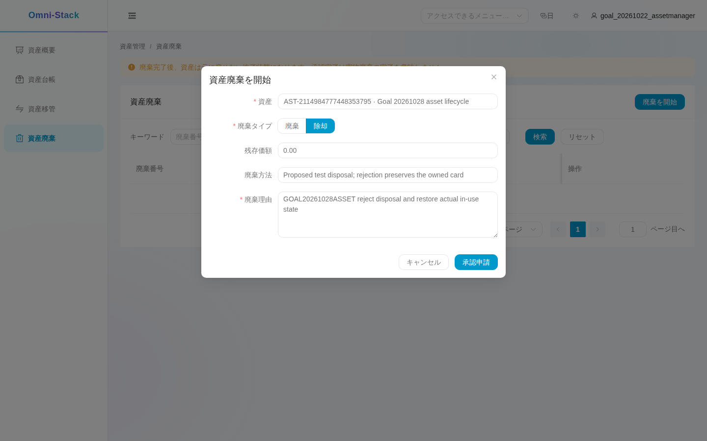

送信すると資産は廃棄待ちになります。承認者は実際に届いたタスクで、種類、元の状態、残存価額、方法、理由を確認し、承認または却下します。タスクに表示される元の状態や業務説明は、保存された実際の情報です。

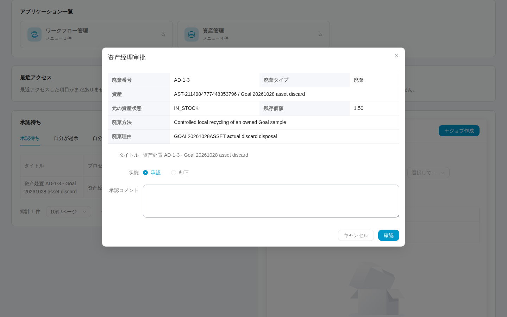

承認だけで資産の使用終了は完了しません。実物が約束どおり回収、破棄、引き渡しされたことを管理者が確認し、その後、元の申請で「廃棄を完了」を選びます。

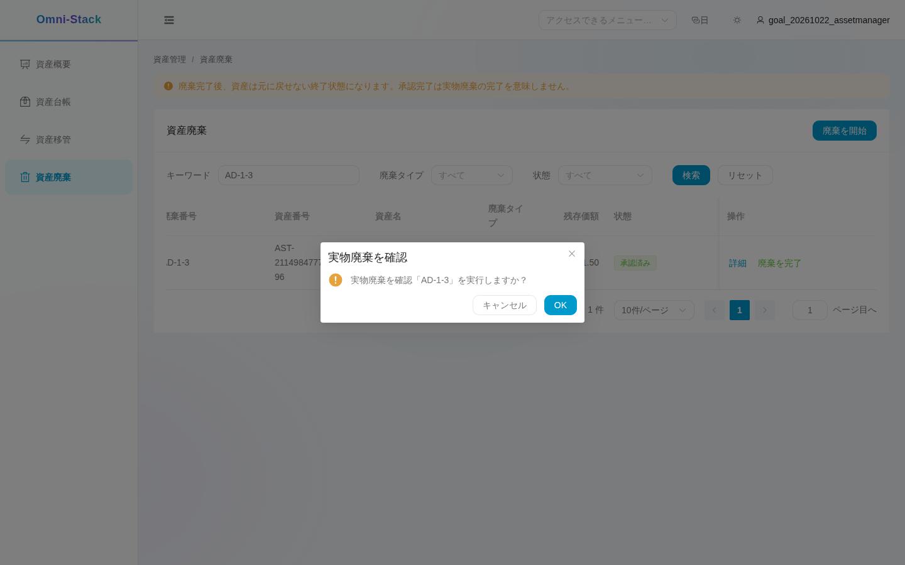

「廃棄」のサンプルは「廃棄済み」になります。下の除却サンプルとは別の実物です。どちらの最終状態も、返却や再割り当てで元に戻すことはできません。

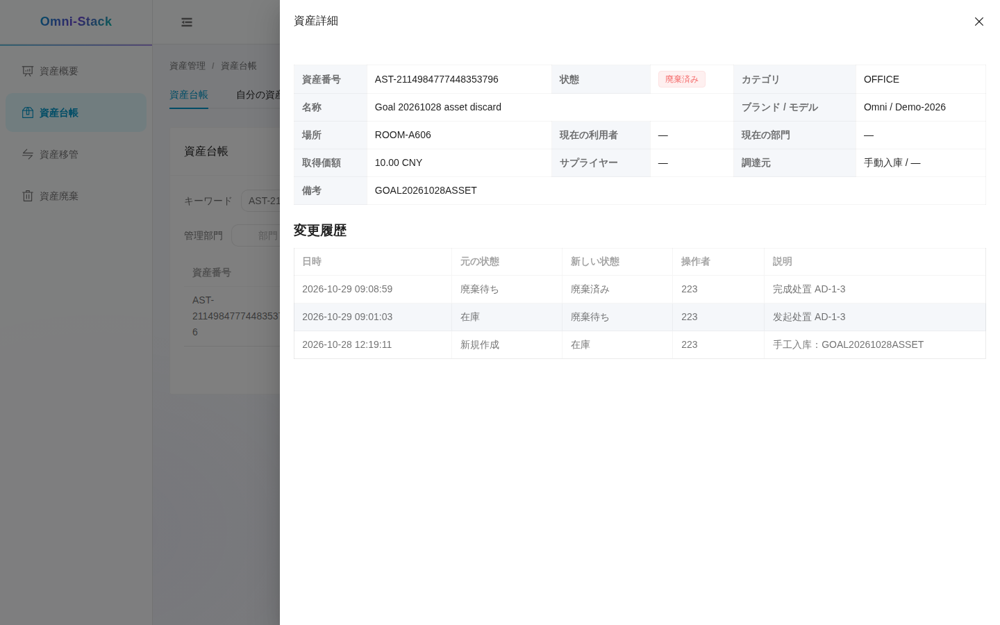

却下された場合、廃棄は実行されず、資産は元の利用関係を保って申請前の状態に戻ります。「申請の却下」は、一度実物を処分してから復元したことを意味しません。

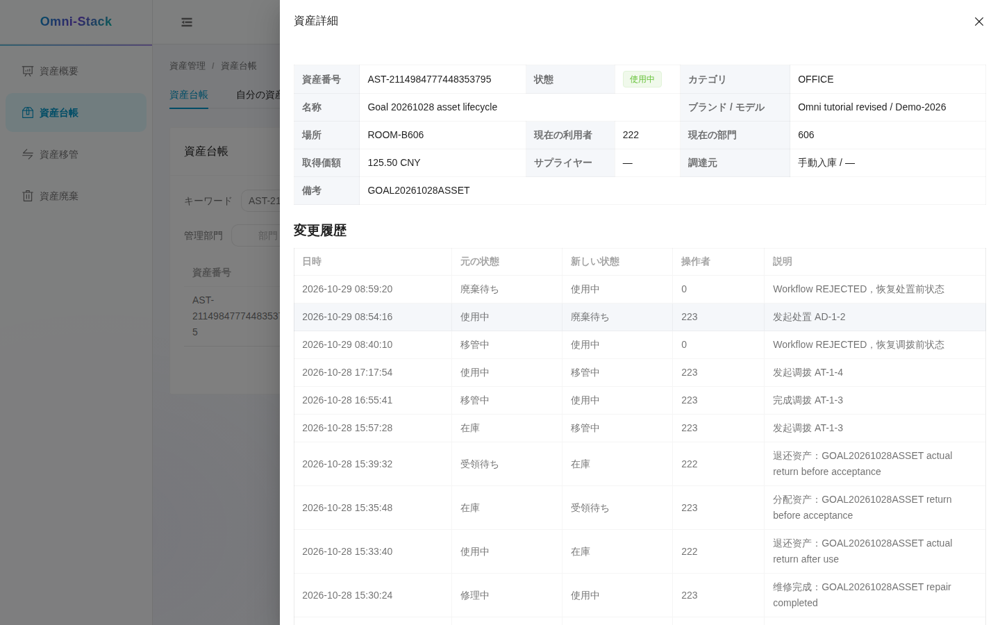

## 14. 開始結果が不明なときは元の申請を再試行する

承認の開始結果が確認待ちになった場合は、元の申請を検索し、詳細を開いて再読み込みします。明確なプロセスがないまま承認待ちと表示されることがあります。同じ処理を新規作成したり、開始に確実に失敗したと決めつけたりしないでください。

まず権限のある管理者が、実際の承認候補者の組織範囲など、不足している前提を直します。前提が整ったら元の申請行の「再試行」を選び、番号を確認して確定します。再試行は同じ申請を使い、別の申請を複製する操作ではありません。

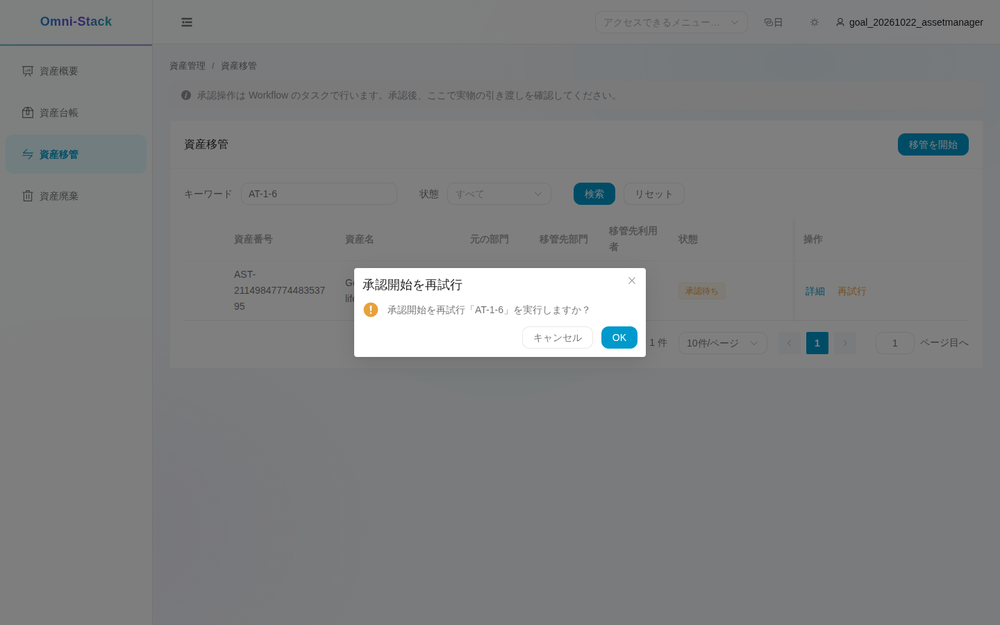

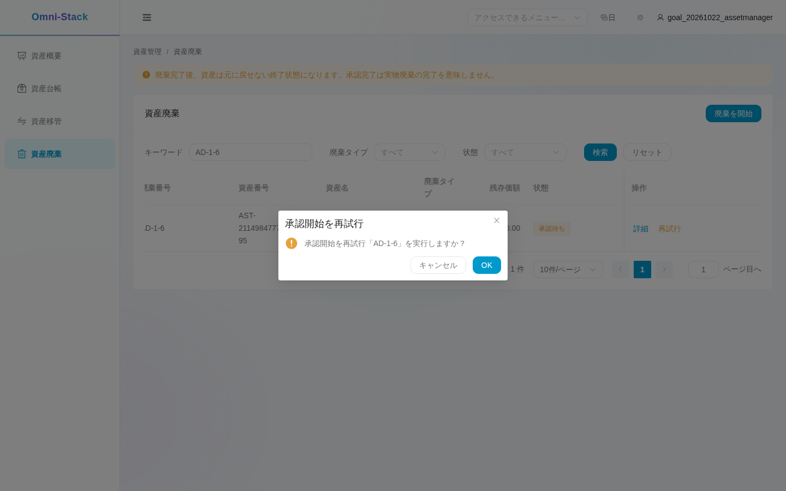

確認ダイアログは、これから行う操作の表示です。成功を判断するには詳細を再読み込みし、プロセスと承認者に届いた実際のタスクを確認します。判断が出た後は、承認または却下の経路に沿って資産を確認します。

申請側でのキャンセルは、画面が明確に「開始失敗」となり、「キャンセル」を表示しているときに限られます。元の申請を確かめてから操作します。結果が不明な状態では、このキャンセルはできません。ボタンがないからといって申請を重複作成しないでください。この節の画像は結果確認待ちの再試行であり、明確な開始失敗の画像ではありません。

## 15. プロセスの取消と申請側のキャンセルは別のもの

開始済みの承認プロセスが正当に終了・取消された場合、移管または廃棄の申請に取消結果が届き、資産は申請前の状態に戻ります。下の画像は、実際の取消後の資産と最新履歴です。元の利用者、部門、場所が保たれています。

現在の画面には、開始済みプロセスを終了するボタンはありません。そのため、ここでは存在しないクリック手順を案内せず、取消後の結果だけを示します。前節の、開始失敗が確定した申請のキャンセルを示す画像でもありません。

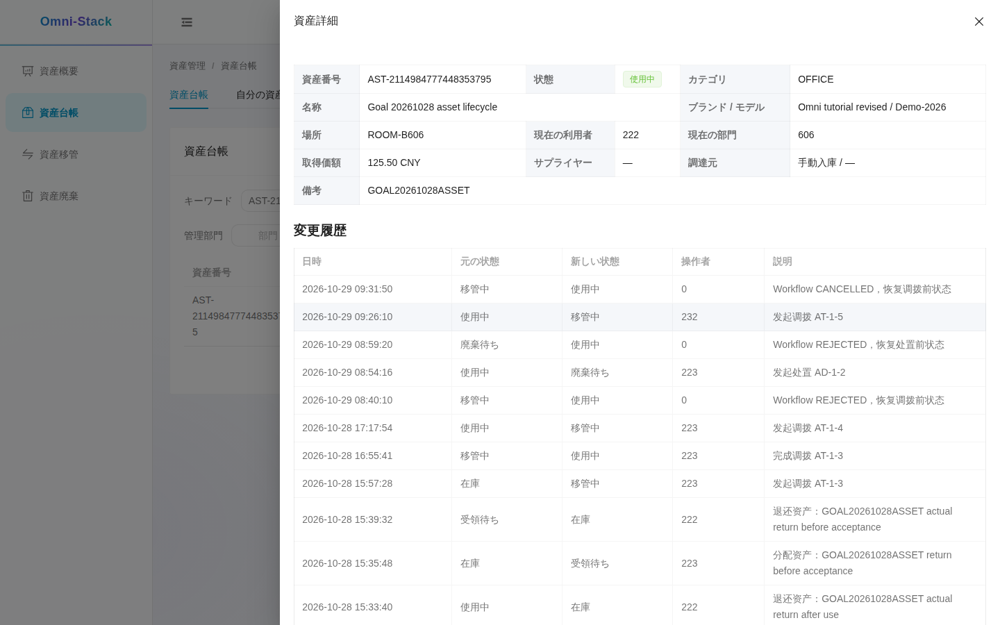

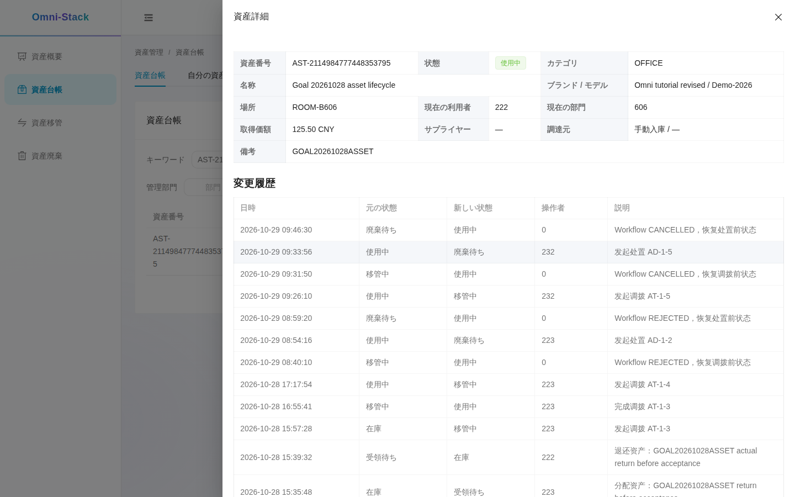

却下でも正当な取消でも、元の申請と資産詳細で最終結果を確認します。承認済みでも実物の処理が終わるまでは、資産は元の申請で処理中のままです。同時に二つ目の処理を始めることはできません。

## 16. データやボタンが見えないときの確認順

最初にブラウザーのタブと現在のアカウントを確認し、次に検索条件と資産の状態、最後に役割と部門範囲を確認します。空の一覧が必ずシステム障害を意味するわけではありません。

下図のデモ用マネージャーは別部門の所属です。役割はありますが、この資産群の管理範囲外なので表示されません。検索条件を書き換えて他部門の資産を見られるようになるべきではありません。

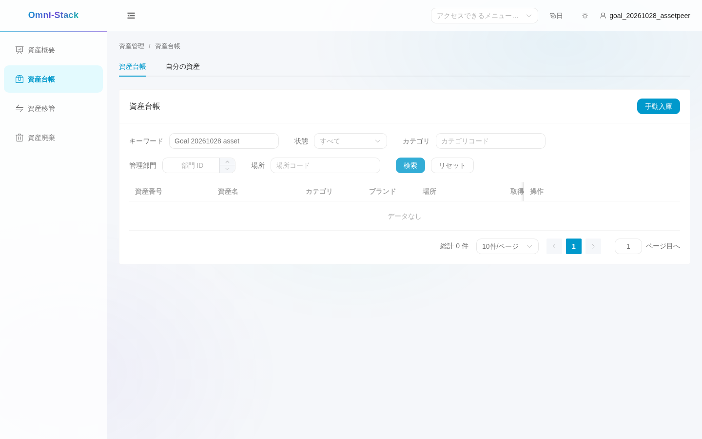

資産利用者が管理機能に入ろうとすると、権限で制限されます。「自分の資産」に戻り、本人の記録を扱ってください。日常の受領確認のために自分を管理者に変える必要はありません。

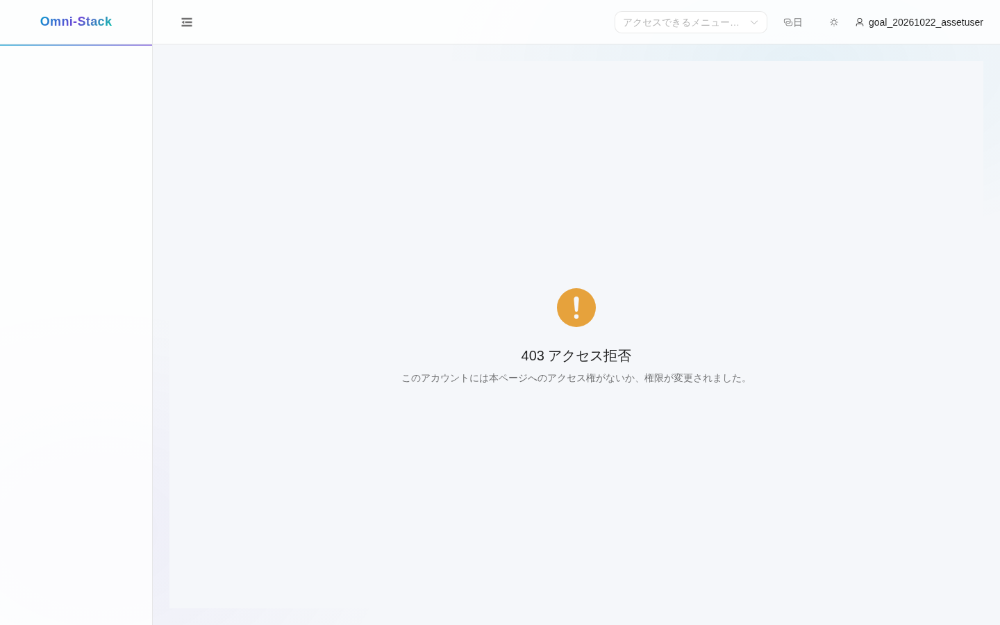

| 状況 | 最初に確認すること | 次の対応 |
| --- | --- | --- |
| 割り当てたばかりの機器が自分の資産にない | 本来の受取人でログインしているか、古い検索条件が残っていないか | 再読み込みと条件解除を行い、管理者に現在の利用者を確認してもらう |
| 返却後に記録が見えなくなった | 在庫に戻っていないか | 管理者が元の番号で検索し、状態と履歴を見る |
| 割り当て、編集、削除がない | アカウント、状態、購買元、これまでの業務 | 繰り返し送信せず、その状態で認められる操作を使う |
| 承認タスクが届かない | 本人が実際の担当か、承認の前提が整っているか | 権限のある管理者が候補者と組織範囲を確認する |
| 承認済みなのに移管中・廃棄待ちのまま | 実物の引き渡しや最終処理を確認したか | 実物を確認してから元の申請を完了する |
| 別の申請が資産を使用中と表示される | 元の移管または廃棄が終わっているか | 元の申請を処理してから新しい業務を始める |
| 送信後の結果が確認待ち | 元の申請があるか、プロセスが確認できるか | 前提を直し、再作成せず同じ申請を再試行する |
| 記録が変更済みと表示される | 他の人が操作したか、画面が古くなっていないか | 再読み込みし、現状を見てから操作を決める |
| 一覧や操作へのアクセスが拒否される | 役割や部門の範囲を超えていないか | 自分に認められる入口を使い、管理業務は権限のある人が行う |

承認を伴う移管と廃棄では、元の申請の最終状態と、資産カードの現在の状態・利用関係の両方を確認します。承認、実物、システム上の記録が一致したかを、ここで判断できます。
