# 자산 그림 가이드: 입고부터 사용 종료까지

새 컴퓨터가 도착하면 누가 등록하고, 누구에게 전달하며, 누가 인수를 확인할까요? 다른 사람에게 넘기거나 수리를 맡기고, 마지막에 폐기할 때는 각각 어떤 작업을 해야 할까요? 이 문서는 이런 일상적인 상황에 따라 자산 기능을 설명합니다. 먼저 현재 사용자를 확인하고, 승인과 실제 인계를 구분하면 절차를 헷갈리는 일을 줄일 수 있습니다.

이미지는 로컬 환경의 전용 시연 계정으로 실제 작업한 화면입니다. 각 화면의 촬영 시점은 다릅니다. 버림과 폐기에는 서로 다른 샘플 자산을 사용했으며, 하나의 자산이 동시에 두 최종 상태가 된 것은 아닙니다. 영문 이름, 계정명, 부서 번호는 시연 데이터입니다. 실제로는 본인에게 처리 권한이 있는 대상을 선택하세요.

## 1. 모듈을 열고 자신의 역할 확인하기

홈페이지에서 워크스페이스를 열면 새 브라우저 탭이 열립니다. 워크스페이스의 애플리케이션 목록이나 앱 대화상자에서 자산 관리를 선택하면 별도의 자산 탭이 열립니다. 자산 모듈 안에서는 왼쪽 메뉴와 오른쪽 위 검색이 현재 모듈에 집중됩니다. 다른 앱으로 이동하려면 원래 워크스페이스 탭으로 돌아가세요.

역할에 따라 볼 수 있는 범위와 담당 작업이 다릅니다.

| 역할 | 주로 확인하고 처리하는 내용 |
| --- | --- |
| 자산 관리자 | 테넌트 내 원장 관리, 자산 등록·할당·수리 요청, 이동·처분 신청과 완료 |
| 자산 매니저 | 권한이 있는 부서 범위의 자산 관리. 승인 가능 여부는 실제로 배정된 작업이 도착했는지로 판단 |
| 자산 사용자 | 본인 자산 조회, 인수 확인, 반납. 전체 사용자의 자산 관리는 담당하지 않음 |

자산 매니저라고 해서 모든 신청을 승인할 수 있는 것은 아닙니다. 반대로 승인 작업 하나를 받았다고 자산 모듈 전체의 관리 권한을 얻는 것도 아닙니다. 메뉴나 버튼이 없다면 계정과 자산 상태를 함께 확인하세요.

## 2. 개요에서 확인할 대상을 찾고 원장으로 이동하기

자산 개요에서는 먼저 상태별 수량을 확인합니다. 분포는 상태, 분류, 부서, 위치로 전환할 수 있습니다. 인수를 기다리는 자산이 많거나 수리 중인 장비가 아직 돌아오지 않은 상황을 찾는 데 도움이 됩니다.

이미지의 숫자는 촬영 당시의 실제 데이터입니다. 처리 후 새로 고침할 수 있지만, 개요의 숫자만으로 특정 자산이 인계되었다고 판단하지 마세요. 해당 자산은 원장에서 확인합니다.

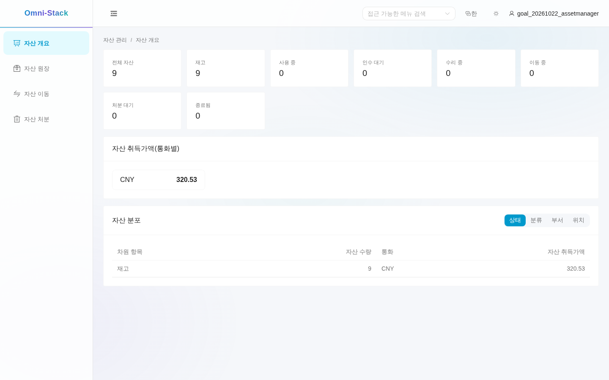

## 3. 자산 찾기, 출처 확인하기, 이력 읽기

자산 원장을 열고 이름이나 자산 번호로 검색합니다. 필요하면 상태, 관리 부서, 위치 등의 조건을 추가합니다. 검색으로 조건을 적용하고 초기화로 해제합니다. 다른 기록은 페이지를 바꾸거나 페이지당 표시 수를 조정해 확인하세요.

표가 넓으면 가로로 스크롤하여 오른쪽의 상태와 작업을 확인합니다. 일부 이미지에서는 왼쪽 열이 화면 밖으로 나갑니다. 검색창의 번호와 상세 화면으로 대상을 구분할 수 있습니다.

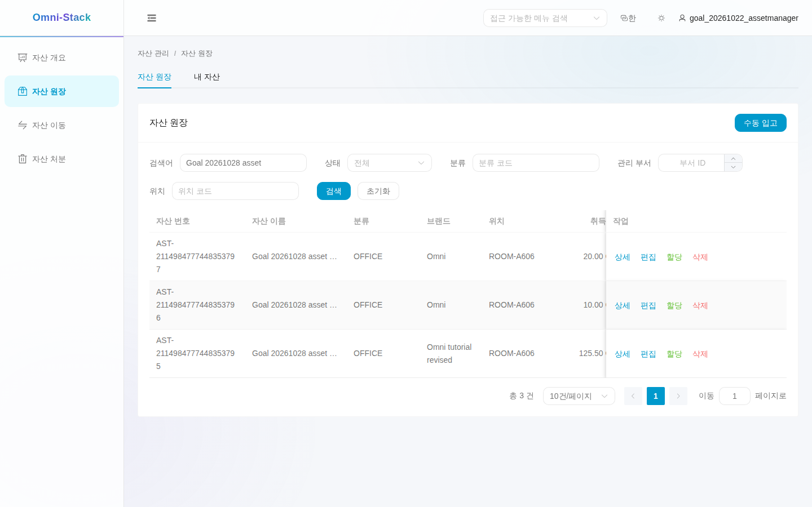

상세를 열면 오른쪽 패널에서 이름, 취득가액, 위치, 현재 사용자와 부서를 확인할 수 있고, 아래에는 변경 이력이 나옵니다. 수동 등록 샘플은 처음에 사용자가 없으며 금액은 125.50 CNY입니다. 자산의 관리 담당자와 실제 사용자는 다를 수 있습니다.

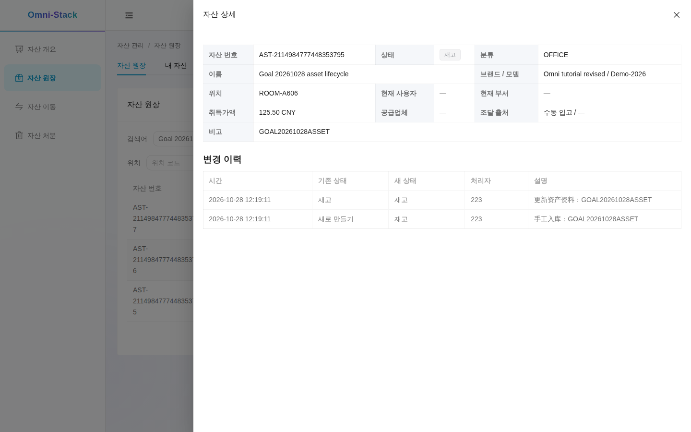

이력에는 신청 시작과 이후 원상 복구 기록이 모두 남습니다. 지금 가능한 작업은 현재 상태를 기준으로 판단하고, 경위는 시간순으로 읽으세요. 이력이 길면 아래로 스크롤합니다. 이미지는 당시 보이는 부분만 보여 주며, 화면 언어를 바꾸어도 저장된 업무 설명은 다시 작성되지 않습니다.

## 4. 구매 입고가 자산 카드로 이어지는 과정

구매 입고 건이 검사를 통과하고 입고 확정되면, 조건을 충족하는 실물의 자산 카드가 자동으로 생성됩니다. 검사 합격, 자산 관리 대상 품목, 양의 정수인 자산 수량이 필요합니다. 같은 모델의 장비가 두 대라면 카드도 두 장으로 나뉘어 각각 할당하고 수리할 수 있습니다.

원장에서 상세를 열고 구매 주문, 입고 문서, 출처 정보를 실물과 대조하세요. 이 이미지는 구매 가이드에서 실제 확인한 출처 자산 카드를 재사용합니다. 뒤에서 사용하는 수동 샘플과는 다른 카드입니다.

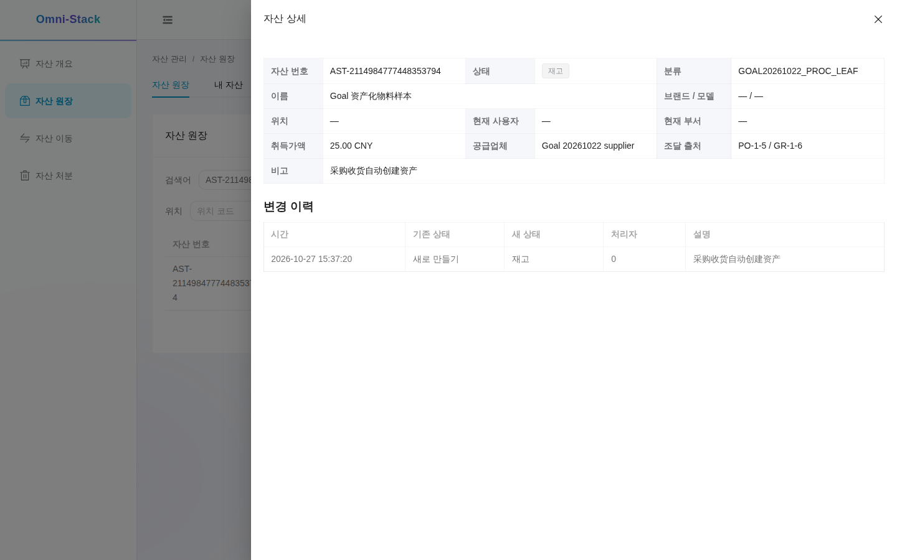

입고를 확정했는데 카드를 찾지 못했다면 검색 조건부터 확인하세요. 그다음 입고 문서의 검사 결과, 자산 관리 설정, 수량을 확인합니다. 같은 실물을 수동으로 반복 등록하지 마세요. 판단하기 어렵다면 입고 번호를 남겨 관리자에게 확인을 요청합니다.

## 5. 구매 출처가 없는 자산 수동 입고하기

기존 장비를 추가 등록하는 경우에는 수동 입고를 사용합니다. 이름, 분류, 규격, 브랜드·모델, 구매일, 가액, 통화, 위치를 입력합니다. 담당 관리자를 선택하고 그 계정에서 자동으로 채워지는 관리 부서를 확인하세요. 정보가 있다면 보증 만료일과 예상 사용 연수도 입력할 수 있습니다.

공급업체를 연결하려면 공급업체 검색창에 이름을 입력하고 권한이 있는 검색 결과를 선택합니다. 옆의 공급업체 이름은 자동 입력되어 선택 당시의 이름을 유지합니다. 임의의 이름을 쓰는 칸이 아닙니다. 적절한 후보가 없으면 공급업체 자료와 접근 권한을 확인하세요.

금액은 화면 안내에 따라 125.50처럼 입력하고, 금액 칸에 통화나 설명을 덧붙이지 마세요. 관리자는 유효한 후보에서 선택하고 부서가 그 사용자와 일치하는지 확인합니다. 시연 번호를 그대로 복사하지 마세요.

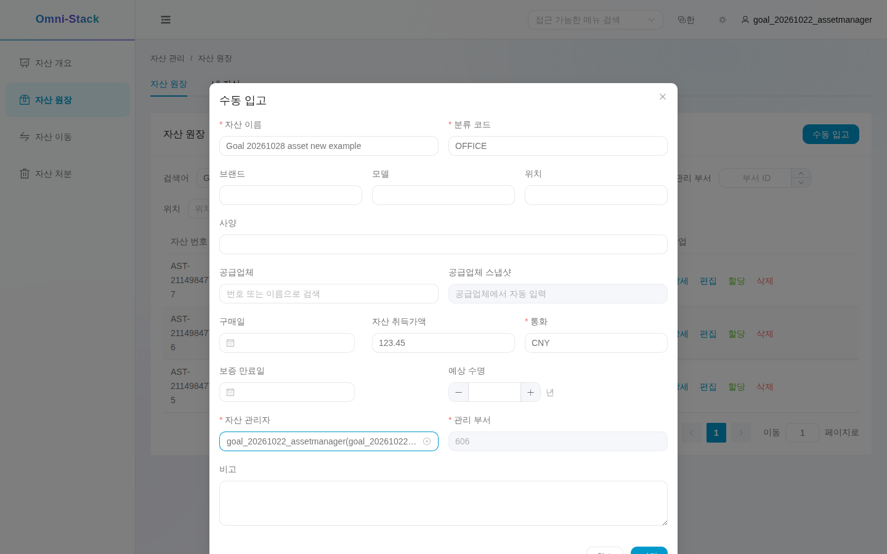

폼이 길면 아래로 스크롤해 비고, 관리 담당, 하단 버튼까지 확인합니다. 확인 후 저장하면 자산 번호가 생성되고 초기 상태는 재고가 됩니다. 취소하면 입력을 버리며 새 자산을 만들지 않습니다.

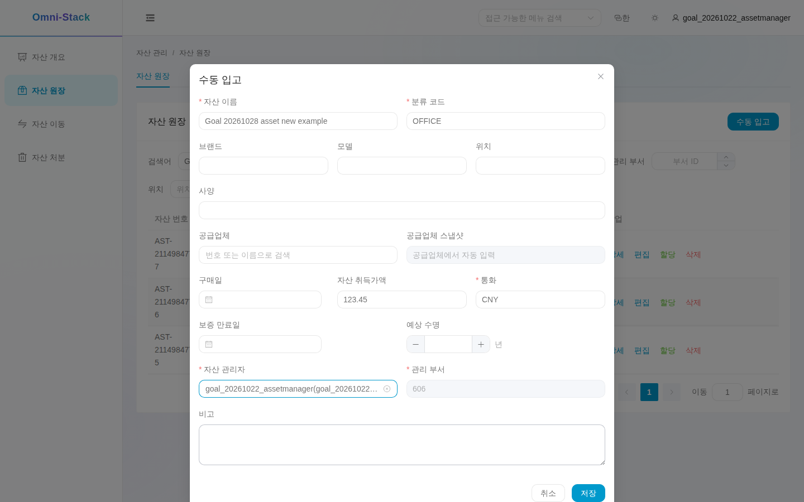

수동 입고가 구매 주문이나 입고 출처를 만들어 주지는 않습니다. 수동 카드와 구매로 생성된 카드는 출처가 다릅니다. 비고를 추가한다고 수동 카드를 구매 출처 카드로 바꿀 수는 없습니다.

## 6. 수정, 삭제, 변경 충돌 처리하기

수정 가능한 재고 자산에서 수정을 열고 이름, 브랜드·모델, 비고 등 화면에서 제공하는 정보를 바꿉니다. 수정 폼에는 위치를 직접 바꾸는 입력란이 없습니다. 자료 수정과 실제 자산 이동을 혼동하지 마세요. 제출 전에 대상을 확인하고, 다른 사람이 먼저 변경했다는 알림이 나오면 반복 제출하지 말고 새로 고침하여 현재 내용을 확인합니다.

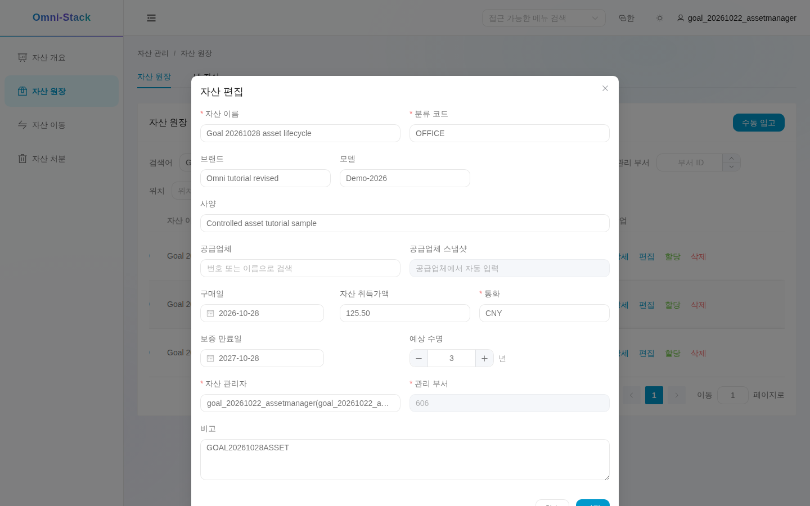

관리 담당과 하단 버튼도 스크롤해 확인하세요. 관리자를 바꾸는 것과 다른 사용자에게 실물을 넘기는 것은 다릅니다. 사용자를 바꿀 때는 할당이나 이동 절차를 사용합니다.

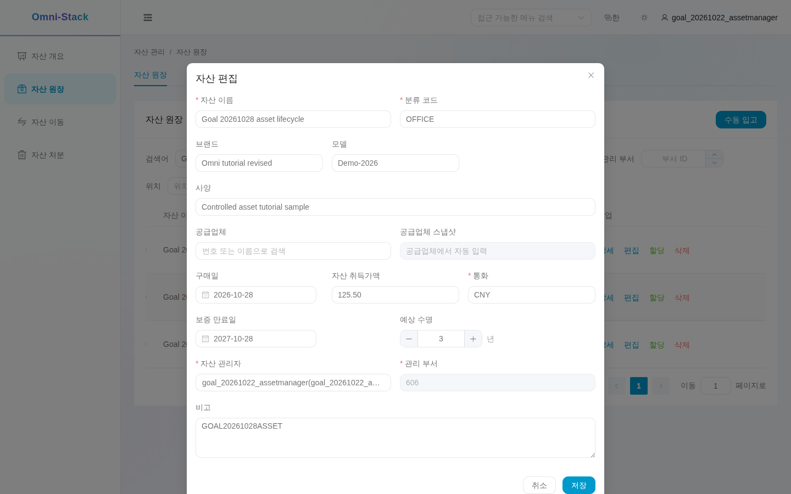

삭제는 아직 사용하지 않았고 사용 관계나 진행 중인 작업이 없는 수동 재고 기록을 정리하는 기능입니다. 확인창에서 이름이나 번호를 확인한 뒤 확정하고 목록을 새로 고칩니다. 구매 출처 카드나 이미 업무 이력이 있는 자산은 사용 종료 대신 삭제할 수 없습니다. 실물을 사용 대상에서 제외할 때는 적절한 처분 절차를 진행하세요.

## 7. 할당은 인수 확인과 다른 단계

원장에서 할당 가능한 재고 자산을 찾아 할당을 선택합니다. 받을 사용자를 고르고 부서를 확인한 뒤 필요한 비고를 입력하세요. 대상 사용자는 활성 계정이어야 하며 해당 부서에 속해야 합니다. 선택 가능한 후보는 본인의 권한 범위로 제한됩니다.

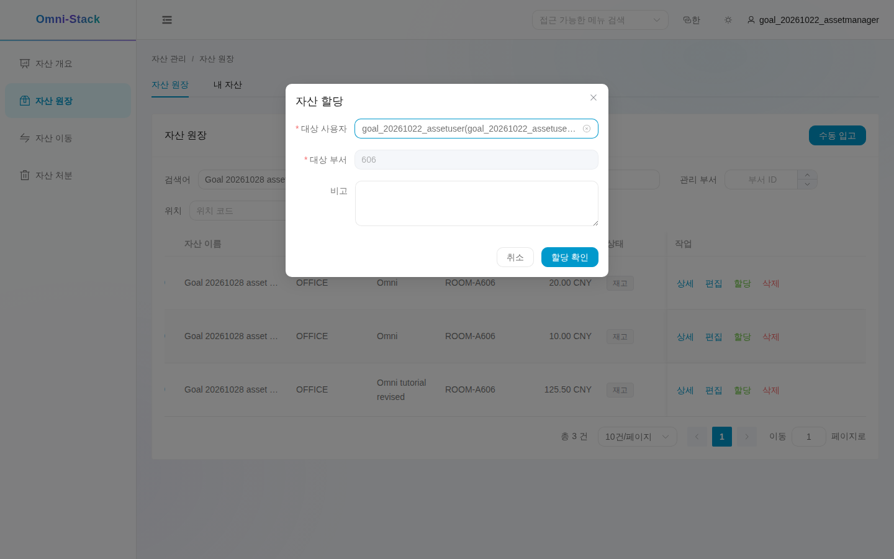

성공하면 인수 대기 상태가 되고 현재 사용자와 부서가 기록됩니다. 관리자가 받을 사람을 정했지만, 그 사람이 실물을 받았다고 확인한 것은 아닙니다. 아래 화면은 같은 시연 자산을 나중에 다시 할당했을 때의 실제 상태입니다.

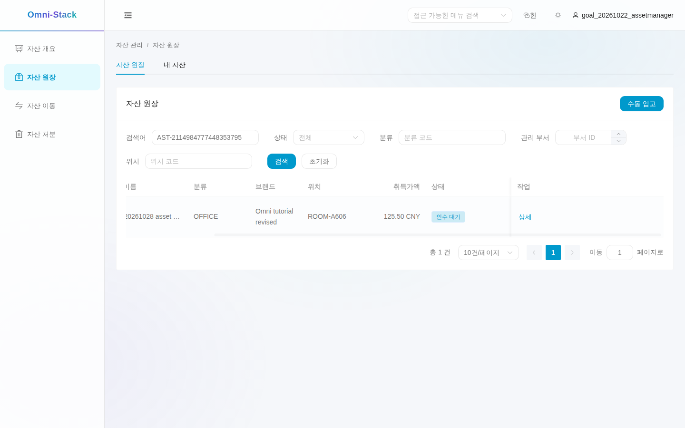

사용 중인 자산을 다른 사람에게 주려면 다시 할당하지 마세요. 먼저 반납한 뒤 재할당하거나, 뒤에서 설명하는 자산 이동 절차를 사용합니다.

## 8. 본인이 인수 확인하거나 인수 전에 반납하기

받는 사람은 자산 원장의 내 자산에서 인수 대기 기록을 찾아 인수 확인을 선택합니다. 확인창에서 번호를 확인하고 실물, 본인 계정, 기록이 일치할 때 확정하세요. 관리자가 다른 사람의 인수를 대신 확인할 수는 없습니다.

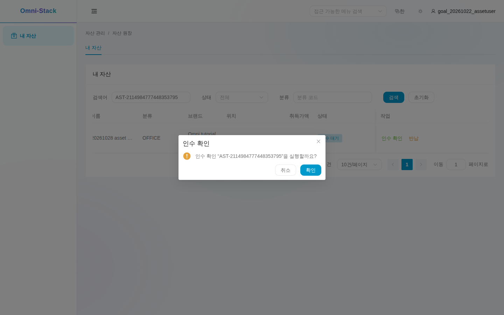

성공 후 내 자산을 새로 고치면 사용 중으로 바뀝니다. 이미지의 계정은 이 샘플 자산의 실제 사용자입니다. 같은 부서의 다른 계정이 부서가 같다는 이유만으로 같은 자산의 사용자가 되지는 않습니다.

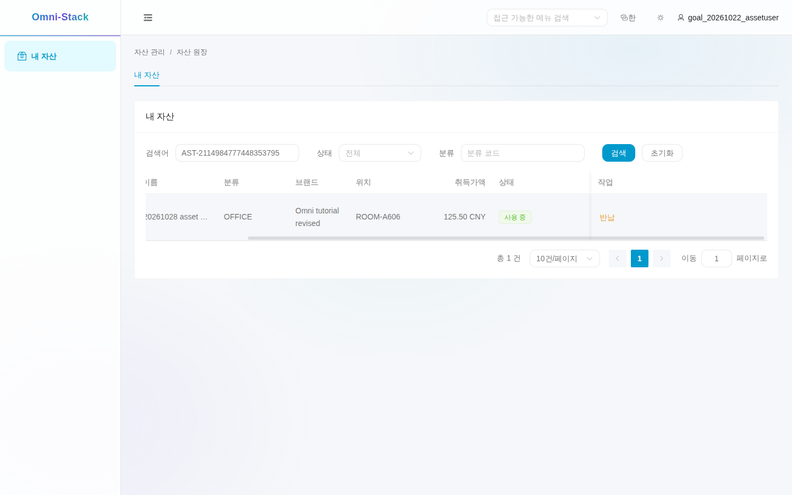

받기 전에 돌려주기로 했다면 인수 대기 기록에서 반납을 선택할 수 있습니다. 반납하려고 먼저 인수 확인을 할 필요는 없습니다. 실물이 본인에게 남아 있지 않은지 확인하세요.

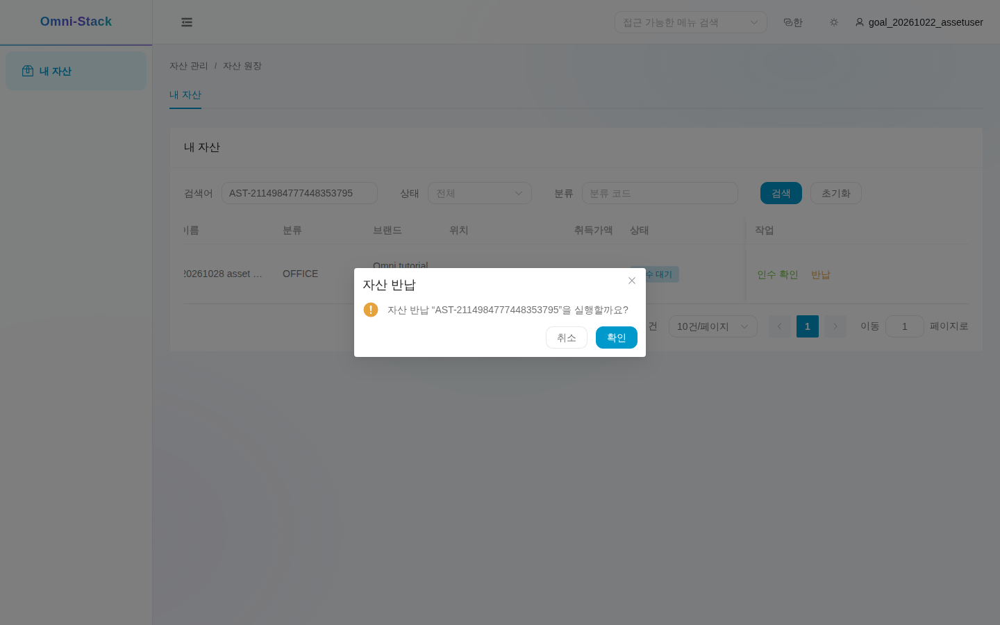

## 9. 사용 중인 자산 반납하기

실물을 반납한 뒤 현재 사용자가 내 자산의 사용 중인 기록에서 반납을 선택하고 번호를 확인하여 확정합니다. 이 작업은 로그인한 본인 명의로 기록된 반납 가능한 자산만 대상으로 합니다.

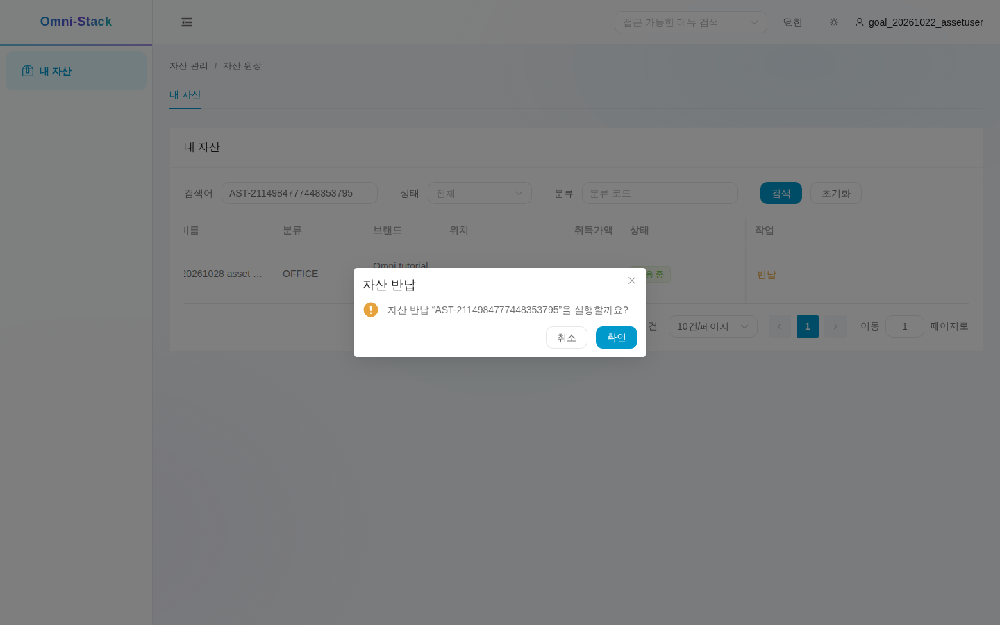

성공하면 자산은 재고로 돌아가고 본인 명의에서 빠집니다. 따라서 내 자산 목록에서도 사라집니다. 빈 목록이 반드시 데이터 손실을 뜻하지는 않습니다. 권한이 있는 관리자에게 원장에서 같은 번호를 검색해 달라고 할 수 있습니다.

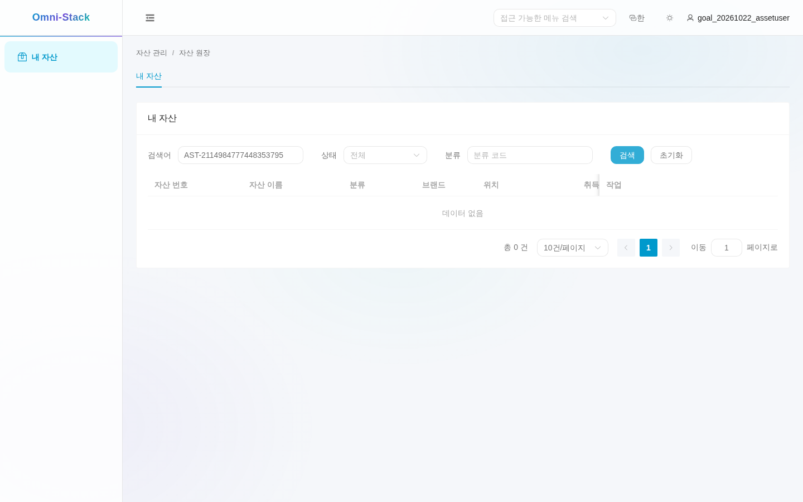

관리자가 상세를 열면 현재 사용 관계는 해제되고, 할당·인수 확인·반납 이력은 남아 있음을 볼 수 있습니다. 구매로 생성된 카드의 출처 정보도 유지됩니다.

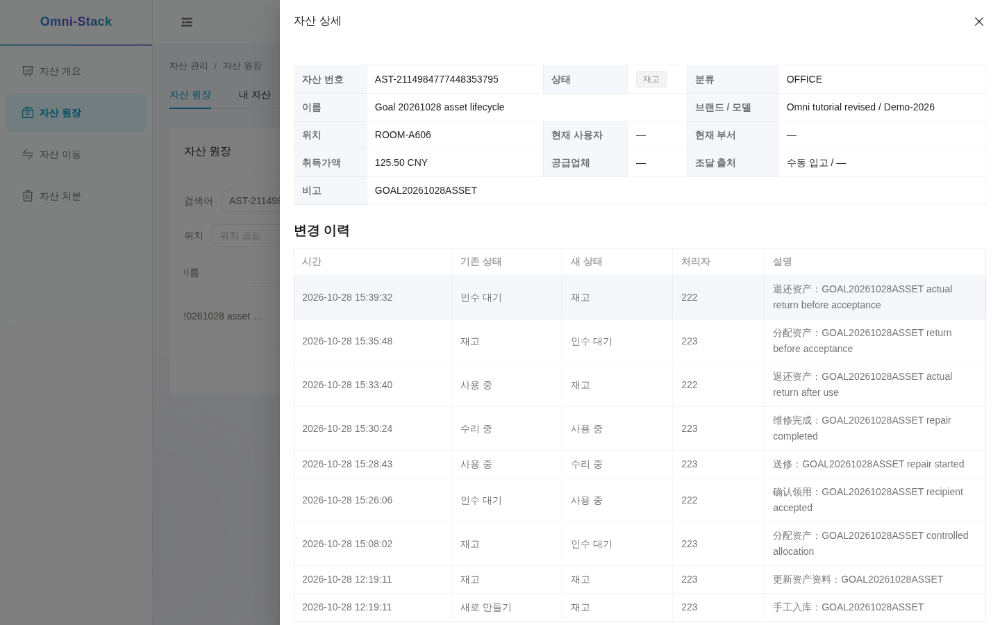

## 10. 수리는 원래 사용 관계를 바꾸지 않음

관리자는 사용 중인 자산에서 수리 요청을 선택하고 확인창에서 대상을 확인합니다. 상태는 수리 중이 됩니다. 수리 중인 자산을 가용 재고처럼 재할당하거나 이동·처분을 동시에 시작하지 마세요.

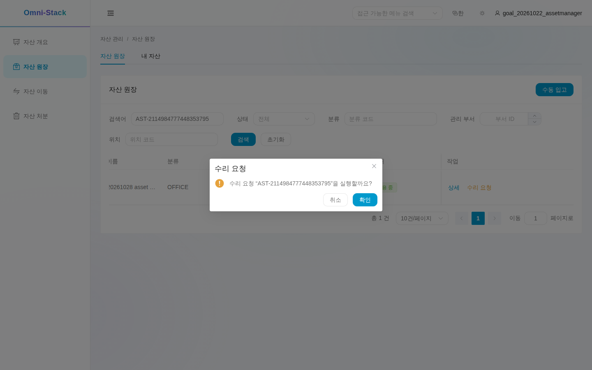

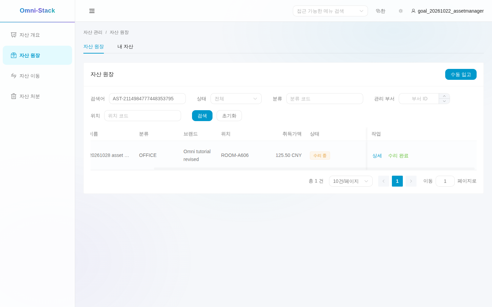

수리가 끝나 실물이 돌아오면 관리자가 수리 완료를 선택해 확정합니다. 사용 중으로 돌아가며 기존 사용자와 부서는 유지됩니다. 여기서 돌아온다는 것은 수리 후 원래 사용 상태로 복귀하는 뜻이지, 사용자가 재고로 반납하는 뜻이 아닙니다.

## 11. 이동을 신청하고 실제 담당자가 승인하기

자산 이동에서 이동 시작을 선택합니다. 권한 범위 안에 있고 다른 신청이 점유하지 않은 자산을 고른 뒤 대상 사용자, 부서, 위치, 사유를 확인합니다. 선택 가능한 자산에는 재고·인수 대기·사용 중 상태가 포함될 수 있습니다. 폼에 실제로 표시되는 후보를 선택하세요.

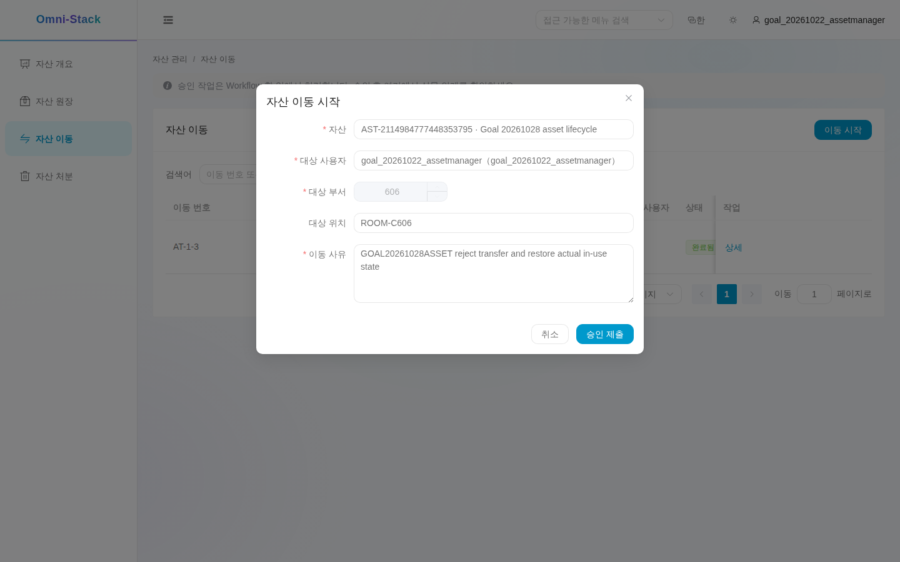

입력된 폼 이미지는 제출 전 미리보기입니다. 실제 제출해야 신청 번호가 만들어집니다. 신청 후 상세에서 기존 사용자와 대상 사용자, 기존 위치와 새 위치를 비교해 대상이 맞는지 확인하세요.

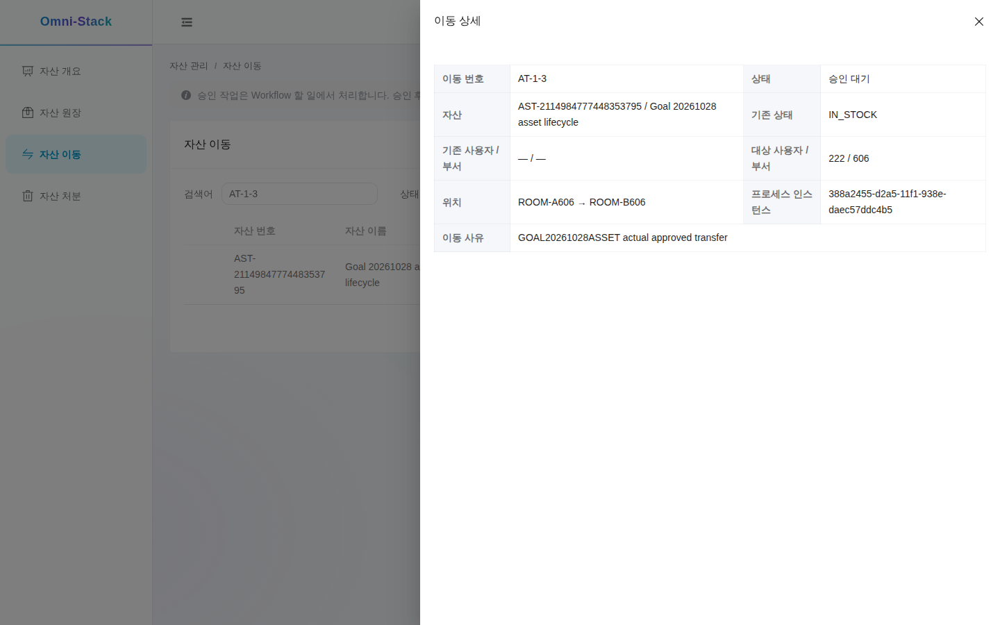

승인자는 원래 워크스페이스 탭으로 돌아가 내 결재 대기에 실제로 도착한 작업을 엽니다. 기존 사용 관계와 사유를 읽고 승인 또는 반려를 고른 뒤 의견을 작성하여 확정합니다. 아래는 실제 담당자가 반려를 선택한 화면입니다. 대화상자를 여는 것만으로 결정이 제출되지는 않습니다.

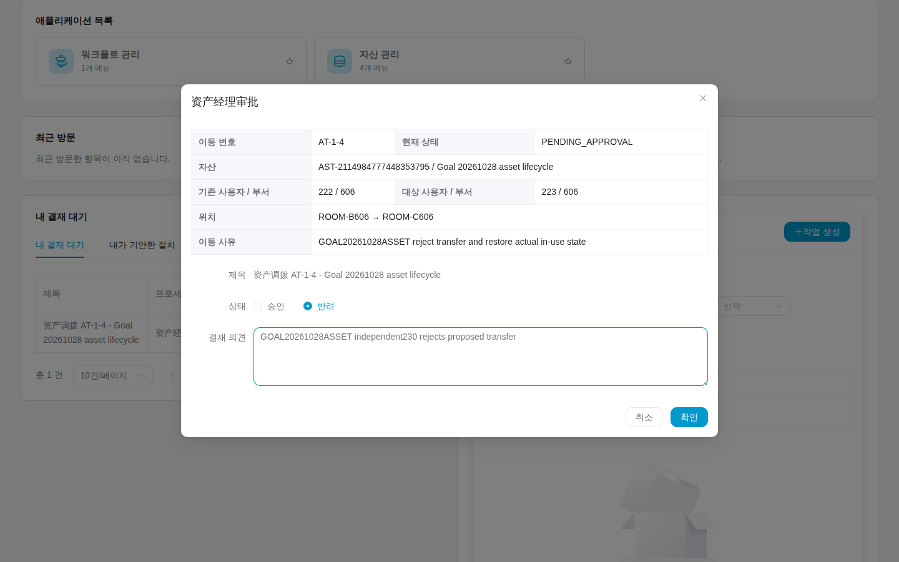

신청 처리 중 자산은 이동 중으로 표시됩니다. 제안한 사용자로 아직 바뀐 상태는 아닙니다. 하나의 자산을 두 작업이 동시에 처리하지 않도록 하는 상태이므로, 대기를 피하려고 다른 신청을 새로 만들지 마세요.

## 12. 승인 다음에는 실물을 인계하기

승인 후 관리자는 자산 탭의 자산 이동으로 돌아와 원래 신청과 결과를 확인하고 실제 인계를 진행합니다. 받는 사람과 위치가 맞는지 확인한 다음 인계 완료를 선택해 확정하세요.

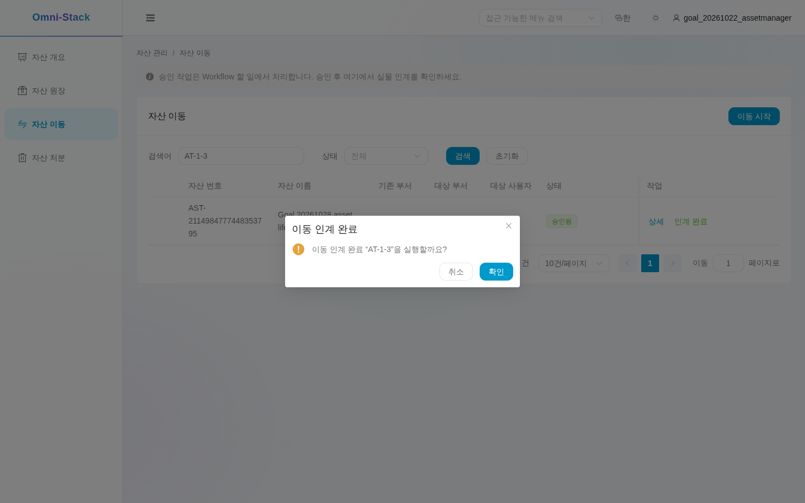

완료되면 신청은 완료 상태가 되고 자산은 사용 상태로 돌아갑니다. 현재 사용자, 부서, 위치는 해당 이동의 대상 값에 맞게 갱신됩니다. 자산을 관리하는 담당자와 실물을 받는 사용자는 서로 다른 개념입니다.

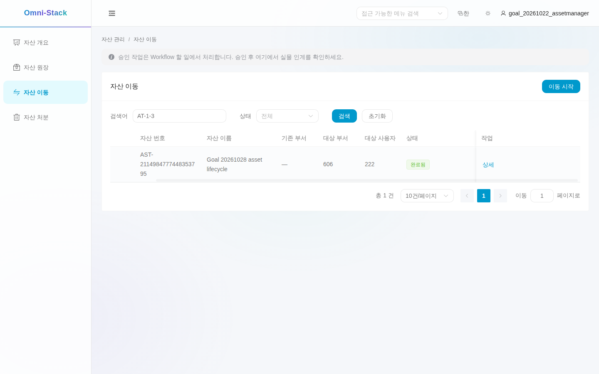

반려되면 제안은 적용되지 않고 자산이 신청 전 상태로 돌아갑니다. 이 예에서는 사용 중이던 자산의 원래 사용자, 부서, 위치가 유지됩니다. 다른 허용 상태에서 신청했다면 그 원래 상태로 돌아왔는지 확인하세요.

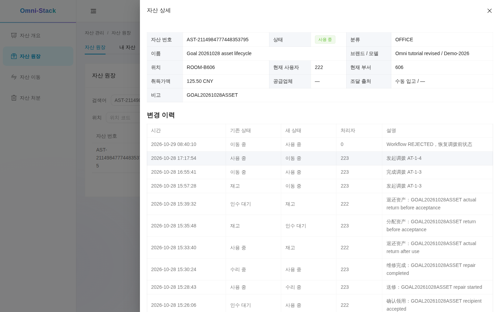

## 13. 버림, 폐기, 최종 처분 확인 구분하기

자산 처분에서 처분 시작을 선택합니다. 처리 가능한 자산을 고른 뒤 유형에서 버림 또는 폐기를 선택하고 사유를 입력합니다. 필요에 따라 잔존 가치와 처분 방식도 입력하세요. 제출 전 실물과 선택한 유형을 대조해야 합니다.

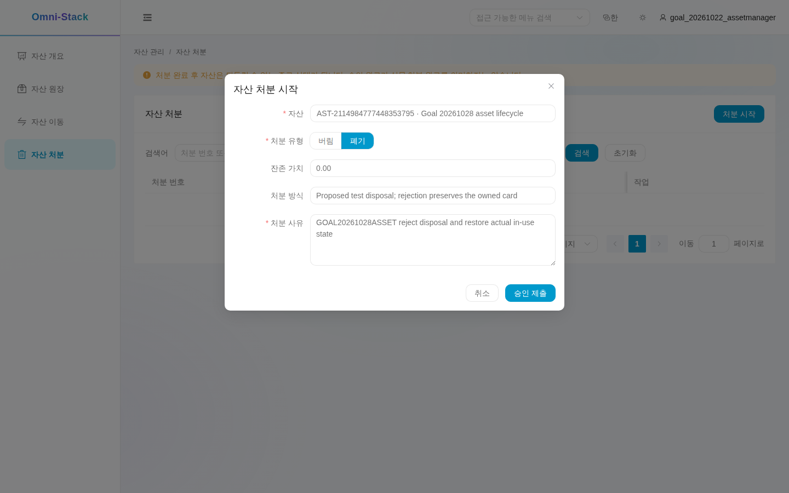

제출하면 자산은 처분 대기가 됩니다. 승인자는 실제 도착한 작업에서 유형, 기존 상태, 잔존 가치, 방식, 사유를 확인한 뒤 승인하거나 반려합니다. 작업에 표시되는 기존 상태와 업무 설명은 저장된 실제 정보입니다.

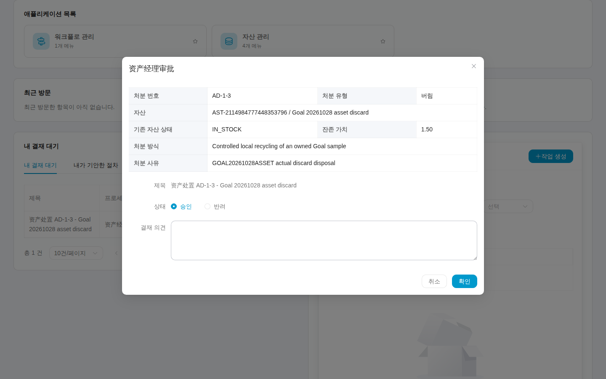

승인만으로 자산의 사용 종료가 완료되지는 않습니다. 관리자가 실물이 약속한 대로 회수·파기·인계되었는지 먼저 확인하고, 원래 신청으로 돌아가 처분 완료를 선택합니다.

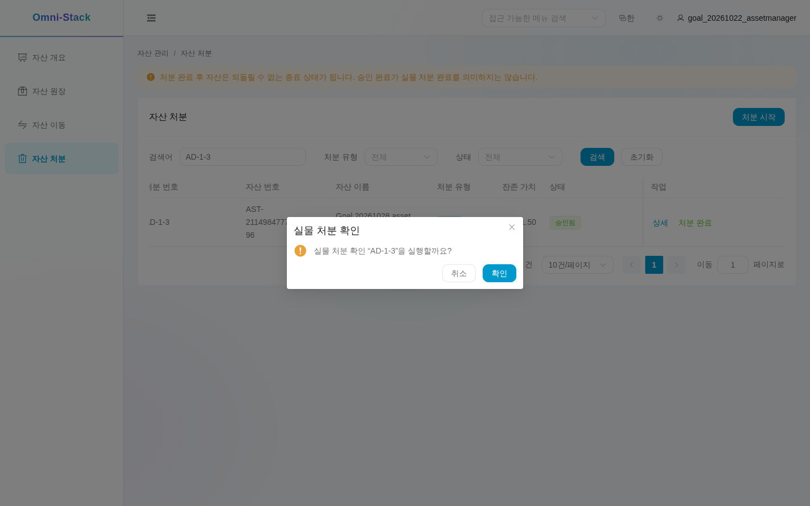

버림을 선택한 샘플 카드는 버림 완료가 됩니다. 아래의 폐기 샘플과는 다른 실물입니다. 두 최종 상태 모두 반납이나 재할당으로 되돌릴 수 없습니다.

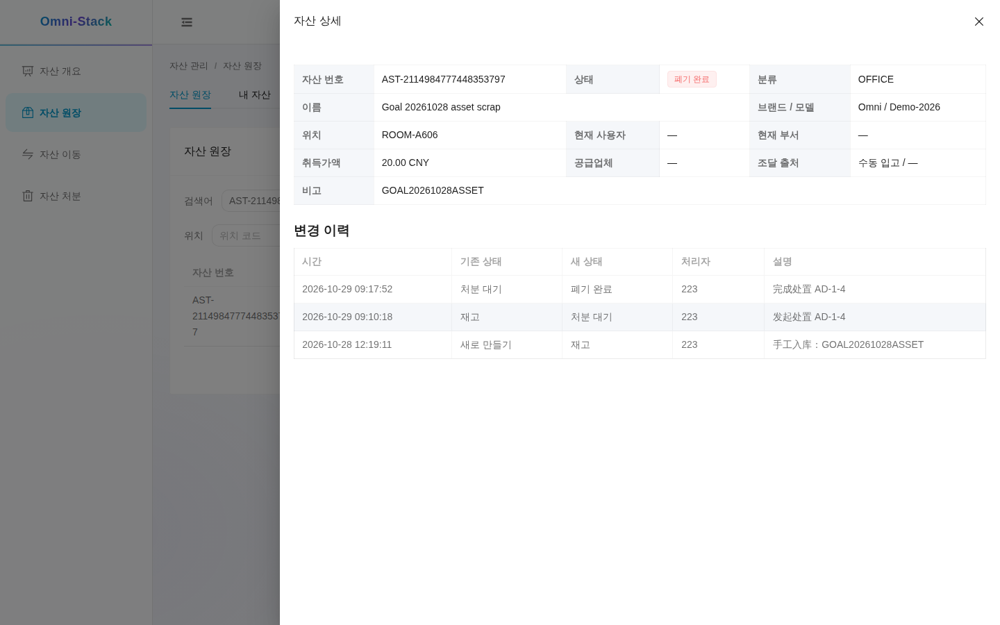

반려되면 처분은 적용되지 않고 원래 사용 관계를 유지한 채 신청 전 상태로 돌아갑니다. 신청 반려는 이미 처분한 실물을 다시 복구했다는 뜻이 아닙니다.

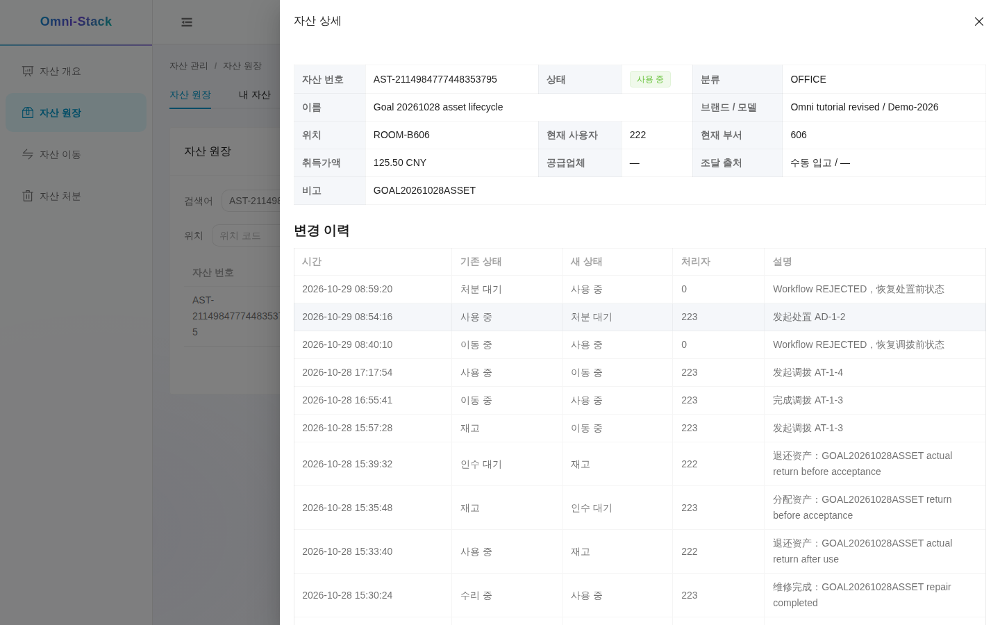

## 14. 시작 결과가 불확실할 때 원래 신청 재시도하기

승인 시작 결과를 확인해야 한다는 안내가 나오면 원래 신청을 검색하고 상세를 열어 새로 고칩니다. 확정된 프로세스가 없는 채 승인 대기로 남아 있을 수 있습니다. 같은 업무를 다시 만들거나 승인 시작이 분명히 실패했다고 단정하지 마세요.

먼저 권한 있는 관리자가 실제 승인 후보자의 조직 범위처럼 누락된 전제 조건을 바로잡습니다. 조건이 회복되면 원래 신청 행에서 재시도를 선택하고 번호를 확인해 확정합니다. 재시도는 같은 신청을 사용하며 새 신청을 복제하는 작업이 아닙니다.

확인창은 실행하려는 작업을 보여 줄 뿐입니다. 성공 여부는 상세를 새로 고친 뒤 프로세스와 승인자에게 실제로 도착한 작업을 확인해 판단하세요. 결정이 나오면 승인 또는 반려 경로에 따라 자산을 확인합니다.

신청 자체의 취소는 화면에 시작 실패가 명확히 표시되고 취소 버튼이 제공될 때만 가능합니다. 원래 신청을 확인한 뒤 사용하세요. 결과가 불확실한 상태에서는 이 취소 경로를 사용할 수 없습니다. 버튼이 없다고 중복 신청을 만들지 마세요. 이 절의 재시도 이미지는 결과 확인 대기 상태이며, 명확한 시작 실패 상태의 화면이 아닙니다.

## 15. 프로세스 취소와 신청 자체 취소는 다름

이미 시작된 승인 프로세스가 적법하게 종료되면 이동 또는 처분 신청에 취소 결과가 전달되고 자산은 신청 전 상태로 돌아갑니다. 아래 이미지는 실제 취소 후의 자산과 최신 이력입니다. 기존 사용자, 부서, 위치가 유지되어 있습니다.

현재 화면에는 시작된 프로세스를 종료하는 버튼이 없습니다. 따라서 존재하지 않는 클릭 절차를 안내하지 않고 취소 후 결과만 보여 줍니다. 앞 절에서 설명한, 시작 실패가 확정된 신청 자체의 취소를 시연한 이미지도 아닙니다.

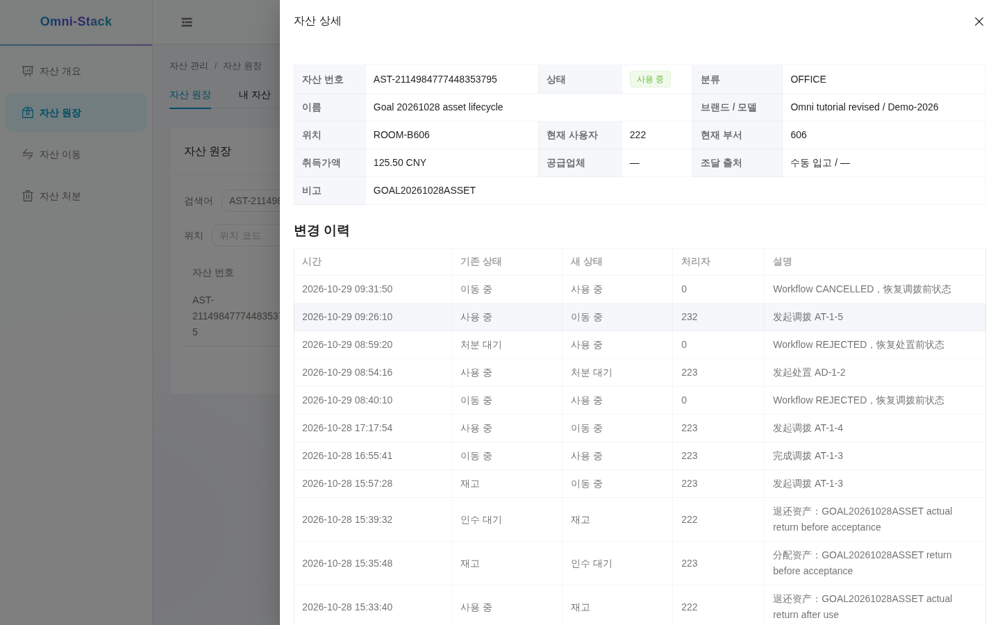

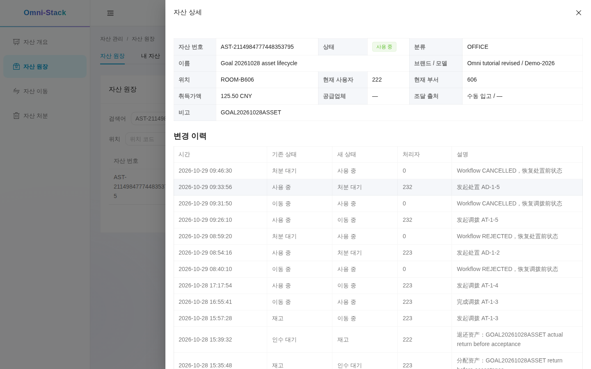

반려든 적법한 취소든 원래 신청과 자산 상세에서 최종 결과를 확인하세요. 승인되었어도 실물 처리가 완료될 때까지는 해당 신청이 자산을 점유합니다. 승인되었다는 이유만으로 두 번째 작업을 동시에 시작할 수는 없습니다.

## 16. 데이터나 버튼이 보이지 않을 때 확인하는 순서

먼저 브라우저 탭과 현재 계정을 확인하고, 다음으로 검색 조건과 자산 상태, 마지막으로 역할과 부서 범위를 확인합니다. 빈 목록이 모두 시스템 장애인 것은 아닙니다.

아래 시연 매니저는 다른 부서에 속합니다. 역할은 있지만 이 자산들의 관리 범위 밖이므로 기록이 보이지 않습니다. 검색 조건을 바꾼다고 다른 부서의 자산이 보여서는 안 됩니다.

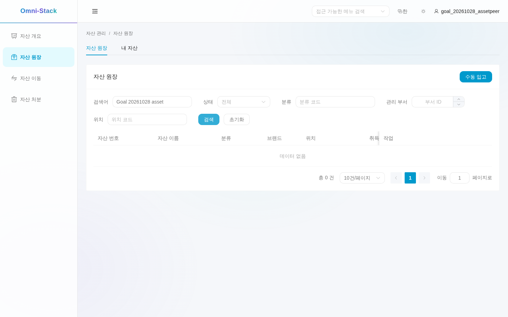

자산 사용자가 관리 기능에 접근하면 권한 제한을 받습니다. 내 자산으로 돌아가 본인 기록을 처리하세요. 일상적인 인수 확인을 위해 본인을 관리자로 바꿀 필요는 없습니다.

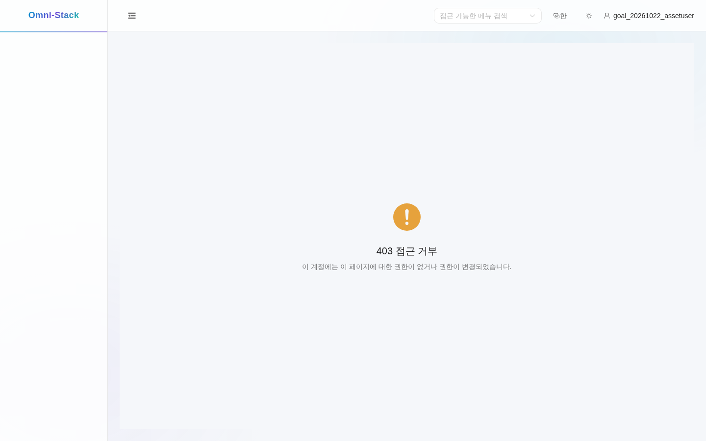

| 상황 | 먼저 확인할 내용 | 다음 조치 |
| --- | --- | --- |
| 새로 할당된 장비가 내 자산에 없음 | 실제 받을 사람으로 로그인했는지, 이전 검색 조건이 남았는지 | 새로 고침하고 조건을 초기화한 뒤 관리자에게 현재 사용자 확인 요청 |
| 반납 후 기록이 사라짐 | 재고로 돌아갔는지 | 관리자가 원래 번호로 검색해 상태와 이력 확인 |
| 할당·수정·삭제 버튼이 없음 | 계정, 상태, 구매 출처, 기존 업무 이력 | 반복 제출하지 말고 현재 상태에서 허용되는 작업 사용 |
| 승인 작업이 도착하지 않음 | 실제 배정 대상인지, 승인 전제 조건이 갖춰졌는지 | 권한 있는 관리자가 후보자와 조직 범위 확인 |
| 승인되었는데 이동 중·처분 대기로 남음 | 실물 인계나 처분을 확정했는지 | 실물을 확인한 뒤 원래 신청의 마지막 단계 완료 |
| 다른 신청이 자산을 점유 중이라고 표시됨 | 원래 이동 또는 처분 신청이 끝났는지 | 원래 신청을 처리한 뒤 새 업무 시작 |
| 제출 후 결과 확인이 필요함 | 원래 신청이 있는지, 프로세스가 확인되는지 | 전제 조건을 복구하고 새로 만들지 말고 같은 신청 재시도 |
| 기록이 이미 변경되었다고 표시됨 | 다른 사람이 작업했는지, 화면이 오래되었는지 | 새로 고침하여 현재 상태를 보고 작업 결정 |
| 목록이나 작업 접근이 거부됨 | 역할 또는 부서 범위를 넘었는지 | 본인에게 허용된 진입점을 사용하고 관리 작업은 권한 있는 사람이 처리 |

승인이 필요한 이동과 처분에서는 원래 신청의 최종 상태와 자산 카드의 현재 상태·사용 관계를 모두 확인하세요. 승인, 실물, 시스템 기록이 일치하는지 이렇게 판단할 수 있습니다.
