# CRM tutorials in pictures: from lead to closed-won and follow-up

This page is for salespeople and sales managers who use CRM. It only covers “how to move a sales opportunity forward in the interface”. Every screenshot comes from the real environment in local Docker (development tenant, shared data); page and button names follow what the interface shows. Deployment, APIs and databases are out of scope.

A lead is a potential sales opportunity that has not yet been qualified. A customer is the company or person you work with, and a contact is a particular person at that customer. An opportunity is a specific potential sale with an amount and an expected closing date. Activities record calls, visits, meetings and other interactions. One customer can have several contacts, opportunities and activities.

## Before you start

- **Who uses it**: CRM administrators (maintain all customers and sales data), sales managers (their department and below), sales representatives (only the leads, customers and opportunities they own), and CRM viewers (read-only).
- **Identity and access**: dedicated local accounts have been used to check a representative’s own records, a manager’s department scope and a viewer’s read-only access. Most existing illustrations use an administrator account. A representative may see fewer rows and no assignment or delete buttons. Keep the permissions appropriate to the job even when the page differs from the illustration.
- **The data is shared**: the historical leads, customers and opportunities you see come from the same development data. The tutorial will not clear or rewrite existing business objects for a demo.
- **One thread**: the examples follow “a lead → follow-up → conversion → opportunity → closed-won → follow-up visit” so you can read the pages in business order.
- **Reading wide tables**: use the bottom scrollbar to reveal status, owner and time columns. The actions stay available on the right. The result images are scrolled to the columns being explained.

## 1. Start with the sales overview

What you want to do: at the start of the day, see overall progress and the follow-ups that need attention.
Who can see it: roles that include CRM menus.
Where to start: left side “CRM” → “Sales Overview”.

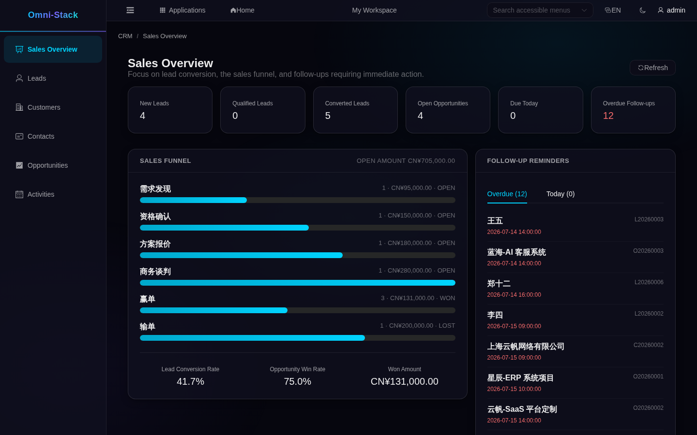

What you will see: six cards for new leads, qualified leads, converted leads, open opportunities, due today and overdue; the funnel shows opportunity count and amount per stage, with lead conversion rate, win rate and won amount below; the right side lists customers to follow up, split into overdue and today.
How to recover: if the numbers differ from what you expect, confirm your data scope and filters first; when there are many overdue items, work through the right-hand list instead of editing opportunity stages.

## 2. Leads: capture the opportunity

### 2.1 Finding and filtering leads

Where to start: “Leads” on the left.

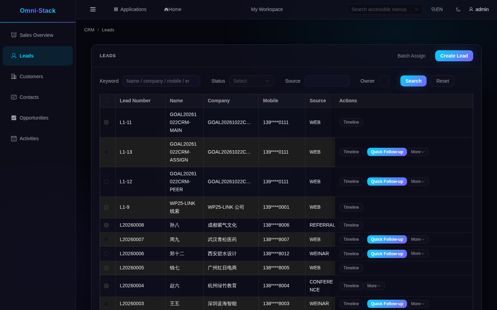

What you will see: each row shows the lead number, name, company, mobile (masked), source, status, owner and next follow-up time. Statuses include New, Following Up, Qualified, Converted and Disqualified.
How to recover: clear the filters or change the keyword, then check whether you or your team own the lead. A missing owner name in the list does not by itself mean the lead is unassigned.

### 2.2 Creating a lead

What to click and fill in: click “Create Lead” at the top right, fill in the name (required), company, mobile, source, industry, rating and next follow-up time, then save.

What you will see: the saved lead starts as “new lead” and the owner is the current operator.
How to recover: the form stops you when the name is missing; if a duplicate is suspected, search existing leads by company or phone first and continue with the existing record instead of creating another.

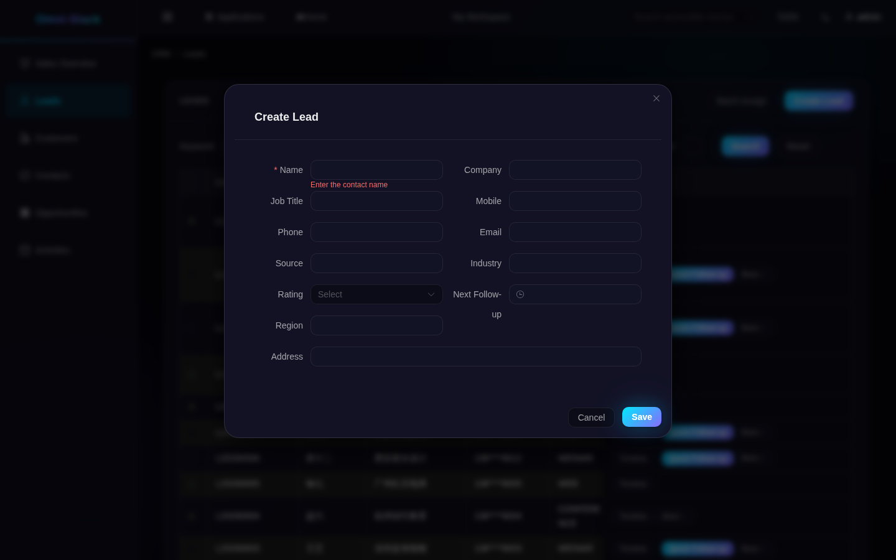

### 2.3 Following up, assigning and status

The simplest way to record a call or visit is “Quick Follow-up” in the lead row: enter the subject, type, content and planned time, then save. Saving a plan does not mark it complete. After the interaction, find the activity in “Activities” and choose “Complete”. The lead row’s “Timeline” lets you read existing activities without creating or changing a record.

- **Moving a lead to “following”**: create and complete a follow-up activity for the lead; the status then changes from “new lead” to “following”. That is the real rule, not a button that sets the status directly.
- **Assigning an owner**: a manager can select leads and use “Batch Assign”, or choose assignment from the row’s “More” menu. Select the colleague and enter a reason, then refresh to check the owner. The colleague must be active, have an organization and fall within your assignment scope. A department manager cannot assign to a different department outside that scope. Representatives without assignment permission do not see the action.
- **Disqualify and reopen**: disqualify when there is no value; when the prospect returns, reopen the lead and it becomes “following” again.
- **Qualify**: only a “following” lead can be qualified; after that it is ready for conversion.
- **Edit**: use “More” → “Edit” in the row to change company, mobile and source; a converted lead cannot be edited.

How to recover: a status error means the previous step is incomplete (for example, qualifying before completing a follow-up); complete the steps in order instead of clicking repeatedly.

### 2.4 Converting into customer, contact and opportunity

What you want to do: turn a qualified lead into the customer, contact and opportunity you will work with.
Who can do it: the sales person who owns the lead, or a manager.
Where to start: the lead row’s “More” → “Convert”.

What to click and fill in: in the conversion wizard, first choose whether to create a customer or link an existing one. Then create a contact or choose one belonging to that customer. Decide whether to create an opportunity as well; if so, enter its name, amount and expected close date. Check the confirmation page before submitting.

What you will see: the lead becomes Converted. The customer and contact are created or linked as you selected, and an optional opportunity appears in its own menu. The lead’s earlier follow-up activities move to the customer and can be seen in Customer 360.
How to recover: a first conversion requires a Qualified lead, and an existing contact must belong to the selected customer. If the page has not updated after submission, refresh and check the customer, contact and opportunity before doing anything again. Continue with the linked records once the lead is converted.

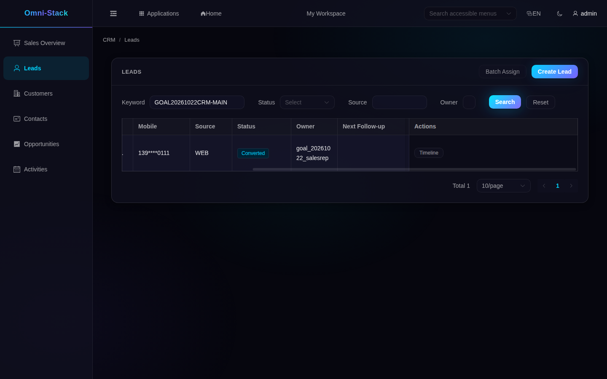

### 2.5 Deleting a lead

Delete only a lead created by mistake and not yet converted. Its follow-up activities are deleted too. Converted leads keep their history and the system refuses deletion.

## 3. Customers: where relationships live

### 3.1 Finding and creating customers

Where to start: “Customers” on the left.

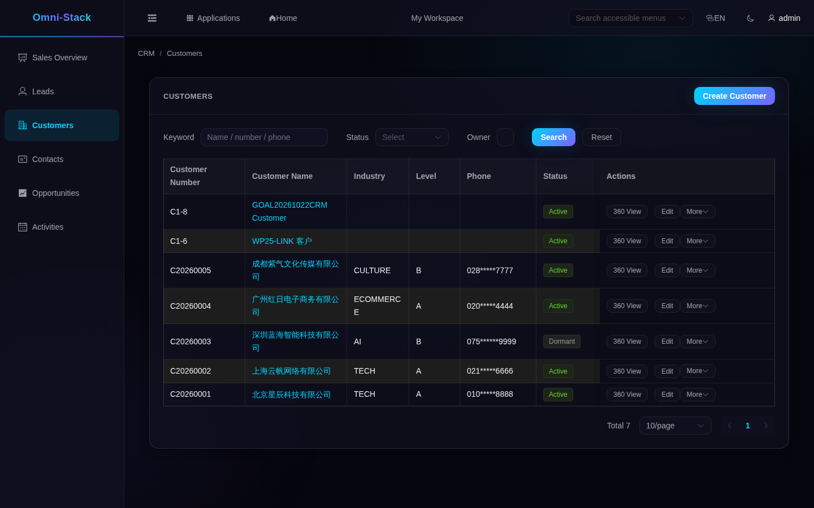

What you will see: customer statuses include Potential, Active, Dormant, Lost and Blacklisted. Phones are masked. “360 View”, “Edit” and “More” are available according to your permissions.
What to click and fill in: click “Create Customer”, fill in the name (required), industry, level, source and contact details, and check any duplicate warning before saving. A new customer starts as Potential and is owned by the person creating it.
How to recover: when a duplicate is reported, search existing customers first; if the company is genuinely different (same name in another city, for example), add distinguishing details.

### 3.2 Customer 360: the whole relationship in one screen

What you want to do: before a conversation, see contacts, open opportunities and recent activities.
Where to start: “360 View” in the customer row.

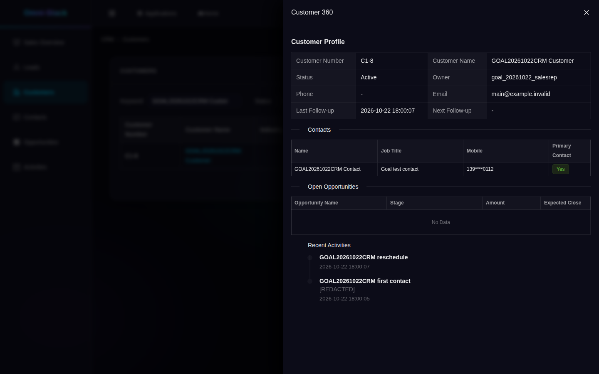

What you will see: a details panel with the customer number, status, owner and latest follow-up, followed by contacts (including the primary marker), open opportunities and recent activities. Won and lost opportunities do not appear in this open-opportunity section. Each section still respects its own viewing permissions; a viewer gains neither editing rights nor access to unmasked contact details by opening this panel.
“[REDACTED]” in an activity means that part of its content has been hidden; the activity itself has not disappeared. Sample business data, such as names and company names, is not automatically translated when you change the interface language.
How to recover: empty open opportunities are not necessarily an error — won or lost opportunities do not appear here; filter by customer in the opportunity menu to see them.

### 3.3 Status, transfer and blacklist

- **Status**: choose “Change Status” from “More”. Potential can become Active; Active can become Dormant or Lost; Dormant and Lost can return to Active. These are specific transitions rather than arbitrary changes between any two statuses.
- **Transfer ownership**: a manager selects “Transfer Owner”, chooses the colleague, enters a reason and decides whether to transfer open opportunities too. The colleague’s organization must be within the manager’s scope. Contacts and customer activities move with the customer. When the open-opportunity option is selected, those opportunities and their activities move as well.
- **Blacklist and restore**: a manager with the relevant permission can add an Active customer to the blacklist, or use the dedicated removal action to return it to Active. The ordinary status selector cannot replace these actions. The blacklist is a relationship marker; it does not automatically block every later sales action.
- **Edit**: the customer row’s “Edit” changes name, industry, level and contact details; existing business records keep the data as it was at the time.

How to recover: refresh and check the current status before choosing an allowed transition. If the colleague is outside your scope, choose someone within it. When another person has changed the record, refresh and review that change before submitting again.

### 3.4 Deleting a customer

Delete only a customer created by mistake whose history is no longer needed. Open opportunities prevent deletion; do not close a legitimate sale just to remove the customer. Deletion also removes that customer’s contacts and customer activities and clears related contact references, so check the impact before confirming. Having only closed opportunities does not itself prevent customer deletion.

## 4. Contacts: reach the right person

Where to start: “Contacts” on the left.

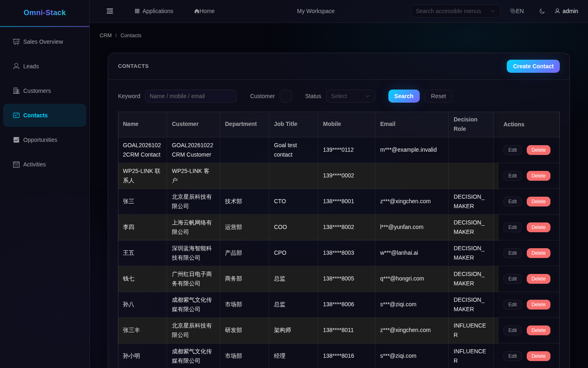

What you will see: every contact belongs to a customer, which can have at most one primary contact. Setting a new primary contact clears the old marker.
If the table is wider than the screen, drag its bottom scrollbar to the right to find “Primary Contact”. “Set as Primary” changes the main point of contact; Edit and Delete remain on the right. This separate view of the actions keeps the labels readable.

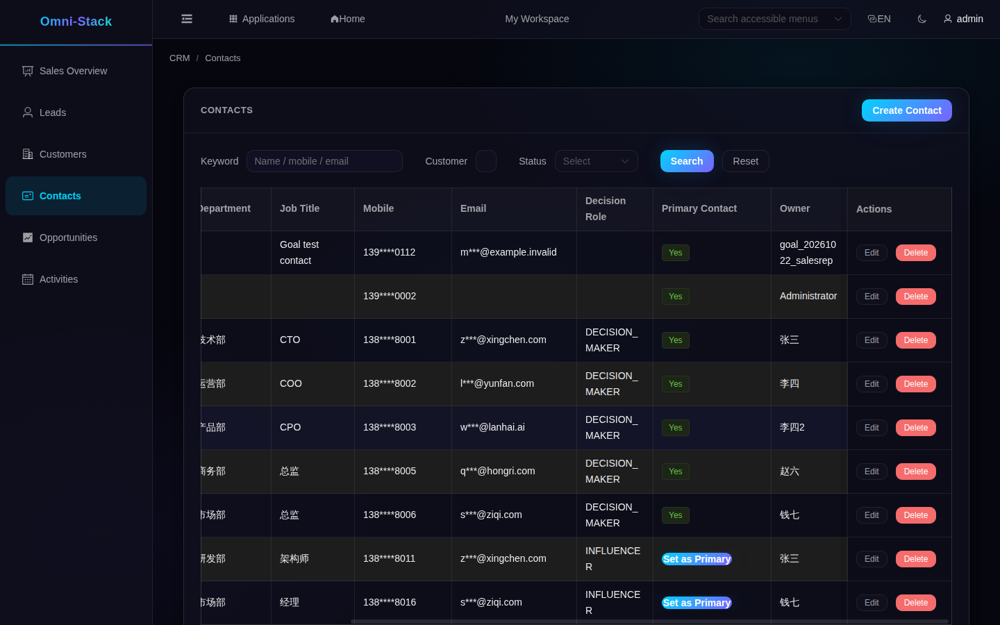

What to click and fill in: click “Create Contact” on the contact page, select the customer, and enter the name, mobile, email and job title. A frequently used contact can be marked as primary.
- **Edit**: the contact row’s “Edit” changes title, mobile and email; setting a new primary contact clears the old marker.
- **Delete**: choose “Delete” in the contact row after checking that the person and their links are no longer needed. A primary contact can also be deleted without choosing another first. Arrange a replacement beforehand if the business still needs a main point of contact.
How to recover: the customer must exist and be visible to you. Check your scope if you cannot find it, or create the customer first when needed. Deleting a contact clears activity and opportunity references to that person. If the business still needs a primary contact, choose a replacement before deciding to delete.

## 5. Opportunities: manage amount and stage

### 5.1 List and board

Where to start: “Opportunities” on the left.

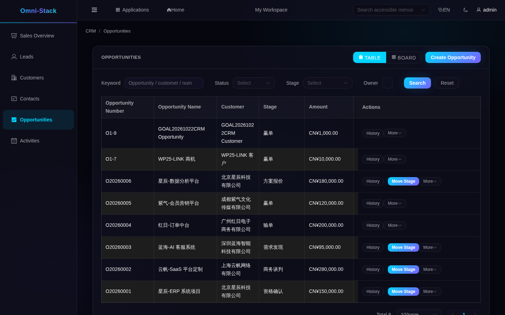

What you will see: switch between “Table” and “Board” at the top right; each row shows the customer, stage, amount, probability, expected close date and status (open, won, lost).
How to recover: if an opportunity is missing on the board, check the filters, owner and viewing scope. Refresh missing stage information before assuming a stage needs to be added.

### 5.2 Creating and editing

What to click and fill in: click “Create Opportunity”, choose the customer, fill in the name, amount (required), expected close date and initial stage; amounts are ordinary decimal numbers.
How to recover: complete the fields the form reports; to change key fields of a won or lost opportunity, reopen it first.

### 5.3 Stage changes, won and lost

What you want to do: move an opportunity from discovery to won or lost.
Where to start: “Move Stage” in the opportunity row.

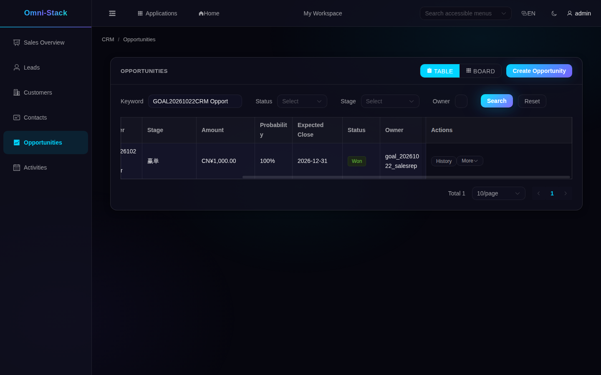

What you will see: stages go “discovery → qualification → proposal → negotiation → won/lost”; moving forward is direct, moving backward requires a reason; winning sets the status to “won”, and losing requires a loss reason.
How to recover: stages need not be adjacent; an earlier stage can move directly to Won. If a change is refused, check that the opportunity is still Open and the target is an enabled stage in the same sales pipeline. Supply a reason when moving backward and a loss reason when choosing Lost. Choosing the current stage makes no new change. Reopen a Won or Lost opportunity before moving it again.

### 5.4 Stage history and reopen

The row’s “History” shows stage changes and their reasons. Reopening a Won or Lost opportunity restores the Open stage it occupied before closing. If that stage has been disabled, check the pipeline configuration rather than creating a duplicate opportunity to replace its history.

### 5.5 Assign and delete

Assignment hands the opportunity and its activities to a colleague within your scope; the button is hidden without assignment permission. Delete only an Open opportunity created by mistake: its activities are removed too, so keep records with useful business history. Won and Lost opportunities cannot be deleted directly.

## 6. Follow-up activities: leave a trace of every touch

Where to start: “Activities” on the left.

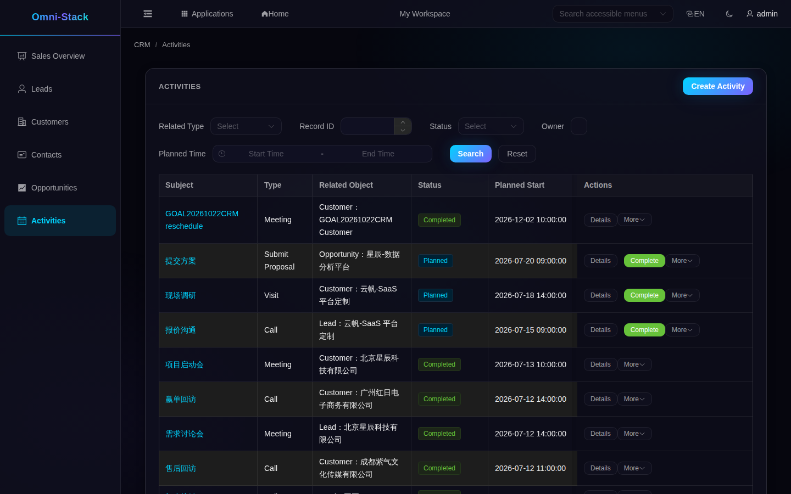

What you will see: activities relate to a lead, customer or opportunity; statuses are planned, completed and cancelled; the list shows planned start and completion times.
What to click and fill in: click “Create Activity”, choose the related type and object, fill in the subject, type (call, visit, meeting, and so on) and planned time.
You can search for a customer. For a lead or opportunity, this page currently asks for its numeric system record ID, which differs from the business number containing letters. There is no shared object picker yet: confirm the record rather than guessing an ID. For a lead, “Quick Follow-up” in its row is an easier entry.
Usually choose Planned when creating an activity. To record an interaction that has already happened, choose Completed and enter its actual completion time. You cannot create an activity directly as Cancelled.
To find an activity, narrow the list by related type, record ID, status, owner or planned time, then check the subject. This page has no keyword search box; the lead page’s search method does not apply here.
How to recover: the related object must exist and be within your data scope; pick again if you chose the wrong one instead of creating an activity without a relation.

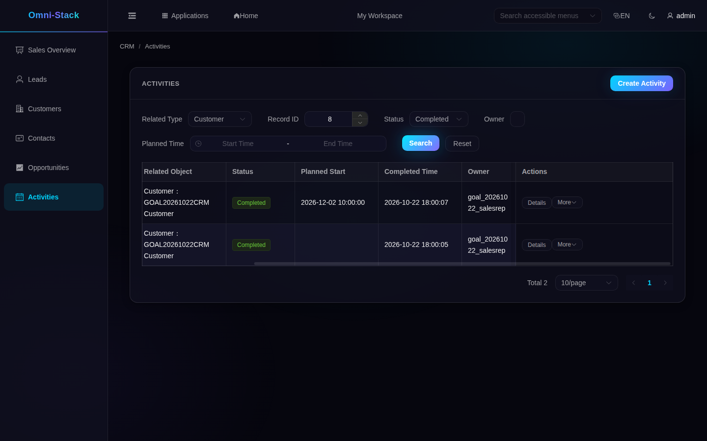

- **Complete**: click “Complete” in the row; the activity becomes completed and writes back the latest follow-up time on the customer or lead. A “new lead” becomes “following” after completion.
- **Edit**: while an activity is Planned, you can change its subject, type, content and planned times. Save and refresh to confirm. Keep completed activities as the record of what happened, and create a new activity for the next interaction.
- **Cancel and reschedule**: a cancelled activity can be rescheduled back to planned.
- **Delete**: delete only unfinished activities you do not need to keep.

## 7. One complete story

1. Create a lead in “Leads” with name and company.
2. Create a phone follow-up for the lead and complete it; the lead becomes “following”.
3. Qualify the lead; it becomes “qualified”.
4. Convert it into customer, contact and opportunity; the customer 360 shows the contact and activity.
5. In “Opportunities”, move the opportunity stage by stage until it is won.
6. After winning, create a follow-up visit activity under the customer and complete it; the customer 360 shows it in recent activities.

General recovery: a status error means the previous step is incomplete; missing data usually means data scope or filters; never “work around” the flow by creating duplicates or editing statuses.

## 8. Common failures and recovery

- **No CRM menu after signing in**: confirm whether your role includes CRM menus; an ordinary employee without CRM permission is the correct result.
- **Empty list**: clear the filters first; confirm there really is no data instead of treating it as a fault:

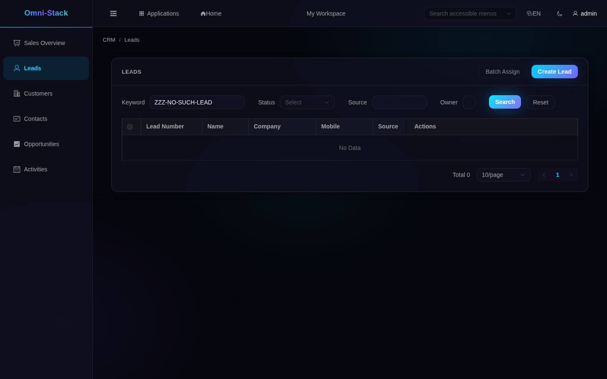

- **Permission denied**: use an identity with access, or ask an administrator to grant the menu to your role. An employee opening CRM sees:

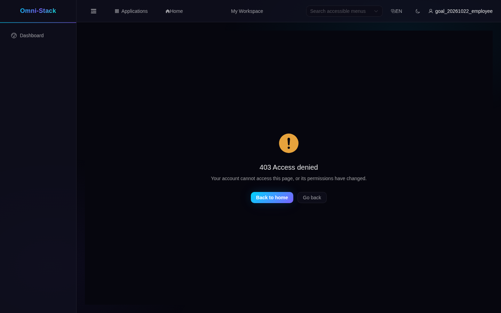

- **Conversion refused**: check that the lead is Qualified, the customer and contact match, and the record is within your scope. If it is already converted, continue with the linked records instead of creating duplicates.
- **Opportunity cannot advance**: refresh and check whether it is closed, whether the target stage is enabled, and whether a backward-move or loss reason is missing. The customer’s blacklist marker is not a blanket block on stage changes.
- **Reschedule fails**: only a cancelled activity can be rescheduled back to planned.

## 9. Examples and verification boundaries

- Dedicated local test accounts have been used to check representative, manager and viewer scopes, out-of-scope refusals, read-only write refusals and contact-detail masking. A representative also completed follow-up, qualification, conversion, winning and cancellation followed by rescheduling. These checks do not mean every deployment has assigned the same roles to all users.
- The data is a shared development database; the numbers and names in the screenshots are one snapshot, not fixed seeds.
- The system has no bulk import/export, customer merge or opportunity-delete recovery; this tutorial does not offer those operations.
