# CRM 図解チュートリアル：リードから受注・フォローまで

このページは CRM を使う営業担当と営業責任者向けです。「画面で商談をどう前に進めるか」だけを扱い、配備・API・データベースには触れません。スクリーンショットはすべてローカル Docker の実環境（開発テナント、共有データ）で取得し、ページ名とボタン名は実際の表示に従います。

まず言葉を整理しましょう。リードは、まだ確認が済んでいない営業の見込みです。顧客は取引先の会社や個人、連絡先はその顧客で実際にやり取りする相手です。商談は金額と成約見込みを持つ一件の営業案件で、活動は電話・訪問・会議など一回ごとのやり取りを記録します。一つの顧客に複数の連絡先・商談・活動を持てます。

## 読む前の前提

- **使う人**：CRM 管理者（全顧客と営業データを維持）、営業責任者（自部門と下位）、営業担当（自分が担当するリード・顧客・商談のみ）、CRM 閲覧者（読み取り専用）。
- **アカウントと閲覧範囲**：ローカルの専用アカウントで、営業担当の本人範囲、営業責任者の部門範囲、閲覧者の読み取り専用権限を確認しています。既存の図は主に管理者で取得したものです。一般の営業担当では一覧が短く、割り当てや削除のボタンが表示されない場合があります。図に合わせるために権限を広げる必要はありません。
- **データは共有**：表示されるリード・顧客・商談は同じ開発データに由来します。チュートリアルのために既存の業務オブジェクトを消去・改変しません。
- **一つの流れ**：「リード → フォロー → 転換 → 商談 → 受注 → フォロー訪問」の順で各ページを読むと理解しやすくなります。
- **横に長い表の見方**：下部の横スクロールバーで、状態・担当者・日時の列を表示できます。右側の操作はそのまま使えます。結果の図は、説明している列までスクロールしています。

## 1. まず営業概要

やりたいこと：一日の始まりに全体の進捗と、すぐ対応すべきフォローを確認する。
見られる人：CRM メニューを持つロール。
入口：左側「CRM」→「営業概要」。

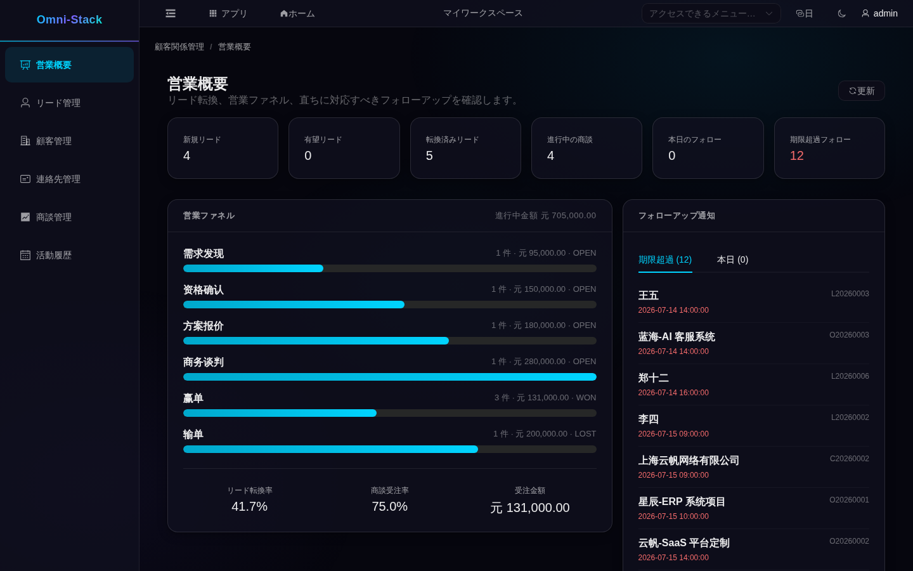

表示されるもの：上部の 6 枚は新規リード、有望リード、転換済みリード、オープン商談、本日フォロー予定、期限超過フォロー。中央のファネルは段階ごとの商談数と金額、下部にリード転換率・商談勝率・受注金額。右側は「期限超過」「本日」に分けたフォロー対象です。
失敗時の回復：数字が想定と違うときは、まず自分のデータ範囲と絞り込みを確認します。期限超過が多いときは右側の一覧から処理し、商談段階を書き換えないでください。

## 2. リード：機会を立ち上げる

### 2.1 リードの検索と絞り込み

入口：左側「リード管理」。

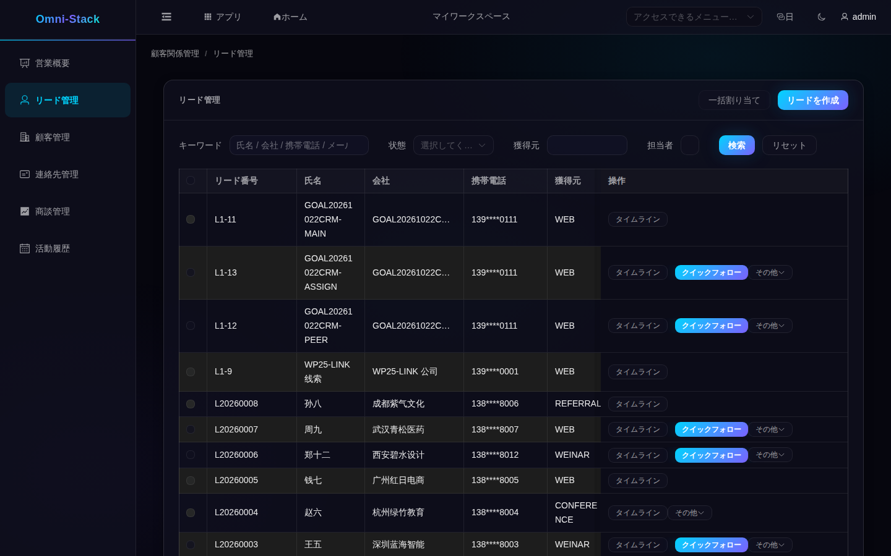

表示されるもの：各行にリード番号、氏名、会社、携帯（マスク済み）、流入元、状態、担当者、次回フォロー日時が並びます。状態は「新規」「フォロー中」「有望」「転換済み」「無効」です。
失敗時の回復：絞り込みを解除するかキーワードを変え、自分や自分のチームが担当するリードかを確認します。一覧に担当者名が出ていないだけでは、未割り当てとは判断できません。

### 2.2 リードの新規作成

入力するもの：右上の「リードを作成」を押し、氏名（必須）、会社、携帯、流入元、業種、評価、次回フォロー日時を入力して保存します。

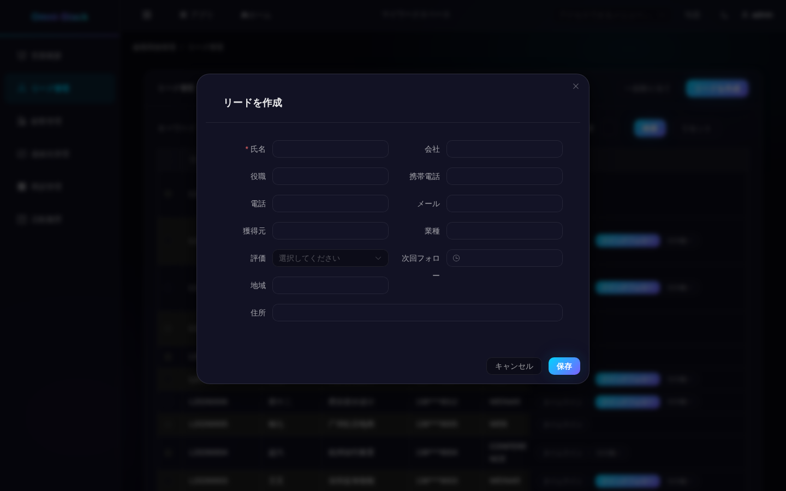

表示されるもの：保存後は「新規リード」になり、担当者は操作者です。
失敗時の回復：氏名がないとフォームが止めます。重複の疑いがあるときは会社や電話で既存リードを検索し、重複作成せず既存をフォローしてください。

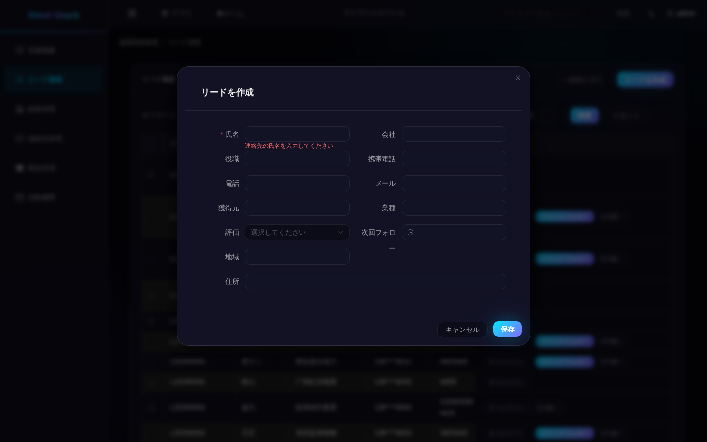

### 2.3 フォロー・割当・状態

電話や訪問を記録するには、リード行の「クイックフォロー」が便利です。件名・種別・内容・予定時刻を入力して保存します。予定を保存しただけでは完了になりません。実際の接触が終わってから「活動履歴」でその活動を見つけ、「完了」を選びます。リード行の「タイムライン」では、既存の活動を作成・変更せずに振り返れます。

- **「フォロー中」へ**：リードにフォロー活動を作成して完了すると、状態が「新規」から「フォロー中」に変わります。ボタンで直接状態を変えるのではなく、これが実際のルールです。
- **担当者の割り当て**：営業責任者はリードを選択して「一括割り当て」、または行の「その他」から割り当てを選びます。同僚と理由を入力し、確定後に担当者を確認します。相手は有効なアカウントと所属組織を持ち、自分が割り当てられる範囲内である必要があります。部門責任者は範囲外の別部門には割り当てられません。割り当て権限のない営業担当には操作が表示されません。
- **無効化と再開**：価値がないと判断したら無効化し、見込みが戻ったら再開して「フォロー中」に戻します。
- **有望と判定**：「フォロー中」のリードで資格を確認し、「有望」にすると転換できるようになります。
- **編集**：行の「その他」→「編集」で会社・携帯・流入元などを変更します。転換済みリードは編集できません。

失敗時の回復：状態エラーは前の手順が未完了という意味です（フォロー完了前に有望と判定したなど）。順番に補い、連打しないでください。

### 2.4 顧客・連絡先・商談への転換

やりたいこと：有望なリードを、以後使う顧客・連絡先・商談に一度で転換する。
できる人：そのリードの担当者または管理者。
入口：リード行の「その他」→「転換」。

入力するもの：転換ウィザードで、まず顧客を新規作成するか既存顧客に関連付けるかを選びます。次に、その顧客の連絡先を作成または選択します。商談も作成する場合は名称・金額・成約予定日を補い、最後に確認画面を見て送信します。

表示されるもの：リードは「転換済み」になり、選んだ方法で顧客と連絡先が作成または関連付けられます。商談の作成を選んだ場合は商談メニューにも表示されます。以前のリードのフォロー活動は顧客に移り、顧客 360 で確認できます。
失敗時の回復：最初の転換には「有望」のリードが必要で、既存連絡先は選んだ顧客に属している必要があります。送信後に画面が更新されない場合は、まず再読み込みして顧客・連絡先・商談を確認します。転換済みなら関連付けた顧客や商談で続け、重複作成しないでください。

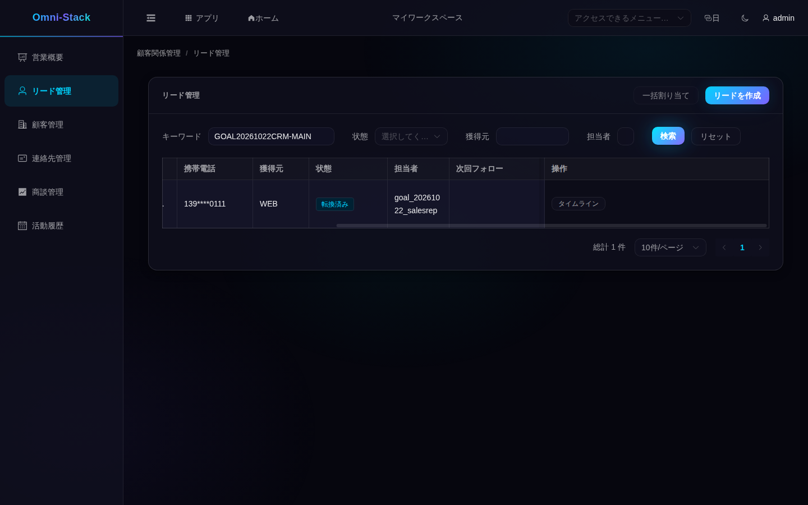

### 2.5 リードの削除

誤って作成し、まだ転換していないリードだけを削除します。そのリードのフォロー活動も削除されます。転換済みは履歴保持のため削除できません。

## 3. 顧客：すべての関係の拠点

### 3.1 検索と新規作成

入口：左側「顧客管理」。

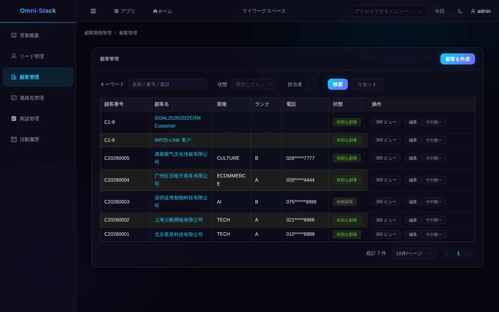

表示されるもの：状態には「見込み顧客」「有効な顧客」「休眠顧客」「失注済み」「ブラックリスト」があります。電話はマスクされ、「360 ビュー」「編集」「その他」は権限に応じて表示されます。
入力するもの：「顧客を作成」で名称（必須）と業種・レベル・流入元・連絡先を入力し、重複の案内を確認して保存します。新しい顧客は「見込み顧客」となり、操作者が担当します。
失敗時の回復：重複の案内ではまず既存顧客を検索します。同名でも地域が違うなど本当に別なら区別情報を補います。

### 3.2 顧客 360：関係を一画面で

やりたいこと：商談前に関連する連絡先・オープン商談・最近の活動を確認する。
入口：顧客行の「360 ビュー」。

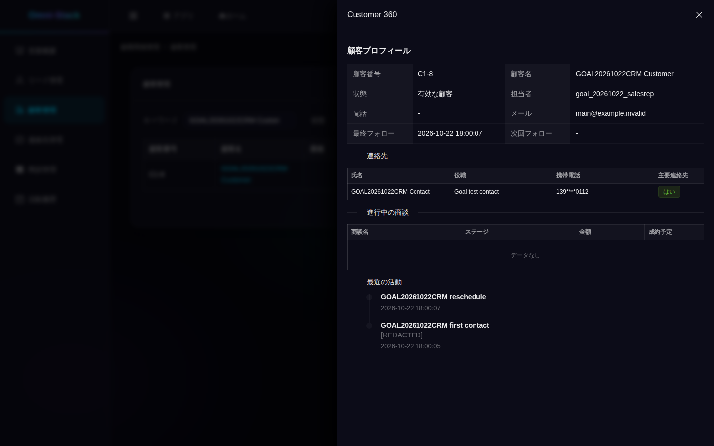

表示されるもの：詳細パネルに顧客番号、状態、担当者、直近フォローが表示され、その下に連絡先（主連絡先の印付き）、オープン商談、最近の活動が並びます。受注・失注の商談はこの欄には出ません。各部分にも個別の閲覧権限が適用され、閲覧者がこの画面を開いても編集権限や未マスクの連絡先情報を得られるわけではありません。
活動の内容に「[REDACTED]」と表示されるのは、その部分が非表示になっているためで、活動自体が消えたわけではありません。氏名や会社名などのサンプル業務データは、画面の言語を変えても自動翻訳されません。
失敗時の回復：オープン商談が空でも異常とは限りません。受注・失注はここに出ないため、商談メニューで顧客で絞り込んで確認します。

### 3.3 状態・移管・ブラックリスト

- **状態**：「その他」から状態変更を選びます。「見込み顧客」から「有効な顧客」へ、有効から休眠または失注済みへ、休眠・失注済みから有効へ変更できます。どの状態にも自由に変更できるわけではありません。
- **担当者の移管**：営業責任者が移管を選び、引継ぎ先と理由を入力して、オープン商談も移すかを選びます。相手の組織は自分の管理範囲内である必要があります。顧客の連絡先と顧客に属する活動も移ります。商談の移管を選んだ場合は、そのオープン商談と活動も一緒に移ります。
- **ブラックリストと復帰**：該当権限のある管理者は、有効な顧客をブラックリストに登録し、専用の解除操作で有効に戻せます。通常の状態選択では代用できません。ブラックリストは取引関係の印であり、その後の営業操作をすべて自動的に止めるものではありません。
- **編集**：顧客行の「編集」で名称・業種・レベル・連絡先を変更できます。既存の業務記録は当時のデータのままです。

失敗時の回復：状態の変更が拒否されたら、再読み込みして現在の状態を確認し、許可された操作を選びます。引継ぎ先が範囲外なら範囲内の同僚を選び直します。他の人が更新していた場合も、まず変更内容を確認してから再送信を判断します。

### 3.4 顧客の削除

誤って作成し、履歴を残す必要がない顧客だけを削除します。オープン商談があると削除は拒否されます。削除のために進行中の正当な商談を閉じないでください。顧客配下の連絡先と顧客の活動も削除され、関連する連絡先参照も解除されるため、確定前に影響を確認します。閉じた商談だけが残っていること自体は、顧客を削除できない理由にはなりません。

## 4. 連絡先：正しい相手に届く

入口：左側「連絡先管理」。

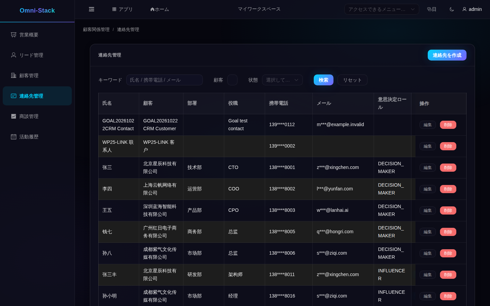

表示されるもの：連絡先は顧客に属し、主連絡先は顧客ごとに最大 1 人です。新しく設定すると古い印は自動で外れます。
表が画面より広い場合は、下部の横スクロールバーを右に動かして「主要連絡先」列を表示します。「主要に設定」で窓口を変更でき、右側には編集と削除もあります。文字が窮屈にならないよう、操作部分は別の図で示します。

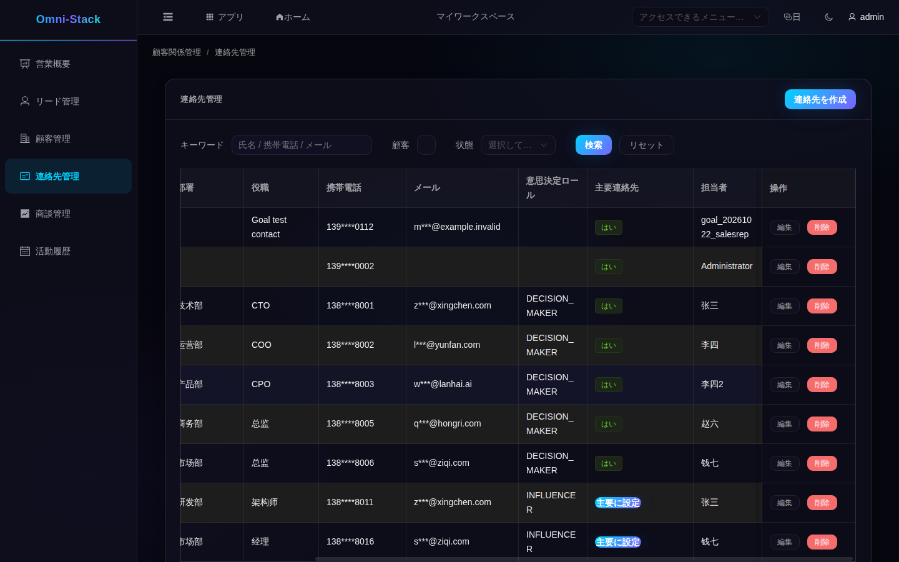

入力するもの：「連絡先管理」の「連絡先を作成」で顧客を選び、氏名・携帯・メール・役職を入力します。よく使う相手は主連絡先にできます。
- **編集**：連絡先行の「編集」で役職・携帯・メールを変更できます。新しい主連絡先を設定すると他の印は自動で外れます。
- **削除**：相手とその関連付けを残す必要がないことを確認し、行の「削除」を選びます。主連絡先も、先に別の人を設定せず削除できます。主要な窓口が必要な場合は、あらかじめ引継ぎ先を決めてください。
失敗時の回復：顧客は存在し、閲覧できる範囲にある必要があります。見つからない場合は範囲を確認し、必要なら先に顧客を作成します。連絡先を削除すると、活動や商談からその人への参照も解除されます。主要な窓口を残す必要がある場合は、引継ぎ先を決めてから削除するかを判断します。

## 5. 商談：金額と段階を管理する

### 5.1 一覧とボード

入口：左側「商談管理」。

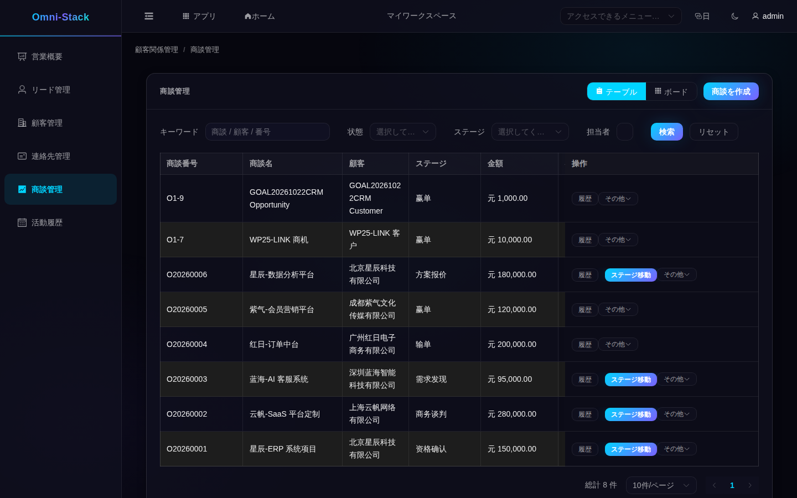

表示されるもの：右上で「テーブル」と「ボード」を切り替えます。各行に顧客、段階、金額、確率、完了予定、状態（オープン・受注・失注）が並びます。
失敗時の回復：ボードで見つからないときは絞り込み・担当者・閲覧範囲を確認します。段階情報が欠けている場合はまず再読み込みし、表示されないだけで段階の追加が必要とは判断しないでください。

### 5.2 新規作成と編集

入力するもの：「商談を作成」で顧客を選び、名称・金額（必須）・完了予定日・初期段階を入力します。金額は通常の小数です。
失敗時の回復：フォームの案内に従って補います。受注・失注の商談の重要項目を変えるには、先に再開します。

### 5.3 段階の移行・受注・失注

やりたいこと：商談を段階的に進め、受注または失注にする。
入口：商談行の「ステージ移動」。

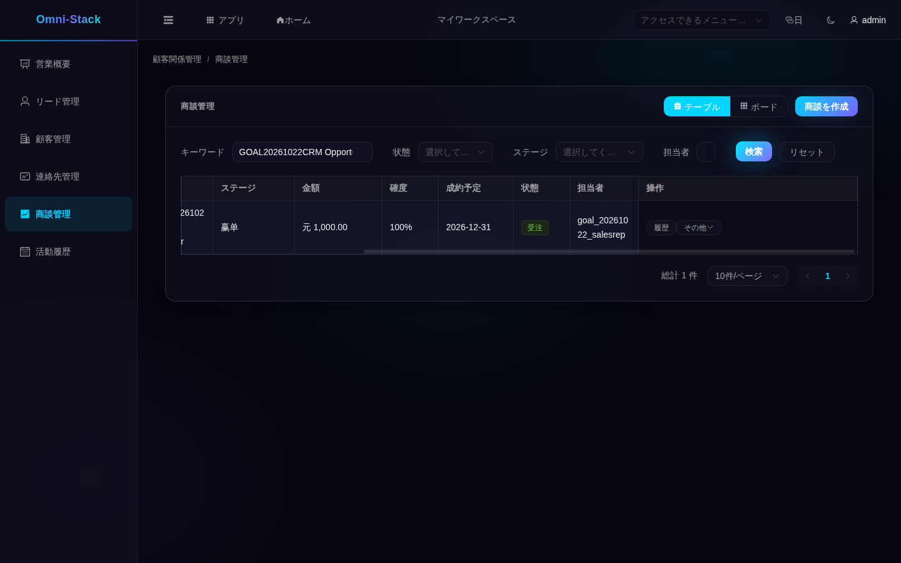

表示されるもの：段階は「ニーズ発見 → 資格確認 → 提案 → 商談 → 受注/失注」と進みます。前進は直接、後退は理由が必要です。受注で状態が「受注」になり、失注には失注理由が必要です。
失敗時の回復：隣の段階を一つずつ通る必要はなく、早い段階から直接受注も選べます。拒否されたら、商談がオープンで、移行先が同じ営業パイプラインの有効な段階かを確認します。後退には変更理由、失注には失注理由を補います。現在と同じ段階を選んでも新しい変化は起きません。受注・失注後に進める場合は、先に「その他」から再開します。

### 5.4 段階履歴と再開

行の「履歴」で段階変更と理由を確認できます。再開すると、受注・失注前にいたオープンの段階に戻ります。元の段階が無効になっている場合は拒否されるため、パイプライン設定を確認します。履歴を置き換えるために重複した商談を作らないでください。

### 5.5 割当と削除

割り当ては商談とその活動を範囲内の同僚に引き継ぎます。権限がなければボタンは表示されません。削除するのは誤って作成したオープン商談だけで、関連活動も削除されます。業務履歴がある商談は残してください。受注・失注の商談は直接削除できません。

## 6. フォロー活動：接触を記録する

入口：左側「活動履歴」。

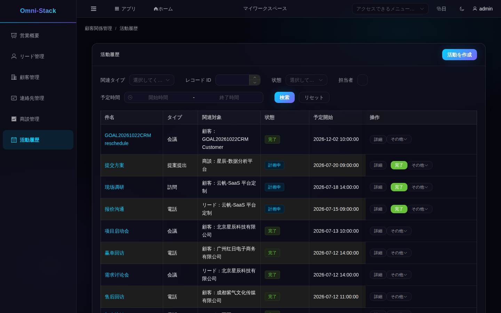

表示されるもの：活動はリード・顧客・商談に関連付けられます。状態は計画中・完了・取消で、計画開始と完了時刻が表示されます。
入力するもの：「活動を作成」で関連種別と対象を選び、件名・種別（電話・訪問・会議など）・計画時刻を入力します。
顧客は検索して選べます。リードや商談の場合、この画面ではシステム上の数字のレコード ID を入力します。英字を含む業務番号とは別です。共通の対象選択画面はまだないため、数字を推測せず記録を確認してください。リードには、行の「クイックフォロー」を使う方法もあります。
通常は「計画中」で作成します。すでに終わった接触を記録する場合は「完了」を選び、実際の完了時刻も入力します。「取消」の状態で直接作成することはできません。
活動を探すときは、関連タイプ・レコード ID・状態・担当者・予定時間で絞ってから件名を確認します。この画面にはキーワード検索欄がないため、リード一覧と同じ検索方法は使えません。
失敗時の回復：関連対象は存在し、データ範囲内である必要があります。選び間違えたら選び直し、関連のない活動を作らないでください。

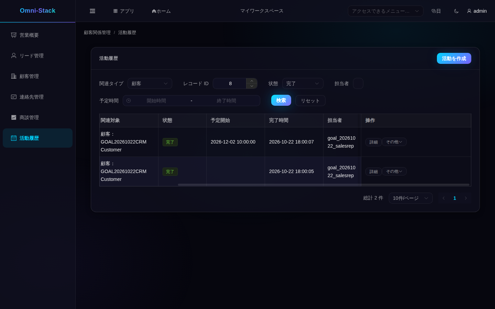

- **完了**：行の「完了」で活動が完了し、顧客やリードの直近フォロー時刻に反映されます。「新規」のリードは完了後に「フォロー中」になります。
- **編集**：計画中の活動は件名・種別・内容・予定時刻を変更できます。保存後に再読み込みして確認します。完了した活動は当時の記録として残し、次の連絡には新しい活動を作成します。
- **取消と日程変更**：取り消した活動は日程を変更して計画中に戻せます。
- **削除**：不要な未完了の活動だけを削除します。

## 7. 一つの完全な流れ

1. 「リード管理」で氏名と会社を入力してリードを作成。
2. リードに電話フォローを作成して完了すると「フォロー中」になります。
3. 「有望と判定」で資格を確認し、「有望」にします。
4. 顧客・連絡先・商談に転換し、顧客 360 で連絡先と活動を確認。
5. 「商談管理」で段階を進め、最終的に受注。
6. 受注後、顧客にフォロー訪問活動を作成して完了すると、顧客 360 の最近の活動に表示されます。

共通の回復：状態エラーは前の手順の未完了、データが見つからないときはデータ範囲と絞り込みを確認します。重複作成や状態の書き換えで流れを「迂回」しないでください。

## 8. よくある失敗と回復

- **ログイン後に CRM メニューがない**：ロールに CRM メニューが含まれるか確認します。CRM 権限のない一般社員は正常な結果です。
- **一覧が空**：まず絞り込みを解除し、本当にデータがないか確認します。

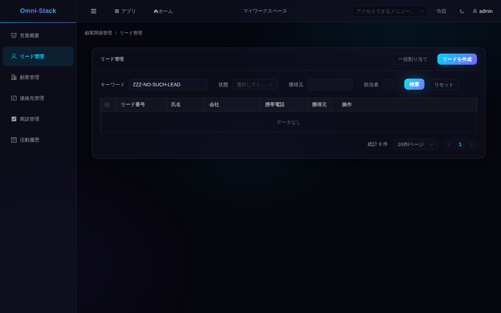

- **権限がないと表示される**：必要な権限を持つアカウントを使うか、管理者にロールのメニュー権限を確認してもらいます。一般社員が CRM を開くと：

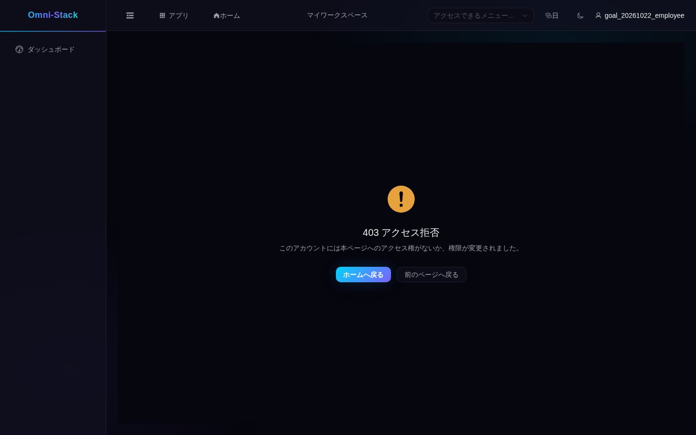

- **転換が拒否される**：リードが有望か、顧客と連絡先が一致しているか、自分の閲覧範囲内かを確認します。転換済みなら関連する記録で続け、重複作成しません。
- **商談を進められない**：再読み込みし、商談が閉じていないか、移行先が有効か、後退理由や失注理由が入力されているかを確認します。顧客のブラックリスト表示は、すべての段階操作を止める仕組みではありません。
- **日程変更に失敗**：取り消した活動だけが計画中に戻せます。

## 9. 例と検証範囲

- ローカルの専用テストアカウントで、営業担当・営業責任者・閲覧者の範囲、範囲外への拒否、閲覧者の書き込み拒否、連絡先のマスクを確認しています。営業担当はフォロー・資格確認・転換・受注・活動の取消後の日程変更も実行しました。すべての配備先で各ユーザーに同じロールが設定済みという意味ではありません。
- データは共有の開発データベースで、スクリーンショットの番号と名称は一つのスナップショットであり固定シードではありません。
- 一括インポート/エクスポート、顧客統合、商談削除の復元はありません。本チュートリアルはこれらの操作を提供しません。
