# CRM 그림 튜토리얼: 리드에서 수주와 후속 방문까지

이 페이지는 CRM을 쓰는 영업 담당과 영업 관리자를 위한 것입니다. "화면에서 영업 기회를 어떻게 앞으로 진행하는가"만 다루고 배포·API·데이터베이스는 다루지 않습니다. 스크린샷은 모두 로컬 Docker의 실제 환경(개발 테넌트, 공유 데이터)에서 촬영했으며 페이지와 버튼 이름은 실제 표시를 따릅니다.

먼저 용어를 구분해 보세요. 리드는 아직 확인되지 않은 영업 기회입니다. 고객은 거래할 회사나 개인이고, 연락처는 그 고객에서 실제로 대화하는 사람입니다. 영업 기회는 금액과 예상 성사 시점이 있는 개별 영업 건입니다. 활동에는 전화·방문·회의처럼 한 번씩 이루어지는 접촉을 기록합니다. 고객 하나에 여러 연락처, 영업 기회, 활동을 연결할 수 있습니다.

## 읽기 전 전제

- **사용하는 사람**: CRM 관리자(모든 고객과 영업 데이터 유지), 영업 관리자(본 부서 및 하위), 영업 담당(본인이 맡은 리드·고객·기회만), CRM 조회자(읽기 전용).
- **계정과 조회 범위**: 로컬 전용 계정으로 영업 담당자의 본인 범위, 영업 관리자의 부서 범위, 조회자의 읽기 전용 권한을 확인했습니다. 기존 그림은 주로 관리자 계정에서 촬영했습니다. 일반 영업 담당자는 목록이 더 짧거나 할당·삭제 버튼이 보이지 않을 수 있습니다. 그림과 맞추려고 계정 권한을 넓힐 필요는 없습니다.
- **데이터는 공유**: 보이는 리드·고객·기회는 같은 개발 데이터에서 나온 것입니다. 튜토리얼을 위해 기존 업무 객체를 지우거나 바꾸지 않습니다.
- **하나의 흐름**: "리드 → 후속 활동 → 전환 → 기회 → 수주 → 후속 방문" 순서로 읽으면 각 페이지가 이해하기 쉽습니다.
- **넓은 표 보기**: 아래 가로 스크롤 막대로 상태·담당자·시간 열을 확인합니다. 오른쪽 작업 영역은 그대로 사용할 수 있습니다. 결과 그림은 설명하는 열이 보이도록 스크롤한 상태입니다.

## 1. 먼저 영업 개요

하고 싶은 일: 하루를 시작하며 전체 진행과 바로 처리할 후속 활동을 봅니다.
볼 수 있는 사람: CRM 메뉴가 있는 역할.
시작 위치: 좌측 "CRM" → "영업 개요".

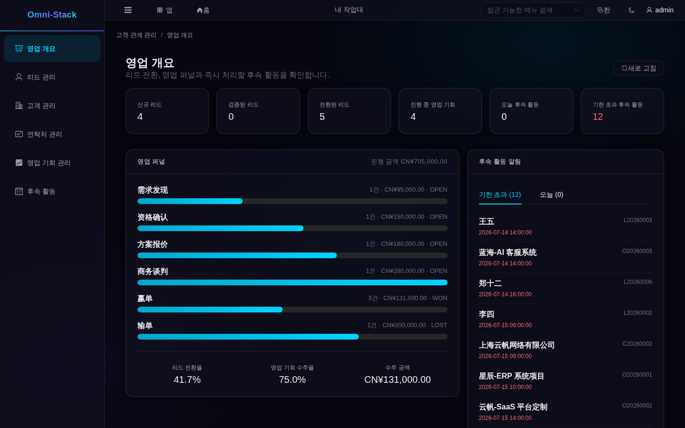

보이는 것: 상단 6개 카드는 신규 리드, 적격 리드, 전환된 리드, 진행 중 기회, 오늘 후속, 기한 초과 후속입니다. 가운데 퍼널은 단계별 기회 수와 금액, 아래에는 리드 전환율·기회 승률·수주 금액이 나옵니다. 우측은 "기한 초과"와 "오늘"로 나눈 후속 목록입니다.
실패 시 복구: 숫자가 예상과 다르면 먼저 내 데이터 범위와 필터를 확인합니다. 기한 초과가 많으면 우측 목록부터 처리하고 기회 단계를 바꾸지 마세요.

## 2. 리드: 기회를 세우기

### 2.1 리드 찾기와 필터

시작 위치: 좌측 "리드 관리".

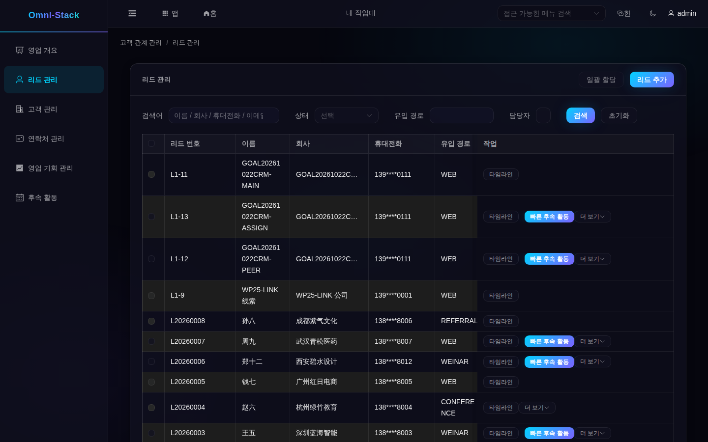

보이는 것: 각 행에 리드 번호, 이름, 회사, 휴대전화(마스킹), 유입 경로, 상태, 담당자, 다음 후속 시각이 나옵니다. 상태는 신규, 후속 활동 중, 적격, 전환됨, 부적격입니다.
실패 시 복구: 필터를 지우거나 검색어를 바꾼 다음, 본인이나 팀이 담당하는 리드인지 확인합니다. 목록에 담당자 이름이 없다는 사실만으로 미할당 상태라고 판단할 수는 없습니다.

### 2.2 리드 만들기

입력할 것: 우측 상단 "리드 추가"를 눌러 이름(필수), 회사, 휴대폰, 유입원, 업종, 등급, 다음 후속 시각을 입력하고 저장합니다.

보이는 것: 저장하면 "신규 리드"가 되고 담당자는 현재 작업자입니다.
실패 시 복구: 이름이 없으면 폼이 막습니다. 중복이 의심되면 회사나 전화로 기존 리드를 검색해 중복 생성 대신 기존 리드를 이어서 관리하세요.

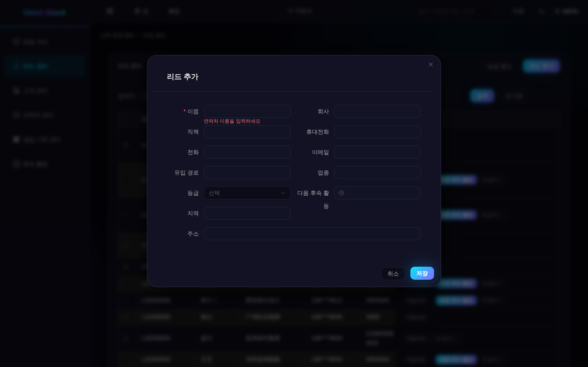

### 2.3 후속, 배정, 상태

전화나 방문을 기록할 때는 리드 행의 "빠른 후속 활동"이 편리합니다. 제목·유형·내용·예정 시각을 입력해 저장합니다. 계획을 저장했다고 완료되는 것은 아닙니다. 실제 접촉이 끝나면 "후속 활동"에서 해당 활동을 찾아 "완료"를 누릅니다. 리드 행의 "타임라인"에서는 새 기록을 만들거나 바꾸지 않고 기존 활동을 살펴볼 수 있습니다.

- **"후속 활동 중"으로**: 리드에 후속 활동을 만들고 완료하면 상태가 "신규"에서 "후속 활동 중"으로 바뀝니다. 버튼으로 상태를 직접 바꾸는 것이 아니라 이것이 실제 규칙입니다.
- **담당자 할당**: 관리자는 리드를 선택해 "일괄 할당"을 누르거나 행의 "더 보기"에서 할당을 선택합니다. 담당 동료와 사유를 입력하고 확정한 뒤 담당자를 확인합니다. 대상 계정은 활성 상태이고 소속 조직이 있어야 하며, 내 할당 범위에 속해야 합니다. 부서 관리자는 범위 밖의 다른 부서로 할당할 수 없습니다. 할당 권한이 없는 일반 영업 담당자에게는 이 작업이 표시되지 않습니다.
- **무효화와 재개**: 가치가 없다고 판단되면 무효화하고, 다시 기회가 생기면 재개해 "후속 활동 중"으로 돌아갑니다.
- **적격 판정**: "후속 활동 중"인 리드의 자격을 확인해 "적격"으로 바꾸면 전환할 수 있습니다.
- **편집**: 행의 "더 보기" → "편집"에서 회사·휴대폰·유입원 등을 바꿉니다. 전환된 리드는 편집할 수 없습니다.

실패 시 복구: 상태 오류는 이전 단계가 끝나지 않았다는 뜻입니다(후속 완료 전 적격 판정 등). 순서대로 보완하고 연타하지 마세요.

### 2.4 고객·연락처·기회로 전환

하고 싶은 일: 적격 리드를 이후 사용할 고객·연락처·기회로 한 번에 전환합니다.
할 수 있는 사람: 해당 리드 담당자 또는 관리자.
시작 위치: 리드 행 "더 보기" → "전환".

입력할 것: 전환 마법사에서 먼저 새 고객을 만들지 기존 고객에 연결할지 선택합니다. 이어서 그 고객의 연락처를 만들거나 선택합니다. 영업 기회도 함께 만들 경우 이름·금액·예상 성사일을 입력하고 마지막 확인 화면을 검토한 뒤 제출합니다.

보이는 것: 리드는 "전환됨"이 됩니다. 고객과 연락처는 선택한 방식에 따라 생성되거나 연결되며, 영업 기회 생성을 선택했다면 해당 메뉴에서도 확인할 수 있습니다. 이전 리드의 후속 활동은 고객으로 이동해 고객 360에서 볼 수 있습니다.
실패 시 복구: 처음 전환하려면 리드가 "적격"이어야 하며 기존 연락처는 선택한 고객에 속해야 합니다. 제출 후 화면이 갱신되지 않으면 먼저 새로고침해 고객·연락처·영업 기회를 확인합니다. 이미 전환했다면 연결된 기록에서 이어서 관리하고 중복 생성하지 마세요.

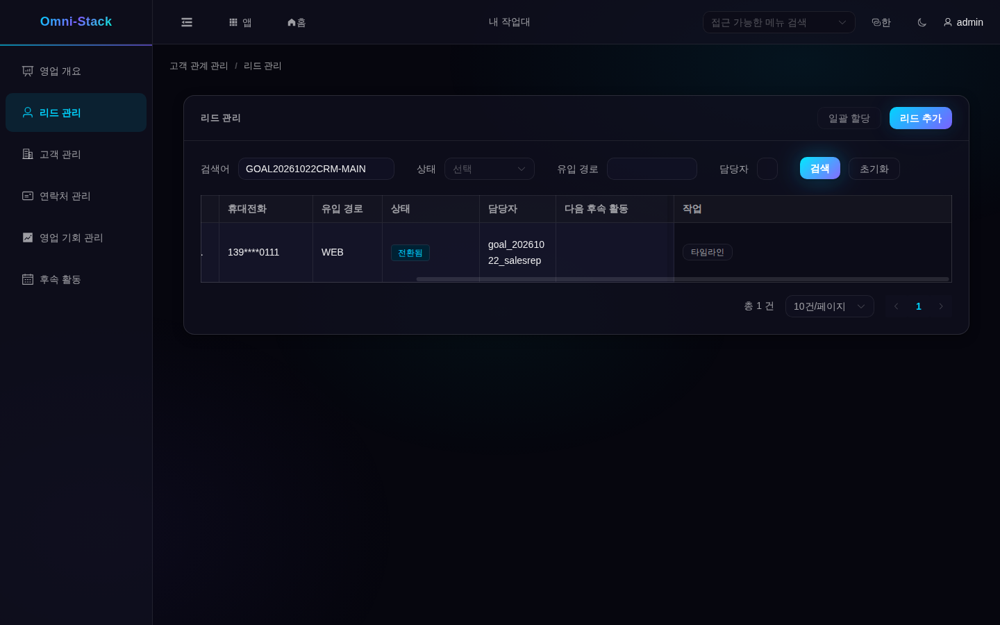

### 2.5 리드 삭제

잘못 만들어 아직 전환하지 않은 리드만 삭제합니다. 그 리드의 후속 활동도 함께 삭제됩니다. 전환된 리드는 이력 보존을 위해 삭제되지 않습니다.

## 3. 고객: 모든 관계의 거점

### 3.1 찾기와 만들기

시작 위치: 좌측 "고객 관리".

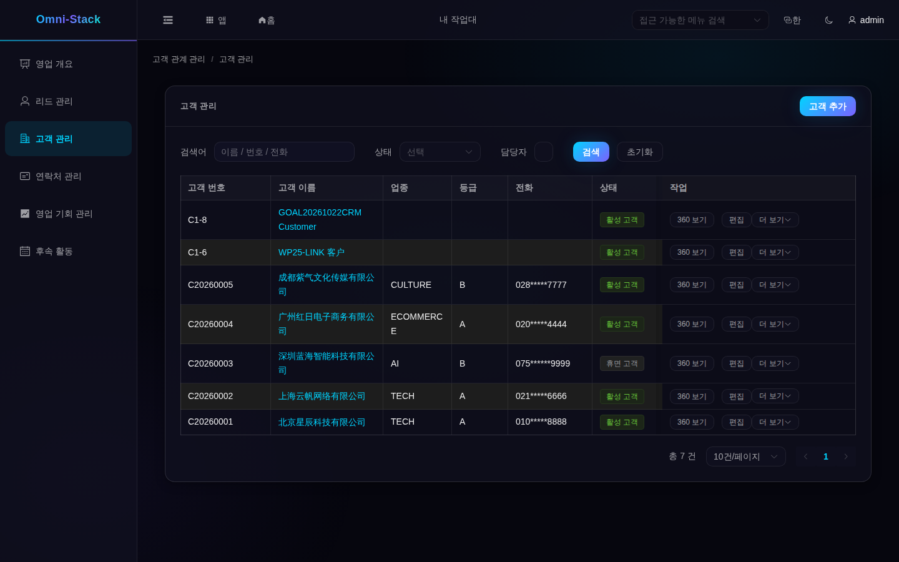

보이는 것: 고객 상태에는 잠재 고객, 활성 고객, 휴면 고객, 이탈 고객, 블랙리스트가 있습니다. 전화는 마스킹되며 권한에 따라 "360 보기", "편집", "더 보기"가 표시됩니다.
입력할 것: "고객 추가"에서 이름(필수)과 업종·등급·유입 경로·연락처를 입력하고 중복 안내를 확인한 뒤 저장합니다. 새 고객은 잠재 고객 상태이며 현재 작성자가 담당합니다.
실패 시 복구: 중복 안내가 나오면 먼저 기존 고객을 검색합니다. 이름이 같아도 지역이 다른 등 실제로 별개라면 구분 정보를 보강합니다.

### 3.2 고객 360: 관계를 한 화면에

하고 싶은 일: 상담 전에 연락처·진행 중 기회·최근 활동을 확인합니다.
시작 위치: 고객 행의 "360 보기".

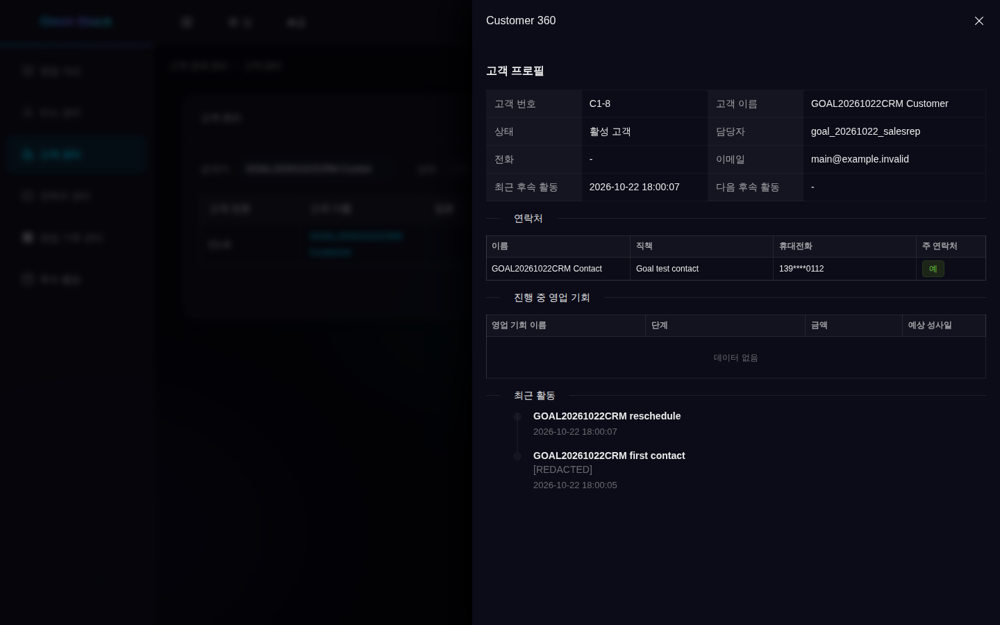

보이는 것: 상세 패널에 고객 번호, 상태, 담당자, 최근 후속이 표시되고, 아래에 연락처(주 연락처 표시), 진행 중 영업 기회, 최근 활동이 이어집니다. 수주·실주한 기회는 이 진행 중 목록에 나오지 않습니다. 각 영역에도 개별 조회 권한이 적용됩니다. 조회자가 이 패널을 열어도 편집 권한이나 마스킹되지 않은 연락처 정보를 얻지는 않습니다.
활동 내용의 "[REDACTED]"는 그 부분이 숨겨졌다는 뜻이며 활동 기록 자체가 사라진 것은 아닙니다. 이름이나 회사명 같은 예시 업무 데이터는 화면 언어를 바꿔도 자동으로 번역되지 않습니다.
실패 시 복구: 진행 중 기회가 비어 있어도 오류는 아닙니다. 수주·실주는 여기에 나오지 않으므로 기회 메뉴에서 고객으로 필터링해 확인하세요.

### 3.3 상태, 이관, 블랙리스트

- **상태**: "더 보기"에서 상태 변경을 선택합니다. 잠재 고객은 활성 고객으로, 활성 고객은 휴면 또는 이탈 고객으로 바꿀 수 있습니다. 휴면·이탈 고객은 활성 고객으로 복귀할 수 있습니다. 임의의 두 상태 사이에서 자유롭게 바꾸는 방식은 아닙니다.
- **담당자 이관**: 관리자가 이관을 선택하고 새 담당자와 사유를 입력한 뒤 진행 중 영업 기회도 함께 넘길지 정합니다. 새 담당자의 조직은 내 관리 범위 안에 있어야 합니다. 고객의 연락처와 고객 후속 활동은 함께 이동합니다. 영업 기회 이관을 선택하면 해당 진행 중 기회와 그 활동도 함께 이동합니다.
- **블랙리스트와 해제**: 해당 권한을 가진 관리자는 활성 고객을 블랙리스트에 추가하고, 전용 해제 작업으로 활성 고객으로 되돌릴 수 있습니다. 일반 상태 선택으로 대신할 수는 없습니다. 블랙리스트는 거래 관계를 표시하는 기능이며 이후 모든 영업 작업을 자동으로 차단하지는 않습니다.
- **편집**: 고객 행의 "편집"에서 이름·업종·등급·연락처를 바꿉니다. 이미 발생한 업무 기록은 당시 데이터를 유지합니다.

실패 시 복구: 상태 변경이 거부되면 새로고침해 현재 상태를 확인하고 허용된 작업을 선택합니다. 새 담당자가 범위 밖이라면 범위 안의 동료를 다시 선택하세요. 다른 사람이 기록을 갱신했다면 먼저 변경 내용을 확인한 뒤 다시 제출할지 결정합니다.

### 3.4 고객 삭제

잘못 만들었고 이력을 보존할 필요가 없는 고객만 삭제합니다. 진행 중 영업 기회가 있으면 삭제가 거부되며, 삭제만을 위해 정상적으로 진행 중인 기회를 닫지 마세요. 고객 아래의 연락처와 고객 후속 활동도 삭제되고 관련 연락처 참조도 해제되므로 확정 전에 영향을 확인해야 합니다. 종료된 기회만 남아 있다는 이유만으로 고객 삭제가 금지되지는 않습니다.

## 4. 연락처: 맞는 사람에게 닿기

시작 위치: 좌측 "연락처 관리".

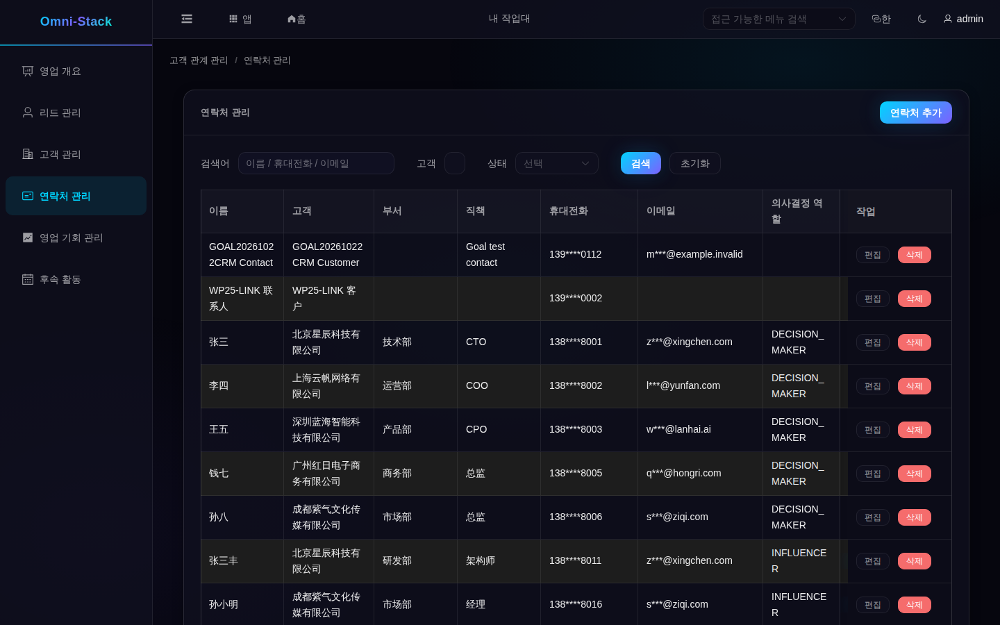

보이는 것: 연락처는 고객에 속하며 고객마다 주 연락처를 최대 한 명 지정할 수 있습니다. 새로 지정하면 이전 표시는 자동으로 해제됩니다.
표가 화면보다 넓으면 아래의 가로 스크롤 막대를 오른쪽으로 움직여 "주 연락처" 열을 찾습니다. "주 연락처로 설정"으로 주요 연락 담당자를 바꿀 수 있고 오른쪽에는 편집과 삭제도 있습니다. 글자가 잘리지 않도록 작업 영역은 별도 그림으로 보여 줍니다.

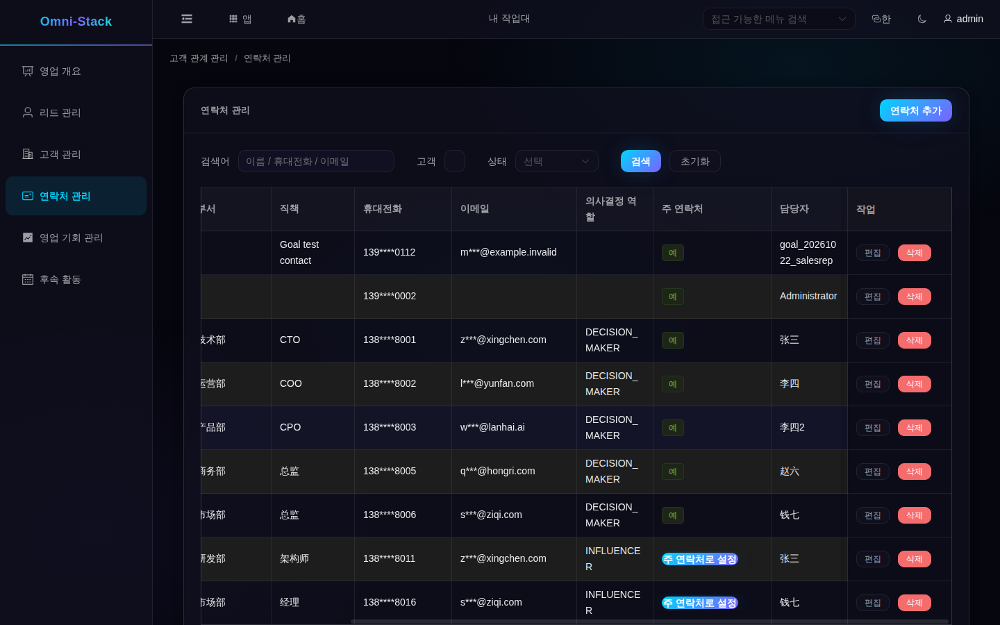

입력할 것: "연락처 관리"에서 "연락처 추가"를 누르고 고객을 먼저 선택한 다음 이름·휴대전화·이메일·직함을 입력합니다. 자주 연락하는 사람을 주 연락처로 지정할 수 있습니다.
- **편집**: 연락처 행의 "편집"에서 직함·휴대폰·이메일을 바꿉니다. 새 주 연락처를 지정하면 다른 표시는 자동으로 해제됩니다.
- **삭제**: 이 사람과 연결 정보를 더 보존할 필요가 없는지 확인한 뒤 행의 "삭제"를 누릅니다. 주 연락처도 다른 사람을 먼저 지정하지 않고 삭제할 수 있습니다. 주요 연락 창구가 계속 필요하면 미리 인수할 사람을 정하세요.
실패 시 복구: 고객이 존재하며 내 조회 범위 안에 있어야 합니다. 찾을 수 없으면 범위를 확인하고 필요할 때 고객을 먼저 만듭니다. 연락처를 삭제하면 활동과 영업 기회에서 그 사람을 참조하던 연결도 해제됩니다. 주요 연락 창구를 유지해야 한다면 후임자를 정한 뒤 삭제할지 판단하세요.

## 5. 기회: 금액과 단계 관리

### 5.1 목록과 보드

시작 위치: 좌측 "영업 기회 관리".

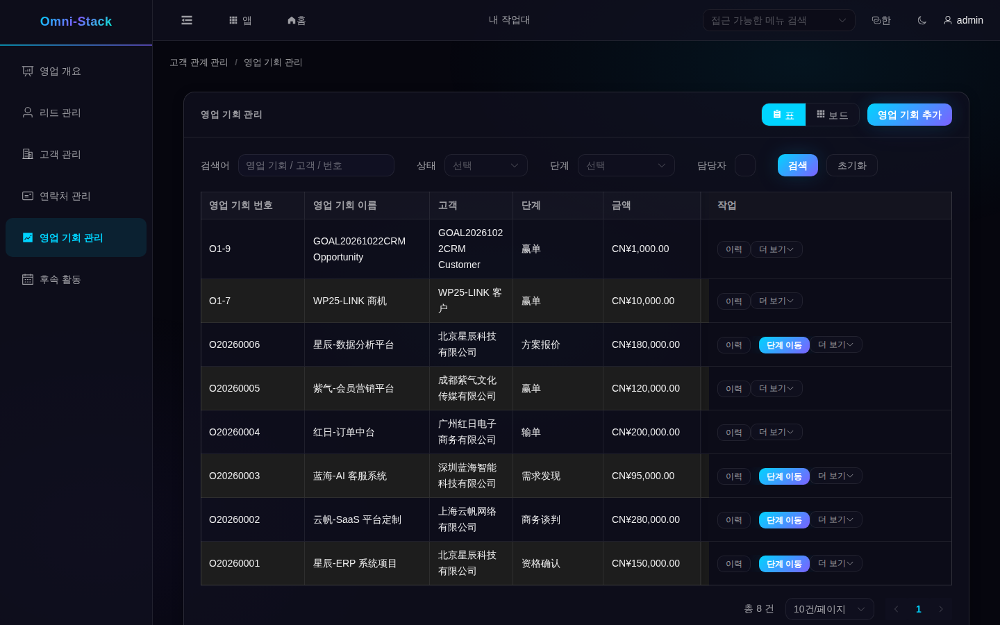

보이는 것: 우측 상단에서 "표"와 "보드"를 전환합니다. 각 행에 고객, 단계, 금액, 확률, 예상 성사일, 상태(진행 중·수주·실주)가 나옵니다.
실패 시 복구: 보드에서 보이지 않으면 필터·담당자·조회 범위를 확인합니다. 단계 정보가 누락되면 먼저 새로고침하세요. 표시가 없다는 사실만으로 단계를 추가해야 한다고 판단하지 마세요.

### 5.2 만들기와 편집

입력할 것: "영업 기회 추가"에서 고객을 고르고 이름·금액(필수)·예상 성사일·초기 단계를 입력합니다. 금액은 일반 소수입니다.
실패 시 복구: 폼 안내에 따라 보완합니다. 수주·실주 기회의 핵심 항목을 바꾸려면 먼저 재개합니다.

### 5.3 단계 이동, 수주와 실주

하고 싶은 일: 기회를 단계적으로 진행해 수주 또는 실주로 만듭니다.
시작 위치: 기회 행의 "단계 이동".

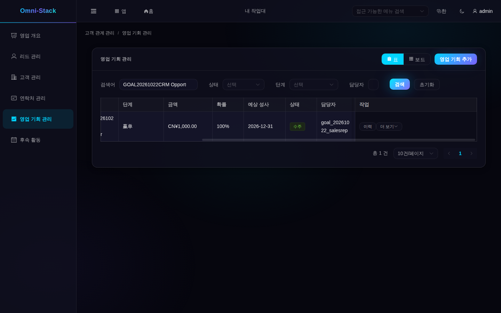

보이는 것: 단계는 "니즈 발견 → 자격 확인 → 제안 → 협상 → 수주/실주"로 진행됩니다. 전진은 바로 가능하고 후퇴는 사유가 필요합니다. 수주하면 상태가 "수주"가 되고 실주에는 실주 사유가 필요합니다.
실패 시 복구: 바로 다음 단계를 하나씩 거칠 필요는 없으며 초기 단계에서 바로 수주를 선택할 수도 있습니다. 거부되면 기회가 아직 진행 중인지, 대상 단계가 같은 영업 파이프라인에서 활성 상태인지 확인하세요. 이전 단계로 돌아갈 때는 변경 사유, 실주를 선택할 때는 실주 사유를 입력합니다. 현재 단계를 다시 선택해도 새 변화는 생기지 않습니다. 수주·실주 이후 다시 진행하려면 먼저 "더 보기"에서 "다시 열기"를 선택합니다.

### 5.4 단계 이력과 재개

행의 "이력"에서 단계 변화와 사유를 볼 수 있습니다. 다시 열면 수주·실주로 종료하기 직전의 진행 중 단계로 복귀합니다. 이전 단계가 비활성화되어 있으면 거부되므로 파이프라인 설정을 확인하세요. 이력을 대신하려고 중복 기회를 만들지 마세요.

### 5.5 배정과 삭제

할당하면 영업 기회와 그 활동을 범위 안의 동료에게 넘깁니다. 할당 권한이 없으면 버튼이 표시되지 않습니다. 잘못 만든 진행 중 기회를 삭제하면 그 활동도 함께 삭제되므로 업무 이력이 있는 기회는 보존하세요. 수주·실주한 기회는 바로 삭제할 수 없습니다.

## 6. 후속 활동: 모든 접촉을 기록

시작 위치: 좌측 "후속 활동".

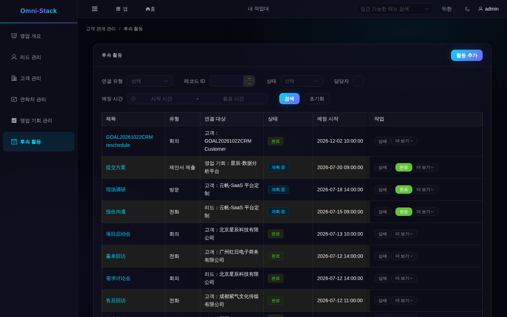

보이는 것: 활동은 리드·고객·기회에 연결됩니다. 상태는 계획 중·완료·취소이며 계획 시작과 완료 시각이 표시됩니다.
입력할 것: "활동 추가"에서 관련 유형과 대상을 고르고 제목·유형(전화·방문·회의 등)·계획 시각을 입력합니다.
고객은 검색해서 선택할 수 있습니다. 리드나 영업 기회는 현재 화면에서 시스템의 숫자 레코드 ID를 입력해야 하며, 영문자가 포함된 업무 번호와는 다릅니다. 공통 대상 선택기가 아직 없으므로 숫자를 추측하지 말고 기록을 확인하세요. 리드에는 해당 행의 "빠른 후속 활동"을 이용할 수도 있습니다.
보통은 "계획 중"으로 만듭니다. 이미 끝난 접촉을 나중에 기록하려면 "완료"를 선택하고 실제 완료 시각도 입력합니다. "취소" 상태로 바로 만들 수는 없습니다.
활동을 찾을 때는 연결 유형·레코드 ID·상태·담당자·예정 시각으로 범위를 좁힌 뒤 제목을 확인합니다. 이 페이지에는 검색어 입력란이 없으므로 리드 목록과 같은 검색 방법을 적용할 수 없습니다.
실패 시 복구: 관련 대상은 존재하고 데이터 범위 안이어야 합니다. 잘못 골랐으면 다시 선택하고 연결 없는 활동을 만들지 마세요.

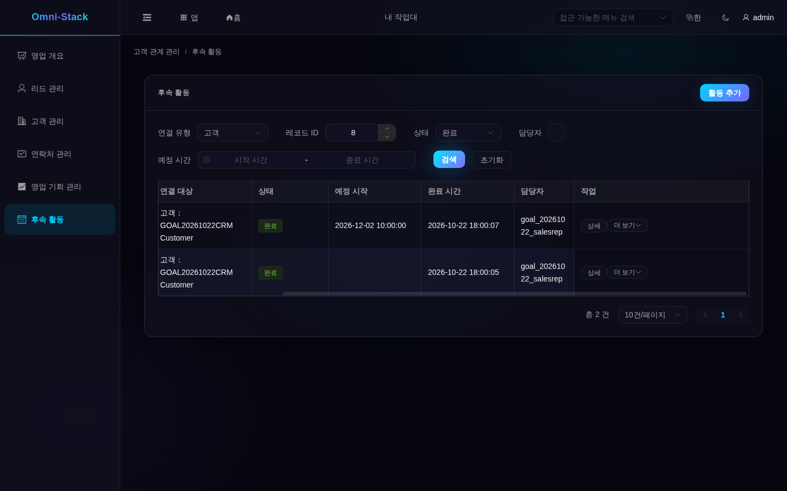

- **완료**: 행의 "완료"를 누르면 완료가 되고 고객·리드의 최근 후속 시각에 반영됩니다. "신규" 리드는 완료 후 "후속 활동 중"이 됩니다.
- **편집**: 계획 중인 활동은 제목·유형·내용·예정 시각을 바꿀 수 있습니다. 저장 후 새로고침해 확인하세요. 완료한 활동은 당시 기록으로 남기고 다음 연락에는 새 활동을 만듭니다.
- **취소와 일정 변경**: 취소하면 상태가 취소가 됩니다. 취소된 활동은 일정을 바꿔 계획 중으로 되돌릴 수 있습니다.
- **삭제**: 필요 없는 미완료 활동만 삭제합니다.

## 7. 하나의 완전한 이야기

1. "리드 관리"에서 이름과 회사를 입력해 리드를 만듭니다.
2. 리드에 전화 후속 활동을 만들고 완료하면 "후속 활동 중"이 됩니다.
3. "적격 판정"으로 자격을 확인하면 "적격"이 됩니다.
4. 고객·연락처·기회로 전환하고 고객 360에서 연락처와 활동을 확인합니다.
5. "영업 기회 관리"에서 단계를 차례로 진행해 최종 수주합니다.
6. 수주 후 고객에 후속 방문 활동을 만들고 완료하면 고객 360의 최근 활동에 나타납니다.

공통 복구: 상태 오류는 이전 단계 미완료, 데이터가 없으면 데이터 범위와 필터를 확인합니다. 중복 생성이나 상태 편집으로 흐름을 "우회"하지 마세요.

## 8. 흔한 실패와 복구

- **로그인 후 CRM 메뉴 없음**: 역할에 CRM 메뉴가 있는지 확인합니다. CRM 권한이 없는 일반 사원은 정상 결과입니다.
- **목록이 비어 있음**: 먼저 필터를 지우고 실제로 데이터가 없는지 확인합니다.

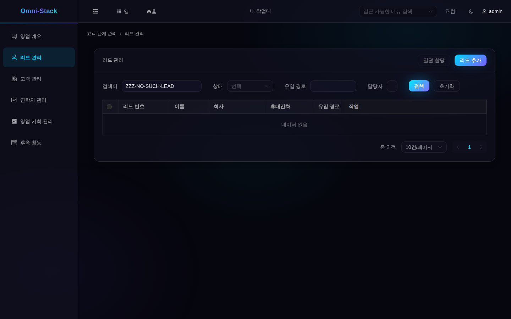

- **권한 없음**: 필요한 권한을 가진 계정을 사용하거나 관리자에게 역할의 메뉴 권한을 확인해 달라고 요청합니다. 일반 사원이 CRM을 열면:

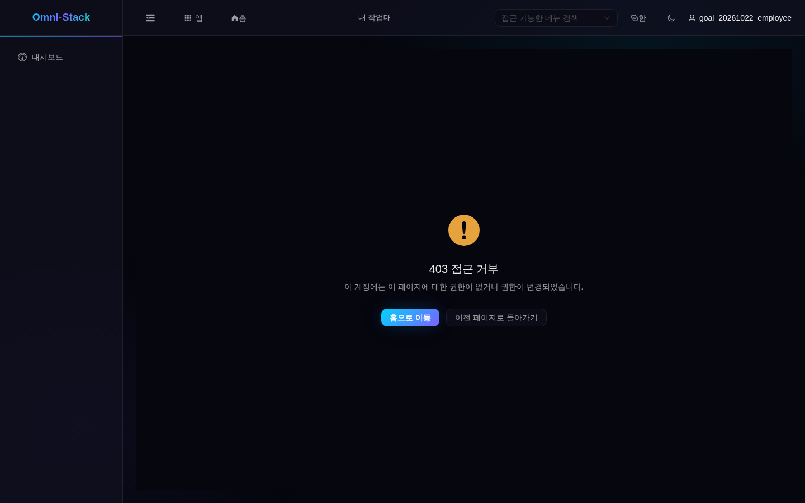

- **전환 거부**: 리드가 적격인지, 고객과 연락처가 맞는지, 기록이 내 조회 범위 안에 있는지 확인합니다. 이미 전환했다면 연결된 기록에서 계속하고 중복 생성하지 마세요.
- **기회 진행 불가**: 새로고침한 뒤 이미 종료되었는지, 대상 단계가 활성 상태인지, 이전 단계로 돌아가는 사유나 실주 사유가 빠졌는지 확인합니다. 고객의 블랙리스트 표시는 모든 단계 작업을 자동 차단하는 규칙이 아닙니다.
- **일정 변경 실패**: "취소"된 활동만 계획 중으로 되돌릴 수 있습니다.

## 9. 예시와 검증 범위

- 로컬 전용 테스트 계정으로 영업 담당자·관리자·조회자의 범위, 범위 밖 접근 거부, 읽기 전용 계정의 쓰기 거부, 연락처 마스킹을 확인했습니다. 영업 담당자는 후속 활동·자격 확인·전환·수주와 활동 취소 후 일정 변경도 실제로 완료했습니다. 모든 배포 환경에서 모든 사용자에게 같은 역할이 설정되어 있다는 뜻은 아닙니다.
- 데이터는 공유 개발 데이터베이스이며 스크린샷의 번호와 이름은 하나의 스냅샷으로 고정 시드가 아닙니다.
- 일괄 가져오기/내보내기, 고객 병합, 기회 삭제 복구 기능은 없으며 본 튜토리얼은 이런 작업을 제공하지 않습니다.
