# CRM 图文教程：从线索到赢单与回访

这页面向使用 CRM 的销售与销售管理者，只讲“在界面上怎么把一条销售机会推进下去”。所有截图来自本机 Docker 中的真实环境（开发租户、共享数据），页面与按钮名称以实际显示为准；文中不涉及部署、接口或数据库。

先分清几个名字：线索是一条尚未确认的销售机会；客户是你要合作的公司或个人；联系人是这个客户下具体对接的人；商机是一次有金额和成交预期的销售事项；跟进活动记录电话、拜访、会议等每次接触。同一个客户可以有多名联系人、多条商机和多次跟进。

## 读前须知

- **谁会用到**：CRM 管理员（维护全部客户与销售数据）、销售经理（带团队看本部门及下级）、销售代表（只看自己负责的线索、客户与商机）、CRM 只读员（可以查看，不能修改）。
- **身份与范围**：本地专用账号已分别验证销售代表的本人范围、销售经理的部门范围和只读员的只读权限。本文既有配图主要使用管理员身份；普通销售的列表可能更短，分配、删除等按钮也可能不显示。不要为了让页面看起来一样而扩大账号权限。
- **数据是共享的**：你看到的历史线索、客户与商机来自同一套开发数据；教程不会为了演示清空或改写已有业务对象。
- **一条主线**：后文用“某公司的线索 → 跟进 → 转换 → 商机 → 赢单 → 回访”串起各页面，读的时候可以按这条线理解先后关系。
- **查看宽表**：内容放不下时，拖动底部横向滚动条查看状态、负责人和时间列，右侧操作区仍可使用。结果配图已滚到需要查看的列。

## 一、先看销售概览

想完成什么：每天开工先看整体进度和需要马上处理的跟进。
谁能看：有 CRM 菜单的角色。
从哪里进：左侧「CRM」→「销售概览」。

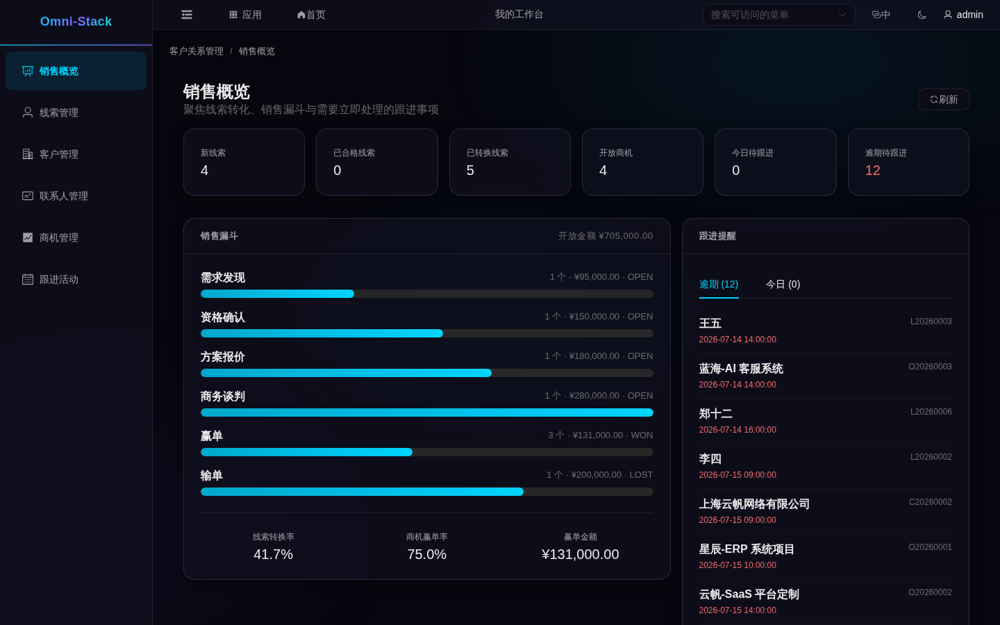

看到什么：顶部六张卡分别是新线索、已合格线索、已转换线索、开放商机、今日待跟进、逾期待跟进；中部漏斗按阶段显示商机数量与金额，底部是线索转换率、商机赢单率与赢单金额；右侧按「逾期」「今日」列出需要跟进的客户与时间。
失败怎么恢复：数字与预期不符时，先确认自己的数据范围与筛选口径；逾期待跟进很多时，优先处理右侧列表，而不是去改商机阶段。

## 二、线索：把陌生机会立起来

### 2.1 查找与筛选线索

从哪里进：左侧「线索管理」。

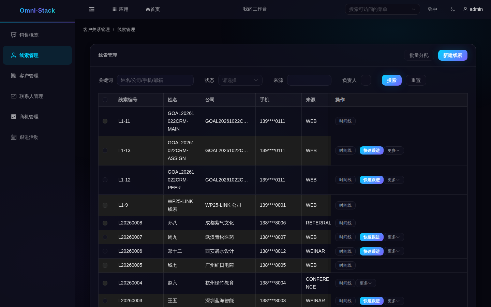

看到什么：每行是线索编号、姓名、公司、手机（已脱敏）、来源、状态、负责人和下次跟进时间；状态包括新线索、跟进中、已合格、已转换、无效。
失败怎么恢复：查不到时先清空筛选或换关键词，再确认这条线索是否归自己或自己的团队。列表里没有某个人的姓名，不能直接认定线索尚未分配。

### 2.2 新建线索

点什么、填什么：点右上角「新建线索」，填写姓名（必填）、公司、手机、来源、行业、评级和下次跟进时间，然后保存。

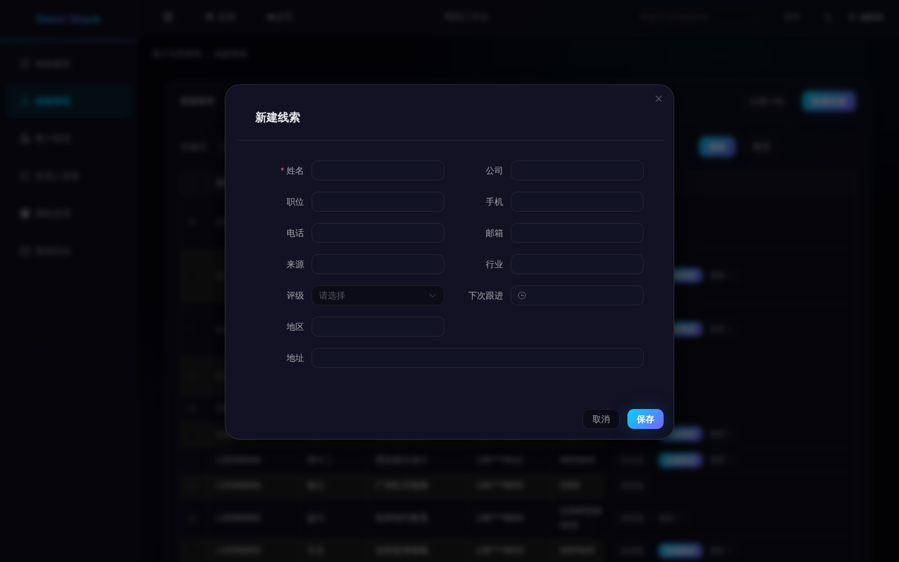

看到什么：保存后线索进入「新线索」，负责人是当前操作人。
失败怎么恢复：姓名没填时表单会直接提示；提示疑似重复时，先按公司或电话搜索，确认是否应继续跟进已有线索，不要重复建立。

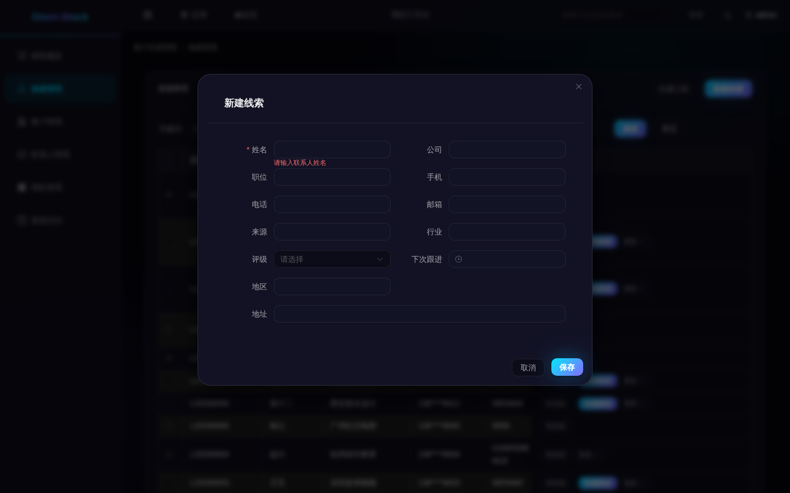

### 2.3 跟进、分配与状态

记录一次电话或拜访，最方便的入口是线索行的「快速跟进」：填写主题、类型、内容与计划时间后保存。保存计划不代表已经完成；实际接触结束后，再到「跟进活动」找到这条活动并点「完成」。线索行的「时间线」可回看已留存的活动，不会因此新建或改变记录。

- **让线索进入「跟进中」**：给线索新建并完成一次跟进活动后，状态自动从「新线索」变为「跟进中」。这是系统的真实规则，不是点某个按钮直接改状态。
- **分配负责人**：经理可勾选线索后点「批量分配」，或在该行「更多」里选择分配；选择负责同事并填写原因，确认后刷新负责人。目标必须启用、有所属组织，并且在你的可分配范围内。部门经理不能把线索分给范围外的其他部门；普通销售没有分配权限时不显示该操作。
- **判无效与重开**：确认没有价值时在「更多」里判为无效；对方回心转意时可重开，线索回到「跟进中」。
- **资格确认**：只有「跟进中」的线索可以确认资格，确认后等待转换。
- **编辑**：在行「更多」→「编辑」中修改公司、手机、来源等信息；已转换的线索不能编辑。

失败怎么恢复：提示状态不允许，说明上一步没做完（例如还没完成跟进就想确认资格）；按顺序补齐即可，不要反复点击。

### 2.4 转换成客户、联系人与商机

想完成什么：把一条合格线索一次转成后续要用的客户、联系人和商机。
谁能做：负责该线索的销售或管理者。
从哪里进：线索行「更多」→「转换」。

点什么、填什么：打开转换向导后，先选择新建客户还是关联已有客户，再新建或选择这个客户下的联系人；随后决定是否同时建立商机。建立商机时补上名称、金额和预计成交日期，最后检查确认页再提交。

看到什么：转换后线索状态变为「已转换」。客户和联系人会新建或关联到你选择的记录；勾选建立商机时，还能在商机菜单查到它。此前线索的跟进活动也会转到客户名下，可以到客户 360 查看。
失败怎么恢复：只有「已合格」的线索可以首次转换；已有联系人必须属于选中的客户。提交后页面没及时更新，先刷新并查看客户、联系人和商机，不要另建一套重复记录。已转换线索应继续从关联客户或商机跟进。

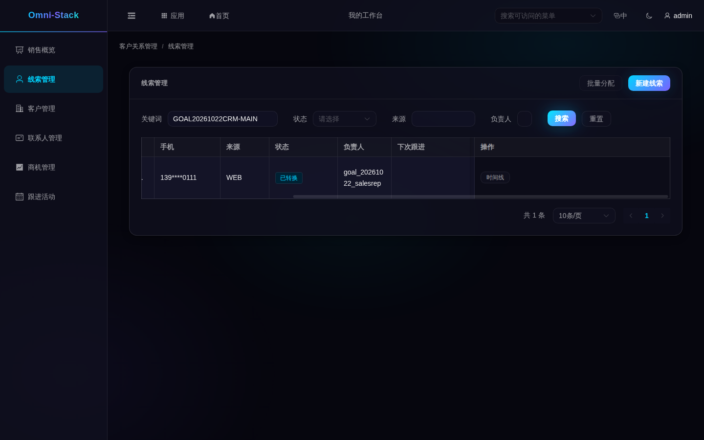

### 2.5 删除线索

只有确实建错、且未转换的线索才删除，也会删除它的跟进活动；已转换的线索要保留历史，系统会拒绝删除。

## 三、客户：所有关系的落点

### 3.1 查找与新建

从哪里进：左侧「客户管理」。

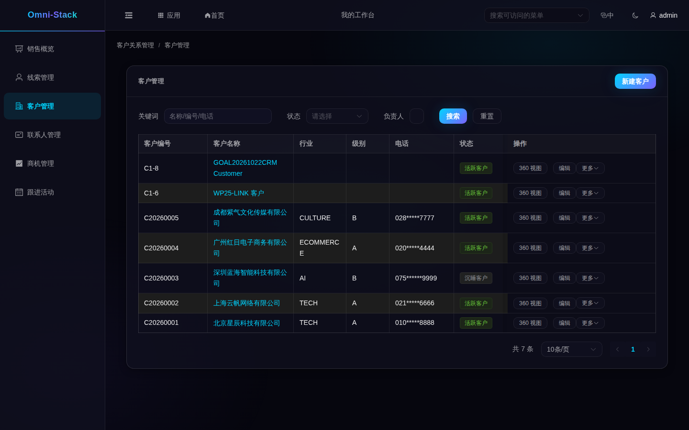

看到什么：客户可处于潜在、活跃、沉睡、流失或黑名单状态；电话已脱敏。操作列按权限显示「360 视图」「编辑」「更多」。
点什么、填什么：点「新建客户」填写名称（必填）与行业、级别、来源、联系方式；保存前先检查重复提示。保存后的新客户处于潜在状态，由当前操作人负责。
失败怎么恢复：重复提示时先搜索已有客户；确实不同（例如同名不同城市）再补充区分信息。

### 3.2 客户 360：一屏看清关系

想完成什么：在与客户沟通前，快速看到联系人、开放商机与最近活动。
从哪里进：客户行「360 视图」。

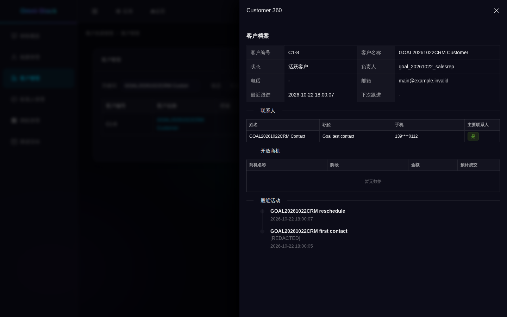

看到什么：详情面板显示客户编号、状态、负责人、最近跟进；下方依次是联系人（含主联系人标记）、开放商机（已赢单/输单不在这里）和最近活动。各部分仍受自己的查看权限限制；只读员不能因此修改记录，也不能因此看到未获授权的完整联系方式。
图中活动内容出现「[REDACTED]」表示该段内容已被隐藏，不是活动记录丢失；姓名、公司名称等示例业务数据也不会随界面语言自动翻译。
失败怎么恢复：开放商机为空不一定是错误——已赢单或输单的商机不会出现在这里，可到商机菜单按客户筛选查看。

### 3.3 状态、转移、黑名单

- **状态**：在「更多」里选择变更状态。潜在客户可转为活跃；活跃客户可转为沉睡或流失；沉睡、流失客户可恢复为活跃。不能任意选两个状态互转。
- **转移负责人**：经理在「更多」里选择转移，选接手同事、填写原因，并决定是否同时转移该客户的开放商机。接手人的组织必须在你的管理范围内。保存后，客户下的联系人和客户跟进也会随负责人转移；勾选同时转移时，开放商机及其跟进一并转移。
- **黑名单与恢复**：有相应权限的管理者可把活跃客户加入黑名单，或用专门的恢复操作回到活跃。普通状态选择不能替代这两个操作。黑名单用于标记客户关系，不应把这个标签当作系统会自动阻止所有后续销售动作的保证。
- **编辑**：客户行「编辑」可以修改名称、行业、级别与联系方式；已经发生的业务记录仍以当时的数据为准。

失败怎么恢复：提示状态不允许时，刷新确认当前状态，再选择上面允许的动作；提示接手人不在范围内时，重新选择范围内的同事。页面已被其他人更新时，先刷新并核对变化，再决定是否重新提交。

### 3.4 删除客户

只删除确实建错、无需继续保留的客户。有开放商机时，系统会拒绝删除；不要为了删客户随意关闭正常商机。删除会同时移除该客户下的联系人和客户跟进记录，并清除相关联系人引用，确认前应检查影响；仅有已关闭商机并不等于一定禁止删除客户。

## 四、联系人：找对人才能推进

从哪里进：左侧「联系人管理」。

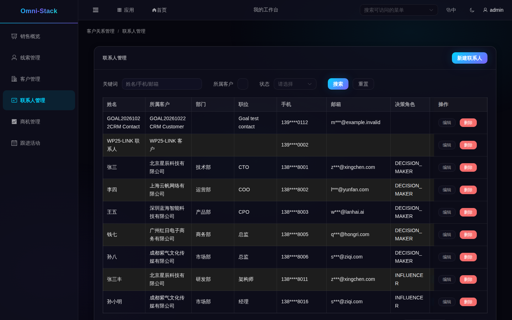

看到什么：联系人归属某个客户；每个客户最多选一位主联系人，设新的主联系人后旧标记自动取消。
表格较宽时，拖动底部横向滚动条向右，找到「主要联系人」列；「设为主要」可以更换主要联络人，右侧仍可编辑或删除。下面单独展示向右滚动后的操作区，避免把按钮挤在一张图里。

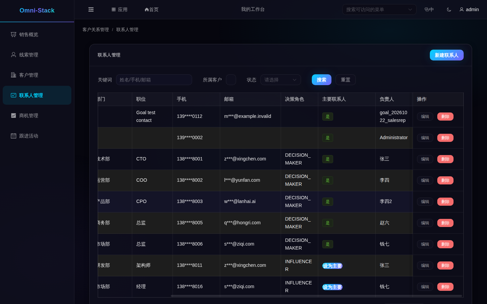

点什么、填什么：在「联系人管理」点新建，先选所属客户，再填写姓名、手机、邮箱与职位；常用联系人可设为主联系人。
- **编辑**：联系人行「编辑」可以修改职位、手机与邮箱；设新的主联系人后，其他人的主标记会自动取消。
- **删除**：使用联系人行「删除」，确认这位联系人及其关联已不再需要。主联系人也可以删除，不要求先另选一人；要保留主要联络窗口时，先安排好替代联系人。
失败怎么恢复：联系人必须属于可访问的客户，找不到客户时先确认范围，必要时先建客户。删除联系人会清除相关活动和商机对该联系人的引用；如果需要保留主要联络人，先选好接替者，再决定是否删除。

## 五、商机：把金额和阶段管起来

### 5.1 列表与看板

从哪里进：左侧「商机管理」。

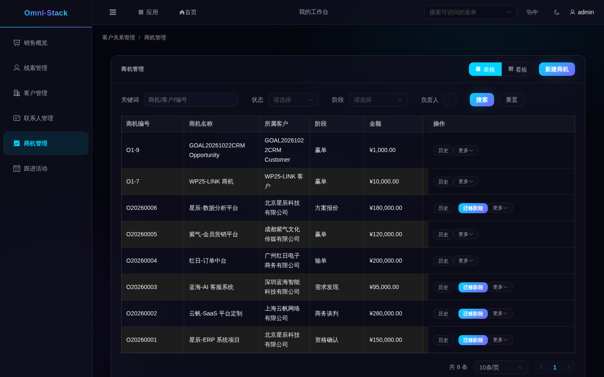

看到什么：右上角可在「表格」和「看板」之间切换；每行显示所属客户、阶段、金额、概率、预计成交和状态（开放、赢单、输单）。
失败怎么恢复：看板里找不到商机，先检查筛选、负责人和可见范围；页面缺少阶段信息时先刷新，不要把显示缺失当作可以随意补阶段的理由。

### 5.2 新建与编辑

点什么、填什么：点「新建商机」，选择客户、填写名称、金额（必填）、预计成交日期与初始阶段；金额使用普通十进制数字。
失败怎么恢复：提示金额或客户不合法时按表单提示补全；已赢单/输单的商机要修改关键信息，需先重新打开。

### 5.3 阶段迁移、赢单与输单

想完成什么：把商机从需求发现一步步推进，直到赢单或输单。
从哪里进：商机行「迁移阶段」。

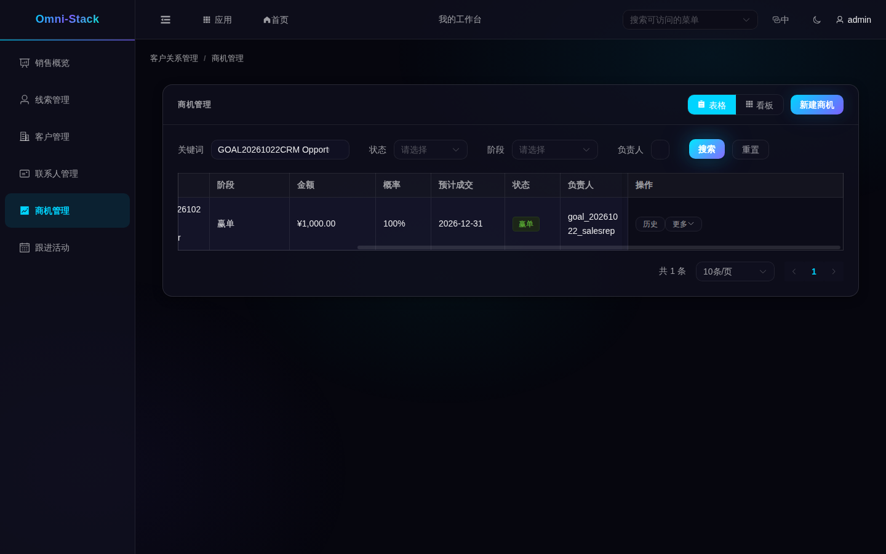

看到什么：阶段按「需求发现 → 资格确认 → 方案报价 → 商务谈判 → 赢单/输单」推进；前进可直接选择，回退需要填写原因；赢单后状态变为「赢单」，输单需要填写输单原因。
失败怎么恢复：阶段不要求逐个相邻推进，也可以从较早阶段直接选择赢单。被拒绝时，先确认商机仍开放、目标阶段属于同一销售管道且可用；回退补原因，输单补输单原因。选择当前已有的阶段不会产生新变化。已赢单或输单要继续推进，先「更多」→ 重新打开。

### 5.4 阶段历史与重开

商机行「历史」可以查看每一次阶段变化及原因；重新打开会把赢单或输单商机恢复到关闭前的开放阶段，便于继续跟进。原阶段停用时会被拒绝，应先确认管道配置；不要另建重复商机替代历史。

### 5.5 分配与删除

分配把商机和它的跟进交给范围内的其他同事；没有分配权限时不会显示该按钮。删除只针对建错的开放商机，也会删除它的跟进活动；有业务历史的商机应保留。已赢单或输单的商机不能直接删除。

## 六、跟进活动：把每次接触留痕

从哪里进：左侧「跟进活动」。

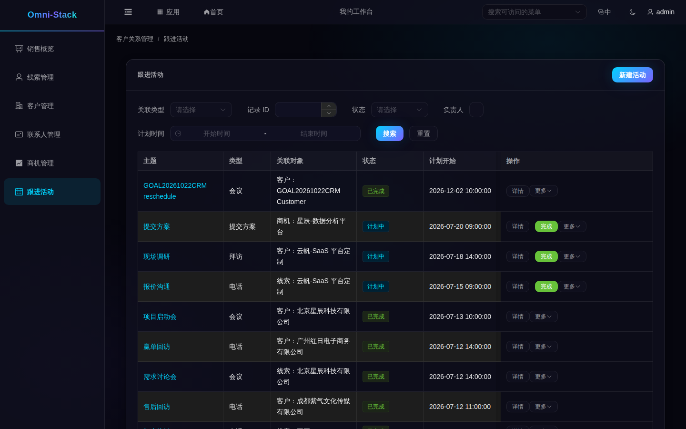

看到什么：活动可以关联线索、客户或商机；状态有计划中、已完成、已取消；列表显示计划开始与完成时间。
点什么、填什么：点「新建活动」，选择关联类型与对象，填写主题、类型（电话、拜访、会议等）和计划时间。
客户可以搜索选择；关联线索或商机时，当前页面要求填写记录的系统数字标识，不是带字母的业务编号。页面暂时没有统一的对象选择器，不知道标识时应先核对记录；给线索留痕可优先用线索行的「快速跟进」，不要猜数字。
新建时通常选「计划中」。补记已经完成的接触可以选「已完成」，同时填写实际完成时间；不能直接新建一条「已取消」活动。
查找活动时，可按关联类型、记录标识、状态、负责人和计划时间缩小范围，再查看主题。这个页面没有关键词搜索框，不能照搬线索页的搜索方法。
失败怎么恢复：关联对象必须存在且在数据范围内；选错对象时重新选择，不要建一条没有关联的活动。

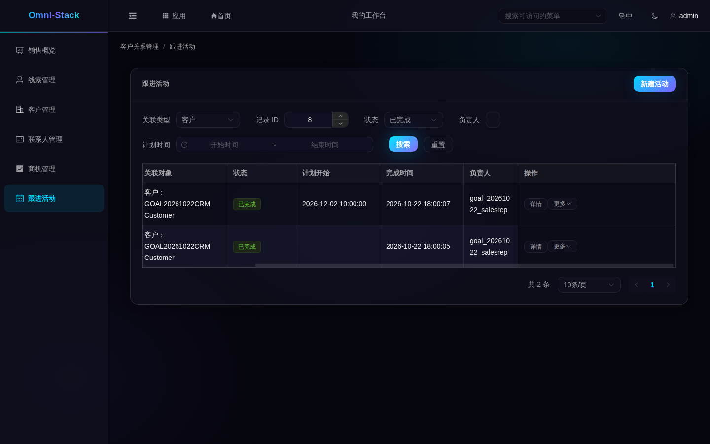

- **完成**：点行内「完成」，活动进入已完成，并回写客户/线索的最近跟进时间；线索若是「新线索」，完成后自动进入「跟进中」。
- **编辑**：仍在计划中的活动可修改主题、类型、内容和计划时间；保存后刷新确认。已完成的活动要保留当时记录，后续联系另建活动。
- **取消与改期**：取消后活动状态为已取消；已取消的活动可以改期，回到计划中。
- **删除**：只有不需要保留的未完成活动才删除。

## 七、一条完整故事

1. 在「线索管理」新建线索，填姓名与公司。
2. 给线索新建一条电话跟进并完成，线索变为「跟进中」。
3. 确认资格，线索变为「已合格」。
4. 转换成客户、联系人和商机；在客户 360 里能看到联系人和活动。
5. 到「商机管理」把商机逐阶段推进，最终赢单。
6. 赢单后在客户下新建一条回访活动并完成，客户 360 的最近活动里能看到它。

失败时的通用恢复：状态不允许的操作，说明前一步没完成；找不到数据，先查数据范围与筛选；不要通过重复创建或改状态来“绕过”流程。

## 八、常见失败与恢复

- **登录后没有 CRM 菜单**：确认角色是否包含 CRM 菜单；普通员工没有 CRM 权限是正常结果。
- **列表为空**：先清空筛选；确认真实没有数据，不要当成故障。示例：

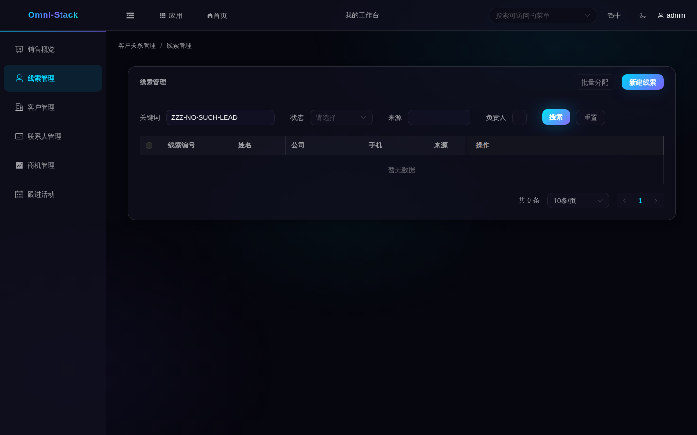

- **提示无权限**：换有权限的身份，或请管理员在角色里授予对应菜单。员工打开 CRM 会看到：

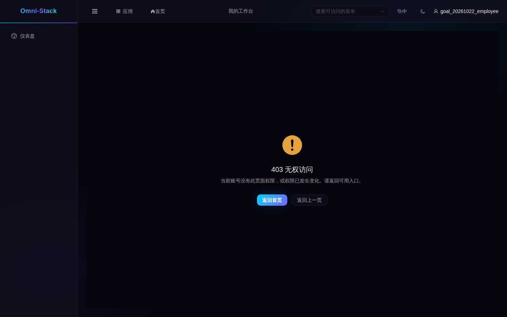

- **转换被拒**：先确认线索已合格、客户和联系人匹配、记录仍在自己的可见范围内；如果已转换，转到关联记录继续，不要重复建立。
- **商机不能推进**：先刷新检查商机是否已关闭、目标阶段是否可用，以及回退或输单原因是否已填写。不要把客户的黑名单标签误认为所有阶段操作的自动拦截规则。
- **改期失败**：只有「已取消」的活动可以改期回计划中。

## 九、示例与验证边界

- 已用本地专用测试账号完成销售代表、销售经理、只读员的独立范围检查，验证了越范围访问拒绝、只读写入拒绝及联系方式脱敏。销售代表也实际完成了跟进、资格确认、转换、赢单和活动取消后改期。这些结果不代表每个部署都已为每位用户配置相同角色。
- 数据来自共享开发库，示例中的编号与名称只是其中一份数据，不代表固定种子。
- 系统没有批量导入/导出、客户合并与商机删除恢复功能，本教程不提供这些操作。
