# Platform tutorials in pictures: site, workspace, system, jobs and approvals

This page is for colleagues who use Omni-Stack day to day. It covers what to click, what to expect and how to recover, without deployment or code. Screenshots come from the real local Docker environment: Home is the public Wiki, and business pages use dedicated test identities in the development tenant. Automated capture uses controlled test sign-in, without claiming a person entered the CAPTCHA. Contact cells in the user list and online session identifiers are masked; page content and business results are not rewritten. Button and page names follow the actual interface.

## Before you start

- **Identities you will use**: administrator (sees every platform menu), ordinary employee (can sign in but has no management menus; opening a management page directly is blocked), asset user (only sees “My Assets”), supplier (enters through the supplier portal and cannot see internal management pages).
- **Sign-in needs the real CAPTCHA**: after opening the sign-in page, type the characters shown in the image. A CAPTCHA is valid once; click the image to get a new one if it is unclear. This tutorial offers no way to skip verification.
- **The data is shared**: this environment was initialized by the full preset, so the users, records and assets you see may come from other people’s verification. The tutorial will not clear data or change role grants for the sake of a demo.
- **Two things are not verified under production conditions**: a real external social-provider account connection was not completed in this run; first install on an empty database was not measured here. External social sign-in and this project's own OAuth2 sign-in are separate checks, explained separately below.

## 1. The site and sign-in entries

### 1.1 Read the project Wiki without signing in

What you want to do: learn about the project and read tutorials, then find the sign-in and supplier entries.
Who can do it: everyone, no sign-in required.
Where to start: open `http://localhost:3000` in a browser.

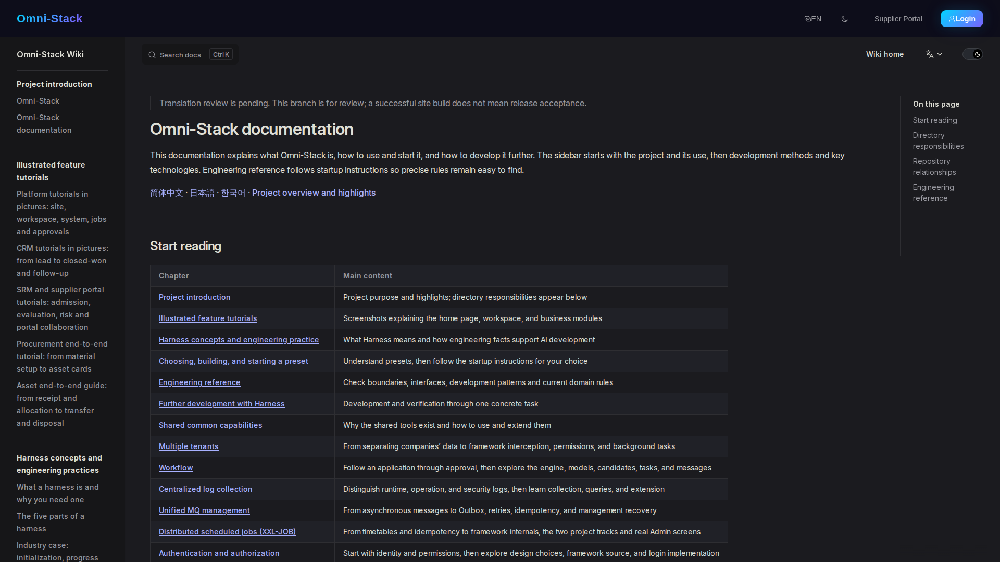

What you will see: Home displays the project Wiki. Open an article through the chapters on the left or the reading entries in the centre; use document search to find content and the outline on the right to reach a section. “Login” at the top right opens internal sign-in, while “Supplier Portal” opens supplier sign-in. Signed-in internal users still read the same Wiki here. If you have workspace access, “My Workspace” is the account area's only business entry; it opens a new browser tab and keeps the Wiki tab.
How to recover: if the document cannot load, use the page's retry button or open the Wiki separately. If the whole site is unreachable, confirm that the application is running and that the address and port match your environment, then reload. Avoid repeated sign-in submissions.

### 1.2 Signing in as an administrator

What you want to do: sign in, open My Workspace and find the available platform applications.
Who can do it: colleagues with an administrator account.
Where to start: “Login” on the home page, or open the sign-in page directly.

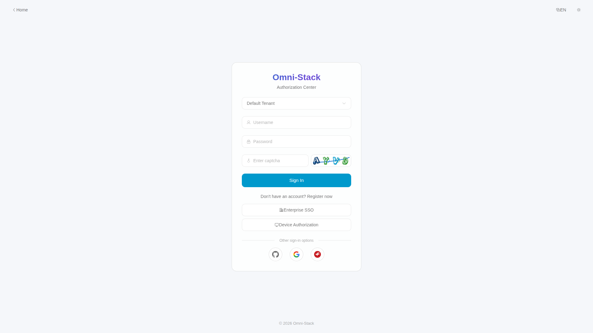

What to click and fill in: select the account's tenant, enter the account and password, type the current CAPTCHA characters (click the image to replace it), then submit.
What you will see: a normal sign-in from the home page returns to the Wiki home when no return page was specified. Your account appears at the top; select “My Workspace” to enter the business workspace. If you originally opened a protected page, sign-in returns you there. Your permissions determine the available applications and management menus.

How to open a business module next: choose a module in the workspace's “Application Catalog” or “Applications” drawer. The browser opens a new business tab and keeps the original workspace tab. The business page shows only its module menus and searches only that module; it has no global Applications button, other-module candidates, or home/workspace return button. To return to your workspace, switch to the original workspace tab or close the business tab you just opened.

How to recover: if the CAPTCHA is rejected, fetch a new image and retype it — the old CAPTCHA is invalid immediately. If the password is rejected, check case and input method instead of retrying repeatedly. If the account is disabled, ask an administrator to confirm its status.

### 1.3 Self-service registration

What you want to do: let a new colleague create an account, then have an administrator assign roles.
Who can do it: new colleagues in a tenant that permits self-registration. Internal account registration does not require a supplier invitation token.
Where to start: the “Register” entry below the sign-in form.

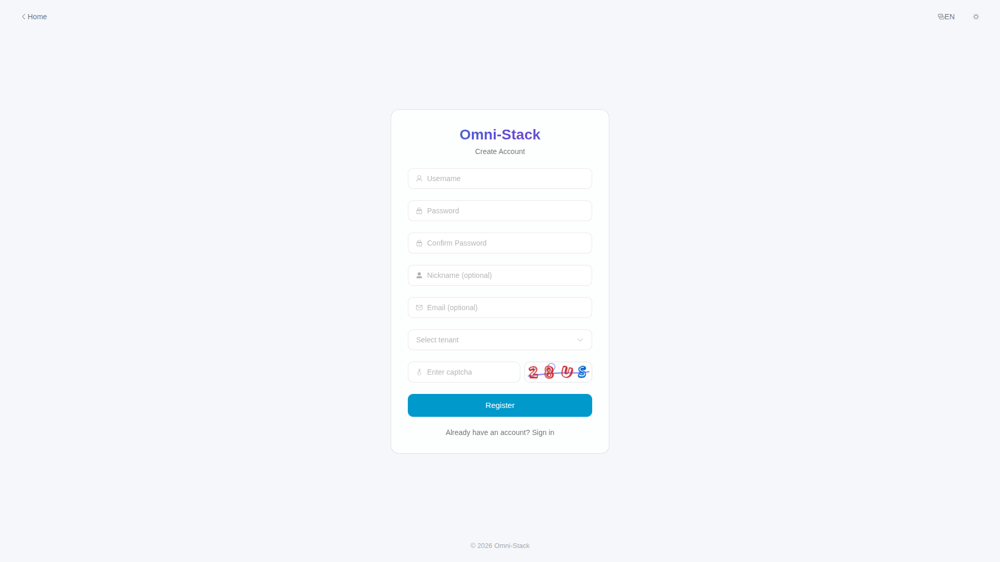

What to click and fill in: enter the account and password twice, optionally add nickname/email, select the correct tenant, then enter the CAPTCHA and submit. This screenshot does not submit the form or prove an account was created.
What you will see: the account can sign in, but it only has the base identity and sees no business menus; an administrator must add roles and the organization later in user management.
How to recover: if the account already exists, pick another name; if the CAPTCHA is rejected, fetch a new image; if registrations are rate-limited, try again later instead of scripting bulk registrations.

### 1.4 Suppliers signing in and registering through the portal

What you want to do: let a supplier work only in the portal — profile, evaluation and quotation — without touching internal management pages.
Who can do it: supplier contacts. Create an account first if needed; company enrollment separately requires a valid invitation and does not happen automatically during account registration.
Where to start: “Supplier Entry” on the home page, or open the portal sign-in page directly.

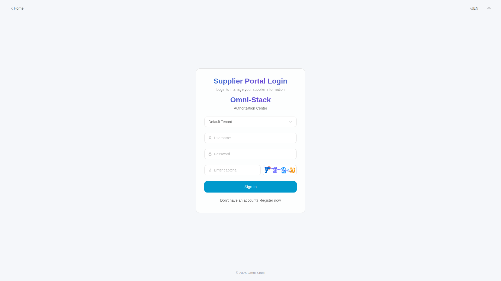

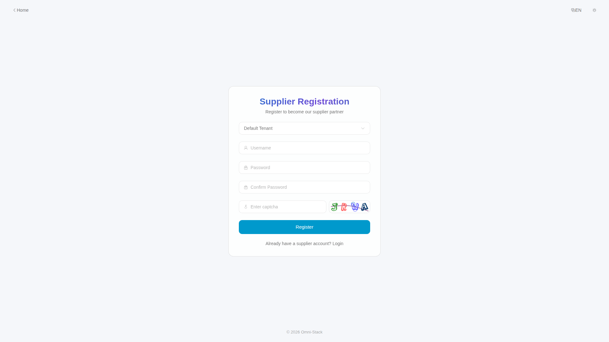

What to do: this form creates only an authentication account. Sign in through the portal and use the invitation token to apply for company enrollment. Approved enrollment, the supplier role and an active account association are needed for the authorized profile, evaluation and quotation functions.
What you will see: an enrolled supplier enters its own portal without internal management menus. Typing an internal address does not grant access. These two images show unsubmitted entry forms, not successful enrollment or approval.
How to recover: check the sign-in tenant, invitation expiry, enrollment review and account association with your procurement contact. Do not register the same company repeatedly.

### 1.5 Device authorization

What you want to do: sign in on a device that has no browser.
Who can do it: colleagues who need to sign in.
Where to start: the “Device Authorization” entry on the sign-in page.

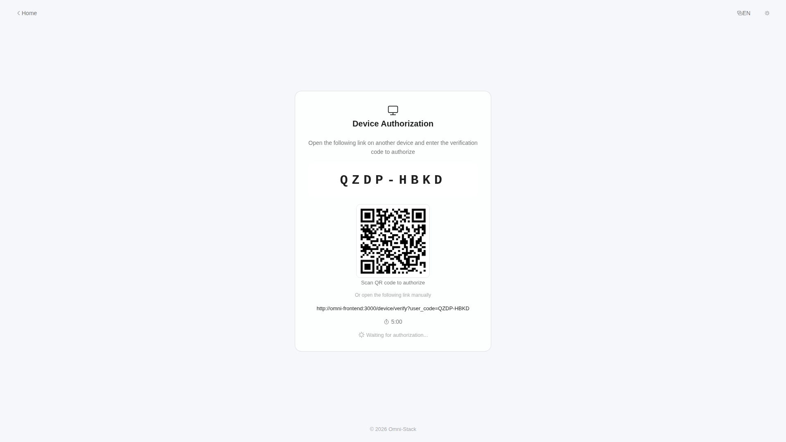

What to do and expect: open the current verification address on another device where you can sign in, or scan the current QR code. Check the request before confirming, then wait on the original device. This image shows waiting, not completed authorization. Its address belongs to the Docker network; use your deployment's reachable address, and never copy the expired code, QR code or example URL.
How to recover: if the code expires, start again; never confirm a request you do not recognize on an unfamiliar device.

### 1.6 Authorization consent

What you want to do: confirm that a third-party application may access certain information on your behalf.
Who can do it: colleagues signing in through a third-party application.
Where to start: the sign-in flow redirects here automatically.

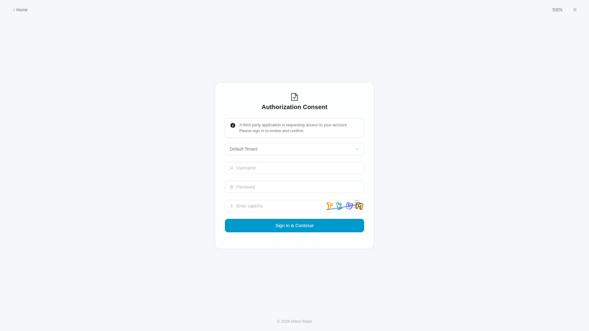

What to do and expect: sign in through a flow initiated by a legitimate application, then review the application and requested scopes before deciding whether to consent. The screenshot shows only the pre-login entry, without a scope list or successful grant. Displaying this form does not mean the application has received permission.
How to recover: if the request is reported as invalid, start the sign-in again from the original application; do not assemble the address by hand and retry.

### 1.7 Social sign-in callback (real external account connection not verified here)

What you want to do: sign in with an external platform account.
Current state: a real external-provider account connection was not completed here. Opening a callback without a legitimate authorization context only shows a login or rejection state; it proves neither success nor failure of the complete social flow. After configuring the provider, start authorization through the normal entry. This project's own OAuth2 sign-in and a real external social-provider connection are separate flows.

### 1.8 No permission, and pages that do not exist

What you want to do: understand what happened when you were blocked, and who to ask.
Who can do it: any identity can run into this.
Where to start: an ordinary employee opening a management page, or anyone typing an address that does not exist.

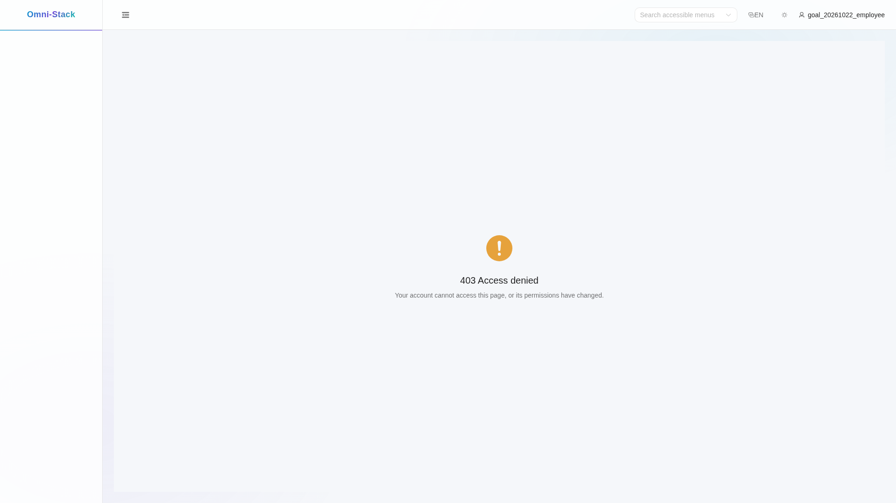

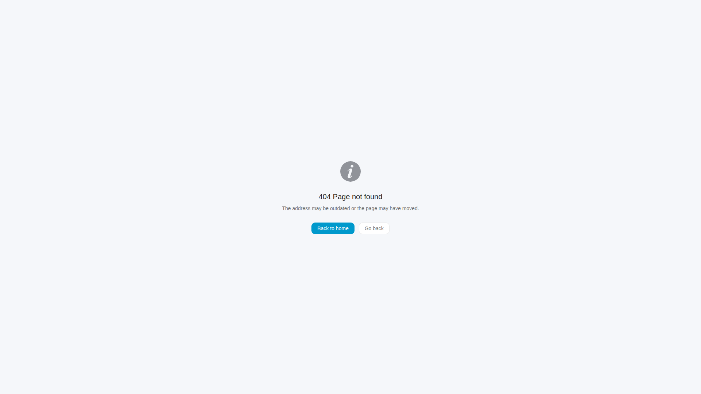

What you will see: private permission denial hides the target content and provides no Home, Back or Workspace buttons. Switch to the original Workspace tab or close the business tab. A wrong public anonymous address uses a separate 404 with Home/Back recovery; these are different contexts.
How to recover: check whether you are using the wrong identity (for example an employee account opening a management page). If you genuinely need access, ask an administrator to grant the menu to your role — do not share an administrator account.

### 1.9 Recovering from a menu load failure

What you want to do: recover the workspace when menu loading fails.
What you will see: the workspace reports that the feature menu failed to load and offers a retry; the application directory is empty.
How to recover: click “Reload” on the page. The directory returns after loading succeeds. If retries keep failing, ask an administrator to check service status instead of refreshing the browser repeatedly and creating duplicate requests.

## 2. The unified Workspace cockpit

My Workspace on Home opens a new browser tab and keeps the Wiki tab. Workspace has no Home/Wiki navigation button; switch back to the original tab to read documents. Overview, approvals and My Jobs share one page.

### 2.1 Account, summaries and applications

Purpose: inspect your account, actual statistics, todos and available applications.
Who: signed-in identities eligible for Workspace; applications and approvals still follow permissions and the selected preset.

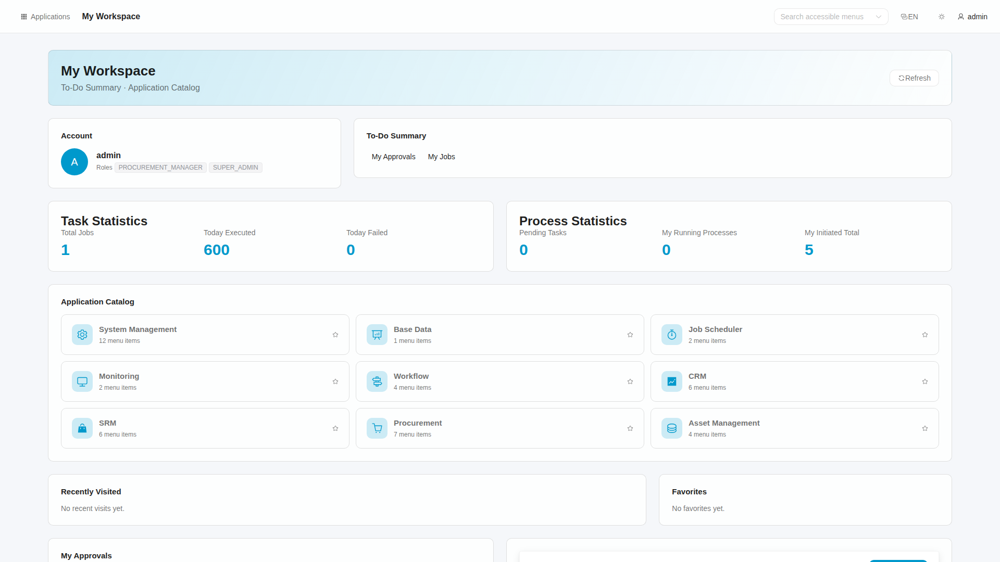

You see account and roles, job/approval summaries, applications, recent visits and favorites. A full-preset administrator has nine applications; other identities see only their authorized, deployed entries. Workspace Applications and header search cover every accessible menu, without exposing unauthorized features.
Open a business module from the catalog, drawer or search in a new tab, retaining Workspace. Business sidebars and search focus on that module and provide no global application switch. Return by switching to the original tab.
Recovery: an empty catalog can be correct for an identity without business permissions. Retry loading/statistics errors rather than treating them as zero. A preset without workflow omits its approval panel normally.

### 2.2 Handle approvals on the same page

Purpose: handle approvals assigned to you.
Entry: the approval summary or the My Approvals panel further down.

The panel has waiting-for-me, initiated-by-me and completed-by-me tabs. Its list is empty in this capture. Open a real task when one exists; the other cockpit areas remain on the same page. Private Workspace and business error pages provide no Home/Back recovery buttons.
Recovery: confirm a process was started and includes you as a candidate. Do not edit task data to manufacture a todo. Server authorization still applies; a visible menu does not prove every operation is allowed.

### 2.3 Manage My Jobs on the same page

Purpose: create, edit, pause/resume, run manually, read logs and delete your own scheduled jobs.
Entry: the job summary or My Jobs further down.

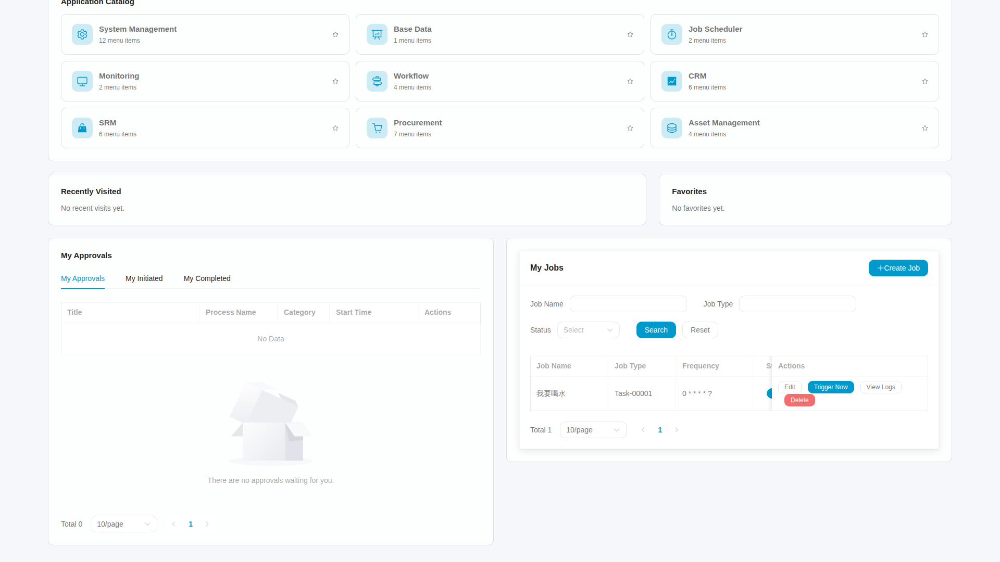

Filter your records and use the actual create/edit form for parameters. The list includes schedule, state and execution information. When panels sit side by side, scroll the table horizontally for columns outside the viewport rather than assuming their state.
Recovery: pausing stops future schedules but still permits a manual run. After an accepted trigger, check a new execution log. Preserve associations after unknown registration/deletion outcomes; do not create duplicates or hide records in the database. See [distributed job operations](distributed-jobs-usage.en.md).

## 3. System management

### 3.1 User management

What you want to do: create colleague accounts, assign roles and disable accounts of people who have left.
Who can do it: administrators.

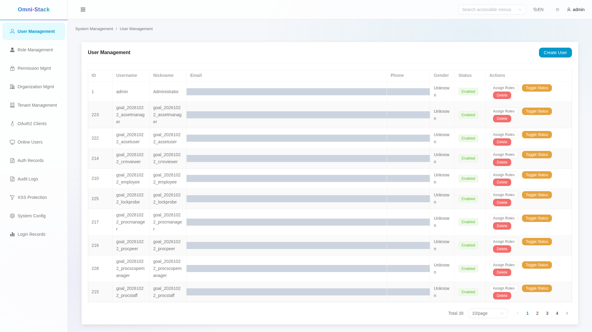

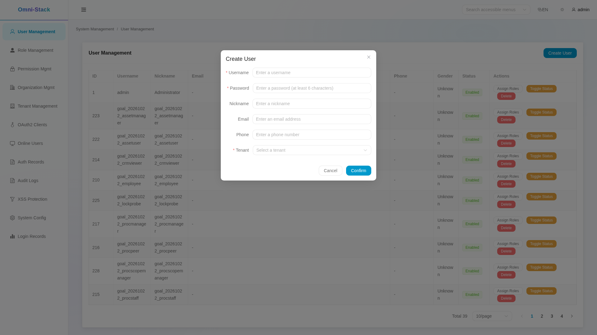

What to click and fill in: click “Create User” at the top right, fill in the account, password and basic information, choose the tenant and confirm. A duplicate account is refused and an empty password cannot be submitted.
What you will see: after an actual successful creation, the user appears with the base identity and needs the required roles assigned. The blank form in this image has not created a user.
How to recover: if the user name already exists, choose another; if the password is required, fill it in. After assigning roles, ask the colleague to sign in again — an existing session does not gain new permissions automatically.

### 3.2 Role management

What you want to do: define the menus and action scope for a class of positions.
Who can do it: administrators.

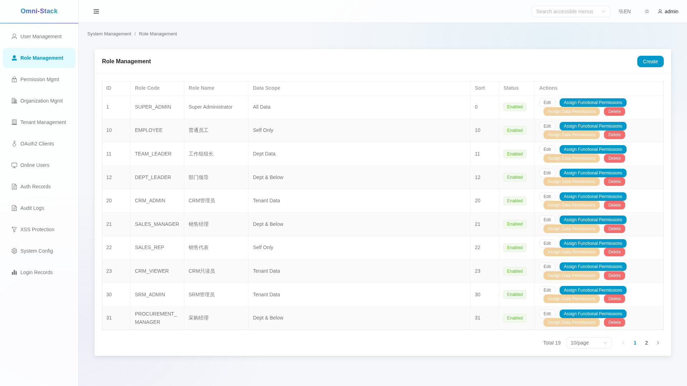

What to do and expect: the list shows data scope such as all data, department or self. Edit maintains basic information and selects the scope. Use the separate “Assign Functional Permissions” for menus/actions; “Assign Data Permissions” selects organizations only when the scope is Custom. Role names are shared business data and do not translate when the interface language changes.
How to recover: if a colleague cannot see menus after authorization, ask them to sign in again first. Do not “fix” an individual account by editing shared grant data; check the role and organization first.

### 3.3 Organization management

What you want to do: maintain the department tree and keep people attached to the right department.
Who can do it: administrators.

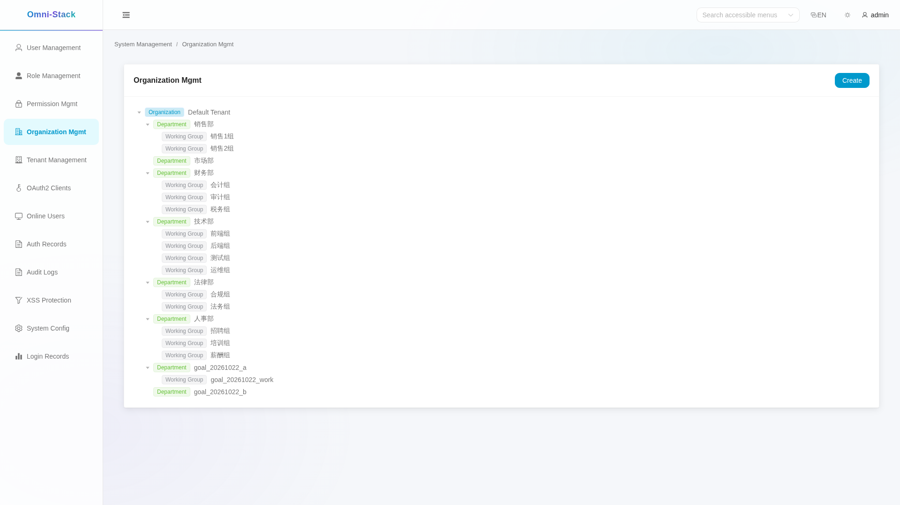

What you will see: organizations, departments and workgroups have parent/child relationships. Creating a department does not assign people automatically; membership is maintained separately. Department-based data scope combines membership with this tree. The root named Default Tenant is an organization, not a tenant-switching control.
How to recover: check people and business-data ownership before moving or deleting an organization. Verify the effect in a test organization rather than deleting one still in use.

### 3.4 Tenant management

What you want to do: view and manage tenant information.
Who can do it: administrators (some tenant operations are reserved for super administrators).

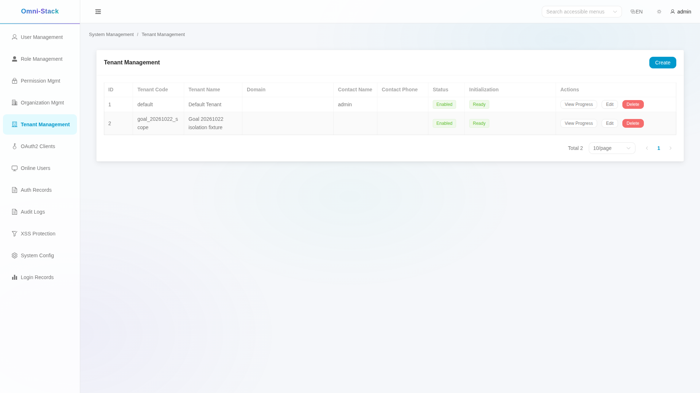

What you will see: tenant and initialization status are listed here; selecting a row does not switch your current identity. To use another tenant, sign in again with a legitimate account for that tenant. Each tenant's users and business data remain subject to its authorization boundary.
How to recover: if expected data is missing, confirm the current tenant first instead of assuming data loss.

### 3.5 OAuth2 clients

What you want to do: manage third-party applications allowed to connect.
Who can do it: administrators.

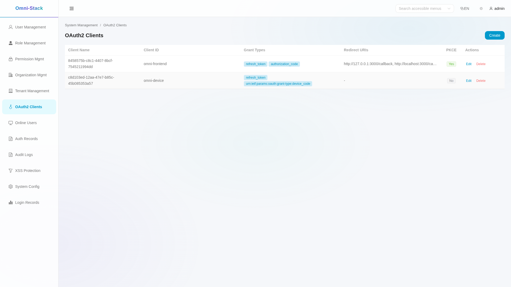

What you will see: application name, client identifier, grant types, redirect URI and the PKCE requirement. This page has no client-disable control or status column. It manages applications connecting to this project's authorization server, rather than configuration for GitHub, Google or other social providers.
How to recover: check the client identifier, allowed grant, exact redirect URI and PKCE requirement. A real social-provider connection also needs that provider's legitimate configuration; see 1.7.

### 3.6 Audit log, login records and authorization records

What you want to do: trace who did which security-related action and when.
Who can do it: administrators.

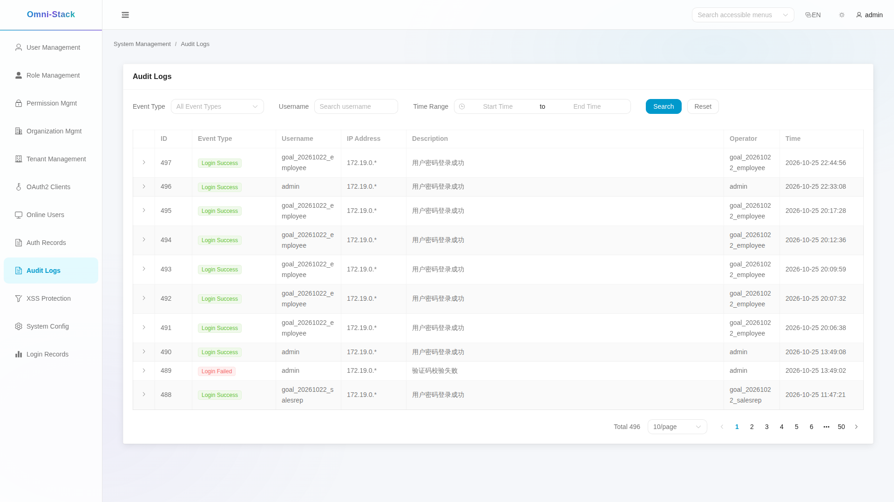

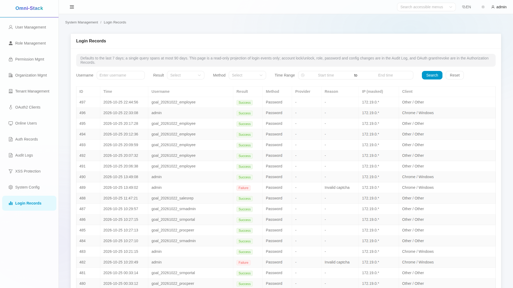

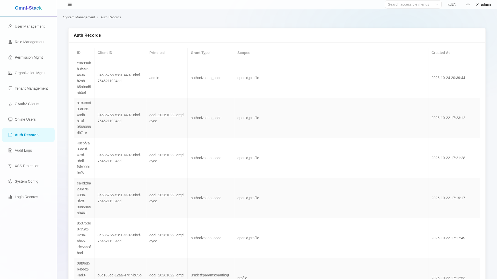

What you will see: the audit log lists sign-in success/failure and role assignment/revocation in reverse time order. Login records are a read-only projection, defaulting to seven days with a ninety-day maximum per query. Authorization records show client, authorized user, grant type and scopes; a record ID is not an access token. None can be edited here. The page redacts source addresses, and dedicated test sign-ins also leave real audit records.
How to recover: use the time range and event filters allowed by the page. Do not alter the database or manually back-fill audit records.

### 3.7 Online users

What you want to do: view current sessions and, when necessary, take an abnormal session offline.
Who can do it: administrators.

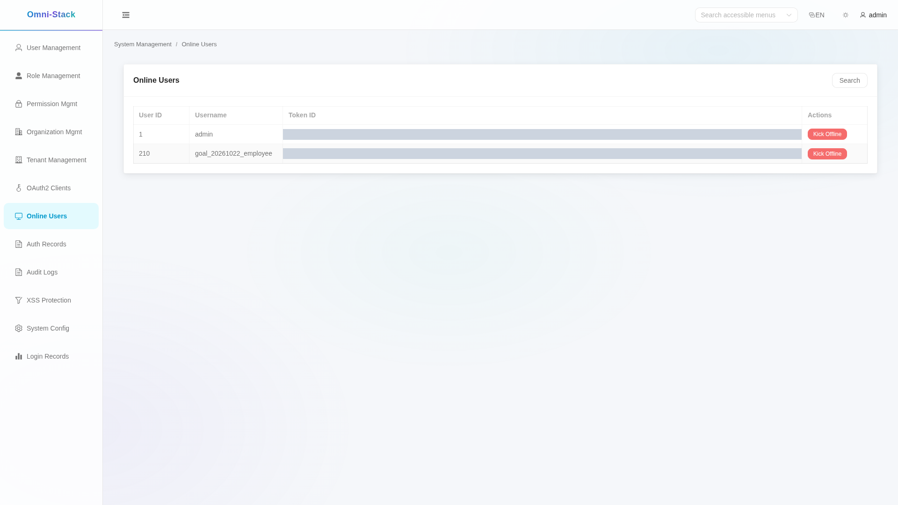

What you will see: user ID, username and session Token ID, without a sign-in-time column. Session identifiers are masked in this image. Force-offline requires the user to sign in again; this capture did not perform that action.
How to recover: the action only affects the session, not the account; after a mistake, ask the person to sign in again.

### 3.8 System configuration and XSS protection

What you want to do: adjust this tenant’s login-failure protection policy and maintain cross-site scripting protection rules.
Who can do it: administrators.

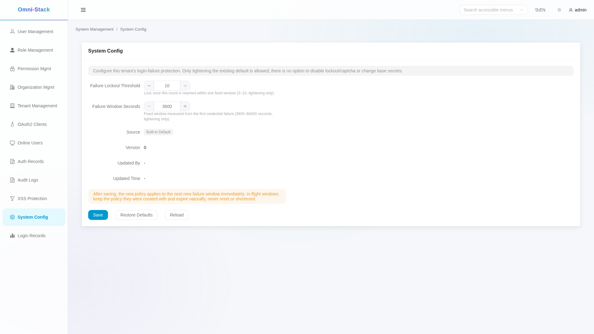

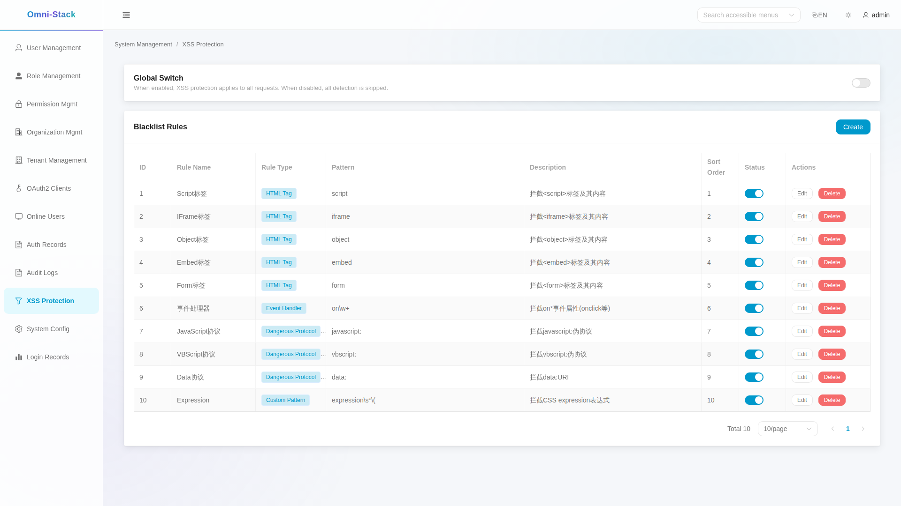

What you will see: the lockout threshold and counting window can only be tightened within the form's limits. Newly created failure windows use the saved policy; existing windows retain their creation-time policy and expire naturally without resetting. The XSS page manages filtering rules and its switch. The actual screenshot has the global switch off while rules remain enabled; this is not a recommended configuration, and capture changed neither.
How to recover: note the original value before changing it and restore it if something looks wrong; do not adjust it during peak hours when the impact is unclear.

## 4. Dictionary management

What you want to do: maintain business drop-down options (for example asset category and location).
Who can do it: administrators.

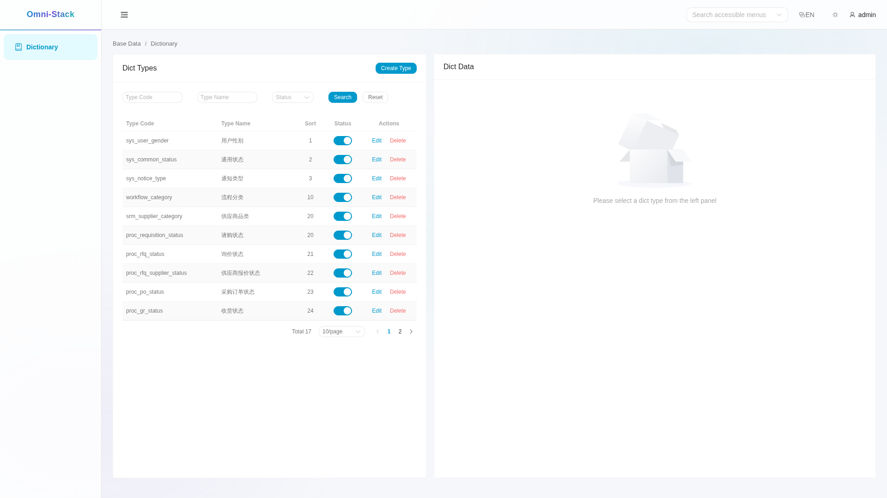

What to do and expect: select a dictionary type on the left before maintaining its items on the right. No type is selected in this image, so the selection prompt is normal. Types define categories and items define options; type codes must be unique and required fields cannot be empty.
How to recover: if a new option does not appear on the business page, first confirm whether the dictionary cache has been refreshed; refresh the business page after editing data items.

## 5. Operations

### 5.1 Operation logs

What you want to do: see who performed the operations covered by the application's recording rules.
Who can do it: administrators.

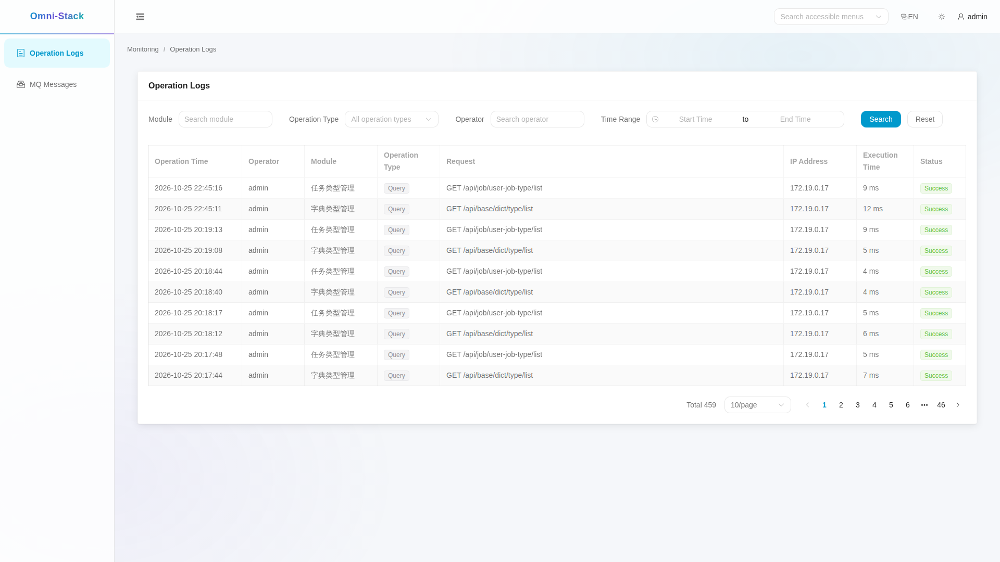

What you will see: recorded queries, creates, updates and deletes by module; the image contains real query records. Not every query is automatically recorded. Authentication behaviour belongs to security audit/login records. Reading an endpoint with operation logging may itself produce a log and an asynchronous collection message.
How to recover: if a record is missing, first confirm the action actually succeeded, then check the time and module filters.

### 5.2 Message records

What you want to do: inspect asynchronous message delivery and handle messages that reached the dead-letter state.
Who can do it: administrators.

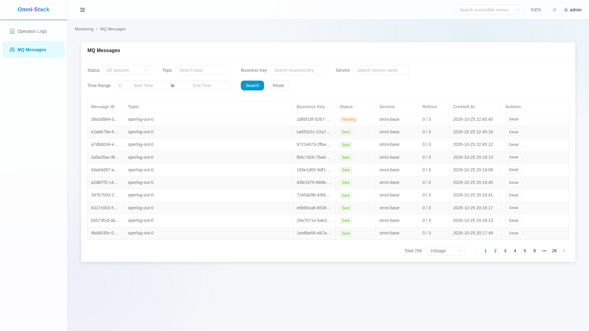

What you will see: pending, sent, failed, dead-letter and skipped states. Authorized users can resend or skip dead letters. Pending has not reached the broker; Sent means the sender successfully handed it to the broker, without proving that the receiving business operation completed.
How to recover: when a message stays pending, first confirm the scheduler and message service are healthy; before resending, confirm whether the business side effect already happened so you do not process it twice.

## 6. Jobs

### 6.1 Personal job types

What you want to do: define the job types colleagues can create.
Who can do it: administrators.

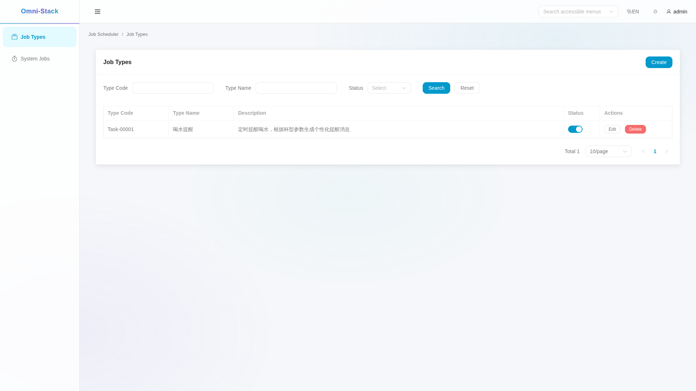

What you will see: a type determines the template available for personal jobs, and creation requires a type code and name. Chinese type names in the image are shared business data. Registering a type does not deploy its execution logic; a matching application handler is also needed.
How to recover: if the type does not appear on the personal job page after defining it, confirm it is enabled; do not overwrite an existing type with a duplicate code.

### 6.2 System jobs

What you want to do: view built-in system jobs and their scheduling status.
Who can do it: administrators.

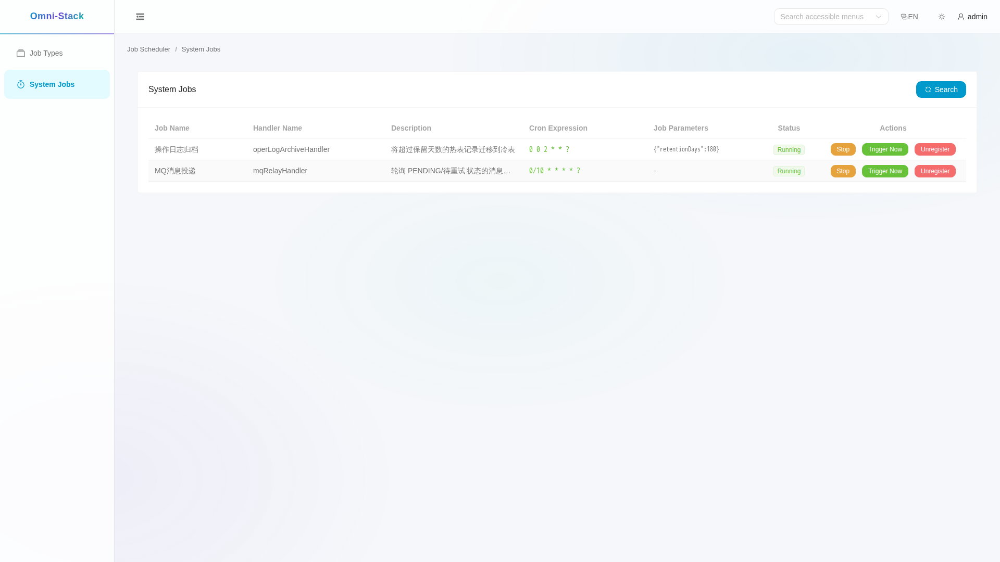

What you will see: system jobs registered by the current Base service, with handler, schedule, parameters and state. The two rows in this image are not the platform's entire job inventory. Stop, Trigger Now and Unregister are real operations; this capture only viewed the page. For the cross-service picture, see [distributed job administration](distributed-jobs-admin.en.md).
How to recover: if execution fails, check the scheduler and job logs first; do not manually edit job state to “make the demo succeed”.

## 7. Approvals

### 7.1 Process definitions

What you want to do: view published approval processes; to create or change one, design and publish it on the “Process Models” page first.
Who can do it: administrators or process maintainers.

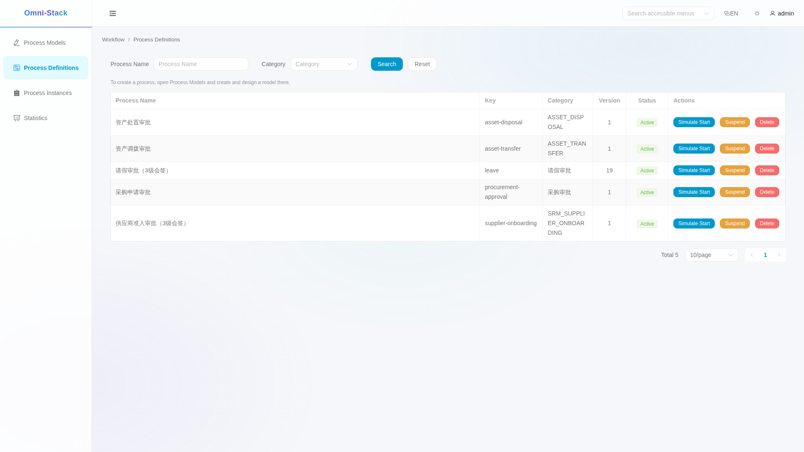

What you will see: the list shows process name, key, category, version and run state, and a published process can be simulated, suspended or deleted. A process that fails validation cannot be published. Each model has a unique key within its tenant; publishing again reuses that key and creates a new version, rather than requiring a new key each time.
How to recover: when publishing on the “Process Models” page fails, check that the diagram has start and end nodes and that approvers are configured; do not overwrite a published version that is in use.

### 7.2 Process instances

What you want to do: see where a process is and who is handling it.
Who can do it: administrators.

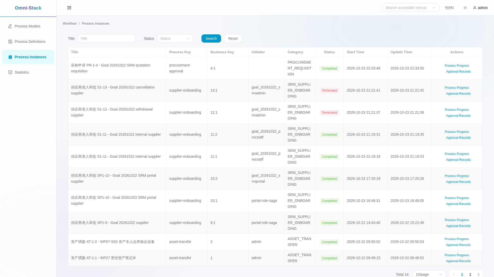

What you will see: real historical instances, including completed and terminated records, with title, process key, business key, initiator, category, state and times. Open flow progress or approval records to inspect the history. This capture did not start, approve or terminate a process.
How to recover: if an instance stays on the same step for a long time, first confirm the candidates received their todos, then contact the process maintainer; do not edit process data directly.

## 8. Common problems and recovery

- **No menus after signing in**: confirm your identity and roles; an ordinary employee having no business menus is the correct result. Sign in again after role changes.
- **A page opens but the list is empty**: confirm the tenant, the data scope and the business prerequisites (for example, no requests yet); do not treat empty data as a fault.
- **Permission denied**: use an identity that has access, or ask an administrator to grant the menu to your role; do not share an administrator account.
- **Menu load failure**: click “Reload”; if it keeps failing, ask an administrator to check service status.
- **Messages stay pending**: confirm the scheduler and message service, then look at retry counts; do not treat “a row exists” as “delivered”.
- **Cannot enter the portal after registration**: confirm the invitation was sent and admission review is complete.

## 9. Unverified and boundaries

- A real external social-provider account connection was not completed in this run. Section 1.7 explains that boundary without treating it as a failure of this project's own OAuth2 sign-in.
- First install on an empty database was not measured here; historical data and menu residue on the shared database do not represent empty-database behaviour.
- Users, roles and historical records belong to the shared test environment. The restricted management visit uses a dedicated ordinary employee; other platform-management images use a controlled administrator test identity. This does not grant management access to every ordinary account.
- Form screenshots are unsubmitted; the device waiting page and authorization sign-in page do not complete a grant. The displayed CAPTCHA, short-lived user code and QR code cannot be reused. An image proves only the state shown, not a complete business transaction.
