# プラットフォーム機能の図解チュートリアル：サイト、ワークスペース、システム、タスク、承認

このページは Omni-Stack を日常的に使う同僚向けです。画面の操作、表示される結果、困ったときの復旧方法を説明し、配備やコードには触れません。画像はローカル Docker の実環境から取得しています。ホームは公開 Wiki、業務画面は開発テナントの専用テストユーザーです。自動取得には制御されたテスト用ログインを使い、人が CAPTCHA を入力したとは主張しません。ユーザー一覧の連絡先とオンラインのセッション識別子はマスクし、画面内容や業務結果は書き換えていません。ボタン名は実画面に従います。

## 読む前の前提

- **使う身元**：管理者（すべてのプラットフォームメニューが見える）、一般社員（ログインはできるが管理メニューはなく、管理ページを直接開くと拒否される）、資産利用者（「自分の資産」だけが見える）、サプライヤー（サプライヤーポータルから入り、内部管理ページは見えない）。
- **ログインには実際の CAPTCHA が必要**：ログイン画面に表示された画像の文字を入力します。CAPTCHA は 1 回だけ有効で、読みにくいときは画像をクリックして更新します。検証を飛ばす方法は本チュートリアルにはありません。
- **データは共有**：この環境は全量プリセットで初期化されているため、表示されるユーザー・履歴・資産は他の人の検証に由来する場合があります。デモのためにデータを消したり、ロール付与を変えたりしません。
- **本番条件で未検証の 2 点**：今回は外部ソーシャルサービスの実アカウント接続を完了していません。空データベースへの初回インストールもここでは実測していません。外部接続と本プロジェクト自身の OAuth2 ログインは別の検証として説明します。

## 1. サイトとログイン入口

### 1.1 ログインせずにプロジェクトの Wiki を読む

やりたいこと：プロジェクトと操作方法を知り、ログインやサプライヤー入口を見つける。
できる人：全員。ログイン不要。
入口：ブラウザで `http://localhost:3000` を開く。

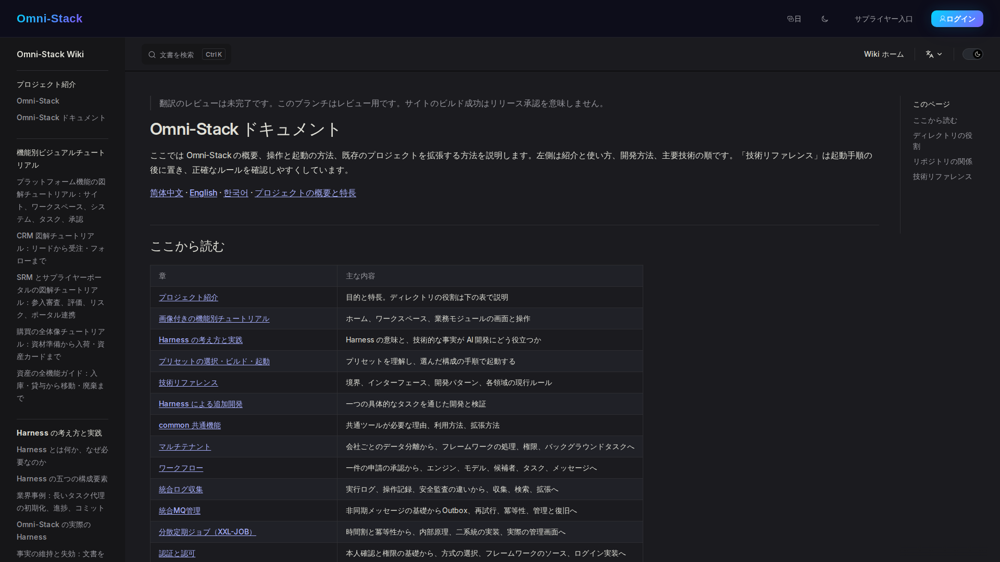

表示されるもの：ホームにはプロジェクトの Wiki が表示されます。左の章または中央の入口から本文を開き、文書検索で内容を探し、右の目次で小節へ移動できます。右上の「ログイン」は内部アカウント用、「サプライヤー入口」はポータル用です。ログイン済みの内部ユーザーも同じ Wiki を読めます。アクセス権がある場合、アカウント領域の業務入口は「マイワークスペース」のみで、新しいブラウザタブで開き、元の Wiki は残ります。
失敗時の回復：文書を読み込めないときは画面の再試行ボタンを使うか、Wiki を別画面で開きます。サイト全体へアクセスできない場合は、アプリが起動しているか、アドレスとポートが環境と一致するかを確認してから再読み込みします。ログイン送信を繰り返さないでください。

### 1.2 管理者としてログインする

やりたいこと：ログインしてマイワークスペースを開き、利用できるアプリを探す。
できる人：管理者アカウントを持つ同僚。
入口：ホームの「ログイン」、またはログインページを直接開く。

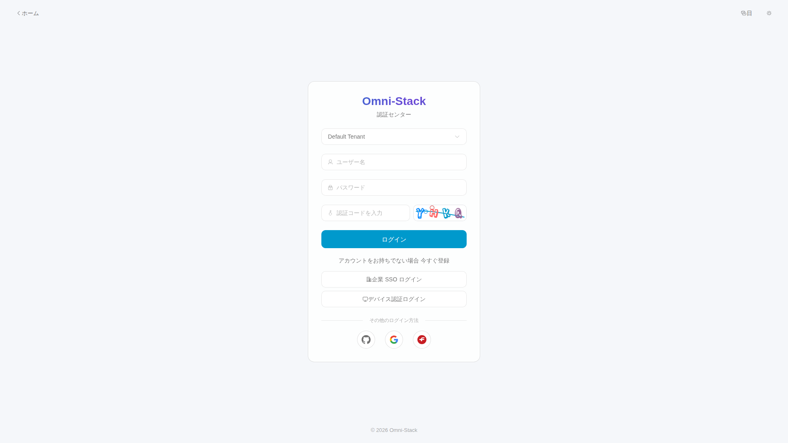

入力するもの：アカウントの所属テナントを選び、アカウントとパスワード、現在の CAPTCHA 画像の文字を入力して送信します。画像をクリックすると更新できます。
表示されるもの：ホームから通常ログインし、戻り先が指定されていなければ Wiki ホームへ戻り、上部にアカウントが表示されます。「マイワークスペース」を選ぶと業務用の画面へ進めます。最初にログインが必要なページを開いていた場合は、ログイン後にそのページへ戻ります。使えるアプリや管理メニューはアカウントの権限で決まります。

次に業務モジュールを開くには：ワークスペースの「アプリケーション一覧」または「アプリ」のパネルでモジュールを選びます。新しいブラウザタブで業務画面が開き、元のワークスペースのタブは残ります。業務画面は現在のモジュールのメニューと検索だけを提供し、全体アプリボタン、他モジュール候補、ホームやワークスペースへ戻るボタンはありません。ワークスペースへ戻るときは元のタブに切り替えるか、開いた業務タブを閉じてください。

失敗時の回復：CAPTCHA エラーは画像を更新して入力し直します（古い CAPTCHA は即時に無効）。パスワード エラーは大文字小文字と入力方法を確認し、連続で試さないでください。アカウントが停止されている場合は管理者に状態を確認してもらいます。

### 1.3 セルフサービス登録

やりたいこと：新しい同僚にアカウントを作ってもらい、後で管理者がロールを割り当てる。
できる人：セルフ登録を許可したテナントの新しい同僚。内部アカウントの登録にはサプライヤーの招待トークンは不要です。
入口：ログイン画面下の「登録」入口。

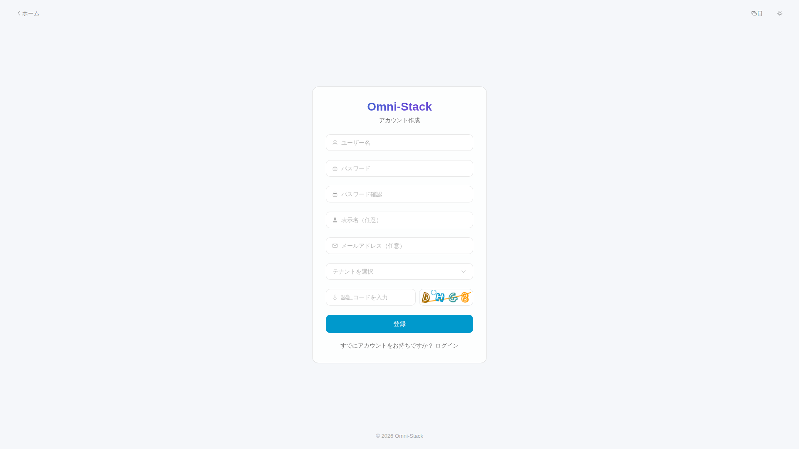

入力するもの：アカウントとパスワードの確認を入力し、必要なら表示名とメールも入れます。正しいテナントを選び、CAPTCHA を入力して送信します。画像は未送信で、アカウント作成済みの証拠ではありません。
表示されるもの：登録後は基本ロールだけでログインでき、業務メニューは表示されません。必要なロールと組織は管理者がユーザー管理で割り当てます。
失敗時の回復：アカウント重複の場合は別名にします。CAPTCHA エラーは画像を更新します。登録が制限される場合は時間をおいて再試行し、スクリプトで一括登録しないでください。

### 1.4 サプライヤーのポータルログインと登録

やりたいこと：サプライヤーがポータルだけで資料・評価・見積を扱い、内部管理ページに触れないようにする。
できる人：サプライヤーの担当者。アカウントがなければ先に登録します。企業の利用申請には別途有効な招待が必要で、アカウント登録だけでは完了しません。
入口：ホームの「サプライヤー入口」、またはポータルのログインページ。

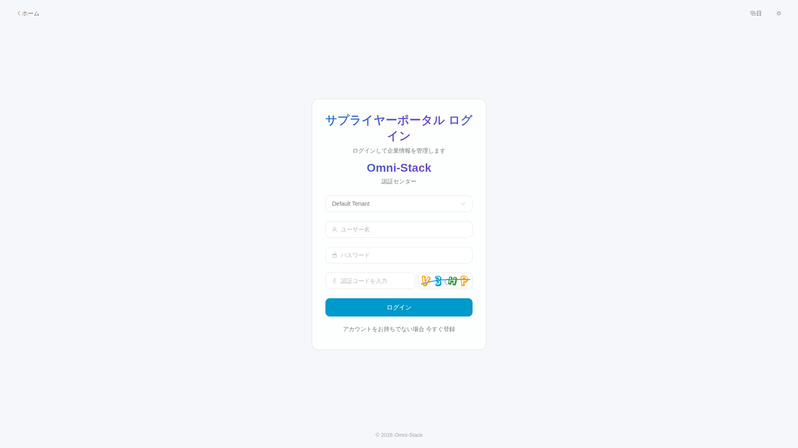

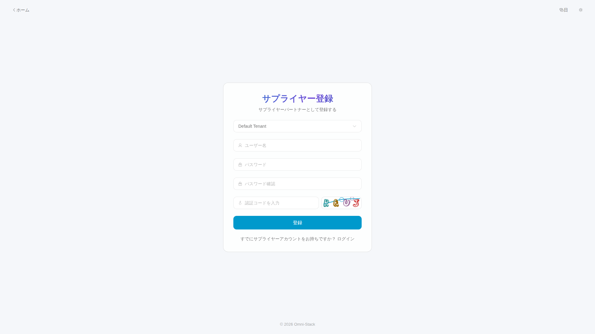

操作：このフォームでは認証アカウントだけを作成します。ポータルへログインし、招待トークンで企業の利用申請を行います。審査完了、サプライヤーロール、有効なアカウント関連付けがそろうと、許可された企業情報・評価・見積の機能を利用できます。
表示されるもの：登録済みのサプライヤーは自社のポータルに入り、内部管理メニューは表示されません。内部アドレスを入力しても権限は増えません。この二枚は未送信の入口フォームで、申請や承認の成功を示すものではありません。
失敗時の回復：ログイン先のテナント、招待の期限、申請審査、アカウント関連付けを購買担当に確認してもらいます。同じ企業を何度も登録しないでください。

### 1.5 デバイス認可

やりたいこと：ブラウザのない機器でログインを完了する。
できる人：ログインが必要な同僚。
入口：ログイン画面の「デバイス認証ログイン」入口。

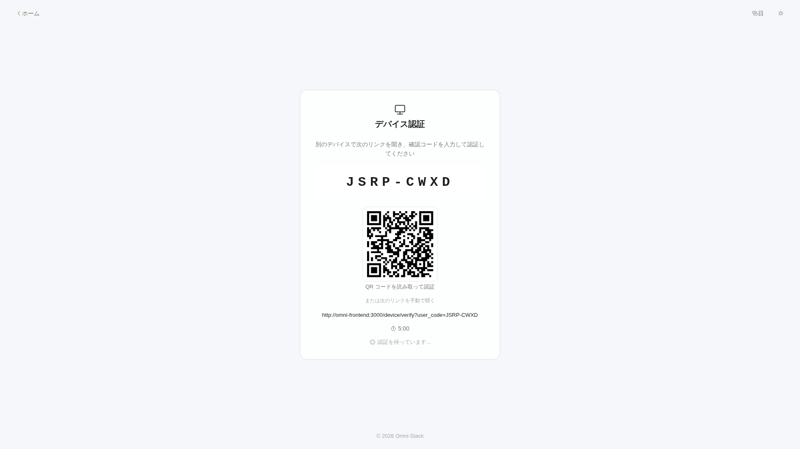

操作と結果：ログインできる別の機器で、現在の検証アドレスを開くか QR コードを読み取ります。要求を確かめて確認し、元の機器で結果を待ちます。画像は待機中で、認可の完了ではありません。取得時のアドレスは Docker 内部用です。実際は自分の配備先にアクセスできるアドレスを使い、図のアドレスや期限切れコード・QR コードを転用しません。
失敗時の回復：コードが期限切れなら最初からやり直します。見覚えのない機器の要求は承認しないでください。

### 1.6 認可の確認

やりたいこと：サードパーティアプリが自分の代わりにアクセスしてよい情報を確認する。
できる人：サードパーティアプリ経由でログインする同僚。
入口：ログインの流れで自動的に遷移します。

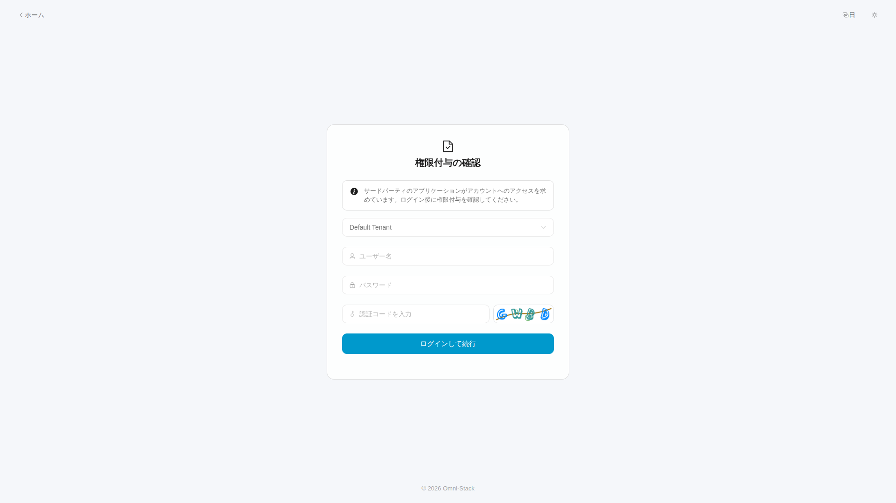

操作と結果：正規のアプリから開始した流れでログインし、アプリ名と要求範囲を確認して同意を判断します。この画像はログイン前の入口だけで、権限一覧や認可成功を表示していません。フォームが表示されただけでアプリが権限を得たとは考えないでください。
失敗時の回復：要求が無効と表示されたら、元のアプリからログインをやり直します。アドレスを手で組み立てて再試行しないでください。

### 1.7 ソーシャルログインのコールバック（外部実アカウント接続は未検証）

やりたいこと：外部プラットフォームのアカウントでログインする。
現状：外部サービスの実アカウントを使った接続はここでは完了していません。正規の認可情報なしにコールバックを開いてもログインや拒否画面になるだけで、ソーシャルログイン全体の成否は判断できません。外部設定後に通常の入口から認可します。本プロジェクト自身の OAuth2 ログインと外部ソーシャル接続は別の流れです。

### 1.8 権限がない場合と存在しないページ

やりたいこと：拒否されたときに何が起きたか、誰に聞けばよいかを知る。
できる人：どの身元でも起こります。
入口：一般社員が管理ページを開く、または存在しないアドレスを入力する。

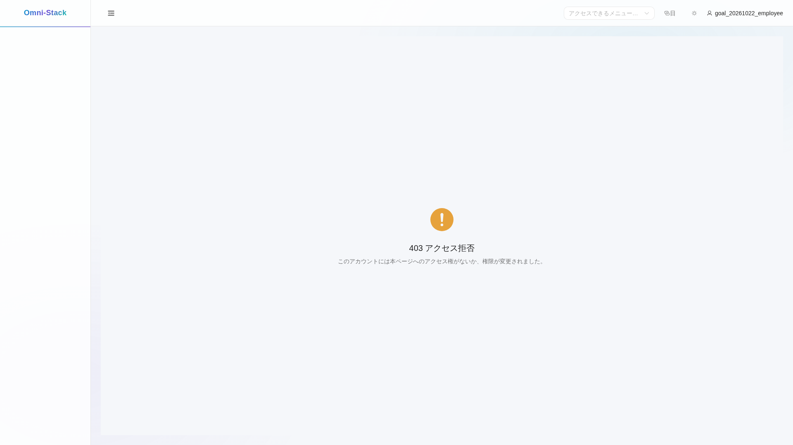

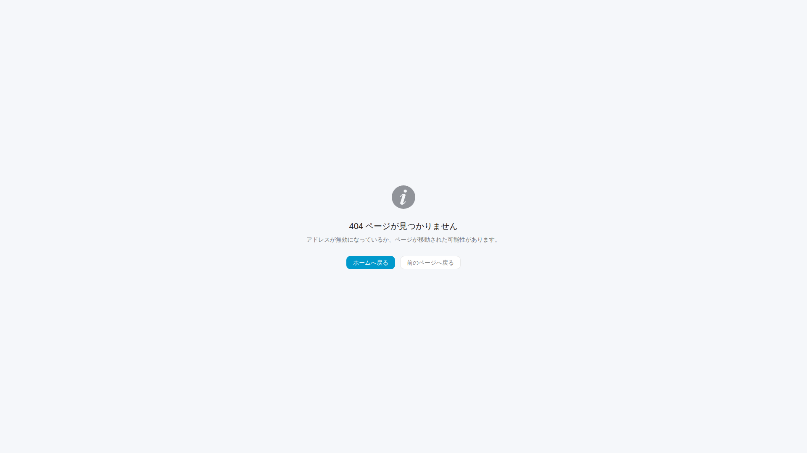

表示されるもの：内部の権限拒否では対象内容とホーム・前のページ・ワークスペースへのボタンを表示しません。元のワークスペースタブへ切り替えるか業務タブを閉じます。公開の匿名アドレスの誤りは別の 404 で、ホームや前のページへ戻れます。この二つは別の利用場面です。
失敗時の回復：身元の間違い（社員アカウントで管理ページを開くなど）を確認します。本当に必要なら管理者にロールへのメニュー付与を依頼し、管理者アカウントを共有しないでください。

### 1.9 メニュー読み込み失敗からの回復

やりたいこと：ワークスペースのメニュー読み込みが失敗したときに復旧する。
表示されるもの：ワークスペースに「機能メニューの読み込みに失敗しました。再試行できます」と表示され、アプリ一覧は空になります。
失敗時の回復：画面の「再読み込み」を押します。読み込みが成功すると一覧が戻ります。何度試しても失敗する場合は、ブラウザの連続更新で重複リクエストを作らず、管理者にサービス状態の確認を依頼してください。

## 2. 統合ワークスペースのコックピット

ホームのワークスペース入口は新しいブラウザタブを開き、Wiki のタブを残します。ホーム/Wiki へ戻るナビゲーションはなく、文書を読むときは元のタブへ切り替えます。概要、承認、マイジョブは一つの画面です。

### 2.1 アカウント、集計、アプリ

目的：自分のアカウント、実際の集計、やること、利用できるアプリを確認します。
利用者：ワークスペースへのアクセス資格があるログインユーザー。アプリと承認は権限とプリセットに従います。

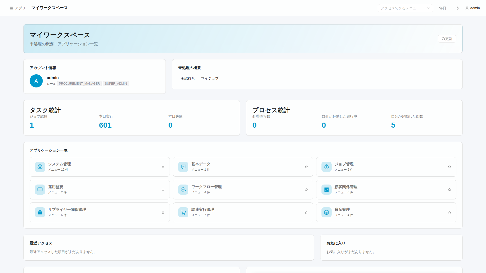

アカウントとロール、タスクと承認の集計、アプリ、最近使った項目、お気に入りが表示されます。全量構成の管理者は九アプリ、他のユーザーは権限があり配置済みの入口だけです。アプリパネルと上部検索はアクセス可能な全メニューが対象で、未許可機能は含みません。
一覧、パネル、検索から業務を選ぶと別タブで開きます。業務側は現在のモジュールのメニューと検索に集中し、全体の切り替えはありません。戻るときは元のワークスペースタブを選びます。
復旧：業務権限のないユーザーの空一覧は正常な場合があります。読込や集計の失敗はゼロと扱わず再試行します。ワークフローなしのプリセットで承認パネルがないのも正常です。

### 2.2 同じ画面で承認する

目的：自分に割り当てられた承認を処理します。
入口：承認集計から移るか、下へスクロールして承認パネルを開きます。

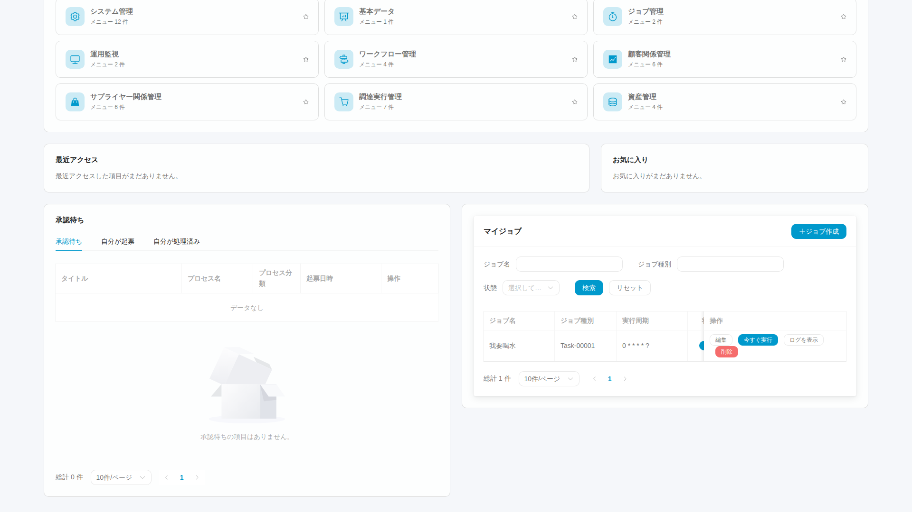

承認待ち、自分が起票、自分が処理したものの三タブがあります。この画像の一覧は空です。実タスクがあるときに開いて処理し、他の領域は同じ画面に残ります。非公開のワークスペースと業務エラー画面にはホーム・前の画面への回復ボタンはありません。
復旧：プロセスが開始され、自分が候補者かを確認し、直接データを変えてタスクを作りません。サーバーの認可は続き、メニュー表示だけで全操作を許可されたとは言えません。

### 2.3 同じ画面でマイジョブを管理する

目的：自分の定期ジョブの作成、編集、停止・再開、手動実行、履歴、削除を行います。
入口：タスク集計から移るか、下のマイジョブへスクロールします。

自分の記録を絞り込み、作成・編集フォームで引数を設定します。一覧には周期、状態、実行情報があります。パネルを並べたときは横スクロールで画面外の列を確認し、見切れから状態を推測しません。
復旧：停止は今後の周期起動を止めますが手動実行は可能です。受理後は新しい実行ログを確認します。登録・削除の結果が不明なら関連を保って照合し、重複作成や DB 変更で隠しません。詳細は[定期ジョブの操作](distributed-jobs-usage.jp.md)を参照してください。

## 3. システム管理

### 3.1 ユーザー管理

やりたいこと：同僚のアカウント作成、ロール割当、退職者の無効化。
できる人：管理者。

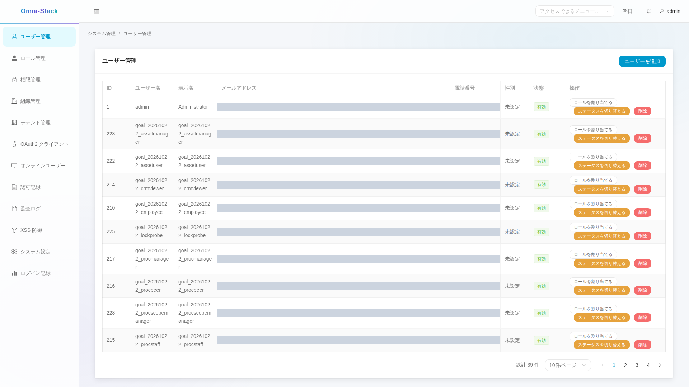

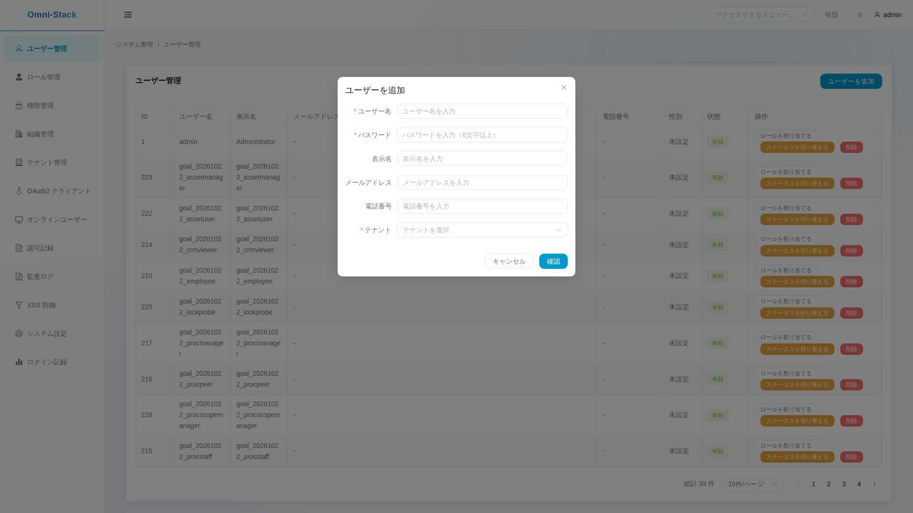

入力するもの：右上の「ユーザーを追加」を押し、アカウント、パスワード、基本情報を入力してテナントを選び、確認します。重複アカウントは拒否され、パスワードが空では送信できません。
表示されるもの：実際に作成が成功すると基本ロールのユーザーが一覧へ加わり、必要なロールを続けて割り当てます。画像の空のフォームはユーザーを作成していません。
失敗時の回復：ユーザー名が存在する場合は別名にします。パスワード必須の案内が出たら入力します。ロール割当後は同僚に再ログインしてもらいます（既存セッションに新しい権限は自動付与されません）。

### 3.2 ロール管理

やりたいこと：職種ごとにメニューと操作範囲を定義する。
できる人：管理者。

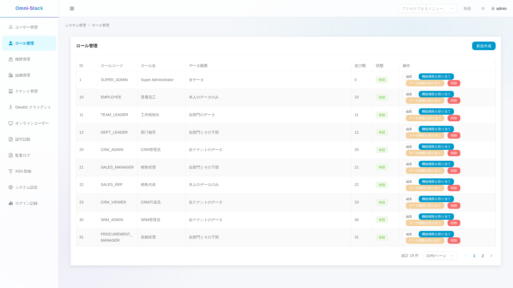

操作と結果：各ロールのデータ範囲（全データ、自部門、本人など）が表示されます。「編集」で基本情報とデータ範囲を設定し、メニューと操作は別の「機能権限を割り当て」を使います。カスタム範囲を選んだ場合だけ「データ権限を割り当て」で組織を選べます。ロール名は共有業務データなので、表示言語を変えても翻訳されません。
失敗時の回復：権限付与後にメニューが見えない場合は、まず再ログインしてもらいます。個別アカウントを共有データの付与変更で「直す」のではなく、ロールと組織を先に確認してください。

### 3.3 組織管理

やりたいこと：部門ツリーを維持し、所属を正しく保つ。
できる人：管理者。

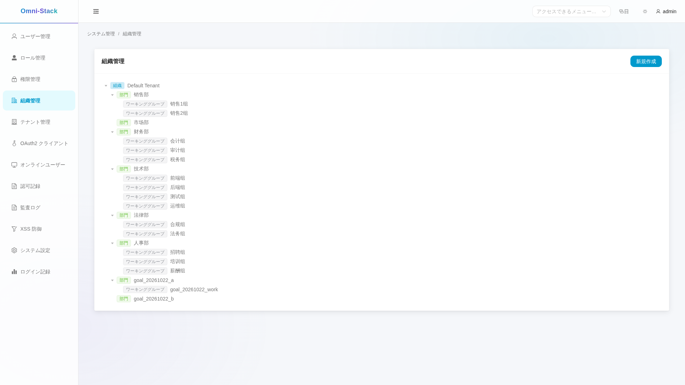

表示されるもの：組織、部門、ワークグループが親子関係で並びます。部門の作成だけでは人員は所属せず、メンバーの割当は別に管理します。部門単位のデータ範囲は所属とこのツリーを組み合わせます。Default Tenant というルート組織は、テナント切替の操作部品ではありません。
失敗時の回復：移動や削除の前に人員と業務データの所属を確認します。利用中の組織を削除せず、テスト組織で影響を確かめます。

### 3.4 テナント管理

やりたいこと：テナント情報を表示・管理する。
できる人：管理者（一部のテナント操作はスーパー管理者のみ）。

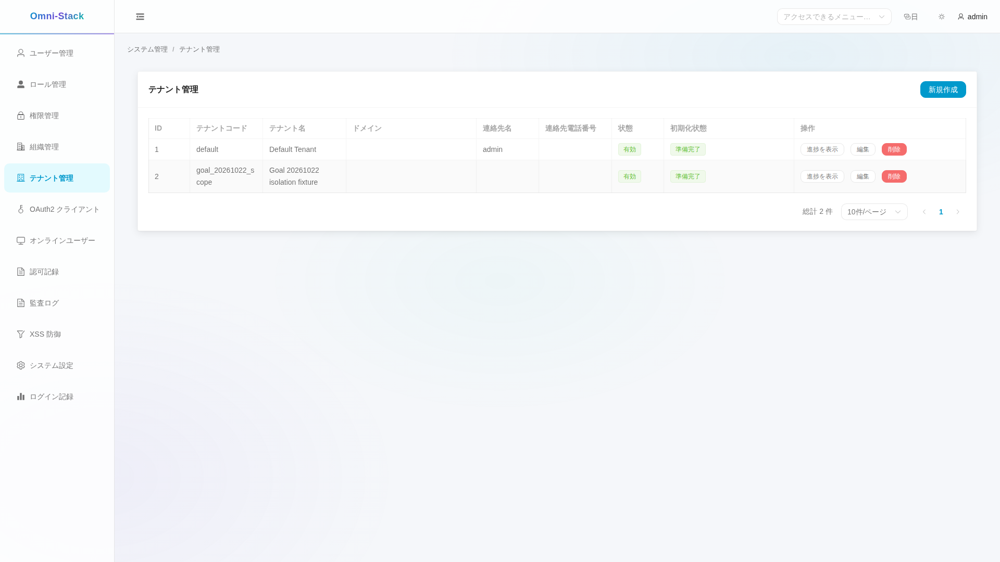

表示されるもの：テナントと初期化状態の一覧で、行を選んでも現在の利用者は切り替わりません。別のテナントを使うには、そのテナントの正規アカウントでログインし直します。各テナントのユーザーと業務データは、それぞれの認可境界で保護されます。
失敗時の回復：期待するデータが見えないときは、データ消失を疑う前に現在のテナントを確認してください。

### 3.5 OAuth2 クライアント

やりたいこと：接続を許可するサードパーティアプリを管理する。
できる人：管理者。

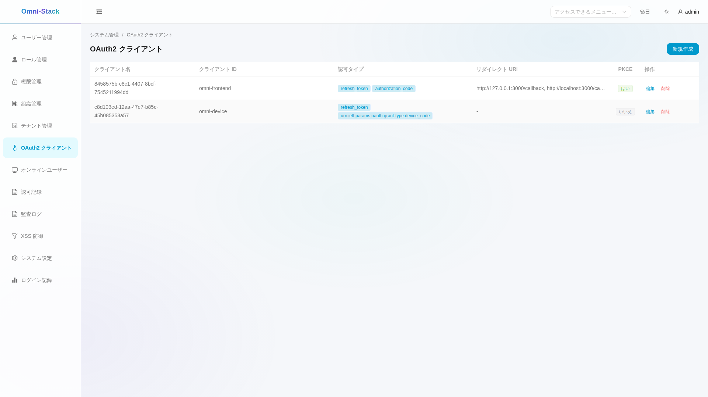

表示されるもの：アプリ名、クライアント識別子、認可タイプ、リダイレクト URI、PKCE の必須設定が並び、無効化ボタンや状態列はありません。このプロジェクトの認可サーバーに接続するアプリの管理で、GitHub や Google などのソーシャル設定画面とは異なります。
失敗時の回復：クライアント識別子、許可された認可タイプ、完全なリダイレクト URI、PKCE の条件を確認します。実際のソーシャル接続には外部側の正規設定も必要です（1.7 参照）。

### 3.6 監査ログ、ログイン記録、認可記録

やりたいこと：誰がいつ何のセキュリティ関連操作をしたかを追跡する。
できる人：管理者。

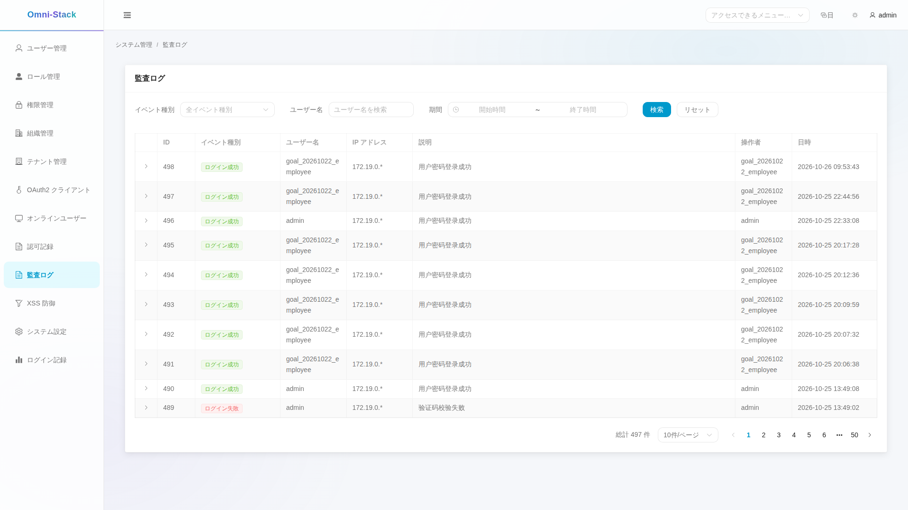

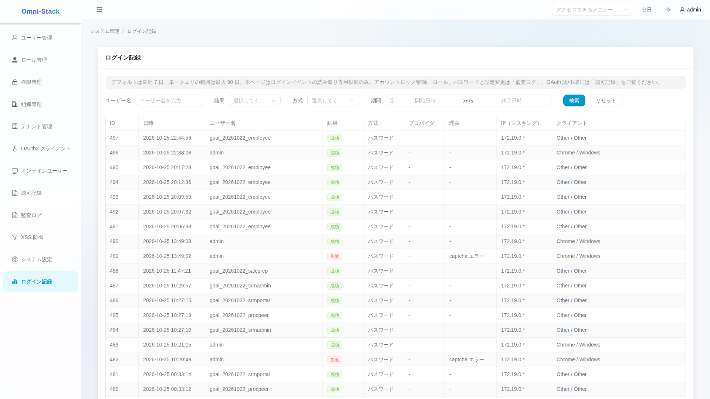

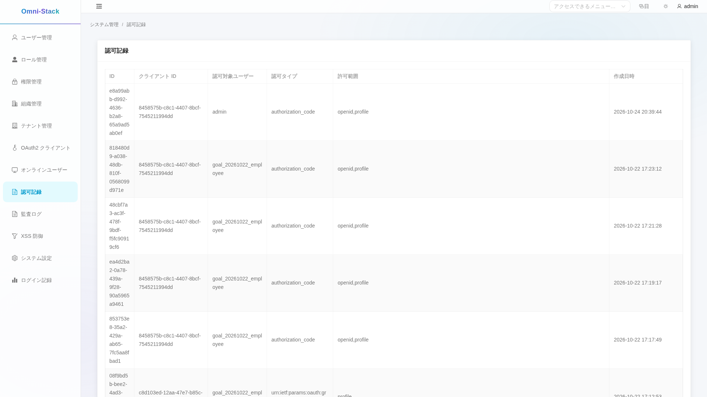

表示されるもの：監査ログはログイン成功・失敗、ロール付与・取消などを新しい順に示します。ログイン記録は読み取り専用で、初期値は直近七日、一回の検索は最大九十日です。認可記録はクライアント、対象ユーザー、認可タイプ、許可範囲を示し、記録 ID はアクセストークンではありません。いずれも編集不可です。送信元アドレスは画面でマスクされ、専用テストログインも実際の監査記録を残します。
失敗時の回復：画面の制限内で時刻やイベントを絞り込みます。DB の変更や手作業で監査を補完しません。

### 3.7 オンラインユーザー

やりたいこと：現在のセッションを確認し、必要なら異常なセッションを切断する。
できる人：管理者。

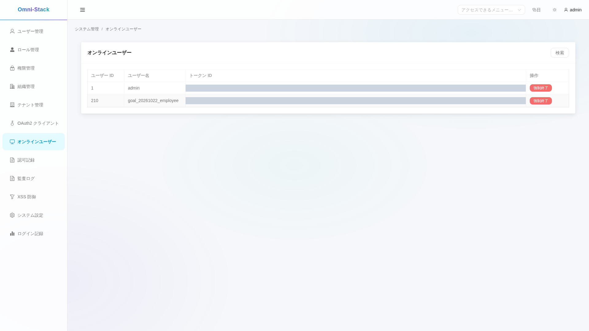

表示されるもの：ユーザー ID、ユーザー名、セッションのトークン ID で、ログイン時刻の列はありません。図のセッション識別子はマスク済みです。強制終了すると再ログインが必要ですが、この取得では実行していません。
失敗時の回復：操作はセッションだけに影響し、アカウントには影響しません。誤操作時は再ログインしてもらいます。

### 3.8 システム設定と XSS 防御

やりたいこと：本テナントのログイン失敗保護ポリシーを調整し、クロスサイトスクリプティング対策のルールを維持する。
できる人：管理者。

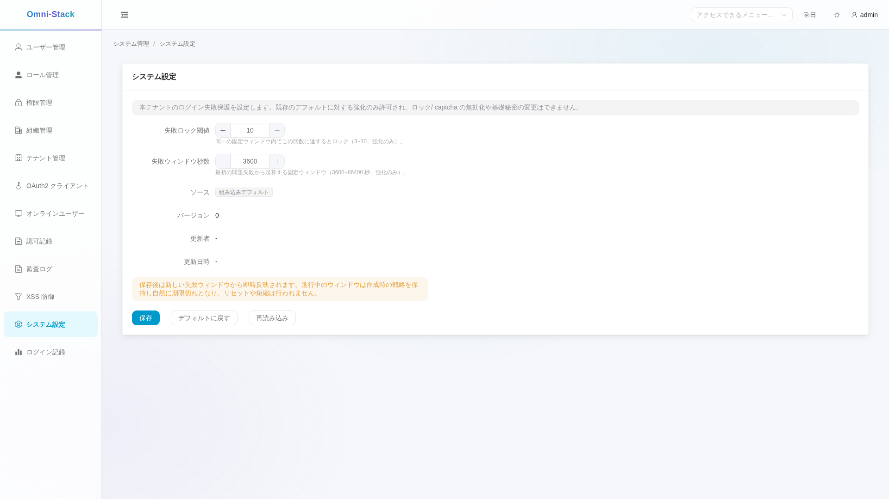

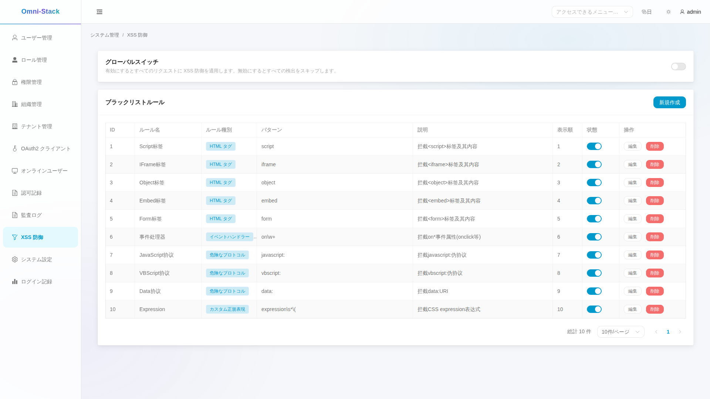

表示されるもの：ロックしきい値と集計ウィンドウは、フォームの制約内で厳しくする方向に調整できます。保存したポリシーは新規ウィンドウに適用され、進行中のものは作成時のポリシーを保って自然に期限切れとなり、リセットされません。XSS は送信内容のフィルターとルールを管理します。画像では全体スイッチがオフ、個別ルールは有効ですが、推奨設定ではなく取得時にも変更していません。
失敗時の回復：変更前に元の値を控え、異常があれば戻します。影響範囲が不明なときはピーク時間帯に変えないでください。

## 4. 辞書管理

やりたいこと：業務のドロップダウン選択肢（資産カテゴリや設置場所など）を維持する。
できる人：管理者。

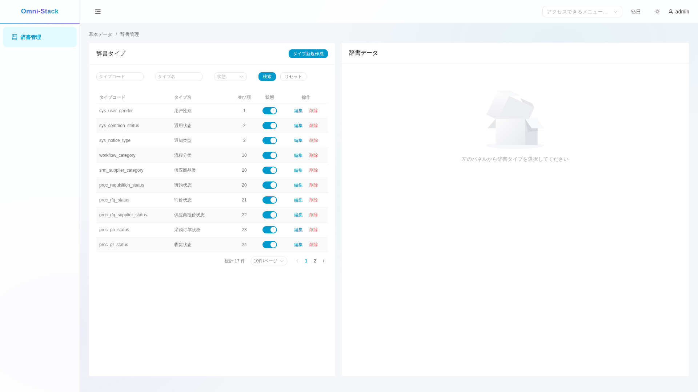

操作と結果：左の辞書タイプを選んでから右の項目を管理します。図では未選択なので選択案内が正常に表示されています。タイプが分類、項目が選択肢を決めます。タイプコードは一意、必須項目は空にできません。
失敗時の回復：追加後に業務画面へ新しい選択肢が出ない場合は、辞書キャッシュが更新されたかを確認し、データ項目の編集後に業務画面を更新して確認します。

## 5. 運用

### 5.1 操作ログ

やりたいこと：アプリの記録対象となっている操作を、誰が行ったか調べる。
できる人：管理者。

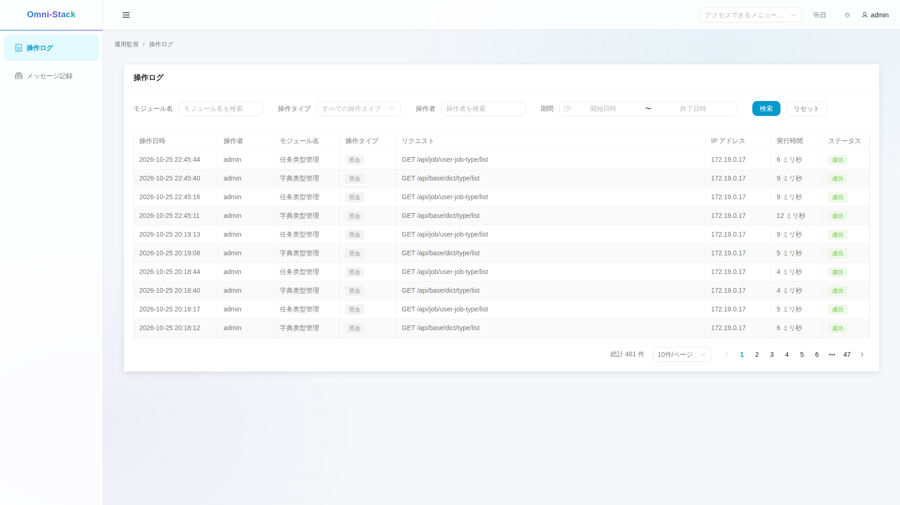

表示されるもの：記録対象の検索・作成・更新・削除がモジュール単位で並び、図には実際の検索履歴があります。すべての検索が自動記録されるわけではありません。ログインは認証監査とログイン記録へ残ります。操作ログ付きの API を読むこと自体でも記録と非同期の収集メッセージが発生し得ます。
失敗時の回復：記録が見つからない場合は、操作が実際に成功したかを確認し、時刻とモジュールの絞り込みを見直します。

### 5.2 メッセージ記録

やりたいこと：非同期メッセージの配送状態を確認し、デッドレターを処理する。
できる人：管理者。

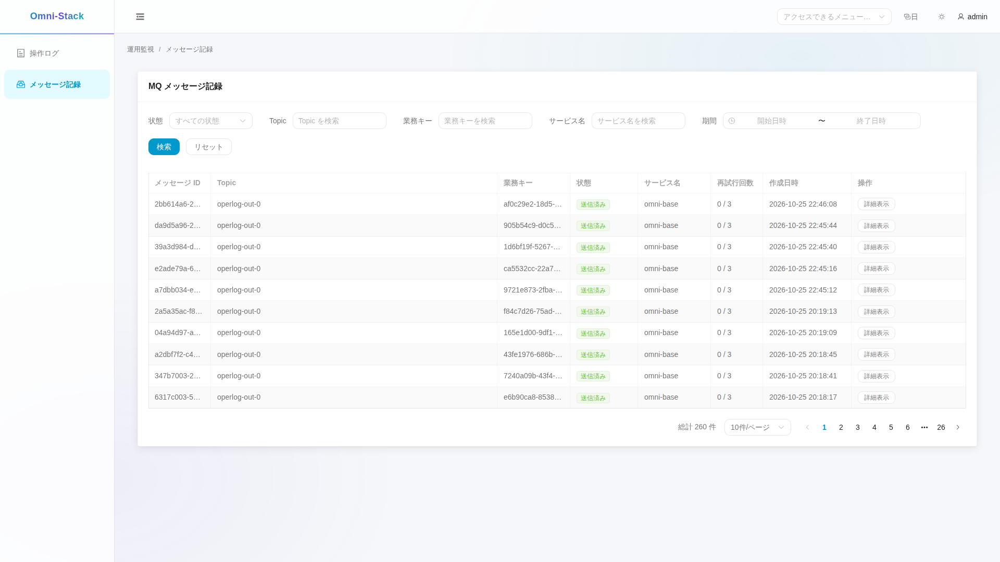

表示されるもの：送信待ち、送信済み、失敗、デッドレター、スキップ済みの状態があります。権限があればデッドレターを再送・スキップできます。送信待ちはまだブローカーに渡っておらず、送信済みもブローカーへの送信成功だけで、受信側の業務処理完了を保証しません。
失敗時の回復：長く配信待ちの場合は、まずスケジューラとメッセージサービスが正常か確認します。再送前に業務の副作用が発生済みでないかを確認し、二重処理を避けてください。

## 6. タスク

### 6.1 個人タスク種別

やりたいこと：同僚が作成できるタスク種別を定義する。
できる人：管理者。

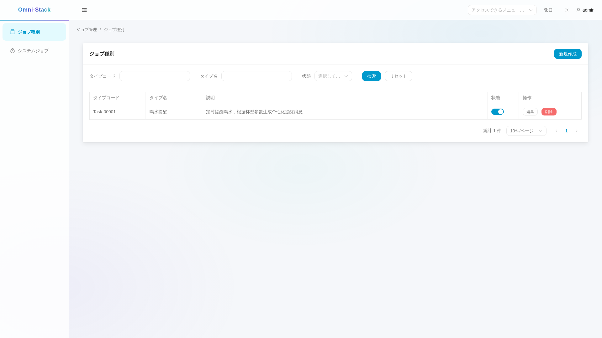

表示されるもの：種別は個人ジョブで選べるテンプレートを決め、作成にはコードと名称が必要です。図の中国語の種別名は共有データです。種別を登録するだけで実行処理が配備されるわけではなく、一致する処理プログラムも必要です。
失敗時の回復：定義後に個人タスク画面へ出ない場合は、種別が有効かを確認します。重複コードで既存種別を上書きしないでください。

### 6.2 システムタスク

やりたいこと：組み込みのシステムタスクとスケジュール状態を見る。
できる人：管理者。

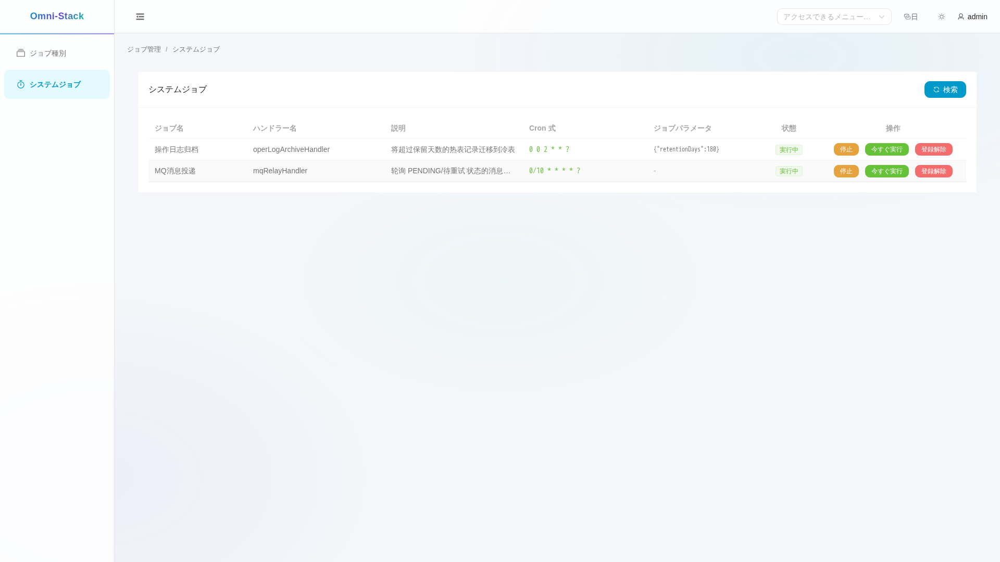

表示されるもの：現在の Base サービスが登録した処理、周期、引数、状態で、図の二件がプラットフォーム全体のジョブではありません。停止・今すぐ実行・登録解除は実操作ですが、今回は閲覧だけです。サービスをまたぐ全体像は[分散ジョブの管理](distributed-jobs-admin.jp.md)で説明します。
失敗時の回復：実行失敗時はスケジューラとタスクログを確認します。デモを成功させるためにタスク状態を手で書き換えないでください。

## 7. 承認

### 7.1 プロセス定義

やりたいこと：公開済みの承認プロセスを確認する。新規作成や変更は先に「プロセスモデル」ページで設計して公開する。
できる人：管理者またはプロセス保守担当。

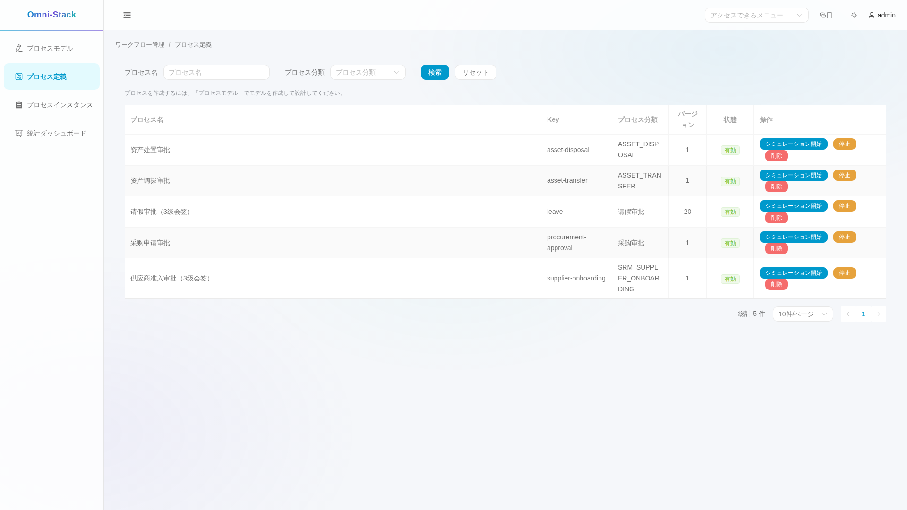

表示されるもの：プロセス名、識別子、分類、バージョン、稼働状態が表示され、公開済みプロセスは模擬起動・停止・削除ができます。検証に通らないプロセスは公開できません。モデルの識別子は同じテナント内で一意です。再公開では同じ識別子の新しいバージョンを作り、毎回識別子を変える必要はありません。
失敗時の回復：「プロセスモデル」ページでの公開に失敗したら、開始・終了ノードがあるか、承認者が設定されているかを確認します。使用中の公開バージョンを上書きしないでください。

### 7.2 プロセスインスタンス

やりたいこと：プロセスがどこまで進み、誰が処理しているかを見る。
できる人：管理者。

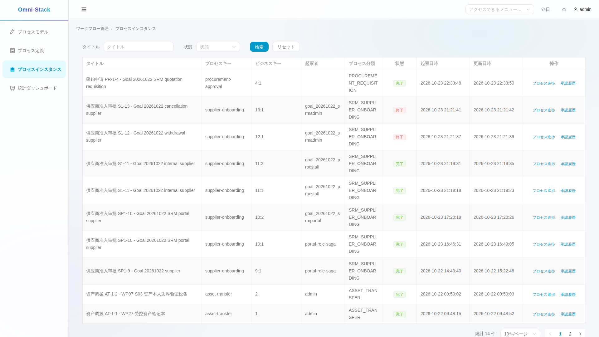

表示されるもの：図には完了・終了済みを含む実際の過去のインスタンスがあり、件名、プロセス識別子、業務キー、起票者、分類、状態、時刻が並びます。進捗と承認履歴の入口から処理過程を確認します。取得時にプロセスの起動、承認、終了は行っていません。
失敗時の回復：同じノードに長く留まる場合は、候補者に ToDo が届いているかを確認してからプロセス保守担当に連絡します。プロセスデータを直接編集しないでください。

## 8. よくある問題と回復

- **ログイン後にメニューがない**：身元とロールを確認します。一般社員に業務メニューがないのは正常な結果です。ロール変更後は再ログインが必要です。
- **ページは開くが一覧が空**：テナント、データ範囲、業務前提（まだ申請がないなど）を確認します。空データを故障とみなさないでください。
- **権限がないと表示される**：権限のある身元に切り替えるか、管理者にロールへのメニュー付与を依頼します。管理者アカウントを共有しないでください。
- **メニュー読み込み失敗**：「再読み込み」を押します。改善しない場合は管理者にサービス状態の確認を依頼します。
- **メッセージが配信待ちのまま**：スケジューラとメッセージサービスを確認し、再試行回数を見ます。「表に行がある」を「配信済み」とみなさないでください。
- **登録後にポータルへ入れない**：招待が送信済みか、参入審査が完了しているかを確認します。

## 9. 未検証と境界

- 外部ソーシャルサービスの実アカウント接続は今回完了していません。1.7 はその境界を説明するもので、本プロジェクト自身の OAuth2 ログインの失敗を意味しません。
- 空データベースへの初回インストールはここでは実測していません。共有データベース上の履歴やメニュー残存は、空 DB の挙動を表しません。
- ユーザー、ロール、履歴は共有テスト環境のデータです。管理ページへの制限付きアクセスには専用の一般社員、その他の管理画像には制御された管理者テストユーザーを使い、全員に管理権限があるとは示しません。
- フォームは未送信、デバイスは確認待ち、認可画面はログイン前です。図の CAPTCHA、短期コード、QR コードは再利用できません。画像はその状態の説明であり、業務全体の完了を証明しません。
