# 플랫폼 기능 그림 튜토리얼: 사이트, 워크스페이스, 시스템, 작업, 승인

이 페이지는 Omni-Stack을 매일 사용하는 동료를 위해 조작 방법, 예상 결과, 복구 방법을 설명하며 배포나 코드는 다루지 않습니다. 이미지는 로컬 Docker의 실제 환경에서 촬영했습니다. 홈은 공개 Wiki이고 업무 화면은 개발 테넌트의 전용 테스트 계정입니다. 자동 촬영에는 통제된 테스트 로그인을 사용하며 사람이 CAPTCHA를 입력했다고 주장하지 않습니다. 사용자 목록의 연락처와 온라인 세션 식별자는 마스킹했고 화면 내용이나 업무 결과는 바꾸지 않았습니다. 버튼 이름은 실제 화면을 따릅니다.

## 읽기 전 전제

- **사용하는 신원**: 관리자(모든 플랫폼 메뉴 표시), 일반 사원(로그인은 되지만 관리 메뉴가 없고 관리 페이지를 직접 열면 차단됨), 자산 사용자("내 자산"만 표시), 공급업체(공급업체 포털로 들어오며 내부 관리 페이지는 보이지 않음).
- **로그인에는 실제 CAPTCHA가 필요합니다**: 로그인 화면에 표시된 이미지의 문자를 입력합니다. CAPTCHA는 한 번만 유효하며, 읽기 어려우면 이미지를 클릭해 갱신합니다. 검증을 건너뛰는 방법은 이 튜토리얼에 없습니다.
- **데이터는 공유됩니다**: 이 환경은 전체 프리셋으로 초기화되어 있어 보이는 사용자·이력·자산이 다른 사람의 검증에서 나온 것일 수 있습니다. 데모를 위해 데이터를 지우거나 역할 부여를 바꾸지 않습니다.
- **프로덕션 조건에서 미검증인 두 가지**: 이번에는 외부 소셜 제공자의 실제 계정 연결을 완료하지 않았으며 빈 데이터베이스 최초 설치도 실측하지 않았습니다. 외부 소셜 연결과 프로젝트 자체 OAuth2 로그인은 별도의 검증으로 설명합니다.

## 1. 사이트와 로그인 진입점

### 1.1 로그인 없이 프로젝트 Wiki 읽기

하고 싶은 일: 프로젝트와 사용법을 알아본 뒤 로그인과 공급업체 진입점을 찾습니다.
할 수 있는 사람: 모든 사람. 로그인 불필요.
시작 위치: 브라우저에서 `http://localhost:3000`을 엽니다.

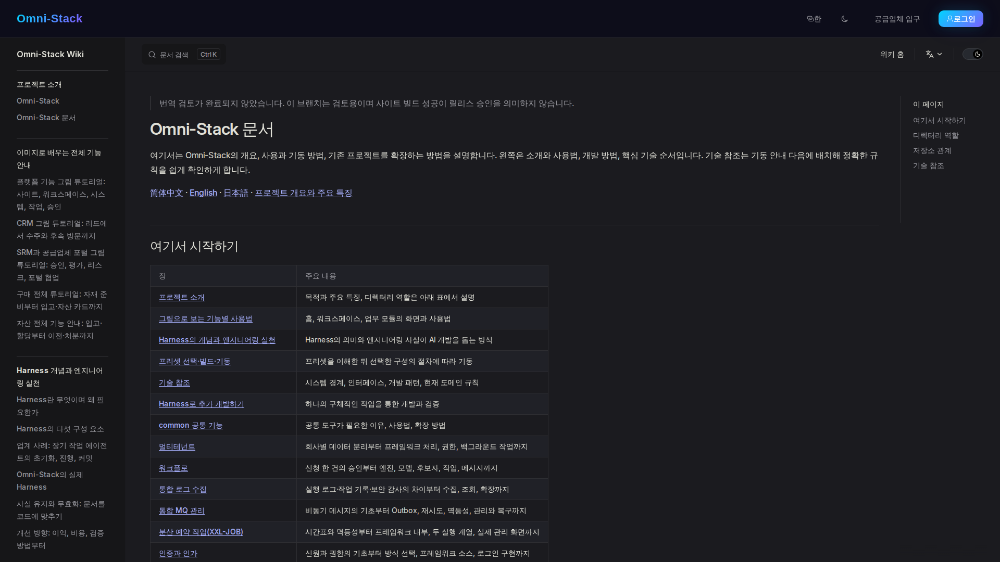

보이는 것: 홈에서 프로젝트 Wiki가 바로 보입니다. 왼쪽 장별 메뉴나 가운데 읽기 입구로 본문을 열고 문서 검색이나 오른쪽 목차를 이용합니다. 우상단 "로그인"은 내부 계정용이고 "공급업체 입구"는 포털용입니다. 로그인한 내부 사용자도 같은 Wiki를 읽습니다. 접근 권한이 있으면 계정 영역의 업무 진입점은 "내 워크스페이스" 하나이며 새 브라우저 탭을 열어 원래 Wiki 탭을 유지합니다.
실패 시 복구: 문서를 불러오지 못하면 화면의 재시도 버튼을 쓰거나 Wiki를 별도로 엽니다. 사이트 전체에 접근할 수 없다면 애플리케이션 실행 여부와 주소·포트를 확인한 뒤 새로 고칩니다. 로그인 제출을 반복하지 마세요.

### 1.2 관리자로 로그인하기

하고 싶은 일: 로그인해 내 워크스페이스를 열고 이용 가능한 플랫폼 앱을 찾습니다.
할 수 있는 사람: 관리자 계정을 가진 동료.
시작 위치: 홈의 "로그인" 또는 로그인 페이지를 직접 엽니다.

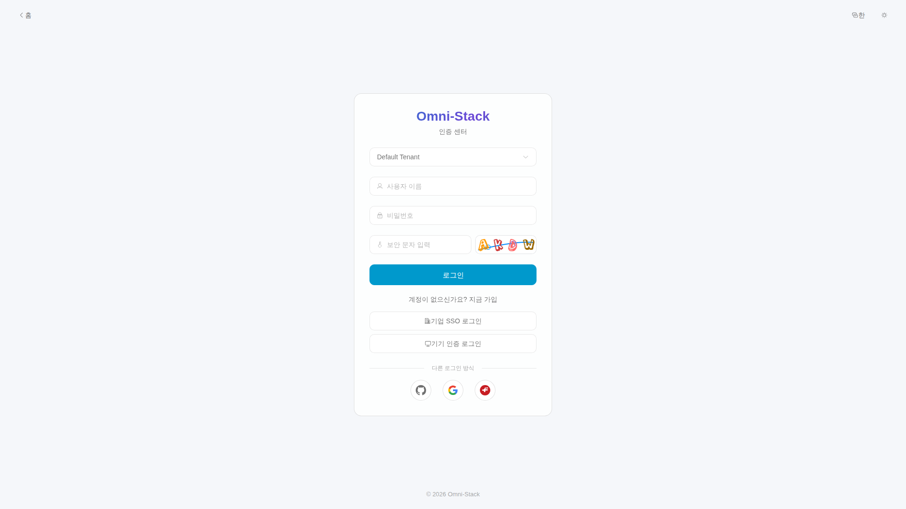

입력할 것: 계정의 테넌트를 먼저 선택하고 계정과 비밀번호, 현재 CAPTCHA 문자를 입력해 제출합니다. 이미지를 누르면 갱신됩니다.
보이는 것: 홈에서 보통 방식으로 로그인하고 돌아갈 페이지를 따로 지정하지 않았다면 Wiki 홈으로 돌아오며 위쪽에 계정이 표시됩니다. "내 워크스페이스"를 선택하면 업무 화면으로 갑니다. 처음에 로그인이 필요한 페이지를 열었다면 로그인 후 그 페이지로 돌아갑니다. 사용할 앱과 관리 메뉴는 계정 권한에 따라 달라집니다.

다음으로 업무 모듈 열기: 워크스페이스의 "애플리케이션 목록"이나 "앱" 패널에서 모듈을 선택합니다. 브라우저가 새 업무 탭을 열고 원래 워크스페이스 탭은 그대로 남습니다. 업무 화면은 현재 모듈의 메뉴와 검색만 제공하며 전체 앱 버튼, 다른 모듈 후보, 홈이나 워크스페이스 복귀 버튼은 없습니다. 워크스페이스로 돌아가려면 원래 탭으로 전환하거나 방금 연 업무 탭을 닫으세요.

실패 시 복구: CAPTCHA 오류는 이미지를 갱신해 다시 입력합니다(이전 CAPTCHA는 즉시 무효). 비밀번호 오류는 대소문자와 입력기를 확인하고 연속 시도하지 마세요. 계정이 중지되었다면 관리자에게 상태를 확인하세요.

### 1.3 셀프 서비스 가입

하고 싶은 일: 새 동료가 계정을 만들고, 이후 관리자가 역할을 부여합니다.
할 수 있는 사람: 셀프 가입을 허용한 테넌트의 새 동료. 내부 계정 가입에는 공급업체 초대 토큰이 필요하지 않습니다.
시작 위치: 로그인 화면 아래의 "가입" 진입점.

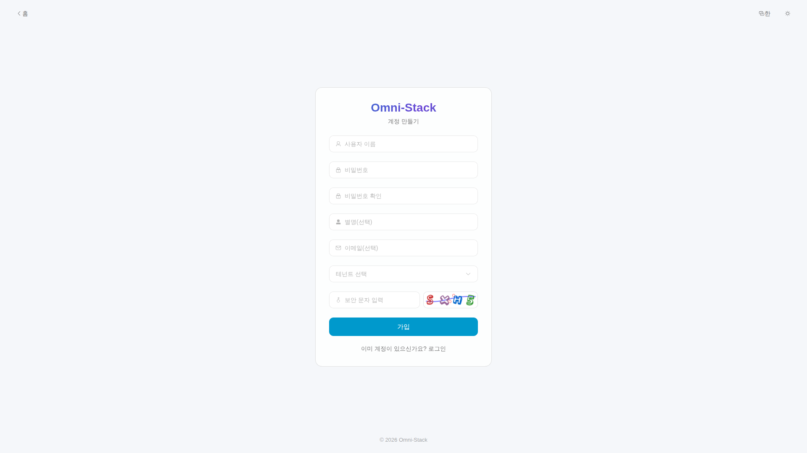

입력할 것: 계정과 비밀번호 확인을 입력하고 필요하면 별명과 이메일도 작성합니다. 올바른 테넌트를 선택하고 CAPTCHA를 입력해 제출합니다. 이미지는 미제출 상태이며 계정 생성 성공을 뜻하지 않습니다.
보이는 것: 가입 후 기본 역할로 로그인할 수 있지만 업무 메뉴는 없습니다. 필요한 역할과 조직은 관리자가 사용자 관리에서 부여합니다.
실패 시 복구: 계정이 이미 있으면 다른 이름을 씁니다. CAPTCHA 오류는 이미지를 갱신합니다. 가입이 제한되면 잠시 후 다시 시도하고 스크립트로 대량 가입하지 마세요.

### 1.4 공급업체의 포털 로그인과 가입

하고 싶은 일: 공급업체가 포털에서만 자료·평가·견적을 다루고 내부 관리 페이지에는 접근하지 않도록 합니다.
할 수 있는 사람: 공급업체 담당자. 계정이 없으면 먼저 가입합니다. 기업 등록에는 별도의 유효한 초대가 필요하며 계정 가입만으로 완료되지 않습니다.
시작 위치: 홈의 "공급업체 진입" 또는 포털 로그인 페이지.

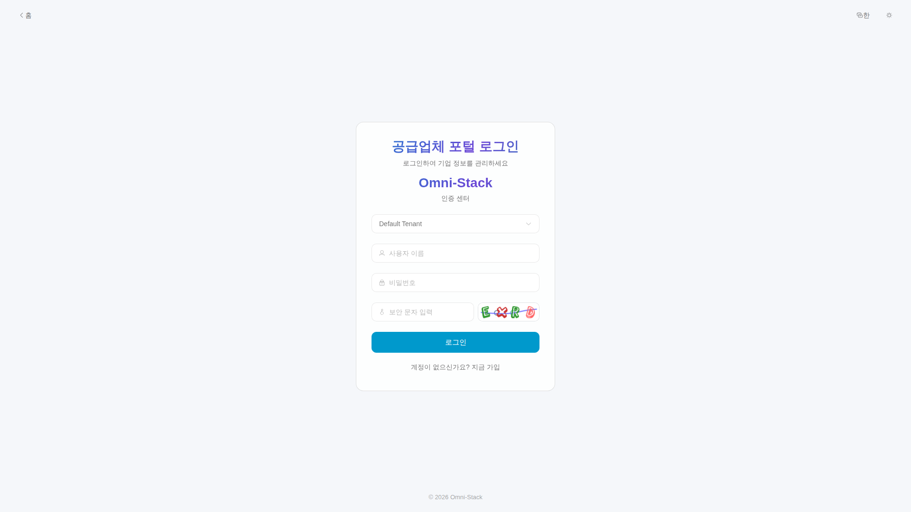

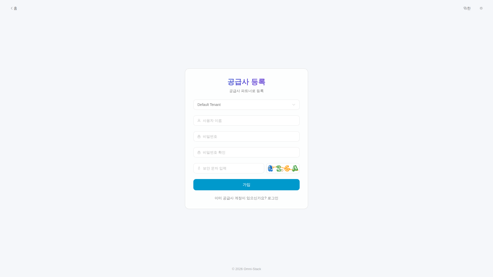

조작: 이 양식은 인증 계정만 생성합니다. 포털에 로그인한 뒤 초대 토큰으로 기업 등록을 신청합니다. 심사 완료, 공급업체 역할, 활성 계정 연결이 갖춰져야 허용된 기업 정보·평가·견적 기능을 이용할 수 있습니다.
보이는 것: 등록된 공급업체는 자신의 포털에 들어가며 내부 관리 메뉴는 없습니다. 내부 주소를 입력해도 권한은 늘어나지 않습니다. 두 이미지는 미제출 입구 양식이며 기업 등록이나 승인 성공의 증거가 아닙니다.
실패 시 복구: 로그인 테넌트, 초대 만료, 등록 심사, 계정 연결을 구매 담당자와 확인합니다. 같은 기업을 반복 등록하지 마세요.

### 1.5 기기 인증

하고 싶은 일: 브라우저가 없는 기기에서 로그인을 완료합니다.
할 수 있는 사람: 로그인이 필요한 동료.
시작 위치: 로그인 화면의 "기기 인증 로그인" 진입점.

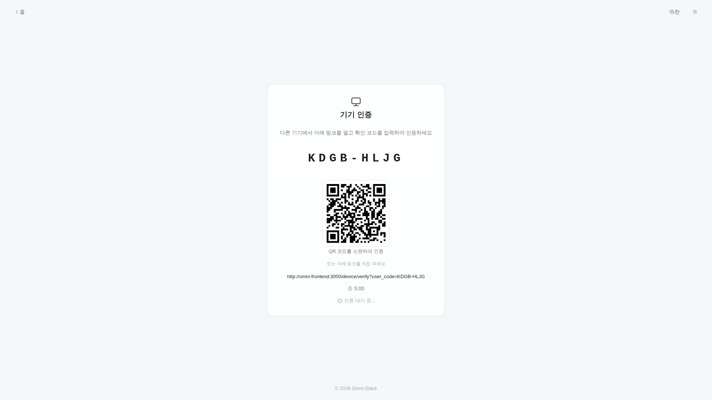

조작과 결과: 로그인할 수 있는 다른 기기에서 현재 검증 주소를 열거나 QR 코드를 읽습니다. 요청을 확인한 뒤 승인하고 원래 기기에서 결과를 기다립니다. 이미지는 대기 상태이며 인가 완료가 아닙니다. 촬영 주소는 Docker 내부용이므로 실제 배포에서 접근 가능한 주소를 사용하고 그림의 주소나 만료된 코드·QR 코드를 복사하지 않습니다.
실패 시 복구: 코드가 만료되면 처음부터 다시 시작합니다. 낯선 기기의 요청은 승인하지 마세요.

### 1.6 인가 동의

하고 싶은 일: 서드파티 앱이 내 대신 접근할 수 있는 정보를 확인합니다.
할 수 있는 사람: 서드파티 앱으로 로그인하는 동료.
시작 위치: 로그인 흐름에서 자동으로 이동합니다.

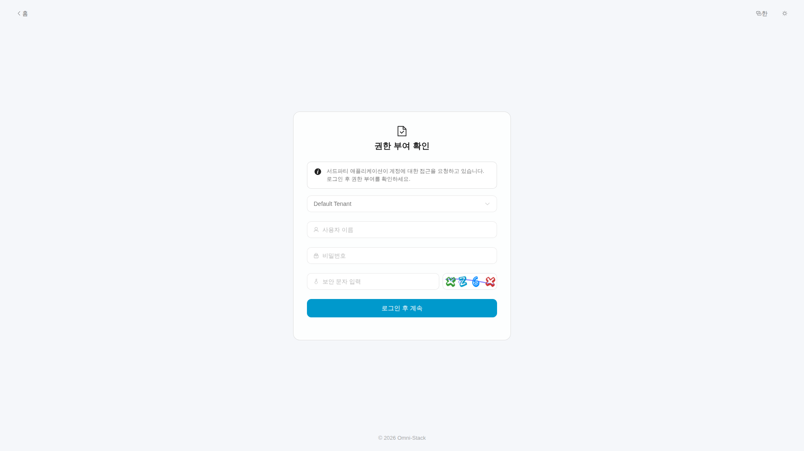

조작과 결과: 정식 앱에서 시작한 흐름으로 로그인하고 앱 이름과 요청 범위를 확인한 뒤 동의 여부를 결정합니다. 이 이미지는 로그인 전 입구만 보여 주며 권한 목록이나 인가 성공은 표시하지 않습니다. 양식이 보인다고 앱에 권한이 부여된 것은 아닙니다.
실패 시 복구: 요청이 유효하지 않다고 나오면 원래 앱에서 로그인을 다시 시작합니다. 주소를 직접 조합해 재시도하지 마세요.

### 1.7 소셜 로그인 콜백(외부 실제 계정 연결은 미검증)

하고 싶은 일: 외부 플랫폼 계정으로 로그인합니다.
현재 상태: 외부 서비스의 실제 계정 연결은 여기서 완료하지 않았습니다. 정식 인가 문맥 없이 콜백을 열면 로그인이나 거부 상태만 표시되며 전체 소셜 흐름의 성공·실패는 판단할 수 없습니다. 외부 설정 후 정상 입구에서 인가를 시작해야 합니다. 프로젝트 자체의 OAuth2 로그인과 외부 소셜 연결은 서로 다른 흐름입니다.

### 1.8 권한 없음과 존재하지 않는 페이지

하고 싶은 일: 차단되었을 때 무슨 일이 있었는지, 누구에게 물어야 하는지 압니다.
할 수 있는 사람: 모든 신원에서 발생할 수 있습니다.
시작 위치: 일반 사원이 관리 페이지를 열거나, 존재하지 않는 주소를 입력합니다.

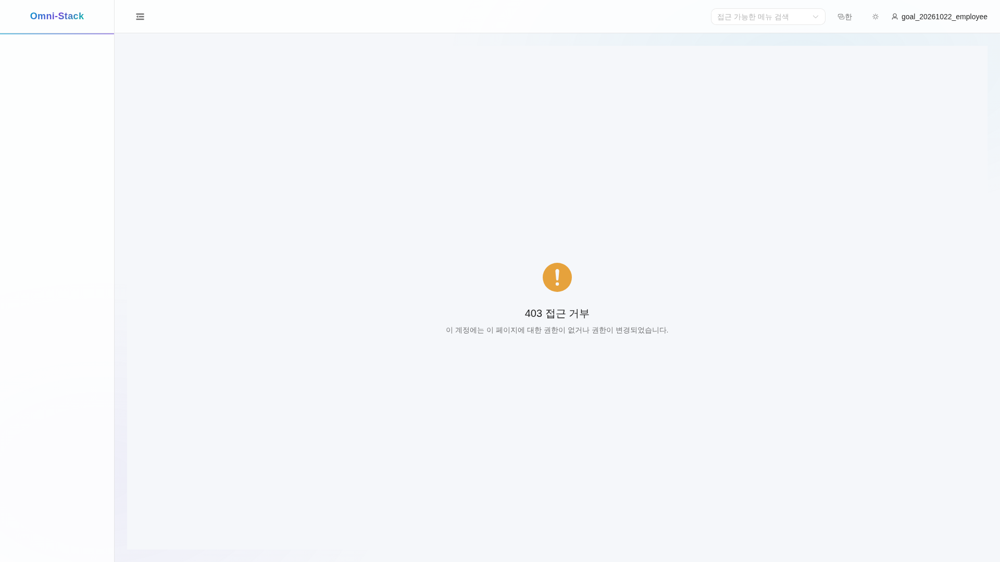

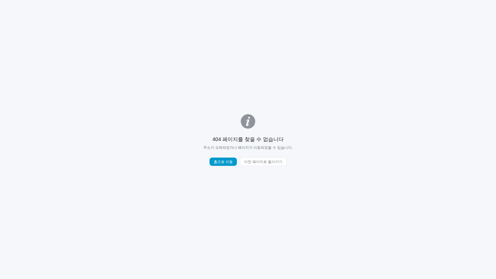

보이는 것: 내부 권한 거부는 대상 내용과 홈·이전 페이지·워크스페이스 버튼을 표시하지 않습니다. 원래 워크스페이스 탭으로 바꾸거나 업무 탭을 닫습니다. 잘못된 공개 익명 주소는 별도의 404이며 홈·이전 페이지 버튼으로 복구합니다. 두 상황은 구분해야 합니다.
실패 시 복구: 신원이 잘못되지 않았는지(사원 계정으로 관리 페이지를 연 경우 등) 확인합니다. 정말 필요하면 관리자에게 역할에 메뉴를 부여해 달라고 요청하고, 관리자 계정을 공유하지 마세요.

### 1.9 메뉴 로딩 실패에서 복구

하고 싶은 일: 워크스페이스 메뉴 로딩이 실패했을 때 복구합니다.
보이는 것: 워크스페이스에 "기능 메뉴를 불러오지 못했습니다. 다시 시도할 수 있습니다"가 표시되고 앱 디렉터리는 비어 있습니다.
실패 시 복구: 화면의 "다시 로드"를 누릅니다. 로딩에 성공하면 디렉터리가 돌아옵니다. 여러 번 실패하면 브라우저를 연속 새로 고쳐 중복 요청을 만들지 말고 관리자에게 서비스 상태 점검을 요청하세요.

## 2. 통합 워크스페이스 조종석

홈의 내 워크스페이스는 새 브라우저 탭을 열고 Wiki 탭을 유지합니다. 홈/Wiki 복귀 탐색 버튼은 없으므로 문서를 읽으려면 원래 탭으로 전환합니다. 개요, 승인, 내 작업이 한 화면에 모입니다.

### 2.1 계정, 요약, 앱

목적: 내 계정, 실제 통계, 할 일, 접근 가능한 앱을 확인합니다.
사용자: 워크스페이스 접근 자격이 있는 로그인 계정. 앱과 승인은 권한과 프리셋에 따릅니다.

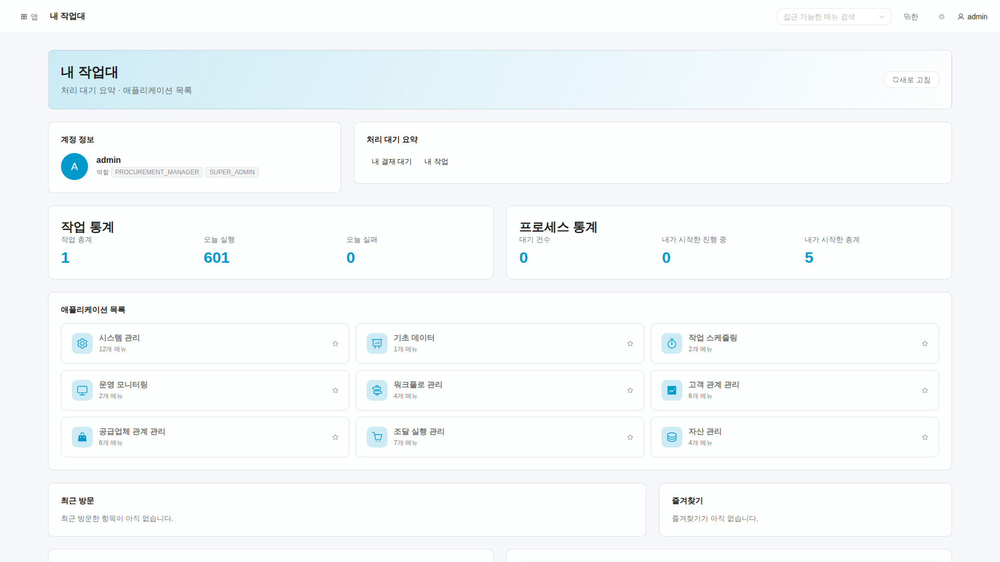

계정과 역할, 작업·승인 요약, 앱, 최근 방문, 즐겨찾기가 표시됩니다. 전체 프리셋 관리자는 아홉 앱을 보고 다른 사용자는 권한이 있고 배포된 진입점만 봅니다. 앱 패널과 상단 검색은 접근 가능한 전체 메뉴를 대상으로 하며 미허가 기능을 보여 주지 않습니다.
목록, 패널, 검색에서 업무를 고르면 새 탭에서 열립니다. 업무 화면의 메뉴와 검색은 현재 모듈에 집중하며 전체 앱 전환은 없습니다. 돌아갈 때는 원래 워크스페이스 탭을 선택합니다.
복구: 업무 권한이 없는 계정의 빈 목록은 정상일 수 있습니다. 로딩·통계 오류를 0으로 취급하지 말고 재시도합니다. 워크플로가 없는 프리셋에서 승인 패널이 없는 것도 정상입니다.

### 2.2 같은 화면에서 승인 처리

목적: 나에게 배정된 승인을 처리합니다.
진입: 승인 요약을 이용하거나 아래 승인 패널로 스크롤합니다.

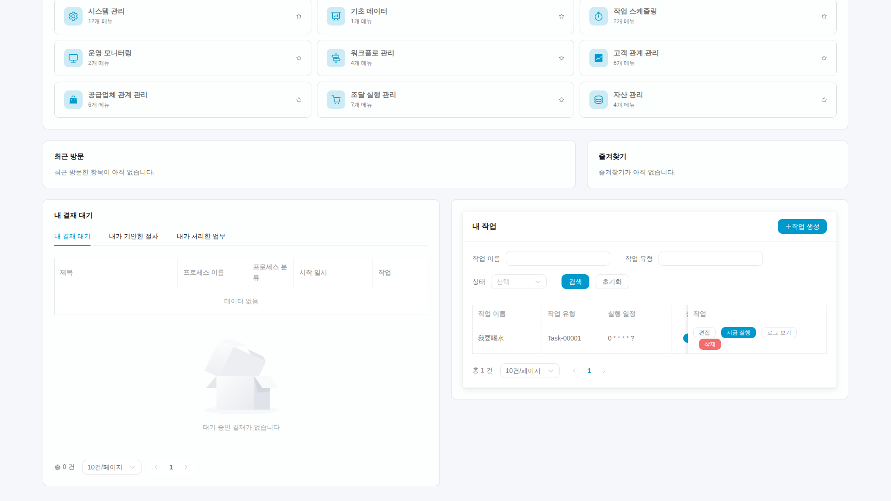

내 승인 대기, 내가 시작, 내가 처리한 항목의 세 탭이 있습니다. 이 이미지의 목록은 비어 있습니다. 실제 작업이 있으면 열어 처리하며 나머지 영역은 같은 페이지에 남습니다. 비공개 워크스페이스와 업무 오류 화면에는 홈·뒤로 복구 버튼이 없습니다.
복구: 프로세스 시작과 후보자 포함 여부를 확인하고 직접 데이터를 고쳐 할 일을 만들지 않습니다. 서버 인가는 계속 적용되며 메뉴가 보인다고 모든 조작이 허용된 것은 아닙니다.

### 2.3 같은 화면에서 내 작업 관리

목적: 자신의 예약 작업 생성, 수정, 중지·재개, 수동 실행, 로그 조회, 삭제를 수행합니다.
진입: 작업 요약을 이용하거나 아래 내 작업으로 스크롤합니다.

내 기록을 필터링하고 생성·수정 양식에서 인수를 설정합니다. 목록에는 주기, 상태, 실행 정보가 있습니다. 패널이 나란히 있으면 가로 스크롤로 화면 밖의 열을 확인하며 잘린 부분으로 상태를 추측하지 않습니다.
복구: 중지는 이후 주기 배정을 멈추지만 수동 실행은 가능합니다. 요청 접수 뒤 새 실행 로그를 확인합니다. 등록·삭제 결과가 불명확하면 연결을 유지해 대조하고 중복 생성이나 DB 변경으로 숨기지 않습니다. 자세한 내용은 [예약 작업 사용법](distributed-jobs-usage.kr.md)을 참고하세요.

## 3. 시스템 관리

### 3.1 사용자 관리

하고 싶은 일: 동료 계정을 만들고, 역할을 부여하고, 퇴사자 계정을 비활성화합니다.
할 수 있는 사람: 관리자.

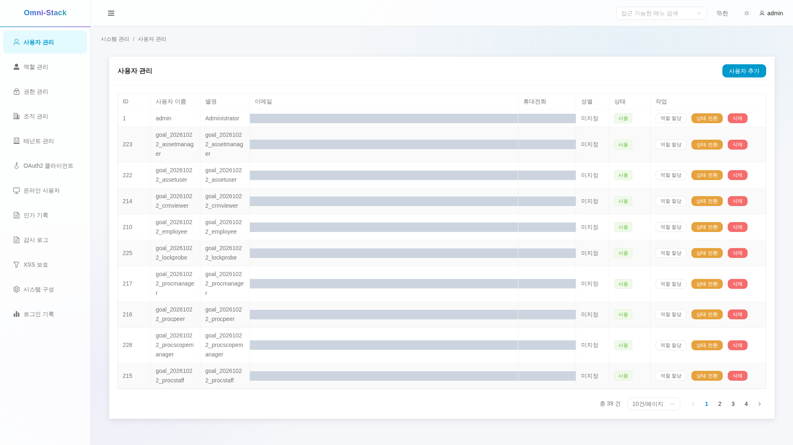

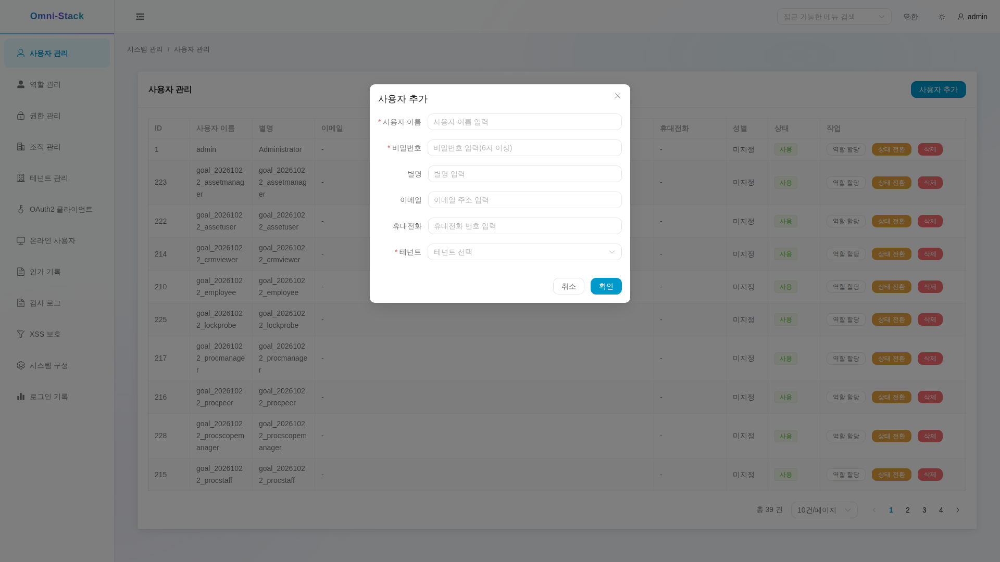

입력할 것: 우상단 "사용자 추가"를 눌러 계정, 비밀번호, 기본 정보를 입력하고 테넌트를 선택해 확인합니다. 중복 계정은 거부되고 비밀번호가 비어 있으면 제출할 수 없습니다.
보이는 것: 실제 생성에 성공하면 기본 역할의 사용자가 목록에 나타나며 필요한 역할을 이어서 부여합니다. 이미지의 빈 양식은 사용자를 생성하지 않았습니다.
실패 시 복구: 사용자 이름이 이미 있으면 다른 이름을 씁니다. 비밀번호가 필수라고 나오면 입력합니다. 역할 부여 후에는 동료에게 다시 로그인하도록 합니다(기존 세션은 새 권한을 자동으로 받지 않습니다).

### 3.2 역할 관리

하고 싶은 일: 직무별로 메뉴와 작업 범위를 정의합니다.
할 수 있는 사람: 관리자.

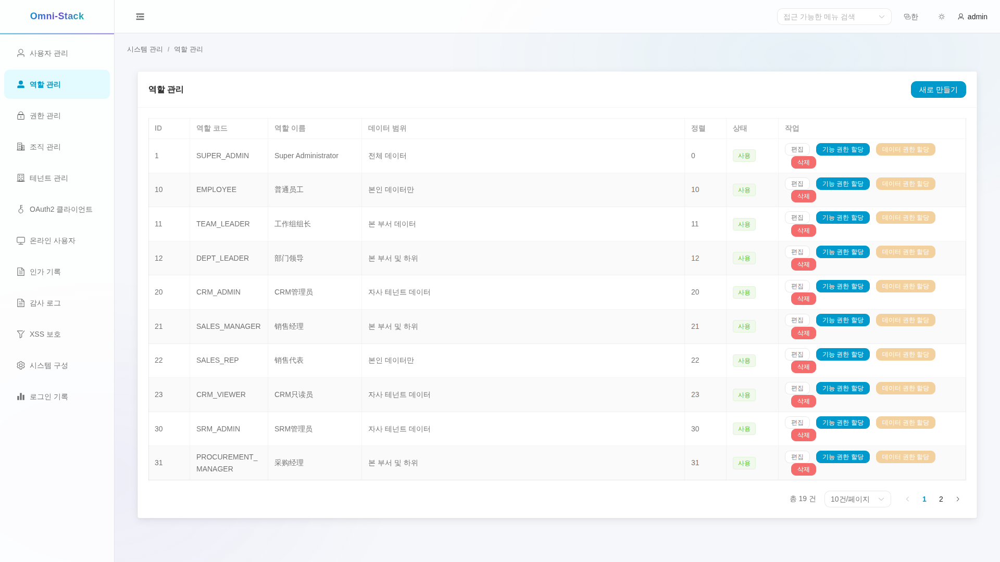

조작과 결과: 역할의 데이터 범위(전체, 본 부서, 본인 등)를 보여 줍니다. 편집에서 기본 정보와 데이터 범위를 정하고, 메뉴·조작은 별도의 "기능 권한 할당"을 사용합니다. 사용자 지정 범위에서만 "데이터 권한 할당"으로 조직을 고를 수 있습니다. 역할 이름은 공유 업무 데이터이므로 화면 언어를 바꿔도 번역되지 않습니다.
실패 시 복구: 권한 부여 후 메뉴가 보이지 않으면 먼저 다시 로그인하게 합니다. 개별 계정을 공유 데이터의 부여 변경으로 "고치지" 말고 역할과 조직을 먼저 확인하세요.

### 3.3 조직 관리

하고 싶은 일: 부서 트리를 유지하고 소속을 올바르게 유지합니다.
할 수 있는 사람: 관리자.

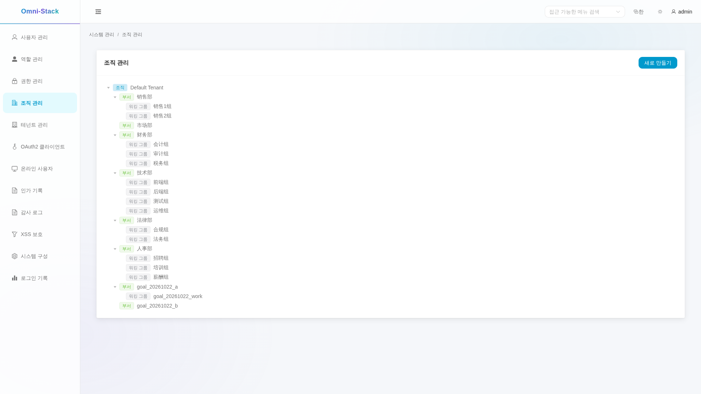

보이는 것: 조직, 부서, 작업 그룹의 부모·자식 관계가 표시됩니다. 부서를 생성해도 사람은 자동 배정되지 않으며 구성원 소속은 별도로 관리합니다. 부서별 데이터 범위는 소속과 이 트리를 함께 사용합니다. Default Tenant라는 루트 조직은 테넌트 전환 버튼이 아닙니다.
실패 시 복구: 이동·삭제 전에 인원과 업무 데이터의 소속을 확인합니다. 사용 중인 조직을 지우지 말고 테스트 조직에서 영향을 확인합니다.

### 3.4 테넌트 관리

하고 싶은 일: 테넌트 정보를 보고 관리합니다.
할 수 있는 사람: 관리자(일부 테넌트 작업은 슈퍼 관리자만 가능).

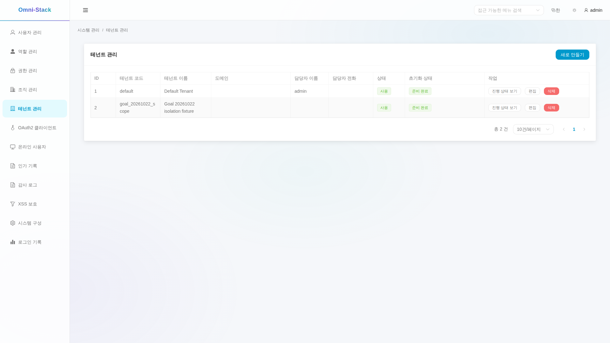

보이는 것: 테넌트와 초기화 상태를 나열할 뿐 행을 선택해도 현재 계정이 전환되지는 않습니다. 다른 테넌트를 이용하려면 해당 테넌트의 정식 계정으로 다시 로그인합니다. 사용자와 업무 데이터는 각 테넌트의 인가 경계로 보호됩니다.
실패 시 복구: 기대한 데이터가 보이지 않으면 데이터 손실을 의심하기 전에 현재 테넌트를 확인하세요.

### 3.5 OAuth2 클라이언트

하고 싶은 일: 연결을 허용할 서드파티 앱을 관리합니다.
할 수 있는 사람: 관리자.

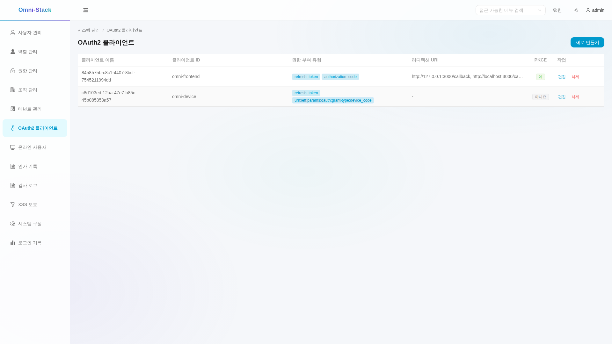

보이는 것: 앱 이름, 클라이언트 식별자, 인가 유형, 리다이렉트 URI, PKCE 필수 여부이며 비활성화 버튼이나 상태 열은 없습니다. 프로젝트의 인가 서버에 연결하는 앱을 관리하며 GitHub·Google 같은 소셜 제공자 설정 화면은 아닙니다.
실패 시 복구: 클라이언트 식별자, 허용된 인가 유형, 완전한 리다이렉트 URI, PKCE 요구를 확인합니다. 실제 소셜 연결에는 외부의 정식 설정도 필요합니다(1.7 참조).

### 3.6 감사 로그, 로그인 기록, 인가 기록

하고 싶은 일: 누가 언제 어떤 보안 관련 작업을 했는지 추적합니다.
할 수 있는 사람: 관리자.

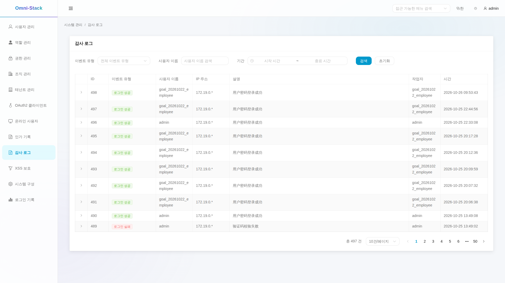

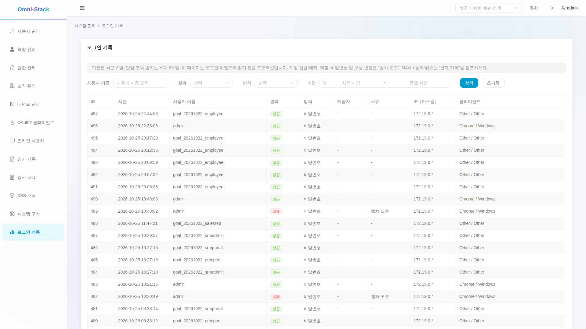

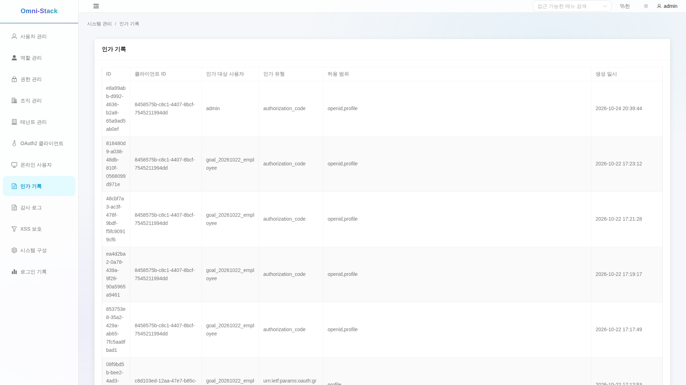

보이는 것: 감사 로그는 로그인 성공·실패, 역할 부여·회수를 최신순으로 보여 줍니다. 로그인 기록은 읽기 전용이며 기본 최근 7일, 한 번 조회는 최대 90일입니다. 인가 기록은 클라이언트, 대상 사용자, 인가 유형, 허용 범위이며 기록 ID는 접근 토큰이 아닙니다. 셋 다 편집할 수 없습니다. 출발지 주소는 화면에서 마스킹하고 전용 테스트 로그인도 실제 감사 이력을 남깁니다.
실패 시 복구: 페이지가 허용한 시간·이벤트 범위로 조회합니다. DB 수정이나 수동 입력으로 감사 이력을 채우지 않습니다.

### 3.7 온라인 사용자

하고 싶은 일: 현재 세션을 보고 필요하면 비정상 세션을 끊습니다.
할 수 있는 사람: 관리자.

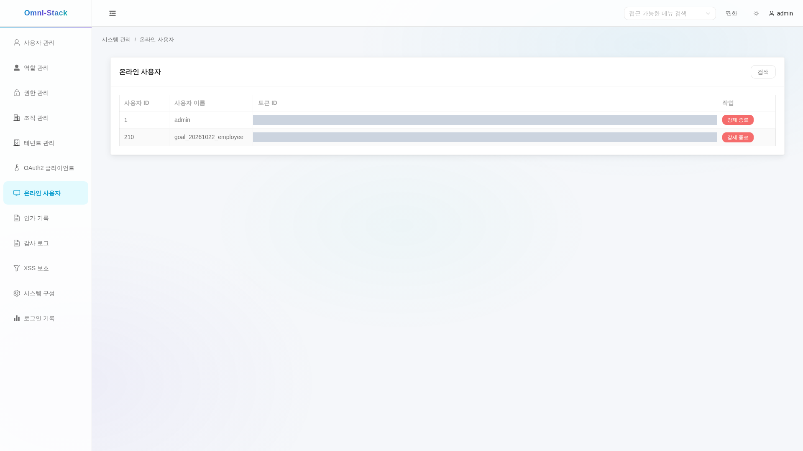

보이는 것: 사용자 ID, 사용자 이름, 세션 토큰 ID이며 로그인 시각 열은 없습니다. 이미지의 세션 식별자는 마스킹했습니다. 강제 종료하면 다시 로그인해야 하지만 이번 촬영에서는 실행하지 않았습니다.
실패 시 복구: 작업은 세션에만 영향을 주고 계정에는 영향을 주지 않습니다. 실수했다면 다시 로그인하게 하세요.

### 3.8 시스템 설정과 XSS 보호

하고 싶은 일: 이 테넌트의 로그인 실패 보호 정책을 조정하고 크로스 사이트 스크립팅 보호 규칙을 유지합니다.
할 수 있는 사람: 관리자.

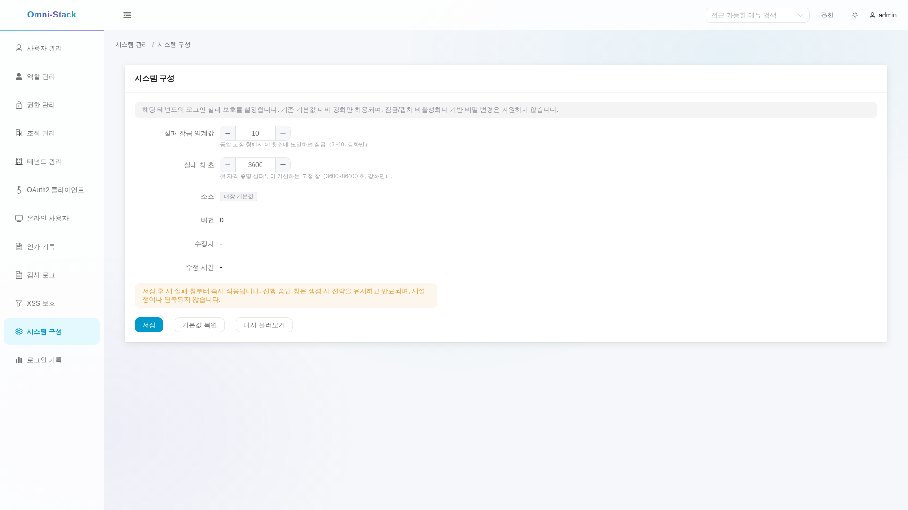

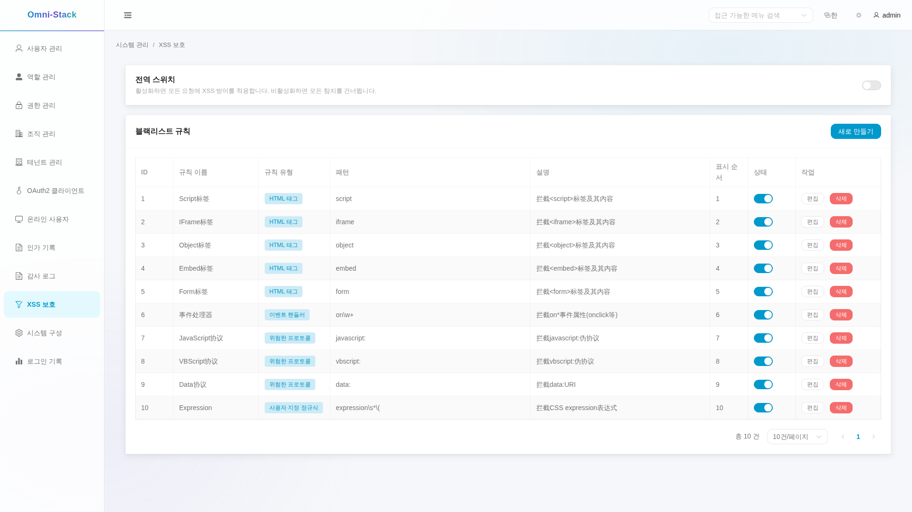

보이는 것: 잠금 임계값과 집계 창은 양식의 제한 안에서 정책을 강화하는 방향으로만 조정합니다. 새로 생성한 실패 집계 창에는 저장된 정책을 적용하고 기존 창은 생성 당시 정책을 유지해 자연 만료되며 초기화하지 않습니다. XSS는 제출 내용의 필터와 규칙을 관리합니다. 이미지의 전체 스위치는 꺼져 있고 개별 규칙은 켜져 있지만 권장 설정은 아니며 촬영에서 바꾸지 않았습니다.
실패 시 복구: 변경 전에 원래 값을 적어 두고 이상이 있으면 되돌립니다. 영향 범위가 불명확하면 피크 시간대에 바꾸지 마세요.

## 4. 사전 관리

하고 싶은 일: 업무 드롭다운 선택지(자산 분류, 위치 등)를 유지합니다.
할 수 있는 사람: 관리자.

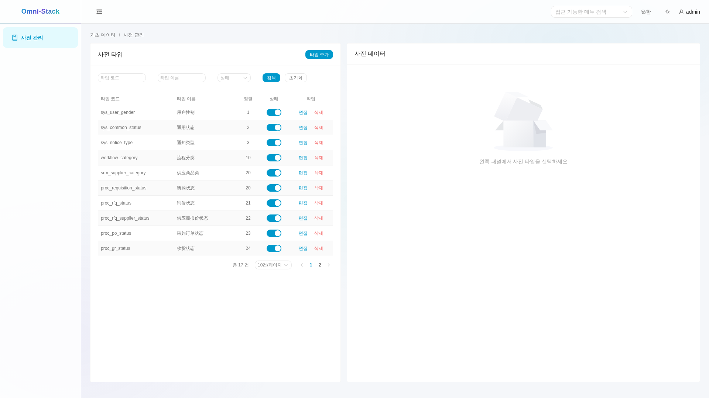

조작과 결과: 왼쪽 사전 유형을 먼저 골라 오른쪽 항목을 관리합니다. 이미지는 유형 미선택 상태이므로 선택 안내가 정상입니다. 유형은 분류, 항목은 선택지를 정합니다. 유형 코드는 고유해야 하고 필수 항목은 비울 수 없습니다.
실패 시 복구: 추가 후 업무 화면에 새 선택지가 없으면 사전 캐시가 갱신되었는지 확인하고, 데이터 항목 수정 후 업무 화면을 새로 고쳐 확인합니다.

## 5. 운영

### 5.1 작업 로그

하고 싶은 일: 애플리케이션의 기록 대상 조작을 누가 수행했는지 확인합니다.
할 수 있는 사람: 관리자.

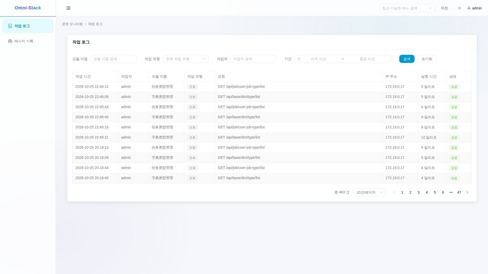

보이는 것: 기록 대상으로 지정된 조회·생성·수정·삭제가 모듈별로 나열되며 이미지에는 실제 조회 기록이 있습니다. 모든 조회가 자동 기록되지는 않습니다. 로그인은 인증 감사와 로그인 기록으로 남습니다. 작업 로그가 지정된 API를 읽는 행위 자체도 로그와 비동기 수집 메시지를 만들 수 있습니다.
실패 시 복구: 기록이 없으면 작업이 실제로 성공했는지 확인하고 시각과 모듈 필터를 다시 봅니다.

### 5.2 메시지 기록

하고 싶은 일: 비동기 메시지 전달 상태를 확인하고 데드레터를 처리합니다.
할 수 있는 사람: 관리자.

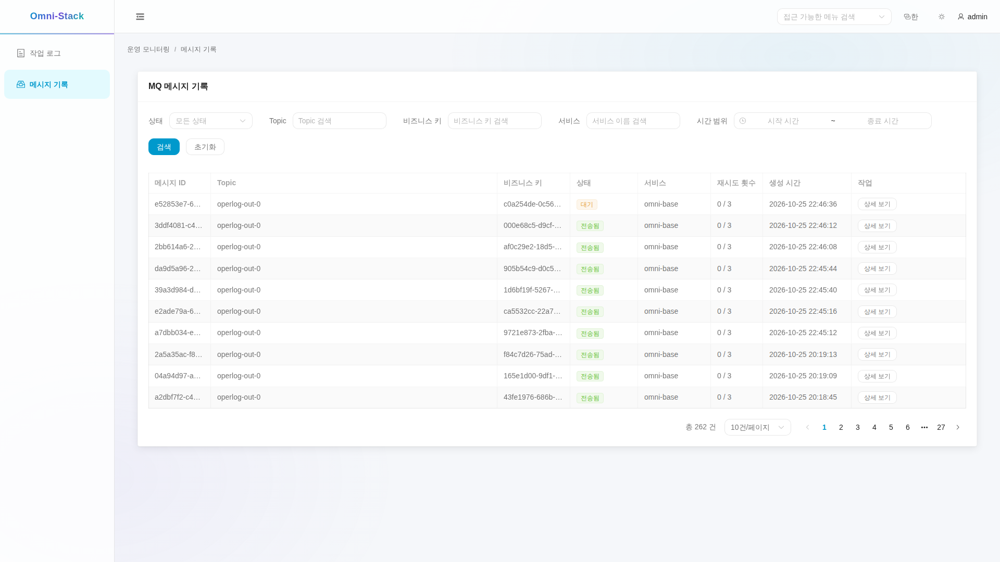

보이는 것: 전송 대기, 전송됨, 실패, 데드레터, 건너뜀 상태입니다. 권한이 있으면 데드레터를 재전송하거나 건너뜁니다. 대기는 아직 브로커에 넘기지 않은 상태이며 전송됨도 브로커 전달 성공일 뿐 수신 측 업무 완료의 증거는 아닙니다.
실패 시 복구: 오래 대기 중이면 먼저 스케줄러와 메시지 서비스가 정상인지 확인합니다. 재전송 전에 업무 부작용이 이미 발생했는지 확인해 중복 처리를 피하세요.

## 6. 작업

### 6.1 개인 작업 유형

하고 싶은 일: 동료가 만들 수 있는 작업 유형을 정의합니다.
할 수 있는 사람: 관리자.

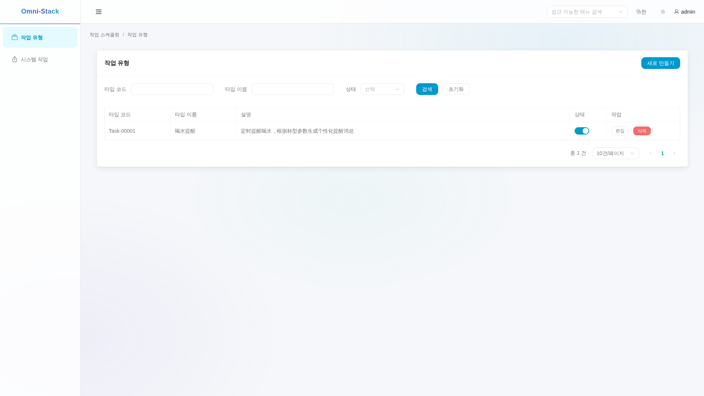

보이는 것: 유형은 개인 작업에서 선택하는 템플릿을 정하며 생성할 때 코드와 이름이 필요합니다. 이미지의 중국어 유형 이름은 공유 업무 데이터입니다. 유형 등록만으로 실행 로직이 배포되지는 않으며 일치하는 애플리케이션 처리기도 필요합니다.
실패 시 복구: 정의 후 개인 작업 화면에 보이지 않으면 유형이 활성인지 확인합니다. 중복 코드로 기존 유형을 덮어쓰지 마세요.

### 6.2 시스템 작업

하고 싶은 일: 내장 시스템 작업과 스케줄 상태를 봅니다.
할 수 있는 사람: 관리자.

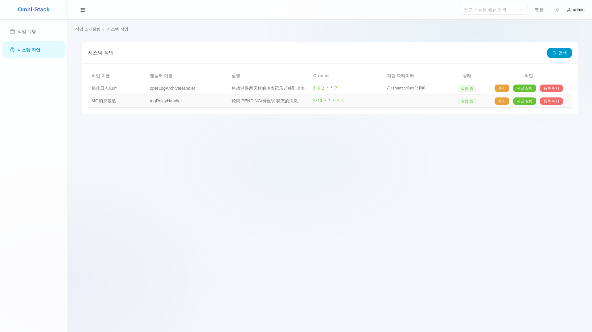

보이는 것: 현재 Base 서비스가 등록한 처리기, 주기, 인수, 상태이며 이미지의 두 행이 플랫폼 전체 작업은 아닙니다. 중지·지금 실행·등록 해제는 실제 조작이지만 이번에는 조회만 했습니다. 서비스 전체 현황은 [분산 작업 관리](distributed-jobs-admin.kr.md)에서 설명합니다.
실패 시 복구: 실행 실패 시 스케줄러와 작업 로그를 먼저 확인합니다. 데모를 성공시키려고 작업 상태를 직접 바꾸지 마세요.

## 7. 승인

### 7.1 프로세스 정의

하고 싶은 일: 게시된 승인 프로세스를 봅니다. 새로 만들거나 바꾸려면 먼저 "프로세스 모델" 페이지에서 설계하고 게시합니다.
할 수 있는 사람: 관리자 또는 프로세스 유지보수 담당자.

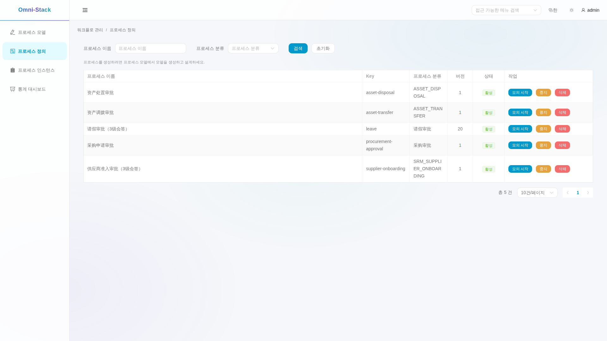

보이는 것: 프로세스 이름, 식별자, 분류, 버전, 실행 상태가 표시되며 게시된 프로세스는 모의 시작·중지·삭제를 할 수 있습니다. 검증을 통과하지 못한 프로세스는 게시할 수 없습니다. 모델 식별자는 같은 테넌트 안에서 고유하며 재게시할 때 같은 식별자의 새 버전을 만듭니다. 매번 새 식별자로 바꾸는 것은 아닙니다.
실패 시 복구: "프로세스 모델" 페이지에서 게시가 실패하면 시작·종료 노드가 있는지, 승인자가 설정되었는지 확인합니다. 사용 중인 게시 버전을 덮어쓰지 마세요.

### 7.2 프로세스 인스턴스

하고 싶은 일: 프로세스가 어디까지 진행되었고 누가 처리 중인지 봅니다.
할 수 있는 사람: 관리자.

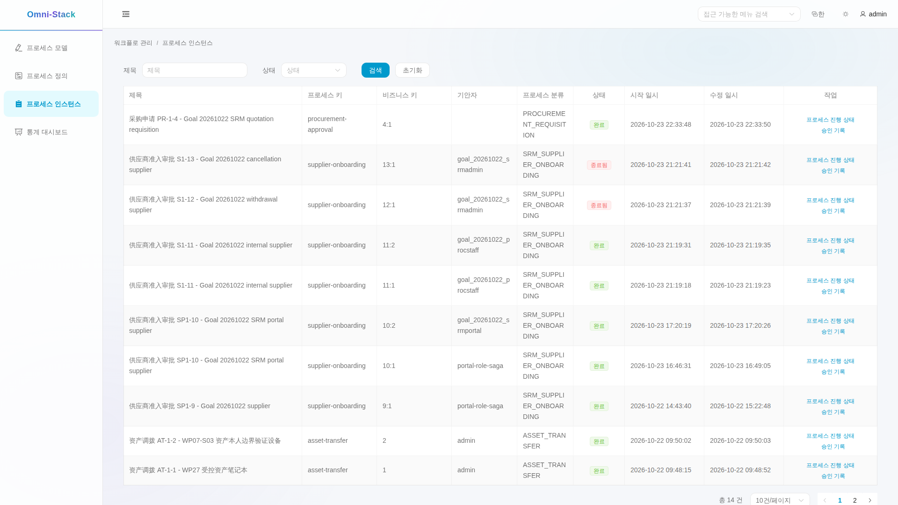

보이는 것: 이미지에는 완료·종료된 기록을 포함한 실제 과거 인스턴스가 있습니다. 제목, 프로세스 식별자, 업무 키, 시작자, 분류, 상태, 시간이 나오며 진행 상황과 승인 기록에서 처리 이력을 확인합니다. 촬영 중 프로세스를 시작·승인·종료하지 않았습니다.
실패 시 복구: 같은 노드에 오래 머물면 후보자에게 할 일이 도착했는지 확인한 뒤 프로세스 유지보수 담당자에게 연락합니다. 프로세스 데이터를 직접 편집하지 마세요.

## 8. 흔한 문제와 복구

- **로그인 후 메뉴가 없음**: 신원과 역할을 확인합니다. 일반 사원에게 업무 메뉴가 없는 것은 정상입니다. 역할 변경 후 다시 로그인해야 합니다.
- **페이지는 열리지만 목록이 비어 있음**: 테넌트, 데이터 범위, 업무 선행 조건(아직 신청이 없음 등)을 확인합니다. 빈 데이터를 고장으로 보지 마세요.
- **권한이 없다고 표시됨**: 권한이 있는 신원으로 바꾸거나 관리자에게 역할에 메뉴 부여를 요청합니다. 관리자 계정을 공유하지 마세요.
- **메뉴 로딩 실패**: "다시 로드"를 누릅니다. 계속 실패하면 관리자에게 서비스 상태 점검을 요청합니다.
- **메시지가 계속 전달 대기**: 스케줄러와 메시지 서비스를 확인하고 재시도 횟수를 봅니다. "표에 행이 있음"을 "전달됨"으로 보지 마세요.
- **가입 후 포털에 들어갈 수 없음**: 초대가 발송되었는지, 입주 심사가 완료되었는지 확인합니다.

## 9. 미검증과 경계

- 외부 소셜 제공자의 실제 계정 연결은 이번에 완료하지 않았습니다. 1.7은 이 경계를 설명할 뿐 프로젝트 자체 OAuth2 로그인의 실패를 뜻하지 않습니다.
- 빈 데이터베이스 최초 설치는 여기서 실측하지 않았습니다. 공유 데이터베이스의 이력과 메뉴 잔존은 빈 DB 동작을 대표하지 않습니다.
- 사용자·역할·이력은 공유 테스트 데이터입니다. 관리 접근 거부는 전용 일반 사원, 나머지 관리 이미지는 통제된 관리자 테스트 계정이며 모든 일반 계정이 관리 권한을 가진다는 뜻은 아닙니다.
- 양식은 미제출이며 기기 대기 화면과 인가 로그인 화면에서 인가를 완료하지 않았습니다. 그림의 CAPTCHA·단기 코드·QR 코드는 재사용할 수 없습니다. 이미지는 표시 상태의 설명이며 전체 업무 흐름 검증을 대신하지 않습니다.
