# 平台功能图文教程：官网、工作台、系统、任务与审批

这页面向日常使用 Omni-Stack 的同事，只讲“在界面上点什么、会看到什么、出问题怎么恢复”，不讲部署和代码。截图来自本机 Docker 中运行的真实环境：首页图为无需登录的 Wiki，业务图使用开发租户的专用测试身份。自动取证使用受控测试登录，不冒称真人填写验证码；用户列表的联系方式与在线会话标识已遮罩，页面和业务结果没有改写。按钮与页面名称以界面实际显示为准。

## 读前须知

- **你会用到的身份**：管理员（能看到全部平台菜单）、普通员工（能登录，但没有管理菜单，直接打开管理页面会被拦下）、资产使用人（只看到「我的资产」）、供应商（从供应商门户进入，看不到内部管理页面）。
- **登录需要真实验证码**：打开登录页后，按页面显示的图形验证码填写；验证码一次有效，看不清就点图片换一张。本教程不提供任何跳过验证的方式。
- **数据是共享的**：当前环境由全量预设初始化，你看到的历史记录、用户和资产可能来自其他人的验证。教程不会为了演示去清空数据或改动角色授权。
- **尚有两处未在生产条件验证**：本次没有完成外部社交平台真实账号实联；空数据库的首次安装未在本环境实测。外部社交实联与本项目自己的 OAuth2 登录是两类验证，正文会分别说明。

## 一、官网与登录入口

### 1.1 不登录也能阅读项目 Wiki

想完成什么：先了解项目、阅读教程，再找到登录和供应商入口。
谁可以使用：所有人，无需登录。
从哪里进：浏览器打开 `http://localhost:3000`。

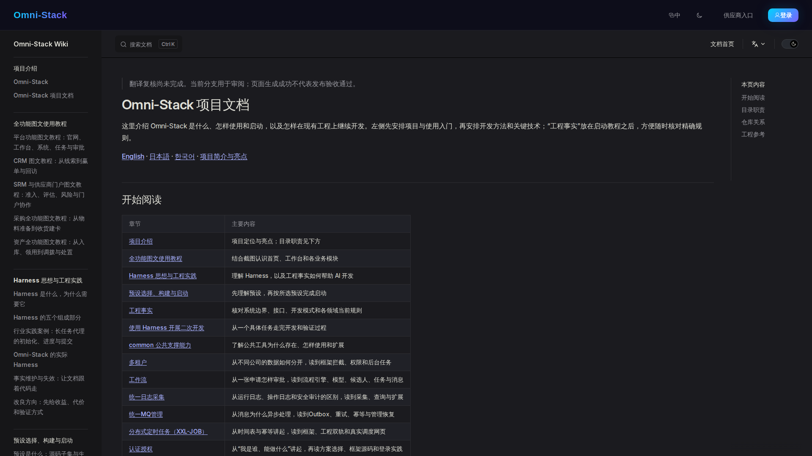

看到什么：首页直接展示项目 Wiki。点击左侧章节或中间的阅读入口打开正文，使用文档顶部的搜索查找内容；右侧目录可以定位当前文章的小节。右上角「登录」进入内部账号登录，「供应商入口」进入供应商门户。已登录的内部用户回到这里仍可阅读同一份 Wiki；拥有工作台访问权限时，账户区的业务入口只有「我的工作台」，点击后在新网页标签中打开，原 Wiki 首页保留。
失败怎么恢复：文档加载失败时，点击页面提供的「重试」，也可以单独打开 Wiki。若整个站点无法访问，先确认应用已启动、地址和端口与你的环境一致，再刷新；不要反复提交登录。

### 1.2 用管理员账号登录

想完成什么：登录后打开我的工作台，找到可用的平台应用。
谁能做：拥有管理员账号的同事。
从哪里进：首页「登录」，或直接打开登录页。

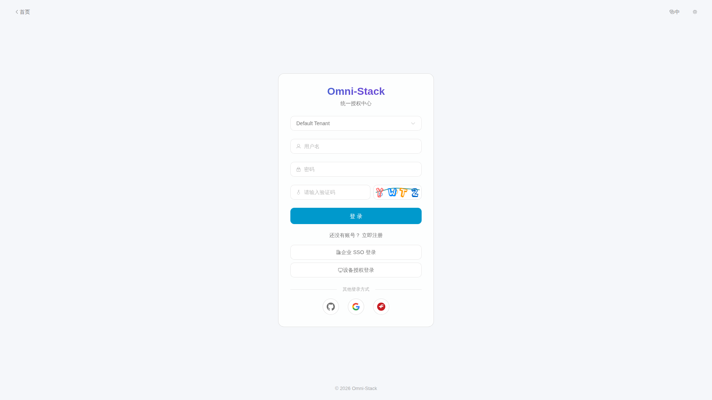

点什么、填什么：先选账号所属租户，再输入账号与密码，在验证码输入框填当前图片中的字符（点击图片可以换一张），然后提交。
看到什么：从首页正常登录、没有指定返回页面时，会回到 Wiki 首页，顶部显示当前账号；点击「我的工作台」再进入业务工作区。若原先打开的是需要登录的页面，登录后会返回该页面。能看到哪些应用和管理菜单，由账号权限决定。

接下来怎么进入业务：在工作台的「应用目录」或「应用」弹窗里选择模块，浏览器会打开一个新的业务标签，原工作台标签会保留。业务页只提供当前模块菜单，右上角搜索也只找当前模块；没有全局应用按钮、其他模块候选或返回首页/工作台的按钮。要回工作台，切换到最初的工作台标签，或关闭刚打开的业务标签。

失败怎么恢复：提示验证码错误时，换一张图重新填写，旧验证码会立即失效；提示密码错误时确认大小写与输入法，不要连续试错；账号被停用请联系管理员确认状态。

### 1.3 自助注册新账号

想完成什么：让新同事自己创建账号，再由管理员分配角色。
谁能做：允许自助注册的租户中的新同事；内部账号注册页不要求供应商邀请令牌。
从哪里进：登录页下方的「注册」入口。

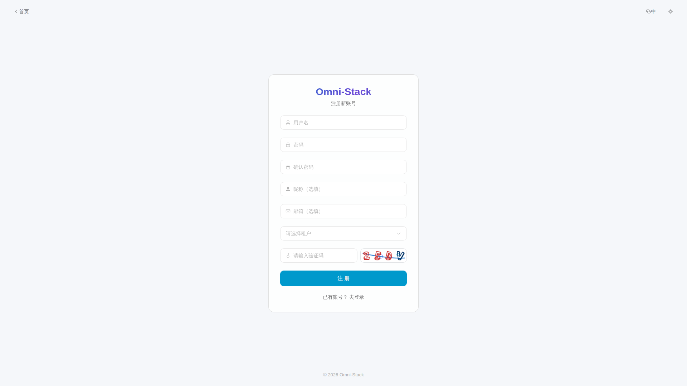

点什么、填什么：填写账号、密码并重复确认，按需填昵称与邮箱，选择正确租户，输入验证码后提交。图中表单没有提交，不表示已经创建了账号。
看到什么：注册成功后可以登录，但只有基础身份，看不到业务菜单；需要管理员在用户管理里补充角色和组织。
失败怎么恢复：提示账号已存在时更换账号名；验证码错误时换图重填；注册频繁被拦时稍后再试，不要用脚本批量注册。

### 1.4 供应商从门户登录与注册

想完成什么：供应商只进入门户，处理自己的资料、评估和报价，不接触内部管理页面。
谁能做：供应商联系人。还没有账号时先注册；企业入驻另需有效邀请，并不随账号注册自动完成。
从哪里进：首页「供应商入口」，或直接打开门户登录页。

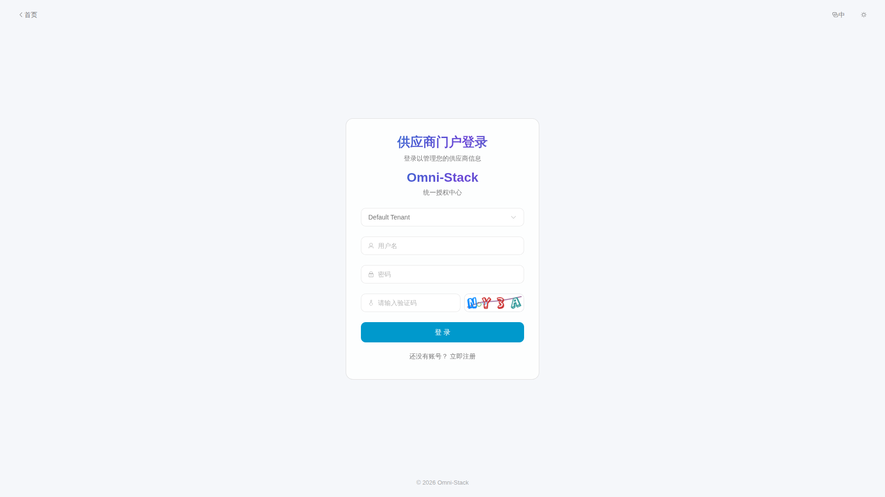

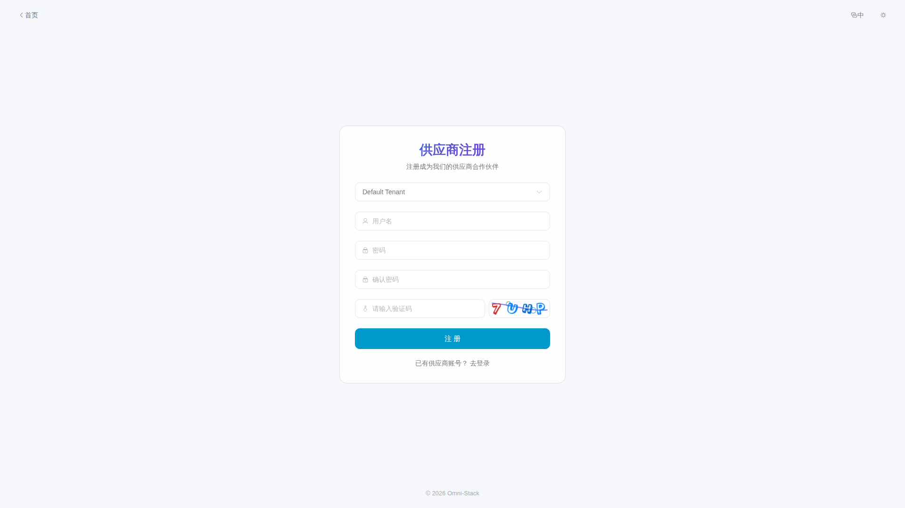

点什么、填什么：在注册页只创建认证账号，然后从门户登录。尚未完成入驻时，用邀请令牌提交企业入驻申请；审核通过、供应商角色和有效关联建立后，才能使用获授权的资料、评估和报价功能。
看到什么：已入驻的供应商进入自己的门户，页面不会出现内部管理菜单；直接输入内部管理地址也不会增加权限。这两张图只是未提交的入口表单，不代表入驻或审批成功。
失败怎么恢复：注册后无法使用业务功能，先确认登录租户、邀请有效期、入驻审核和账号关联，请采购对接人核对；不要反复注册同一家企业。

### 1.5 设备授权

想完成什么：在没有浏览器的设备上完成登录授权。
谁能做：需要登录的同事。
从哪里进：登录页的「设备授权」入口。

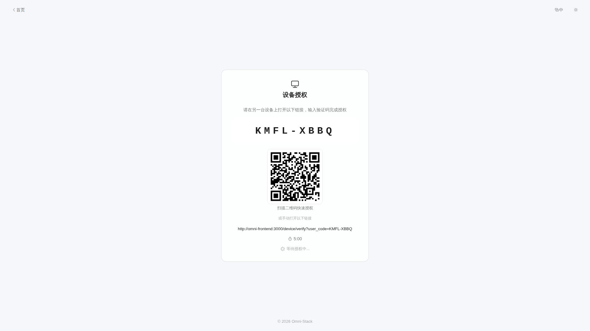

点什么、看到什么：在能够登录的另一台设备打开当前页面给出的验证地址，或扫描当前二维码，核对请求后确认，再回原设备等待结果。图中只是等待状态，没有代你确认授权。示例使用容器内地址；实际操作应使用自己部署的可访问地址，不能照抄图中地址、已过期用户码或二维码。
失败怎么恢复：授权码过期就重新发起一次；不要在陌生设备上确认你不认识的授权请求。

### 1.6 授权确认

想完成什么：确认第三方应用可以代表你访问哪些信息。
谁能做：正在使用第三方应用登录的同事。
从哪里进：登录流程自动跳转。

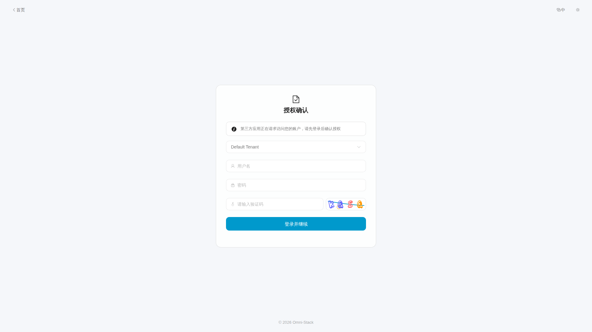

点什么、看到什么：先在合法应用发起的流程中登录，再核对应用及其申请范围，决定是否同意。截图只展示登录前的入口，没有展示权限列表或授权成功；不要因为看见这张表单就认为应用已经拿到权限。
失败怎么恢复：页面提示请求无效时，从原应用重新发起登录；不要手动拼接地址反复尝试。

### 1.7 社交登录回调（外部真实账号实联未验证）

想完成什么：用外部平台账号登录。
现状：本次没有完成外部平台真实账号实联。直接打开回调地址而没有合法授权上下文，只能展示登录或拒绝状态，不能据此判断完整社交登录成功或失效。配置好外部平台后，仍需从正常入口完成授权；本项目自己的 OAuth2 登录与外部社交平台实联是两件事，不能混为一谈。

### 1.8 无权限与页面不存在

想完成什么：理解被拦下时发生了什么，以及该找谁。
谁能做：任何身份都可能遇到。
从哪里进：普通员工直接打开管理页面，或输入一个不存在的地址。

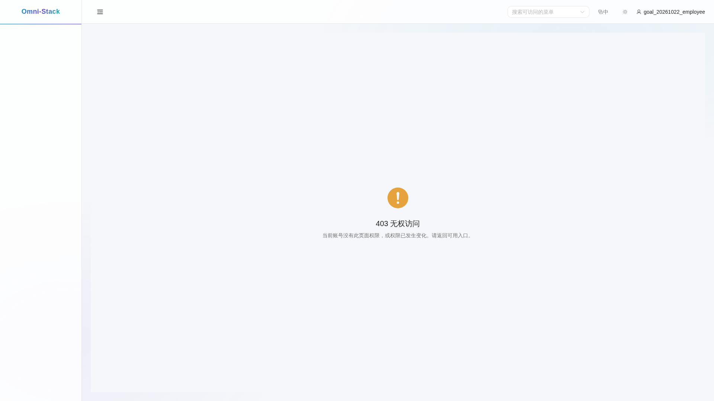

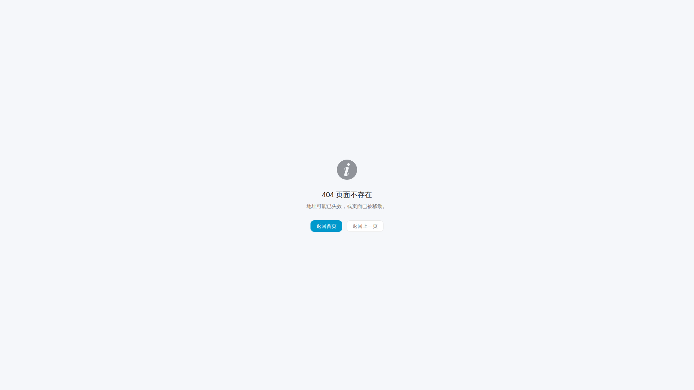

看到什么：内部无权限时不会显示目标内容，也不提供返回首页、上一页或工作台的按钮；切换回原工作台标签或关闭该业务标签即可。公开匿名地址错误则显示独立的 404 页面，可用首页或上一页按钮恢复，两者不能混为一谈。
失败怎么恢复：确认是否用错身份（例如用员工账号打开了管理页面）；确实需要权限时，请管理员在角色里授予对应菜单，而不是让同事共用管理员账号。

### 1.9 菜单加载失败后的恢复

想完成什么：在工作台菜单加载失败时恢复页面。
看到什么：工作台显示“功能菜单加载失败，你可以重试”，应用目录为空。
失败怎么恢复：点击页面上的「重新加载」按钮；恢复后重新出现应用目录。若多次重试仍失败，联系管理员检查服务状态，不要在浏览器里反复刷新制造重复请求。

## 二、统一工作台驾驶舱

首页的「我的工作台」会打开新网页标签，原 Wiki 首页保留。工作台没有返回首页或 Wiki 的导航按钮；需要读文档时切换回原标签。概览、待我审批和我的任务在同一个页面里，不必在三个页面之间切换。

### 2.1 账户、概览与应用

想完成什么：先看自己的账户、实际统计、待办和可进入的应用。
谁能做：具备工作台访问资格的登录身份；应用和审批仍按权限与预设展示。

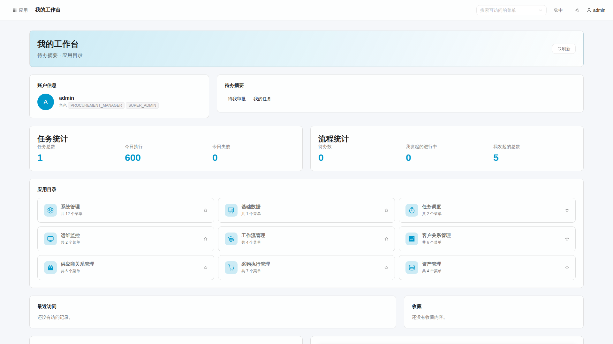

看到什么：账户和角色、任务/审批概览、应用目录、最近访问与收藏。管理员的全量目录有九个应用；其他身份只展示自己已授权且已部署的入口。工作台的「应用」弹窗和顶部搜索可查全部可访问菜单，不是未授权功能。
怎么进入业务：点应用目录、弹窗或搜索结果，在新业务标签打开模块，原工作台保留。业务页只显示本模块侧栏和本模块搜索，不再提供全局应用切换。返回工作台请切换原标签。
失败怎么恢复：没有业务权限时目录为空可以是正常结果；加载或统计查询失败应按页面重试，不能把失败当成零。裁剪了工作流的预设不显示审批面板，也不代表故障。

### 2.2 同页处理我的审批

想完成什么：处理分配给自己的审批。
从哪里进：工作台的审批概览入口，或向下滚到「待我审批」。

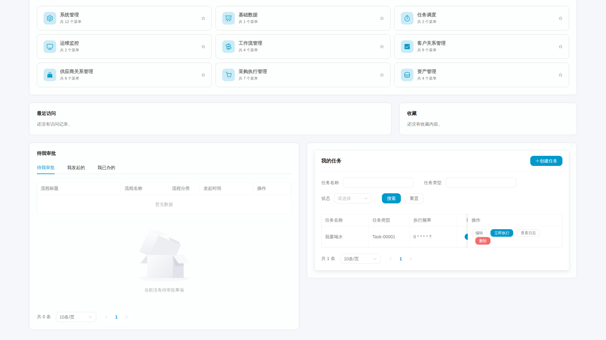

看到什么：面板有「待我审批」「我发起的」「我已办的」页签；当前图中的审批列表为空。有真实任务时再打开对应流程处理，其他任务与工作台区域仍在同一页。内部工作台和业务页的无权限/错误页面不会提供返回首页或上一页按钮。
失败怎么恢复：先确认流程已发起且候选人包含自己，不直接改任务数据制造待办。业务权限由服务端继续核对，不能靠菜单是否可见判断全部权限。

### 2.3 同页管理我的任务

想完成什么：创建、编辑、启停、手动执行、查看日志和删除自己的定时任务。
从哪里进：任务概览入口，或向下滚到「我的任务」。

看到什么：自己的任务列表、周期、状态及执行信息；用筛选缩小范围，用创建或编辑表单维护参数。审批与任务并排时，横向滚动表格查看没有入镜的列，不能据裁切推断状态。
失败怎么恢复：暂停停止后续定时调度，仍可手动执行；触发受理后检查新的执行日志。注册或删除结果未知时保留关联核对，不重复创建或改库隐藏记录。完整操作和恢复见[分布式定时任务](distributed-jobs-usage.md)。

## 三、系统管理

### 3.1 用户管理

想完成什么：新建同事账号、分配角色、停用离开的账号。
谁能做：管理员。

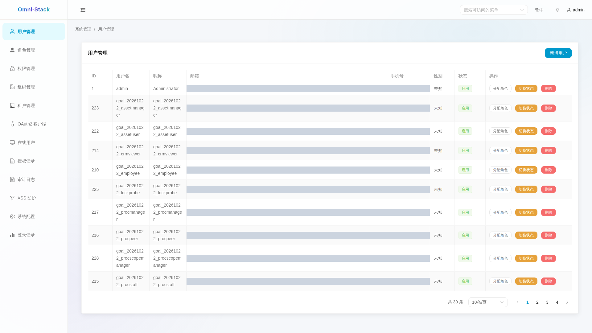

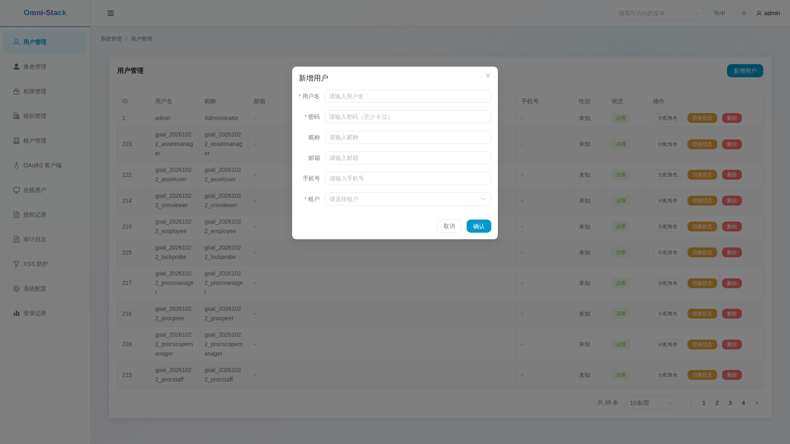

点什么、填什么：点右上角「新增用户」，填写账号、密码和基本信息，选择租户后确认；账号重复会被拒绝，密码为空无法提交。
看到什么：实际创建成功后，新用户出现在列表中，默认只有基础身份，需要继续分配所需角色。图中的空白表单没有创建用户。
失败怎么恢复：提示用户名已存在就换一个；提示密码不能为空就补全；给同事分配角色后让其重新登录，旧会话不会自动获得新权限。

### 3.2 角色管理

想完成什么：给一类岗位定义菜单和操作范围。
谁能做：管理员。

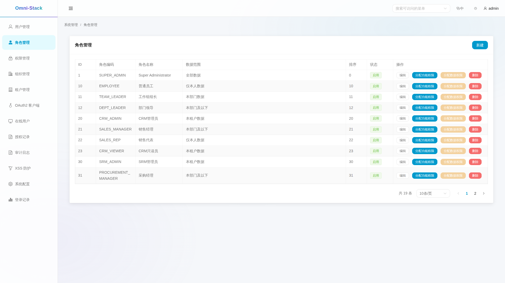

点什么、看到什么：角色列表展示数据范围（全部、本部门、本人等）。「编辑」维护基本信息并选择数据范围；勾选菜单和操作要点独立的「分配功能权限」。只有选了自定义数据范围，才可用「分配数据权限」选择组织。角色名称属于共享业务数据，切换语言不会翻译已有名称。
失败怎么恢复：授权后同事看不到菜单，先让其重新登录；不要通过修改共享数据的授权来“修”个别账号的问题，应先确认角色与组织是否正确。

### 3.3 组织管理

想完成什么：维护部门树，确定人员归属。
谁能做：管理员。

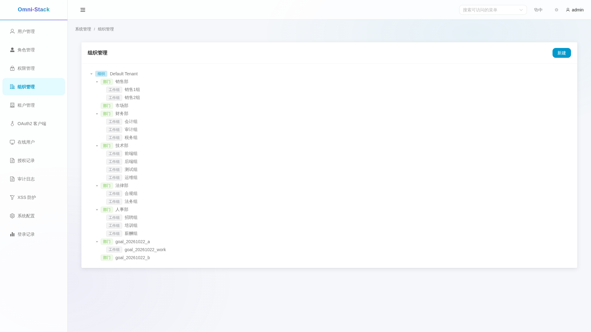

看到什么：组织、部门与工作组按父子关系展示；新增部门不会自动把人员分配进去，人员归属仍需单独维护。“本部门/本部门及下级”的数据范围结合人员归属与这棵树计算。图中的根组织虽叫 Default Tenant，也不是切换租户的控件。
失败怎么恢复：移动或删除组织前核对人员与业务数据归属；先在测试组织验证影响，不直接删除仍在使用的原组织。

### 3.4 租户管理

想完成什么：查看和管理租户信息。
谁能做：管理员（部分租户操作仅超级管理员可用）。

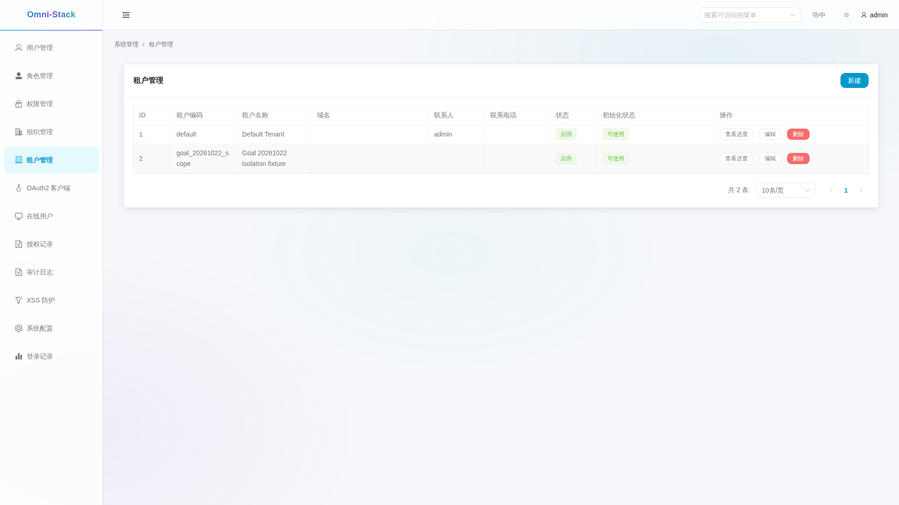

看到什么：列表展示租户与初始化状态，不是切换当前身份的控件。要进入另一个租户，需用该租户的合法账号重新登录；不同租户的用户与业务数据受各自权限边界保护。
失败怎么恢复：看不到预期数据时先确认当前租户，而不是怀疑数据丢失。

### 3.5 OAuth2 客户端

想完成什么：管理允许接入的第三方应用。
谁能做：管理员。

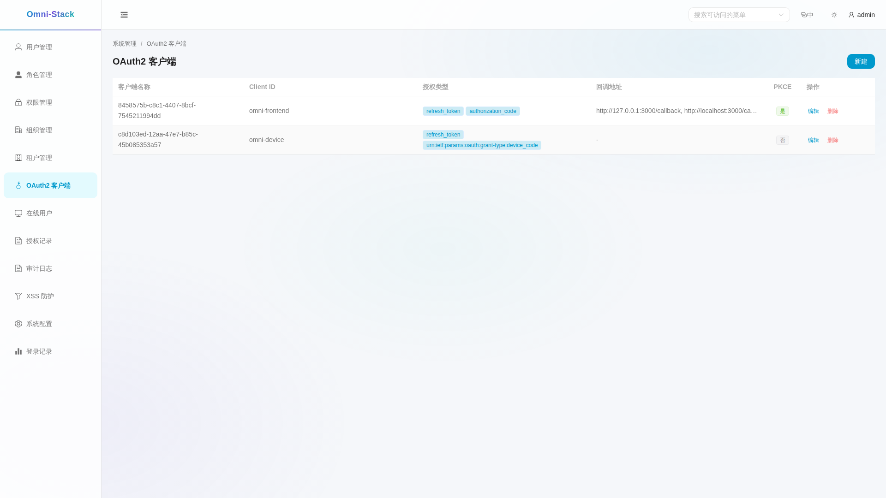

看到什么：列表展示应用名称、客户端标识、授权类型、回调地址和是否强制 PKCE；当前页面没有“停用客户端”或状态列。它管理接入本项目授权服务器的应用，不等于 GitHub、Google 等社交平台的配置页。
失败怎么恢复：应用登录失败时，核对客户端标识、授权类型、完整回调地址及 PKCE 要求；社交平台实联还需要各自的合法配置，见 1.7。

### 3.6 审计日志、登录记录与授权记录

想完成什么：追溯谁在什么时间做了什么安全相关操作。
谁能做：管理员。

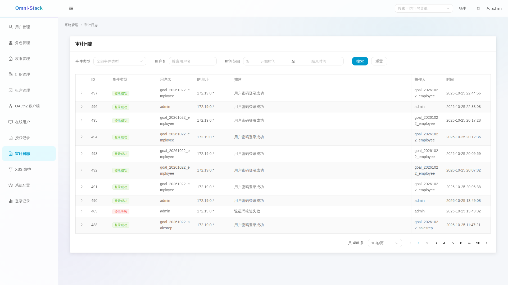

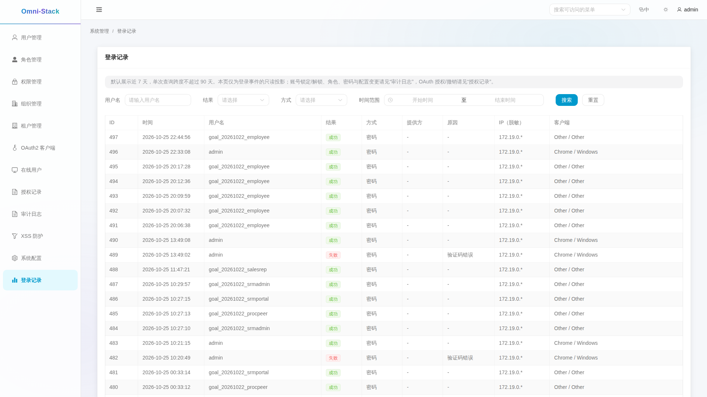

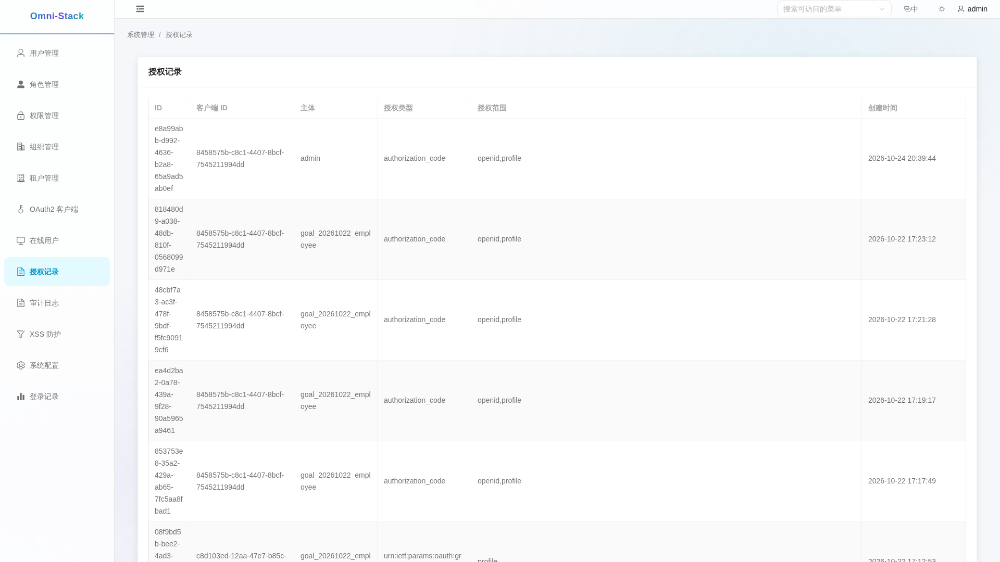

看到什么：审计日志按时间倒序展示登录成功、失败、角色分配与撤销等安全事件；登录记录是登录事件的只读视图，默认最近七天、一次最多九十天；授权记录展示客户端、被授权用户、授权类型与范围。记录标识不是访问令牌。三者都不可在这里修改。截图中的来源地址由页面脱敏，专用测试登录也会如实留下审计记录。
失败怎么恢复：找不到某次操作时，按页面允许的时间范围或事件类型筛选；不要改库或手工补写审计记录。

### 3.7 在线用户

想完成什么：查看当前登录会话，必要时让异常会话下线。
谁能做：管理员。

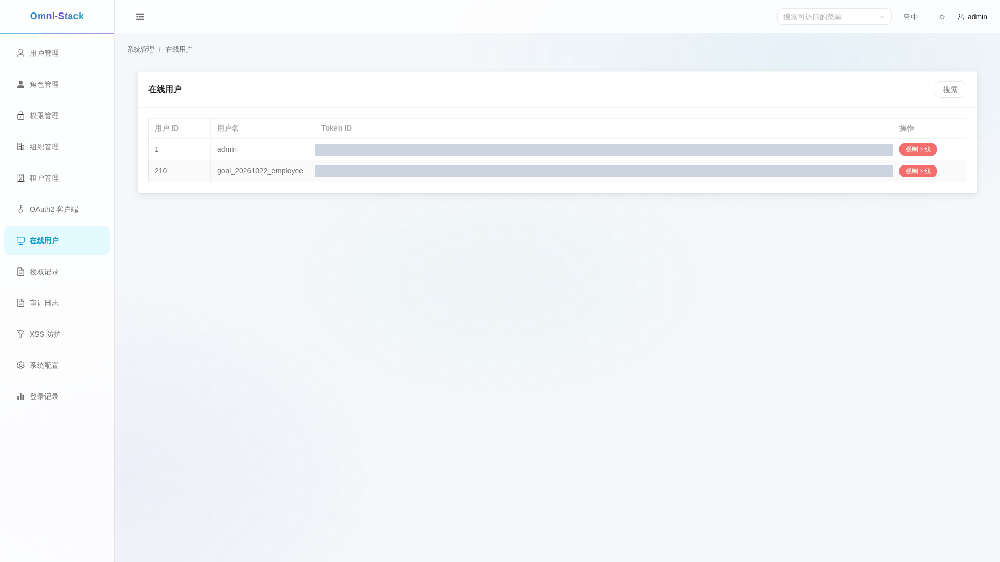

看到什么：当前列表显示用户编号、用户名和会话 Token ID，没有登录时间列。图中的会话标识已遮罩；「强制下线」会使该用户需要重新登录，本次截图没有执行这个动作。
失败怎么恢复：下线操作只影响会话，不影响账号本身；误操作后让对方重新登录即可。

### 3.8 系统配置与 XSS 防护

想完成什么：调整本租户的登录失败保护策略，维护跨站脚本防护规则。
谁能做：管理员。

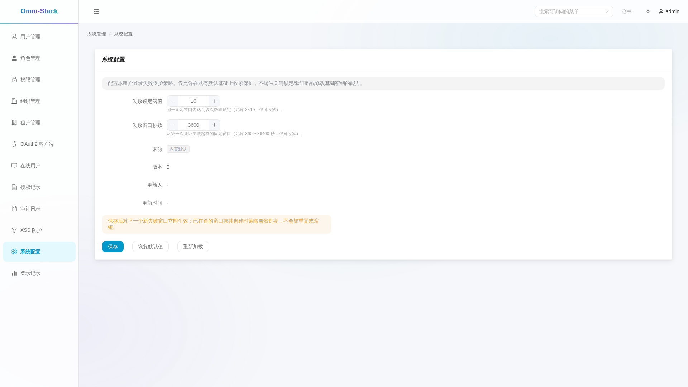

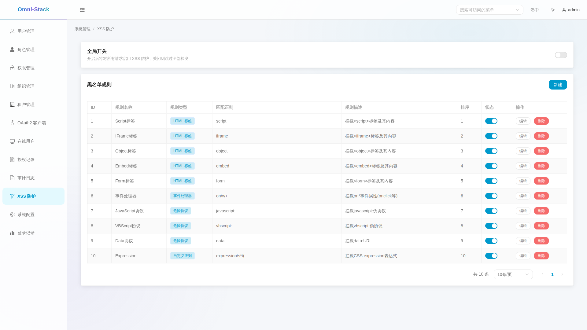

看到什么：系统配置页管理登录失败的锁定阈值与统计窗口，只允许按页面约束收紧策略。保存后，新建的失败统计窗口采用新策略；已在途的窗口保留创建时策略并自然到期，不被重置。XSS 页维护提交内容的过滤开关与规则；图中全局开关关闭、规则仍启用，只是实际状态，不是推荐配置，本次没有改动。
失败怎么恢复：改动前记下原值，出现异常时改回；不确定影响范围时不要在业务高峰调整。

## 四、字典管理

想完成什么：维护业务下拉选项（如资产品类、位置）。
谁能做：管理员。

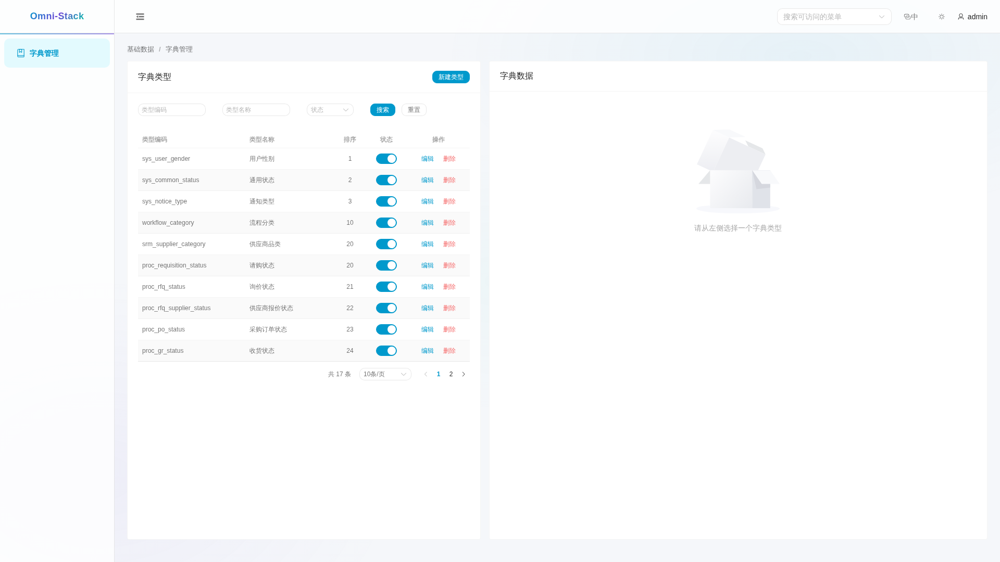

点什么、看到什么：先点左侧的字典类型，再在右侧查看和维护数据项。图中尚未选择类型，右侧的选择提示是正常状态。类型决定下拉分类，数据项决定具体选项；类型编码不能重复，必填项不能留空。
失败怎么恢复：新增后业务页面没出现新选项，先确认字典是否已刷新缓存；修改数据项后回到业务页刷新查看。

## 五、运维

### 5.1 操作日志

想完成什么：查看谁在业务页面执行了哪些已纳入记录的操作。
谁能做：管理员。

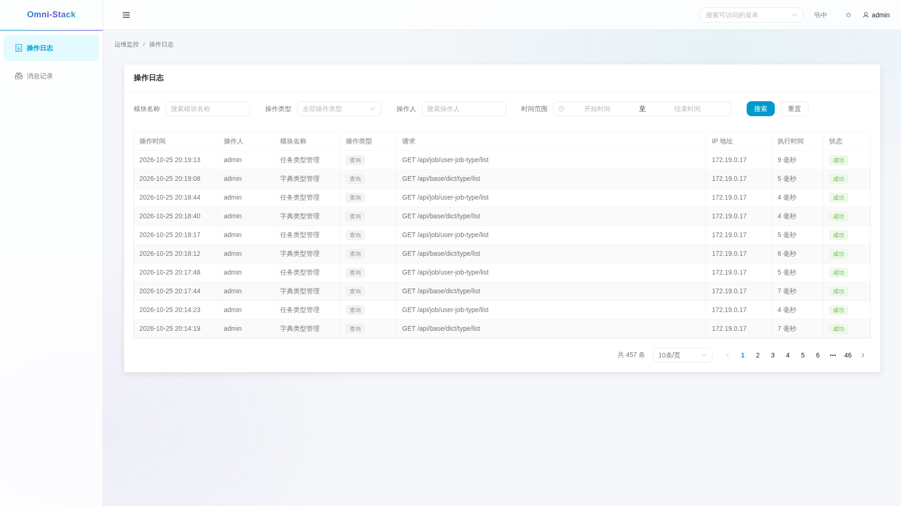

看到什么：操作日志按模块记录已纳入记录范围的查询、新增、修改和删除，图中就是实际查询记录；并非所有查询都自动留存。登录行为在认证审计与登录记录中。读取带操作记录的接口本身也可能留下日志，并通过消息异步归集。
失败怎么恢复：查不到记录时先确认操作是否真正提交成功，再核对时间与模块筛选。

### 5.2 消息记录

想完成什么：查看异步消息的投递状态，处理进入死信的消息。
谁能做：管理员。

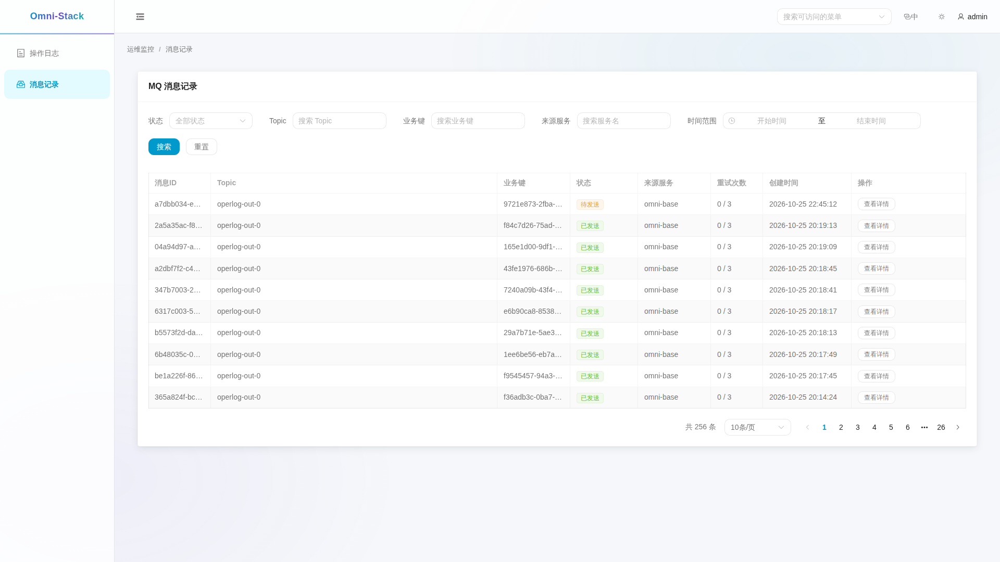

看到什么：页面有待发送、已发送、失败、死信和已跳过等状态；死信可按权限重发或跳过。图中的待发送还没有交给消息中间件；已发送只说明发送侧已成功交付中间件，不能证明接收方已处理完业务。
失败怎么恢复：消息长期等待时先确认调度与消息服务是否正常；重发前确认业务是否已产生副作用，避免重复处理。

## 六、任务

### 6.1 个人任务类型

想完成什么：定义同事可以创建的任务类型。
谁能做：管理员。

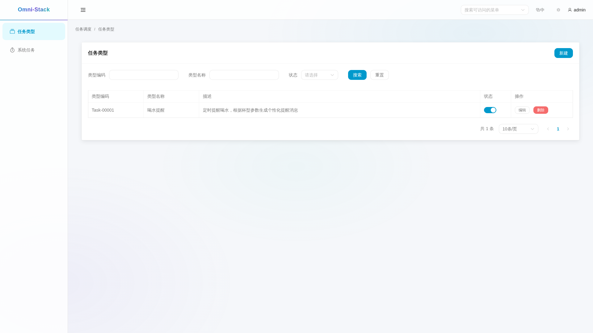

看到什么：类型决定个人任务创建时可选的模板，新增时需填写类型编码与名称。图中的中文类型名称属于共享数据；登记一个类型不等于已经部署对应执行逻辑，还要有程序提供的处理器与之匹配。
失败怎么恢复：定义后个人任务页看不到该类型，确认类型是否启用；不要用重复编码覆盖已有类型。

### 6.2 系统任务

想完成什么：查看系统内置任务及其调度状态。
谁能做：管理员。

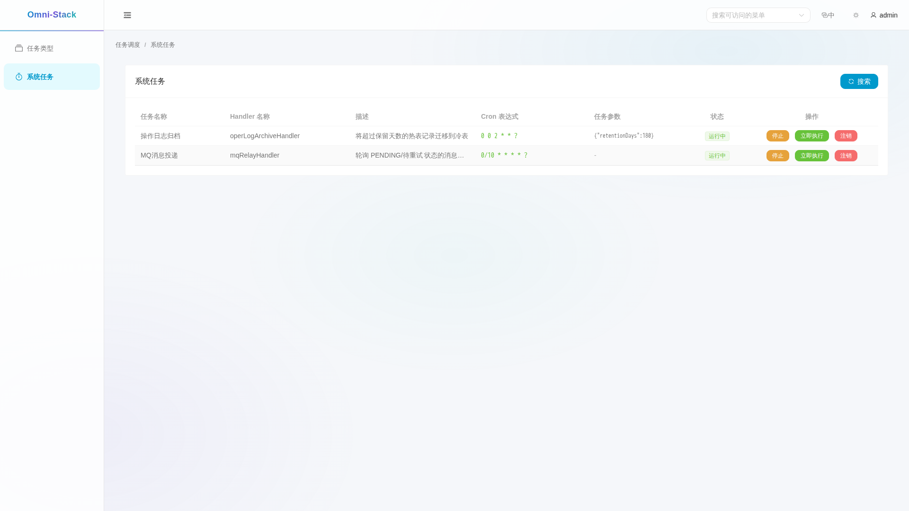

看到什么：页面列出当前 Base 服务登记的系统任务及其处理器、执行周期、参数与状态；图中两条记录并不是整个平台的全部任务。可停止、立即执行或注销；「立即执行」会真实触发一次任务，本次只查看，没有触发。跨服务的任务全貌见[分布式定时任务管理](distributed-jobs-admin.md)。
失败怎么恢复：执行失败时先看调度中心与任务日志；不要为了“演示成功”手动改任务状态。

## 七、审批

### 7.1 流程定义

想完成什么：查看已发布的审批流程；新建或修改流程要先到「流程模型」页设计并发布。
谁能做：管理员或流程维护人员。

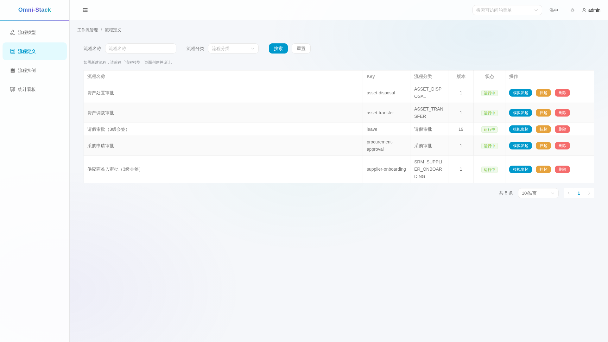

看到什么：列表显示流程名称、标识、分类、版本与运行状态，可对已发布流程做模拟发起、挂起或删除；未通过校验的流程不能发布。同一租户内一个模型使用唯一标识，多次发布沿用该标识并产生不同版本，不是每次发布都要换一个标识。
失败怎么恢复：在「流程模型」页发布失败时，先检查流程图是否有开始与结束节点、审批人配置是否完整；不要覆盖正在使用的已发布版本。

### 7.2 流程实例

想完成什么：查看流程运行到哪一步、由谁处理。
谁能做：管理员。

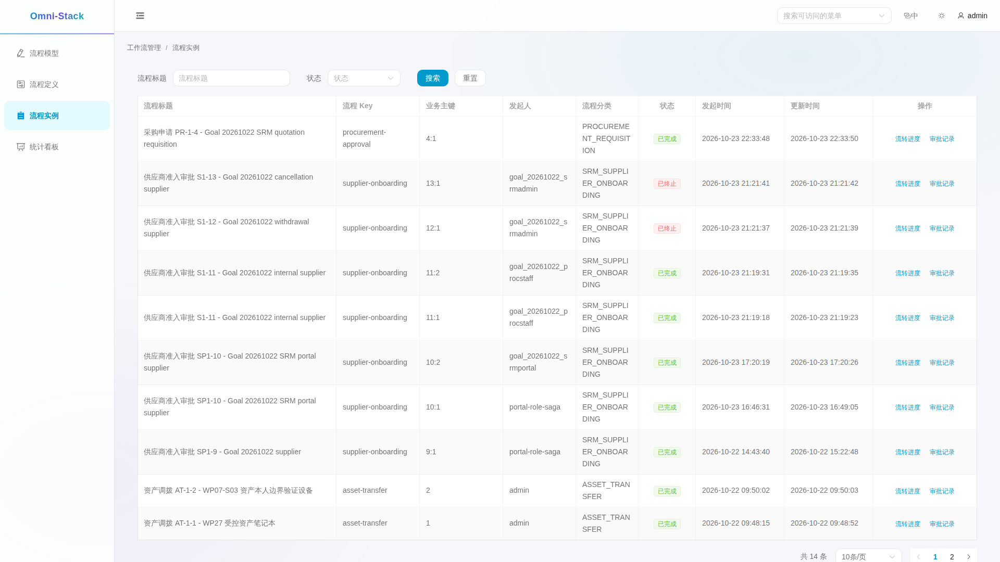

看到什么：图中有真实的历史流程实例，包括已完成与已终止的记录；列表展示流程标题、流程标识、业务主键、发起人、分类、状态与时间。可从流转进度和审批记录入口查看处理过程；本次取图没有发起、批准或终止流程。
失败怎么恢复：实例长时间停在同一节点时，先确认候选人是否收到待办，再联系流程维护人员，不要直接改流程数据。

## 八、常见问题与恢复

- **登录后没有菜单**：确认身份与角色；普通员工没有业务菜单是正常结果。角色变更后需要重新登录。
- **页面能打开但列表为空**：先确认租户、数据范围和业务前提（例如还没有申请单），不要把空数据当成故障。
- **提示无权限**：换用有权限的身份，或请管理员在角色中授予对应菜单；不要共用管理员账号。
- **菜单加载失败**：点「重新加载」；仍失败时联系管理员检查服务状态。
- **消息一直等待投递**：确认调度与消息服务正常，再看重试次数；不要用“表里有记录”当作“已送达”。
- **注册后进不去门户**：确认邀请是否发出、入驻审核是否完成。

## 九、未验证与边界

- 外部社交平台真实账号实联未在本轮完成，1.7 只说明其边界，不据此否定本项目自己的 OAuth2 登录。
- 空数据库首次安装未在本环境实测；共享数据库上的历史数据与菜单残留不代表空库行为。
- 用户、角色与历史记录均来自共享测试环境；图中的受限管理访问使用专用普通员工身份，其余平台管理图使用受控管理员测试身份，不代表所有普通账号都有管理权限。
- 表单截图没有提交；设备等待页和授权登录页没有完成授权。图中的短期验证码、用户码与二维码均不能复用；截图只说明所展示的界面状态，不能替代完整业务链验证。
