# Procurement walkthrough: from a purchase request to receipts and assets

Buying something takes more than filling in an order. Someone approves the need, suppliers quote, procurement chooses what to buy and from whom, and the receiving team checks quantity and quality. This guide follows that sequence, including preparation, everyday queries, configuration, and recovery when something fails.

Read the main story once, then return to the part you handle. Each picture explains its identity and outcome. A picture of an open form shows how to fill it in; it does not prove that the form was submitted.

## 1. Find the entry point, your role, and the goal

### 1.1 Open procurement from the workspace

The homepage presents the project Wiki. After signing in, click My Workspace to open a new browser tab. From the workspace, use Applications, the application directory, or the menu search at the top right to open procurement in another tab. The procurement tab shows and searches only its own module. Keep the workspace tab to switch applications.

Procurement has seven business pages: overview, materials, requisitions, approval routes, RFQs, purchase orders, and goods receipts. Categories are maintained on the left of the materials page, rather than in a separate application. Management entries such as approval routes appear only for identities with the required authorization.

On material and document lists with pagination, use the controls at the bottom to check the total, change pages, or choose how many rows to show. A new search or page-size change starts at page 1. Paging does not expand your identity's data scope. If a record seems missing, check the filters and reset the search first.

### 1.2 Who handles each part

| Current identity | Main responsibilities | Check before starting |
|---|---|---|
| Applicant authorized to use procurement | Prepare requisitions, follow approval, manage own drafts | Correct organization; materials and approval rules are ready |
| Approval candidate | Handle tasks assigned to them in the workspace | They are a candidate for the current approval step |
| Procurement staff | Maintain materials, request quotes, compare and award, handle orders and receipts | Access to the relevant menus and records within their own scope |
| Procurement manager | Maintain approval routes and view the authorized department scope | Management permission and a published workflow |
| Supplier portal user | View and quote on invitations sent to their company | Approved company and a portal account associated with that company |

Signing in as an ordinary employee does not automatically grant every procurement permission. An empty list, a missing menu, and an explicit access denial mean different things. Check the identity, organization, and authorization first. Switching to an administrator is not a normal business step.

### 1.3 Main example: three asset items and two ordinary items

The actual main sequence starts with requisition **PR-1-8**. After approval, procurement creates **RFQ-1-8**, receives a supplier quotation, awards **PO-1-5**, and finally confirms goods receipt **GR-1-6**.

| Item | Quantity and unit price | Result for this line |
|---|---|---|
| Material included in asset management | 3 units at 25.00 each | 3 asset cards at 25.00 each after a passing quality result |
| Ordinary material | 2 units at 12.50 each | Received normally, with no asset cards |
| Total | 100.0000 CNY | Received quantities of 3 and 2 respectively |

Later sections use separate examples for recovery, receipts handled by different staff, and cancellation. Each has its own document number. They do not ask you to move the main documents back to earlier states. Wide tables can be scrolled horizontally; pinned action columns do not change the underlying document.

## 2. Prepare materials: define what can be purchased

### 2.1 Search materials and maintain categories

Procurement staff open materials, choose a category on the left, and search by keyword, enabled status, or other available filters on the right. Reset clears the filters. Return to All Materials to view the full catalog. This catalog is shared within the tenant; each staff member does not create a separate copy.

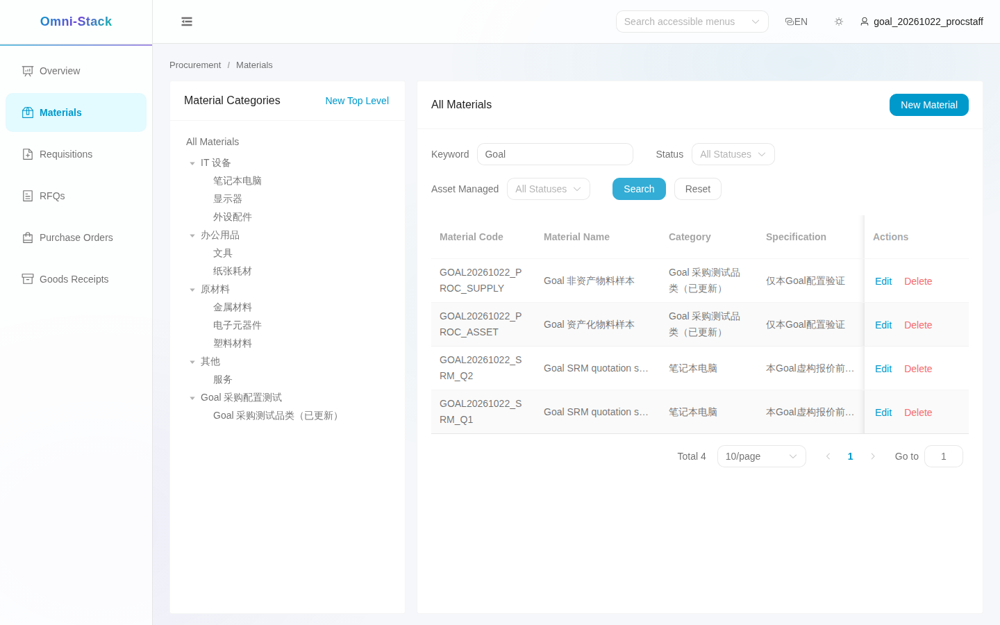

Use the category area's add entry for a root category. Hover over an existing category to find actions such as adding a child, editing, or deleting. Enter the code, name, sort order, and enabled status. When editing, the code and parent are read-only so existing materials are not accidentally moved.

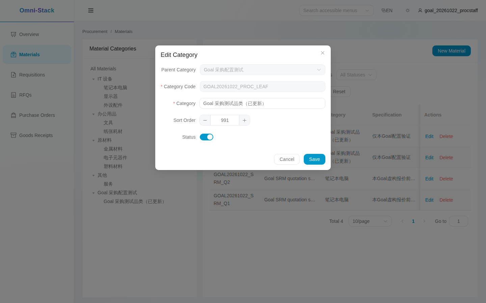

Refresh the tree after saving and check the position, name, and status. Before deleting, resolve child categories and existing references. If deletion is rejected, address the stated dependency instead of clicking repeatedly. Check materials and rules that use a category before disabling it.

### 2.2 Create, edit, disable, or delete materials

Add a material with a unique code, name, enabled leaf category, and unit. Select the asset management option when it should later produce asset cards. Asset-managed materials use EA, PCS, UNIT, or SET, and the quantity used to create cards must be a positive whole number.

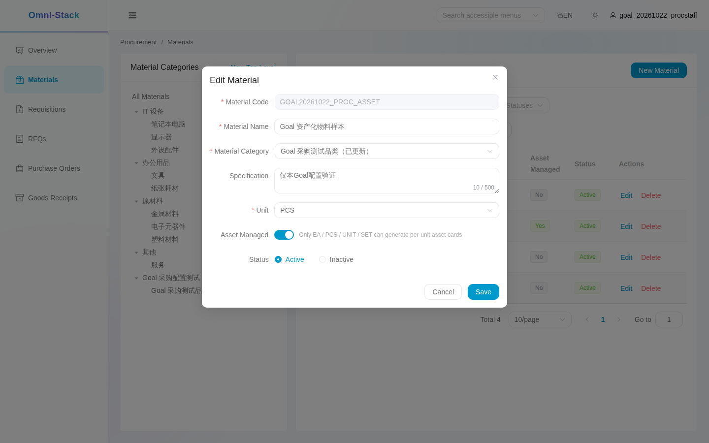

After saving, search by code and check the name, category, unit, asset flag, and enabled status. Edit the fields that are available; the code remains unchanged. Disable materials that should no longer be purchased. Deletion still respects existing business references and the application's rejection messages.

For duplicate codes, choose an unused code. If someone else has changed the record, close the form, refresh, and reopen it before saving. Do not repeatedly overwrite changes from an outdated form.

## 3. Approval routes: decide who should approve a request

### 3.1 Inspect rules before changing them

A procurement manager opens approval routes. A rule links a category and amount range to a published procurement workflow. A small purchase might go to a department manager, while a larger one adds further approval steps. An applicable rule must exist before an applicant submits.

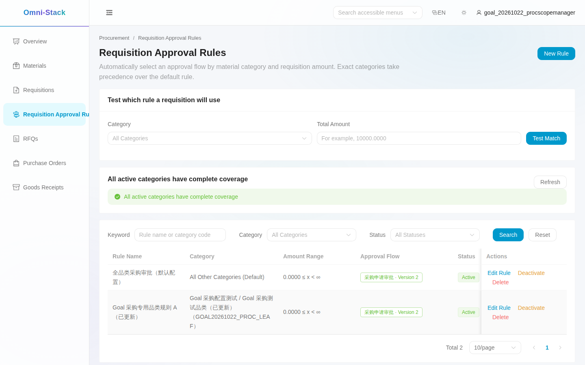

Search existing rules by keyword, category, and active status; Reset clears the filters. Then check amounts and workflow versions. Desktop shows a table, while phones automatically show cards. Edit, activate or deactivate, and delete still act on the same rule; there is no layout switch to find. Inspect the flow preview, test conditions, and review coverage and impact before creating or changing a rule. Staff without route management access should not bypass that restriction to configure rules.

### 3.2 Complete the creation or edit wizard

First enter the rule name, category, and amount limits. The range includes the lower limit and excludes the upper limit. An empty upper limit means no upper bound. Adjacent ranges should meet without gaps or conflicting coverage. For matching conditions, a category-specific rule takes precedence over the default. The system generates the rule code. Advanced information for existing rules is read-only; the wizard does not ask you to enter a code or priority.

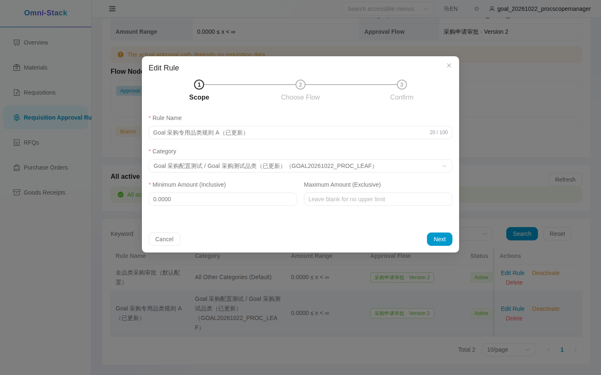

Next select a published workflow version available for procurement, checking its name, version, and publication time. A shared name does not mean two versions have identical approval arrangements. After saving, use the matching test below to inspect approval order and candidates.

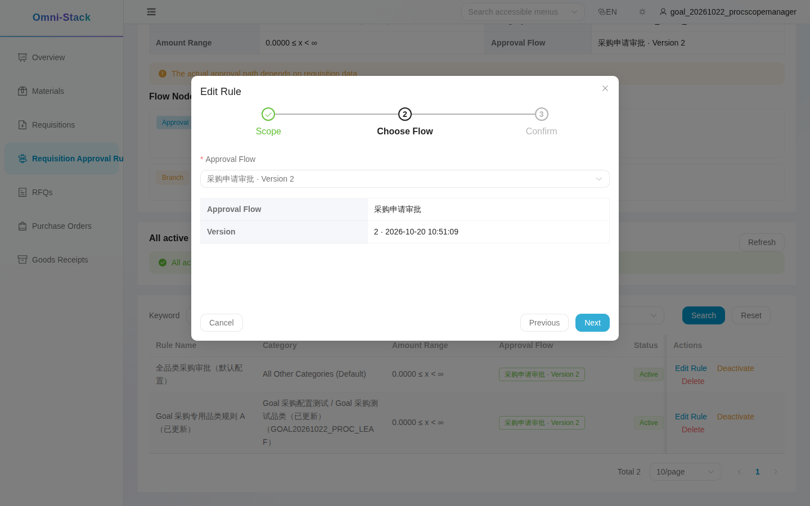

Finally check the summary, scope, and workflow, choose active or inactive status, and save. Query the list again to confirm the intended status. Use the latest list for editing or deletion too. Check impact before disabling or deleting so future requests do not lose their route. These three wizard pictures show an existing rule opened without saving; they are not proof of newly creating a rule.

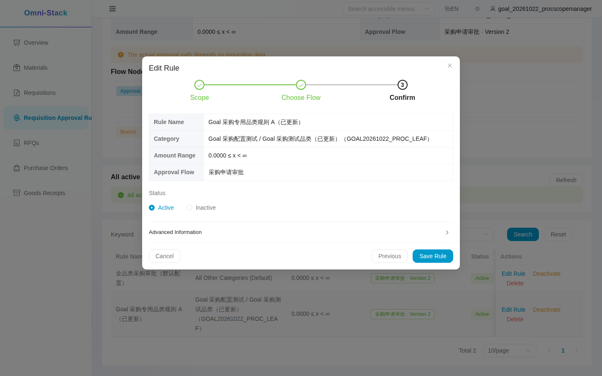

### 3.3 Test which workflow a set of conditions selects

Open the matching test, choose a category, and enter an amount. The example uses 100 and shows the matched rule, workflow version, and approval arrangement. If no rule matches, candidates are missing, or workflow conditions are incomplete, fix those prerequisites before applicants submit.

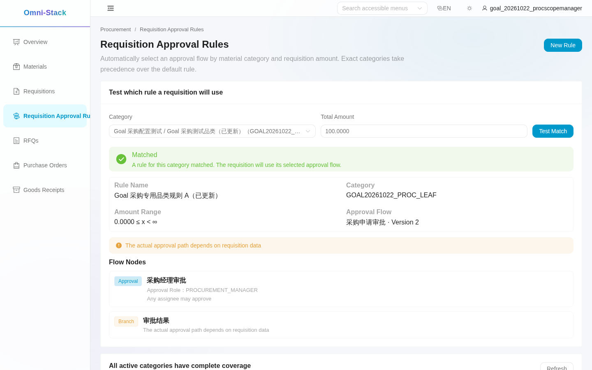

View the same matching information on a phone and tablet

On a narrow screen, the summary stacks vertically and long candidate descriptions wrap. The result is the same as on desktop, without squeezing the summary sideways.

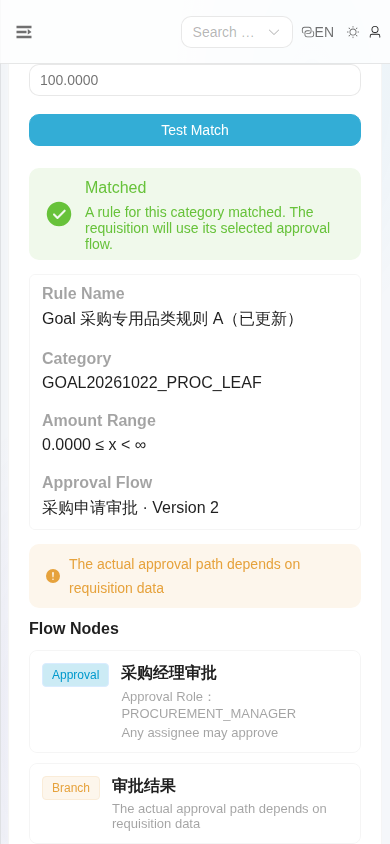

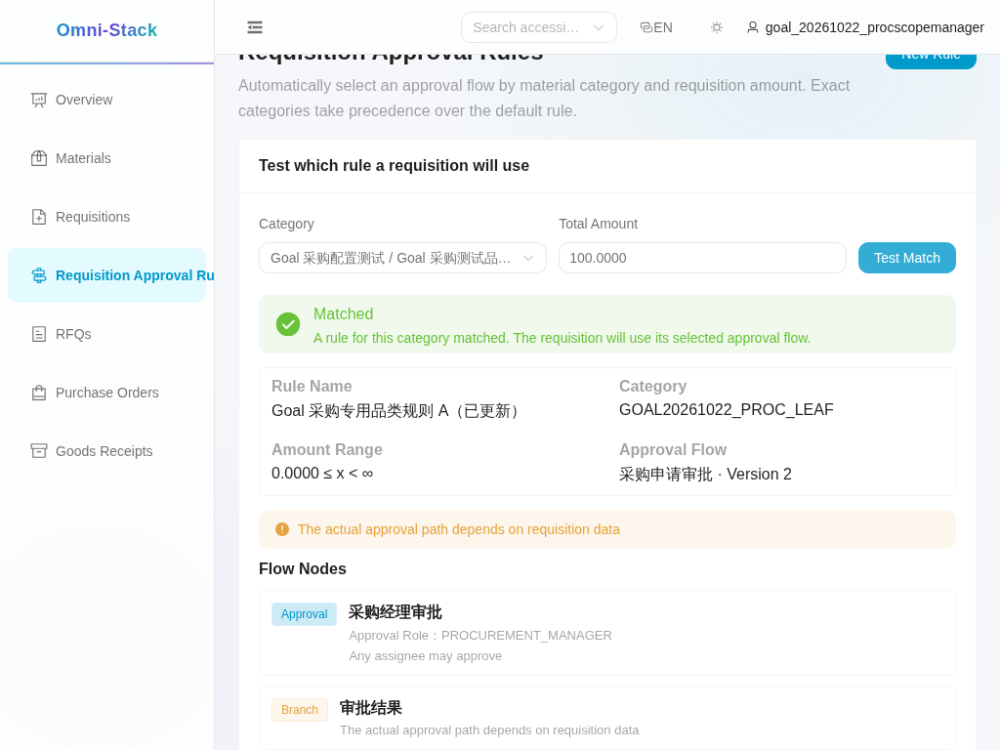

Review coverage and impact as well, including the effect on future requests. A submitted requisition keeps the approval information selected at submission. Updating a rule does not quietly move an existing request to another workflow.

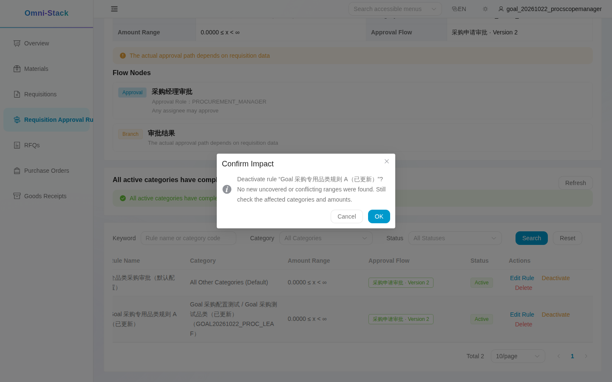

## 4. Requisitions: turn a need into an approvable request

### 4.1 Search and inspect requisitions

The applicant opens requisitions and searches by keyword, status, or other available conditions. The scope visible to a manager or other identity depends on authorization. Different people may get different results for the same filters.

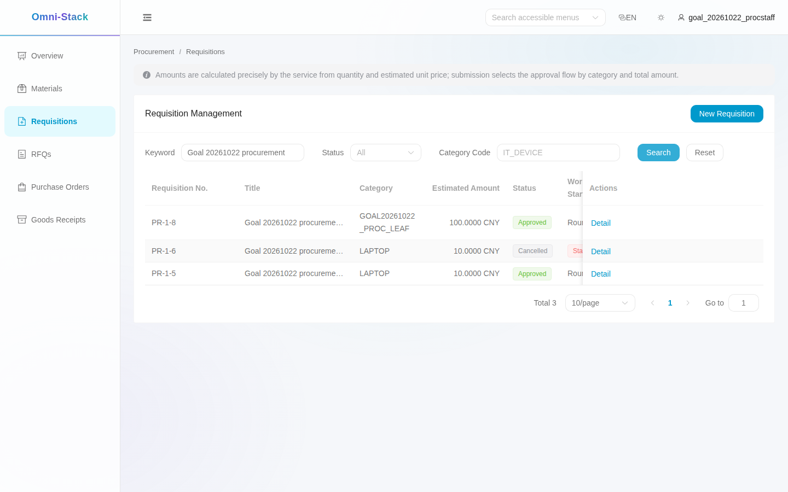

Open details and check the title, applicant, category, lines, estimated amount, and approval progress. The main requisition PR-1-8 is eventually approved: 3 asset-managed units and 2 ordinary units, with an estimated total of 100.0000 CNY.

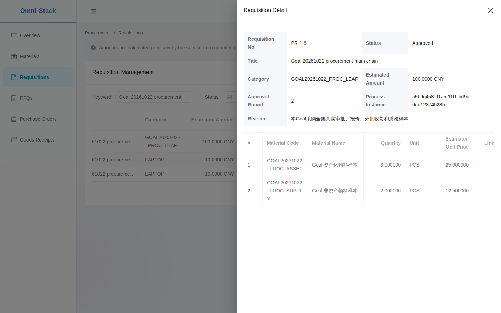

### 4.2 Create, edit, or delete a draft

Add a requisition, fill in its title and category, then choose materials, quantities, and estimated unit prices line by line. Quantities must be positive and estimated prices cannot be negative. Add or remove lines as needed. Check the calculated amount and purpose before saving.

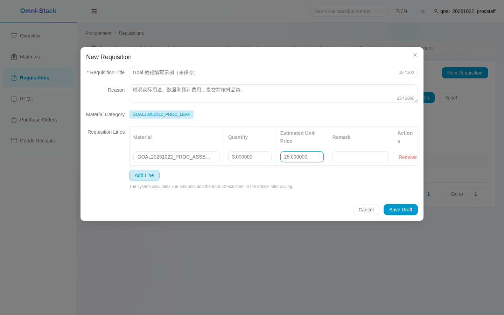

Saving creates a draft; approval has not started. Reopen a draft to edit it, or delete or cancel it when it is no longer needed. A cancelled document cannot continue to be edited as a draft. Return to the list, check its number and contents, and then decide whether to submit.

### 4.3 Submit, approve, and start a new round after rejection

Before submitting, check materials, amount, organization, the applicable rule, and candidates. Workflow startup and the approval result may appear after the submission is accepted. Accepted does not mean approved. Refresh the original document to check progress.

Approval candidates use the workspace approval area to open their actual assigned task, check the linked requisition and lines, enter an opinion, and approve or reject. Being able to read the procurement list does not make someone a candidate for the current task.

PR-1-8 was rejected in its first round. The applicant edited it, saved it as a draft, and submitted a new round, which was approved. After rejection, edit and save before submitting again; do not repeatedly approve an old task. The procurement page does not offer withdrawal of a request that is actively being approved.

### 4.4 After startup failure, inspect the original before retrying or cancelling

A validation failure before acceptance is different from a workflow startup failure after acceptance. Correct the form for the former. For the latter, keep the original requisition, refresh its startup status, and avoid immediately creating a duplicate request.

The next two pictures are the original wide-screen captures from the actual failure exercise. They explain that historical failure and do not claim the latest interface has failed again.

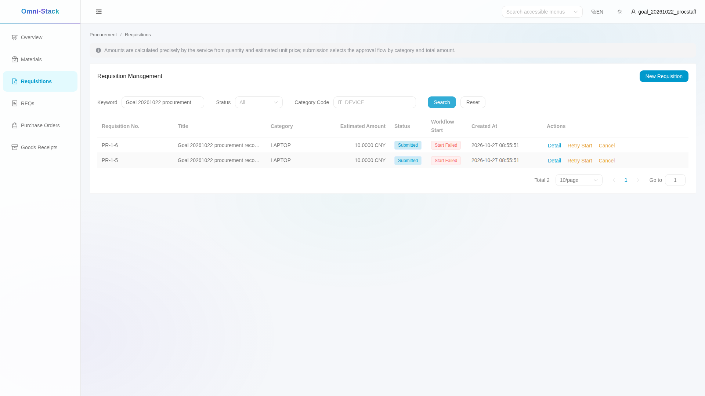

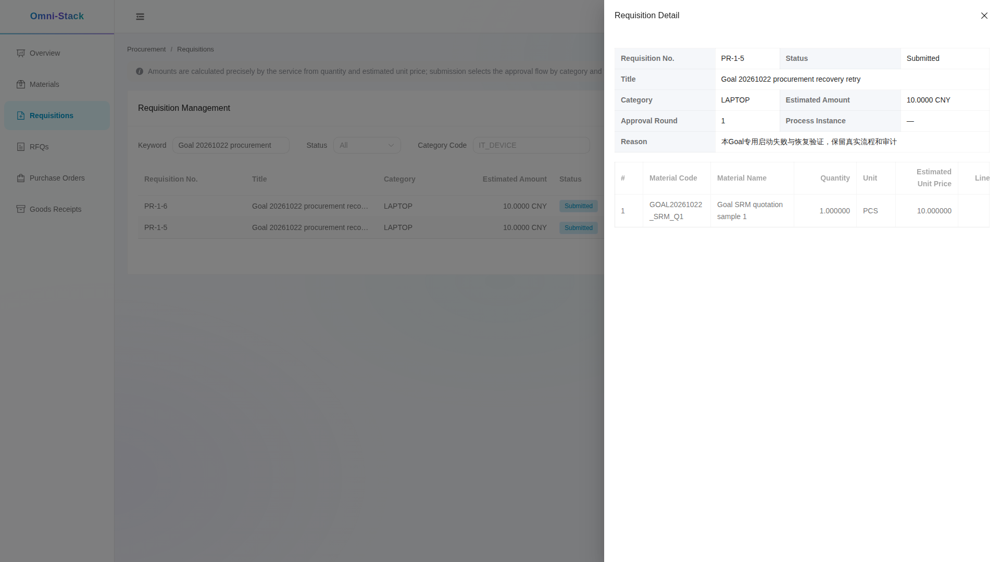

Once prerequisites are restored, retry startup on the original document and inspect approval progress. PR-1-5 entered actual approval after retry and was ultimately approved. If a submission result is uncertain, first inspect whether the original already has a workflow and tasks.

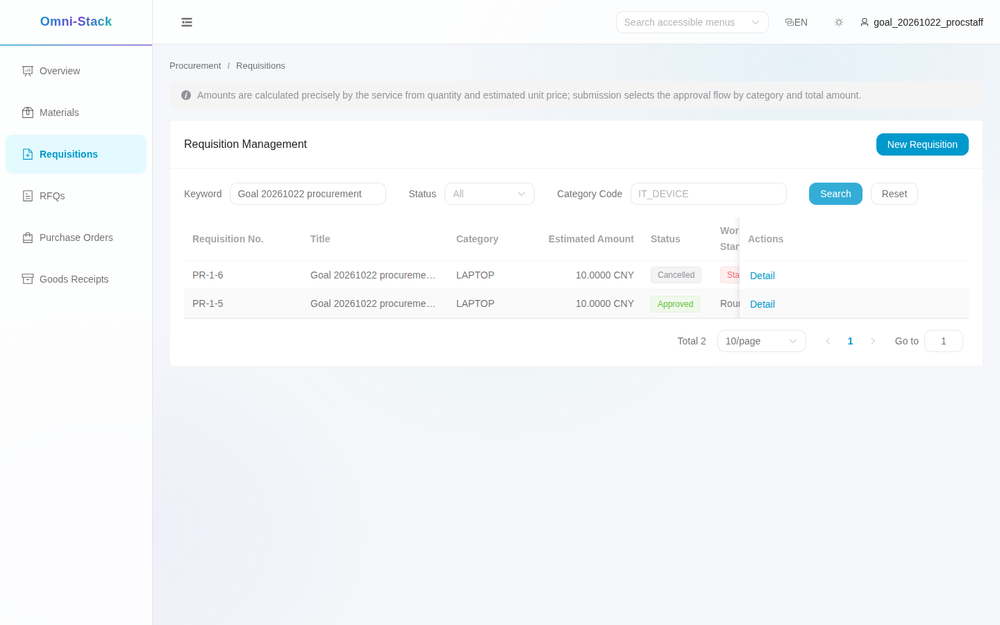

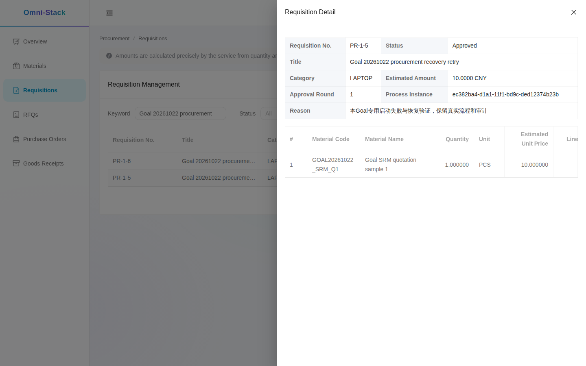

A startup-failed requisition that is no longer needed can be cancelled through its original document. PR-1-6 is cancelled without an approval instance. This does not grant cancellation of any actively approving requisition.

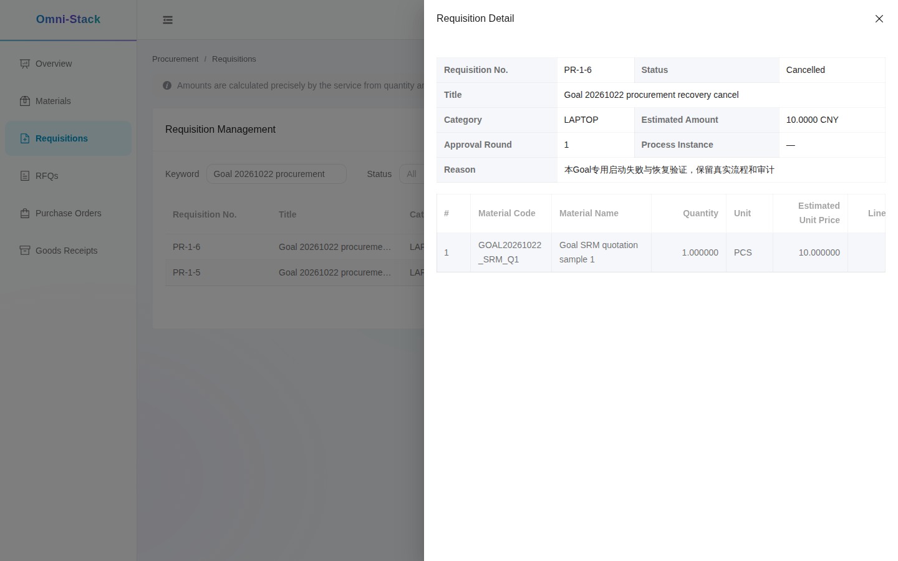

## 5. Prepare and create an RFQ: choose invitees and a deadline

### 5.1 Prepare the supplier first

Authorized supplier management staff maintain suppliers. Before inviting one, confirm that its company is approved, its supply categories are suitable, and its portal user is associated with that company. Selecting a supplier name in an RFQ does not replace onboarding approval or portal association.

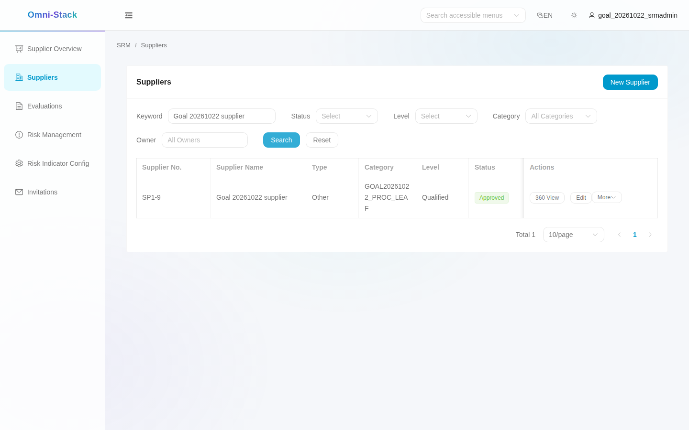

The picture shows supplier management staff checking company 9, rather than procurement staff approving it. That company later participates in the main RFQ.

### 5.2 Search RFQs and create a draft

Procurement staff open RFQs and search by document number, title, status, or quotation deadline. Open details to check the source requisition and invitees.

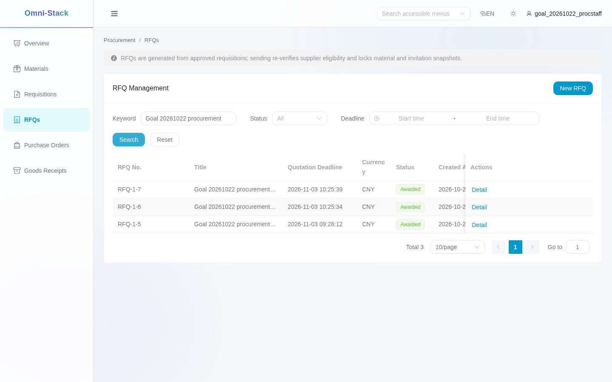

Add an RFQ from an approved requisition you can access. Enter a title, a future quotation deadline, and instructions, then select at least one eligible supplier. The lines come from the selected requisition. Check them before saving.

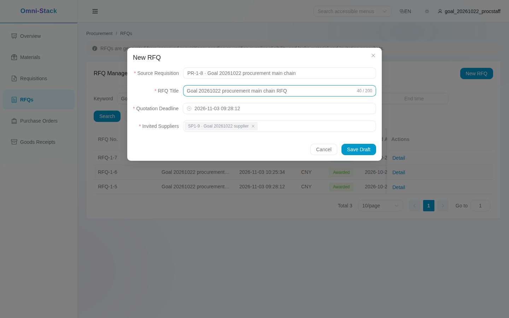

Approval does not automatically create the RFQ. Saving leaves a draft that can be edited or deleted. Send and confirm to recheck prerequisites such as supplier eligibility and deadline, and open quotations to the invited companies. After sending, the original requirements cannot be freely edited as a draft.

For a draft or sent RFQ that will not continue, use cancellation when its current state permits and confirm. An awarded RFQ preserves its result; do not treat it as an RFQ still awaiting comparison.

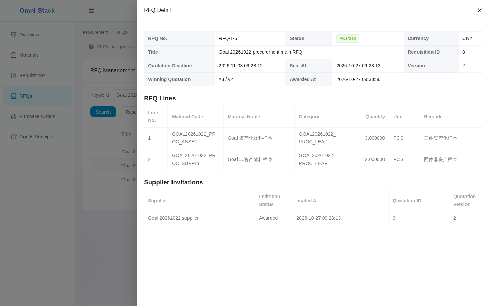

This is the separate completed example RFQ-1-5, illustrating the read-only award result. The main RFQ is RFQ-1-8. Do not mix amounts or quotation versions across these numbers.

## 6. Supplier quotations: respond as your own company

The supplier signs in to the portal and opens a received procurement invitation. Check the deadline, materials, quantities, and requirements first. A portal identity can handle its own company's invitations, not inspect other suppliers' quotations.

Enter line prices, delivery days, quotation validity, and other required information. Check the total before submitting. The main example uses 25.00 for each of 3 asset-managed units and 12.50 for each of 2 ordinary units, totaling 100.0000 CNY.

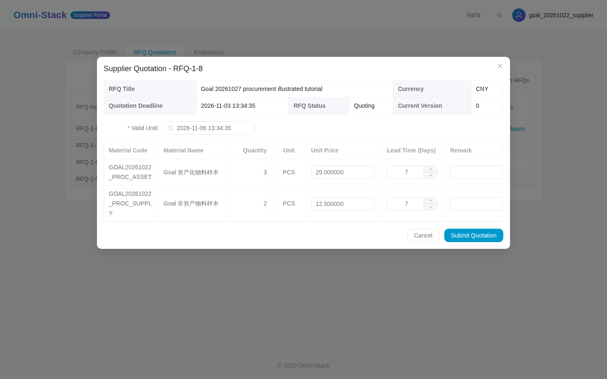

This picture shows RFQ-1-8 before submission, with version 0 because no quotation has yet been saved. No submission happened while taking the picture. The later actual submission created version 1, shown in the next section's comparison table.

After submission, check the version and amount. While the deadline and RFQ state still permit quotations, edit and submit a new version using the portal. Procurement must compare the current valid version. Follow rejection messages once the deadline passes or the RFQ is cancelled or awarded.

If the connection drops after submission, reopen the same invitation to see whether it was saved before retrying. Avoid repeatedly changing prices and submitting versions you cannot distinguish. An internal administrator without a company association cannot impersonate a supplier portal user to quote.

## 7. Compare and award: turn a valid quotation into an order

Procurement staff open comparison from an accessible RFQ and inspect supplier, current quotation version, total, and line prices. Expand details to check quantities, units, and delivery terms. Do not choose by the lowest total alone.

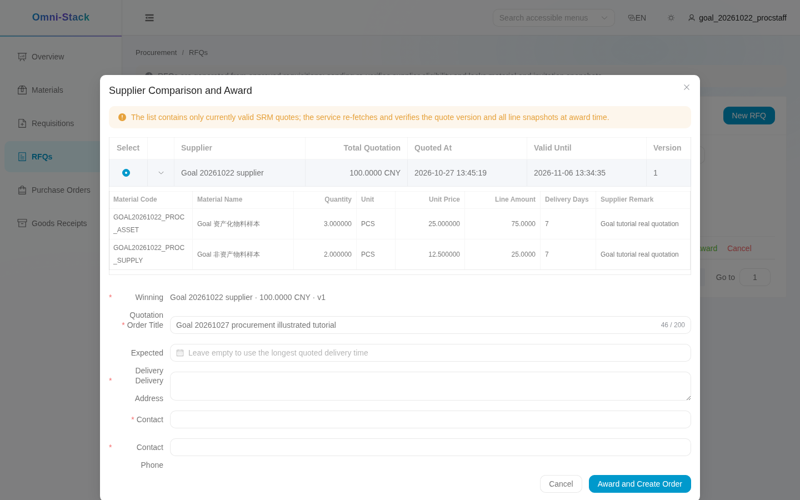

This actual example has one supplier quotation; it is not evidence of a multi-supplier contest. The system allows award of an already received valid quotation before the deadline. The deadline limits when suppliers can keep quoting; it does not force procurement to wait before awarding.

Choose the quotation and award it, entering the order title, expected delivery date, receiving address, contact name, and telephone number. Review and confirm.

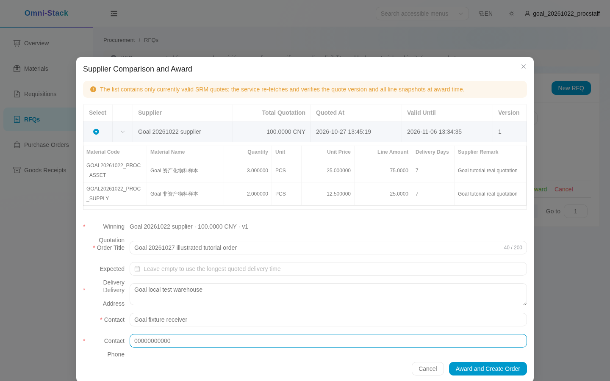

After success, inspect the created purchase order and RFQ result. If the quotation version changed, reload comparison and select again. If the request times out, first check whether the RFQ is awarded and an order already exists instead of creating a duplicate.

## 8. Purchase orders: confirm before receiving goods

### 8.1 Search, inspect, and edit a draft

Open purchase orders and search by keyword, status, or expected delivery date. Award creates the order; this is not a separate order without a source. Inspect the RFQ, supplier, quotation version, quantities, prices, and delivery details.

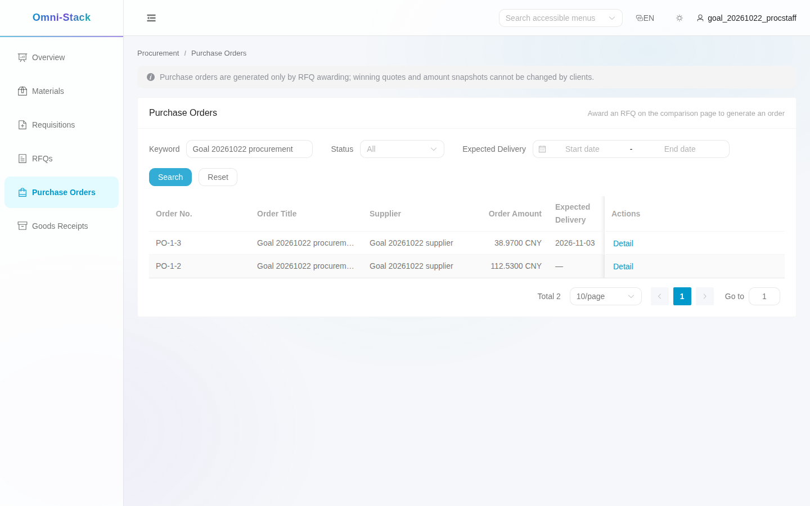

A draft allows edits to permitted delivery information and can be deleted. You cannot freely replace the awarded quotation prices in the order form.

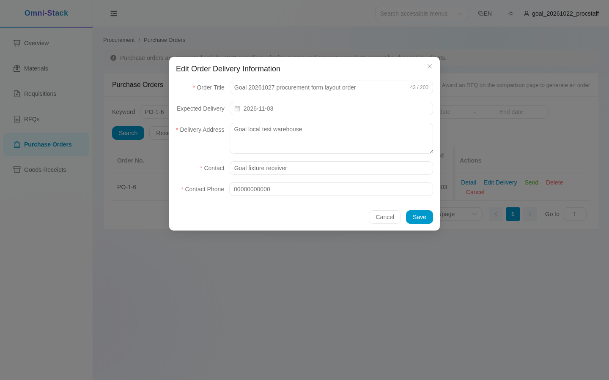

This form belongs to PO-1-6, a separate layout-check example. It was opened without saving for the picture and was later formally cancelled. It is neither the main PO-1-5 nor a rollback of that order.

### 8.2 Send, internally confirm, or cancel

Review the draft, send it, and confirm the action. Authorized internal procurement staff then confirm the order. This confirmation happens in the procurement application; the supplier portal does not offer an equivalent confirmation button. Only a successfully confirmed order can enter receiving.

A draft, sent order, or confirmed order with no receipts yet can be cancelled when its current state allows it. A partially or fully received order cannot be cancelled this way. The current interface does not provide another user action to close an order.

Separate actual examples include formally cancelled PO-1-3 and deleted draft PO-1-4. Cancelling or deleting an order does not revert an awarded RFQ to an unawarded state, and does not allow awarding it again.

### 8.3 Understand cumulative receipts and staff visibility

The main PO-1-5 is fully received, totaling 100.0000 CNY with cumulative quantities of 3 and 2.

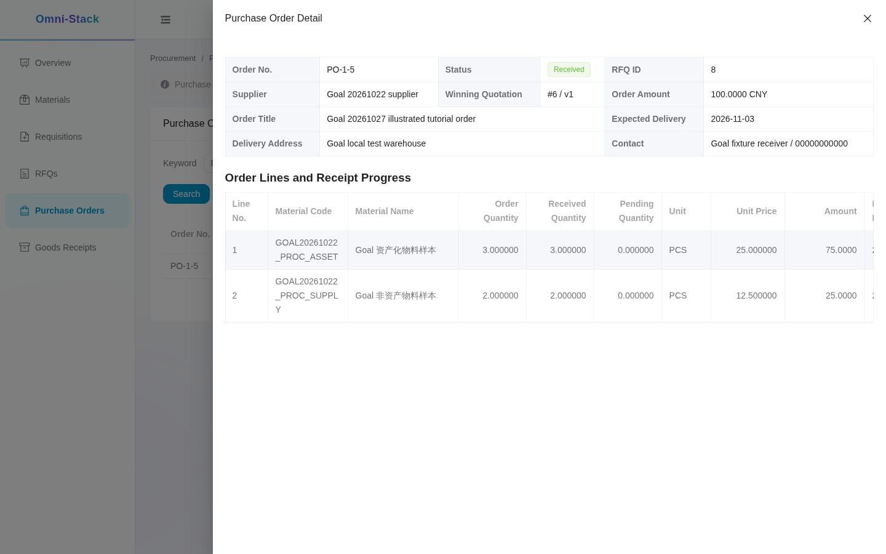

Separate order PO-1-2 totals 112.5300 CNY and uses version 2 of a different quotation. Different people received it in batches. A staff member may not be allowed to open someone else's receipt details, while the order's cumulative quantities still include those confirmed receipts.

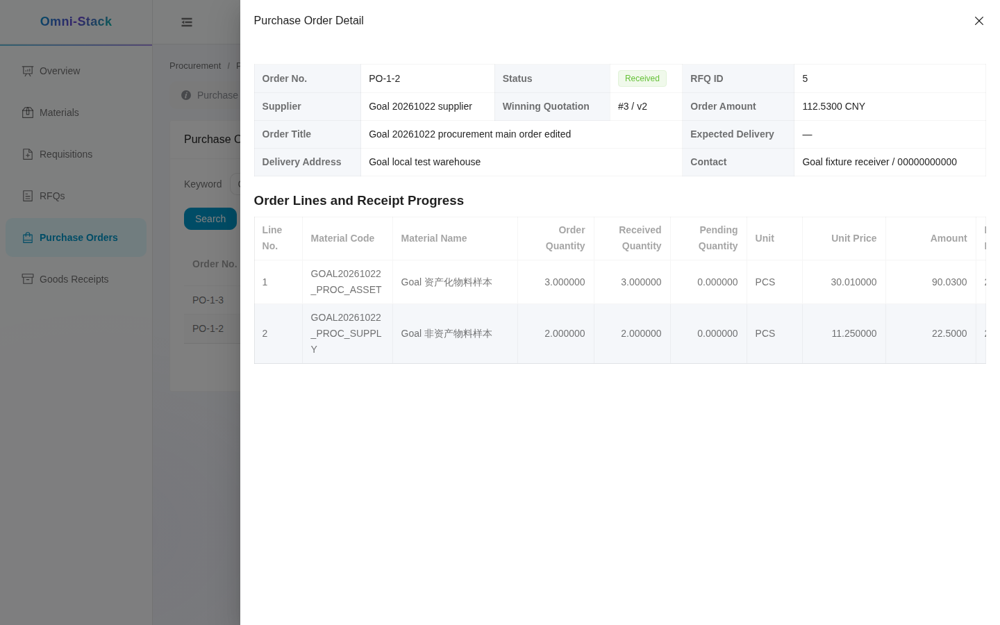

Seeing only two receipt documents therefore does not mean the order has received only those quantities. Use the order's latest cumulative and remaining amounts to decide what can still be received.

## 9. Receiving and quality: received does not necessarily mean passed

### 9.1 Create a receipt draft

Procurement staff open goods receipts, search by keyword, status, or receiving time, and inspect the source order, lines, and quality results. To add one, select a confirmed or partially received order, enter the receiving time and remarks, and fill in this batch's line quantities.

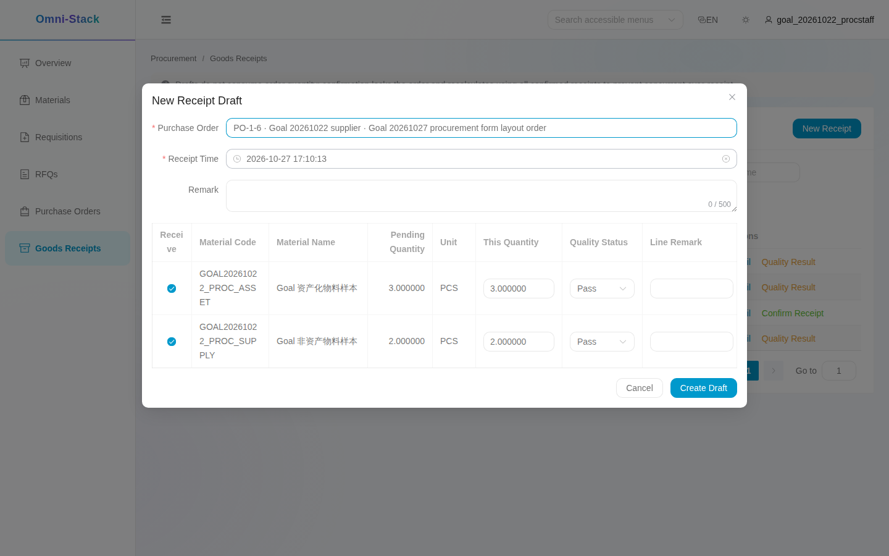

Check every line against the whole order's remaining quantity. Quality options are Pass, Fail, and Pending. Choose Pending when the result is unknown rather than Pass merely to create cards sooner. Asset cards are created per unit actually received, and eligible quantities must be positive whole numbers. There is no separate asset quantity input on this form.

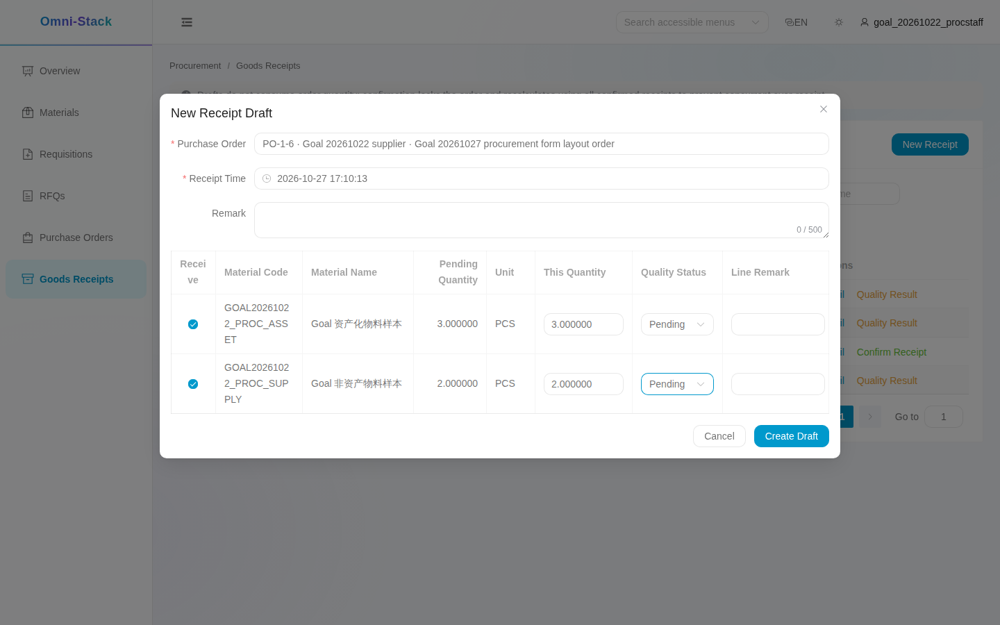

These two form pictures use the then-confirmed separate order PO-1-6. They demonstrate input without submitting a receipt or creating assets. That order was later cancelled.

### 9.2 Saving and confirming have different effects

Saving creates a receipt draft. It neither counts toward confirmed receipts nor reserves order quantity. Confirmation rechecks all confirmed receipts on the order, including documents handled by people whose details you cannot access.

Two drafts can each appear within the old remaining quantity but cannot both be confirmed against that same quantity. On an over-receipt or version conflict, refresh the order and original receipt. The current receipt page has no edit or delete action for an existing draft. Repeatedly creating drafts does not fix an earlier one.

### 9.3 Confirm quantity first and enter the final quality result later

When the main GR-1-6 was confirmed, its asset line still had pending quality. The order could become fully received, but that pending line did not yet produce asset cards.

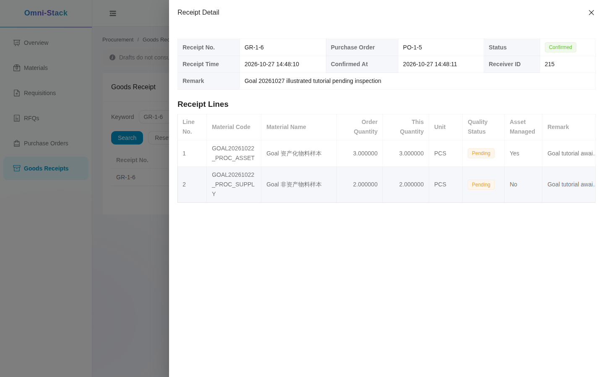

Once inspection is complete, authorized procurement staff use the quality result action on the original line, select Pass or Fail, and submit. Only pending lines can be resolved this way. A final result cannot be changed repeatedly.

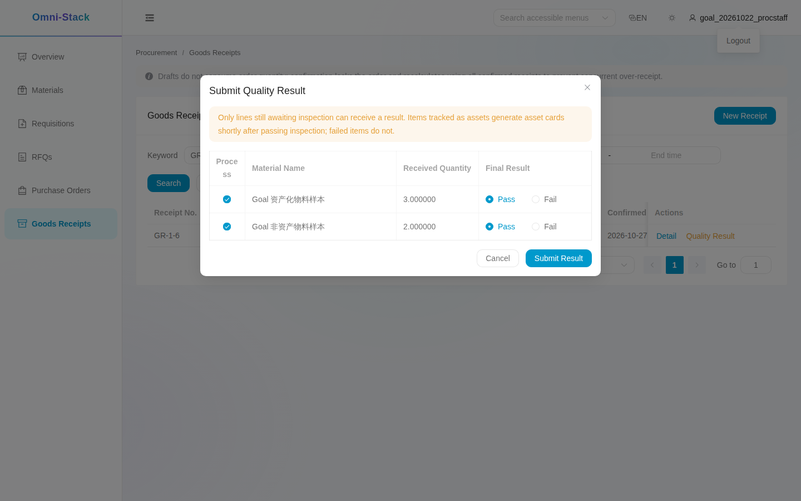

Reopen the original receipt after submitting and check status and line quality. The main asset line eventually passed, and three cards were created afterward. Ordinary materials were received but did not create asset cards.

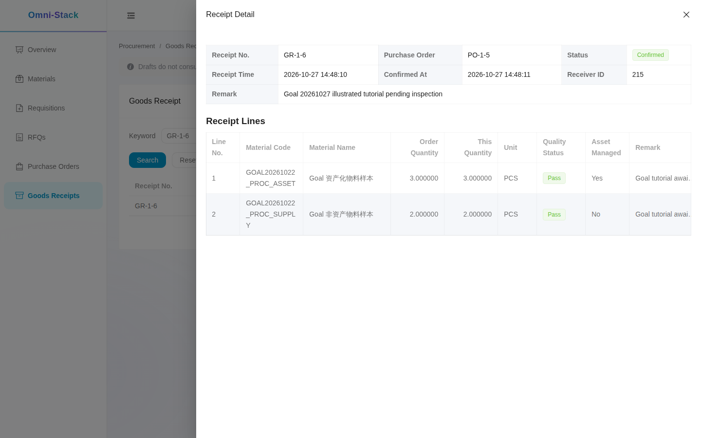

After a timeout, inspect the original instead of creating another receipt merely because no success message appeared. A fully received order, a confirmed receipt, and a passing quality result are three distinct checks.

## 10. Assets after receiving: trace each card to its source

Procurement can be used independently. Asset pages exist only when asset management is also included. Ordinary materials and failed or pending lines do not turn into assets simply because an order is fully received.

<!-- omni:modules:asset -->

### 10.1 Open assets from the workspace and check the actual cards

A passing receipt line with an asset-managed material and a positive whole-number quantity produces cards asynchronously. Wait briefly, return to the workspace, and open asset management in a new tab through the application directory. Search by source document or asset name.

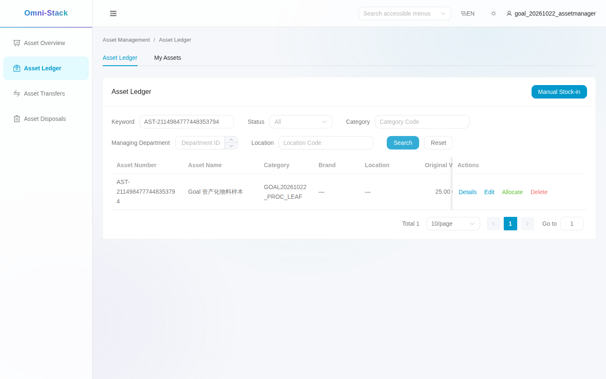

The list picture is filtered and shows the matching card. One visible row does not mean only one card was created. The main sequence created three cards at 25.00 each, matching the asset line's 75.00. The two ordinary units do not produce ledger cards.

### 10.2 Check procurement sources in asset details

Open a card and inspect source order PO-1-5, receipt GR-1-6, source line, amount, and current asset state. These identify what was purchased and which receipt batch produced this card.

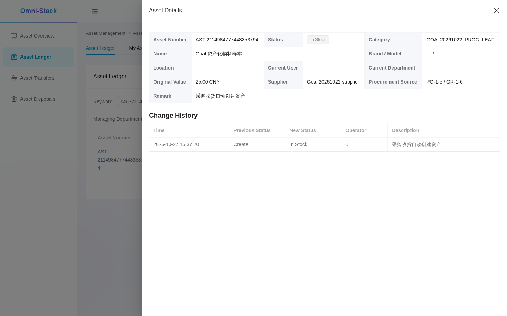

If cards are not visible yet, check the material's asset flag, receipt confirmation, final passing quality, and valid quantity, then wait and refresh. Historical candidate lookup and backfill are protected service capabilities. Procurement managers do not have a manual backfill menu. Normal card creation here is not claimed as validation of historical backfill.

<!-- omni:modules:end -->

## 11. Overview: purchase commitments, not bank payments

Users with overview access open procurement overview, refresh their scoped requisitions, orders, and receipts, and switch among category, supplier, and department dimensions. Both lists and totals respect the current identity's data scope.

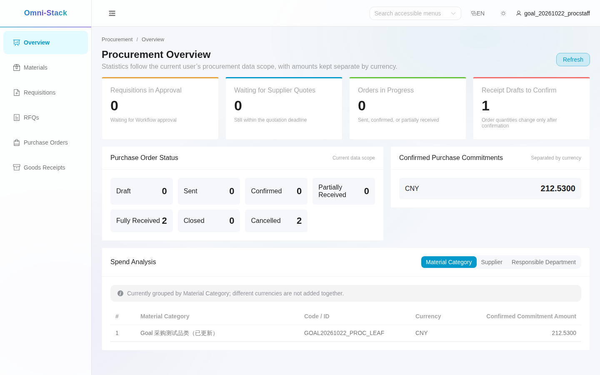

These latest pictures show two fully received orders, two cancelled orders, and one unconfirmed receipt draft. Effective purchase commitments are **212.5300 CNY**: 112.5300 from PO-1-2 plus 100.0000 from PO-1-5. Cancelled or deleted separate examples do not add to that amount.

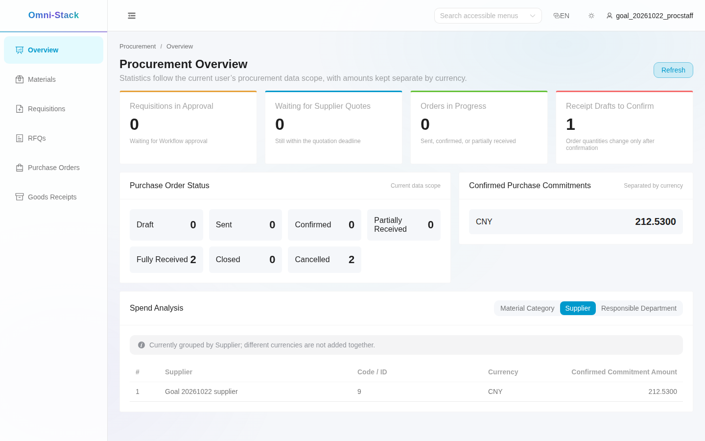

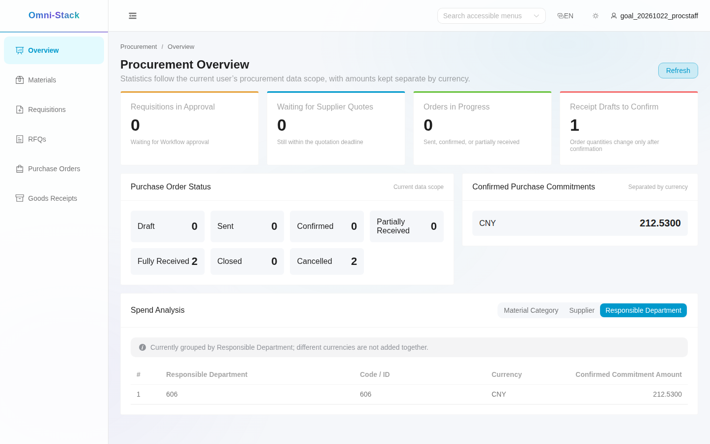

The department picture shows identifier 606, not a resolved department name. Different currencies must not be summed directly. These figures do not represent invoices, payments, or financial three-way matching. Procurement does not perform bank payments for you.

## 12. When something goes wrong, check identity, state, and the original document

### 12.1 Different identities can get different results for the same filters

Procurement staff see their own records. A parent manager sees the authorized department and descendants. A peer may receive a genuinely empty list, while an employee without procurement permission is denied. None of these results substitutes for another.

View four actual identity and scope outcomes

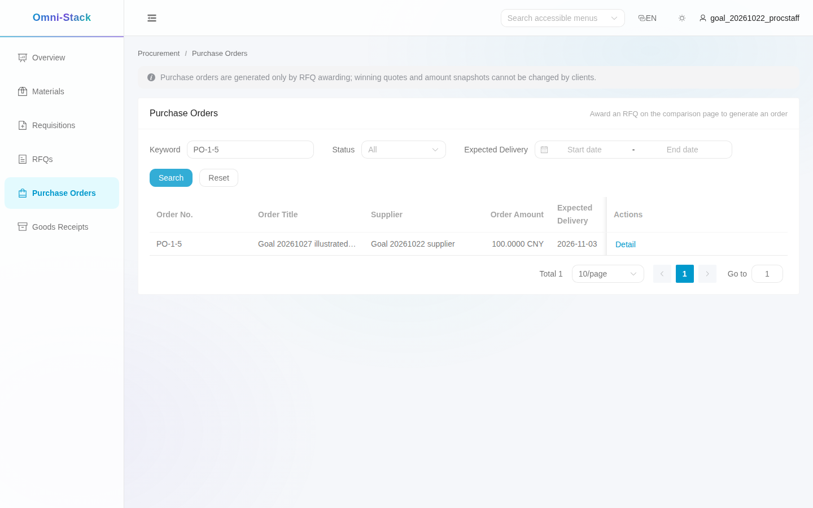

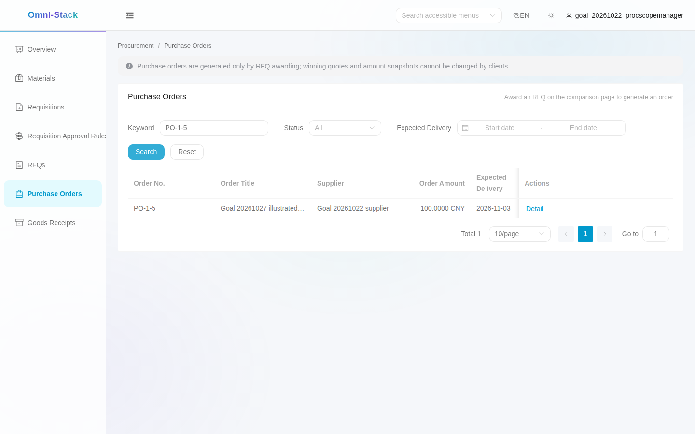

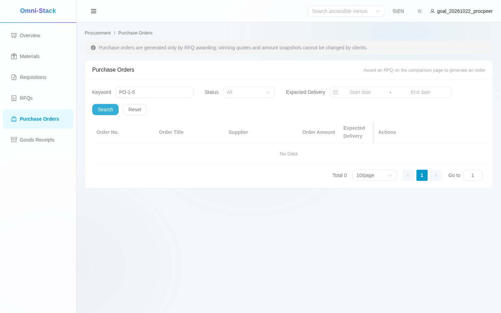

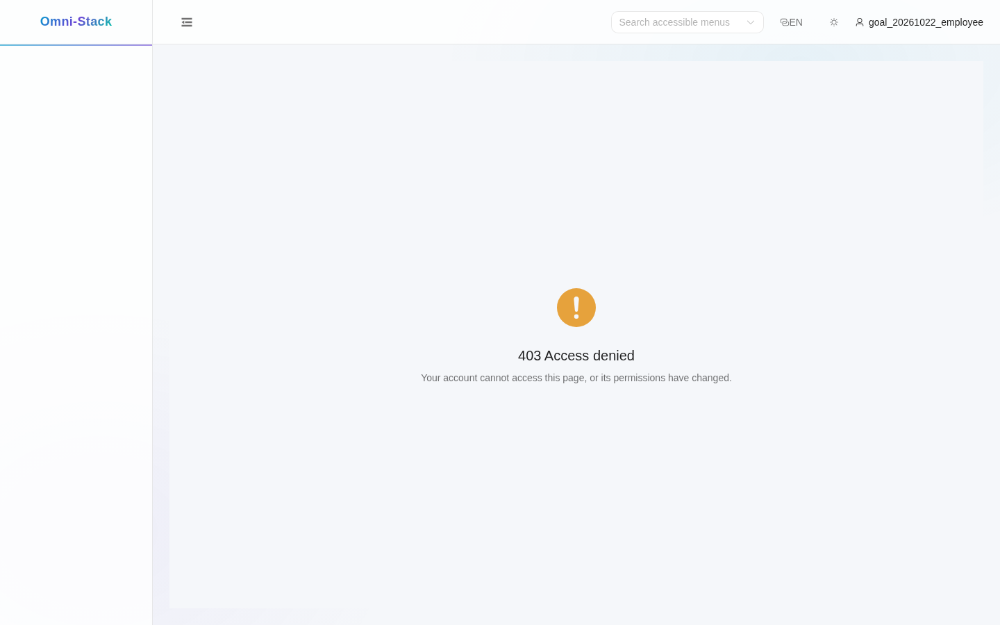

### 12.2 Recover on the original document

| Problem | Check first | Next action |
|---|---|---|
| Category or material will not save | Required fields, duplicate code, leaf category, latest version | Correct the input; refresh on conflict and resolve dependencies before deletion |
| Requisition rejected before acceptance | Materials, amount, organization, rule, candidates | Fix prerequisites and submit the original |
| Requisition rejected by an approver | Opinion and lines requiring changes | Edit and save as draft, then submit a new round |
| Workflow startup fails after acceptance | Original startup state and restored prerequisites | Refresh, then retry the original or cancel an unwanted failed request |
| RFQ cannot be sent | Approved requisition, eligible suppliers, future deadline | Correct the draft or supplier prerequisites, then send |
| Portal quotation denied | Own-company association, invitation, deadline, RFQ state | Use the correct company identity and complete the quote; ask authorized staff about access |
| Award fails or times out | Current quotation version, RFQ award state, existing order | Refresh the original RFQ and orders before acting again |
| Order cannot be cancelled | Any partial or complete receipts | Follow the permitted state; do not undo receipts to force cancellation |
| Receipt confirmation fails | Latest whole-order totals, remaining quantity, document version | Refresh and avoid duplicating quantities confirmed by other staff |
| No asset cards after receiving | Asset-managed material, confirmed receipt, passing quality, valid quantity | Wait and refresh; retain the original document for technical investigation if it persists |
| Missing menu, empty list, or access denial | Account, tenant, organization, authorized scope | Check permissions and data separately; an administrator result does not replace a normal identity |

Pictures come from the actual local application with registered test identities and business examples. This is not a claim of a person signing in by entering a CAPTCHA. Historical failures, unsubmitted forms, and final results are distinguished. This chapter's business and image evidence does not mean the entire project has passed final release acceptance.
