# 調達の図解ガイド：購買申請から発注、入荷、資産登録まで

発注書を作るだけでは、買い物は完了しません。必要性を承認してもらい、サプライヤーに見積もりを依頼し、購入先を決め、届いた品物の数量と品質を確認します。このページでは、その流れに沿って、事前準備、日常の検索、設定、失敗後の対処を説明します。

まず主な流れを読み、その後で自分の担当部分を確認してください。各画像では、誰の画面で、どの時点の結果かを説明します。入力フォームの画像は記入方法を示すもので、送信済みである証拠とは区別します。

## 1. 入口、担当者、今回の目的を確認する

### 1.1 ワークスペースから調達を開く

ホームページではプロジェクト Wiki を読めます。ログイン後に自分のワークスペースを選ぶと、新しいブラウザータブが開きます。ワークスペースのアプリボタン、アプリ一覧、右上のメニュー検索から調達を探すと、調達も別のタブで開きます。調達のタブには現在のモジュールのメニューと検索結果だけが表示されます。ほかのアプリに移るときは、開いてあるワークスペースのタブを使います。

調達には、調達概要、品目カタログ、購買申請管理、購買申請承認ルール、見積依頼・比較、発注書、入荷確認の七つの業務ページがあります。カテゴリは品目カタログの左側で管理し、独立した別アプリではありません。承認ルールなどの管理メニューは、権限を持つ利用者にだけ表示されます。

ページ分けされた品目や伝票の一覧では、下部で総件数を確認し、ページや1ページの表示件数を変えられます。再検索や表示件数の変更後は1ページ目から表示します。ページを変えても利用者の閲覧範囲は広がりません。見つからない場合は、まず条件を確認し、リセットして検索し直します。

### 1.2 誰がどこを担当するか

| 利用者 | 主な作業 | 始める前の確認 |
|---|---|---|
| 調達の申請権限がある申請者 | 購買申請の作成、承認状況の確認、自分の下書きの管理 | 所属組織が正しく、品目と承認ルールが準備済み |
| 承認候補者 | ワークスペースで自分に割り当てられた承認を処理 | 現在の承認段階の候補者である |
| 調達担当者 | 品目、見積依頼、比較と採用、発注、入荷を処理 | 必要なメニューと自分の範囲の伝票を利用できる |
| 調達責任者 | 承認ルールの管理、許可された部門範囲の閲覧 | 管理権限があり、選ぶフローが公開済み |
| サプライヤーポータル利用者 | 自社に届いた見積依頼を確認して回答 | 企業が承認済みで、アカウントと企業が関連付け済み |

一般従業員は、ログインできるだけで調達の全権限を得るわけではありません。空の一覧、表示されないメニュー、アクセス拒否は別の結果です。利用者、所属組織、付与された権限を確認してください。管理者への切り替えを通常の業務手順にはしません。

### 1.3 主な例：資産対象を3点、通常品目を2点購入する

今回の実操作は購買申請 **PR-1-8** から始まります。承認後に **RFQ-1-8** を作成し、サプライヤーが回答した見積もりを採用して **PO-1-5** を発行し、最後に入荷 **GR-1-6** を確定しました。

| 品目 | 数量と単価 | この行の結果 |
|---|---|---|
| 資産管理の対象品目 | 3点、単価25.00 | 検査合格後に各25.00の資産カードを3枚作成 |
| 通常品目 | 2点、単価12.50 | 入荷を記録し、資産カードは作成しない |
| 合計 | 100.0000 CNY | 入荷数量はそれぞれ3と2 |

後半には、失敗からの復旧、複数担当者による入荷、取消の別の例も出てきます。それぞれ独自の伝票番号を持ち、主な例の伝票を前の状態に戻す手順ではありません。横に長い表は横スクロールで確認できます。固定された操作列が伝票の値を変えることはありません。

## 2. 品目の準備：何を購入できるかを整える

### 2.1 品目の検索とカテゴリ管理

調達担当者は「品目カタログ」を開きます。左側でカテゴリを選び、右側でキーワードや有効状態などの条件を指定して検索します。リセットで条件を消し、全品目を選ぶと全体に戻れます。カタログは同じテナントで共有する準備資料で、担当者ごとに別のものを作る必要はありません。

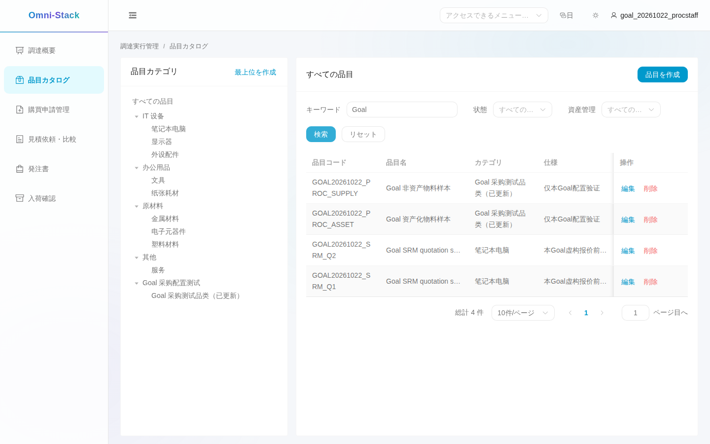

最上位カテゴリはカテゴリ欄の追加操作から作成します。既存カテゴリにポインターを合わせると、子カテゴリの追加、編集、削除などの操作が現れます。コード、名称、並び順、有効状態を入力します。編集時はコードと親カテゴリが読み取り専用で、既存品目の所属を誤って変えないようになっています。

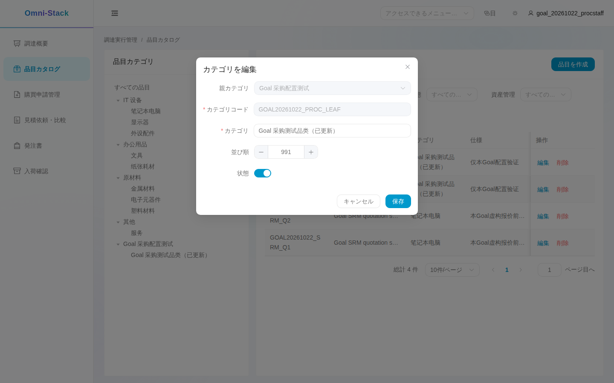

保存後にツリーを更新し、位置、名称、状態を確認します。削除するには、先に子カテゴリや既存の参照を処理します。削除が拒否されたら理由を解消し、繰り返しクリックしないでください。無効化する前にも、そのカテゴリを使う品目やルールを確認します。

### 2.2 品目の作成、編集、無効化、削除

品目を追加し、重複しないコード、名称、有効な末端カテゴリ、単位を入力します。後で資産カードを作る品目では資産管理の対象を選びます。対象品目の単位は EA、PCS、UNIT、SET を使い、カード作成の対象数量は正の整数にする必要があります。

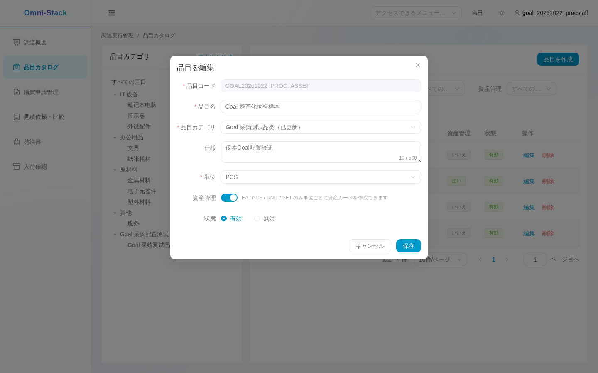

保存後にコードで検索し、名称、カテゴリ、単位、資産対象の設定、有効状態を確認します。編集できる項目を調整し、コードは変えません。今後購入させたくない品目は無効化できます。削除には既存業務からの参照などの制限があるため、画面の案内に従います。

コード重複なら未使用のコードに変更します。他の人による更新が通知されたら、フォームを閉じて一覧を更新し、開き直してから保存してください。古い内容を連続送信して他の人の変更を上書きしないようにします。

## 3. 承認ルール：誰に申請を渡すかを決める

### 3.1 変更する前に既存ルールを見る

調達責任者は「購買申請承認ルール」を開きます。ルールはカテゴリと金額範囲を、公開済みの購買承認フローに結び付けます。少額なら部門責任者だけ、大きな金額なら承認段階を増やす、といった使い方です。申請を送る前に、適用できるルールが必要です。

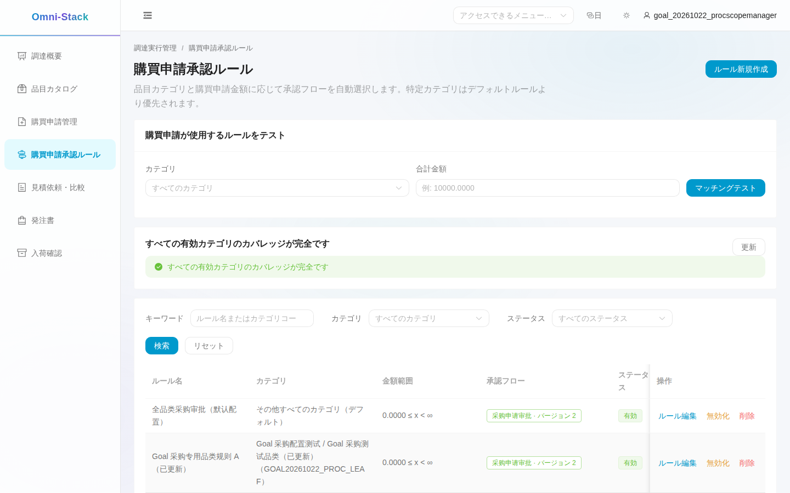

キーワード、カテゴリ、有効状態で既存ルールを検索し、リセットで条件を消します。そのうえで金額とフローの版を確認します。デスクトップでは表、スマートフォンでは自動的にカードになり、編集、有効・無効、削除は同じルールを対象にします。表示切替ボタンを探す必要はありません。フローのプレビュー、条件の試算、適用範囲や影響の確認をしてから追加や変更を判断します。管理メニューのない担当者が制限を迂回して設定する必要はありません。

### 3.2 ウィザードで作成または編集する

最初にルール名、カテゴリ、金額の下限と上限を入力します。下限を含み、上限を含まない範囲です。上限を空欄にすると上限なしになります。隣り合う範囲に抜けや競合がないか確認してください。同じ条件では特定カテゴリのルールが既定ルールより優先されます。ルールコードはシステムが生成します。既存ルールの詳細情報は閲覧用で、コードや優先順位をこのフォームに手入力するものではありません。

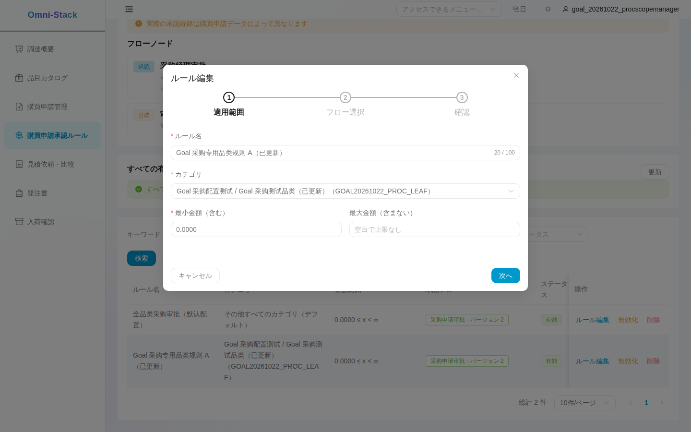

次に、購買に利用できる公開済みフローの版を選び、名称、版、公開日時を確認します。同じ名前でも版が違えば承認内容が違う場合があります。保存後には、後述の一致テストで承認順序と候補者も確認します。

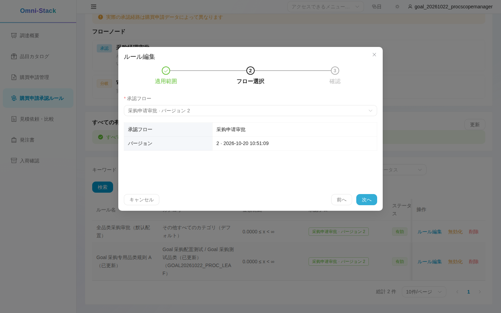

最後に概要、範囲、フローを見直し、有効または無効を選んで保存します。一覧を再検索し、意図した状態になったことを確認します。編集や削除も最新の一覧から行います。無効化や削除の前には影響を調べ、今後の申請にルールがなくなる事態を避けます。三つの画像は既存ルールを開いた未保存の画面で、新規作成の成功結果ではありません。

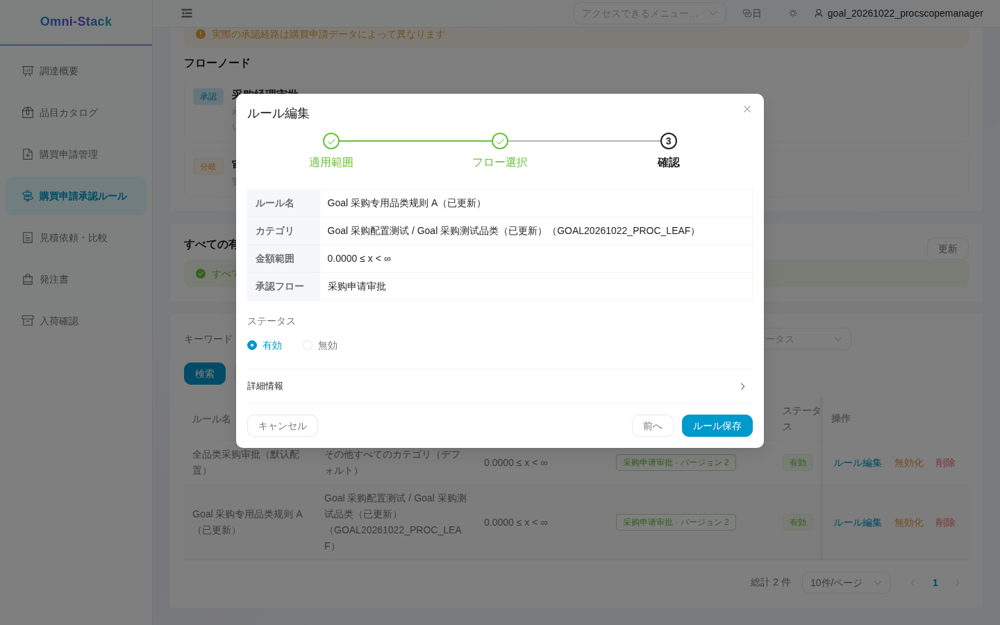

### 3.3 条件を試してフローを確かめる

一致テストを開き、カテゴリと金額を指定します。画像では100を使い、一致したルール、フローの版、承認構成を確認しています。一致なし、候補者不足、条件不足の場合は、申請者が送信する前にルールや前提を整えます。

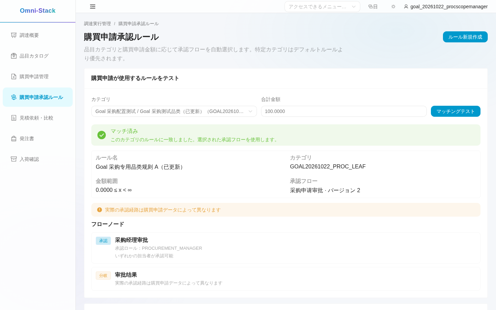

スマートフォンとタブレットで同じ結果を見る

狭い画面では概要が縦に並び、長い候補者の説明は折り返します。デスクトップと同じ結果を、横に押し込めずに読めます。

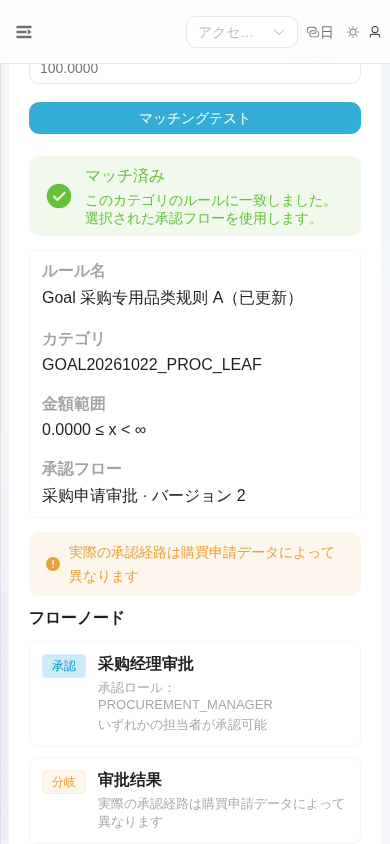

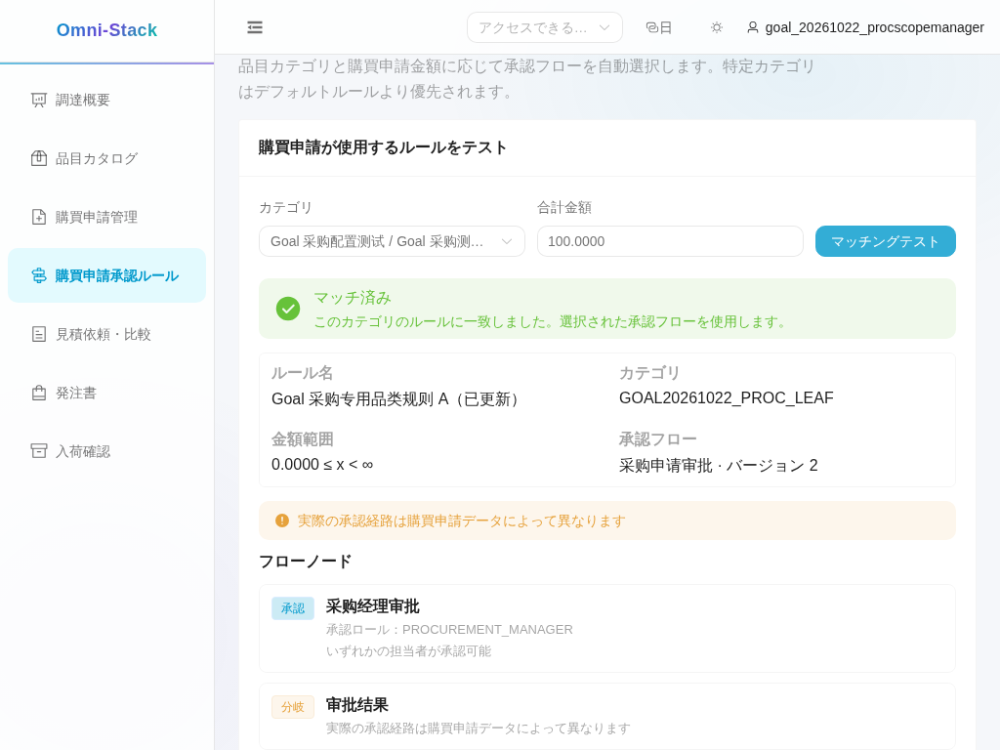

適用範囲と影響分析でも、今後の申請への影響を確認します。送信済みの申請には送信時に選んだ承認情報が残ります。ルールを更新しても、既存申請が別フローに自動で移ることはありません。

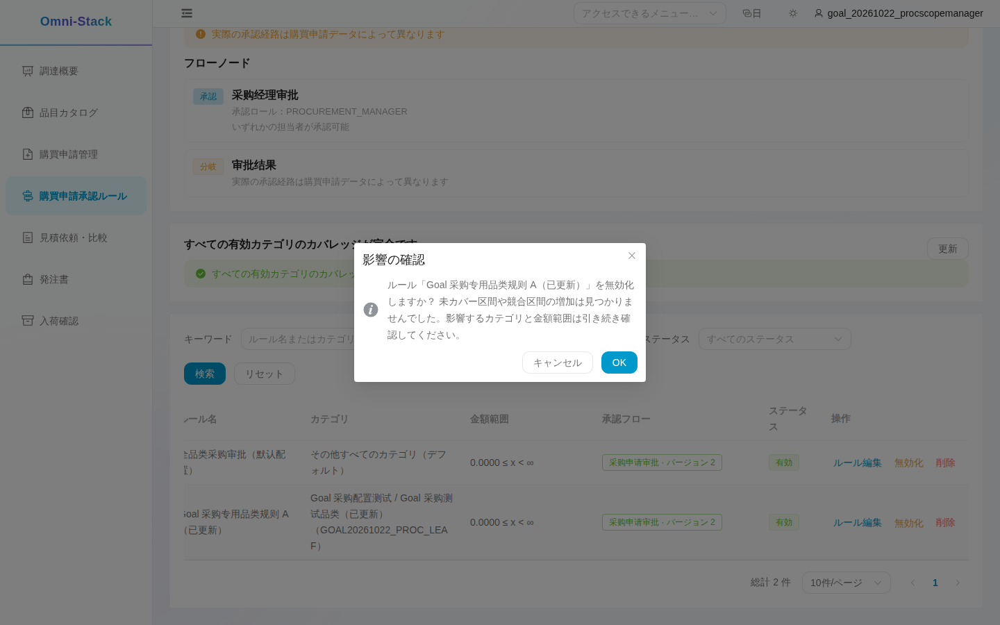

## 4. 購買申請：必要なものを承認できる形にする

### 4.1 申請を検索して詳細を見る

申請者は「購買申請管理」を開き、キーワードや状態などで検索します。責任者などが見られる範囲は権限によって決まり、同じ検索条件でも利用者によって結果は異なります。

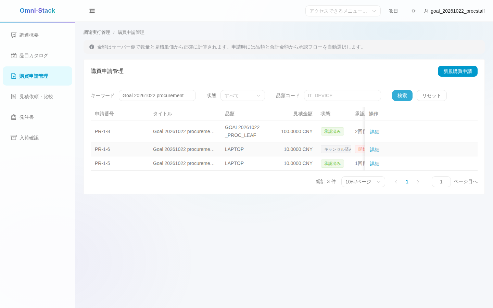

詳細で件名、申請者、カテゴリ、明細、見込金額、承認状況を確認します。主な例 PR-1-8 は最終的に承認され、資産対象3点と通常品目2点、合計100.0000 CNY です。

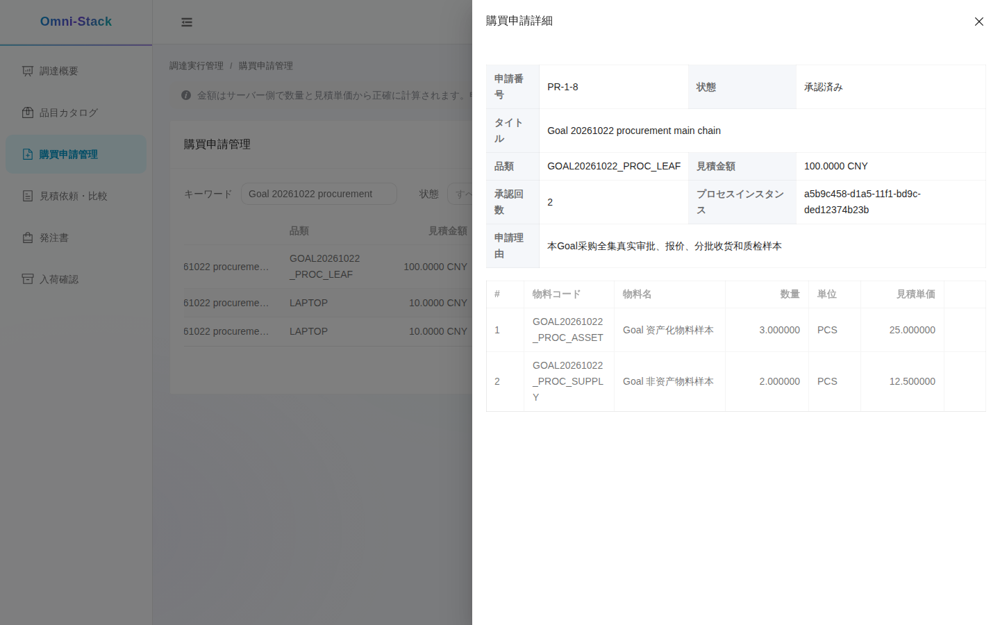

### 4.2 下書きを作成、編集、削除する

追加を選び、件名とカテゴリを入力して、明細ごとに品目、数量、見積単価を指定します。数量は正、見積単価はゼロ以上にします。必要に応じて行を追加または削除し、自動計算された金額と用途を確認して保存します。

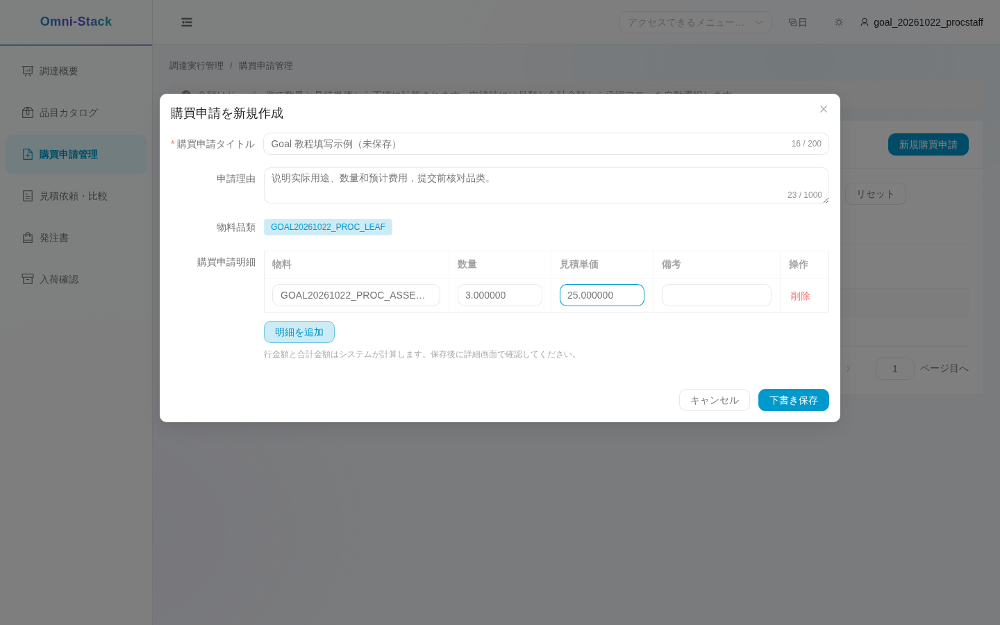

保存すると下書きになり、承認はまだ始まりません。下書きは開き直して編集でき、不要なら削除または取消できます。取消後は下書きとして編集を続けられません。一覧で番号と内容を確認してから送信を判断します。

### 4.3 送信、承認、差し戻し後の再申請

送信前に品目、金額、組織、適用ルール、候補者を確認します。送信の受付後にフローが起動し、承認結果はさらに後で反映される場合があります。「受付済み」を「承認済み」と判断せず、元の申請を更新して進捗を見ます。

承認候補者はワークスペースの承認欄で実際に割り当てられたタスクを開き、関連申請と明細を確認し、意見を入力して承認または差し戻します。調達一覧の閲覧権限だけでは、現在の承認タスクを代行できません。

PR-1-8 は1回目に差し戻され、申請者が編集して下書き保存後に再送信し、2回目で承認されました。差し戻し後は編集と保存を挟んで新たに申請し、古いタスクを繰り返し承認しないでください。承認進行中の申請を直接取り下げる操作は、現在の調達画面にはありません。

### 4.4 起動に失敗したら、元の申請を見て再試行か取消を選ぶ

受付前の入力チェック失敗と、受付後のフロー起動失敗は異なります。前者は入力案内に従って修正します。後者は元の申請に記録が残るため、更新して失敗状態を確認し、すぐに重複する申請を新規作成しないでください。

次の2枚は実際の障害演習時に保存した横長の画像です。当時の失敗を説明するもので、最新画面で再び失敗したと主張するものではありません。

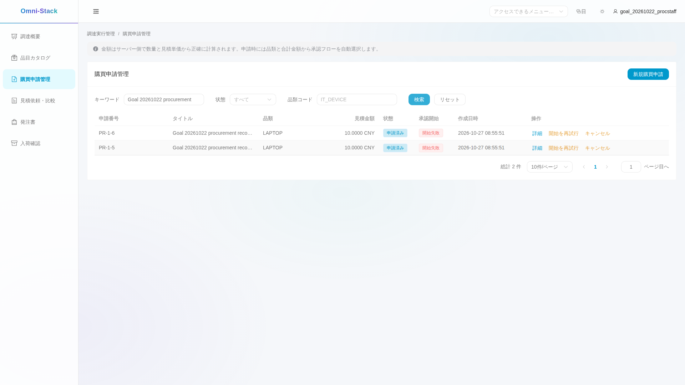

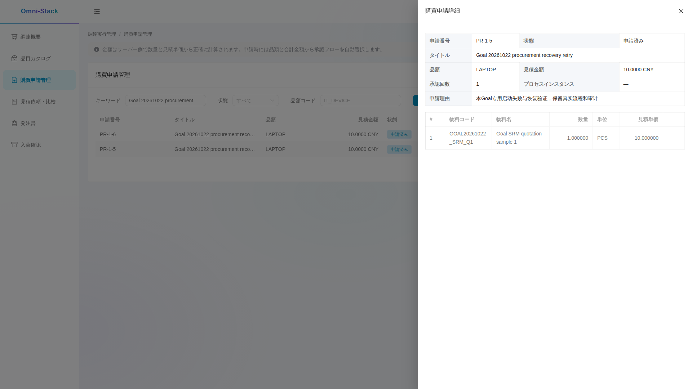

前提を復旧したら、元の申請で起動を再試行し、承認状況を確認します。PR-1-5 は再試行後に実際の承認へ進み、最終的に承認されました。送信結果が不明な場合も、元の申請にフローとタスクが既にあるかを先に確認します。

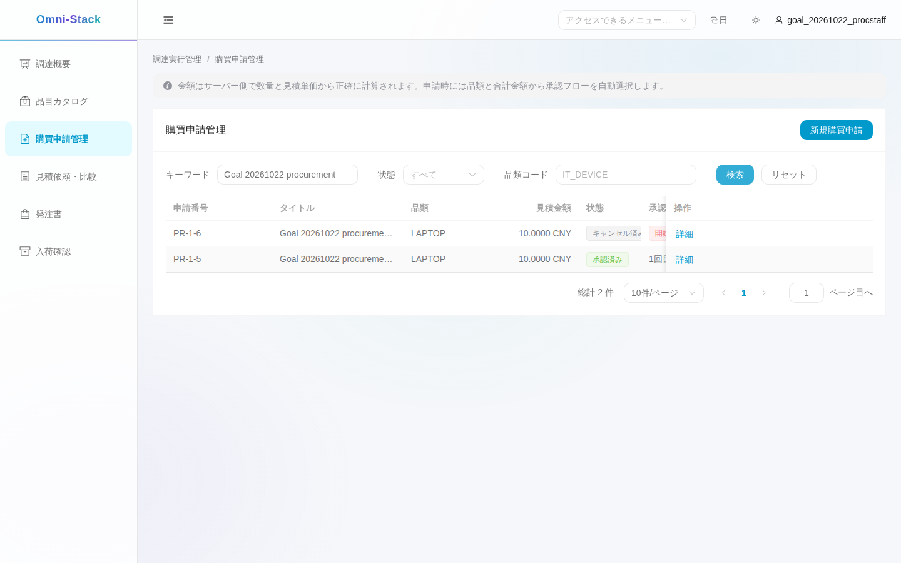

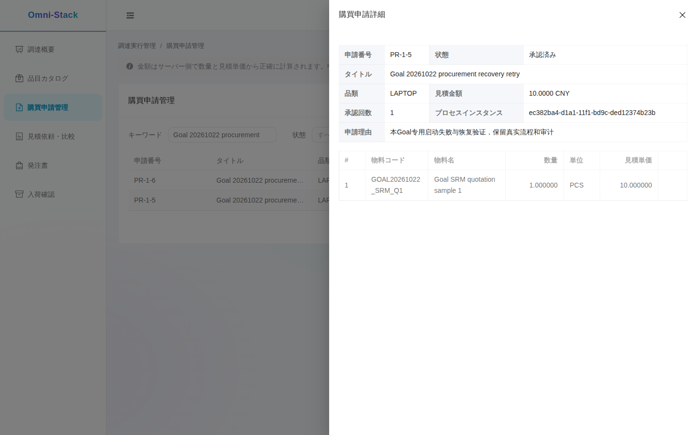

不要になった起動失敗の申請は、元の申請から取消できます。PR-1-6 は承認インスタンスなしで取消済みです。この機能で承認進行中の任意の申請まで取り消せるわけではありません。

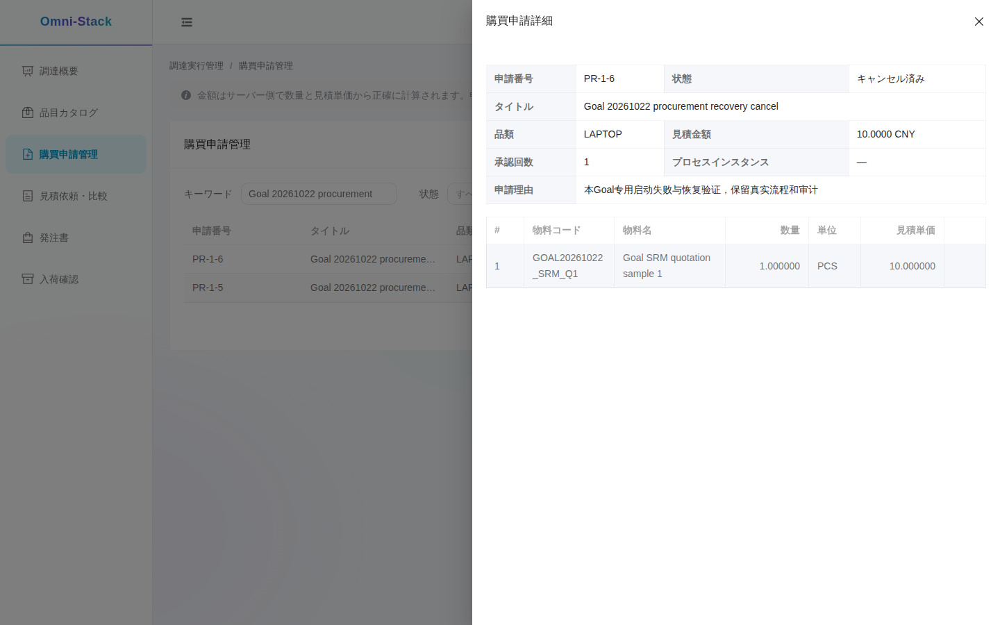

## 5. 見積依頼の準備と作成：依頼先と期限を決める

### 5.1 先にサプライヤーを準備する

サプライヤーは、権限のあるサプライヤー管理担当者が整えます。招待前に企業の承認、取扱カテゴリの適合、企業とポータル利用者の関連付けを確認します。見積依頼で名前を選ぶだけでは、企業の承認やアカウントの関連付けの代わりになりません。

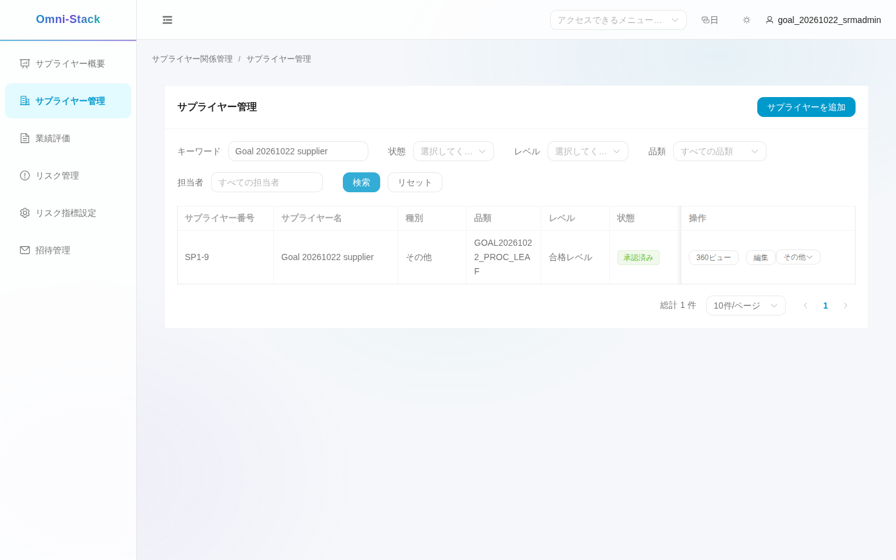

画像はサプライヤー管理の担当者が企業9の前提を確認したものです。調達担当者が企業を代わりに承認した画面ではありません。この企業が主な見積依頼に参加します。

### 5.2 見積依頼を検索して下書きを作る

調達担当者は「見積依頼・比較」を開き、番号、件名、状態、回答期限などで検索します。詳細で元の購買申請と招待先を確認します。

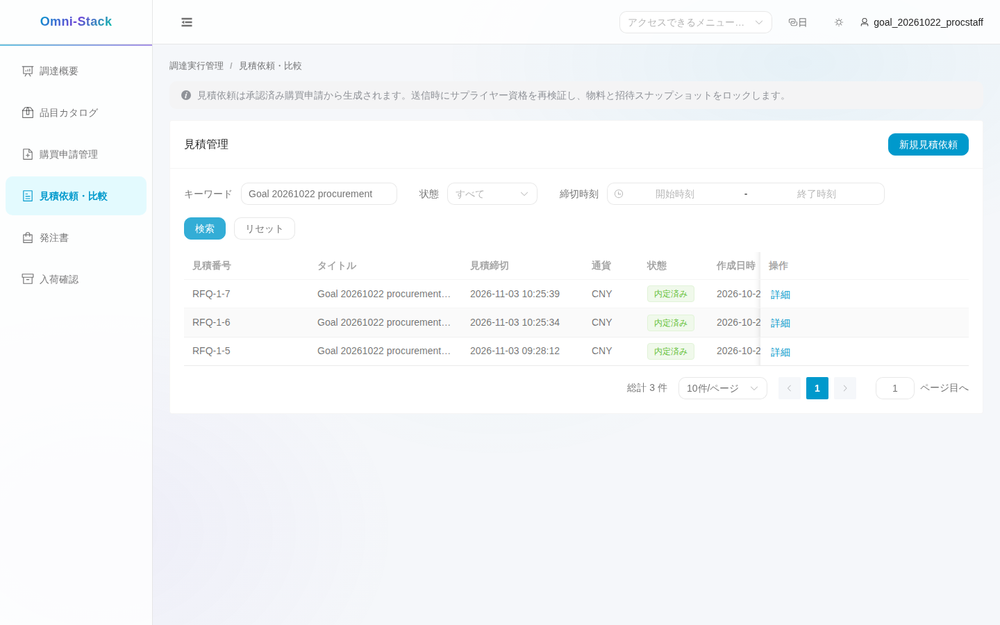

追加を選び、自分が参照できる承認済み購買申請を指定します。件名、将来の回答期限、説明を入力し、条件を満たすサプライヤーを1社以上選びます。明細は選択した申請から引き継ぐため、保存前に確認します。

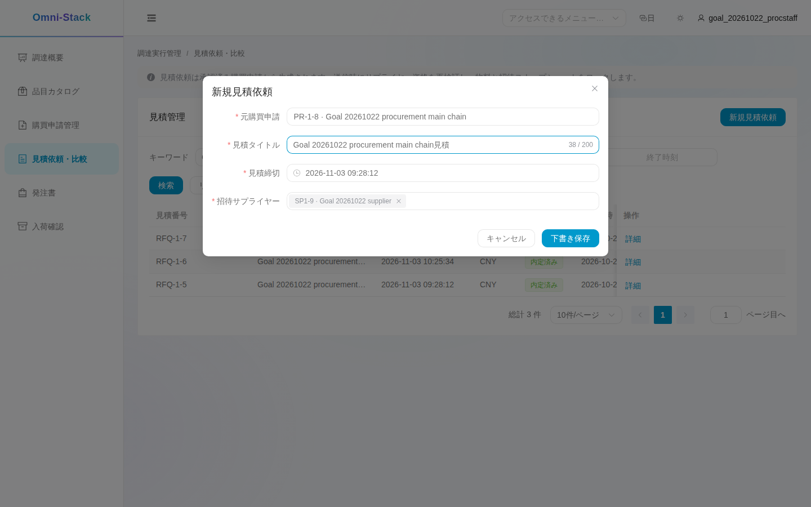

購買申請が承認されても、見積依頼は自動作成されません。保存後は編集や削除ができる下書きです。送信して確認すると、サプライヤーや期限などを再確認し、招待企業が回答できるようになります。送信後は元の要求を下書きのように自由に書き換えられません。

続行しない下書きや送信済み依頼は、現在の状態で許される取消操作を使い、確認します。採用済みの依頼には結果が残るため、未採用の比較対象として扱い続けません。

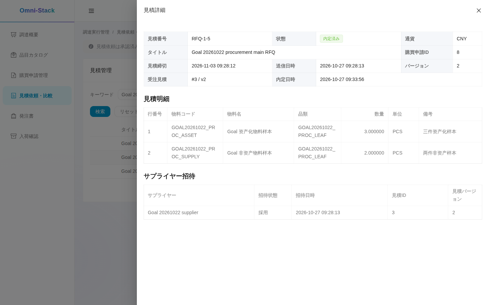

この画像は別の完了例 RFQ-1-5 で、採用後の閲覧結果を示します。主な例は RFQ-1-8 です。異なる番号の金額や見積版を混ぜないでください。

## 6. ポータルから回答する：自社の立場で見積もる

サプライヤーはポータルへログインし、自社に届いた調達の見積依頼を開きます。まず期限、品目、数量、条件を読みます。扱えるのは自社への招待で、他社の見積回答は見られません。

各行の単価、納品日数、見積有効期限などを入力し、合計を確認して送信します。主な例は資産対象3点を単価25.00、通常品目2点を単価12.50とし、合計100.0000 CNY です。

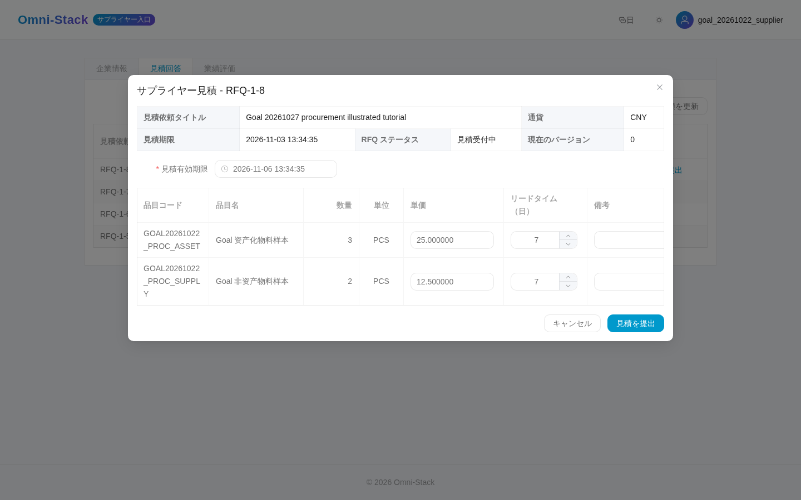

画像は RFQ-1-8 の送信前の入力例で、まだ回答を保存していないため版は0です。撮影時には送信していません。その後の実際の送信で第1版ができ、次節の比較表に結果が表示されます。

送信後は版と金額を確認します。期限と依頼の状態が回答を許す間は、画面から修正して新版を送信できます。調達担当者は現在有効な版を比較します。期限切れ、取消、採用済みなどのときは拒否理由に従います。

送信後に通信が切れたら、同じ依頼を開き直して保存済みかを確認してから再試行します。価格を変えながら連続送信して、区別できない版を増やさないでください。企業との関連付けがない内部管理者が、ポータル利用者になり代わって回答することもできません。

## 7. 比較と採用：有効な見積もりを発注につなげる

調達担当者は参照できる依頼の詳細から比較を開き、企業、現在の見積版、合計、行ごとの価格を確認します。明細を展開し、数量、単位、納品条件も確認してください。合計が最安かどうかだけでは判断しません。

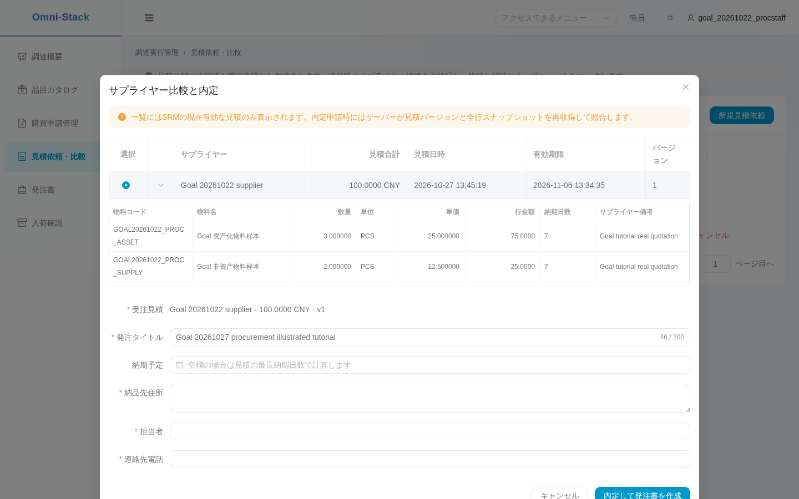

この実例は1社分の見積もりで、複数社競争を実施した証明ではありません。現在のシステムでは、回答期限前でも届いている有効な見積もりを採用できます。期限はサプライヤーが回答を続けられる時刻を制限するもので、調達側が採用を待たなければならない時刻ではありません。

対象の見積もりを選んで採用し、発注書の件名、納品予定日、受取住所、連絡先氏名、電話番号を入力して確認します。

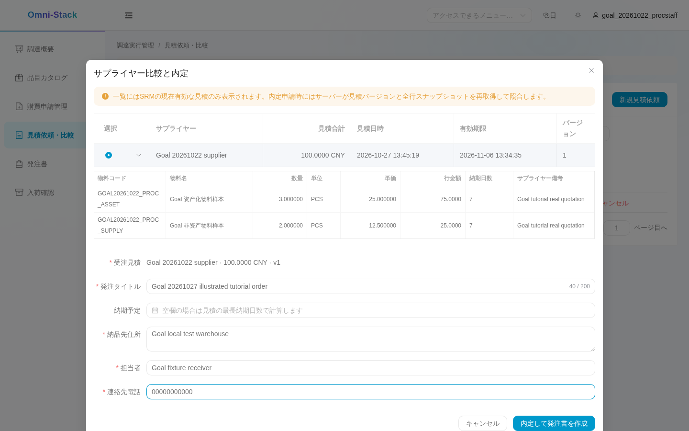

成功後は作成された発注書と依頼の結果を確認します。見積版が変わった場合は比較表を再読込して選び直します。通信待ちが切れた場合も、既に採用済みで発注書がないかを先に調べ、重複作成を避けます。

## 8. 発注書：確定してから入荷を受け付ける

### 8.1 検索、詳細確認、下書き編集

「発注書」でキーワード、状態、納品予定日を指定して検索します。発注書は見積採用から作られ、出所のない伝票を別途入力するものではありません。元の依頼、企業、見積版、数量、価格、納品情報を確認します。

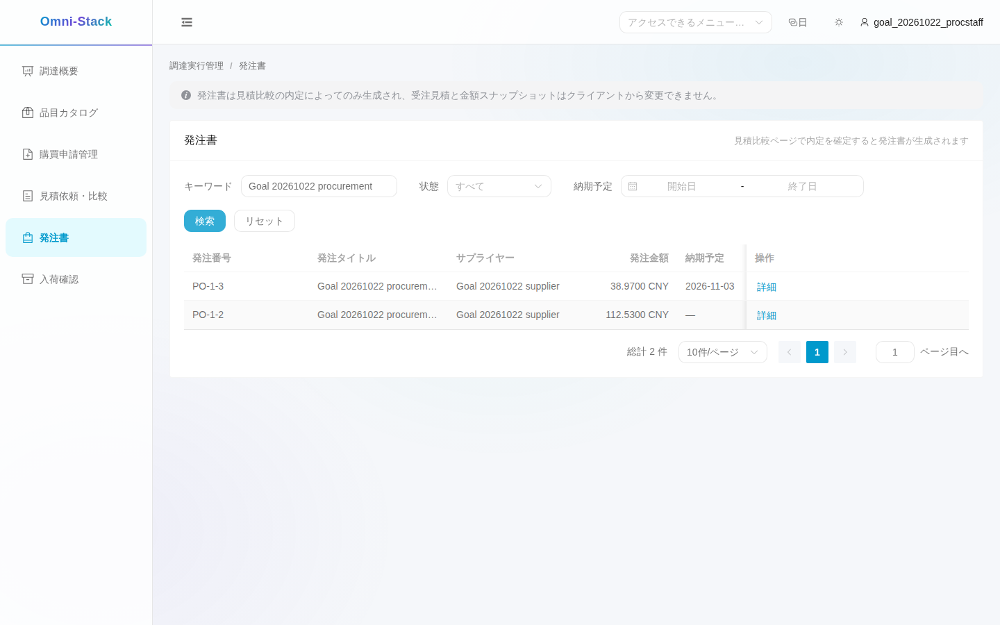

下書きでは、変更が許される納品情報などを編集でき、削除もできます。採用した見積価格を発注フォームで別の価格に自由変更することはできません。

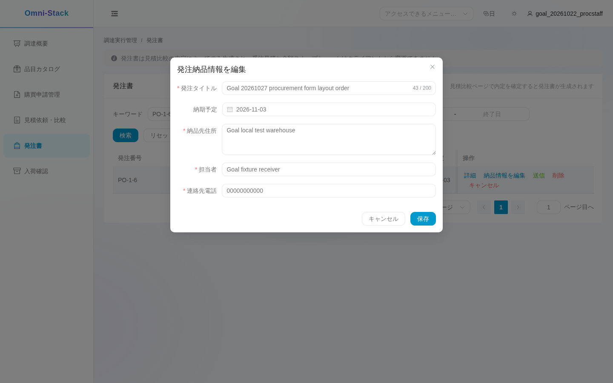

画像はレイアウト確認専用の別伝票 PO-1-6 です。撮影時には開いただけで保存せず、その後に正式に取り消しました。主な例 PO-1-5 でも、その伝票を前の状態に戻したものでもありません。

### 8.2 送信、内部での確定、取消

下書きを確認し、送信操作を確認します。その後、権限のある内部の調達担当者が発注を確定します。これは調達画面での内部操作で、ポータルに存在しないサプライヤー用の確定ボタンを押してもらう手順ではありません。確定後に入荷処理が可能になります。

下書き、送信済み、まだ入荷していない確定済みの発注は、現在の状態が許す場合に取り消せます。一部入荷または全数入荷済みは、この方法では取り消せません。利用者が別途「クローズ」を押す操作も現在の画面にはありません。

実際の別例として、PO-1-3 は正式取消、PO-1-4 は下書き削除を行いました。発注の取消や削除で依頼の採用が自動的に取り消されるわけではなく、同じ依頼を再度採用することもできません。

### 8.3 累計入荷数量と担当者の閲覧範囲

主な例 PO-1-5 は全数入荷済みです。金額は100.0000 CNY、二つの品目の累計数量は3と2です。

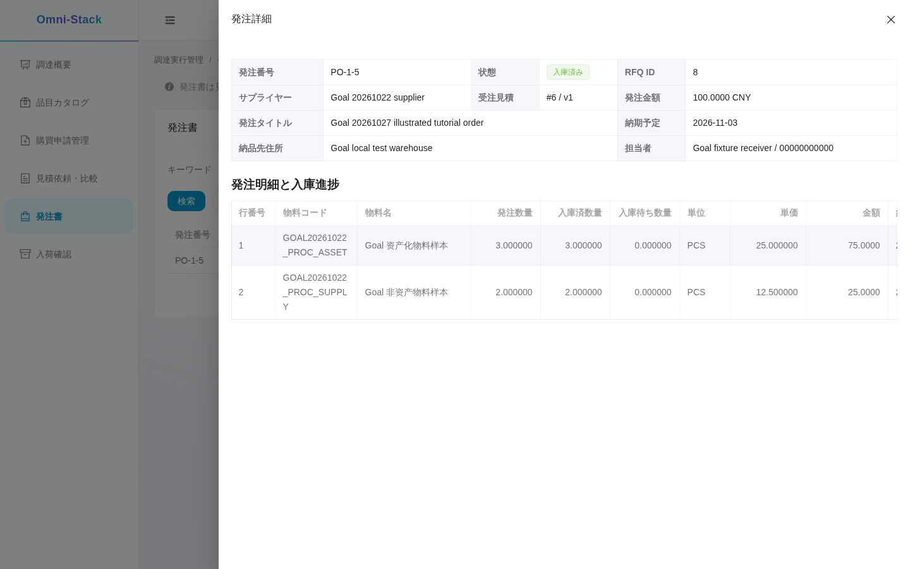

別の PO-1-2 は112.5300 CNY で、別見積もりの第2版を使っています。複数の人が分けて受け入れたため、現在の担当者には他の人の入荷詳細が見えない場合があります。それでも発注の累計には、その確定済み数量が含まれます。

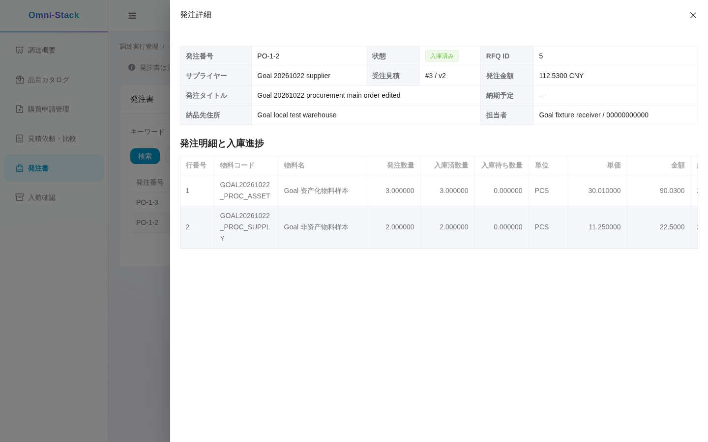

自分に入荷伝票が2件しか見えないからといって、累計もその2件だけとは限りません。追加で受け入れられる数量は、発注の最新の累計と残数で判断します。

## 9. 入荷と品質：届いたことと合格したことを分ける

### 9.1 入荷の下書きを作る

「入荷確認」でキーワード、状態、入荷日時を指定して検索し、詳細で元の発注、明細、品質結果を確認します。追加時は確定済みまたは一部入荷済みの発注を選び、入荷日時、備考、今回の各行の数量を入力します。

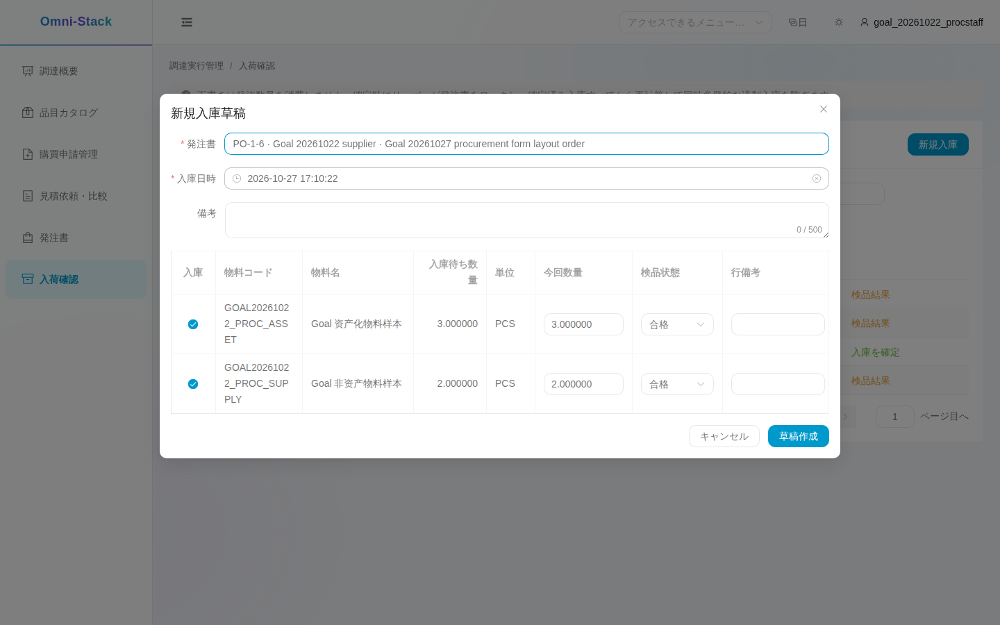

各行の数量が発注全体の受入可能残数を超えないか確認します。品質は「合格」「不合格」「保留」です。未判定なら保留にし、カードを早く作るために合格にしないでください。資産は実際に入荷した数量に従って1点ずつカードになり、対象数量は正の整数が必要です。このフォームに別の資産数量入力欄はありません。

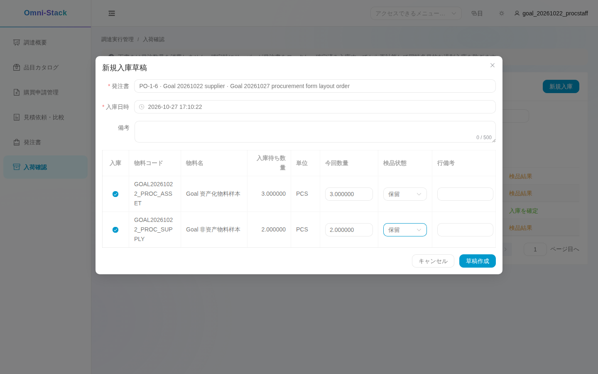

この2枚は、当時確定済みだった別発注 PO-1-6 を使った未送信のフォームです。入荷は登録せず、資産も作成していません。その発注は後に取り消しました。

### 9.2 保存と確定は別の操作

保存した下書きは、正式な累計にも発注残数の予約にもなりません。確定時に、発注全体の確定済み入荷を再確認します。自分に詳細が見えない別担当者の入荷も含まれます。

二つの下書きがそれぞれ古い残数以内でも、同じ残数に対して両方を確定できるとは限りません。超過や版の競合が出たら、発注と元の入荷を更新してください。現在の入荷画面には既存下書きの編集や削除はなく、新しい下書きを何度も作っても古い伝票の修正にはなりません。

### 9.3 数量を確定してから品質結果を補う

主な入荷 GR-1-6 の確定時点では、資産対象の品質はまだ保留でした。発注は全数入荷になっても、保留の行からはまだ資産カードができません。

検査結果が出たら、権限のある調達担当者が元の明細の品質結果操作を使い、合格または不合格を選んで送信します。対象は保留中の行だけです。最終結果を繰り返し書き換えることはできません。

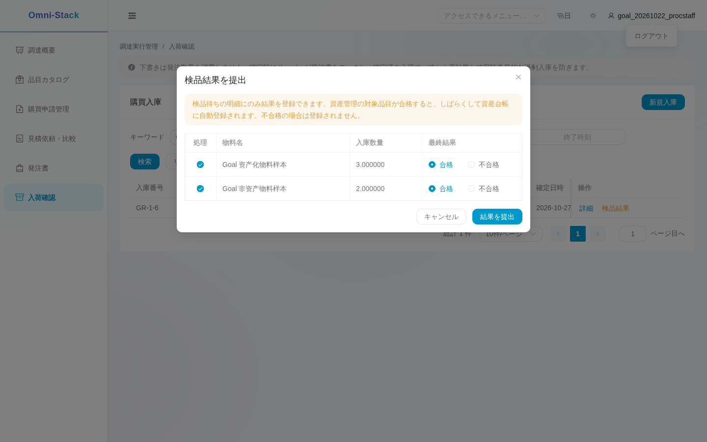

送信後は元の伝票を開き直し、状態と行ごとの品質を確認します。主な例の資産行は最終的に合格し、その後に3枚のカードができました。通常品目は入荷してもカードを作りません。

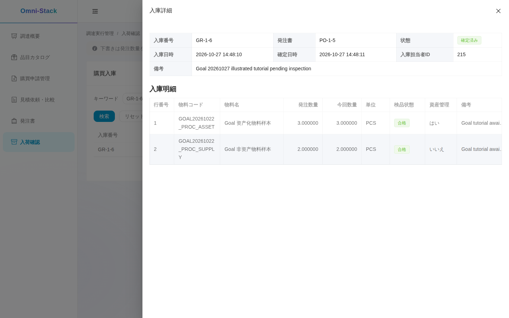

通信が途切れたら、成功表示がないからと新規入荷を作らず、元の伝票を確認します。発注の全数入荷、入荷伝票の確定、品質合格は、それぞれ別に確認する内容です。

## 10. 入荷後の資産：カードを購入元までたどる

調達は単独でも使えます。資産ページがあるのは、資産管理も含めている場合です。通常品目、不合格、保留の行が、全数入荷というだけで資産になるわけではありません。

<!-- omni:modules:asset -->

### 10.1 ワークスペースから資産を開き、実際のカードを確認する

入荷行が合格し、資産対象の品目で、対象数量が正の整数なら、少し遅れて資産カードが作成されます。少し待ってワークスペースへ戻り、アプリ一覧から資産管理を新しいタブで開きます。元伝票や資産名で検索します。

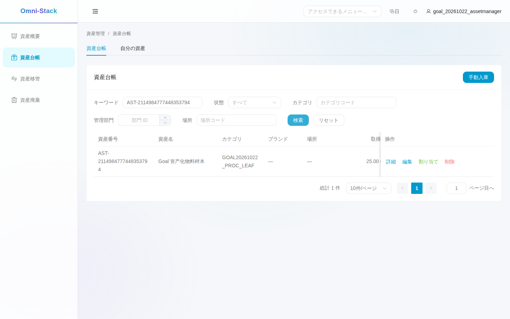

画像の一覧は絞り込み済みで、現在一致するカードだけを表示しています。1行しか見えないことを、1枚しか作成されなかった証拠にはできません。主な例では各25.00のカードが3枚でき、資産対象行の75.00と一致します。通常品目2点は資産台帳のカードになりません。

### 10.2 詳細で発注元と入荷元を確認する

カード詳細で、元の発注 PO-1-5、入荷 GR-1-6、元明細、金額、現在の資産状態を確認します。この関連で、何を買い、どの入荷分から作られたカードかが分かります。

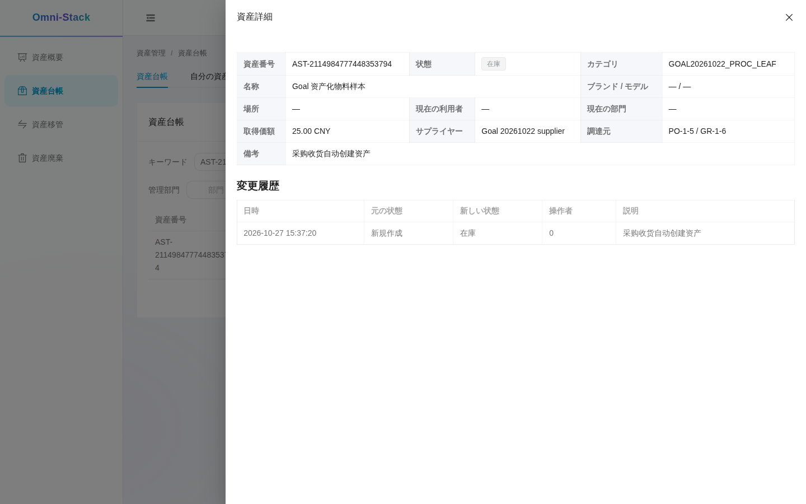

まだ見えないときは、品目の資産対象設定、入荷確定、最終合格、数量を確認し、待って更新します。過去の候補検索や補完処理は保護されたサービス機能です。調達責任者向けの手動補完メニューはありません。この通常のカード作成を、過去分の補完まで検証済みだと扱いません。

<!-- omni:modules:end -->

## 11. 調達概要：購入の約定額と銀行からの支払を区別する

権限のある人は「調達概要」を開き、更新して自分の範囲の申請、発注、入荷を確認します。集計はカテゴリ、サプライヤー、部門の三つの切り口で見られます。一覧と金額の両方が利用者の閲覧範囲に従います。

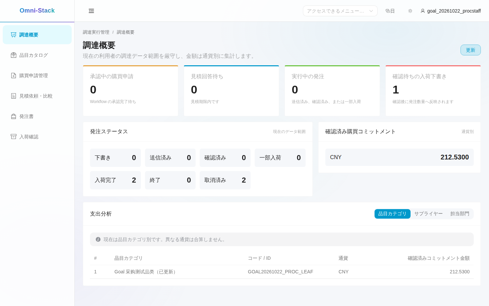

最新画像では、全数入荷済み発注が2件、取消済み発注が2件、未確定の入荷下書きが1件です。有効な購入約定額は **212.5300 CNY** で、PO-1-2 の112.5300と PO-1-5 の100.0000の合計です。取消や削除済みの別例は、この金額を増やしません。

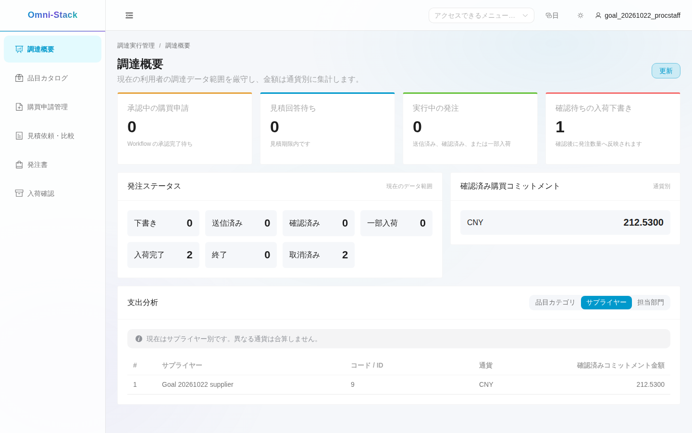

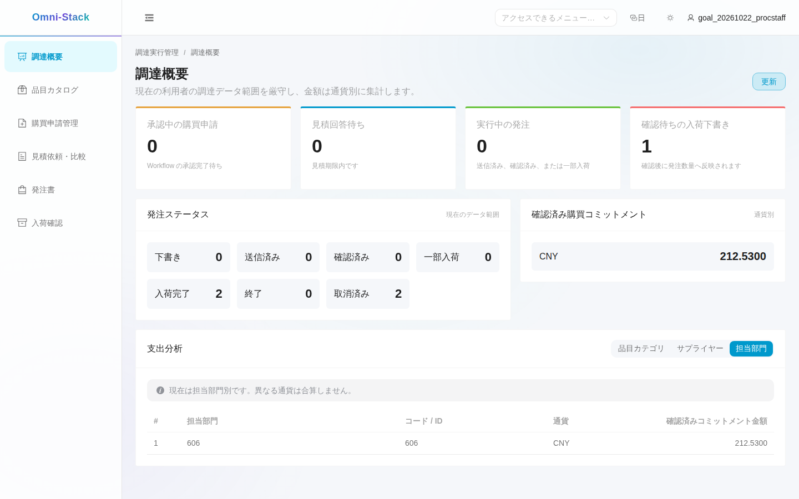

部門画像は識別子606を表示しており、部門名に変換済みとは扱いません。異なる通貨はそのまま合計できません。また、この集計は請求書、支払、会計の三点照合ではなく、調達モジュールが銀行支払を済ませる機能でもありません。

## 12. 困ったら、利用者、状態、元の伝票を確認する

### 12.1 同じ条件でも利用者によって結果が違う

調達担当者は自分の担当伝票を、上位の責任者は許可された部門と下位部門を見ます。同列の別担当者には空の一覧が返り、調達権限のない従業員は拒否される場合があります。それぞれ異なる正しい結果で、互いに代用できません。

四つの実際の利用者と閲覧範囲を見る

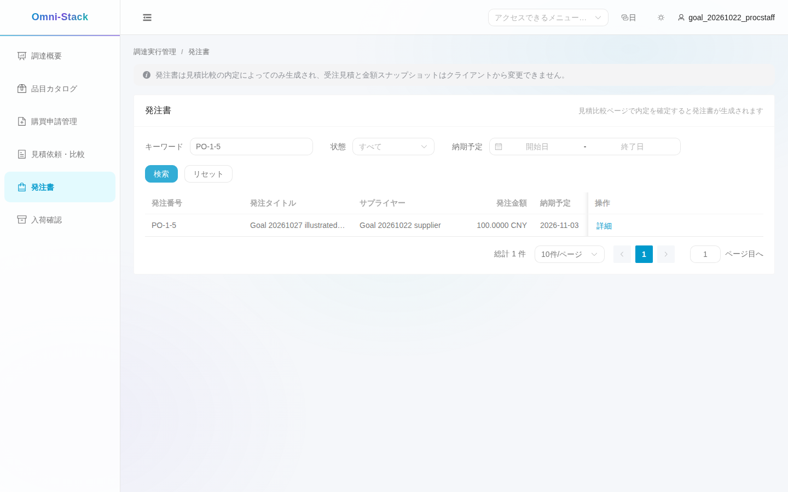

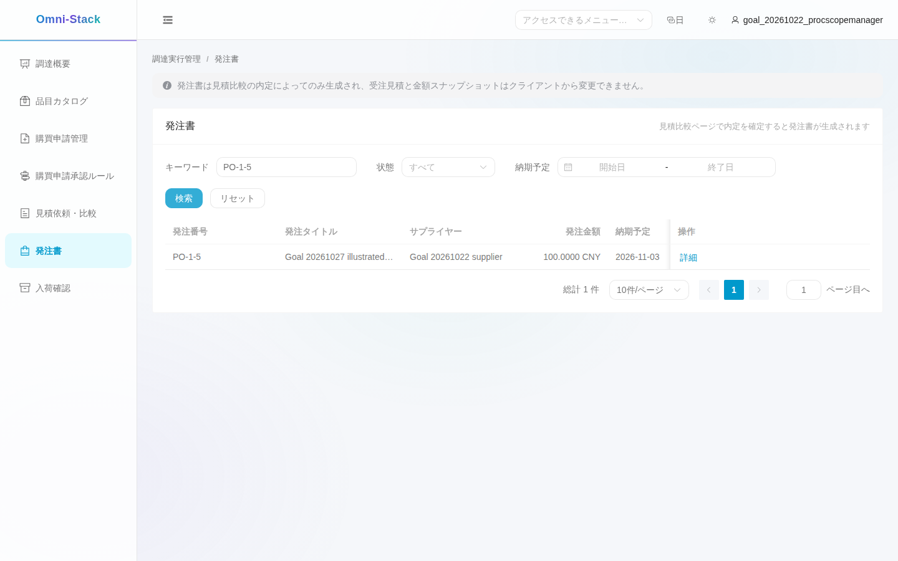

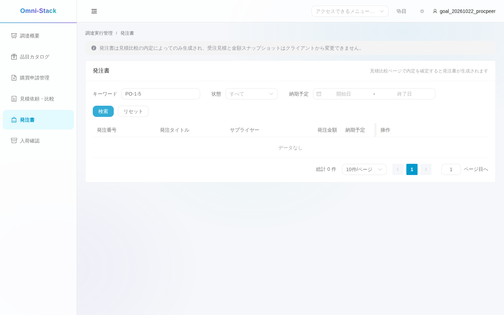

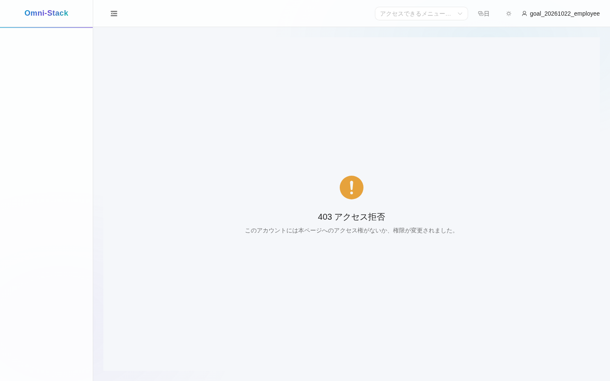

### 12.2 よくある失敗は元の伝票から対処する

| 問題 | 最初に確認すること | 次の対応 |
|---|---|---|
| カテゴリや品目を保存できない | 必須項目、コード重複、末端カテゴリ、最新版 | 内容を修正し、競合なら更新する。削除前に依存を解消 |
| 受付前に購買申請を拒否された | 品目、金額、組織、ルール、候補者 | 前提を整えて元の申請を送信 |
| 承認者から差し戻された | 意見と修正対象の明細 | 編集して下書き保存後、新たな承認を申請 |
| 受付後にフローが起動失敗 | 元の起動状態と復旧した前提 | 更新後に元の申請を再試行、不要なら失敗申請を取消 |
| 見積依頼を送れない | 承認済み申請、適格企業、将来の期限 | 下書きまたは企業側の前提を整えて送信 |
| ポータルで回答できない | 自社関連付け、招待、期限、依頼の状態 | 正しい企業の利用者で入力し、権限は担当者に確認 |
| 採用に失敗または応答不明 | 最新見積版、採用済みか、発注書の有無 | 元の依頼と発注を更新してから再操作 |
| 発注を取り消せない | 一部または全数入荷済みか | 許される状態に従い、入荷を戻して強制取消しない |
| 入荷を確定できない | 発注全体の最新累計、残数、伝票の版 | 更新し、他の担当者の確定分と重複させない |
| 入荷後に資産カードがない | 資産対象、確定、合格、有効な数量 | 待って更新し、続く場合は元の伝票を保持して技術担当へ |
| メニューなし、空一覧、アクセス拒否 | アカウント、テナント、組織、権限範囲 | 権限とデータを分けて確認し、管理者の結果で代用しない |

画像は実際のローカルアプリで、登録済みのテスト利用者と業務例を使って撮影しました。人が画像認証を入力してログインしたとの主張ではありません。過去の失敗、未送信フォーム、最終結果を区別しています。本章の業務・画像の証拠だけで、プロジェクト全体の最終リリース検収が済んだとは扱いません。
