# 조달 그림 안내: 구매 요청부터 주문, 입고, 자산까지

주문서를 작성했다고 구매가 끝나는 것은 아닙니다. 필요성을 승인받고, 공급업체의 견적을 받고, 무엇을 누구에게 살지 정한 다음, 도착한 물품의 수량과 품질을 확인해야 합니다. 이 글은 그 흐름을 따라 준비, 일상 조회, 설정, 실패 후 처리까지 설명합니다.

먼저 전체 흐름을 읽고 자신이 담당하는 부분으로 돌아오세요. 각 그림은 어떤 사용자로 어느 시점의 결과를 본 것인지 설명합니다. 입력 양식을 열어 둔 그림은 작성 방법을 보여 주며, 제출 완료의 증거와 구분합니다.

## 1. 진입 위치와 담당자, 이번 목표 확인하기

### 1.1 작업 공간에서 조달 열기

홈페이지에서는 프로젝트 Wiki를 읽습니다. 로그인한 뒤 내 작업 공간을 누르면 새 브라우저 탭이 열립니다. 작업 공간의 앱 버튼, 앱 목록 또는 오른쪽 위 메뉴 검색에서 조달을 찾아 열면 조달도 새 탭으로 열립니다. 조달 탭에는 현재 모듈의 메뉴와 검색 결과만 표시됩니다. 다른 앱으로 이동할 때는 이미 열어 둔 작업 공간 탭을 사용합니다.

조달에는 조달 개요, 품목 카탈로그, 구매 요청 관리, 구매 요청 승인 규칙, 견적 요청 및 비교, 구매 주문, 입고 확인의 일곱 업무 페이지가 있습니다. 분류는 품목 카탈로그 왼쪽에서 관리하며 별도의 앱이 아닙니다. 승인 규칙 같은 관리 메뉴는 권한이 있는 사용자에게만 보입니다.

페이지가 나뉜 품목이나 문서 목록에서는 아래쪽에서 전체 건수를 보고 페이지나 페이지당 표시 건수를 바꿀 수 있습니다. 다시 검색하거나 표시 건수를 바꾸면 첫 페이지부터 보여 줍니다. 페이지를 넘겨도 사용자에게 허용된 데이터 범위는 넓어지지 않습니다. 기록을 못 찾겠다면 먼저 조건을 확인하고 초기화해 다시 조회하세요.

### 1.2 누가 어느 부분을 담당하나요

| 현재 사용자 | 주요 업무 | 시작 전 확인 사항 |
|---|---|---|
| 조달 요청 권한을 받은 신청자 | 구매 요청 작성, 승인 추적, 본인 초안 관리 | 올바른 소속 조직, 준비된 품목과 승인 규칙 |
| 승인 후보자 | 작업 공간에서 자신에게 배정된 승인 처리 | 현재 단계의 실제 승인 후보자인지 확인 |
| 조달 담당자 | 품목 유지, 견적 요청, 비교와 선정, 주문과 입고 | 필요한 메뉴와 본인 범위의 문서에 접근 가능 |
| 조달 관리자 | 승인 규칙 관리, 허용된 부서 범위 조회 | 관리 권한과 게시된 승인 흐름 |
| 공급업체 포털 사용자 | 자기 회사가 받은 요청을 보고 견적 제출 | 승인된 기업과 해당 기업에 연결된 포털 계정 |

일반 직원이 로그인할 수 있다고 모든 조달 권한이 생기지는 않습니다. 빈 목록, 보이지 않는 메뉴, 명시적인 접근 거부는 서로 다른 결과입니다. 먼저 사용자, 소속 조직, 권한을 확인하세요. 관리자로 바꾸는 것을 정상 업무 절차로 삼지 않습니다.

### 1.3 주 흐름 예제: 자산 품목 3개와 일반 품목 2개

이번 실제 흐름은 구매 요청 **PR-1-8**에서 시작합니다. 승인 뒤 **RFQ-1-8**을 만들고, 공급업체 견적을 선정하여 **PO-1-5**를 생성한 다음, 입고 **GR-1-6**을 확정했습니다.

| 품목 | 수량과 단가 | 해당 행의 결과 |
|---|---|---|
| 자산 관리 대상 품목 | 3개, 개당 25.00 | 품질 합격 후 각각 25.00인 자산 카드 3장 |
| 일반 품목 | 2개, 개당 12.50 | 정상 입고하며 자산 카드는 만들지 않음 |
| 합계 | 100.0000 CNY | 입고 수량은 각각 3과 2 |

뒤에서는 실패 복구, 여러 담당자의 분할 입고, 취소를 위한 별도 예제도 사용합니다. 문서마다 번호가 다르며, 주 흐름의 문서를 과거 상태로 되돌리라는 뜻이 아닙니다. 넓은 표는 가로로 스크롤해 확인할 수 있습니다. 고정 작업 열이 문서의 실제 값을 바꾸지는 않습니다.

## 2. 품목 준비: 무엇을 구매할 수 있는지 정리하기

### 2.1 품목 조회와 분류 관리

조달 담당자는 품목 카탈로그를 엽니다. 왼쪽에서 분류를 고르고 오른쪽에 검색어, 활성 상태 등 조건을 지정해 조회합니다. 초기화로 조건을 지우고 전체 품목으로 돌아가면 전체 목록을 볼 수 있습니다. 카탈로그는 같은 테넌트가 공유하는 준비 자료이며, 담당자마다 따로 만들지 않습니다.

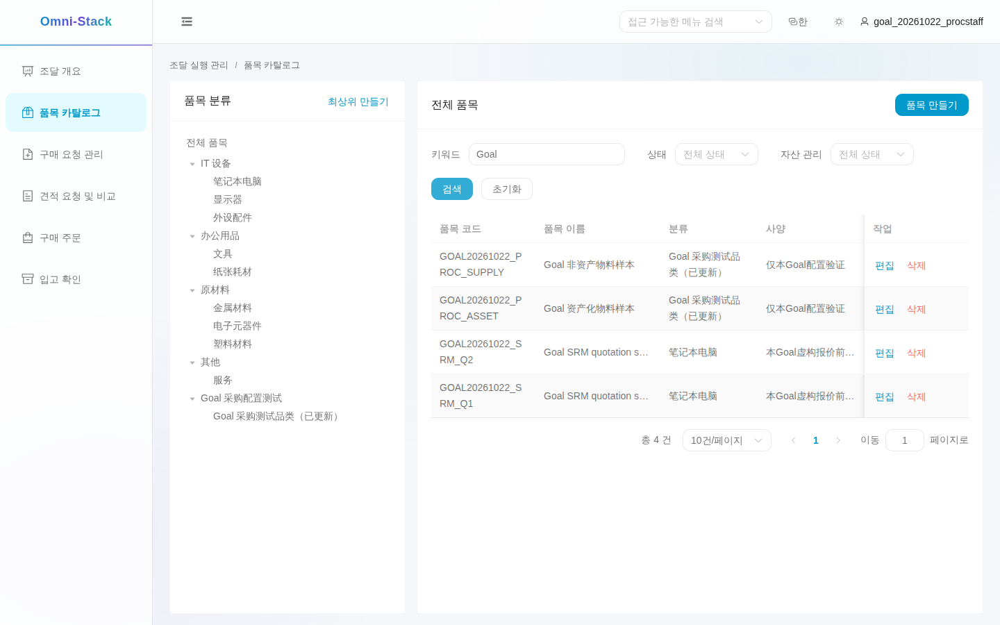

최상위 분류는 분류 영역의 추가 기능으로 만듭니다. 기존 분류에 마우스를 올리면 하위 분류 추가, 편집, 삭제 등의 작업이 보입니다. 코드, 이름, 정렬 순서, 활성 상태를 입력합니다. 편집할 때 코드와 상위 분류는 읽기 전용이므로 기존 품목의 위치를 잘못 바꾸지 않습니다.

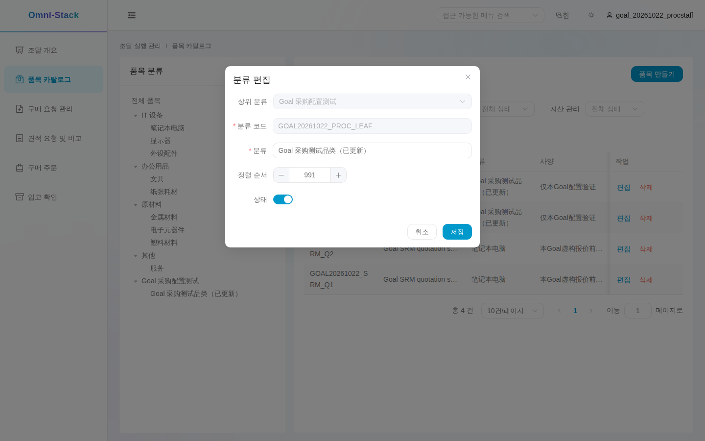

저장한 뒤 트리를 새로 고쳐 위치, 이름, 상태를 확인합니다. 삭제 전에는 하위 분류와 기존 참조를 먼저 처리하세요. 거부되면 안내된 의존 관계를 해결하고 반복 클릭하지 않습니다. 비활성화하기 전에도 해당 분류를 쓰는 품목과 규칙을 확인합니다.

### 2.2 품목 생성, 편집, 비활성화, 삭제

품목 추가에서 중복되지 않는 코드, 이름, 활성화된 말단 분류와 단위를 입력합니다. 이후 자산 카드를 만들어야 하는 품목은 자산 관리 대상을 선택합니다. 대상 품목의 단위는 EA, PCS, UNIT, SET을 사용하고 카드 생성 대상 수량은 양의 정수여야 합니다.

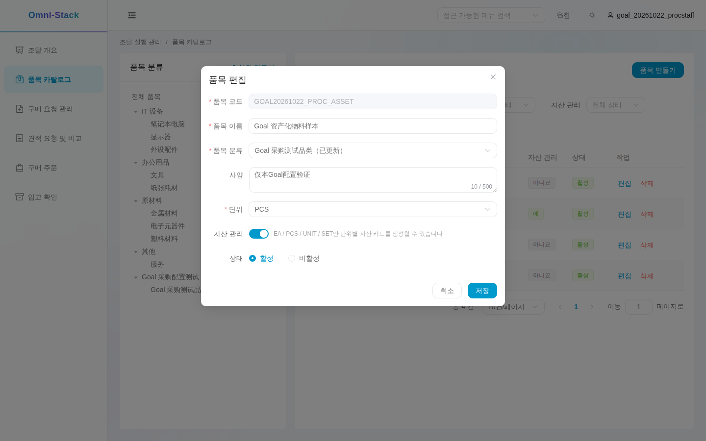

저장 후 코드로 검색해 이름, 분류, 단위, 자산 표시, 활성 상태를 확인합니다. 허용된 정보는 편집할 수 있지만 코드는 그대로 유지합니다. 당분간 구매하지 못하게 할 품목은 비활성화합니다. 삭제도 기존 업무 참조 등의 제한을 따르므로 화면의 안내를 확인합니다.

코드 중복이면 사용하지 않은 코드를 정합니다. 다른 사람이 수정했다는 안내가 나오면 양식을 닫고 새로 고친 뒤 다시 열어 저장하세요. 오래된 양식으로 다른 사람의 변경을 계속 덮어쓰지 않습니다.

## 3. 승인 규칙: 요청을 누구에게 보낼지 정하기

### 3.1 바꾸기 전에 기존 규칙 살펴보기

조달 관리자는 구매 요청 승인 규칙을 엽니다. 규칙은 분류와 금액 범위를 게시된 구매 승인 흐름에 연결합니다. 소액 요청은 부서 책임자에게, 큰 금액은 추가 승인 단계를 거치도록 구성할 수 있습니다. 신청자가 제출하기 전에 적용 가능한 규칙이 있어야 합니다.

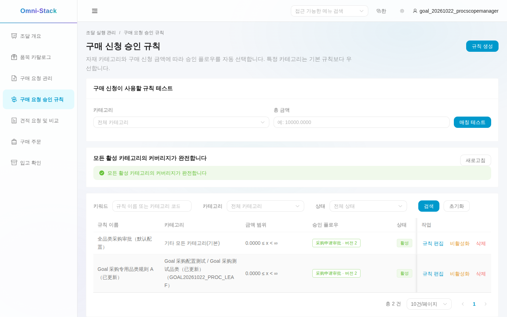

검색어, 분류, 활성 상태로 기존 규칙을 조회하고 초기화로 조건을 지웁니다. 이어서 금액과 흐름 버전을 확인합니다. 데스크톱은 표, 휴대전화는 자동으로 카드로 표시하며 편집, 활성·비활성, 삭제는 같은 규칙에 적용됩니다. 별도의 화면 전환 버튼을 찾을 필요가 없습니다. 흐름 미리 보기, 조건 시험, 적용 범위와 영향 확인을 거쳐 추가나 변경을 판단합니다. 관리 메뉴가 없는 담당자는 제한을 우회해 설정하지 않습니다.

### 3.2 마법사로 생성하거나 편집하기

첫 단계에서 규칙 이름, 적용 분류, 최소·최대 금액을 입력합니다. 최소 금액은 포함하고 최대 금액은 포함하지 않습니다. 최대 금액을 비우면 상한이 없습니다. 인접 범위 사이에 빈틈이나 충돌이 없도록 확인하세요. 같은 조건에서는 특정 분류 규칙이 기본 규칙보다 우선합니다. 규칙 코드는 시스템이 만듭니다. 기존 규칙의 고급 정보는 읽기 전용이며, 코드나 우선순위를 마법사에 직접 입력하는 것이 아닙니다.

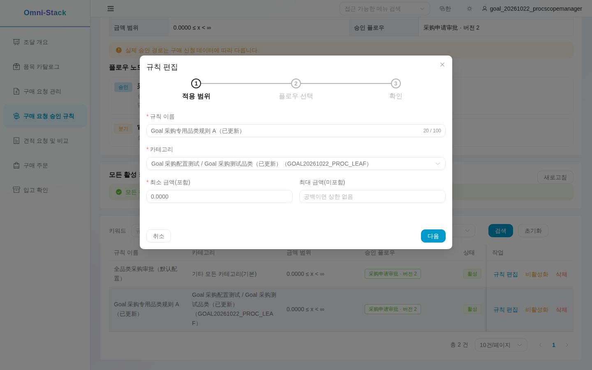

다음으로 구매에 사용할 수 있는 게시된 흐름 버전을 고르고 이름, 버전, 게시 시간을 확인합니다. 이름이 같아도 버전별 승인 구성이 다를 수 있습니다. 저장 후에는 아래의 일치 시험으로 승인 순서와 후보자도 확인합니다.

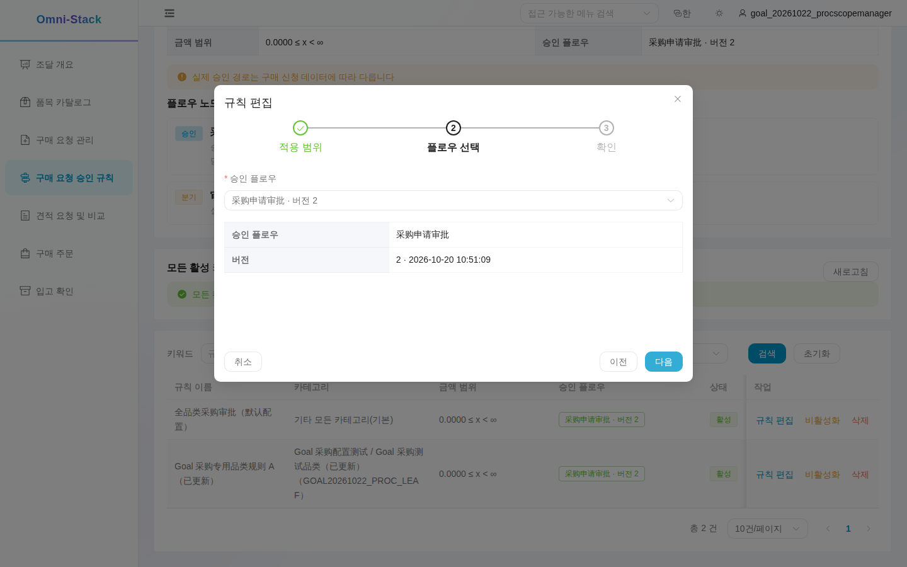

마지막에 요약, 범위, 흐름을 확인하고 활성 또는 비활성을 골라 저장합니다. 목록을 다시 조회해 의도한 상태인지 확인하세요. 편집과 삭제도 최신 목록에서 시작합니다. 비활성화나 삭제 전에 영향을 확인해 이후 요청의 경로가 사라지지 않게 합니다. 세 그림은 기존 규칙을 열고 저장하지 않은 화면이며, 새 규칙 생성 성공 결과가 아닙니다.

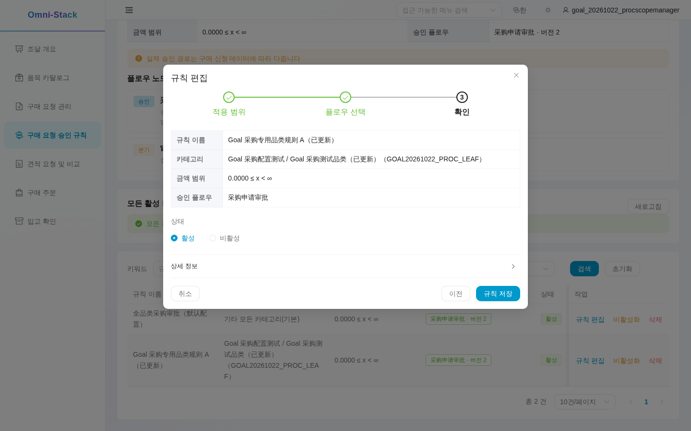

### 3.3 조건을 시험해 어떤 흐름이 선택되는지 확인하기

일치 시험을 열고 분류와 금액을 입력합니다. 예제는 100을 사용하며 선택된 규칙, 흐름 버전, 승인 구성을 함께 보여 줍니다. 일치 없음, 후보자 부족, 흐름 조건 미비가 나타나면 신청자가 제출하기 전에 규칙이나 전제 조건을 보완합니다.

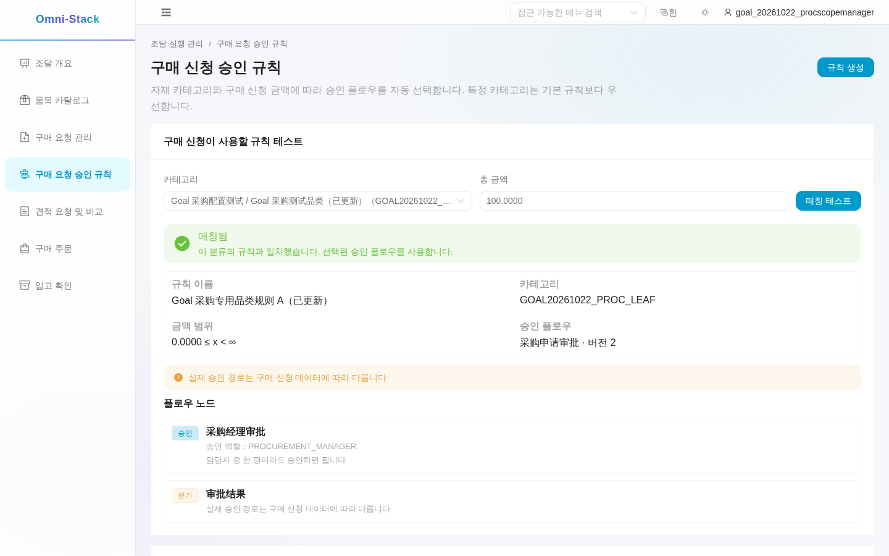

휴대전화와 태블릿에서 같은 결과 보기

좁은 화면에서는 요약이 세로로 배치되고 긴 후보자 설명이 줄바꿈됩니다. 데스크톱과 같은 결과를 가로로 압축하지 않고 읽을 수 있습니다.

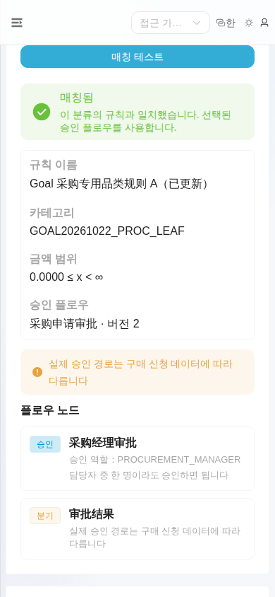

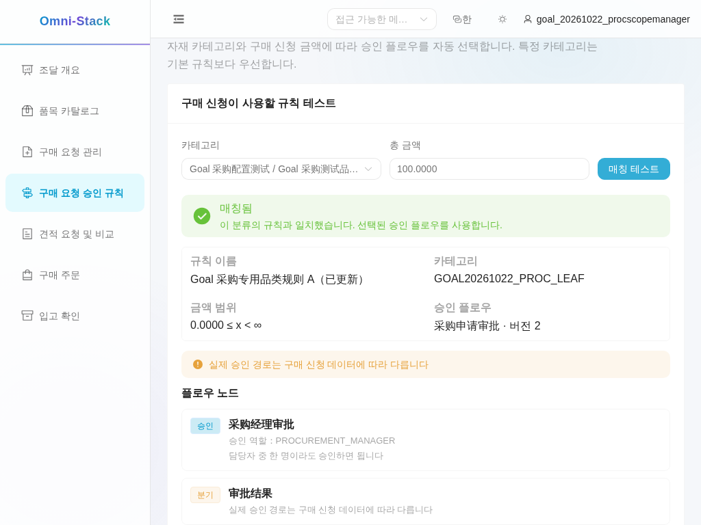

적용 범위와 영향 분석에서 이후 요청에 미치는 영향도 확인합니다. 이미 제출된 요청은 당시 선택한 승인 정보를 유지합니다. 규칙을 바꿔도 기존 요청이 조용히 다른 흐름으로 옮겨 가지 않습니다.

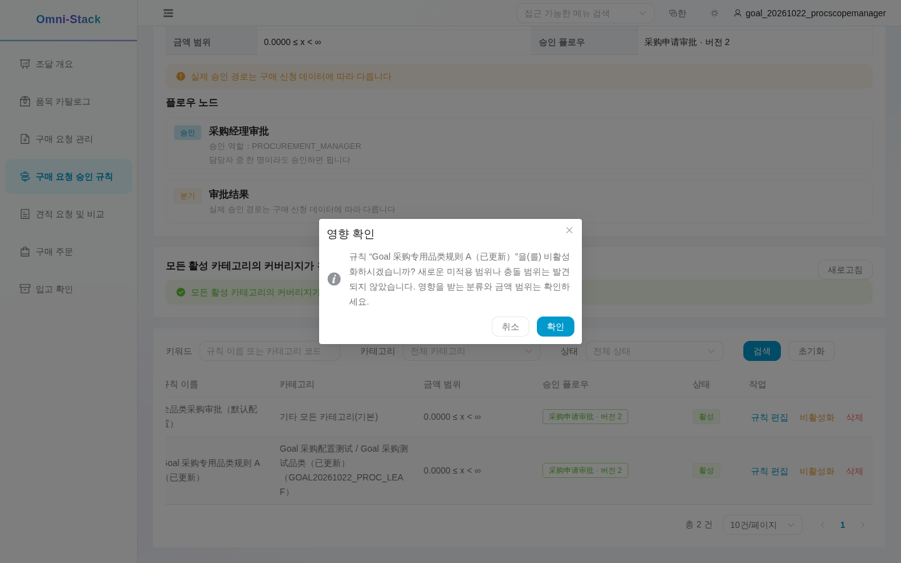

## 4. 구매 요청: 필요한 물품을 승인 가능한 문서로 만들기

### 4.1 요청 조회와 상세 확인

신청자는 구매 요청 관리에서 검색어, 상태 등으로 조회합니다. 관리자 등의 조회 범위는 권한에 따라 달라지므로 같은 조건이어도 사용자별 결과가 다를 수 있습니다.

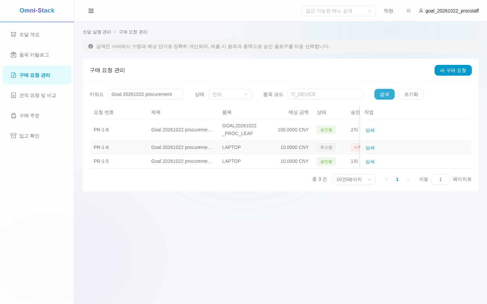

상세에서 제목, 신청자, 분류, 명세, 예상 금액, 승인 진행을 확인합니다. 주 예제 PR-1-8은 최종 승인되었으며 자산 대상 3개와 일반 품목 2개, 예상 합계 100.0000 CNY입니다.

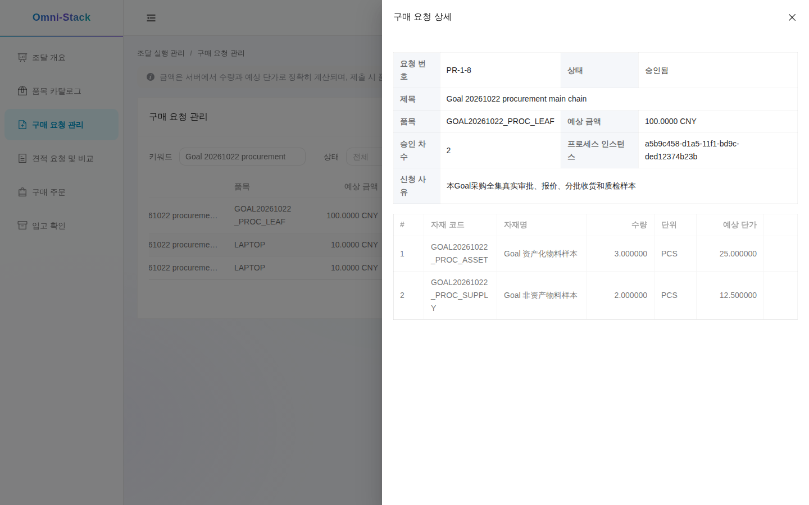

### 4.2 초안 생성, 편집, 삭제

추가를 누르고 제목과 분류를 입력한 뒤, 행마다 품목, 수량, 예상 단가를 정합니다. 수량은 양수, 예상 단가는 0 이상이어야 합니다. 필요한 행을 추가하거나 제거하고 계산된 금액과 용도를 확인해 저장합니다.

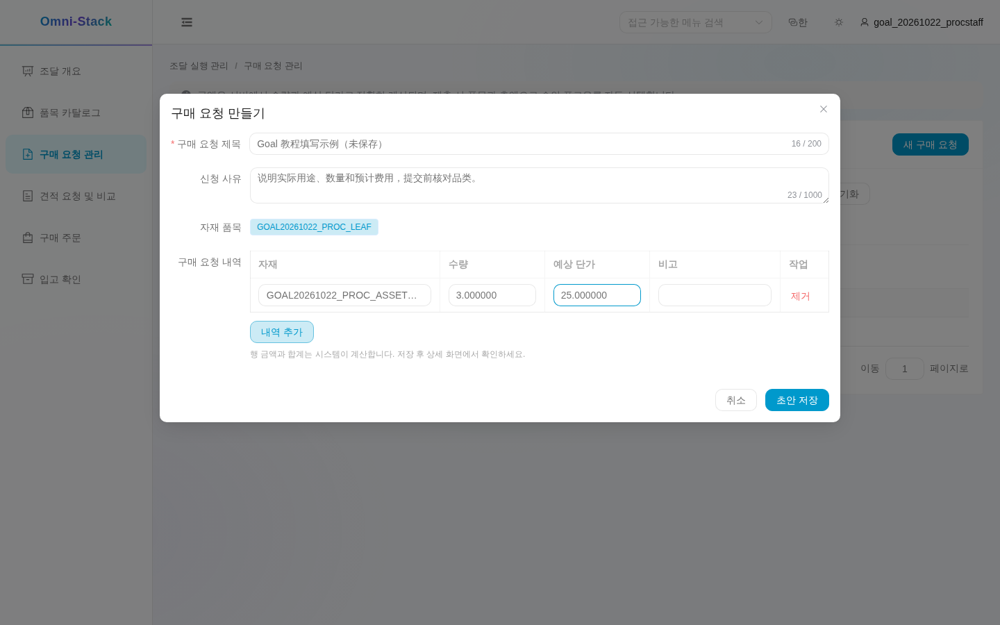

저장하면 초안이 되며 아직 승인은 시작되지 않습니다. 초안을 다시 열어 편집할 수 있고, 필요 없으면 삭제하거나 취소할 수 있습니다. 취소된 문서는 초안처럼 계속 편집할 수 없습니다. 목록에서 번호와 내용을 확인한 다음 제출 여부를 결정합니다.

### 4.3 제출, 승인, 반려 후 새 회차

제출 전 품목, 금액, 조직, 적용 규칙, 후보자를 확인합니다. 제출을 접수한 다음 흐름이 시작되고 승인 결과는 더 늦게 표시될 수 있습니다. 접수되었다고 승인된 것으로 보지 말고 원문서를 새로 고쳐 진행을 확인합니다.

승인 후보자는 작업 공간의 승인 영역에서 실제 배정된 작업을 엽니다. 연결된 요청과 명세를 확인하고 의견을 적어 승인하거나 반려합니다. 조달 목록을 볼 수 있다고 현재 작업의 승인 후보자가 되는 것은 아닙니다.

PR-1-8은 첫 회차에서 반려되었습니다. 신청자가 편집하고 초안으로 저장한 뒤 다시 제출하여 두 번째 회차에서 승인되었습니다. 반려 후에는 편집·저장을 거쳐 새 회차로 제출하고, 이전 승인 작업을 반복 처리하지 않습니다. 현재 조달 화면에는 승인 진행 중인 요청을 직접 철회하는 기능이 없습니다.

### 4.4 시작 실패 시 원문서를 확인하고 재시도 또는 취소하기

접수 전 입력 검사 실패와 접수 후 승인 흐름 시작 실패는 다릅니다. 전자는 안내에 따라 양식을 고칩니다. 후자는 원래 요청에 기록이 남으므로 실패 상태를 새로 확인하고 즉시 중복 요청을 만들지 않습니다.

다음 두 그림은 실제 장애 연습 당시 저장한 넓은 화면입니다. 당시 실패를 설명하며, 최신 화면에서 다시 실패했다고 주장하는 그림이 아닙니다.

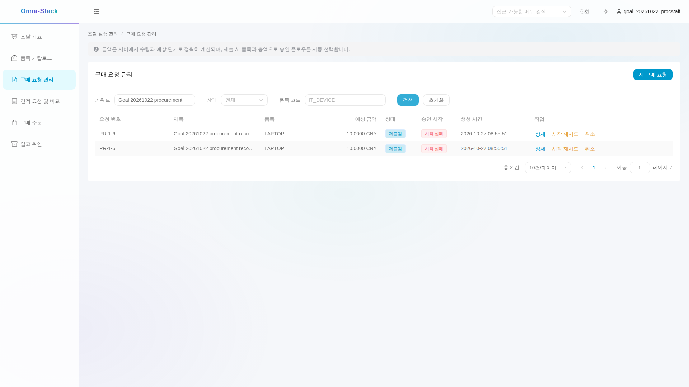

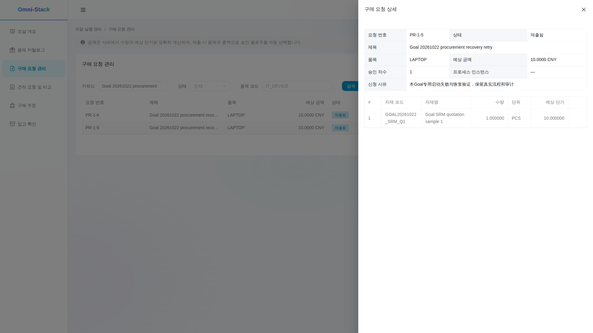

전제 조건을 복구한 뒤 원문서에서 시작 재시도를 하고 승인 진행을 확인합니다. PR-1-5는 재시도 후 실제 승인에 들어가 최종 승인되었습니다. 제출 결과가 불확실할 때도 원문서에 흐름과 작업이 이미 있는지 먼저 확인합니다.

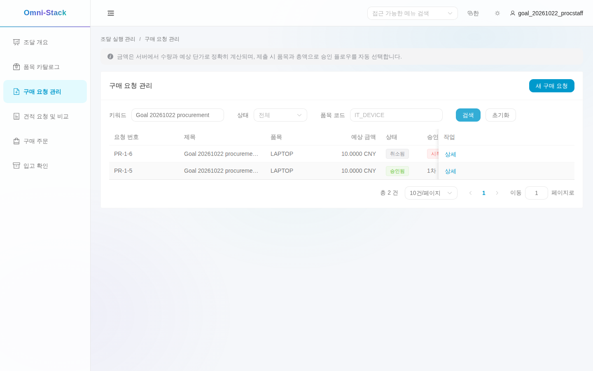

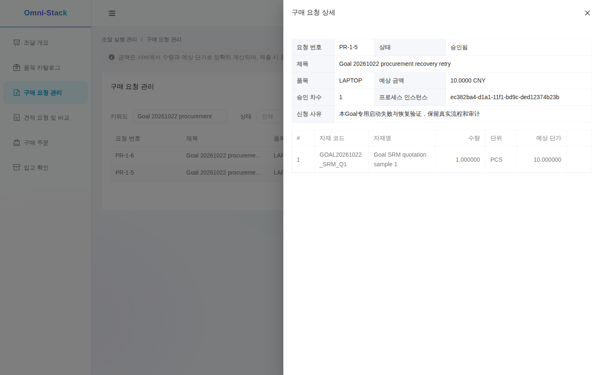

더는 필요 없는 시작 실패 요청은 원문서의 취소 기능으로 끝낼 수 있습니다. PR-1-6은 승인 인스턴스 없이 취소되었습니다. 이 기능이 승인 진행 중인 모든 요청의 취소를 허용하는 것은 아닙니다.

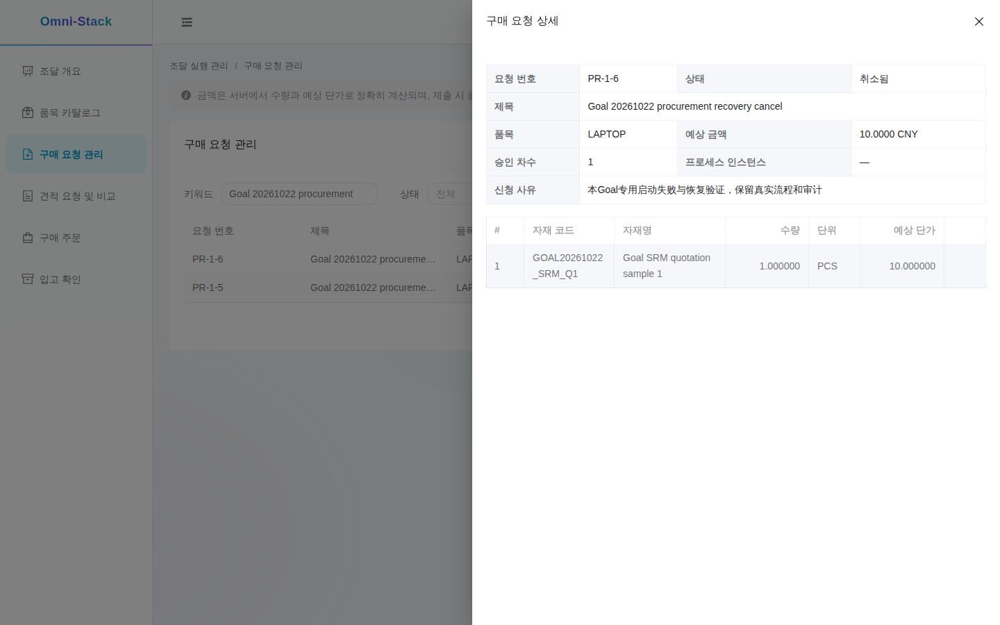

## 5. 견적 요청 준비와 생성: 초대할 기업과 마감 정하기

### 5.1 공급업체부터 준비하기

권한 있는 공급업체 관리 담당자가 기업을 관리합니다. 초대 전 기업 승인, 공급 분류 적합성, 포털 사용자와 기업의 연결을 확인합니다. 견적 요청에서 이름을 선택하는 것으로 기업 승인이나 포털 연결을 대신할 수 없습니다.

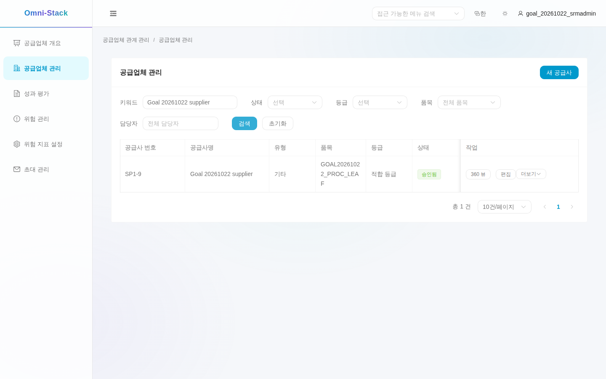

그림은 공급업체 관리 사용자가 기업 9의 전제 조건을 확인한 것입니다. 조달 담당자가 기업을 대신 승인한 화면이 아닙니다. 이 기업이 주 견적 요청에 참여합니다.

### 5.2 견적 요청을 조회하고 초안 만들기

조달 담당자는 견적 요청 및 비교를 열어 번호, 제목, 상태, 마감 시간 등으로 조회합니다. 상세에서 출처 구매 요청과 초대 대상을 확인합니다.

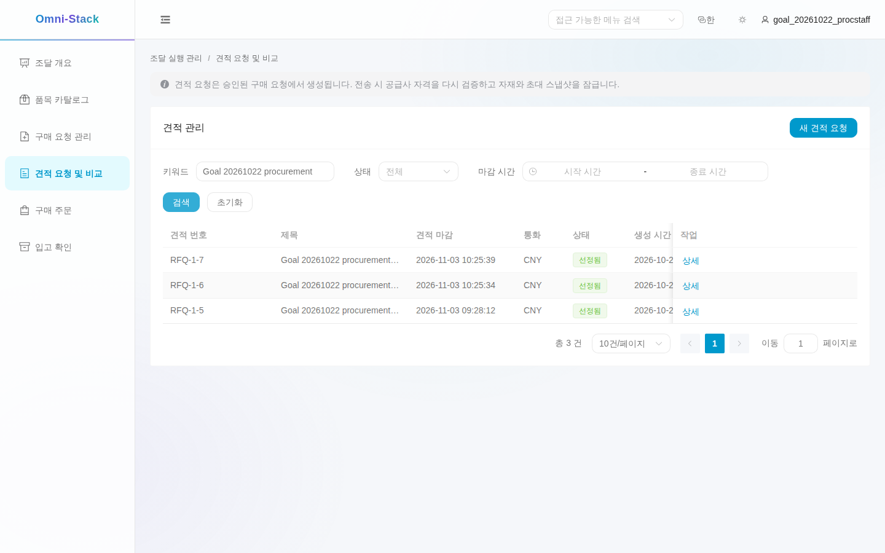

추가를 누르고 자신이 접근할 수 있는 승인된 구매 요청을 고릅니다. 제목, 미래의 견적 마감 시간, 설명을 입력하고 적격 공급업체를 최소 한 곳 선택합니다. 명세는 선택한 요청에서 가져오므로 저장 전 확인합니다.

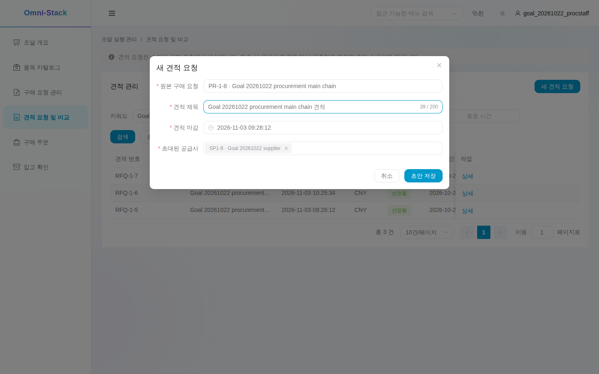

구매 요청이 승인되어도 견적 요청이 자동으로 만들어지지는 않습니다. 저장 후에는 편집·삭제할 수 있는 초안입니다. 발송을 확인하면 공급업체와 마감 등의 조건을 다시 검사하고 초대 기업에 견적 제출을 개방합니다. 발송 뒤에는 원래 요구 사항을 초안처럼 마음대로 바꿀 수 없습니다.

계속하지 않을 초안이나 발송된 요청은 현재 상태에서 허용하는 취소를 사용하고 확인합니다. 선정된 요청에는 당시 결과가 남으므로 계속 비교 대기 문서처럼 다루지 않습니다.

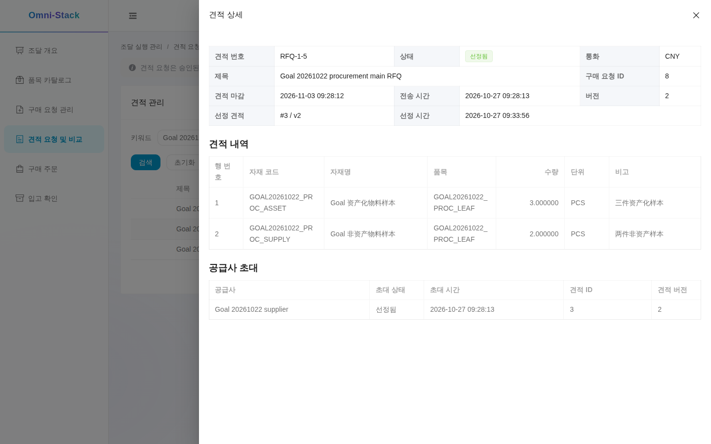

이 그림은 별도로 완료된 RFQ-1-5이며, 선정 후 읽기 전용 결과를 설명합니다. 주 예제는 RFQ-1-8입니다. 번호가 다른 문서의 금액과 견적 버전을 섞지 마세요.

## 6. 공급업체 포털 견적: 자기 회사로 초대에 응답하기

공급업체는 포털에 로그인해 자기 회사가 받은 조달 견적 요청을 엽니다. 먼저 마감, 품목, 수량, 요구 사항을 읽습니다. 본인 기업의 초대만 처리하며 다른 업체 견적은 볼 수 없습니다.

각 행의 단가, 납품 일수, 견적 유효기간 등 필수 내용을 입력하고 합계를 확인해 제출합니다. 주 예제는 자산 품목 3개를 개당 25.00, 일반 품목 2개를 개당 12.50으로 입력해 합계 100.0000 CNY입니다.

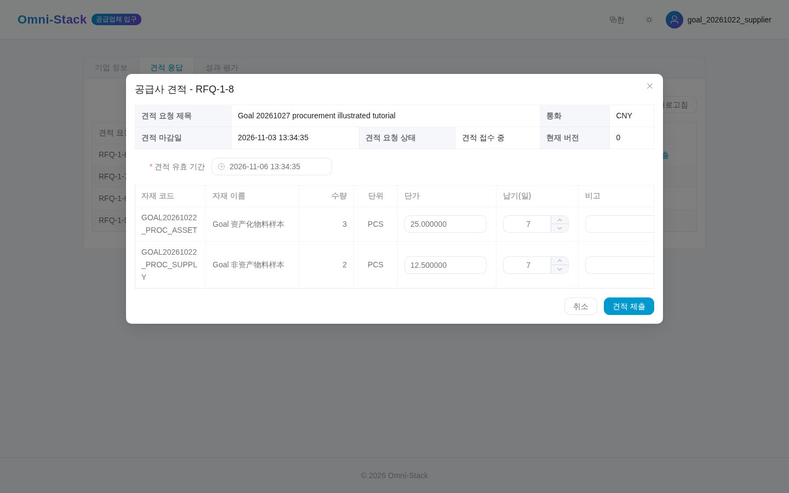

그림은 RFQ-1-8 제출 전 작성 예시입니다. 아직 저장된 견적이 없어 버전이 0이며 촬영 중에는 제출하지 않았습니다. 이후 실제 제출로 첫 버전이 만들어졌고, 다음 절의 비교표에서 결과를 볼 수 있습니다.

제출 후 버전과 금액을 확인합니다. 마감과 요청 상태가 허용하는 동안은 포털에서 수정 후 새 버전을 제출할 수 있습니다. 조달 담당자는 현재 유효한 버전을 비교해야 합니다. 마감 경과, 취소, 선정 완료 등으로 거부되면 안내를 따릅니다.

제출 후 연결이 끊기면 같은 초대를 다시 열어 저장 여부를 확인하고 재시도합니다. 가격을 바꾸며 연속 제출해 구분하기 어려운 버전을 만들지 마세요. 기업에 연결되지 않은 내부 관리자가 포털 사용자를 가장해 대신 견적을 제출할 수도 없습니다.

## 7. 비교와 선정: 유효 견적을 주문으로 바꾸기

조달 담당자는 접근 가능한 요청 상세에서 비교를 열고 업체, 현재 견적 버전, 총액, 행별 가격을 확인합니다. 명세를 펼쳐 수량, 단위, 납품 조건도 확인하세요. 총액이 가장 낮다는 이유만으로 결정하지 않습니다.

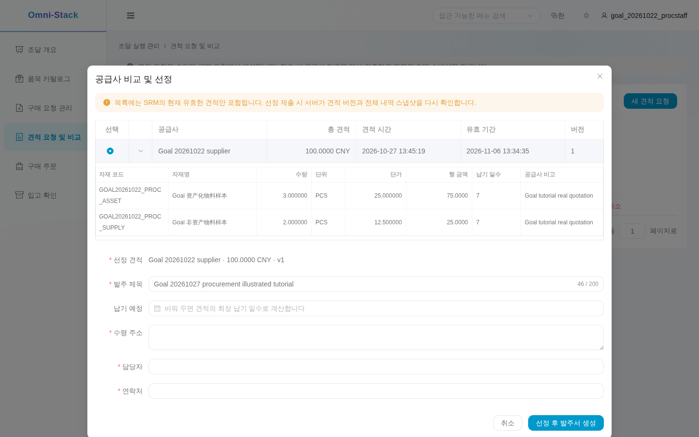

이 실제 예제에는 한 공급업체의 견적만 있어 여러 업체의 경쟁을 검증한 것은 아닙니다. 현재 시스템은 마감 전에도 이미 받은 유효 견적을 선정할 수 있습니다. 마감은 공급업체가 언제까지 견적을 계속 제출할 수 있는지 정하며, 조달 담당자가 선정하려면 반드시 기다려야 하는 시각이 아닙니다.

대상 견적을 고르고 선정을 누른 뒤 주문 제목, 예상 납품일, 수령 주소, 연락 담당자와 전화번호를 입력해 확인합니다.

성공 후 생성된 주문과 요청 결과를 확인합니다. 견적 버전이 바뀌었다면 비교표를 다시 불러와 선택합니다. 응답이 끊겼다면 이미 선정되었거나 주문이 있는지 먼저 조회하여 중복 생성을 피합니다.

## 8. 구매 주문: 확정한 뒤 입고하기

### 8.1 조회, 상세 확인, 초안 편집

구매 주문에서 검색어, 상태, 예상 납품일로 조회합니다. 주문은 견적 선정으로 만들어지며 출처 없는 별도 문서를 입력하는 기능이 아닙니다. 출처 요청, 공급업체, 견적 버전, 수량, 가격, 납품 정보를 확인합니다.

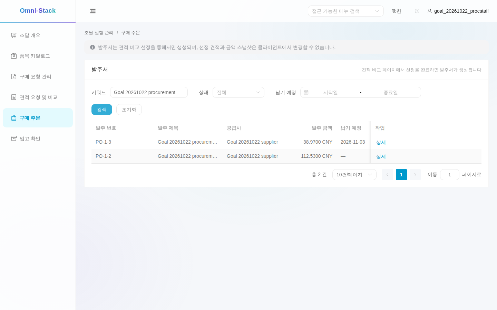

초안에서는 허용된 납품 정보 등을 편집하거나 삭제할 수 있습니다. 선정된 견적 가격을 주문 양식에서 다른 가격으로 마음대로 바꿀 수는 없습니다.

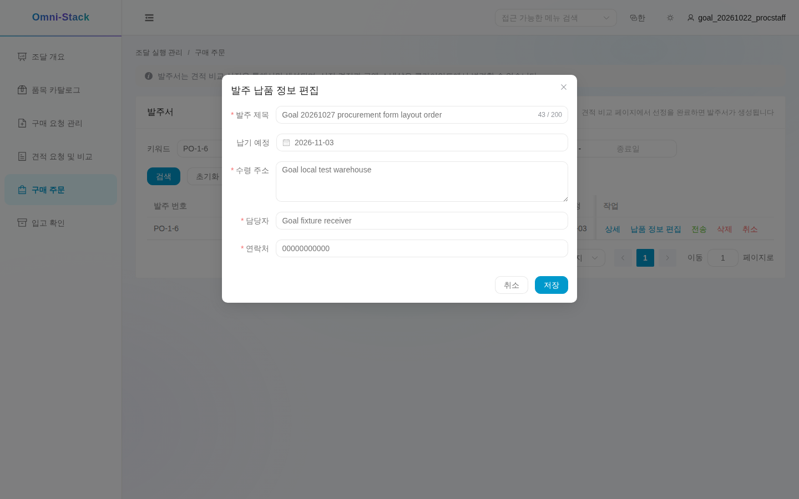

이 양식은 레이아웃 확인을 위한 별도 주문 PO-1-6입니다. 촬영 때 열기만 하고 저장하지 않았으며 나중에 정식 취소했습니다. 주 주문 PO-1-5가 아니며 주 주문을 과거 상태로 되돌린 화면도 아닙니다.

### 8.2 발송, 내부 확정, 취소

초안을 확인해 발송하고 확인합니다. 이어서 권한 있는 내부 조달 담당자가 주문을 확정합니다. 이 확정은 조달 관리 화면에서 수행하며, 공급업체 포털에 없는 확정 버튼을 공급업체에게 누르라고 하지 않습니다. 확정이 성공해야 입고 단계로 갈 수 있습니다.

초안, 발송 상태 또는 아직 입고가 없는 확정 주문은 현재 상태가 허용할 때 취소할 수 있습니다. 일부나 전량이 입고된 주문은 이 방식으로 취소하지 못합니다. 현재 화면에는 사용자가 별도로 주문 종료를 누르는 기능도 없습니다.

별도 실제 예제로 PO-1-3은 정식 취소했고 PO-1-4 초안은 삭제했습니다. 주문을 취소하거나 삭제해도 선정된 견적 요청이 미선정으로 돌아가지 않으며 같은 요청을 다시 선정할 수도 없습니다.

### 8.3 누적 입고와 담당자 조회 범위 이해하기

주 주문 PO-1-5는 전량 입고되었습니다. 금액은 100.0000 CNY이며 두 품목의 누적 입고는 각각 3과 2입니다.

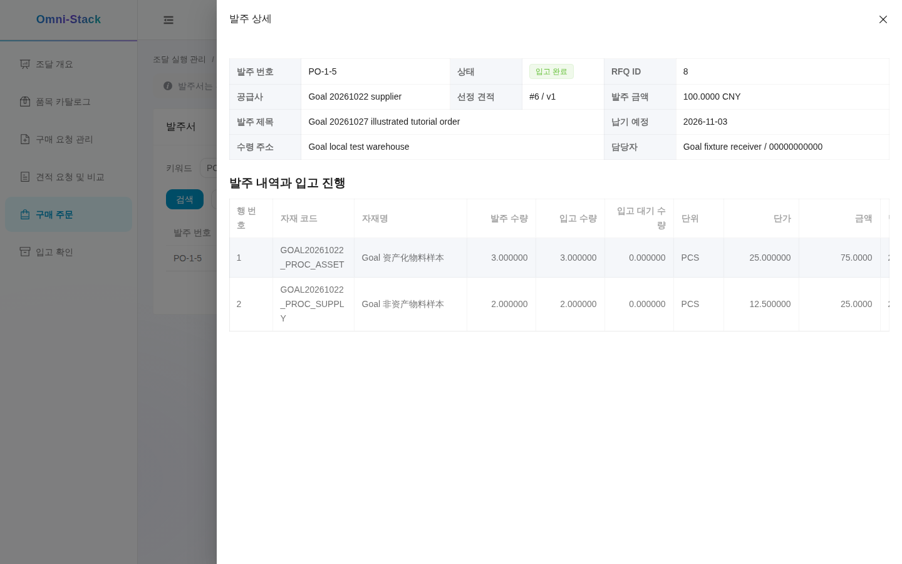

별도 주문 PO-1-2는 112.5300 CNY이며 다른 견적의 두 번째 버전을 사용합니다. 여러 사람이 나누어 입고했기 때문에 현재 담당자는 다른 사람의 입고 상세를 못 볼 수 있습니다. 그래도 주문 누적에는 그 확정 수량이 포함됩니다.

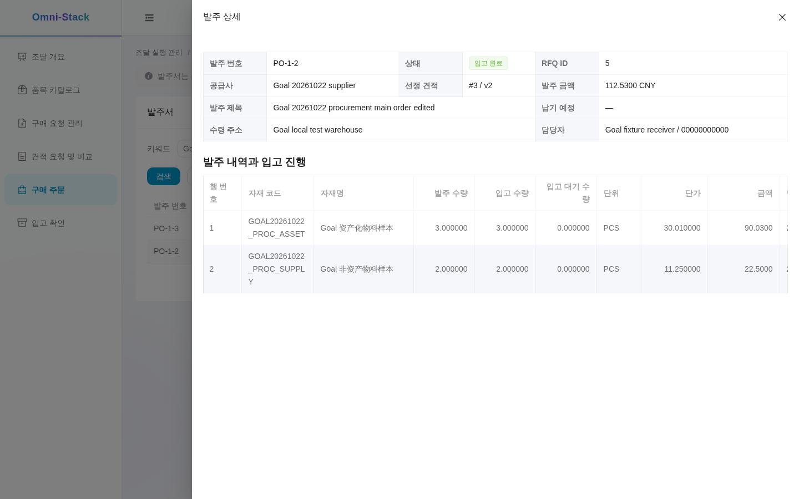

따라서 내게 보이는 입고 문서가 두 개라고 주문이 그 두 문서만큼만 입고된 것은 아닙니다. 추가 입고 가능량은 주문의 최신 누적 수량과 잔여량으로 판단합니다.

## 9. 입고와 품질: 도착과 합격을 구분하기

### 9.1 입고 초안 만들기

조달 담당자는 입고 확인에서 검색어, 상태, 입고 시간으로 조회하고 상세에서 출처 주문, 명세, 품질 결과를 확인합니다. 추가할 때는 확정 또는 부분 입고 주문을 고르고 입고 시간, 비고와 이번 행별 수량을 입력합니다.

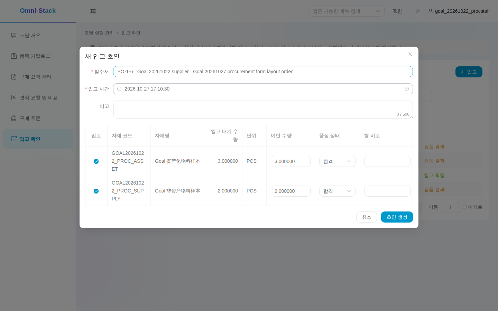

각 행이 전체 주문의 잔여 입고 가능량을 넘지 않는지 확인합니다. 품질 선택은 합격, 불합격, 보류입니다. 결론이 없다면 보류로 두고 카드 생성을 앞당기려고 합격을 선택하지 마세요. 자산 카드는 실제 입고 수량에 따라 하나씩 생기며 대상 수량은 양의 정수여야 합니다. 양식에 별도의 자산 수량 입력란은 없습니다.

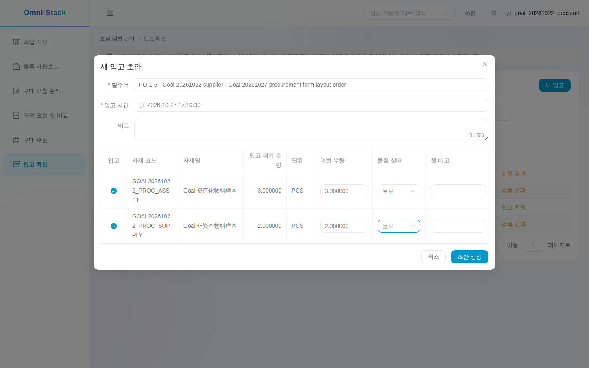

이 두 그림은 당시 확정된 별도 주문 PO-1-6의 미제출 양식입니다. 입고를 제출하지 않았고 자산도 만들지 않았습니다. 이 주문은 나중에 취소되었습니다.

### 9.2 저장과 확정은 효과가 다릅니다

저장된 입고 초안은 정식 누적에 포함되지 않고 주문 잔여량도 예약하지 않습니다. 확정할 때 전체 주문의 확정 입고를 다시 확인하며, 자신에게 상세가 보이지 않는 다른 담당자의 문서도 포함합니다.

두 초안이 각각 오래된 잔여량 이내여도 같은 잔여량을 두 번 확정할 수는 없습니다. 초과 입고나 버전 충돌이면 주문과 원래 입고를 새로 고치세요. 현재 입고 화면에는 기존 초안 편집·삭제 기능이 없습니다. 새 초안을 계속 만드는 것으로 이전 문서를 고칠 수는 없습니다.

### 9.3 수량을 먼저 확정하고 품질 결론 보완하기

주 입고 GR-1-6을 확정할 때 자산 품목의 품질은 아직 보류였습니다. 주문은 전량 입고가 될 수 있지만 그 보류 행은 아직 자산 카드를 만들지 않습니다.

검사 결과가 나오면 권한 있는 조달 담당자가 원래 행의 품질 결과 기능을 열어 합격 또는 불합격으로 제출합니다. 아직 보류인 행만 처리하며 이미 확정된 결론을 반복 변경할 수 없습니다.

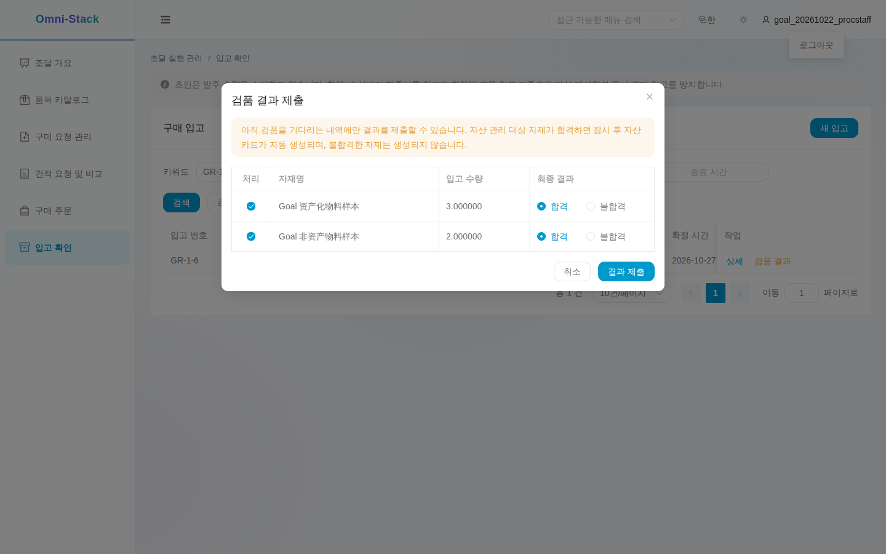

제출 후 원문서를 다시 열어 상태와 행별 품질을 확인합니다. 주 자산 행은 최종 합격했고 그 뒤 카드 3장이 만들어졌습니다. 일반 품목은 정상 입고되어도 카드를 만들지 않습니다.

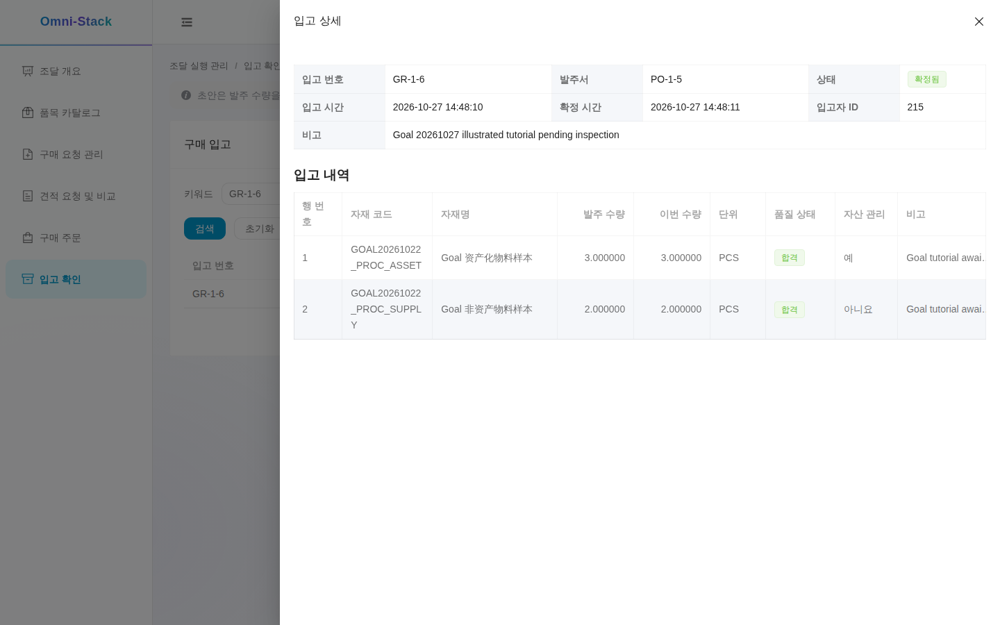

응답이 끊기면 원문서를 확인하고, 성공 알림이 안 보였다는 이유로 새 입고를 만들지 않습니다. 주문 전량 입고, 입고 문서 확정, 품질 합격은 각각 별도로 확인하는 내용입니다.

## 10. 입고 이후 자산: 카드의 출처를 따라가기

조달은 단독으로도 사용할 수 있습니다. 자산 페이지는 자산 관리 모듈을 함께 포함할 때 제공됩니다. 일반 품목, 불합격 또는 보류 행이 전량 입고라는 이유만으로 자산이 되지는 않습니다.

<!-- omni:modules:asset -->

### 10.1 작업 공간에서 자산을 열어 실제 카드 확인하기

합격한 입고 행이 자산 관리 대상이고 대상 수량이 양의 정수이면 비동기로 카드가 만들어집니다. 잠시 기다린 뒤 작업 공간으로 돌아가 앱 목록에서 자산 관리를 새 탭으로 열고 출처 문서나 자산 이름으로 검색합니다.

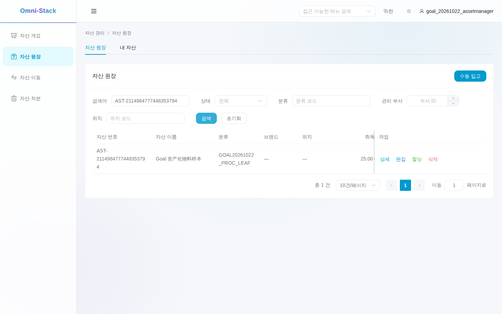

그림은 필터로 현재 일치하는 카드만 보여 줍니다. 한 행만 보인다고 카드가 한 장만 생긴 것으로 판단하지 않습니다. 주 예제에서는 각각 25.00인 카드 3장이 생성되어 자산 품목 금액 75.00과 일치합니다. 일반 품목 두 개는 자산 원장에 카드를 만들지 않습니다.

### 10.2 상세에서 구매 주문과 입고 출처 확인하기

카드 상세에서 출처 주문 PO-1-5, 입고 GR-1-6, 출처 행, 금액과 현재 자산 상태를 봅니다. 이 정보로 무엇을 구매했고 어느 입고분에서 이 카드가 생겼는지 연결할 수 있습니다.

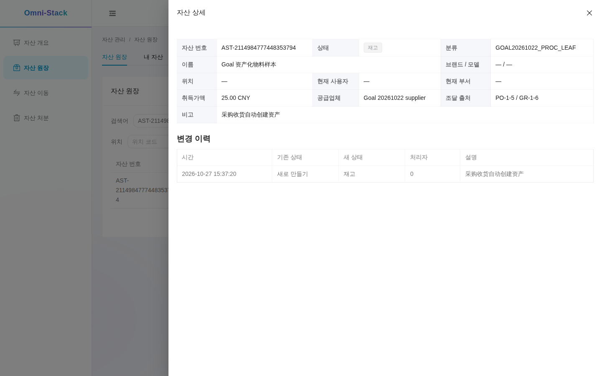

아직 안 보이면 품목의 자산 설정, 입고 확정, 최종 합격과 유효 수량을 확인하고 기다렸다가 새로 고칩니다. 과거 후보 조회와 누락 보충은 보호된 서비스 기능입니다. 조달 관리자에게 수동 보충 메뉴를 제공하지 않습니다. 여기서 정상 카드가 생긴 것을 과거 내역 보충도 검증한 것으로 주장하지 않습니다.

<!-- omni:modules:end -->

## 11. 조달 개요: 구매 약정과 실제 지급 구분하기

개요 권한이 있는 사용자는 조달 개요를 열어 현재 범위의 요청, 주문, 입고를 새로 확인하고 분류, 공급업체, 부서의 세 기준으로 통계를 전환합니다. 목록과 합계 모두 현재 사용자의 데이터 범위를 따릅니다.

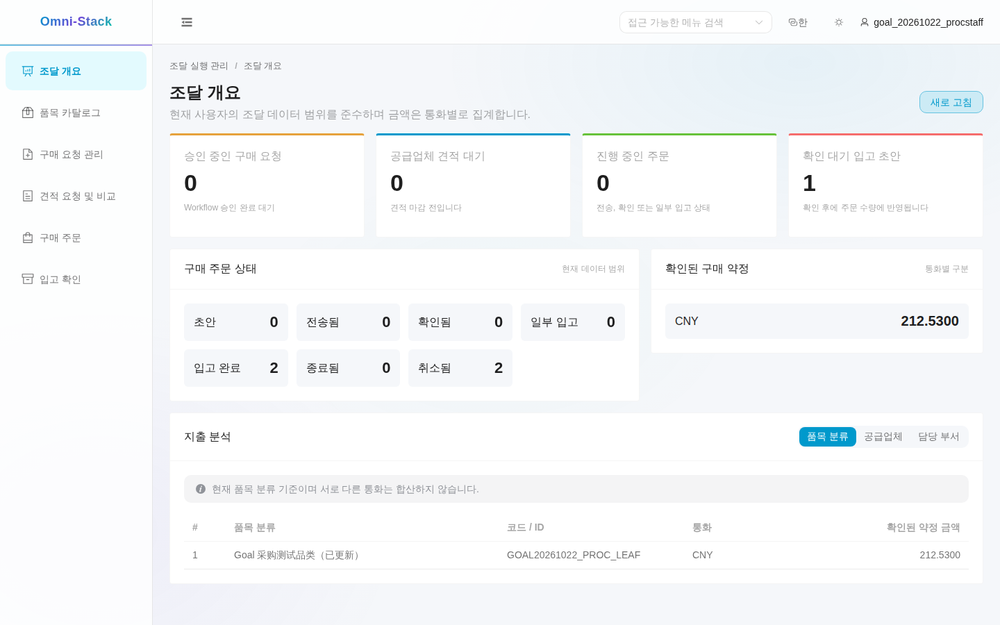

최신 그림에는 전량 입고 주문 두 건, 취소 주문 두 건, 미확정 입고 초안 한 건이 있습니다. 유효 구매 약정은 **212.5300 CNY**로 PO-1-2의 112.5300과 PO-1-5의 100.0000을 더한 값입니다. 취소·삭제된 별도 예제는 이 금액을 늘리지 않습니다.

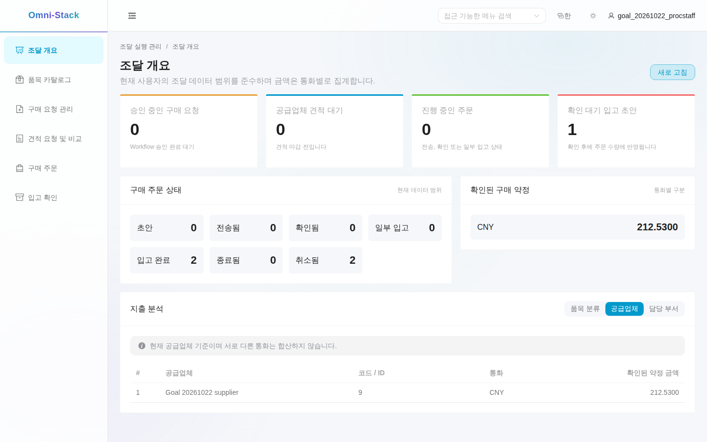

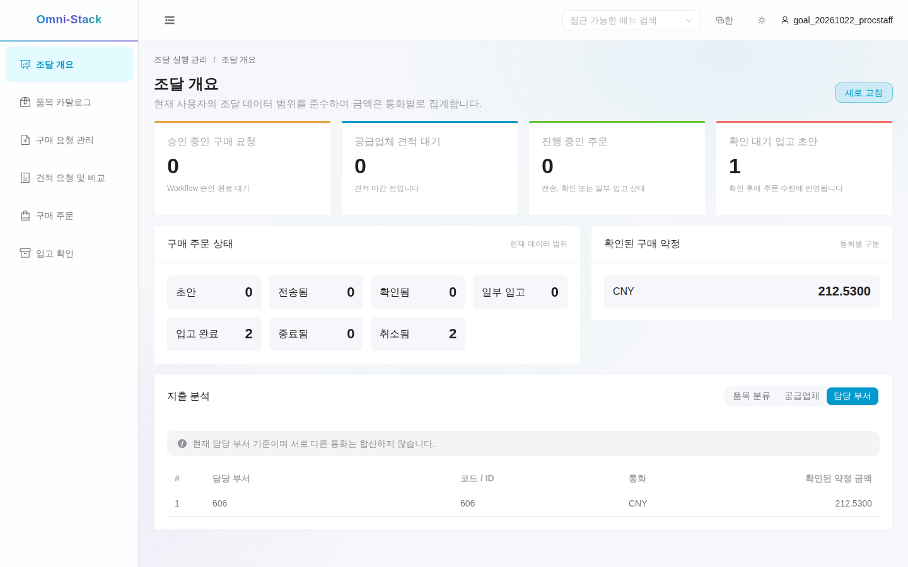

부서 그림은 식별자 606을 표시하며 부서 이름으로 변환된 것으로 보지 않습니다. 다른 통화는 그대로 합산하면 안 됩니다. 이 수치는 청구서, 지급 또는 재무의 주문·입고·청구 대사가 아니며 조달 모듈이 은행 지급을 수행한 것도 아닙니다.

## 12. 문제가 생기면 사용자, 상태, 원문서부터 확인하기

### 12.1 같은 조건에서도 사용자별 결과는 다를 수 있습니다

담당자는 본인 문서를 보고, 상위 관리자는 허용된 부서와 하위 부서를 봅니다. 동급의 다른 담당자는 실제 빈 목록을 받을 수 있고, 조달 권한이 없는 직원은 거부됩니다. 각각의 결과를 다른 것으로 대신할 수 없습니다.

실제 네 사용자 범위와 접근 거부 보기

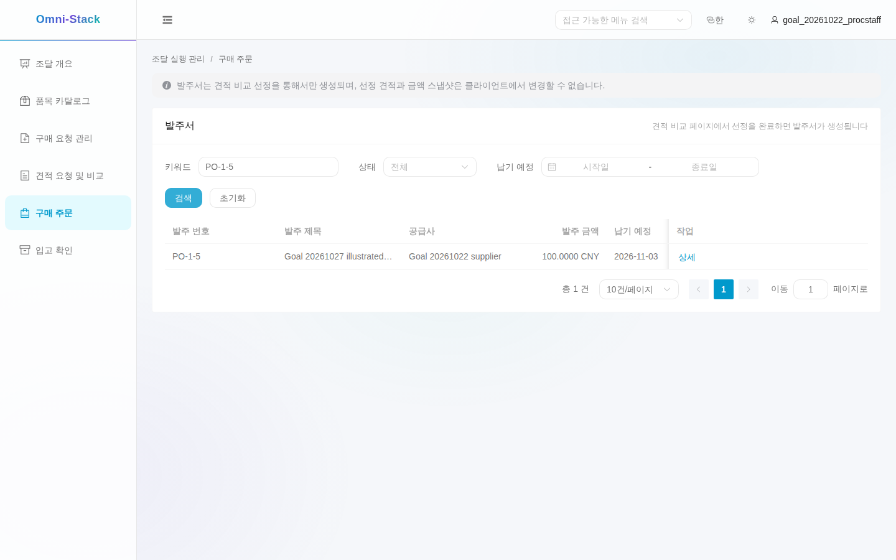

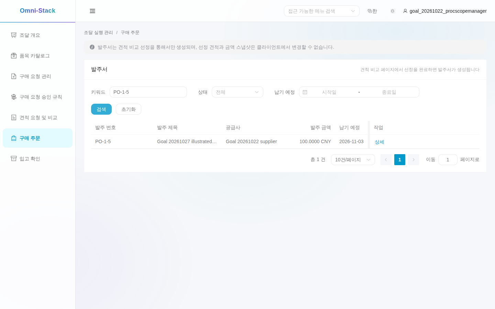

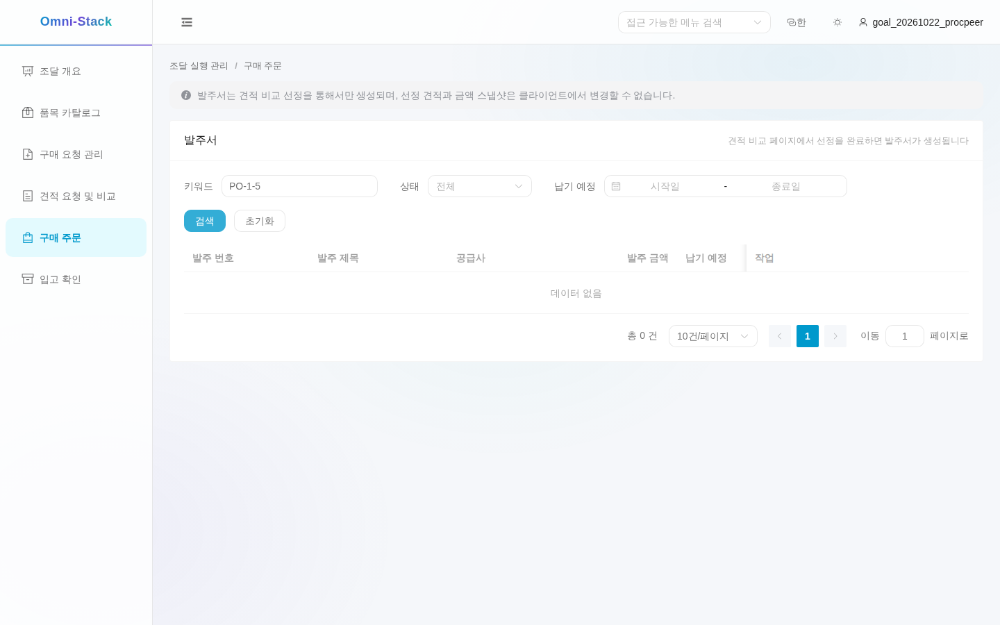

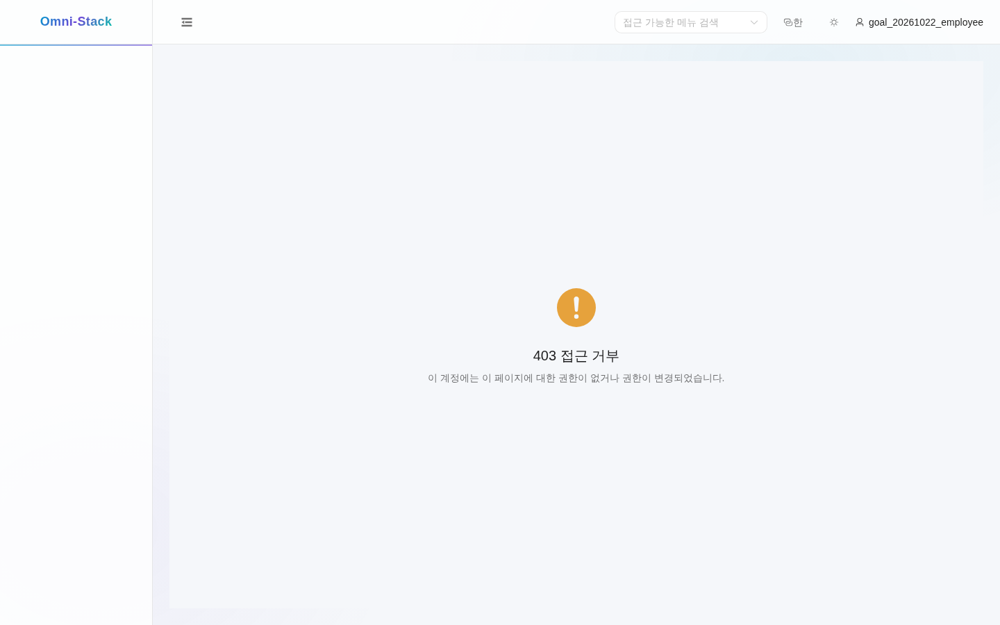

### 12.2 흔한 실패는 원문서에서 처리하기

| 문제 | 먼저 확인할 것 | 다음 행동 |
|---|---|---|
| 분류나 품목 저장 실패 | 필수 항목, 코드 중복, 말단 분류, 최신 버전 | 수정하고 충돌이면 새로 고침, 삭제 전 의존 관계 처리 |
| 구매 요청이 접수 전에 거부됨 | 품목, 금액, 조직, 규칙, 후보자 | 전제 조건을 보완해 원래 요청 제출 |
| 승인자가 구매 요청을 반려함 | 의견과 수정할 명세 | 편집·초안 저장 후 새 회차 제출 |
| 접수 후 승인 흐름 시작 실패 | 원래 시작 상태와 전제 복구 여부 | 새로 확인 후 재시도하거나 불필요한 실패 요청 취소 |
| 견적 요청 발송 실패 | 승인된 요청, 적격 기업, 미래 마감 | 초안이나 공급업체 전제 조건을 수정하고 발송 |
| 포털 견적 제출 거부 | 자기 회사 연결, 초대, 마감, 요청 상태 | 올바른 기업 사용자로 작성, 권한은 담당자에게 확인 |
| 선정 실패 또는 응답 불명 | 현재 견적 버전, 선정 여부, 기존 주문 | 원래 요청과 주문을 새로 조회한 다음 처리 |
| 주문 취소 불가 | 일부 또는 전량 입고 여부 | 현재 허용 상태를 따르고 입고를 되돌려 강제 취소하지 않음 |
| 입고 확정 실패 | 전체 주문 최신 누적, 잔여량, 문서 버전 | 새로 확인하고 다른 담당자 확정 수량과 중복 방지 |
| 입고 뒤 자산 카드 없음 | 자산 대상, 입고 확정, 합격, 유효 수량 | 기다렸다 새로 조회하고 지속 시 원문서를 보존해 기술 담당자에게 전달 |
| 메뉴 없음, 빈 목록, 접근 거부 | 계정, 테넌트, 조직, 허용 범위 | 권한과 데이터를 따로 확인하고 관리자 결과로 대신하지 않음 |

그림은 실제 로컬 앱에서 등록된 테스트 사용자와 업무 예제로 촬영했습니다. 사람이 직접 이미지 인증을 입력해 로그인했다는 의미는 아닙니다. 과거 실패, 미제출 양식, 최종 결과를 구분했습니다. 이 장의 업무와 그림 증거만으로 전체 프로젝트의 최종 출시 검수가 완료되었다고 보지는 않습니다.
