# 采购全功能图文教程：把采购需求变成订单、收货与资产

买东西并不是填完一张订单就结束了。需求要有人批准，供应商要报价，采购员要确认买什么、向谁买，收到货后还要核对数量和质量。本文沿着这条线，把准备、日常查询、配置和失败后的处理一起讲清楚。

你可以先跟着主线读一遍，再回到自己负责的部分。每张图都说明当时的身份和结果；打开表单的图片只说明怎么填写，不能代替提交后的结果。

## 一、先认清入口、身份和这次要完成的事

### 1.1 从工作台进入采购

首页用来阅读项目 Wiki。登录后，点击「我的工作台」会打开新的浏览器页签。在工作台通过「应用」、应用目录或右上角菜单搜索找到采购，再打开采购模块的新页签。采购页只保留当前模块的菜单与搜索范围；需要切换应用时，使用已经打开的工作台页签。

采购模块有采购概览、物料管理、请购管理、审批路由、询价管理、采购订单和收货管理七个业务页面。品类在物料管理页的左侧维护，不是另一个独立应用。审批路由等管理入口只有具备相应授权的身份才会显示。

物料和单据等带分页的列表，可以在底部查看总条数、切换页码或调整每页条数。重新查询或改变每页条数后，会从第一页开始显示。翻页不会扩大当前身份能看的范围；找不到记录时，先核对筛选条件，再重置查询。

### 1.2 谁来完成哪一段

| 当前身份 | 主要做什么 | 开始前要确认什么 |
|---|---|---|
| 已获采购申请授权的申请人 | 填写请购、跟踪审批、处理自己的草稿 | 当前组织正确，物料和审批规则已准备好 |
| 审批候选人 | 在工作台处理分配给自己的审批 | 自己确实是当前审批环节的候选人 |
| 采购员 | 维护物料，发询价，比价定标，处理订单和收货 | 能看到相应菜单及本人范围内的单据 |
| 采购经理 | 维护审批路由，查看授权部门范围内的采购 | 有管理权限，所选流程已经发布 |
| 供应商门户用户 | 查看本企业收到的询价邀请并报价 | 企业已批准，门户账号已与该企业关联 |

普通员工并不因为能够登录就自动拥有全部采购权限。列表为空、没有菜单和明确提示无权访问，是不同情况。先确认身份、所属组织及授权，不能把切换管理员当作正常业务步骤。

### 1.3 主线样例：买三件资产物料和两件普通物料

这次真实操作从请购 **PR-1-8** 开始，审批通过后创建询价 **RFQ-1-8**，供应商提交报价，再定标生成订单 **PO-1-5**，最终确认收货 **GR-1-6**。

| 物料 | 数量与单价 | 这一行的结果 |
|---|---|---|
| 纳入资产管理的物料 | 3 件，每件 25.00 | 合格后生成 3 张资产卡，每张 25.00 |
| 普通物料 | 2 件，每件 12.50 | 正常收货，不生成资产卡 |
| 合计 | 100.0000 CNY | 收货数量分别为 3 和 2 |

后文还会展示独立的失败恢复、跨人员收货和取消样例，它们有自己的单号，不是让你把主线单据来回退回旧状态。列表较宽时可以横向滚动查看完整列；固定操作列不会改变单据本身的数据。

## 二、物料准备：先让大家知道可以买什么

### 2.1 查询物料与维护品类

采购员进入「物料管理」。左侧选择品类，右侧填写关键字、启用状态等条件后查询；点击重置清掉筛选。想看全部物料时回到「全部物料」。物料目录属于本租户共享的准备资料，不是每个采购员各建一份。

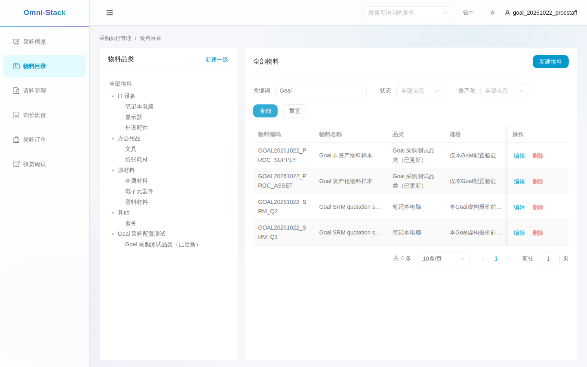

新增顶层品类使用品类区域的新增入口；鼠标移到已有品类上，可以找到新增子品类、编辑或删除等操作。填写编码、名称、排序和启用状态。编辑时不能随意改编码或换父级，以免把已有物料挂到错误的位置。

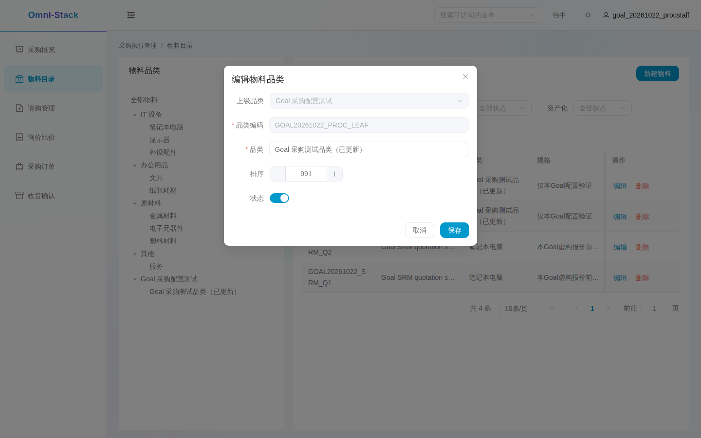

保存后刷新树，确认位置、名称和状态正确。删除前先处理子品类与已有引用；系统拒绝删除时，按提示清理依赖，不要反复点击。停用品类前也要检查正在使用它的物料和规则。

### 2.2 新增、编辑、停用和删除物料

点击新增物料，填写唯一编码、名称、已启用的末级品类和计量单位。需要后续生成资产卡的物料，勾选「纳入资产管理」。这类物料的单位使用 EA、PCS、UNIT 或 SET，收货时的资产数量还必须是正整数。

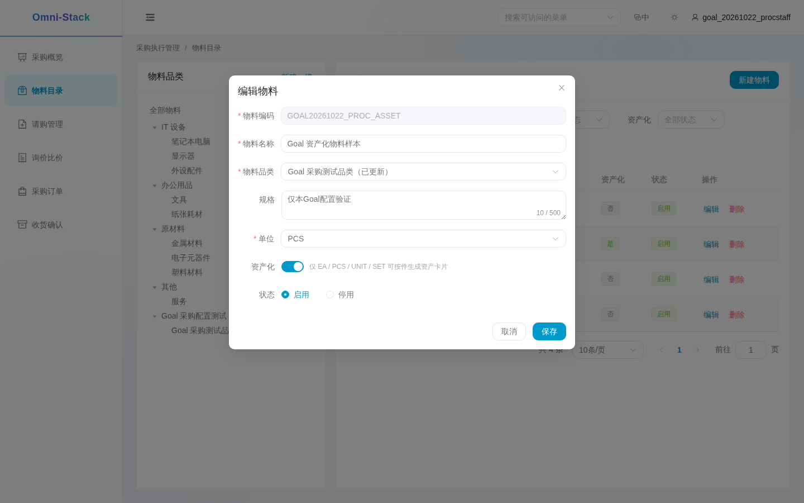

保存后按编码搜索，核对名称、品类、单位、资产标记和启用状态。编辑用于调整允许修改的资料，编码保持不变。暂时不能再采购的物料可停用；删除操作仍受已有业务引用等限制，以页面提示为准。

如果提示编码重复，换一个尚未使用的编码。如果提示内容已被别人修改，先关闭表单、刷新并重新打开，再根据最新资料保存。不要用旧表单连续覆盖别人的变更。

## 三、审批路由：决定一笔需求应该交给谁

### 3.1 先看规则，再修改规则

采购经理进入「审批路由」。一条规则把品类、金额范围和已经发布的采购审批流程关联起来。例如，某品类的小额需求走部门经理，大额需求再增加其他审批环节。申请人提交前必须能找到适用规则。

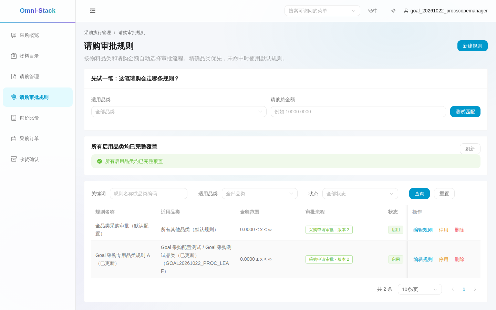

按关键字、品类、启用状态查询已有规则，重置可以清空条件；再查看金额和流程版本。桌面用表格展示，手机会自动改为卡片，编辑、启停和删除仍对应同一条规则，不需要寻找切换按钮。可以查看流程图、测试一组条件、检查覆盖情况及影响分析，再决定是否新增或修改。普通采购员没有规则管理入口时，不需要绕过权限自行配置。

### 3.2 按向导完成新增或编辑

第一步填写规则名称、适用品类和金额上下限。金额范围包含下限、不包含上限；上限留空表示没有金额上限。相邻区间要首尾衔接，避免同一笔需求落入空档或冲突范围。相同条件下，具体品类规则优先于默认规则。规则编码由系统生成，已有规则的高级信息用于只读查看，不需要在向导里手填编码或优先级。

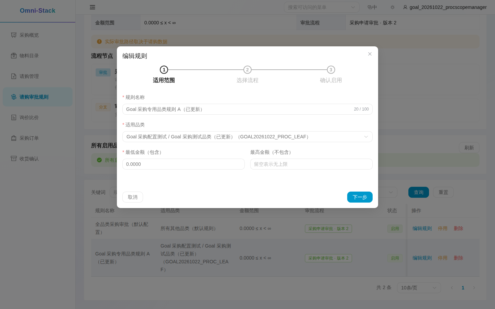

第二步选择已经发布、可用于采购的流程版本，核对名称、版本及发布时间。不要只看流程名字：同名流程不同版本的审批安排可能不同。保存后还要通过下文的匹配测试检查审批顺序和候选人规则。

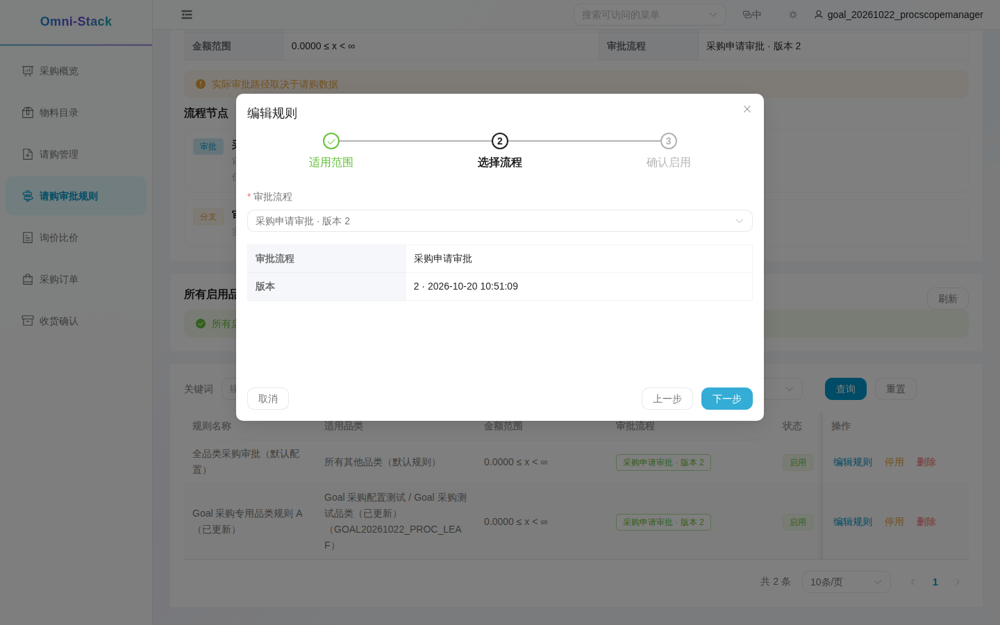

最后一步核对摘要、适用范围和流程，选择启用或停用状态，确认后保存。返回列表重新查询，确认规则已经按预期启用。编辑和删除也要从最新列表进入；删除或停用前先看影响，不要让后续新申请找不到路由。这三张向导图打开的是已有规则，拍摄时未保存，不是新增规则成功后的结果图。

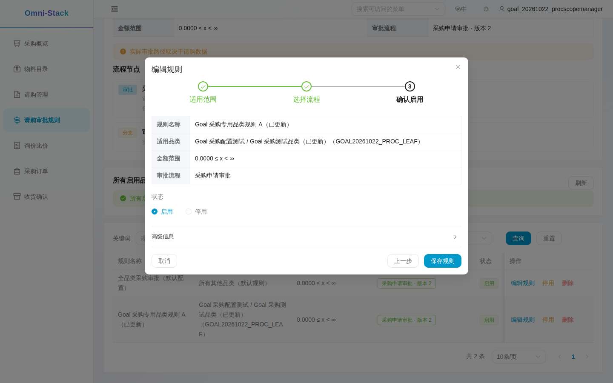

### 3.3 用一组条件检查是否选对流程

打开匹配测试，选择品类并输入金额。图中以 100 为例，结果同时给出命中的规则、流程版本和审批安排。没有命中、候选人缺失或流程条件不完整时，先修正规则或相关前置，再让申请人提交。

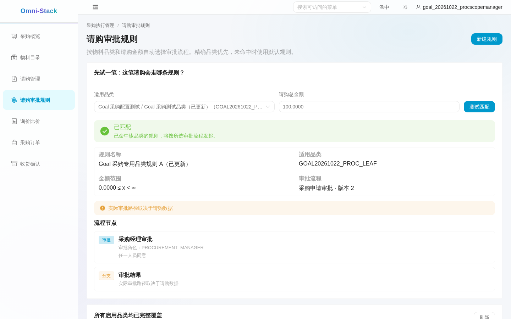

查看手机和平板上的同一组匹配信息

窄屏下摘要改为纵向排布，较长的审批人说明会换行。测试结论和桌面相同，不需要横向挤压阅读。

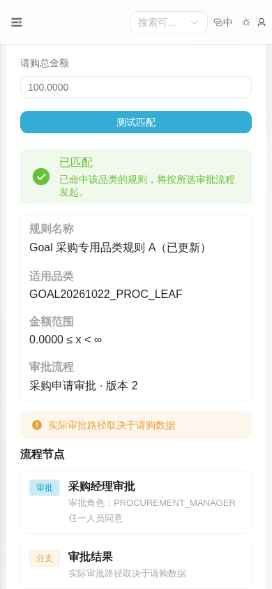

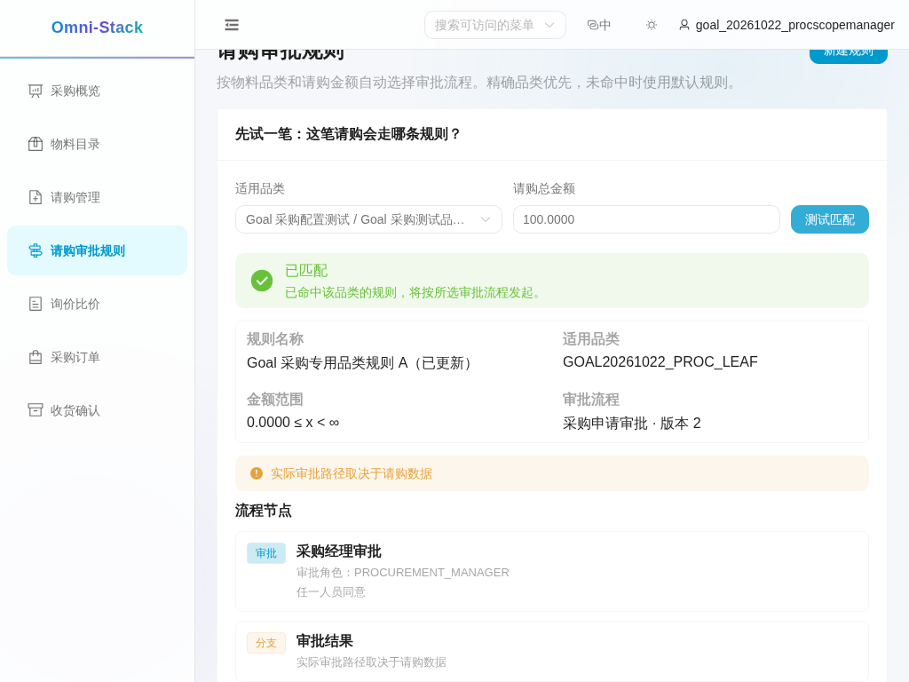

再查看覆盖与影响分析，确认拟修改的规则涉及哪些后续申请。已经提交的请购使用当时选定的审批信息，修改规则不会把旧申请悄悄改成另一条流程。

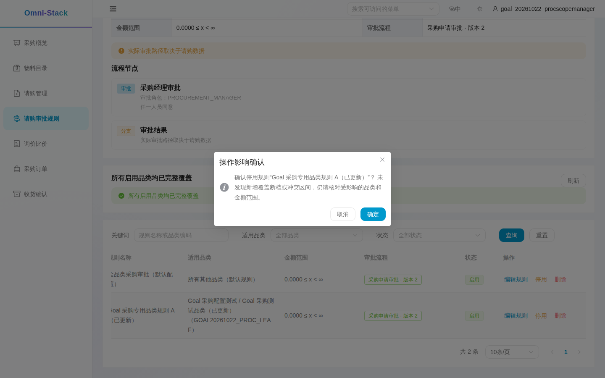

## 四、请购：把“想买什么”变成可审批的需求

### 4.1 查询与查看请购

申请人进入「请购管理」，使用关键字、状态等条件查询。采购经理等身份能看到的范围取决于授权；同一条件下，不同人员的列表未必相同。

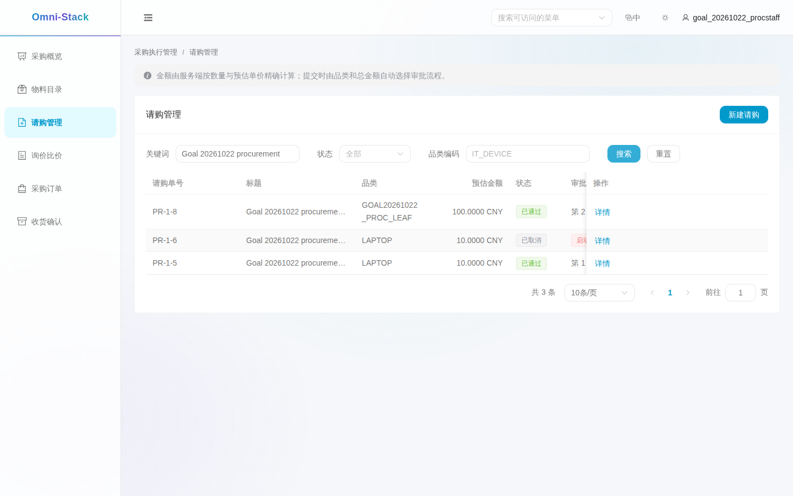

打开详情，核对标题、申请人、品类、明细、估价和审批进度。主线请购 PR-1-8 最终已经批准，数量是资产物料 3 件、普通物料 2 件，估价合计 100.0000 CNY。

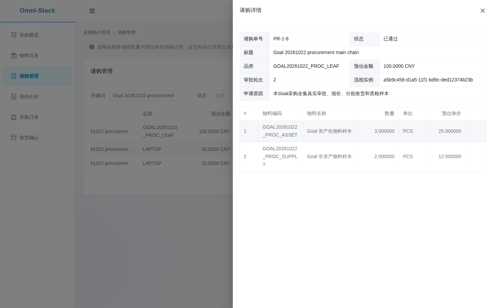

### 4.2 新建、修改或删除草稿

点击新增，填写标题和品类，按行选择物料、数量和估算单价。数量必须大于零，估算单价不能为负；按实际需要增加或移除明细行。核对系统计算的金额及用途说明后保存。

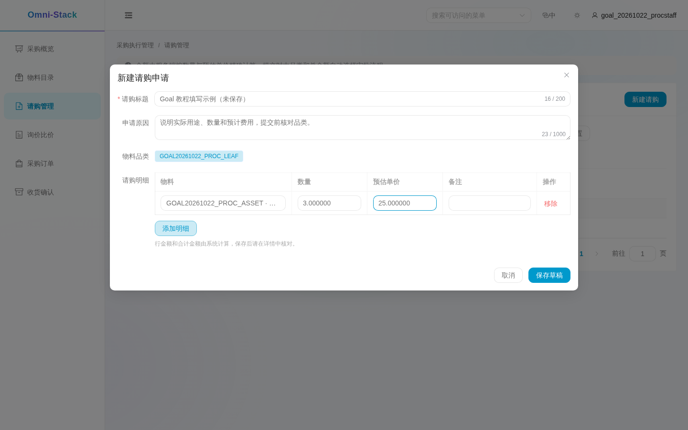

保存只是形成草稿，还没有开始审批。草稿可以重新打开编辑，也可以在不再需要时删除或取消；取消后不能继续按草稿编辑。保存后回列表，确认单号和内容，再决定是否提交。

### 4.3 提交、审批与驳回后的新一轮

提交前检查物料、金额、组织、适用审批规则和候选人。提交被受理后，流程启动和审批结果可能稍后才显示，不能把“已受理”当作“已批准”。刷新原单详情，查看当前进度。

审批候选人到工作台的审批区域，打开实际分配给自己的任务，核对关联请购与明细，填写意见，再批准或驳回。能看到采购列表，不代表能审批当前任务；不在候选范围内的人不能代替审批人处理。

主线 PR-1-8 曾在第一轮被驳回，申请人随后修改、保存为草稿并再次提交，第二轮才批准。被驳回后，要先编辑和保存，再按新一轮提交；不能对旧审批任务重复点批准。当前采购页面没有把正在审批的申请直接撤回的操作。

### 4.4 启动失败时，先查原单，再决定重试还是取消

“提交前校验没通过”和“提交受理后流程启动失败”不同。前者按表单提示补齐内容；后者保留在原请购上，先刷新确认失败状态，不要立刻新建一张重复需求。

下面两张是本次故障演练发生时保留的真实宽屏截图。它们用于解释当时的失败，并不冒充最新页面的再次失败。

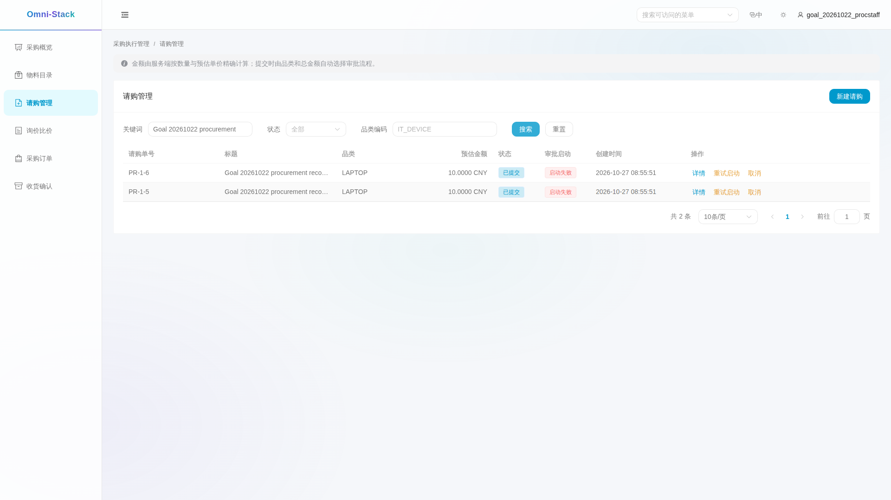

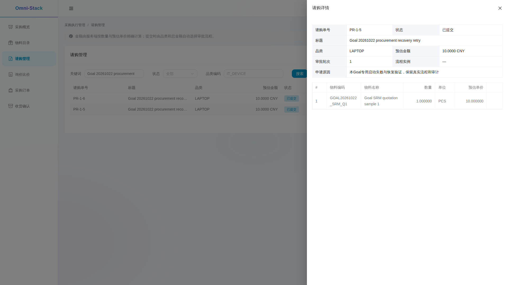

前置恢复后，在原单上使用重试启动，再查看审批进度。样例 PR-1-5 重试后进入真实审批，最终批准。遇到提交结果不确定，先查看原单是否已有流程和任务，再决定下一次操作。

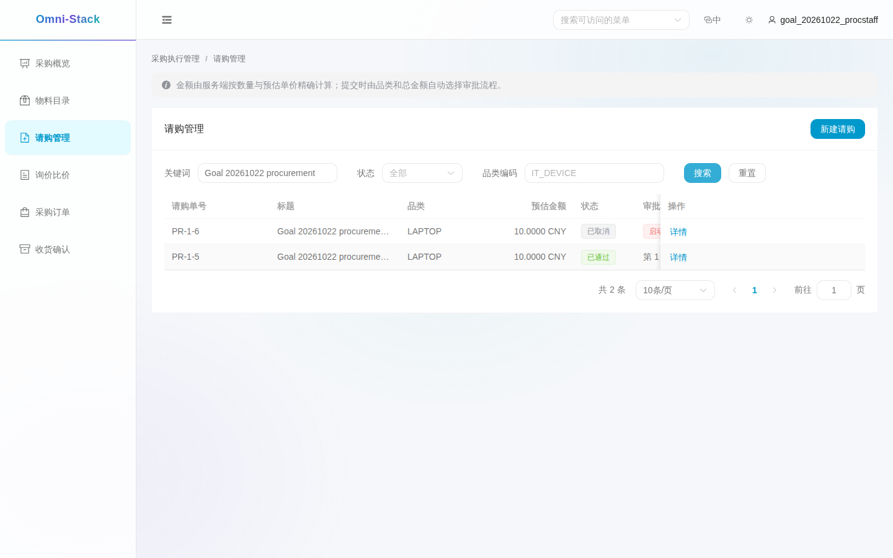

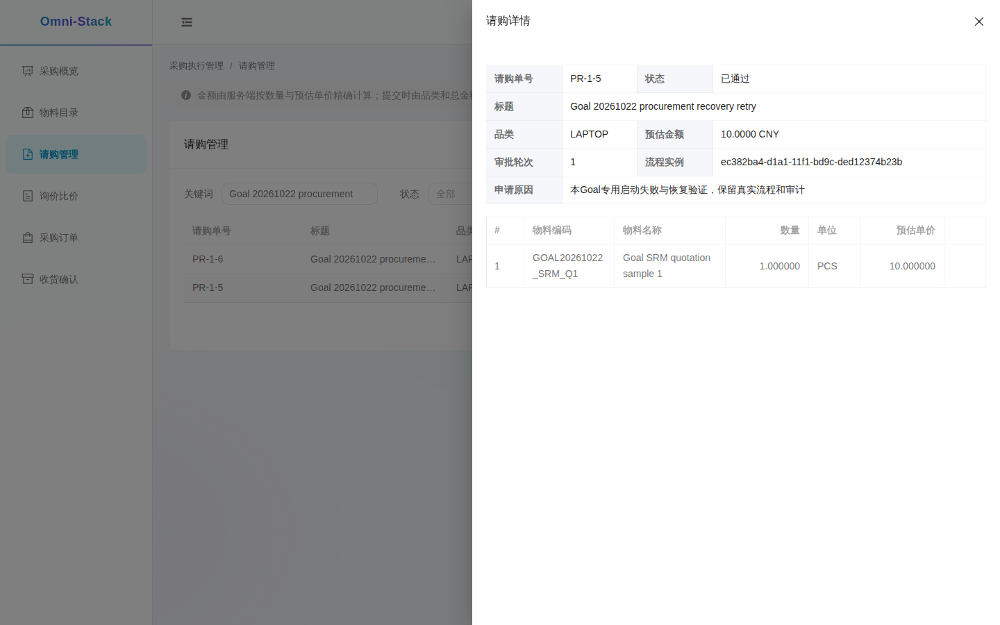

不再需要的启动失败请购，可以通过原单的取消操作结束。样例 PR-1-6 已取消，没有产生审批实例。此能力不等于可以取消任意正在审批的请购。

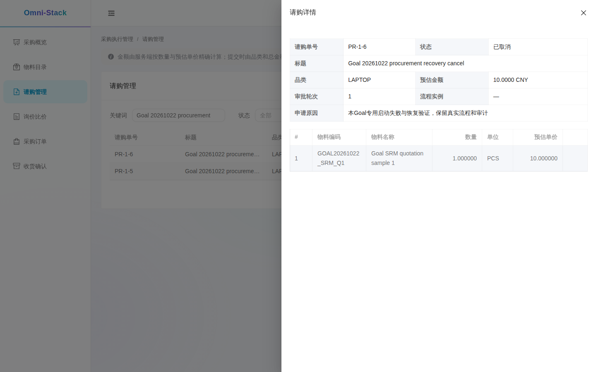

## 五、询价前置与创建：决定邀请谁、什么时候报价

### 5.1 供应商必须先准备好

供应商由供应商管理模块的授权人员维护。邀请前确认企业已批准、供货品类满足要求，并且供应商门户用户已经关联到这家企业。采购员不能靠在询价框里选中名字，替代供应商准入或门户关联。

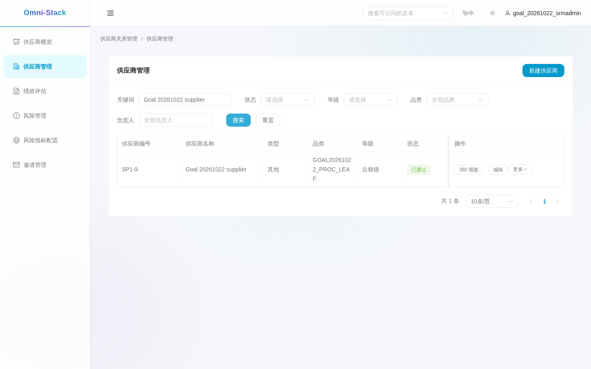

图中是供应商管理身份查看企业 9 的前置资料，不是采购员代替供应商审批。这家企业随后参与主线询价。

### 5.2 查询询价与新建草稿

采购员进入「询价管理」，按单号、标题、状态和截止时间等条件查询，打开详情核对来源请购和邀请对象。

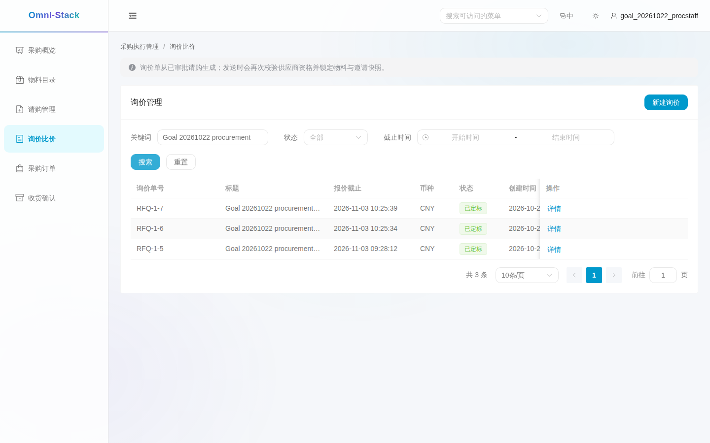

点击新增，选择已经批准且自己可访问的请购，填写标题、未来的报价截止时间、说明，并选择至少一家合格供应商。明细来自所选请购，保存前逐项核对。

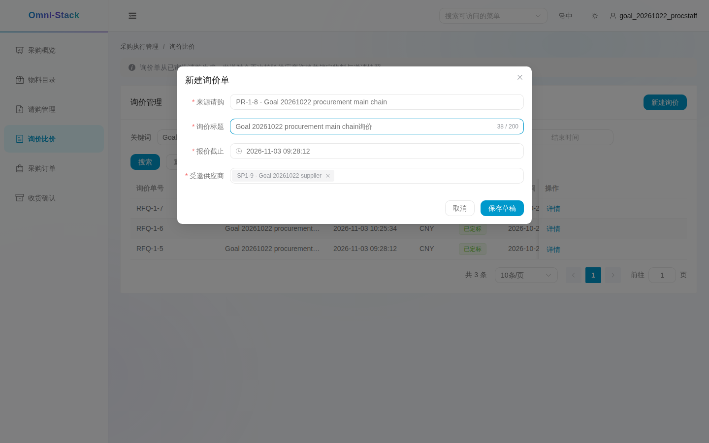

请购批准不会自动替你创建询价。保存后仍是草稿，可以修改或删除；点击发送并确认后，系统再次检查供应商、截止时间等前置，并向受邀企业开放报价。发送后不能继续把原始需求当草稿任意修改。

不再继续的草稿或已发送询价，可以使用当前状态允许的取消操作并确认。已经定标的询价保留当时结果，不继续当作待比价询价处理。

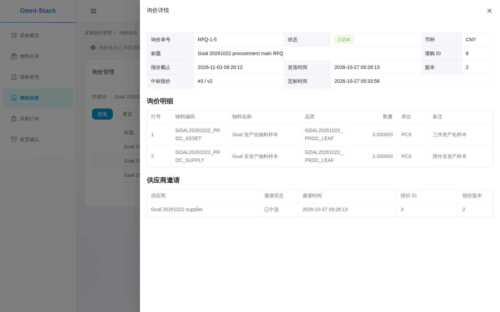

这张是另一条已完成样例 RFQ-1-5，说明定标后的只读结果；主线询价为 RFQ-1-8。不要把不同单号的金额和报价版本混在一起。

## 六、供应商门户报价：用自己的企业身份回答邀请

供应商登录门户，在收到的采购询价中打开邀请，先看截止时间、物料、数量和要求。这里只能处理本企业受邀的询价，不能查看其他供应商的报价。

填写各行单价、交付天数、报价有效期等必需内容，再核对合计并提交。主线资产物料为每件 25.00，普通物料为每件 12.50，数量分别为 3 和 2，合计 100.0000 CNY。

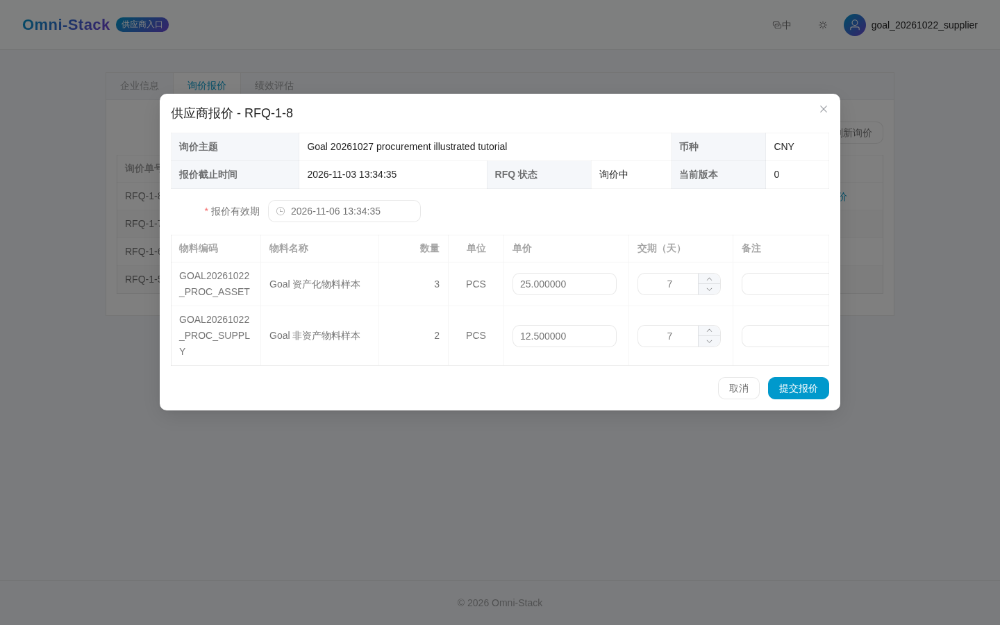

这张图是 RFQ-1-8 提交前的填写示例，显示尚未形成报价的版本 0；截图时没有提交。随后真实提交形成报价第一版，采购员在下一节的比较表中可以看到结果。

提交后查看报价版本和金额。仍在允许报价的时间及状态内，可以按页面操作修改并提交新版本；采购员比价时需要使用当前有效版本。已经截止、询价已取消或定标等情况下，以页面拒绝提示为准。

如果提交后网络中断，先重新打开同一邀请确认是否已经保存，再决定是否重试。不要一边改价格一边连续提交，把自己都无法辨认的多个版本留给采购员。内部管理员也不能冒充没有关联企业的门户用户代报价。

## 七、比价与定标：把有效报价变成订单

采购员在可访问的询价详情打开报价比较，检查供应商、当前报价版本、总价和每行价格。展开明细确认数量、单位及交付条件，不能只看最低总价。

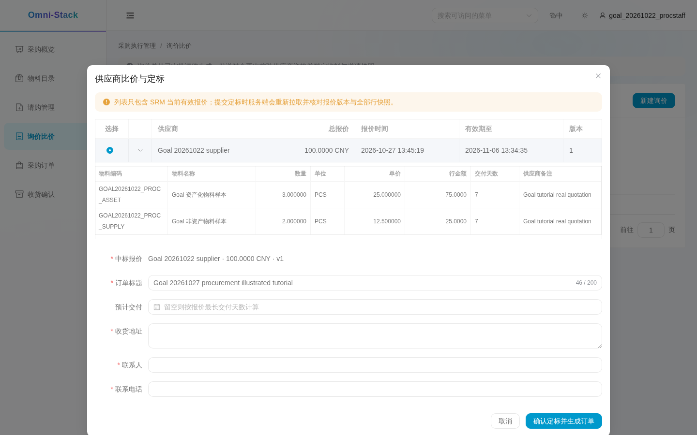

图中真实样例只有一家供应商的有效报价，不代表已经完成多家竞价。当前系统允许在截止前对已收到的有效报价定标；报价截止时间约束供应商是否还能继续报价，并不是要求采购员等到截止后才能定标。

选中目标报价，点击定标，填写订单标题、预期交付日期、收货地址、联系人和联系电话，核对后确认。

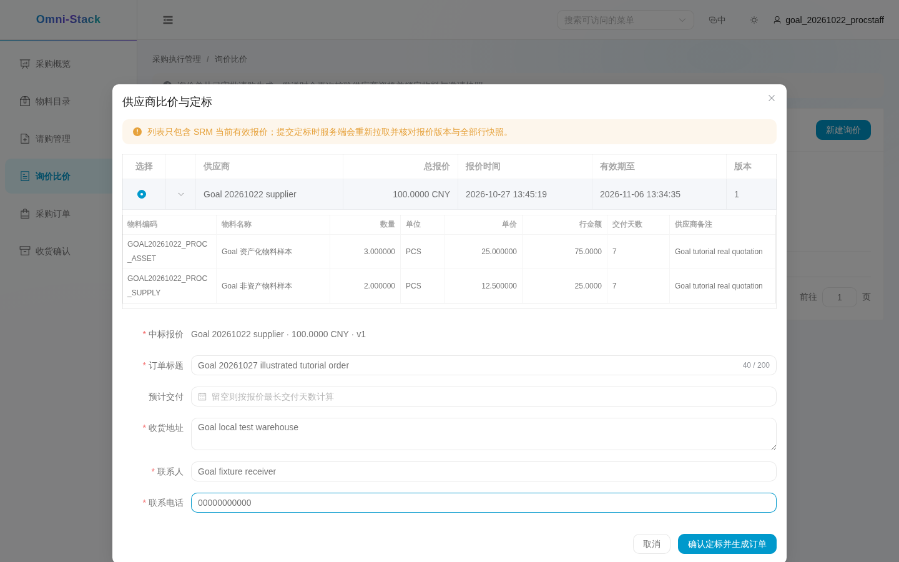

成功后查看生成的采购订单和询价结果。若提示报价版本已变化，重新加载比较表再选择；若请求超时，先查该询价是否已经定标、是否已有订单，不要连续创建重复订单。

## 八、采购订单：确认后才能收货

### 8.1 查询、查看与编辑草稿

进入「采购订单」，按关键字、状态和预期交付日期查询。订单由定标生成，不是另填一份没有来源的订单。打开详情检查来源询价、供应商、报价版本、数量、价格和交付资料。

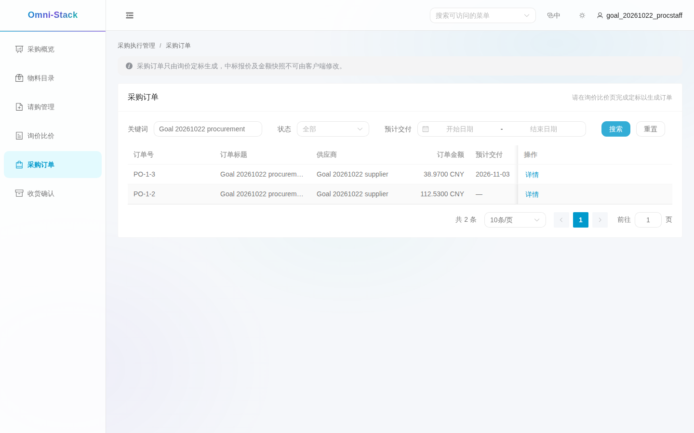

草稿可以编辑交付资料等允许修改的内容，也可以删除。已经选定的报价价格不能在订单表单里随意改成另一组价格。

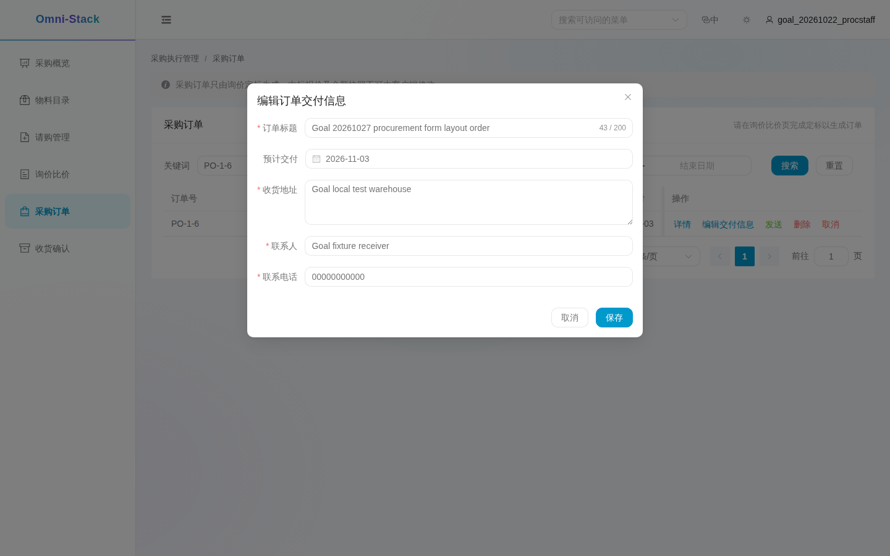

此表单来自专门用于检查布局的订单 PO-1-6：拍摄时只打开表单，没有保存；这个独立样例之后已正式取消。它不是主线 PO-1-5，也不是主线订单的回退状态。

### 8.2 发送、内部确认和取消

核对草稿后，使用发送并确认。随后由具备权限的内部采购人员执行订单确认。这里的确认发生在采购后台，不是让供应商去门户点击一个并不存在的确认按钮。确认成功后，订单才进入可收货阶段。

草稿、已发送或尚未收货的已确认订单，可以按当前状态允许的取消操作处理。部分收货或已经收齐的订单不能按这个办法取消。当前页面没有另一个供用户点击的“关闭订单”操作。

本次另有 PO-1-3 正式取消、PO-1-4 草稿删除的真实样例。取消或删除订单不会自动把已定标询价变回未定标，也不能据此重复定标原询价。

### 8.3 看懂累计收货与人员范围

主线 PO-1-5 最终已经收齐，金额 100.0000 CNY，两个物料的累计收货数量分别为 3 和 2。

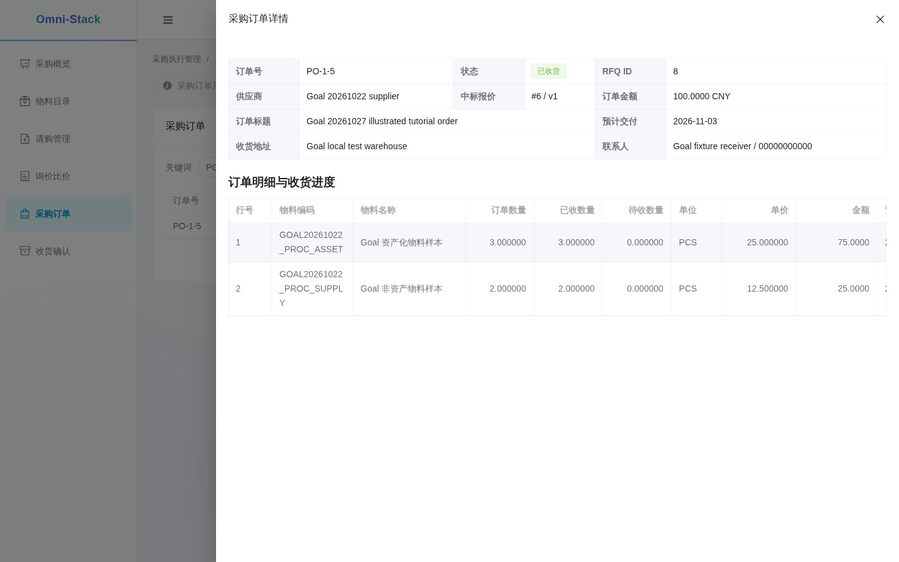

另一条独立订单 PO-1-2 的金额为 112.5300 CNY，使用的是另一份报价的第二版。它被多人分批收货：当前采购员可能看不到别人负责的收货单详情，但订单累计数量仍然包含那些已经确认的收货。

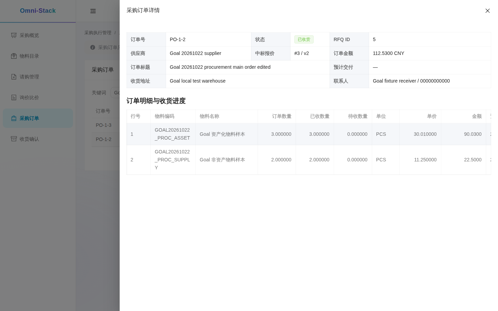

所以“我只看到两张收货单”不等于“这笔订单只收了这两张的数量”。要判断还能收多少，以订单最新的累计与剩余数量为准。

## 九、收货与质检：数量收到了，质量不一定已经合格

### 9.1 创建收货草稿

采购员进入「收货管理」，可按关键字、状态和收货时间查询，打开详情查看来源订单、明细和质检结果。新增时选择可收货的已确认或部分收货订单，填写收货时间、备注及本次各行数量。

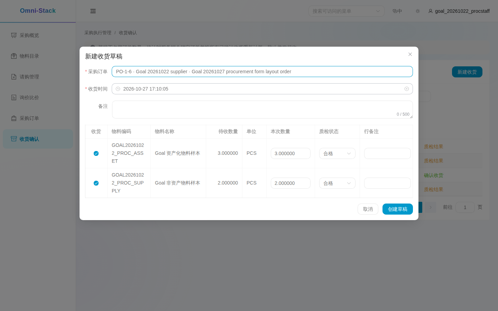

逐行核对本次收货量，不得超过整笔订单的剩余可收数量。质检选项为「合格」「不合格」「待定」；暂时没有结论就选待定，不能为了快点建卡先选合格。资产按实际收货数量逐件建卡，能用于建卡的数量必须是正整数；表单没有另填一份“资产数量”的输入框。

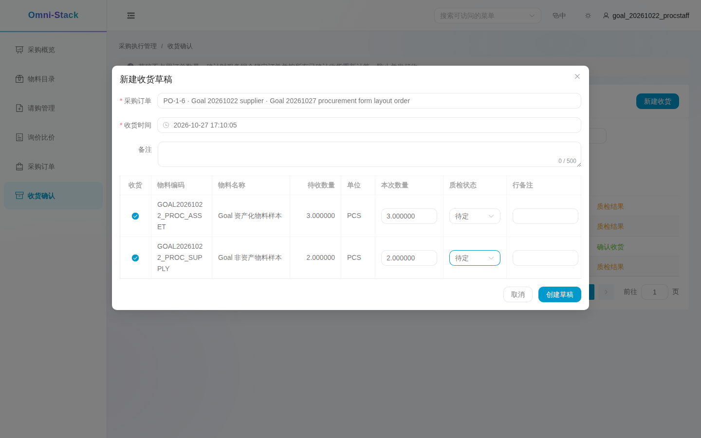

这两张表单图使用当时已确认的独立订单 PO-1-6，只演示填写，没有提交收货，也没有为它生成资产。该订单之后已经取消。

### 9.2 保存和确认是两件事

保存得到收货草稿，尚未计入正式累计，也不会预留订单余量。确认时会重新核对整笔订单已经确认的全部收货，包括其他人员负责而自己看不到详情的记录。

因此两张草稿即使单独看来都没有超量，也不能都按旧余量确认。遇到超量或版本变化提示，先刷新订单与原收货单再处理。当前收货页没有修改或删除已有草稿的操作，不能把反复新建草稿当作修正旧单的办法。

### 9.3 先确认数量，稍后补充质检结论

主线收货 GR-1-6 确认时，资产物料的质检仍为待定。订单可以因此收齐，但待定行此时不会生成资产卡。

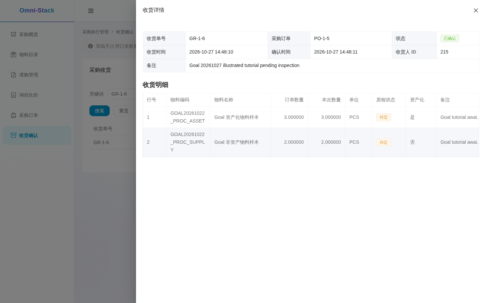

得到检测结果后，具备权限的采购人员在原收货明细使用质检结果操作，选择合格或不合格并提交。只处理仍待定的行；已经确定的最终结论不能反复改写。

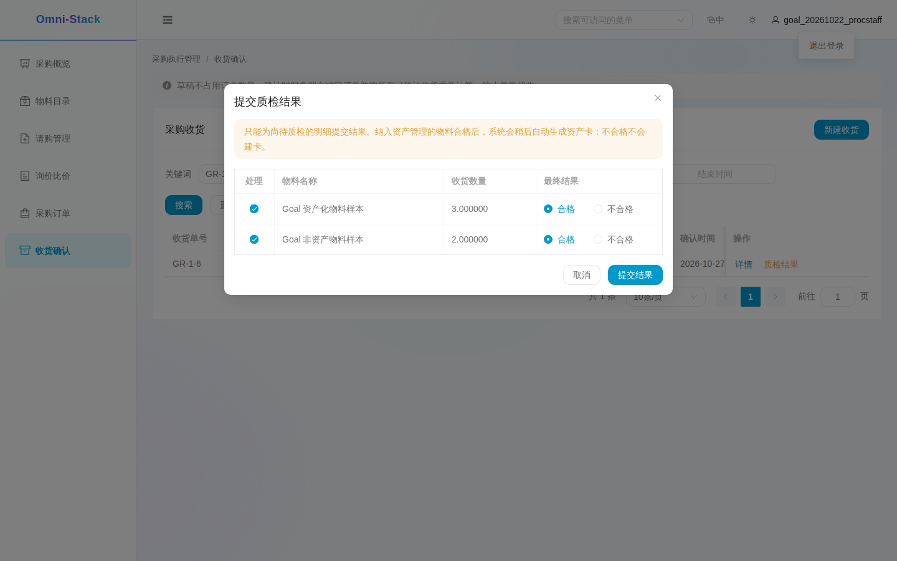

提交后重新打开原单，确认状态和行级质检结果。主线资产行最终判为合格，随后才生成三张资产卡；普通物料正常收货，但不生成卡片。

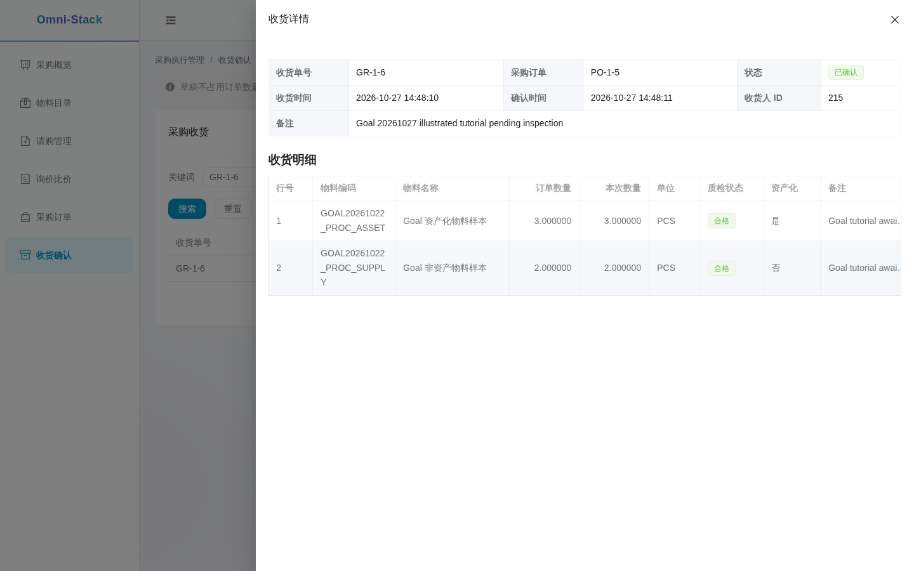

请求超时先查原单，不要凭没有弹出成功提示就再建一单。订单收齐、收货确认、质检合格是三个不同判断，必须分别看清。

## 十、收货后的资产：看得到来源，才知道卡片从哪来

采购可以独立使用；只有工程同时启用资产管理时，才有后续资产页面。普通物料、不合格行或仍待定的行不会因为采购收齐就自动变成资产。

<!-- omni:modules:asset -->

### 10.1 从工作台打开资产模块，核对实际卡片

当收货行已合格、物料纳入资产管理、资产数量为正整数时，系统会异步建立资产卡。稍等后回到工作台，通过应用目录打开资产模块的新页签，按来源单据或资产名称查询。

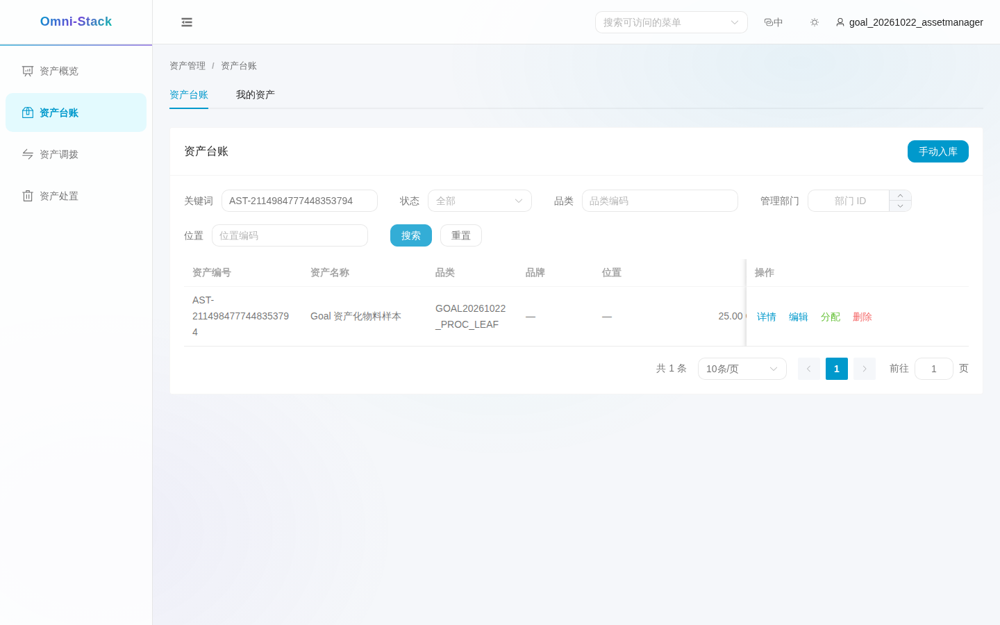

列表图使用了筛选，只显示当前命中的卡片，不能单凭这一页显示一行就认定只生成了一张。主线实际生成三张卡，每张 25.00，总额对应资产物料的 75.00；两件普通物料不在资产台账中建卡。

### 10.2 打开详情核对采购来源

打开卡片详情，检查来源订单 PO-1-5、收货 GR-1-6、来源明细、金额和当前资产状态。它们能把“这张卡”与“买了什么、收到哪一批”连起来。

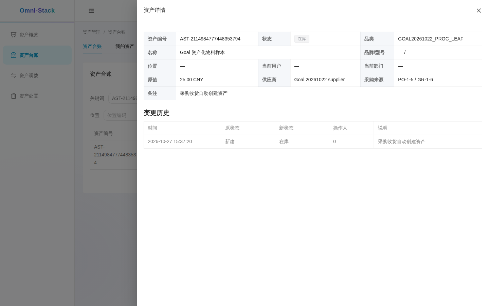

如果暂时没看到卡片，先确认物料资产标记、已确认收货、最终合格结果和资产数量，再等待并刷新。历史候选查询与补偿回补是受保护的服务支撑能力，当前没有给采购经理提供一页“手工回补”菜单。本文不把正常建卡成功冒称为历史回补也已经验证。

<!-- omni:modules:end -->

## 十一、采购概览：这是采购承诺，不是银行付款

有概览权限的人员进入「采购概览」，刷新后查看当前范围内的请购、订单和收货情况，再切换品类、供应商、部门三个统计维度。列表和统计都会受当前身份的数据范围影响。

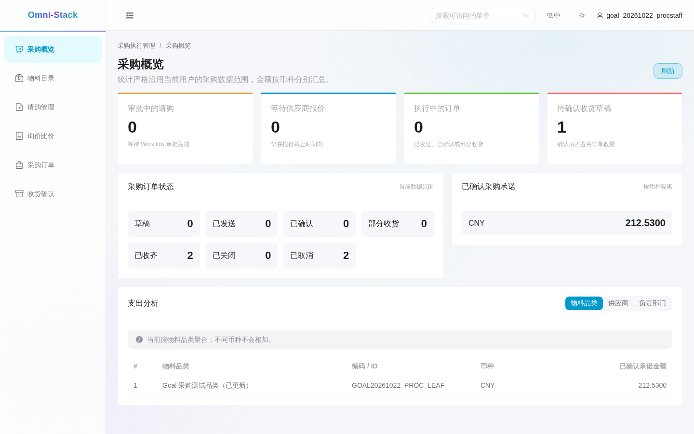

这组最新截图里有两笔收齐订单、两笔取消订单和一笔待确认收货草稿。有效采购承诺为 **212.5300 CNY**，来自 PO-1-2 的 112.5300 与 PO-1-5 的 100.0000。已取消或删除的独立样例不再增加这个金额。

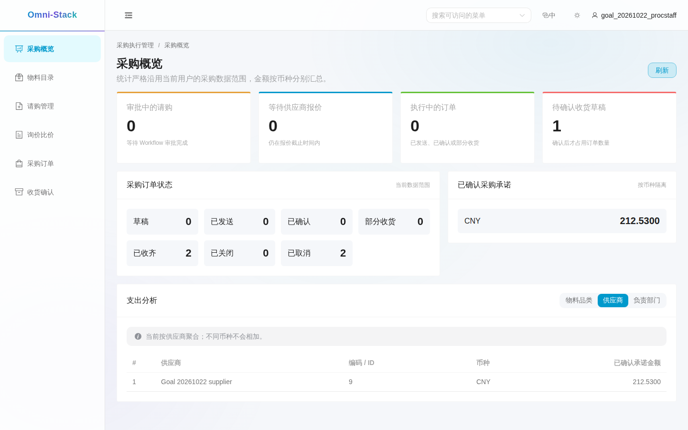

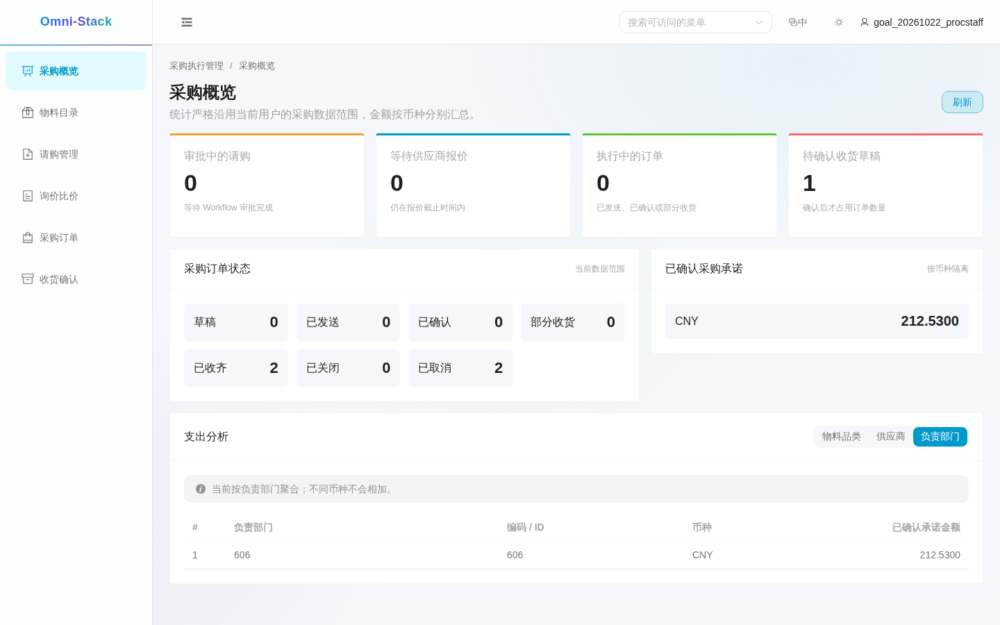

部门图当前显示部门标识 606，不应把它当作已经解析出的部门名称。不同币种不能直接相加；统计也不是发票、付款或财务三单匹配，本项目采购模块没有替你完成银行支付。

## 十二、遇到问题时，先辨认身份、状态与原单

### 12.1 相同条件下，不同身份可以看到不同结果

采购员以本人范围查看自己负责的单据；上级采购经理按授权查看本部门及下级；同级其他人员可能得到真实空列表；没有采购权限的普通员工会被拒绝。这些结果不能互相替代。

查看四种真实身份的范围与无权结果

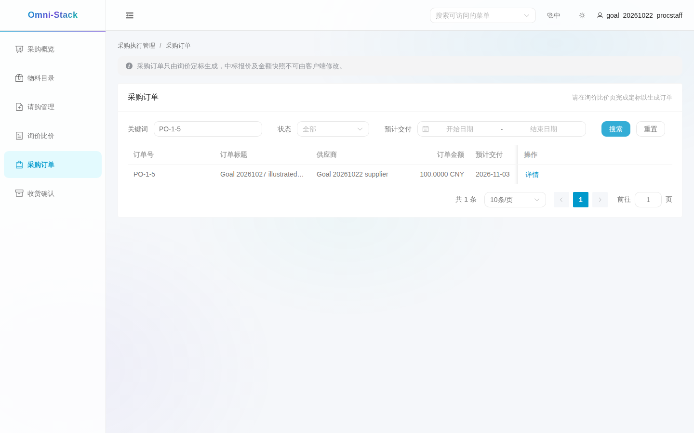

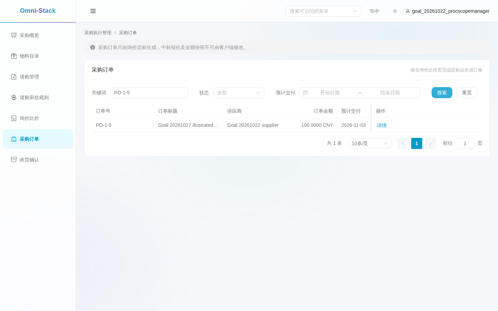

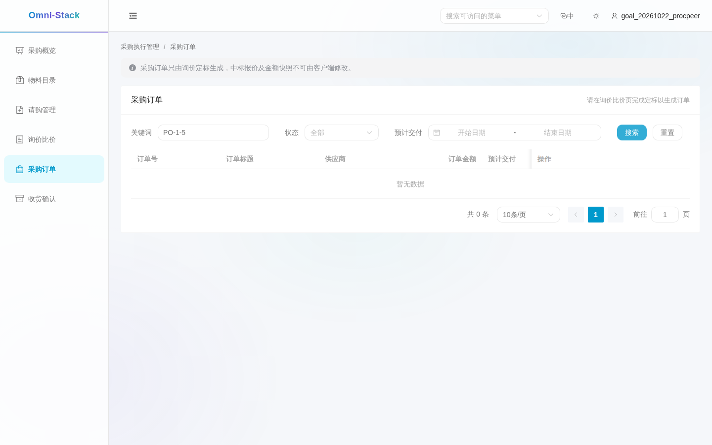

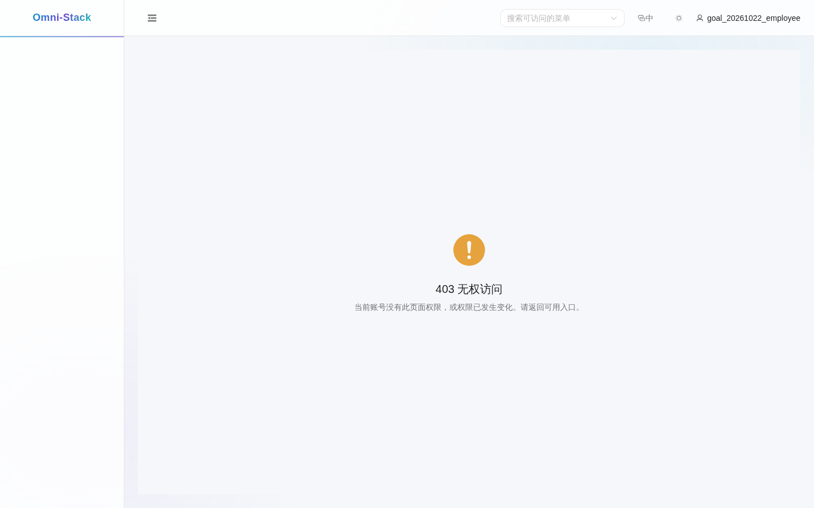

### 12.2 按原单处理常见失败

| 遇到什么 | 先检查什么 | 接下来怎么做 |
|---|---|---|
| 品类或物料保存失败 | 必填项、编码重复、末级品类、最新版本 | 按提示修改，版本冲突先刷新；删除被引用资料先处理依赖 |
| 请购提交前被拒绝 | 物料、金额、组织、规则和候选人 | 补齐前置，再在原请购提交 |
| 请购被驳回 | 原单意见和需要调整的明细 | 编辑并保存为草稿，再发起新一轮 |
| 受理后流程启动失败 | 原单的启动状态，前置是否恢复 | 刷新确认后重试原单，或取消不再需要的失败单 |
| 询价无法发送 | 请购已批准、供应商合格、截止时间仍在未来 | 修正草稿或供应商前置，再发送 |
| 门户无法报价 | 本企业关联、邀请、截止时间和询价状态 | 使用正确企业身份，补全报价；无权时联系授权人员 |
| 定标失败或超时 | 当前报价版本，询价是否已定标，是否已有订单 | 刷新原询价和订单，确认结果后再操作 |
| 订单无法取消 | 是否已经部分收货或收齐 | 按当前允许状态处理，不回退收货来强行取消 |
| 收货确认失败 | 全订单最新累计、剩余量和原单版本 | 刷新核对，避免与他人确认的数量重复 |
| 收货后没有资产卡 | 是否资产物料、已确认、合格、资产数量有效 | 等待异步处理并刷新；持续异常保留原单交技术人员排查 |
| 没有菜单、空列表或无权提示 | 当前账号、租户、组织、授权范围 | 分别核对权限和数据，不能用管理员结果覆盖普通身份结果 |

本文图片来自本机实际应用，使用明确登记的测试身份与业务样例；这不等于真人输入验证码登录。历史失败图、未提交表单和最终结果分别说明，不互相冒充。本章的业务和图片证据也不代表整个项目已经完成最终发布验收。
