# SRM and the supplier portal: approval, evaluation, risk, and quotations

This tutorial follows a supplier from applying to work with your company through everyday management. Internal staff review applications, maintain information, and evaluate performance. Suppliers use their own portal accounts to see company information, evaluation results, and quotation invitations. Each identity has its own entry point and permissions.

Start with the job you want to do:

| What you want to do | Where to start |
| --- | --- |
| Check supplier counts, cooperation status, and risk | Section 1: supplier overview |
| Create a supplier internally and follow its approval | Section 2: creation and approval |
| Find company information, transfer ownership, or maintain contacts and qualifications | Sections 3–5: everyday maintenance |
| Score a supplier and compare evaluation periods | Section 6: performance evaluation |
| Check risk, update indicators, or maintain scoring rules | Section 7: risk management |
| Invite a supplier to register, enroll, and complete its information | Sections 8–9: invitations and the portal |
| Complete or update a quotation for an invitation | Section 10: portal quotations |
| Recover from missing permissions, stale pages, failures, or disallowed states | Section 11: recovery |

## Before you start: confirm your identity and company

Internal staff open the SRM application from the catalog or Applications in My Workspace. It opens in a new browser tab. That tab's sidebar and search cover only the current application; switch to the original workspace tab to use the workspace again. If a menu is missing, check your permissions. Another colleague's page address does not grant you access.

| Your identity | Typical responsibilities | Data you can access |
| --- | --- | --- |
| SRM administrator | Suppliers, invitations, evaluations, and risks in the company | Authorized data in the current company |
| Procurement manager | Suppliers, evaluations, and risks for their department and its children | According to actual organization and role settings |
| Procurement staff | Assigned suppliers and everyday maintenance | Usually records they own |
| Supplier | Their own company profile, evaluations, and quotations | The company linked to the current account |

A portal account must finish enrollment and association before it can access company information. Registering an ordinary account is not enough. Internal administrators cannot quote as a supplier. An account with multiple roles follows its actual permissions and available entry points, rather than the role name alone.

Screenshots use dedicated demonstration identities and business samples in the same local environment. Business names, indicator names, and scoring remarks may remain in Chinese. Sensitive fields such as phone numbers, email addresses, and accounts are protected by permissions or screenshot masks. Operation screenshots from controlled test sessions do not prove a person entered a CAPTCHA or that a third-party account authorized access. Do not repeat deletion or elimination actions on shared business data casually.

## 1. Supplier overview: see what is happening

An administrator or procurement manager with overview access opens Supplier Overview in the current application's sidebar.

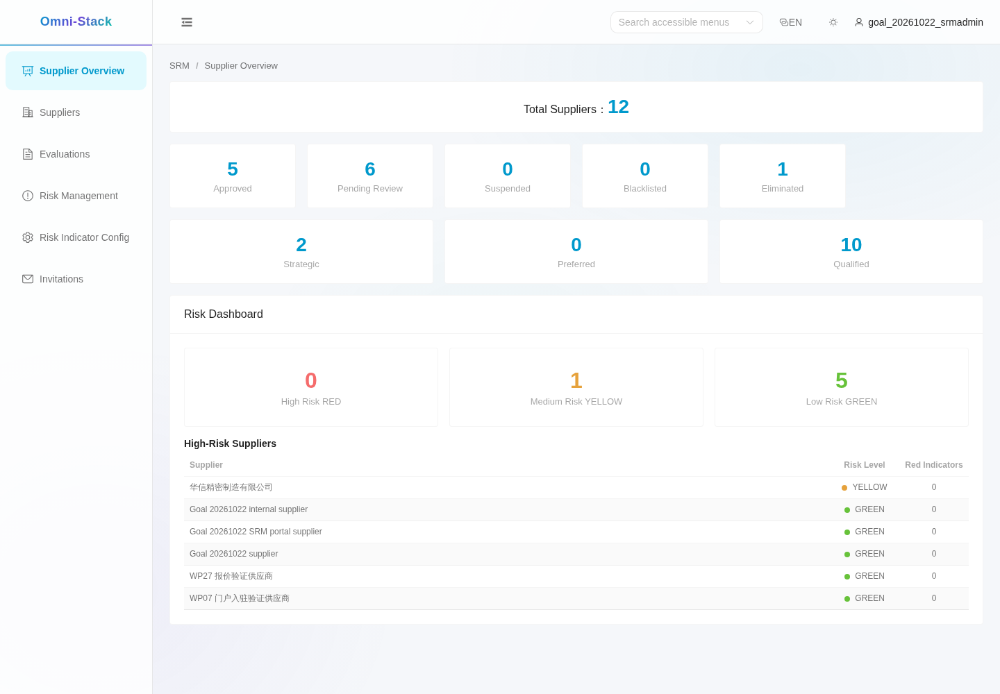

Check supplier counts and state distribution, then the risk dashboard. Counts include only data you are allowed to see, so staff, managers, and administrators may see different totals. Zero is normal when there are no suppliers. If the total seems wrong, first check the company selected at sign-in, account scope, and filters.

## 2. Create a supplier and follow its approval

### 2.1 Create a supplier internally

Open Suppliers and select New Supplier. Complete the required name and type, then check industry, category, credit code, website, and contact information. When assigning an owner, select an eligible internal colleague.

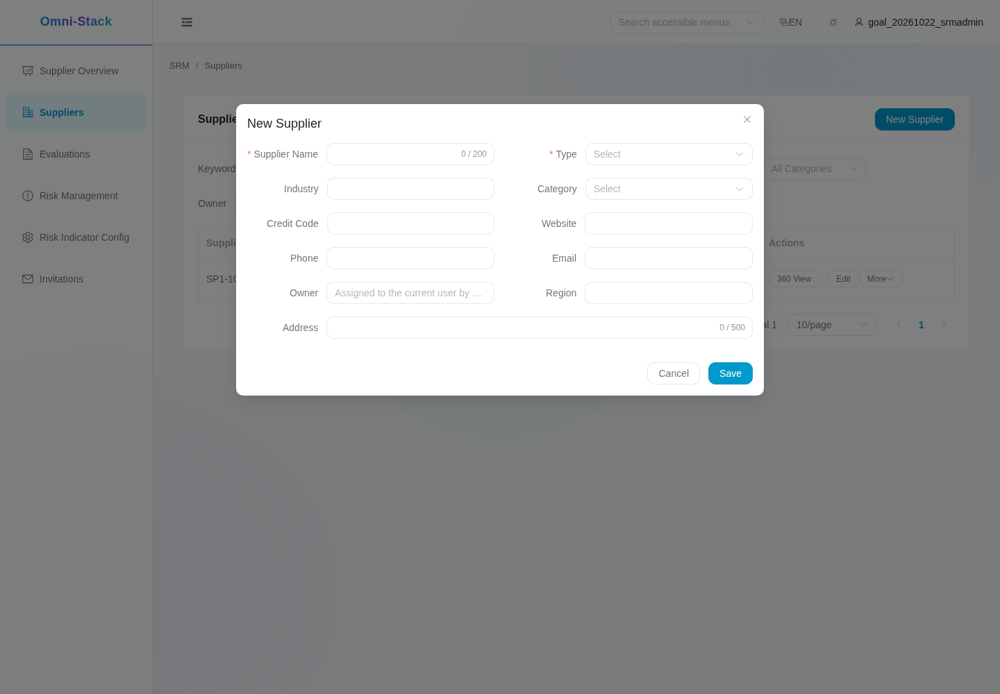

Check the name and credit code before saving to avoid duplicate company records. Saving normally starts admission approval. Check the list status and Approval Progress; a successful save does not mean cooperation has been approved. Missing startup conditions or a temporary service problem may leave the record waiting or showing a startup failure. An administrator must check the actual process situation.

### 2.2 Who approves, and how do you know the result?

Approvers handle assigned items in My Approvals on the same My Workspace page. Approval Progress in the supplier application shows progress; it is not a shortcut for bypassing approval.

The local demonstration actually went through rejection, correction, resubmission, and approval by several approvers. Your company may use a different published process. Follow the actual assigned tasks. Finally, return to the supplier list and confirm Approved. A created process or an accepted application is not the same as completed admission.

### 2.3 Resubmit after rejection

Read the rejection comments and correct the information first. Internal staff use Resubmit Review under More on the supplier row. Suppliers use the available resubmission action on their own company profile. Resubmission starts another approval round and retains the previous comments and history.

Pending Review and Rejected are different states. The current resubmission action applies to corrections after rejection. There is no universal restart button for records left pending after withdrawal, cancellation, or startup failure. Check the original process instead of repeatedly creating the same company.

## 3. Find suppliers, use the 360 view, and transfer ownership

### 3.1 Search and filter

In Suppliers, filter by keyword, state, category, or owner. Clear the filters before concluding a record is missing, then check your actual data scope.

For a wide table, scroll horizontally inside the table to see other columns. Actions stay fixed on the right. If the owner is unassigned, arrange a legitimate internal assignment before operations that require an owner.

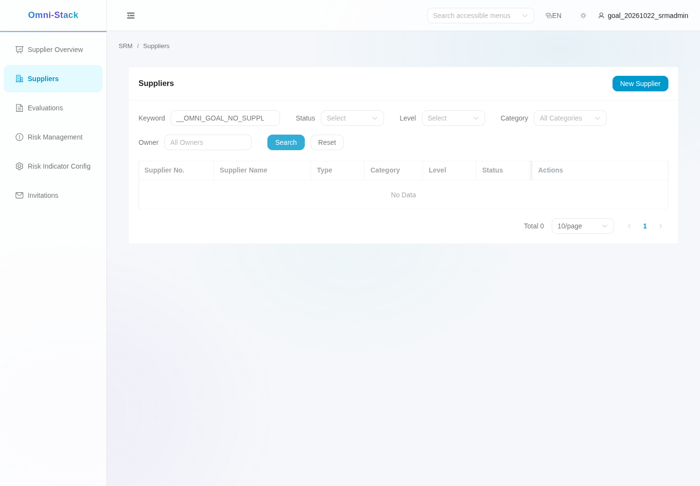

An empty list means there are no visible matches under the current conditions. It does not allow you to expand your own permissions.

### 3.2 The 360 view: prepare for a conversation

Select 360 View on a supplier row.

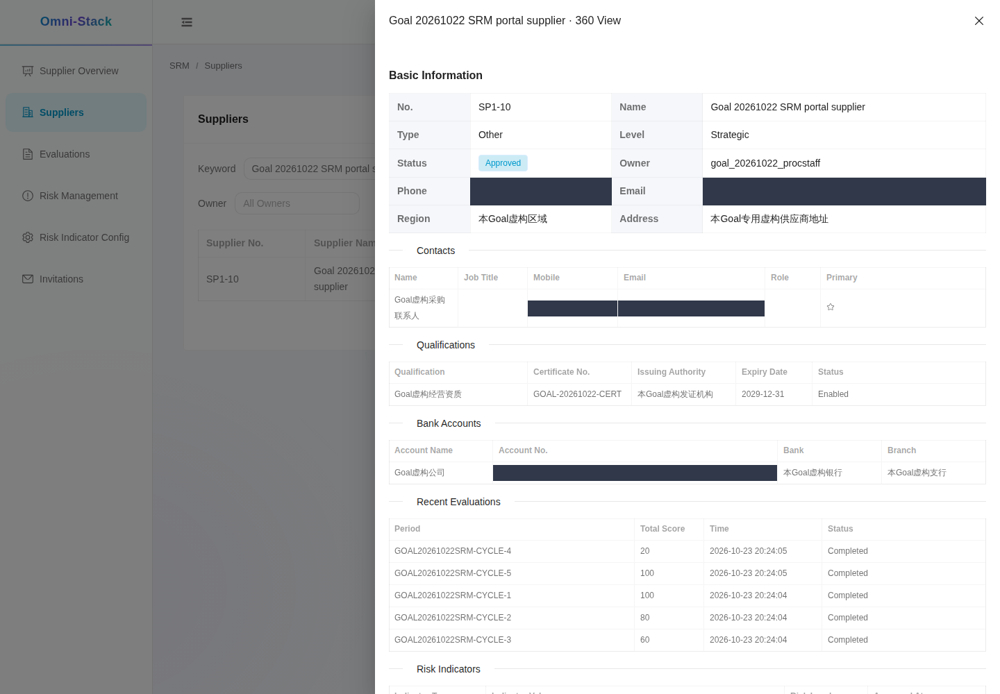

The drawer contains basic information, contacts, qualifications, bank accounts, recent performance evaluations, and risk indicators. Scroll inside the drawer for lower sections. Recent evaluations are a summary; use the evaluation page for full records.

An empty section may mean information has not been maintained, you lack the relevant permission, or there are no visible records. In particular, empty risk indicators do not prove that no evaluation has been performed: also check whether the company has enabled the relevant indicator types. Asterisks in a phone number or account are permission-based masking, not corrupted data.

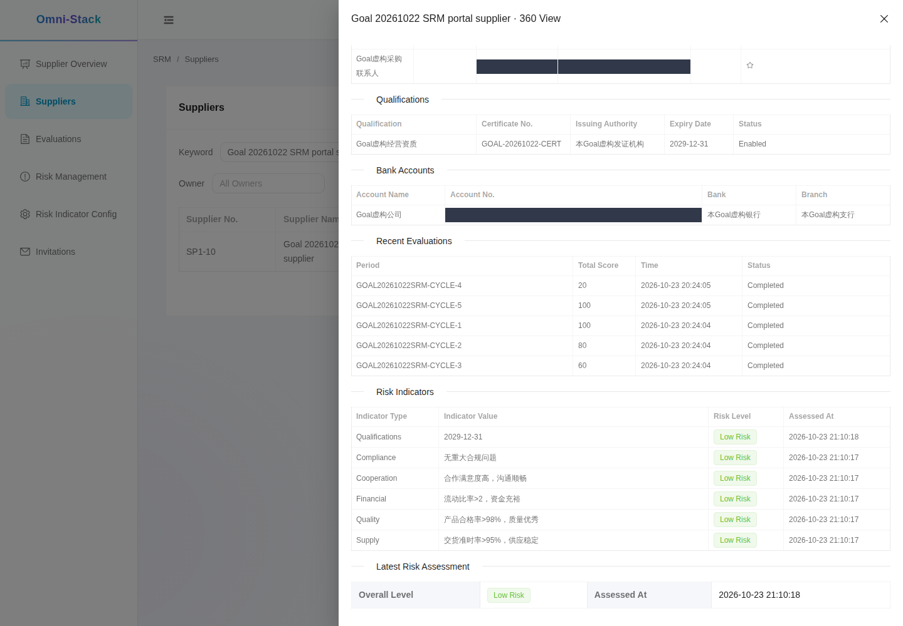

### 3.3 Edit basic information

Select Edit on the supplier row to change fields supported by the current form, such as name, type, industry, category, website, contact details, region, and address. Supplier ratings follow evaluation results and actual rules. Editing information is not a way to set any rating or cooperation state you choose.

If contact information appears only as a masked placeholder, do not copy asterisks back into the field to complete it. Change only what needs updating. If you are unsure whether the last save succeeded, refresh and read the result first.

### 3.4 Transfer ownership

An authorized colleague searches for and selects a new internal owner in the edit dialog, then saves. Candidates depend on the person's status, organization, and your assignment scope. A procurement manager may cover authorized child departments, so crossing a department boundary is not automatically forbidden.

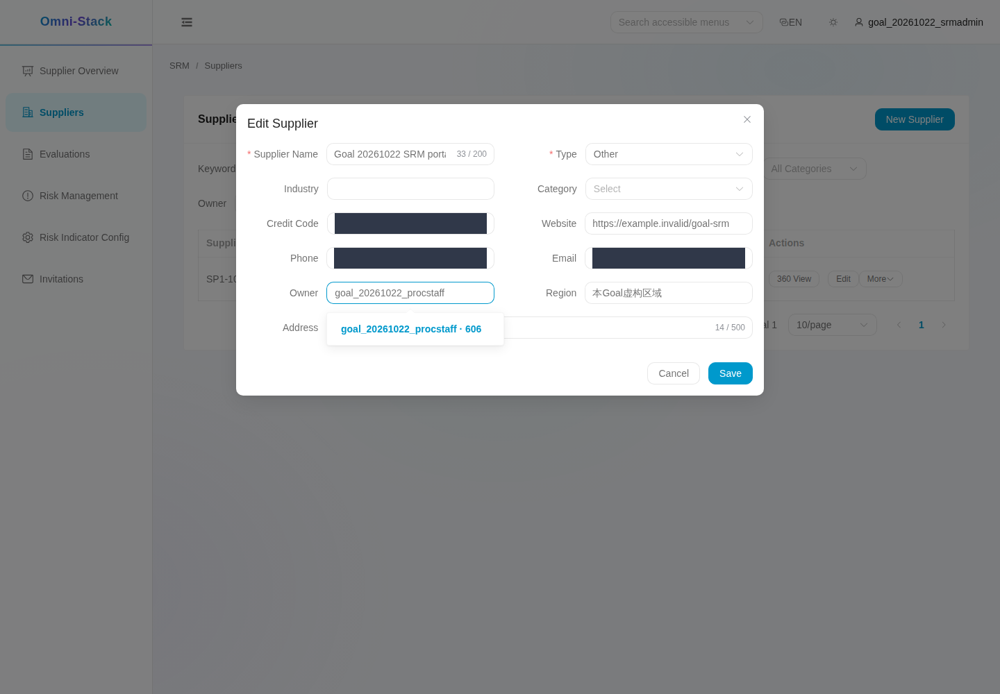

Supplier portal accounts must not become internal owners. No result for a portal account is expected identity isolation; do not try to bypass it through other information fields. A legitimate transfer also updates ownership scope for related evaluations without rewriting their scores.

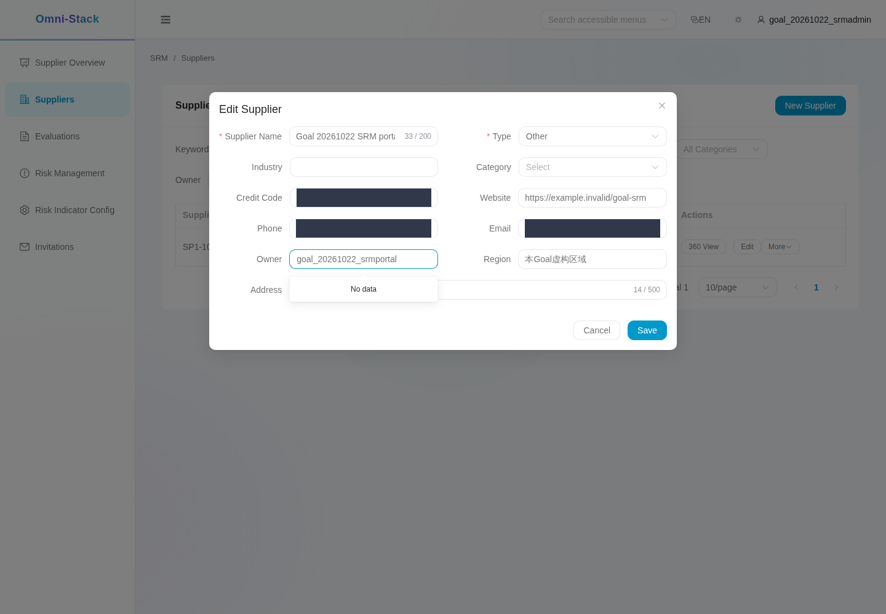

It is easier to check information edits and ownership transfers separately. If both are changed together, information may save first and the transfer may then fail. That does not mean the information save was undone. Refresh, confirm which part succeeded, and handle the remainder.

## 4. Suspension, recovery, blacklisting, elimination, and deletion

Use More on the relevant row. Available actions depend on both the current state and your permissions.

| Current situation | Action | What to confirm afterward |
| --- | --- | --- |
| Approval is running and this round must end | The actual initiator withdraws or cancels it with permission | Old tasks end and the supplier returns to a pending state |
| Approved, but cooperation should pause | Suspend | The list shows Suspended |
| Suspended, and cooperation should resume | Use Resume for the suspended state | The list shows Approved again |
| Approved, but cooperation must be prohibited | Add to Blacklist | The list shows Blacklisted |
| Blacklisted, and cooperation is permitted again | Use Remove from Blacklist | The state returns to Approved under current rules |
| Approved or Suspended, and cooperation must end | Eliminate | Eliminated is shown and history remains |

Resuming a suspension and removing a blacklist entry are different actions. They cannot substitute for each other. Eliminated is a terminal state with no ordinary recovery action. Deleting a record is not a way to restore cooperation either.

Withdrawal and cancellation also depend on who initiated the process. A manager being able to see a supplier does not mean they can end another person's approval. Confirm the state and old tasks afterward; do not assume every pending record can be resubmitted directly.

Deletion is restricted by state, approval, and business history. Do not delete suppliers with important history such as evaluations to reset a process. Read the refusal reason, retain the record, and handle the actual business state.

## 5. Maintain contacts, qualifications, and bank accounts

### 5.1 Use the right entry point

Open Maintain Related Resources under More on the supplier row, then switch between contacts, qualifications, and bank accounts. The 360 view is mainly for reading. Neither it nor the basic information dialog is the maintenance entry point for every related resource.

| Resource | What to fill in and check | How to confirm a save |
| --- | --- | --- |
| Contact | Name, department or position, contact details, and primary designation | The record appears and the primary marker is correct |
| Qualification | Name, certificate number, issuing authority, issue date, and expiry date | Dates are correct and the record can be viewed, edited, or deleted |
| Bank account | Account holder, number, bank, branch, and default designation | The account appears and the default marker is correct |

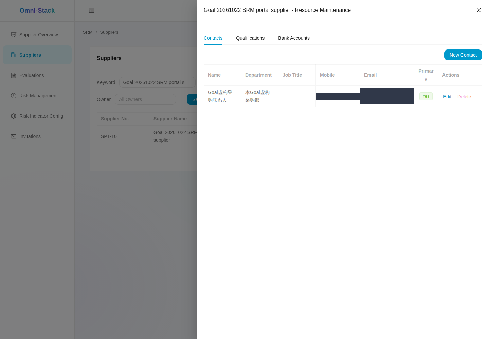

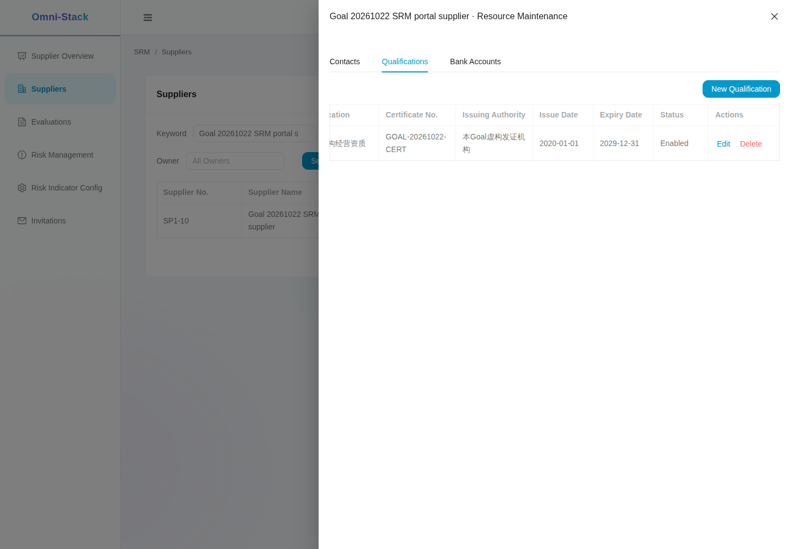

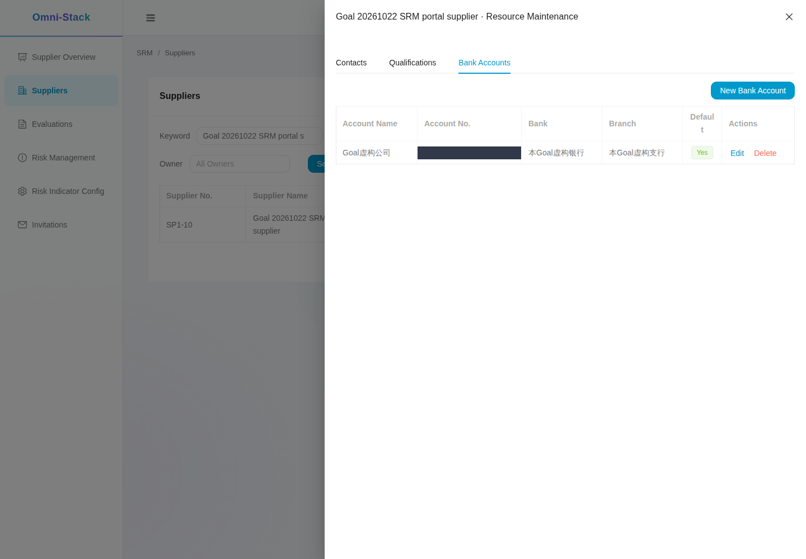

Related-resource tables also scroll horizontally. A contact represents the supplier's communication contact, rather than the internal owner who controls data scope in section 3.

### 5.2 Primary contact and default account

A supplier has only one active primary contact and one active default account. After designating another record, check that the old record lost its corresponding marker. Two records existing in the table does not mean both defaults are in effect.

### 5.3 Expiry and private information

A qualification's expiry date cannot precede its issue date. When a certificate has expired or is approaching expiry, maintain truthful renewal information and check risk again. Eligible suppliers have their certificate risk recalculated. Deleting an expired qualification can also change the result, but real evidence should not be deleted just to remove a warning.

Bank and contact information may be masked according to permissions. Required-field validation does not prove a bank account is genuine or belongs to the supplier. Refresh after an uncertain save and check the list after deletion instead of repeating actions.

## 6. Performance evaluation: compare periods, not just one score

### 6.1 Start a new evaluation

An authorized internal user opens Evaluations and starts a new evaluation. Select an approved supplier with an internal owner within your scope, then enter the evaluation period.

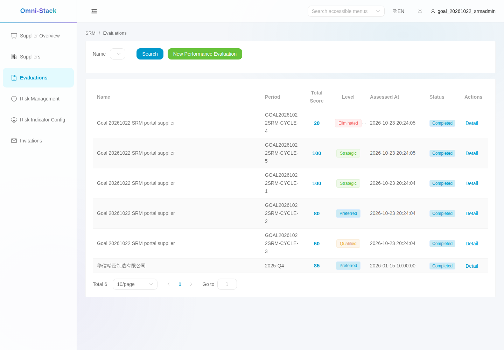

The default template covers quality, delivery, price, and service, weighted 30%, 30%, 20%, and 20%. Score every dimension using the form's available values, add useful comments, and submit. Do not omit a dimension or submit the same one twice.

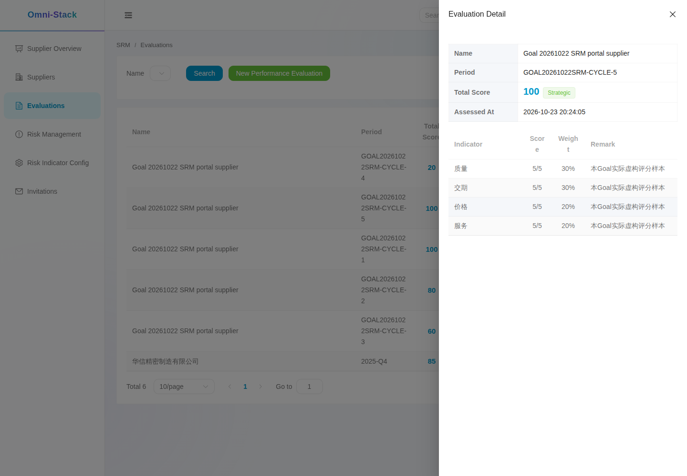

Open the saved evaluation from the list and confirm the company, period, four scores, and weighted total. If admission is incomplete or no owner is assigned, fix those prerequisites first rather than skipping admission to score the supplier.

### 6.2 Understand the total and rating

Current totals range from 20 to 100, with these ratings:

| Total | Evaluation rating |
| --- | --- |
| 90 or above | Strategic |
| 75 to below 90 | Preferred |
| 60 to below 75 | Qualified |
| Below 60 | Eliminated |

An Eliminated performance rating does not mean the supplier has undergone the lifecycle elimination action. Ending cooperation still requires its own business action and authorization.

### 6.3 View multiple periods

Each new period creates another evaluation record instead of replacing earlier scores. Filter by supplier in the evaluation list, open details, or read recent evaluations in the 360 view. Full history and the recent summary can contain different numbers of records.

Suppliers see their own company's evaluations in the portal, not another company's history. If the default template is missing, check company configuration first. There is currently no management page for arbitrarily adding or removing default dimensions.

## 7. Risk management: inspect indicators before the overall color

### 7.1 Read risks and history

Open Risk Management, filter by risk level, and open a supplier's indicators or history.

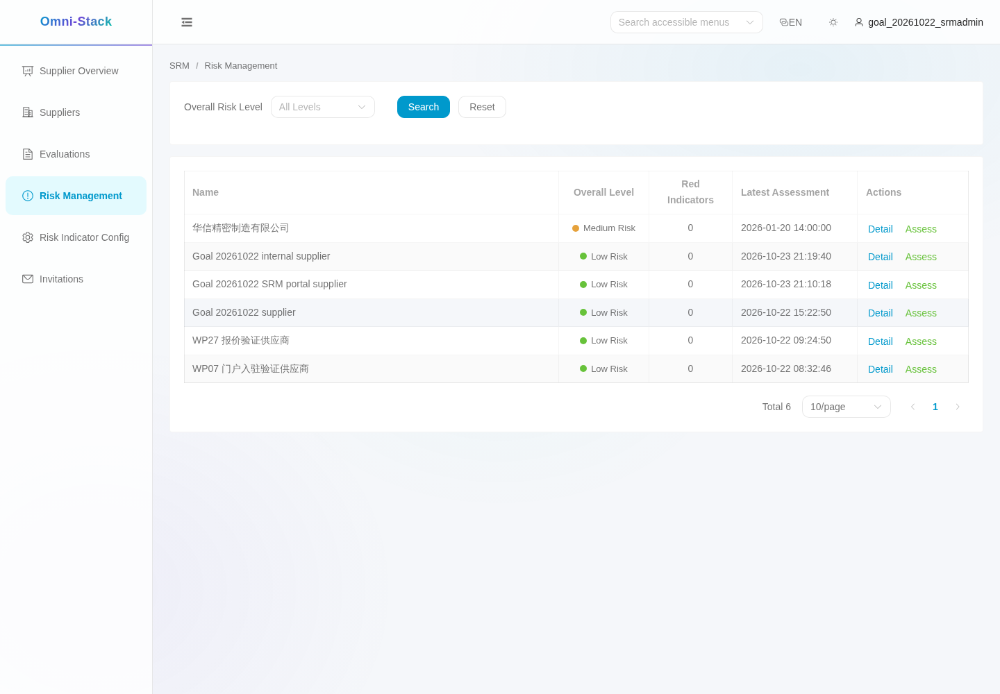

The overall level comes from adding indicator scores and comparing the total with the configured intervals. One red indicator does not necessarily make the overall result red. Check the indicator score, total, and intervals before deciding that a result is wrong.

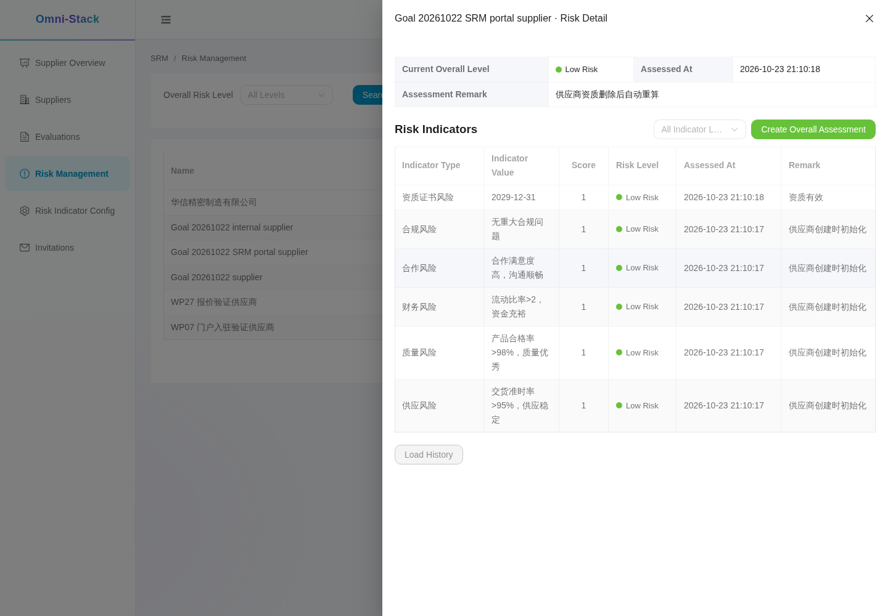

### 7.2 Update manual indicators or run an assessment

An authorized colleague selects the appropriate scoring criterion for an editable indicator and checks the saved score and description. Automatic indicators such as certificates should be maintained through qualification information, rather than manually changing their color.

After running a risk assessment, confirm a new history record and its overall result. History retains the result at that time; later qualification changes do not rewrite all earlier assessments. A risk event being recorded does not prove an external SMS, email, or other notification was delivered.

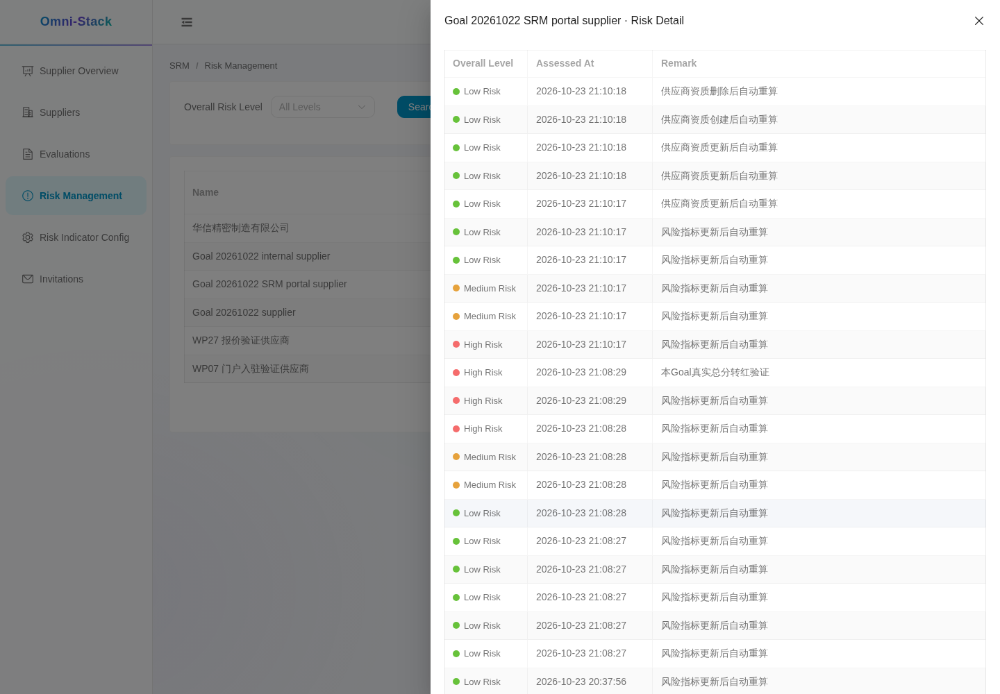

### 7.3 Maintain types, criteria, and thresholds

Administrators use Risk Indicator Config to maintain types, scoring criteria, and overall intervals.

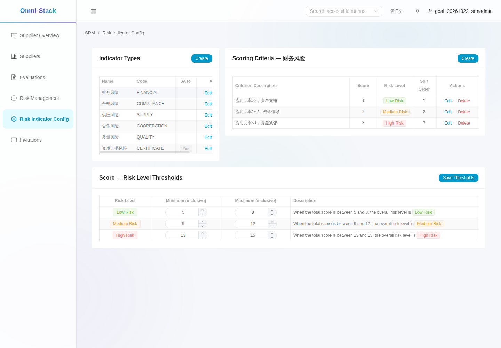

Select an indicator type on the left to see its criteria on the right. The example selects financial risk with individual scores of 1, 2, and 3. The overall intervals below classify the sum of all indicators; do not confuse the two.

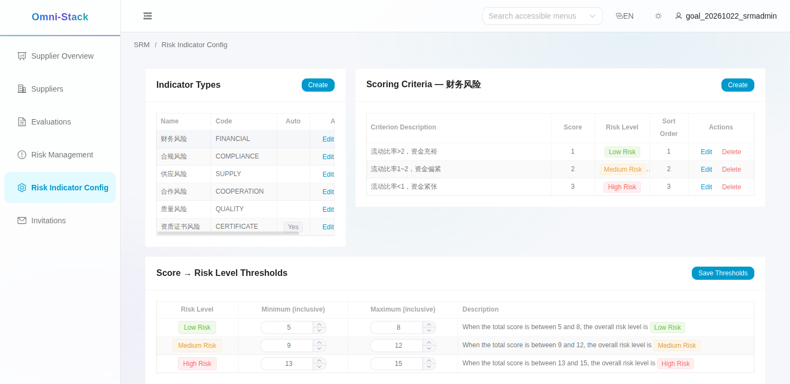

Separate how one indicator is scored from how the total is classified before editing the relevant configuration. Deleting a type that still has related criteria may be refused; handle those relationships first. Keep the original configuration and check every interval to avoid gaps or overlaps. Do not assume the system catches every business configuration mistake for you.

Changing configuration does not mean all old history has been reassessed. Run assessments for the suppliers that need updating and check their results. If indicator types are not enabled, fix configuration first instead of interpreting an empty list as zero risk.

To add a type, select Create on the left, enter its code, name, and useful description, then set its order, automatic-calculation switch, and enabled state. The edit dialog cannot change the code after creation. Save and check the name and state in the list. Use a manual type for ordinary manual scoring. Automatic types depend on calculations already implemented by the project; turning on a switch does not create a new algorithm.

To add a criterion, first select its manual type, then select Create on the right. Enter a clear condition and set the score, risk color, order, and enabled state. Higher scores mean higher risk. Use Edit on a row to change it, and check the impact before deleting. Automatic types have no manual Create action here. After adjusting overall intervals, select Save Thresholds below and read the saved intervals back; changing inputs alone is not a save.

## 8. Invitations: prepare the supplier's enrollment entry

### 8.1 Create and deliver an invitation

An authorized internal user opens Invitations, sets validity and permitted uses, and gives the resulting invitation information to the correct supplier contact.

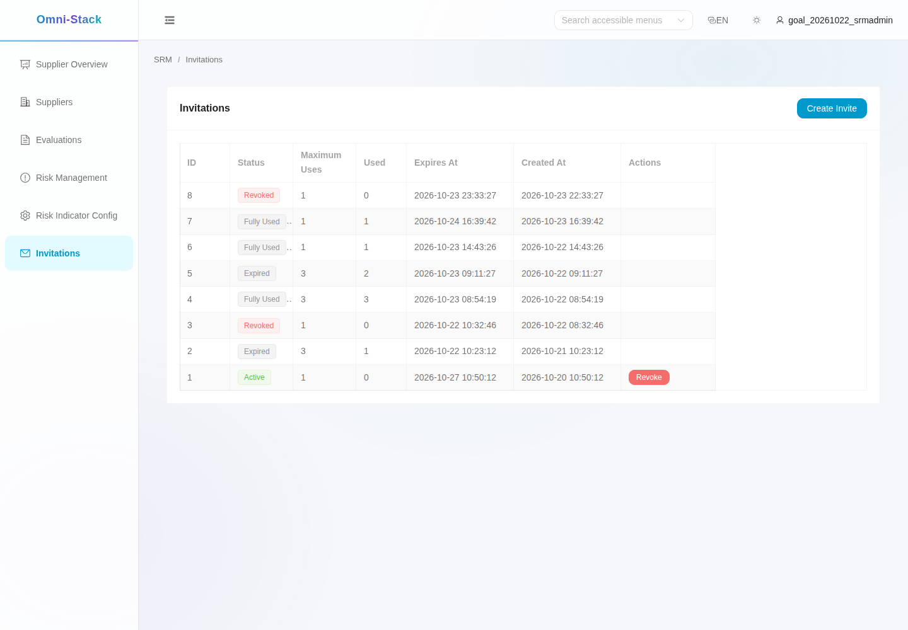

The original invitation information is available only when created. The list does not keep displaying the full secret. Do not expose it in public screenshots, group announcements, or ordinary documents. If it is no longer available, do not guess or attempt to recover hidden secrets.

### 8.2 Check status and revoke

The list may show active, used, expired, or revoked invitations. Refreshing an already accepted application does not repeatedly consume uses, but you should still check the specific application and invitation.

Confirm the target before revoking. A revoked invitation cannot start a new enrollment, and repeating the revocation is refused. When an invitation expires or has insufficient uses, create another legitimate one according to business needs rather than using a different company's invitation.

## 9. Supplier portal: registration, enrollment, and corrections

### 9.1 Account registration and enrollment are different

A supplier uses the supplier entry point to open sign-in or registration, selects the correct company, and follows the page to register and sign in with their own account. They then use the internal invitation to submit their company name, credit code, and required contact information for enrollment.

Registration alone does not establish supplier company identity. After submission, distinguish an accepted application, established portal permissions and company association, and completed admission approval. Success in one stage does not replace the next.

### 9.2 Waiting, failure, and signing in again

While an application is processing, wait for its actual state. If role or enrollment processing fails, address the stated cause and retry when permitted. Do not keep submitting new applications while one is processing.

After association completes, sign in again as prompted so the session receives the new permissions. An old session may still be unable to open company information; that is not a reason to register another account. If admission approval is still running, continue checking company status and the approval result.

### 9.3 Company information: saving is not resubmission

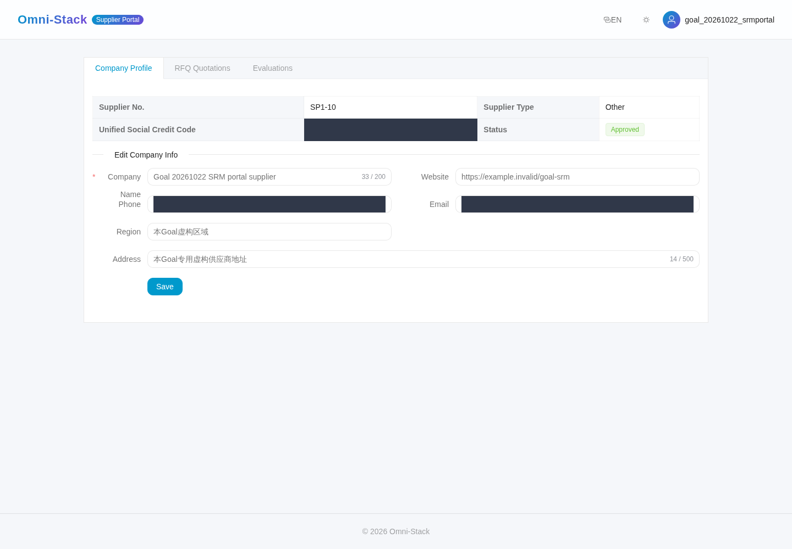

Read the company name, number, credit code, and status in the company information tab. Maintain supported fields such as website, phone, email, region, and address. An ordinary save does not automatically move the company back to pending review or start another approval round.

After rejection, correct the information and use the permitted resubmission action. Follow the new approval afterward. Do not repeatedly resubmit admission for an already approved company.

### 9.4 Evaluations: read your company's results

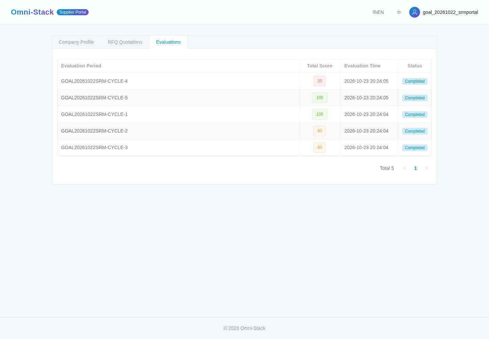

Use the evaluation tab to read the internal scores for your company by period. The portal displays these results; it is not where suppliers score themselves. If there are no records, check with your procurement contact whether an evaluation has actually been completed for your company.

## 10. Portal quotations: from invitation to saved result

### 10.1 Find invitations for your company

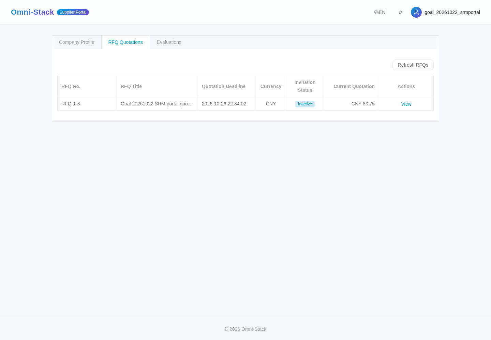

The sample inquiry has already been cancelled, so only viewing is available. To practice a first quotation, procurement must provide an open inquiry that actually invites your company.

Open RFQ Quotations, select an invitation, and check its title, material lines, quantities, currency, deadline, and current state. The supplier must have passed admission, and the inquiry must actually invite this company. Another company's invitation cannot be accessed just by copying its address.

### 10.2 Complete the first quotation

Enter a unit price, delivery days, and any useful remark for every material line, then a valid quotation expiry. Every line must be complete, and unit prices must be positive. Quantities come from the inquiry: check them rather than changing them arbitrarily in the quotation. The quotation expiry cannot precede the inquiry deadline.

After submitting, reopen the detail and check the amount, contents, and current version. If the page says the request was accepted or a button becomes disabled, read the saved result first instead of repeatedly clicking Save while waiting.

If the result cannot be confirmed, the form locks its current contents. Use Retry Same Request to try again with those unchanged contents, or Refresh Quotation Status to check what the server has saved. Refresh reloads the quotation and fills the form with the latest contents; it does not guarantee that the earlier submission succeeded. Check the amount and version before deciding what to do next. Do not change prices and resend or create another quotation while the result is unknown.

### 10.3 Update a quotation or handle a closed inquiry

While the inquiry remains open and permits updates, edit the latest quotation and check its new amount and version. If another window has already updated it, refresh instead of overwriting from a stale page.

Historical quotations may remain readable after cancellation, expiry, or another restriction, but that does not mean new quotations are allowed. Confirm the next business arrangement with procurement rather than treating an old success message as a new successful submission.

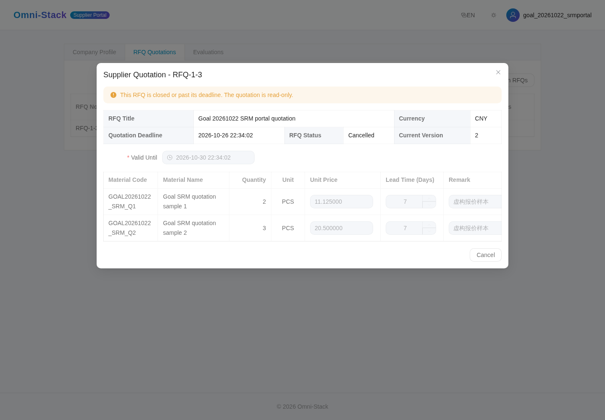

## 11. Common failures and recovery

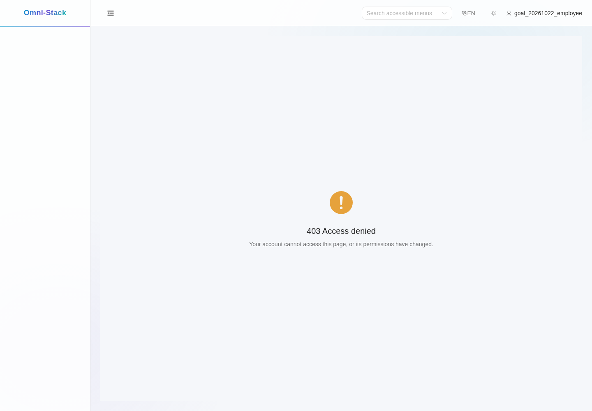

| What happened | What to check first | Next step |
| --- | --- | --- |
| Empty list | Company, filters, and actual data scope | Clear filters and check ownership or organization |
| Missing permission or invisible record | Correct identity, required permission, and association | Use your own authorized entry points |
| No owner candidate | Eligible internal colleague and assignment scope | No portal-account candidate is expected isolation |
| Record has changed | Updates in another window or by a colleague | Refresh and read the latest result before deciding |
| Information saved but transfer failed | Which part actually saved | Check information first, then handle the transfer |
| Action disallowed in the current state | Cooperation state, approval progress, and actual initiator | Use the action for that specific state |
| Enrollment accepted but profile inaccessible | Completed association and refreshed sign-in | Wait for the actual state and retry after addressing the cause |
| Missing evaluation or risk data | Maintained information, enabled configuration, and actual assessments | Do not infer completion or no risk from an empty list |
| No portal inquiry or quotation refused | Company invitation, admission, deadline, and inquiry state | Ask procurement to check business prerequisites; do not use another company's identity |

After switching identities in one browser, other open pages may also need refreshing to confirm the identity. Check the account and company before acting. If a write might have succeeded, query the original record and history instead of sending the same action repeatedly.

## 12. What has actually been verified

Dedicated local samples have actually gone through rejection and resubmission, several approvers, withdrawal and cancellation, suspension and recovery, blacklist-specific recovery, elimination, permitted deletion, ownership transfer and restoration, related-resource maintenance, five evaluation periods, risk changes and certificate renewal, invitation revocation, portal enrollment failure and recovery, and quotation updates. Actual results cover procurement staff, a parent-department manager, a peer-department employee, an internal administrator, and two supplier identities.

These results apply to the recorded local scenarios. They do not guarantee that your company has the same people, process models, or indicators. They do not prove external notification delivery, real third-party account connections, or an unimplemented template management feature. Engineering references explain integration and runtime boundaries; ordinary use does not require source code, commands, or database access.
