# SRM とサプライヤーポータルの図解ガイド：取引審査から評価、リスク、見積回答まで

このガイドでは、サプライヤーとの取引を申請し、日々の管理を行うまでの流れを説明します。社内の担当者は審査、情報の更新、評価を行います。サプライヤーは自分のポータルアカウントで企業情報、評価結果、見積依頼を確認します。それぞれの入口と権限を区別して使いましょう。

まず、やりたいことから読み始めてください。

| やりたいこと | 読む場所 |
| --- | --- |
| サプライヤー数、取引状態、リスクを確認する | 第1節：サプライヤー概要 |
| 社内でサプライヤーを追加し、取引審査を進める | 第2節：追加と承認 |
| 企業情報、担当者の変更、連絡先や資格を管理する | 第3～5節：日常の管理 |
| 評価し、複数の期間の成績を比べる | 第6節：業績評価 |
| リスクの確認、指標の更新、採点ルールの管理をする | 第7節：リスク管理 |
| サプライヤーを招待し、登録や企業情報の入力を進める | 第8、9節：招待とポータル |
| 届いた見積依頼に回答し、回答を修正する | 第10節：見積回答 |
| 権限不足、古い画面、失敗、状態による制限に対処する | 第11節：困ったときの確認方法 |

## 読む前に：アカウントと企業を確認する

社内の担当者は「マイワークスペース」のアプリ一覧または「アプリ」から「サプライヤー関係管理」を開きます。アプリは新しいブラウザータブに表示されます。そのタブの左メニューと右上の検索は、このアプリだけが対象です。ワークスペースに戻るときは、元のタブに切り替えてください。メニューがない場合は自分の権限を確認し、同僚の画面アドレスを知っているだけで操作できるとは考えないでください。

| 利用者 | 主な役割 | 閲覧できる範囲 |
| --- | --- | --- |
| SRM 管理者 | 企業内のサプライヤー、招待、評価、リスクの管理 | 現在の企業内で許可されたデータ |
| 購買責任者 | 自部門と配下部門のサプライヤー、評価、リスクの管理 | 実際の組織とロールの設定による |
| 購買担当者 | 自分が担当するサプライヤーの日常管理 | 通常は自分の担当レコード |
| サプライヤー | 自社の情報、評価、見積回答の確認・操作 | アカウントに関連付けられた企業 |

ポータルを使うには、利用申請と企業への関連付けが必要です。通常のアカウント登録だけでは企業情報は見られません。社内管理者もサプライヤーの代わりにポータルで見積回答はできません。複数のロールがある場合も、ロール名だけで判断せず、実際に許可された入口と範囲を確認してください。

スクリーンショットは同じローカル環境の専用デモアカウントと業務サンプルを使っています。業務名、指標名、採点コメントが中国語のままの場合があります。電話番号、メール、口座などは権限に応じたマスキング、または撮影時のマスクで保護しています。制御されたテストセッションの操作画像は、人が CAPTCHA を入力した証拠でも、外部アカウントの認可が完了した証拠でもありません。削除や取引終了など、簡単に取り消せない操作を共有データでそのまま試さないでください。

## 1. サプライヤー概要：現在の状況を知る

概要の権限がある管理者や購買責任者は、アプリの左側から「サプライヤー概要」を開きます。

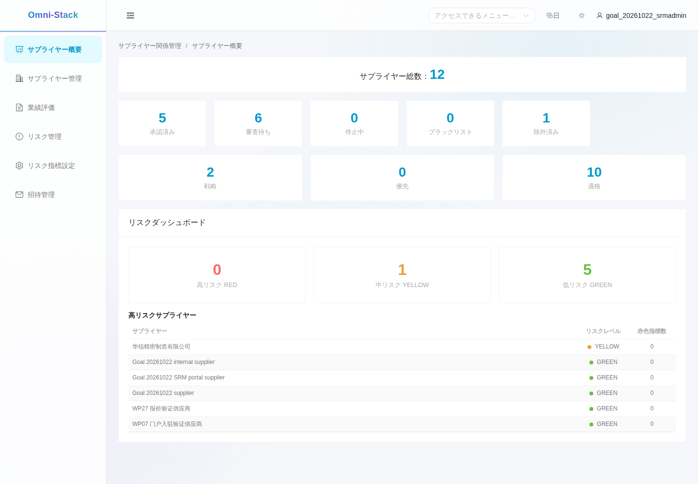

最初に件数と状態別の内訳を確認し、次にリスクの表示を見ます。数値は現在のアカウントが見られるデータの集計です。担当者、責任者、管理者で異なることがあります。データがなければゼロの表示で問題ありません。想定と違う場合は、企業、データ範囲、絞り込み条件を先に確認してください。

## 2. サプライヤーの追加と取引審査

### 2.1 社内で追加する

「サプライヤー管理」で「サプライヤーを追加」を選びます。必須表示に従って名称と種類を入力し、業種、品類、信用コード、ウェブサイト、連絡先を確認します。担当者を指定する場合は、割り当て可能な社内の人だけを選びます。

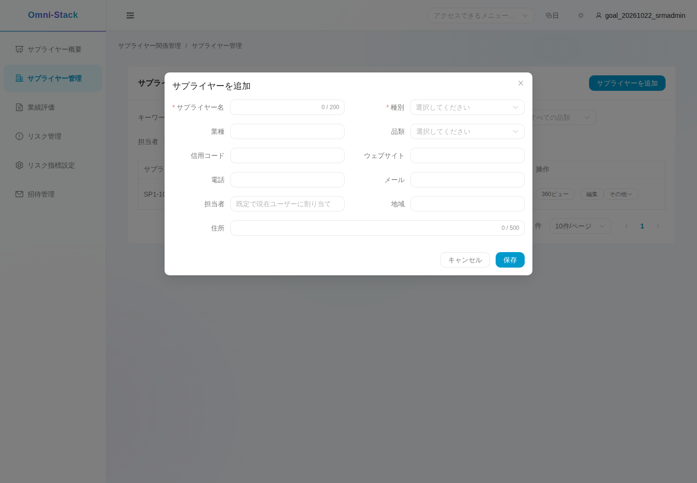

保存前に名称と信用コードを確認し、同じ企業を重複登録しないようにします。正常に保存されると取引審査が始まります。まず一覧の状態と「承認進捗」を確認してください。保存成功は取引が許可されたという意味ではありません。開始条件を満たさない場合や一時的なサービス障害では、処理待ちや開始失敗の状態になることがあります。その場合は管理者が実際のフローを確認します。

### 2.2 承認する人と結果の確認

承認者は「マイワークスペース」内の承認待ち一覧から、自分に割り当てられた案件を処理します。サプライヤー管理の「承認進捗」は状況を確認する入口であり、審査を飛ばして承認するためのボタンではありません。

ローカルのデモでは、却下、修正、再申請、複数の承認者による承認を実際に行いました。企業によって公開済みフローが異なるため、実際のタスクに従って処理してください。最後にサプライヤー一覧に戻り、「承認済み」を確認します。フローの作成や申請の受理だけでは、取引審査の完了とはいえません。

### 2.3 却下後に再申請する

却下されたら、まず承認コメントを読み、情報を修正します。社内の担当者は対象行の「その他」から「審査を再申請」を使います。サプライヤーは自社の企業情報画面で許可された再申請操作を使います。再申請すると次の承認ラウンドが始まり、前回のコメントと履歴も残ります。

「審査待ち」と「却下済み」は別の状態です。現在の再申請操作は、却下後の修正が対象です。取り下げ、キャンセル、開始失敗の後に待機しているレコードを、必ず再開できる共通ボタンはありません。元のフローを確認し、同じ企業を何度も追加しないでください。

## 3. 検索、360ビュー、担当者の変更

### 3.1 検索と絞り込み

「サプライヤー管理」でキーワード、状態、品類、担当者を指定して絞り込みます。見つからない場合は条件を解除し、自分のデータ範囲に含まれるか確認します。

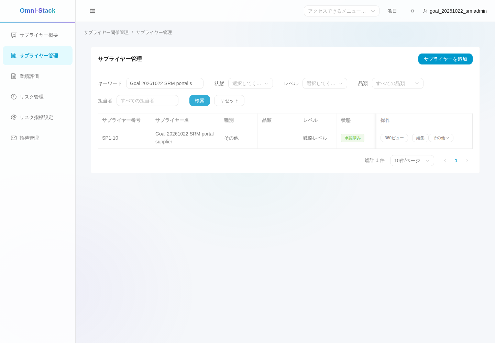

表が横に長い場合は表の内部を横スクロールして残りの列を確認します。操作列は右端に固定されています。担当者が未割り当ての場合は、担当者を必要とする業務の前に、正規の社内割り当てを行います。

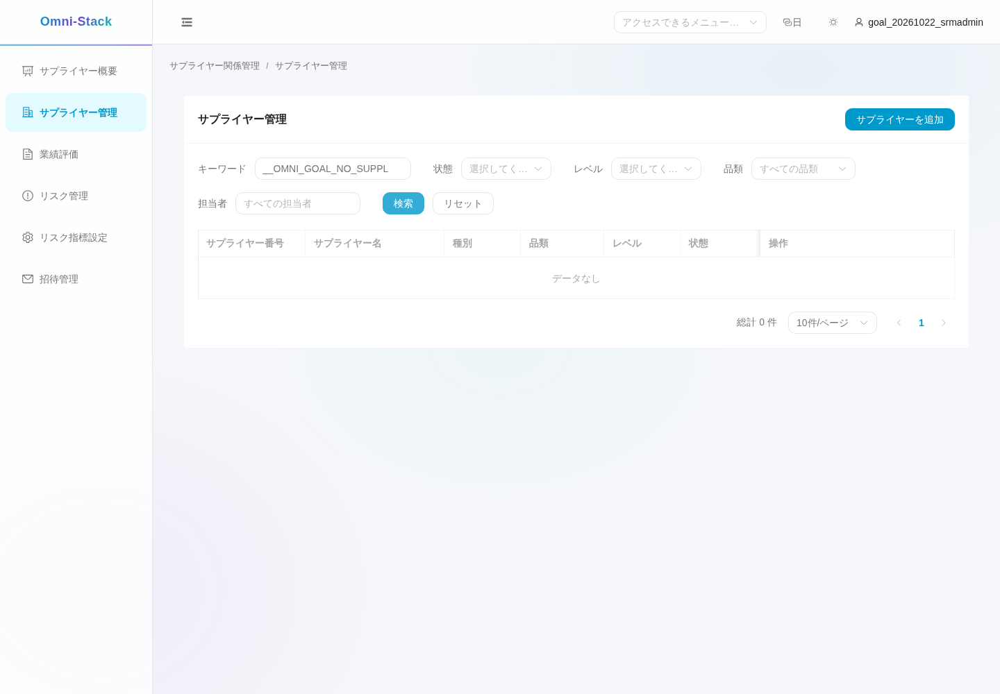

空の一覧は、現在の条件で見られる結果がないことを示します。自分で権限を広げてよいという意味ではありません。

### 3.2 360ビュー：連絡する前に全体を確認する

対象行の「360ビュー」を選びます。

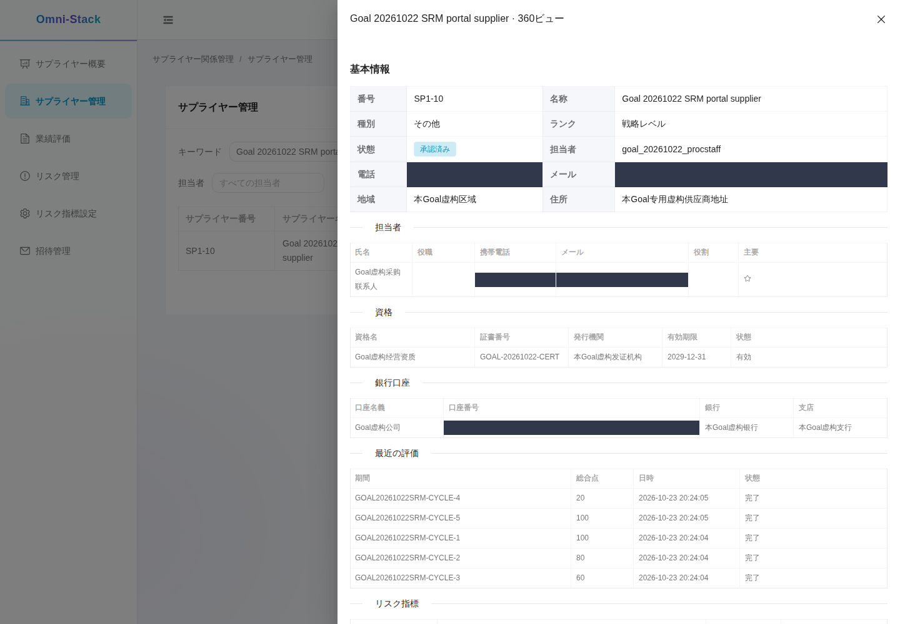

基本情報、連絡先、資格、銀行口座、最近の業績評価、リスク指標を確認できます。下部の情報はパネル内をスクロールしてください。最近の評価は一部の要約です。全記録は評価画面で確認します。

空の欄は、未登録、権限不足、表示できる記録がない場合があります。特に、リスク指標が空というだけで未評価とは判断できません。対象企業で指標の種類が有効かも確認します。電話番号や口座の星印は、権限に応じて情報が伏せられていることを示し、データの破損ではありません。

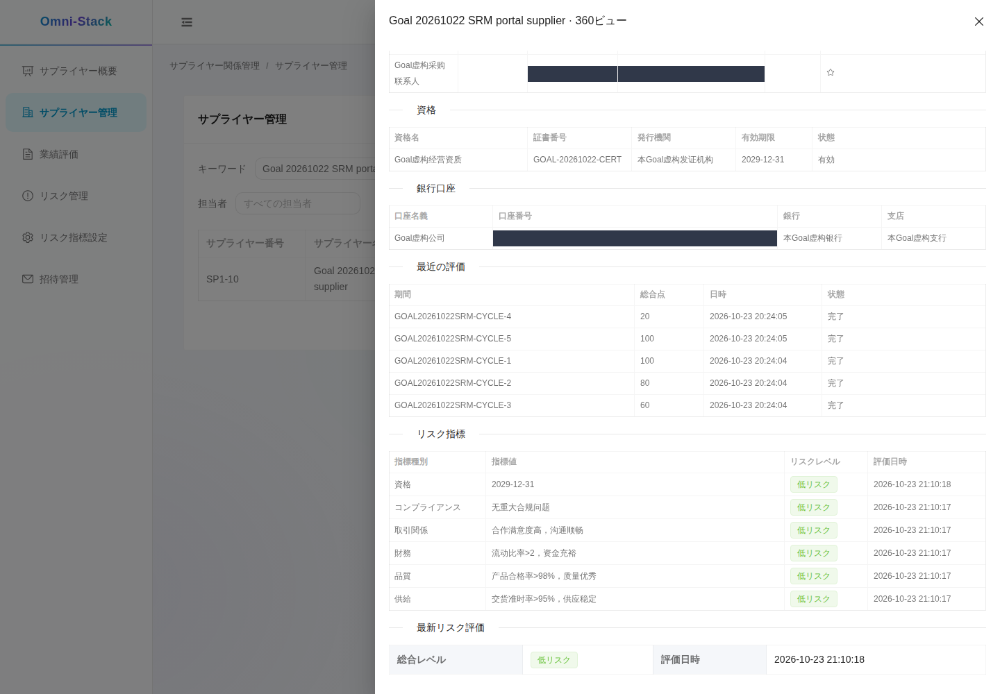

### 3.3 基本情報を編集する

対象行の編集操作から、名称、種類、業種、品類、ウェブサイト、連絡先、地域、住所など、現在のフォームで対応する情報を修正します。評価ランクは評価結果などの実際のルールで決まります。情報の編集は、ランクや取引状態を自由に変える入口ではありません。

連絡先がマスクされた代替表示になっている場合、空欄を埋めようとして星印を入力し直さないでください。必要な項目だけを変更します。前回保存できたか不明なときは、まず再読み込みして結果を確認してください。

### 3.4 担当者を変更する

権限のある人が編集画面で新しい社内担当者を検索・選択し、保存します。候補は在籍状態、組織、割り当て可能な範囲で決まります。購買責任者が許可された配下部門を担当することもあり、部門をまたぐ操作がすべて拒否されるわけではありません。

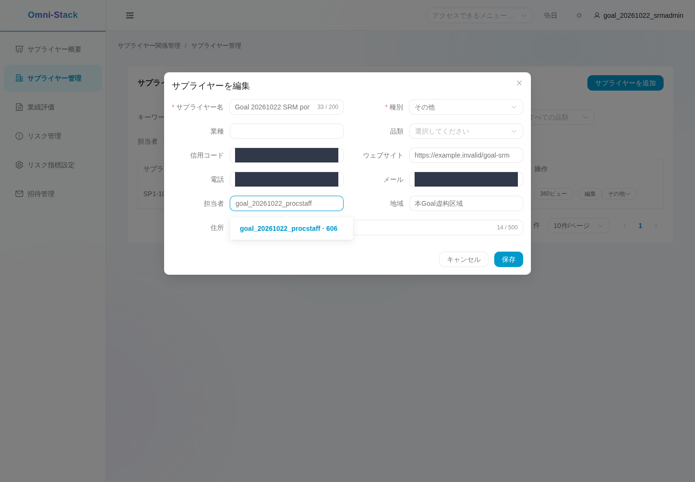

サプライヤーポータルのアカウントを社内担当者にはできません。検索候補に出ないのは正常な分離です。別の項目を書き換えて回避しないでください。正規の担当者変更では関連する評価の担当範囲も更新されますが、元の採点結果は変わりません。

情報の編集と担当者変更は、別々に確認すると分かりやすくなります。同時に変更した場合、情報が先に保存され、その後の担当者変更だけが失敗することがあります。保存済みの情報まで取り消されたとは限りません。再読み込みし、成功した部分と残りを確認してください。

## 4. 凍結、復帰、ブラックリスト、取引終了、削除

対象行の「その他」から操作します。表示される操作は現在の状態と権限で決まります。

| 現在の状況 | 操作 | 操作後の確認 |
| --- | --- | --- |
| 承認中で、今回の審査を終える | 実際の申請者が権限に従って取り下げまたはキャンセルする | 元のタスクが終了し、サプライヤーが処理待ちに戻る |
| 承認済みで、取引を一時停止する | 「凍結」を使う | 「凍結済み」になる |
| 凍結済みで、取引を再開する | 凍結状態の「復帰」を使う | 「承認済み」に戻る |
| 承認済みで、取引を禁止する | 「ブラックリストに追加」を使う | ブラックリスト状態になる |
| ブラックリストから取引を再開する | 「ブラックリストから除外」を使う | 現行ルールでは承認済みに戻る |
| 承認済みまたは凍結済みで、取引を終了する | 「除外」を使う | 「除外済み」になり、履歴は残る |

凍結からの復帰とブラックリストからの除外は別の操作であり、相互に代用できません。「除外済み」は正式な最終状態で、通常の復帰操作はありません。削除も取引を復活させる方法ではありません。

取り下げとキャンセルでは、誰が申請したかも確認します。別の責任者がサプライヤーを見られても、他人の申請を終了できるとは限りません。操作後は状態と元のタスクを確認し、すべて直接再申請できるとは考えないでください。

削除は現在の状態、承認、業務履歴によって制限されます。評価などの重要な履歴があるサプライヤーを、フローの初期化のために削除しないでください。拒否された理由を読み、記録を残して、実際の業務状態に応じて対処します。

## 5. 連絡先、資格、銀行口座を管理する

### 5.1 正しい管理画面を開く

対象行の「その他」から「関連資料を管理」を開き、取引先の連絡先を扱う「担当者」、資格、銀行口座のタブを切り替えます。360ビューは主に閲覧用です。基本情報の編集画面も、すべての関連資料を管理する入口ではありません。

| 資料 | 入力・確認する内容 | 保存後の確認 |
| --- | --- | --- |
| 連絡先 | 氏名、部署や役職、連絡先、主要連絡先かどうか | 一覧に表示され、主要の印が正しい |
| 資格 | 名称、証明書番号、発行機関、発行日、有効期限 | 日付が正しく、閲覧・編集・削除ができる |
| 銀行口座 | 名義、番号、銀行、支店、既定口座かどうか | 一覧に表示され、既定の印が正しい |

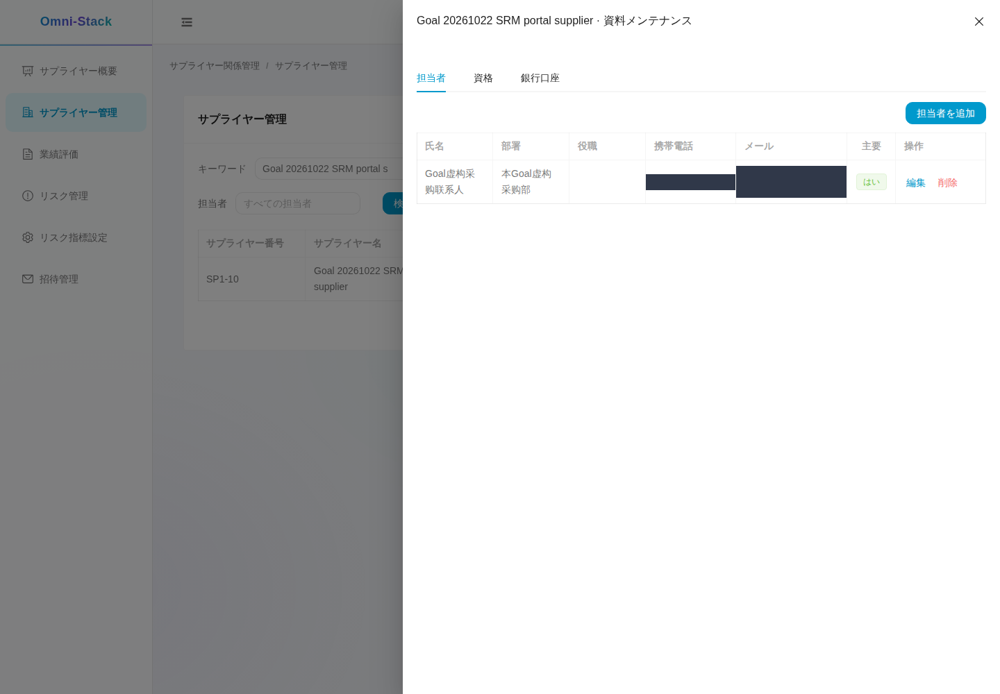

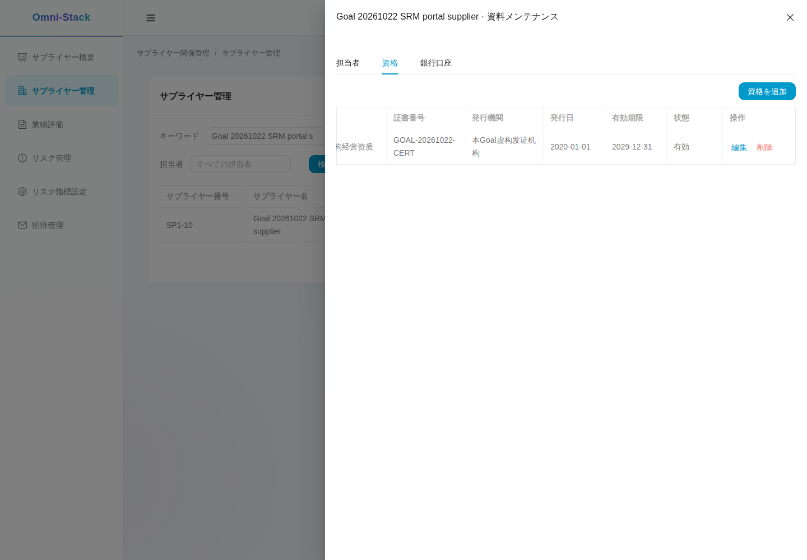

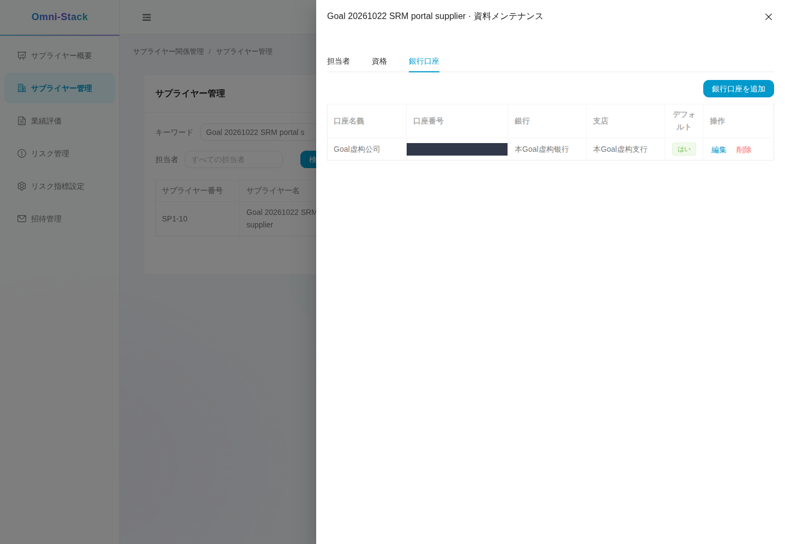

関連資料の表も横スクロールできます。この「担当者」はサプライヤー側の連絡窓口です。第3節のデータ範囲を管理する社内担当者とは区別してください。

### 5.2 主要連絡先と既定口座

1社につき有効な主要連絡先と既定口座はそれぞれ1件です。別のレコードを主要または既定に変更したら、元のレコードから印が外れたことを確認します。一覧に2件あることと、既定が2件有効であることは別です。

### 5.3 有効期限と個人情報

資格の有効期限を発行日より前にはできません。期限切れや期限間近の証明書は、実際の更新情報を入力してからリスクを確認します。条件を満たすサプライヤーでは証明書リスクが再計算されます。期限切れ資格の削除でも結果が変わることはありますが、警告を消すために実在する証拠を削除しないでください。

銀行口座や連絡先は権限に応じてマスクされる場合があります。必須項目の検査は、口座の実在や名義の正しさを保証しません。保存が不確かな場合は再読み込みし、削除後も一覧で確認してから次の操作に進みます。

## 6. 業績評価：1回の点数から期間ごとの変化を見る

### 6.1 新しい評価を始める

権限のある社内担当者が「業績評価」で新しい評価を作成します。取引審査が承認済みで、社内担当者が割り当てられ、自分の範囲内にあるサプライヤーを選び、評価期間を入力します。

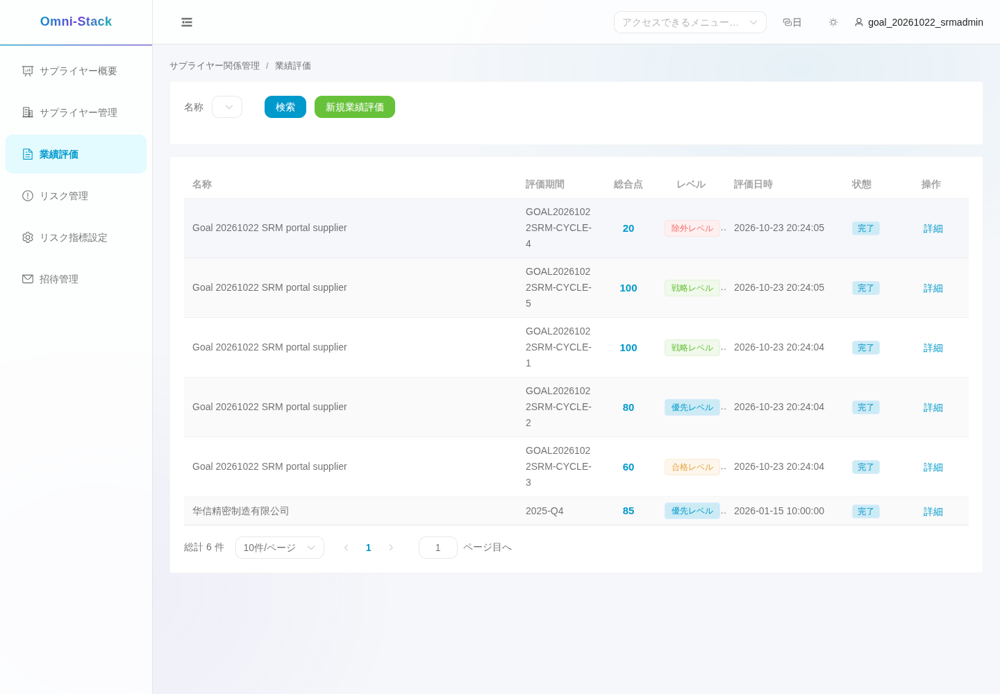

既定の評価は品質、納期、価格、サービスの4項目です。重みは順に30%、30%、20%、20%です。フォームで選べる値を使って全項目を採点し、必要なコメントを添えて送信します。項目を省略したり、同じ項目を重複して送信したりしないでください。

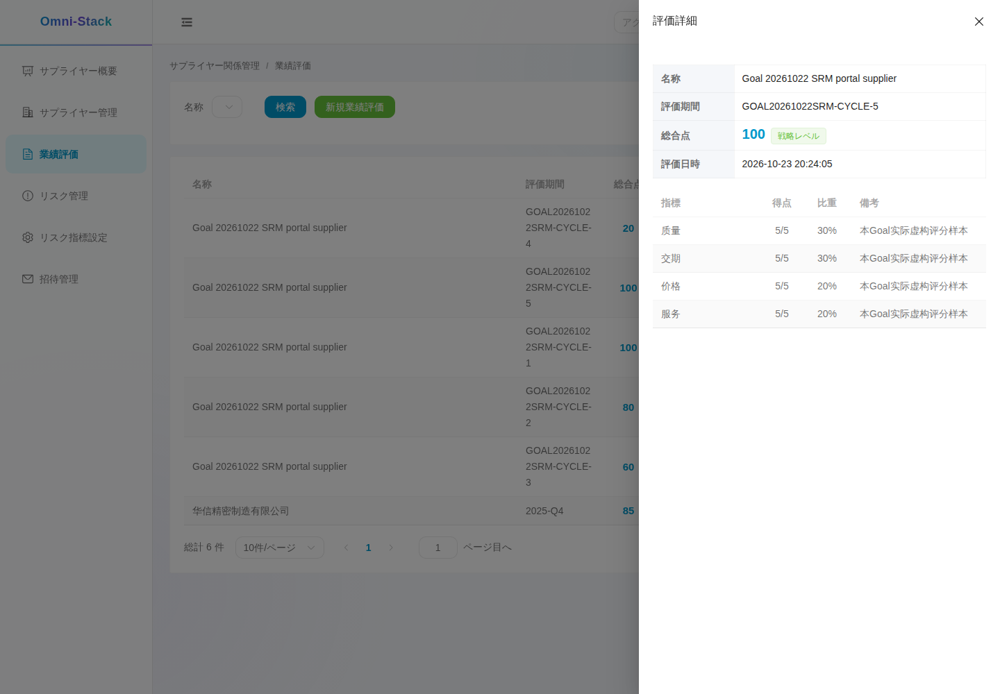

保存後に一覧から詳細を開き、企業、期間、4項目の点数、加重合計を確認します。審査未完了や担当者未割り当ての場合は、評価のために審査を飛ばさず、先に前提を整えてください。

### 6.2 合計点と評価ランクを理解する

現在の合計点は20～100点で、ランクは次のように決まります。

| 合計点 | 評価ランク |
| --- | --- |
| 90点以上 | 戦略レベル |
| 75点以上90点未満 | 優先レベル |
| 60点以上75点未満 | 合格レベル |
| 60点未満 | 除外レベル |

評価の「除外レベル」は、サプライヤーの取引終了操作が行われたという意味ではありません。取引を終了する場合は、対応する業務操作と権限が別途必要です。

### 6.3 複数の期間を確認する

新しい期間の評価は別の記録として追加され、過去の点数を上書きしません。評価一覧をサプライヤーで絞り、詳細で点数を見たり、360ビューで最近の評価を確認したりできます。全履歴と最近の要約では件数が異なることがあります。

サプライヤーはポータルで自社の評価だけを確認でき、他社の履歴は見られません。既定テンプレートがない場合は企業設定を確認します。現在、既定項目を自由に追加・削除するテンプレート管理画面はありません。

## 7. リスク管理：全体の色の前に指標を見る

### 7.1 リスクと履歴を確認する

「リスク管理」でリスクレベルを絞り込み、対象サプライヤーの指標や履歴を開きます。

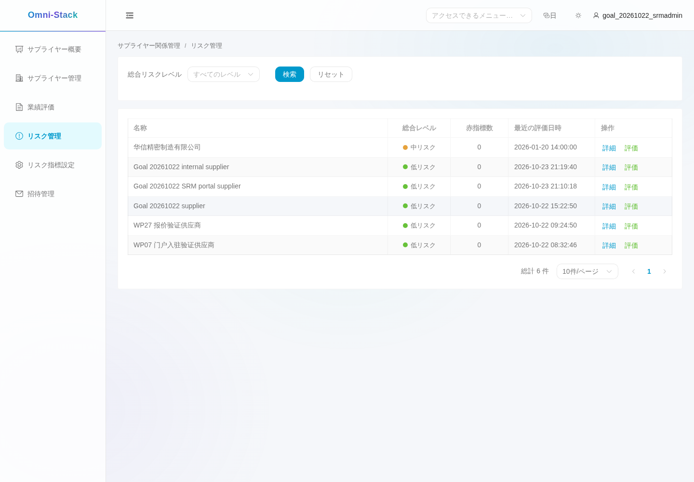

総合レベルは各指標の点数を合計し、設定された区間と照合して決まります。1項目が赤でも、全体が必ず赤になるわけではありません。個別の点数、合計、区間を確認してから結果を判断します。

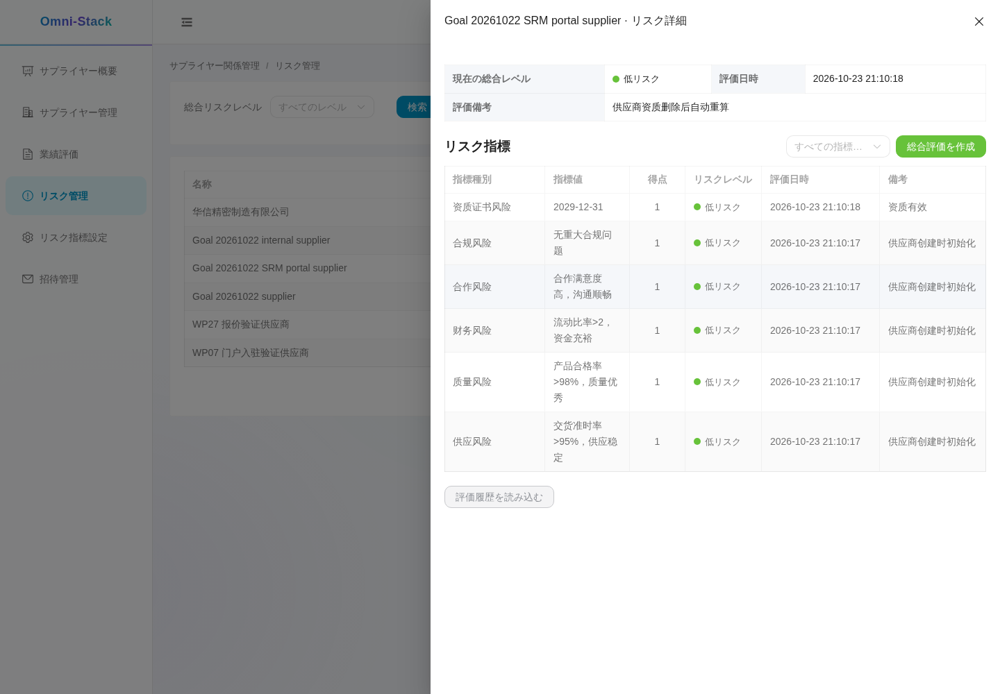

### 7.2 手動指標の更新とリスク評価

権限のある担当者は、編集可能な指標で適切な採点基準を選び、保存された点数と説明を確認します。証明書などの自動指標は資格情報から管理し、手動項目のように色を直接変えないでください。

リスク評価を実行したら、履歴に新しい記録と総合結果が追加されたことを確認します。履歴はその時点の結果です。後から資格を更新しても、過去の評価すべてが書き換わるわけではありません。リスクイベントの記録は、外部 SMS やメールなどの配信完了を意味しません。

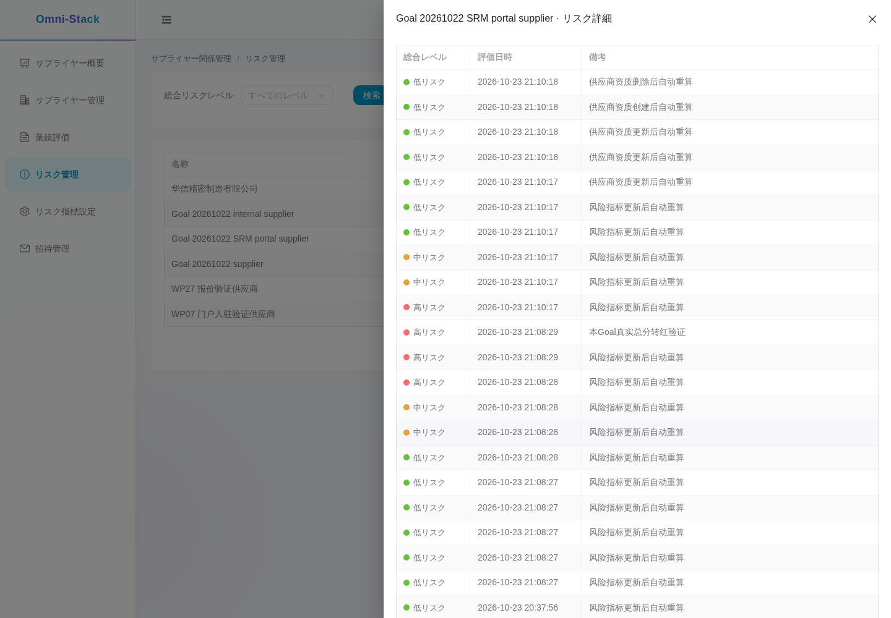

### 7.3 指標の種類、採点基準、しきい値を管理する

管理者は「リスク指標設定」で、種類、採点基準、総合点の区間を管理します。

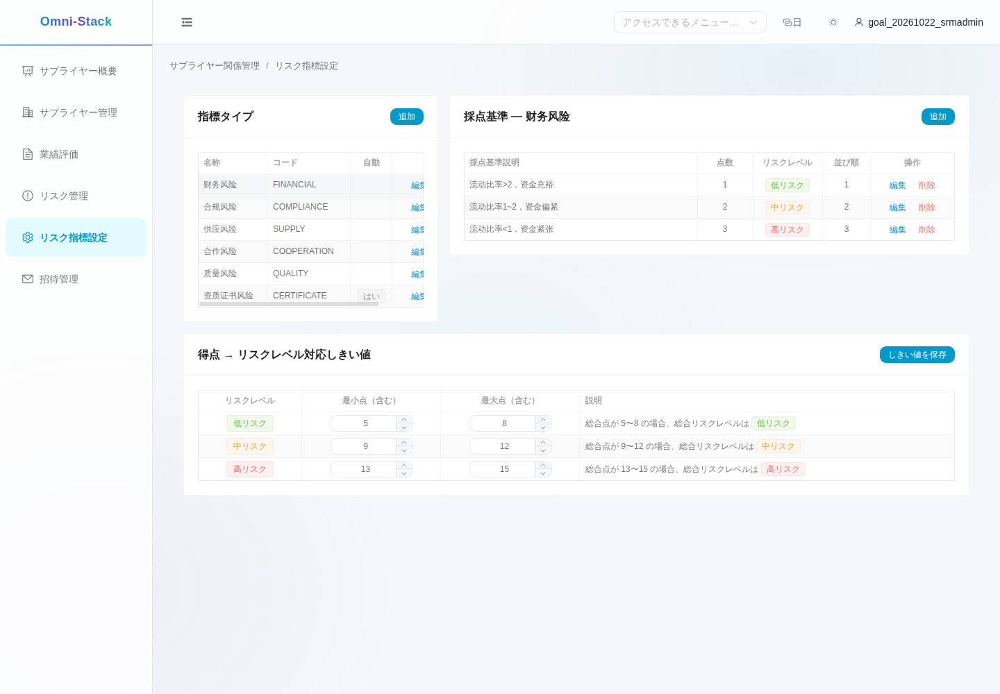

左側で指標の種類を選ぶと、右側にその採点基準が表示されます。画像では財務リスクを選び、個別の点数は1、2、3です。下部の総合区間は全指標の合計点を分類するもので、個別の採点とは別です。

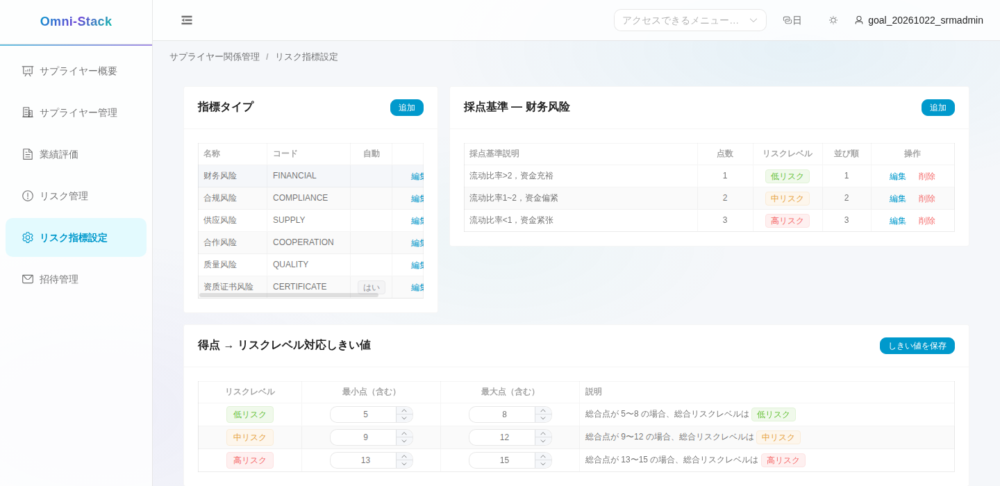

1項目の採点方法と、合計点の分類方法を区別してから設定を変更します。関連する基準が残る種類は削除できない場合があるため、関連を先に確認します。元の設定を保管し、区間の抜けや重複がないか1行ずつ確認してください。システムが業務設定の誤りをすべて検出するとは限りません。

設定変更は、過去の履歴がすべて再評価されたことを意味しません。必要なサプライヤーを実際に再評価して結果を確認します。指標の種類が有効でなければ、空の一覧をリスクゼロと判断せず、先に設定を確認してください。

種類を追加するには、左側の「追加」からコード、名称、必要な説明を入力し、表示順、自動計算の有無、有効状態を設定します。作成後のコードは編集画面では変更できません。保存したら一覧で名称と状態を確認します。通常の手動採点には手動の種類を使います。自動計算はプロジェクトに実装済みの処理が必要で、スイッチを入れるだけで新しい計算方法が生まれるわけではありません。

採点基準を追加する場合は、先に対象の手動の種類を選び、右側の「追加」を使います。分かりやすい判断条件、点数、リスクの色、表示順、有効状態を入力します。点数が高いほどリスクも高くなります。変更は対象行の編集から行い、削除前には影響を確認してください。自動計算の種類には、この手動追加操作はありません。総合区間を変えたら下部の保存操作を行い、保存された区間を読み直します。入力欄の変更だけでは保存されません。

## 8. 招待管理：社内で利用申請の入口を用意する

### 8.1 招待を作って届ける

権限のある社内担当者が「招待管理」を開き、有効期間と利用可能回数を設定して作成し、正しいサプライヤー窓口に招待情報を渡します。

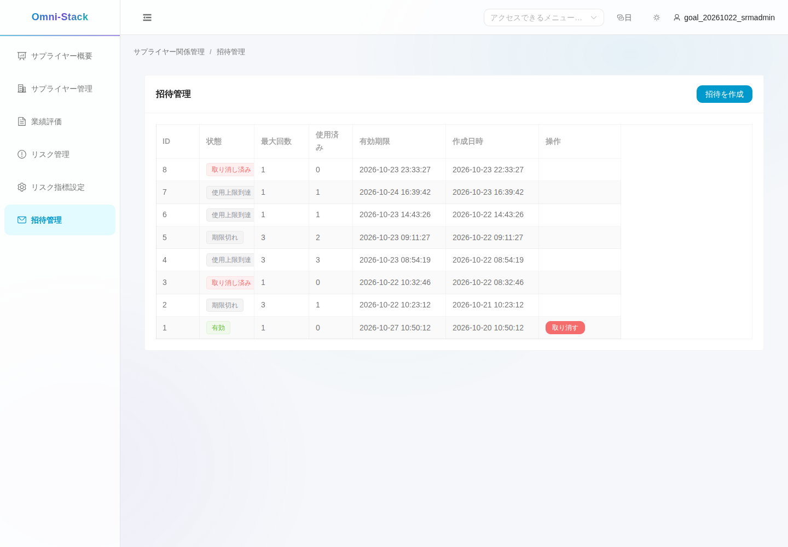

元の招待情報を取得できるのは作成時だけです。一覧に完全な秘密情報が表示され続けるわけではありません。公開スクリーンショット、グループへの告知、通常の文書には載せないでください。後から見つからなくても、隠された秘密を推測して復元しようとしないでください。

### 8.2 状態を確認し、取り消す

一覧には有効、使用済み、期限切れ、取り消し済みなどが表示されます。受理済みの申請は、画面の更新だけで何度も利用回数を消費しません。ただし、対象の申請と現在の招待を確認してください。

取り消す前に対象を確認します。取り消した招待では新しい利用申請を始められず、再度の取り消しも拒否されます。期限切れや回数不足の場合は、業務に応じて正規の招待を作り直し、他社の招待を流用しないでください。

## 9. サプライヤーポータル：登録、利用申請、情報の修正

### 9.1 アカウント登録と利用申請を分ける

サプライヤーは専用入口からログインまたは登録画面を開き、正しい企業を選んで、自分のアカウントを登録してログインします。その後、社内から届いた招待を使い、自社名、信用コード、必要な連絡先を入力して利用申請を送ります。

アカウント登録だけではサプライヤー企業との関係はできません。申請後も、受理された段階、ポータル権限と企業への関連付けができた段階、取引審査が承認された段階を分けて確認します。1つの成功で次の段階まで完了したとはいえません。

### 9.2 待機、失敗、再ログイン

処理中は画面に出る実際の状態を待ちます。ロール付与や利用申請の処理に失敗した場合は原因を確認し、再試行が許可されてから実行します。処理中に新しい申請を連続して送らないでください。

関連付けが完了したら、案内に従って再ログインし、新しい権限をセッションに反映します。古いセッションで企業情報が開けなくても、別のアカウントを登録する理由にはなりません。取引審査が続いている間は、企業の状態と承認結果を確認します。

### 9.3 企業情報：保存と再申請は別の操作

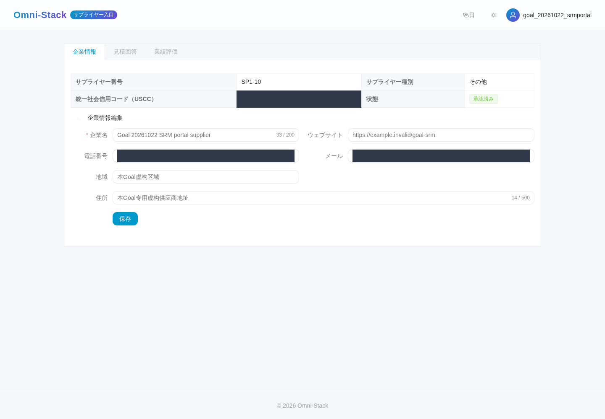

「企業情報」で自社名、番号、信用コード、状態を確認し、現在のフォームで変更できるウェブサイト、電話、メール、地域、住所などを管理します。通常の保存では、自動的に審査待ちに戻ったり、次の承認ラウンドが始まったりしません。

却下後は情報を修正し、画面で許可された再申請操作を使います。その後は新しい承認の状態を確認します。承認済みの企業で何度も取引審査を申請しないでください。

### 9.4 業績評価：自社の結果を読む

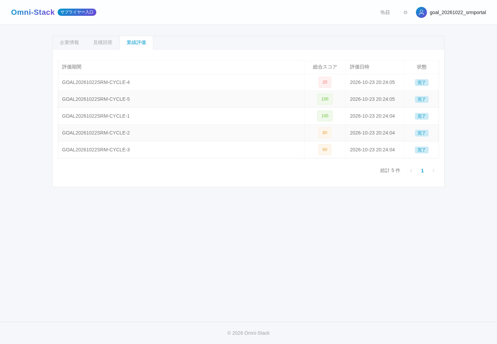

「業績評価」で自社に対する社内の評価を期間ごとに確認します。ポータルは結果の閲覧用で、サプライヤーが自分を採点する場所ではありません。記録がなければ、購買窓口に自社の評価が実際に完了しているか確認してください。

## 10. 見積回答：依頼の受信から保存結果の確認まで

### 10.1 自社に届いた依頼を確認する

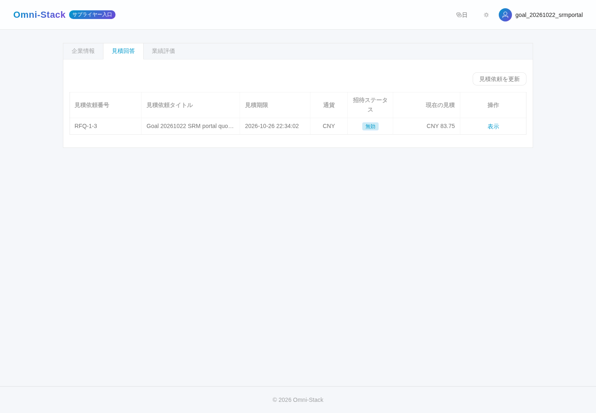

画像のサンプル依頼はキャンセル済みで、閲覧だけが可能です。初回の回答を練習するには、購買側が自社を招待した、受付中の依頼を用意する必要があります。

「見積回答」で依頼を探して詳細を開き、件名、品目、数量、通貨、期限、現在の状態を確認します。サプライヤーは取引審査が承認済みで、この見積依頼に実際に招待されている必要があります。他社への招待を、アドレスを借りて開くことはできません。

### 10.2 初回の回答を送る

全品目に単価、納品までの日数、必要な備考を入力し、条件を満たす見積有効期限を指定します。全行を漏れなく入力し、単価は正の値にします。数量は依頼側が指定するので、回答で自由に変えずに内容を確認してください。見積有効期限を依頼期限より前にはできません。

送信後は詳細を開き直し、金額、回答内容、現在の版を確認します。受理表示やボタンの無効化だけを見て、待ち時間が長いからと保存を連打しないでください。まず保存された結果を読みます。

提出結果を確認できないときは、フォームの現在の内容がロックされます。その内容のまま再試行する場合は「同じリクエストを再試行」を使い、サーバーの保存結果を先に確認する場合は「見積ステータスを更新」を使います。更新は見積を読み直し、最新内容をフォームに反映する操作です。前回の提出成功を保証するものではありません。金額と版を確認して次の操作を決め、結果が不明なまま価格を変えて再送したり、別の見積を作ったりしないでください。

### 10.3 回答の更新と依頼終了後の対応

依頼が開いていて更新可能な間は、最新の内容を基に回答を変更し、新しい金額と版を確認します。別の画面ですでに更新されていたら再読み込みし、古い画面から上書きしないでください。

キャンセル、期限切れ、その他の制限で更新できなくなっても、過去の回答は見られる場合があります。閲覧できることは新しい回答を送れることとは別です。購買担当者と次の対応を確認し、過去の成功表示を新しい送信の成功と取り違えないでください。

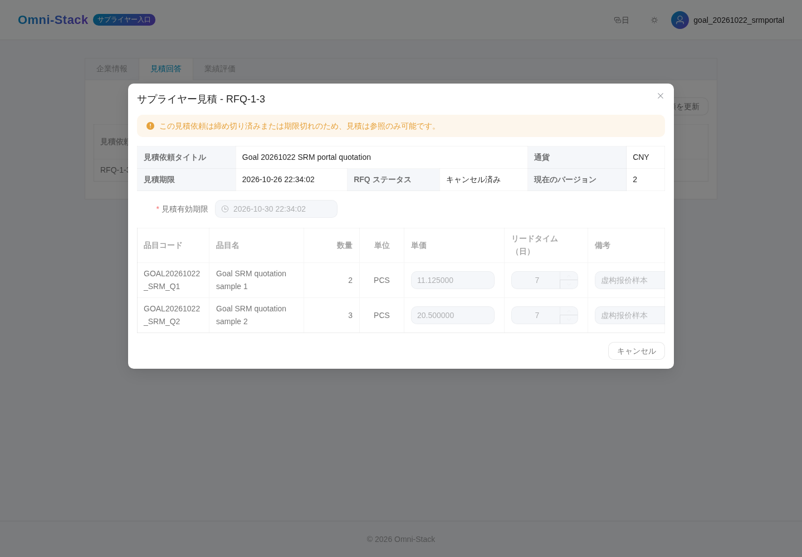

## 11. よくある問題と確認方法

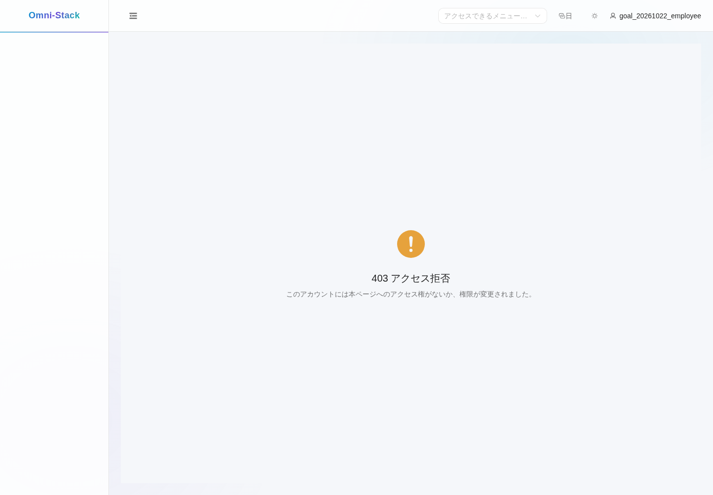

| 起きたこと | 最初の確認 | 次の対応 |
| --- | --- | --- |
| 一覧が空 | 企業、絞り込み、実際のデータ範囲 | 条件を解除し、担当者や組織を確認する |
| 権限不足、または記録が見えない | アカウント、必要な権限、企業との関連付け | 自分に許可された入口を使う |
| 担当者の候補がない | 社内の適格な人か、割り当て範囲内か | ポータルアカウントが出ないのは正常な分離 |
| 記録が更新されたという表示 | 別画面や同僚による更新 | 最新の結果を読み直して判断する |
| 情報保存後に担当者変更が失敗 | 実際に保存された部分 | 情報を確認してから担当者変更に対処する |
| 現在の状態では操作できない | 取引状態、承認進捗、実際の申請者 | その状態に対応する操作を使う |
| 利用申請の受理後も企業情報が開けない | 関連付けの完了と再ログイン | 実際の状態を待ち、失敗原因に対処して再試行する |
| 評価やリスクの情報がない | 情報登録、有効な設定、実際の評価 | 空の一覧だけで完了やリスクなしと判断しない |
| 見積依頼が見えない、または回答できない | 自社への招待、取引審査、期限、依頼状態 | 購買側が前提を確認し、他社の身分は使わない |

同じブラウザーでアカウントを切り替えた場合、他のタブも再読み込みして身分を確認する必要があります。操作前にアカウントと企業を確認してください。書き込みが成功したか不明なときは、元の記録と履歴を照会し、同じ操作を何度も送り直さないでください。

## 12. 実際に検証した範囲

専用のローカルサンプルで、却下と再申請、複数承認者、取り下げとキャンセル、凍結と復帰、ブラックリスト専用の解除、取引終了、許可された削除、担当者の変更と復元、関連資料の管理、5期間の評価、リスク変化と証明書更新、招待取り消し、ポータル利用申請の失敗と復旧、見積回答の更新を実際に行いました。購買担当者、上位部門の責任者、同階層の別部門の社員、社内管理者、2社のサプライヤーの境界にも実際の結果があります。

これは記録されたローカルの場面を検証した結果です。利用企業に同じ人員、フロー、指標が設定済みであることは保証しません。外部通知の配信、実際の外部アカウントへの接続、未実装のテンプレート管理機能も証明しません。連携と実行時の境界は、技術上の事実をまとめた文書で説明します。通常の操作にソースコード、コマンド、データベースへのアクセスは必要ありません。
